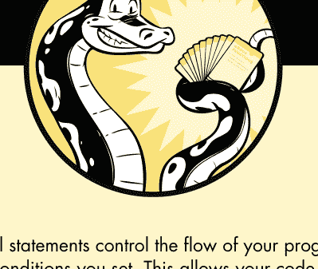

## 条件语句



条件语句根据你设定的条件控制程序流程。这使你的代码能够根据这些条件以特定方式作出响应。你可以定义任意一组条件，并编写出能够完全按需响应的代码。

条件语句在执行其代码之前会检查某个条件是否为真：

```python
if truck_cost > 10000:
    print("That's too much!")
```

每个条件语句都有一个逻辑测试，该测试会评估条件以确定其是 True 还是 False。这些值就是布尔值。

下面是一些常用的逻辑测试：

| 逻辑测试 | 结果 |
|---|---|
| age == 21 | 相等 |
| age != 21 | 不相等 |
| age < 21 | 小于 |
| age <= 21 | 小于或等于 |
| age > 21 | 大于 |
| age >= 21 | 大于或等于 |
| name == 'jesse' | 字符串相等 |
| name != 'jesse' | 字符串不相等 |

你还可以检查某个元素是否在列表中：

```python
my_state in northwest_states
my_state not in northwest_states
```

if 语句由一行条件测试以及在该测试返回 True 时运行的一条语句或一个语句块组成：

```python
if plant_height < 3:
    print("Keep it in the greenhouse!")
```

if 语句还可以测试一个布尔值，并在该值为 True 时运行：

```python
if game_active:
    print("Let's play!")
```


### IF-ELSE 语句

- 如何编写 if-else 语句？
- 如何编写一系列 if-elif-else 语句？

### 用户输入

- 如何提示用户输入？
- 如何处理用户输入的数据？

`input()` 函数会暂停程序，并等待用户输入数据：

```
name = input("What's your name? ")
print(f"Hello, {name}!")
```

```
What's your name? Cedar
Hello, Cedar!
```

所有输入的数据都会被转换为字符串。数值数据需要先转换为适当的类型，然后才能进行处理：

```
price = input("How much for the truck? ")
price = float(price)
if price < 10000:
    print("I'll take it.")
```

```
How much for the truck? 7500.00
I'll take it.
```

### WHILE 循环

只要条件为 `True`，while 循环就会持续运行：

```
num = 0
while num < 3:
    print(num)
    num += 1
```

```
0
1
2
```

至少包含一个项目的列表会被视为 `True`。这个循环会一直运行直到列表为空：

```
bugs = ['bug 1', 'bug 2', 'bug 3']
while bugs:
    bug = bugs.pop(0)
    print(f"Fixing {bug}.")
print("All bugs fixed.")
```

```
Fixing bug 1.
Fixing bug 2.
Fixing bug 3.
All bugs fixed.
```

### BREAK 和 CONTINUE 语句

- `break` 对循环有什么作用？
- `continue` 对循环有什么作用？

当某个特定条件出现时，`break` 语句会终止循环：

```
while True:
    name = input("What's your name? ")
    if name == 'quit':
        break
    print(f"Hello, {name}!")
```

```
What's your name? Cedar
Hello, Cedar!
What's your name? quit
```

`continue` 关键字会结束当前迭代，并跳转回循环开头：

```
while True:
    age = input("How old are you? ")
    age = int(age)
    if age < 0:
        print("That makes no sense!")
        continue
    print(f"{age} is a great age!")
```

```
How old are you? 17
17 is a great age!
How old are you? -5
That makes no sense!
How old are you? 5
5 is a great age!
```
