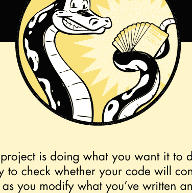

## 测试



一旦你的项目达到预期效果，你就会想要一种方法来检查代码是否仍然能够正常工作，即使你修改已编写的内容并添加新功能。

为代码编写并运行测试可以告诉你代码是否按照预期运行。这些卡片介绍了一些常见的代码测试工具。

### UNITTEST 模块

- 什么是 unittest 模块？
- 如何编写测试用例？
- unittest.assertEqual() 方法有什么作用？
- 还有哪些可用的断言方法？

unittest 模块提供了用于代码测试的工具，例如 TestCase 类。该类的断言方法确保你的代码生成正确的结果；其 setUp() 方法允许你在多个测试中使用相同的初始条件。

要测试函数或类，请将测试代码导入到一个新文件中，并编写一个继承自 unittest.TestCase 的测试用例。然后编写方法来测试代码行为。在修改代码、修复错误和添加功能时使用该模块。你可以在测试代码中进行以下断言：

| 断言 | 描述 |
| --- | --- |
| `assertEqual()` | 两个值匹配 |
| `assertNotEqual()` | 两个值不匹配 |
| `assertTrue()` | 值为 True |
| `assertFalse()` | 值为 False |
| `assertIn()` | 项目在列表中 |
| `assertNotIn()` | 项目不在列表中 |


下面是对卡片 6.8 中 `area_rect()` 函数的一个测试：

```
import unittest
import area_functions as af

class AFTestCase(unittest.TestCase):
    """Tests for area_functions.py."""

    def test_rect_area(self):
        """Test a simple rectangle."""
        area = af.area_rect(3, 4)
        self.assertEqual(area, 12)

if __name__ == '__main__':
    unittest.main()
```

你需要导入 `unittest` 和所要测试的模块。测试类名称通常以 `TestCase` 结尾；前缀用于表明它们测试的内容。测试类必须是 `unittest.TestCase` 的子类。

每个测试都是一个方法。所有以 `test_` 开头的方法都会在测试运行时执行。`test_area_rect()` 方法使用矩形尺寸调用 `area_rect()`，然后检查返回的面积是否正确。

### 运行通过的测试

- 如何为函数运行测试？
- 通过的测试是什么样的？

要为函数运行测试，请运行包含该函数测试的文件：

```
$ python test_area_functions.py
.
-----------------------------
Ran 1 test in 0.000s
OK
```

对于通过的测试，Python 会打印一个点。只运行一个测试的结果并不是很有帮助，但较长的测试用例输出要有用得多。失败的测试会显示 `E` 或 `F`，分别表示错误或断言失败。

测试完成后，会显示一个摘要，指明测试的数量及其运行时间。`OK` 消息表示所有测试均已通过。

### 运行失败的测试

- 失败的测试是什么样的？
- 你能从失败的测试中学到什么？

如果代码产生 Python 错误或断言失败，测试就会失败。

下面是 `test_area_functions.py` 中的一个新测试，用于检查负输入是否返回 `None`：

```
def test_negative_inputs(self):
    """Test negative inputs."""
    area = af.area_rect(-3, 4)
    self.assertEqual(area, None)
```

这个测试会失败；以下是输出：

```
$ python test_area_functions.py
F.
====================
FAIL: test_negative_inputs
Test negative inputs for area_rect().
--------------------
Traceback (most recent call last):
  File "test_area_functions.py", line 15:
    self.assertEqual(area, None)
AssertionError: -12 != None
--------------------
Ran 2 tests in 0.000s
FAILED (failures=1)
```

失败的测试会显示 `F`：输出会显示失败的测试，并打印其文档字符串、失败的断言语句，以及断言语句中的值。最后的摘要会显示测试数量、运行时间和失败项。

### 修复失败的测试

- 如何修复失败的测试？

### `setUp()` 方法

- `setUp()` 在测试用例中有什么作用？
- 如何利用 `setUp()` 让测试代码更高效？

将初始测试需求放在 `setUp()` 方法中，使其在每个测试之前自动运行，从而让代码更高效、更一致。

在示例测试用例（卡片 8.2 和 8.4）中，我们在每个测试函数中都定义了宽和高。相反，我们可以改为在 `setUp()` 中定义宽和高，然后在每个测试函数中使用这些值：

```
class AFTestCase(unittest.TestCase):
    """Tests for area_functions.py."""

    def setUp(self):
        """Create widths and lengths for all tests."""
        self.width = 3
        self.length = 4
```

然后，测试方法将如下所示：

```
def test_rect_area(self):
    """Test a simple rectangle."""
    area = af.area_rect(
        self.width, self.length)
    self.assertEqual(area, 12)
```

这个 `setUp()` 函数很简短。在处理复杂输入值的实际测试中，`setUp()` 函数能让测试代码更高效，并确保众多测试之间的一致性。
