# 图像操作与变换

图像变换是转换图像的艺术。通过图像变换和操作，我们可以增强图像的外观。变换和操作操作也可用作更复杂图像处理任务（例如分类或分割，您将在后面章节中更深入了解）的预处理步骤。在本章中，您将学习如何使用不同的 Python 库（NumPy、SciPy、scikit-image、OpenCV-Python、Mahotas 和 Matplotlib）进行图像操作和变换。不同的配方将帮助您学习如何编写 Python 代码以实现颜色空间变换、几何变换、透视变换/单应性等。

在本章中，我们将介绍以下配方：

- 转换颜色空间（RGB → Lab）
- 应用仿射变换
- 应用透视变换和单应性
- 从图像创建铅笔素描
- 创建卡通风格图像
- 模拟光绘/长曝光
- 使用 HSV 颜色进行对象检测

### 技术要求

要无错误地运行代码，您需要先安装 Python 3（例如 3.6）和所需的库（如果尚未安装）。如果您在 Windows 上工作，建议安装 Anaconda 发行版。您还需要安装 `jupyter` 库才能使用笔记本。

本书中的所有代码文件均可在 GitHub 仓库 https://github.com/PacktPublishing/Python-Image-Processing-Cookbook 中找到。您应该克隆仓库（到您的工作目录）。每个章节对应一个文件夹，每个文件夹包含一个带有完整代码（该章节所有配方）的笔记本；一个名为 *图像* 的子文件夹，其中包含该章节所需的所有输入图像（及相关文件）；以及（可选）另一个名为 *模型* 的子文件夹，其中包含用于该章节配方的模型和相关文件。

## 转换颜色空间（RGB → Lab）

CIELAB（缩写为 Lab）颜色空间由三个颜色通道组成，用三个元组（**L、a、b**）表示像素的颜色，其中 **L** 通道代表 **亮度/照明/强度**（明度）。**a** 和 **b** 通道分别代表 **绿-红** 和 **蓝-黄** 颜色分量。该颜色模型完全将 *强度* 与 *颜色* 分离。它与设备无关且具有广泛的 *色域*。在此配方中，您将看到如何将 RGB 转换为 Lab 颜色空间及其逆转换，以及该颜色模型的实用性。

### 准备工作

在此配方中，我们将使用一张花朵 RGB 图像作为输入图像。让我们先使用以下代码块导入所需的库：

```
import numpy as np
from skimage.io import imread
from skimage.color import rgb2lab, lab2rgb
import matplotlib.pyplot as plt
```

### 如何执行...

在此配方中，您将看到 Lab 颜色空间的几个显著用途，以及它如何使某些图像操作变得简单而优雅。


## 通过将 Lab 颜色空间色通道设为零将 RGB 图像转换为灰度图像

执行以下步骤，使用 Lab 颜色空间和 scikit-image 库函数将 RGB 彩色图像转换为灰度图像：

- 1. 读取输入图像。执行颜色空间转换——从 RGB 颜色空间转换到 Lab 颜色空间：

```
im = imread('images/flowers.png')
im1 = rgb2lab(im)
```

- 2. 将颜色通道值（第二个和第三个通道）设为零：

```
im1[...,1] = im1[...,2] = 0
```

- 3. 通过将图像从 Lab 颜色空间转换回 RGB 颜色空间来获取灰度图像：

```
im1 = lab2rgb(im1)
```

- 4. 绘制输入图像和输出图像，如以下代码所示：

```
plt.figure(figsize=(20,10))
plt.subplot(121), plt.imshow(im), plt.axis('off'),
plt.title('Original image', size=20)
plt.subplot(122), plt.imshow(im1), plt.axis('off'), plt.title('Gray scale image', size=20)
plt.show()
```

以下屏幕截图显示了前面代码块的输出：

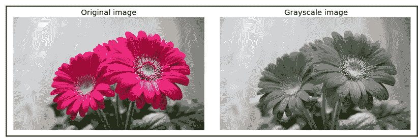

## 通过改变亮度通道来调整图像亮度

执行以下步骤，使用 Lab 颜色空间和 scikit-image 库函数改变彩色图像的亮度：

- 1. 将输入图像从 RGB 转换到 Lab 颜色空间，并增加第一个通道的值（增加 50）：

```
im1 = rgb2lab(im)
im1[..., 0] = im1[..., 0] + 50
```

- 2. 将其转换回 RGB 颜色空间并获得更亮的图像：

```
im1 = lab2rgb(im1)
```

- 3. 将 RGB 图像转换到 Lab 颜色空间，仅减少第一个通道的值（减少 50，如以下代码所示），然后再转换回 RGB 颜色空间，从而获得更暗的图像：

```
im1 = rgb2lab(im)
im1[..., 0] = im1[..., 0] - 50
im1 = lab2rgb(im1)
```

如果运行前面的代码并绘制输入图像和输出图像，您将得到类似于以下屏幕截图所示的输出：

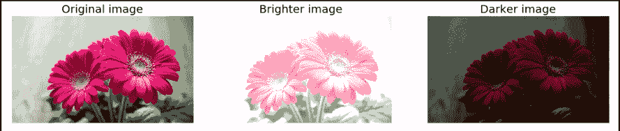

### 工作原理…

使用 scikit-image `color` 模块中的 `rgb2lab()` 函数将图像从 RGB 转换到 Lab 颜色空间。

Lab 颜色空间中修改后的图像使用 scikit-image `color` 模块中的 `lab2rgb()` 函数转换回 RGB。

由于在 Lab 空间中，颜色通道分别位于 a 通道和 b 通道，而强度位于 L 通道，通过将颜色通道值设为零，我们可以从彩色图像中获取灰度图像。

通过仅更改 Lab 空间中的 L 通道值来改变输入彩色图像的亮度（与 RGB 颜色空间不同，后者需要更改所有通道值）；无需触碰颜色通道。

### 更多内容…

Lab 颜色空间有许多其他用途。例如，您可以在 Lab 空间中获得更自然的反转图像，因为只需要反转亮度通道，如以下代码块所示：

```
im1 = rgb2lab(im)
im1[..., 0] = np.max(im1[..., 0]) - im1[..., 0]
im1 = lab2rgb(im1)
```

如果运行前面的代码并显示输入图像以及在 RGB 和 Lab 空间中获得的反转图像，您将得到以下屏幕截图：

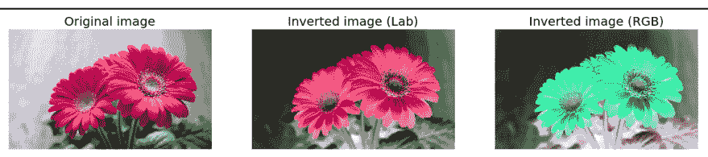

如您所见，Lab 颜色空间中的反转图像比 RGB 颜色空间中的反转图像看起来更自然。

## 应用仿射变换

仿射变换是一种几何变换，它保持点、直线和平面。变换前平行的直线在变换后仍保持平行。对于图像中的每个像素 x，仿射变换可以表示为映射 x |→ Mx+b，其中 M 是线性变换（矩阵），b 是偏移向量。

### 准备工作

首先，让我们导入在灰度图像上实现仿射变换所需的库和函数：

```
import numpy as np
from scipy import ndimage as ndi
from skimage.io import imread
from skimage.color import rgb2gray
```

### 操作步骤…

执行以下步骤，使用 scipy.ndimage 模块函数将仿射变换应用于图像：

- 1. 读取彩色图像，将其转换为灰度图像，并获取灰度图像的形状：

```
img = rgb2gray(imread('images/humming.png'))
w, h = img.shape
```

- 2. 应用恒等变换：

```
mat_identity = np.array([[1,0,0],[0,1,0],[0,0,1]])
img1 = ndi.affine_transform(img, mat_identity)
```

- 3. 应用反射变换（沿 x 轴）：

```
mat_reflect = np.array([[1,0,0],[0,-1,0],[0,0,1]]) @
np.array([[1,0,0],[0,1,-h],[0,0,1]])
img1 = ndi.affine_transform(img, mat_reflect) # offset=(0,h)
```

- 4. 缩放图像（沿 x 轴缩放 0.75 倍，沿 y 轴缩放 1.25 倍）：

```
s_x, s_y = 0.75, 1.25
mat_scale = np.array([[s_x,0,0],[0,s_y,0],[0,0,1]])
img1 = ndi.affine_transform(img, mat_scale)
```

- 5. 将图像逆时针旋转 30°。这是一种复合操作——首先，您需要移动/居中图像，应用旋转，然后再应用逆向移动：

```
theta = np.pi/6
mat_rotate = np.array([[1,0,w/2],[0,1,h/2],[0,0,1]]) @ \
np.array([ [np.cos(theta),np.sin(theta),0], [np.sin(theta),-np.cos(theta),0], [0,0,1]]) @ np.array([[1,0,-w/2],[0,1,-h/2],[0,0,1]])
img1 = ndi.affine_transform(img1, mat_rotate)
```

- 6. 对图像应用剪切变换：

```
lambda1 = 0.5
mat_shear = np.array([[1,lambda1,0],[lambda1,1,0],[0,0,1]])
img1 = ndi.affine_transform(img1, mat_shear)
```

- 7. 最后按顺序应用所有变换：

```
mat_all = mat_identity @ mat_reflect @ mat_scale @ mat_rotate @ mat_shear
ndi.affine_transform(img, mat_all)
```

以下屏幕截图显示了每个仿射变换操作的矩阵（M）：

| 操作 | 公式 |
|---|---|
| 恒等 | $\begin{bmatrix} x' \\ y' \\ 1 \end{bmatrix} = \begin{bmatrix} 1 & 0 & 0 \\ 0 & 1 & 0 \\ 0 & 0 & 1 \end{bmatrix} \begin{bmatrix} x \\ y \\ 1 \end{bmatrix}$ |
| 反射 | $\begin{bmatrix} x' \\ y' \\ 1 \end{bmatrix} = \begin{bmatrix} 1 & 0 & 0 \\ 0 & -1 & 0 \\ 0 & 0 & 1 \end{bmatrix} \begin{bmatrix} x \\ y \\ 1 \end{bmatrix}$ |
| 平移 | $\begin{bmatrix} x' \\ y' \\ 1 \end{bmatrix} = \begin{bmatrix} 1 & 0 & dx \\ 0 & 1 & dy \\ 0 & 0 & 1 \end{bmatrix} \begin{bmatrix} x \\ y \\ 1 \end{bmatrix}$ |
| 缩放 | $\begin{bmatrix} x' \\ y' \\ 1 \end{bmatrix} = \begin{bmatrix} S_x & 0 & 0 \\ 0 & S_y & 0 \\ 0 & 0 & 1 \end{bmatrix} \begin{bmatrix} x \\ y \\ 1 \end{bmatrix}$ |
| 旋转 | $\begin{bmatrix} x' \\ y' \\ 1 \end{bmatrix} = \begin{bmatrix} cos(\theta) & -sin(\theta) & 0 \\ sin(\theta) & cos(\theta) & 0 \\ 0 & 0 & 1 \end{bmatrix} \begin{bmatrix} x \\ y \\ 1 \end{bmatrix}$ |
| 剪切-X | $\begin{bmatrix} x' \\ y' \\ 1 \end{bmatrix} = \begin{bmatrix} 1 & \lambda_x & 0 \\ 0 & 1 & 0 \\ 0 & 0 & 1 \end{bmatrix} \begin{bmatrix} x \\ y \\ 1 \end{bmatrix}$ |
| 剪切-Y | $\begin{bmatrix} x' \\ y' \\ 1 \end{bmatrix} = \begin{bmatrix} 1 & 0 & 0 \\ \lambda_y & 1 & 0 \\ 0 & 0 & 1 \end{bmatrix} \begin{bmatrix} x \\ y \\ 1 \end{bmatrix}$ |

### 工作原理…

请注意，对于图像，x 轴是垂直轴（正方向向下），y 轴是水平轴（正方向从左到右）。

使用 affine_transform() 函数时，输出（变换后）图像中位置 o 处的像素值是根据输入图像在位置 np.dot(matrix, o) + offset 处的像素值确定的。因此，提供给函数作为输入的矩阵实际上是逆变换矩阵。

在某些情况下，会使用附加矩阵进行平移，以将变换后的图像置于可视化框架内。

前面的代码片段展示了如何使用 affine_transform() 函数实现反射、缩放、旋转和剪切等不同的仿射变换。对于每种情况，我们需要提供适当的变换矩阵 M（如前面的图所示）（使用齐次坐标）。

我们可以使用所有矩阵的乘积一次性执行所有仿射变换的组合（例如，如果您希望先进行变换 T1 再进行变换 T2，则需要将输入图像乘以矩阵 T2.T1）。

如果按顺序应用所有变换并逐个绘制变换后的图像，您将得到类似于以下屏幕截图的输出：

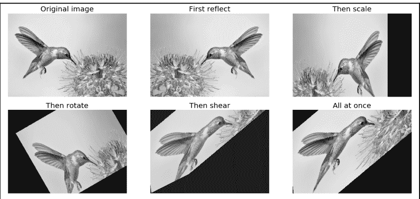


### 还有更多...

再次，在前一个示例中，affine_transform() 函数被应用于灰度图像。同样的效果也可以用彩色图像获得，例如通过将映射函数同时且独立地应用于图像的每个通道。另外，scikit-image 库提供了 AffineTransform 和 PiecewiseAffineTransform 类；你也可以尝试它们来实现仿射变换。

## 应用透视变换和单应性

透视（投影）变换的目标是从两张图像之间的点对应关系估计单应性（一个矩阵，H）。由于该矩阵的自由度（DOF）为八，因此你需要至少四对点来从两张图像中计算单应性矩阵。以下图示显示了计算单应性矩阵所需的基本概念：

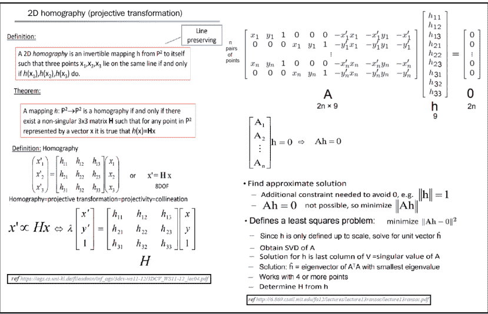

幸运的是，我们不需要计算 SVD，H 矩阵会由 `scikit-image.transform` 模块中的 `ProjectiveTransform` 函数自动计算。在此示例中，我们将使用此函数来实现单应性。

### 准备工作

在此示例中，我们将使用一张蜂鸟图像和一张月球上的宇航员图像（来自 NASA 的公共领域图像）作为输入图像。再次，让我们像往常一样先导入所需的库：

```python
from skimage.transform import ProjectiveTransform
from skimage.io import imread
import numpy as np
import matplotlib.pyplot as plt
```

### 操作步骤

执行以下步骤，使用 scikit-image 的 `transform` 模块对图像应用投影变换：

- 1. 首先，读取源图像，并使用 `np.zeros()` 函数创建目标图像：

  ```python
  im_src = (imread('images/humming2.png'))
  height, width, dim = im_src.shape
  im_dst = np.zeros((height, width, dim))
  ```

- 2. 创建 `ProjectiveTransform` 类的实例：

  ```python
  pt = ProjectiveTransform()
  ```

- 3. 你只需在源图像和目标图像之间提供四对匹配点，即可自动为你估计单应性矩阵 H。此处，目标图像的四个角和输入蜂鸟图像的四个角被作为匹配点提供，如下面的代码块所示：

  ```python
  src = np.array([[ 295., 174.],
     [ 540., 146. ],
     [ 400., 777.],
     [ 60., 422.]])
  dst = np.array([[ 0., 0.],
     [height-1, 0.],
     [height-1, width-1],
     [ 0., width-1]])
  ```

- 4. 获取目标图像中每个像素索引对应的源像素索引：

  ```python
  x, y = np.mgrid[:height, :width]
  dst_indices = np.hstack((x.reshape(-1, 1), y.reshape(-1,1)))
  src_indices = np.round(pt(np.inverse(dst_indices), 0).astype(int))
  valid_idx = np.where((src_indices[:,0] < height) &
                   (src_indices[:,1] < width) &
                   (src_indices[:,0] >= 0) & (src_indices[:,1] >=
                   0))
  dst_indices_valid = dst_indices[valid_idx]
  src_indices_valid = src_indices[valid_idx]
  ```

- 5. 将像素从源图像复制到目标图像：

  ```python
  im_dst[dst_indices_valid[:,0],dst_indices_valid[:,1]] = im_src[src_indices_valid[:,0],src_indices_valid[:,1]]
  ```

如果你运行上面的代码片段，将得到类似下面的截图输出：

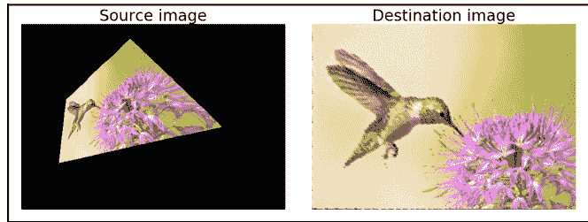

下一张截图显示了月球上的宇航员源图像和画布目标图像。同样，通过在源图像（角点）和目标图像（画布角点）之间提供四对映射点，该任务非常直接：

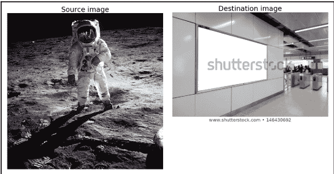

下面的截图显示了投影变换后的输出图像：

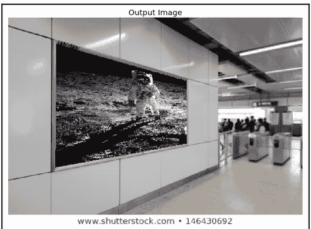

### 工作原理

在上述两种情况中，输入图像都被投影到输出图像的所需位置。

要对图像应用透视变换，首先需要创建一个 ProjectiveTransform 对象。

需要将源图像中的一组 4 个像素位置以及目标图像中相应的匹配像素位置，连同对象实例一起传递给 estimate() 函数，这样会计算单应性矩阵 H（如果可以计算，则返回 True）。

需要在对象上调用 inverse() 函数，这将为你提供与所有目标像素索引相对应的源像素索引。

### 还有更多...

你可以使用 warp() 函数（而不是 inverse() 函数）来实现单应性/投影变换。

### 另请参阅

如需更多详细信息，请参阅以下链接：

- https://www.youtube.com/watch?v=YwIB9PbQkEM
- https://www.youtube.com/watch?v=2ggjHjRx2SQ
- https://www.youtube.com/watch?v=vviNh5y71ss

## 从图像创建铅笔素描

从图像生成素描的关键在于检测图像中的边缘。在此示例中，你将学习如何使用不同的技术，包括高斯差分（及其扩展版本 XDOG）、各向异性扩散和减淡（应用高斯模糊 + 反转 + 阈值处理），从图像中获得素描。

### 准备工作

首先需要导入以下库：

```python
import numpy as np
from skimage.io import imread
from skimage.color import rgb2gray
from skimage import util
from skimage import img_as_float
import matplotlib.pyplot as plt
from medpy.filter.smoothing import anisotropic_diffusion
from skimage.filters import gaussian, threshold_otsu
```

### 操作步骤

需要执行以下步骤：

- 1. 定义 normalize() 函数以在图像中实现最小-最大归一化：

  ```python
  def normalize(img):
      return (img-np.min(img)) / (np.max(img)-np.min(img))
  ```

- 2. 实现 sketch() 函数，该函数以图像和提取的边缘作为输入：

  ```python
  def sketch(img, edges):
      output = np.multiply(img, edges)
      output[output>1]=1
      output[edges==1]=1
      return output
  ```

- 3. 实现一个函数，使用各向异性扩散从图像中提取边缘：

  ```python
  def edges_with_anisotropic_diffusion(img, niter=100, kappa=10,
  gamma=0.1):
      output = img - anisotropic_diffusion(img, niter=niter, \\
      kappa=kappa, gamma=gamma, voxelspacing=None, \\
      option=1)
      output[output > 0] = 1
      output[output < 0] = 0
      return output
  ```

- 4. 实现一个函数，使用减淡操作从图像中提取边缘（有两种实现）：

  ```python
  def sketch_with_dodge(img):
      orig = img
      blur = gaussian(util.invert(img), sigma=20)
      result = blur / util.invert(orig)
      result[result>1] = 1
      result[orig==1] = 1
      return result

  def edges_with_dodge2(img):
      img_blurred = gaussian(util.invert(img), sigma=5)
      output = np.divide(img, util.invert(img_blurred) + 0.001)
      output = normalize(output)
      thresh = threshold_otsu(output)
      output = output > thresh
      return output
  ```

- 5. 实现一个函数，使用高斯差分（DOG）操作从图像中提取边缘：

  ```python
  def edges_with_DOG(img, k = 200, gamma = 1):
      sigma = 0.5
      output = gaussian(img, sigma=sigma) - gamma*gaussian(img, \\
      sigma=k*sigma)

      output[output > 0] = 1
      output[output < 0] = 0
      return output
  ```

- 6. 实现一个函数，使用扩展高斯差分（XDOG）操作从图像中生成素描：

  ```python
  def sketch_with_XDOG(image, epsilon=0.01):
      phi = 10
      difference = edges_with_DOG(image, 200, 0.98).astype(np.uint8)
      for i in range(0, len(difference)):
          for j in range(0, len(difference[0])):
              if difference[i][j] >= epsilon:
                  difference[i][j] = 1
              else:
                  ht = np.tanh(phi*(difference[i][j] - epsilon))
                  difference[i][j] = 1 + ht
      difference = normalize(difference)
      return difference
  ```

如果你运行上面的代码并绘制所有输入/输出图像，将得到类似下面的截图输出：

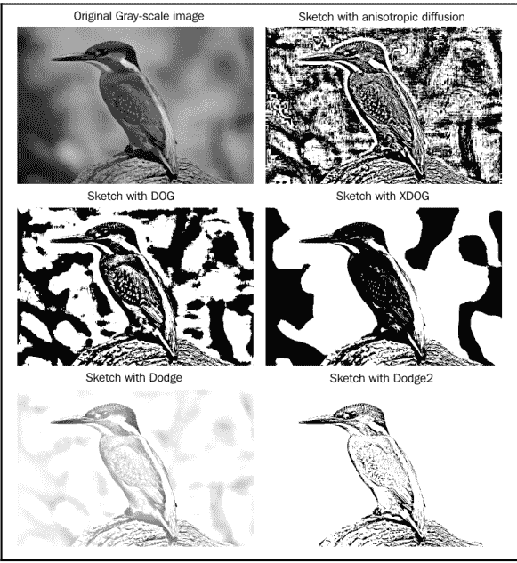


### 工作原理...

如前一节所示，许多素描技术通过模糊图像中的边缘（例如，使用高斯滤波器或扩散）并在一定程度上去除细节，然后减去原始图像来获得素描轮廓。

使用 scikit-image 滤波器模块中的 gaussian() 函数来模糊图像。

使用 medpy 库 filter.smoothing 模块中的 anisotropic_diffusion() 函数，通过各向异性扩散（一种变分方法）来查找边缘。

减淡操作通过使用 np.divide() 将图像除以反转后的模糊图像。这将突出图像中最粗的边缘。

### 更多内容...

还有几种其他边缘检测技术，例如 Canny（带有滞后阈值），你可以尝试用它们从图像生成素描。你可以自行尝试并比较不同算法生成的素描。此外，通过使用 OpenCV-Python 的 pencilSketch() 和 stylization() 函数，你可以使用以下几行代码生成黑白和彩色铅笔素描，以及水彩风格的 stylized 图像：

```
import cv2
import matplotlib.pyplot as plt
src = cv2.imread('images/bird.png')
#dst = cv2.detailEnhance(src, sigma_s=10, sigma_r=0.15)
dst_sketch, dst_color_sketch = cv2.pencilSketch(src, sigma_s=50, sigma_r=0.05, shade_factor=0.05)
dst_water_color = cv2.stylization(src, sigma_s=50, sigma_r=0.05)
```

如果运行此代码并绘制图像，你将得到类似于以下截图的图表：

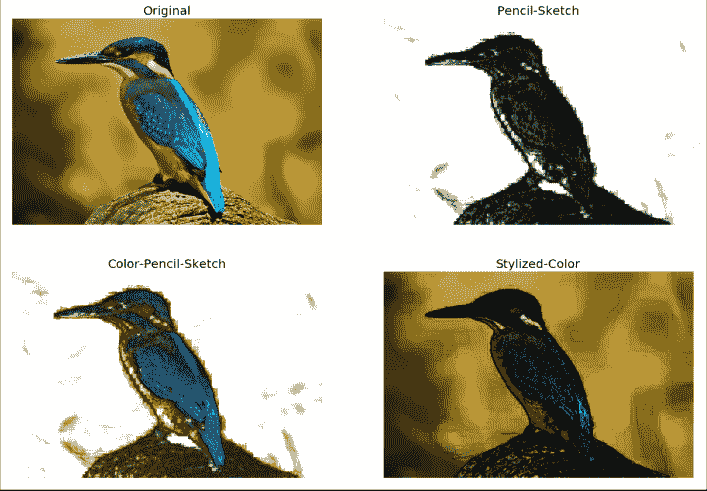

### 另请参阅

如需更多详情，请参阅以下链接：

- https://www.youtube.com/watch?v=Zy11gAIR0xg

## 创建卡通风格图像

在本示例中，你将学习如何从图像创建卡通风格的平纹理图像。同样，实现同一目标的方法不止一种；在此，我们将学习如何使用保边双边滤波器来实现。

### 准备工作

首先需要导入以下库：

```
import cv2
import numpy as np
import matplotlib.pyplot as plt
```

### 操作步骤...

在本示例中，我们将使用 OpenCV-Python 的 bilateralFilter() 函数。首先需要对图像进行下采样以创建图像金字塔（下一章将详细介绍），然后反复应用小型双边滤波器（以去除不重要的细节）并将图像上采样至原始大小。接下来，需要应用中值模糊（以平整纹理），接着使用自适应阈值得到的二值图像对原始图像进行掩模处理。以下代码演示了这些步骤：

- 1. 读取输入图像并初始化稍后将使用的参数：

```
img = plt.imread("images/bean.png")
num_down = 2 # number of downsampling steps
num_bilateral = 7 # number of bilateral filtering steps
w, h, _ = img.shape
```

- 2. 使用高斯金字塔的下采样来减小图像大小（并使后续操作更快）：

```
img_color = np.copy(img)
for _ in range(num_down) :
    img_color = cv2.pyrDown(img_color)
```

- 3. 迭代应用双边滤波器（使用较小的直径值）。d 参数表示每个像素邻域的直径，其中 sigmaColor 和 sigmaSpace 参数分别表示颜色空间和坐标空间中的滤波器 sigma：

```
for _ in range(num_bilateral) :
    img_color = cv2.bilateralFilter(img_color, d=9, sigmaColor=0.1,
    sigmaSpace=0.01)
```

- 4. 使用上采样将图像放大至原始大小：

```
for _ in range(num_down):
    img_color = cv2.pyrUp(img_color)
```

- 5. 将上一步得到的输出图像转换并使用中值滤波器模糊图像：

```
img_gray = cv2.cvtColor(img, cv2.COLOR_RGB2GRAY)
img_blur = cv2.medianBlur(img_gray, 7)
```

- 6. 检测并增强边缘：

```
img_edge = cv2.adaptiveThreshold((255*img_blur).astype(np.uint8), \
    255, cv2.ADAPTIVE_THRESH_MEAN_C, cv2.THRESH_BINARY, \
    blockSize=9, C=2)
```

- 7. 将灰度边缘图像转换回 RGB 彩色图像，并与 RGB 彩色图像进行按位与运算，以得到最终的卡通风格输出图像：

```
img_edge = cv2.cvtColor(img_edge, cv2.COLOR_GRAY2RGB)
img_cartoon = cv2.bitwise_and(img_color, img_edge)
```

### 工作原理...

如前所述，OpenCV-Python 中的 bilateralFilter()、medianBlur()、adaptiveThreshold() 和 bitwise_and() 函数是关键函数，首先用于去除弱边缘，然后转换为平纹理，最后增强图像中的突出边缘。

使用 OpenCV-Python 的 bilateralFilter() 函数来平滑纹理，同时保持边缘相当锐利：

- sigmaColor 参数值越高，邻域中的像素颜色混合越多。这将在输出图像中产生更大的半相等颜色区域。
- sigmaSpace 参数值越高，颜色相似的像素相互影响越多。

对图像进行了下采样以创建图像金字塔（下一章将详细介绍）。

接下来，使用反复应用小型双边滤波器来去除不重要的细节。随后使用上采样将图像调整为原始大小。

最后，应用了 `medianBlur`（以平整纹理），然后使用自适应阈值得到的二值图像对原始图像进行掩模处理。

如果运行上述代码，你将得到如下所示的卡通风格输出图像：

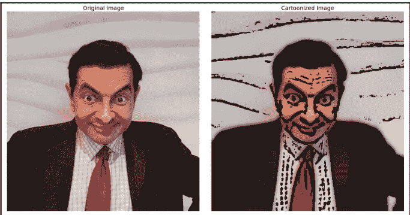

### 更多内容...

调整 OpenCV 函数的参数值，以查看对生成的输出图像的影响。此外，如前所述，实现相同效果的方法不止一种。尝试使用各向异性扩散来获取平纹理图像。你应该得到类似于以下图像（使用 `medpy` 库中的 `anisotropic_diffusion()` 函数）：

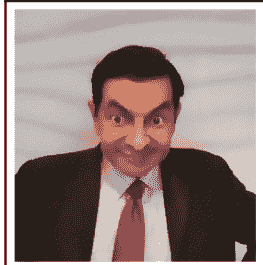

### 另请参阅

如需更多详情，请参阅以下链接：

- http://people.csail.mit.edu/sparis/bf_course/
- https://www.youtube.com/watch?v=DgRgPFkz6bg

## 模拟光画/长曝光

长曝光（或光画）是指创建捕捉时间流逝效果的照片的过程。长曝光照片的一些流行应用示例包括丝滑平滑的水面以及汽车大灯在高速公路上形成的单条连续运动光带。在本示例中，我们将通过对视频图像帧求平均来模拟长曝光。

### 准备工作

我们将从视频中提取图像帧，然后对帧进行平均以模拟光画。让我们先导入所需的库：

```
from glob import glob
import cv2
import numpy as np
import matplotlib.pyplot as plt
```

### 操作步骤...

需要执行以下步骤：

- 1. 实现一个 `extract_frames()` 函数，从作为输入传递给该函数的视频中提取最多前 200 帧：

```python
def extract_frames(vid_file):
    vidcap = cv2.VideoCapture(vid_file)
    success,image = vidcap.read()
    i = 1
    success = True
    while success and i <= 200:
        cv2.imwrite('images/exposure/vid_{}.jpg'.format(i), image)
        success,image = vidcap.read()
        i += 1
```

- 2. 调用该函数，将从冰岛 Godafost 瀑布视频中提取的所有帧（作为 `.jpg`）保存到 `exposure` 文件夹：

```python
extract_frames('images/godafost.mp4')  #cloud.mp4
```

- 3. 从 `exposure` 文件夹读取所有 `.jpg` 文件；逐个读取它们（作为浮点数）；将每个图像拆分为 B、G 和 R 通道；计算颜色通道的累加和；最后，计算颜色通道的平均值：

```python
imfiles = glob('images/exposure/*.jpg')
nfiles = len(imfiles)
R1, G1, B1 = 0, 0, 0
for i in range(nfiles):
    image = cv2.imread(imfiles[i]).astype(float)
    (B, G, R) = cv2.split(image)
    R1 += R
    B1 += B
    G1 += G
R1, G1, B1 = R1 / nfiles, G1 / nfiles, B1 / nfiles
```

- 4. 合并获得的颜色通道平均值并保存最终输出图像：

```python
final = cv2.merge([B1, G1, R1])
cv2.imwrite('images/godafost.png', final)
```


下图显示了提取的输入帧之一：

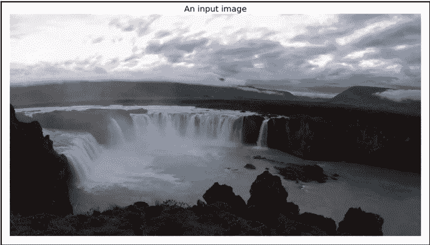

如果你运行前面的代码块，将会得到一张类似于这里所示的长曝光风格图像：

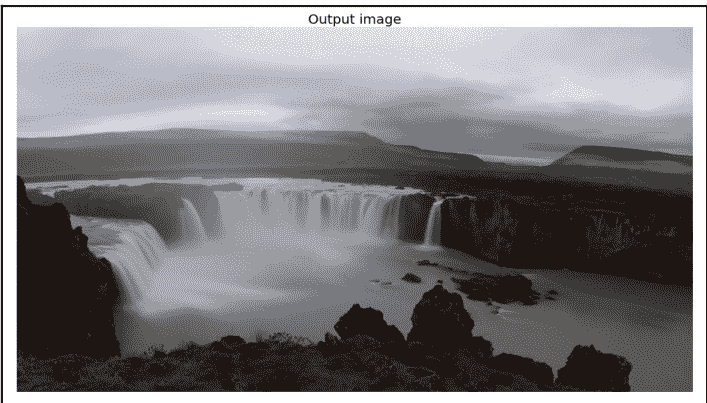

注意云彩和瀑布中的连续效果。

### 工作原理...

OpenCV-Python 中的 `VideoCapture()` 函数被用于以视频文件作为输入创建 `VideoCapture` 对象。随后，使用该对象的 `read()` 方法从视频中捕获帧。

OpenCV-Python 中的 `imread()` 和 `imwrite()` 函数用于从磁盘读取/写入图像。

`cv2.split()` 函数被用于将 RGB 图像拆分为单独的颜色通道，而 `cv2.merge()` 函数被用于将它们重新组合为 RGB 图像。

### 还有更多...

**焦点堆叠**（也称为扩展景深）是一种技术（用于图像处理/计算摄影），它以多张图像（同一主体但在不同对焦距离下拍摄）作为输入，并通过组合输入图像来创建一张景深高于任何单独源图像的输出图像。我们可以在 Python 中模拟焦点堆叠。以下是使用 `mahotas` 库从视频中提取灰度图像帧的焦点堆叠示例。

## 使用 mahotas 扩展景深

执行以下步骤，使用 `mahotas` 库函数实现焦点堆叠：

- 1. 首先创建图像堆栈，方法是从夜间高速公路交通视频中提取灰度图像帧：

```python
import mahotas as mh

def create_image_stack(vid_file, n=200):
    vidcap = cv2.VideoCapture(vid_file)
    success, image = vidcap.read()
    i = 0
    success = True
    h, w = image.shape[:2]
    imstack = np.zeros((n, h, w))
    while success and i < n:
        imstack[i, ...] = cv2.cvtColor(image, cv2.COLOR_BGR2GRAY)
        success, image = vidcap.read()
        i += 1
    return imstack
```

```python
image = create_image_stack('images/highway.mp4')  # cloud.mp4
stack, h, w = image.shape
```

- 2. 使用 mahotas 中的 sobel() 函数作为像素级对焦度量：

```python
focus = np.array([mh.sobel(t, just_filter=True) for t in image])
```

- 3. 在每个像素位置，选择最佳切片（具有最大对焦度量）并创建最终图像：

```python
best = np.argmax(focus, 0)
image = image.reshape((stack, -1))  # image is now (stack, nr_pixels)
image = image.transpose()  # image is now (nr_pixels, stack)
final = image[np.arange(len(image)), best.ravel()]  # Select the right pixel at each location
final = final.reshape((h, w))  # reshape to get final result
```

下图是图像堆栈中使用的输入图像：

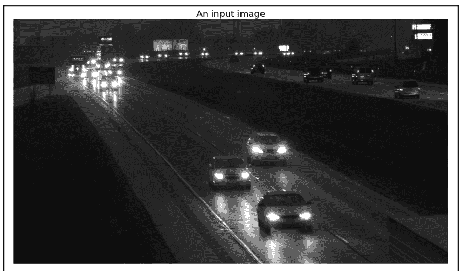

下图是算法实现生成的最终输出图像截图：

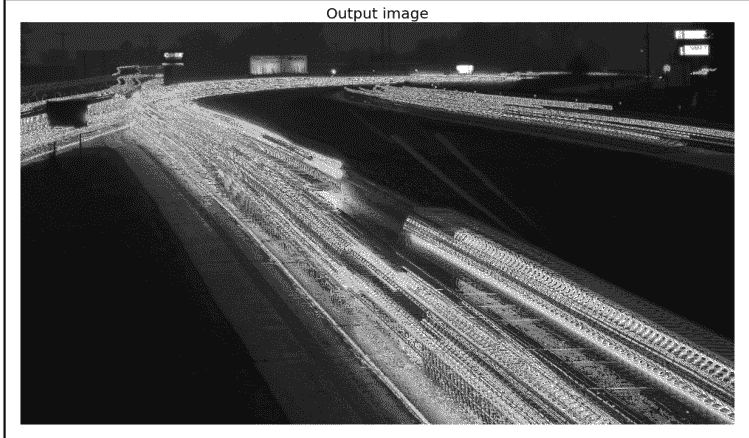

### 另请参阅

有关更多详细信息，请参阅以下链接：

- https://mahotas.readthedocs.io/en/latest/edf.html
- https://docs.opencv.org/3.0-beta/doc/py_tutorials/py_gui/py_video_display/py_video_display.html
- https://www.youtube.com/watch?v=5CTSc9GX3X8

## 使用 HSV 颜色进行对象检测

在本示例中，你将学习如何使用 OpenCV-Python 在 HSV 颜色空间中使用颜色检测对象。你需要指定一个颜色值范围，根据该范围将感兴趣的对象识别并提取出来。你可以更改检测到的对象的颜色，甚至使检测到的对象变为透明。

### 准备工作

在本示例中，我们将使用的输入图像是水族箱中的一条橙色鱼，感兴趣的对象是鱼。你将检测鱼，更改其颜色，并使用 HSV 空间中鱼的颜色范围使其变为透明。让我们先导入所需的库：

```python
import cv2
import numpy as np
import matplotlib.pyplot as plt
```

### 操作步骤...

要完成本示例，需要执行以下步骤：

- 1. 读取输入图像和背景图像。将输入图像从 BGR 转换为 HSV 颜色空间：

```python
bck = cv2.imread("images/fish_bg.png")
img = cv2.imread("images/fish.png")
hsv = cv2.cvtColor(img, cv2.COLOR_BGR2HSV)
```

- 2. 通过选择鱼可能具有的 HSV 颜色范围来创建鱼的掩码：

```python
mask = cv2.inRange(hsv, (5, 75, 25), (25, 255, 255))
```

- 3. 使用掩码提取橙色鱼：

```python
imask = mask > 0
orange = np.zeros_like(img, np.uint8)
orange[imask] = img[imask]
```

- 4. 仅更改色调通道值（加 20）并将图像转换回 BGR 空间，从而将橙色鱼的颜色更改为黄色：

```python
yellow = img.copy()
hsv[..., 0] = hsv[..., 0] + 20
yellow[imask] = cv2.cvtColor(hsv, cv2.COLOR_HSV2BGR)[imask]
yellow = np.clip(yellow, 0, 255)
```

- 5. 最后，先提取没有鱼的输入图像的背景，再从背景图像中提取对应前景对象（鱼）的区域，然后将这两张图像相加，从而创建透明鱼图像：

```python
bckfish = cv2.bitwise_and(bck, bck, mask=imask.astype(np.uint8))
nofish = img.copy()
nofish = cv2.bitwise_and(nofish, nofish, mask=(np.bitwise_not(imask)).astype(np.uint8))
nofish = nofish + bckfish
```

### 工作原理...

下图显示了一个用于快速颜色查找的 HSV 色图。x 轴表示色调，取值范围为 (0,180)，y 轴 (1) 表示饱和度，取值范围为 (0,255)，y 轴 (2) 对应于 S = 255 和 V = 255 的色调值。要在色图中定位特定颜色，只需查找相应的 H 和 S 范围，然后将 V 的范围设置为 (25, 255)。例如，我们感兴趣的鱼的橙色可以在 HSV 范围 (5, 75, 25) 到 (25, 255, 255) 中搜索，如下所示：

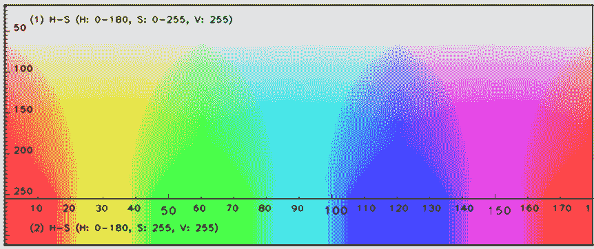

OpenCV-Python 中的 inRange() 函数用于颜色检测。它接受 HSV 输入图像以及（之前定义的）颜色范围作为参数。cv2.inRange() 接受三个参数——输入图像，以及要检测的颜色的下限和上限。它返回一个二进制掩码，其中白色像素表示范围内的像素，黑色像素表示指定范围外的像素。

要更改检测到的鱼的颜色，只需更改色调（颜色）通道值即可；不需要触及饱和度和亮度通道。

使用 OpenCV-Python 中的按位运算来提取前景/背景。

请注意，背景图像的颜色与鱼图像的背景略有不同；否则，透明的鱼就会彻底消失（隐形斗篷！）。

如果你运行前面的代码片段并绘制所有图像，将得到以下输出：

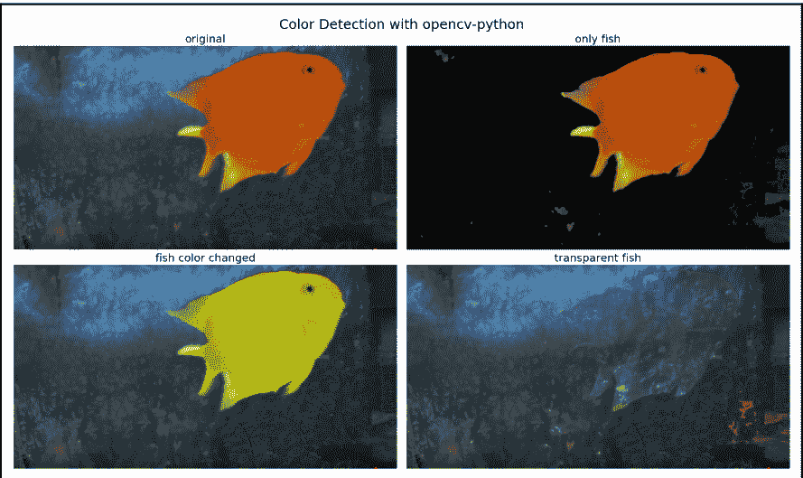

请注意，在 OpenCV-Python 中，RGB 颜色空间中的图像以 BGR 格式存储。如果我们想要以正确的颜色显示图像，在使用 Matplotlib 的 imshow()（它期望图像为 RGB 格式）之前，必须使用 cv2.cvtColor(image, cv2.COLOR_BGR2RGB) 转换图像颜色。

### 另请参阅

有关更多详细信息，请参阅以下链接：

- https://opencv-python-tutorials.readthedocs.io/en/latest/py_tutorials/py_imgproc/py_colorspaces/py_colorspaces.html
- https://i.stack.imgur.com/gyuw4.png
- https://stackoverflow.com/questions/10948589/choosing-the-correct-upper-and-lower-hsv-boundaries-for-color-detection-with-cv
- https://www.youtube.com/watch?v=1F0aOM3WJ74
