# 图像增强

图像增强的目标是提高图像质量或使特定特征更加突出。所使用的技术通常是更通用的技术，并不假设强退化过程模型（与图像恢复不同，我们将在下一章中看到）。图像增强技术的一些示例包括去噪/平滑（使用不同的经典图像处理、无监督机器学习和深度学习技术）、对比度改进和锐化。

在本章中，我们将介绍以下图像增强示例（及其使用 Python 库的实现）：

- 应用滤波器对图像中不同类型的噪声进行去噪
- 使用去噪自编码器进行图像去噪
- 使用 PCA/DFT/DWT 进行图像去噪
- 使用各向异性扩散进行图像去噪
- 使用直方图均衡化改善图像对比度
- 实现直方图匹配
- 执行梯度融合
- 使用 Canny、LoG/零交叉和小波进行边缘检测


## 将滤波器应用于去除图像中不同类型的噪声

噪声代表图像强度的随机变化，会导致图像质量下降。噪声可能在图像捕获或传输过程中引入。图像去噪（噪声去除）是大多数图像处理应用必须执行的重要图像处理任务。在本节中，我们将讨论具有不同分布的不同类型的噪声，例如高斯、椒盐、颗粒、泊森和指数噪声，并使用 SciPy 的 ndimage 模块中的几种流行滤波技术（均值和中值滤波器）对不同噪声类型进行图像去噪。将对所有类型的噪声进行结果比较。

### 准备工作

我们将使用 Lena 灰度图像，并向原始图像添加不同类型的随机噪声（通过从不同分布中绘制随机样本）。我们将流行的线性（均值）滤波器和流行的非线性（中值）滤波器应用于获得的含噪图像。我们还将通过计算峰值信噪比（PSNR）来比较滤波器的性能。

让我们先使用以下代码加载所需的库：

```
%matplotlib inline
from skimage.io import imread
from skimage.util import random_noise
from skimage.color import rgb2gray
from skimage.measure import compare_psnr
from scipy.ndimage import uniform_filter, median_filter
import numpy as np
import matplotlib.pyplot as plt
```

### 操作步骤

对图像中不同类型的噪声进行去噪的步骤如下：

- 1. 定义 plt_hist() 函数以绘制添加到图像中的噪声的直方图：

```
def plt_hist(noise, bins=None):
    plt.grid()
    plt.hist(np.ravel(noise), bins=bins, alpha=0.5, color='green')
    plt.tick_params(labelsize=15)
    plt.title('Noise Histogram', size=25)
```

- 2. 接下来，定义 plt_images() 函数以绘制所有图像，即原始图像、含噪图像和去噪图像（使用均值/中值滤波器），并通过调用先前定义的 plt_hist() 函数绘制噪声直方图。此外，还要使用 PSNR 比较使用滤波器去噪的图像质量：

```
def plt_images(im, im_noisy, noise, noise_type, i):
    im_denoised_mean = uniform_filter(im_noisy, 5)
    im_denoised_median = median_filter(im_noisy, 5)
    plt.subplot(7,4,i), plt.imshow(im_noisy), \
    plt.title('Noisy ({})'.format(noise_type), \
    np.round(compare_psnr(im, im_noisy, 3)), size=25), \
    plt.axis('off')
    plt.subplot(7,4,i+1), plt.imshow(im_denoised_mean), \
    plt.title('Denoised (mean), PSNR={}'.format(np.round(\
    (compare_psnr(im, im_denoised_mean),3)), size=25), \
    plt.axis('off')
    plt.subplot(7,4,i+2), plt.imshow(im_denoised_median), \
    plt.title('Denoised (median), PSNR={}'.format(np.round(\
    (compare_psnr(im, im_denoised_median),3)), size=25), \
    plt.axis('off')
    plt.subplot(7,4,i+3), plt_hist(noise)
```

- 3. 加载原始 Lena 彩色 RGB 图像并将其转换为灰度图像：

```
im = rgb2gray(imread('images/lena.png'))
```

- 4. 现在，通过从不同分布中绘制样本并附上适当参数（每种噪声分布一个）向原始图像添加随机噪声。之后，调用先前定义的 plt_images() 函数来绘制图像和噪声分布：

```
im1 = random_noise(im, 'gaussian', var=0.15**2)
plt_images(im, im1, im1-im, 'Gaussian', 1)

im1 = random_noise(im, 's&p', amount=0.15)
plt_images(im, im1, im1[(im1==0)|(im1==1)] & ((im!=0) & (im!=1)),
'Impulse', 5)

noise = np.random.poisson(lam=int(np.mean(255*im)),
size=im.shape)/255 - np.mean(im)
im1 = np.clip(im + noise, 0, 1)
plt_images(im, im1, noise, 'Poisson', 9)

im1 = random_noise(im, 'speckle', var=0.15**2)
plt_images(im, im1, im1-im, 'Speckle', 13)

noise = np.random.rayleigh(scale=0.15, size=im.shape) - 0.15
im1 = np.clip(im + noise, 0, 1)
plt_images(im, im1, noise, 'Rayleigh', 17)

noise = np.random.exponential(scale=0.15, size=im.shape) - 0.15
im1 = np.clip(im + noise, 0, 1)
plt_images(im, im1, noise, 'Exponential', 21)

noise = np.random.uniform(0, 0.5, size=im.shape) - 0.25
im1 = np.clip(im + noise, 0, 1)
plt_images(im, im1, noise, 'Uniform', 25)
```

### 工作原理

我们首先使用 scipy.ndimage 模块中的 uniform_filter() 函数对含噪图像应用均值滤波器。然后，我们使用同一模块中的 median_filter() 对含噪图像应用中值滤波器。对于这两个滤波器，使用的滤波器大小为 5，以便使用框核应用 5 x 5 卷积。

使用 skimage.measure 模块中的 compare_psnr() 函数比较了使用滤波器去噪的图像的质量。

使用 scikit-image.io 模块中的 imread() 函数读取 Lena RGB 图像，并使用 scikit-image.color 模块中的 rgb2gray() 函数将图像转换为灰度图像。

我们使用 scikit-image.util 模块中的 random_noise() 函数，或使用 NumPy random 模块中的相应分布函数（例如，np.random.poisson()）从不同分布（例如，高斯、泊森和指数）中绘制随机噪声样本，并为每种噪声分布使用适当参数（例如，高斯噪声的均值 μ 和方差 σ²，泊森噪声的均值 λ）。

plt_images() 函数接受三个参数，第一个是原始图像，第二个是含噪图像，第三个是添加的噪声。请注意，对于冲击（s&p）噪声，为了计算噪声矩阵，我们必须找到原始图像中像素值从 0 变为 1（盐）或从 1 变为 0（胡椒）的位置。

运行步骤 4 中的代码后，您应该得到的输出的部分截图如下：

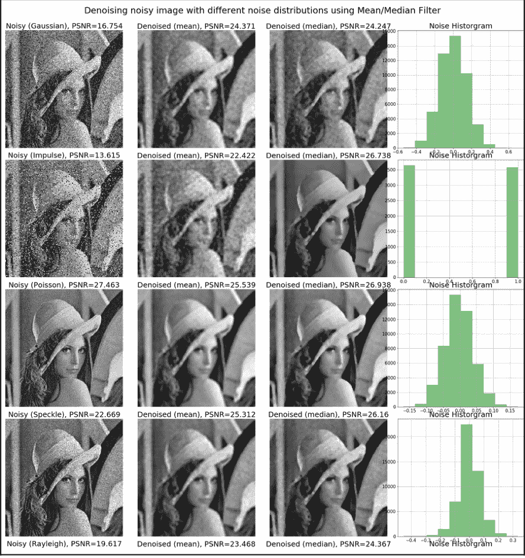

从最后的输出可以看出，中值滤波器对冲击（椒盐）噪声效果尤其好，对颗粒、泊森和瑞利随机噪声也效果更好，而对于其他类型的噪声分布，均值滤波器对此图像效果较好。此外，请注意每种分布的随机噪声直方图的形状如何变化（它们与密度函数的形状相似）。

### 更多内容

您还可以使用 scikit-image 中均值滤波器（例如 `rank.mean()`、`rank.mean_percentile()` 和 `rank.mean_bilateral()`）和中值滤波器（`filters.median()`）的实现。尝试在含噪图像上自行使用这些函数并计算去噪图像的 PSNR 值。

## 使用去噪自编码器进行图像去噪

自编码器是一种常用的神经网络，常以无监督方式学习输入数据的高效表示（通常在降低维度的情况下）。去噪自编码器是自编码器的随机版本，它接收被噪声损坏的（相似）输入，并经过训练以恢复原始输入（通常使用某些深度学习库函数），从而获得良好的表示。我们可以使用去噪自编码器从一组相似的输入图像（被噪声损坏）中学习鲁棒表示，然后生成去噪图像。

### 准备工作

我们将使用 scikit-learn 的标注面孔在野外（lfw）面部数据集（它包含七位非常著名政治家的面部图像）。我们将向这些面部图像添加一些随机噪声，将其用作自编码器的输入，并训练它学习去除噪声。我们将使用 PyTorch 库函数进行深度学习。像往常一样，让我们先导入所需的库：

```
import os
import numpy as np
import matplotlib.pyplot as plt
import torch
from torch import nn
from torch.autograd import Variable
from torch.utils.data import DataLoader
from torchvision import transforms
from torchvision.utils import save_image
from sklearn.datasets import fetch_lfw_people
```

### 操作步骤

现在可以按以下步骤使用去噪自编码器进行去噪：

- 1. 定义 `to_img()` 和 `plot_sample_img()` 函数，分别用于将 PyTorch 张量转换为 lfw 数据集中的图像（每个灰度图像大小为 50 x 37）以及将图像保存到磁盘：

```
def to_img(x):
    x = x.view(x.size(0), 1, 50, 37)
    return x
```

```
def plot_sample_img(img, name):
    img = img.view(1, 50, 37)
    save_image(img, './sample_{}.png'.format(name))
```

- 2. 定义 `add_noise()` 函数以向图像添加随机高斯噪声：

```
def add_noise(img):
    noise = torch.randn(img.size()) * 0.2
    noisy_img = img + noise
    return noisy_img
```

- 3. 实现 `min_max_normalization()` 和 `tensor_round()` 预处理函数，分别用于归一化和四舍五入张量。此外，使用定义的函数创建转换流水线：

```
def min_max_normalization(tensor, min_value, max_value):
    min_tensor = tensor.min()
    tensor = (tensor - min_tensor)
    max_tensor = tensor.max()
    tensor = tensor / max_tensor
    tensor = tensor * (max_value - min_value) + min_value
    return tensor
```

```
def tensor_round(tensor):
    return torch.round(tensor)
```

```
img_transform = transforms.Compose([
    transforms.ToTensor(),
    transforms.Lambda(lambda tensor:min_max_normalization(tensor, \
```


```python
0, 1)),
    transforms.Lambda(lambda tensor:tensor_round(tensor))
 ])
```

- 4. 下载 lfw 数据集，并创建批大小为 8 的数据加载器：

```python
batch_size = 8 # 16
dataset = fetch_lfw_people(min_faces_per_person=70,
   resize=0.4).images / 255
dataloader = DataLoader(dataset, batch_size=batch_size,
   shuffle=True)
```

- 5. 现在，实现自动编码器类、编码器和解码器成员以及该类的 forward() 方法：

```python
class autoencoder(nn.Module):
    def __init__(self):
        super(autoencoder, self).__init__()
        self.encoder = nn.Sequential(
            nn.Linear(50 * 37, 512),
            nn.ReLU(True),
            nn.Linear(512, 128),
            nn.ReLU(True))
        self.decoder = nn.Sequential(
            nn.Linear(128, 512),
            nn.ReLU(True),
            nn.Linear(512, 50 * 37),
            nn.Sigmoid())
    def forward(self, x):
        x = self.encoder(x)
        x = self.decoder(x)
        return x
```

- 6. 实例化自动编码器类，然后使用以下代码片段将损失函数定义为二元交叉熵（BCE）损失，并将优化器定义为 Adam 优化器：

```python
learning_rate = 1e-3
cuda = False #True
model = autoencoder()
if cuda:
    model = model.cuda()
criterion = nn.BCELoss()
optimizer = torch.optim.Adam(model.parameters(),
    lr=learning_rate, weight_decay=1e-5)
```

- 7. 训练自动编码器 100 个时代。在每个时代中，使用前向传播进行自动编码器预测（以及损失函数计算）和反向传播来更新不同层中的权重：

```python
num_epochs = 100
for epoch in range(1, num_epochs+1):
    for data in dataloader:
        img = data
        #...
        if cuda: noisy_img = noisy_img.cuda()
        img = Variable(img)
        if cuda: img = img.cuda()
        output = model(noisy_img)     # forward-prop
        loss = criterion(output, img)
        MSE_loss = nn.MSELoss()(output, img)
        optimizer.zero_grad()
        loss.backward()   # back-prop
        optimizer.step()
        print('epoch [{}/{}] , loss::{:.4f}, MSE_loss::{:.4f}'
              .format(epoch, num_epochs, loss.data.item(), MSE_loss.data.item()))
        if epoch % 10 == 0:
            x = to_img(img.cpu().data)
            x_hat = to_img(output.cpu().data)
            x_noisy = to_img(noisy_img.cpu().data)
            weights = to_img(model.encoder[0].weight.cpu().data)
```

- 8. 打印模型以查看网络架构：

```python
print (model)
# autoencoder(
#   (encoder): Sequential(
#     (0): Linear(in_features=1850, out_features=512, bias=True)
#     (1): ReLU(inplace)
#     (2): Linear(in_features=512, out_features=128, bias=True)
#     (3): ReLU(inplace)
#   )
#   (decoder): Sequential(
#     (0): Linear(in_features=128, out_features=512, bias=True)
#     (1): ReLU(inplace)
#     (2): Linear(in_features=512, out_features=1850, bias=True)
#     (3): Sigmoid()
#   )
# )
```

下图显示了网络结构，以及先前的去噪自动编码器如何与 lfw 面部数据集一起工作：

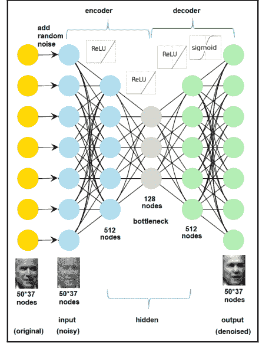

### 工作原理...

我们从 PyTorch 使用 `nn.Sequential()`，通过依次指定构建块（`nn.Module`）来构建自动编码器。来自噪声图像的每个像素都形成一个输入节点，因此输入有 50*37 个节点。输出也具有相同数量的节点。

使用 `nn.Linear(50*37, 512)` 实例化了大小为 1,850 x 512 的全连接层。`nn.ReLU(True)` 用于在输入/隐藏层之间应用原地 ReLU 非线性，而 `nn.Sigmoid()` 用于在最终层之前对输出层应用 Sigmoid 函数。使用 `nn.BCELoss()` 采用二元交叉熵损失。`backward()` 函数用于反向传播并重新计算神经网络中的权重。

可以通过设置 cuda = True 在 GPU 上运行代码，以运行得更快。

下图显示了原始图像、噪声图像、自动编码器重建的输出图像，以及编码器第一个隐藏层在两个不同时代结束时学到的几个特征：

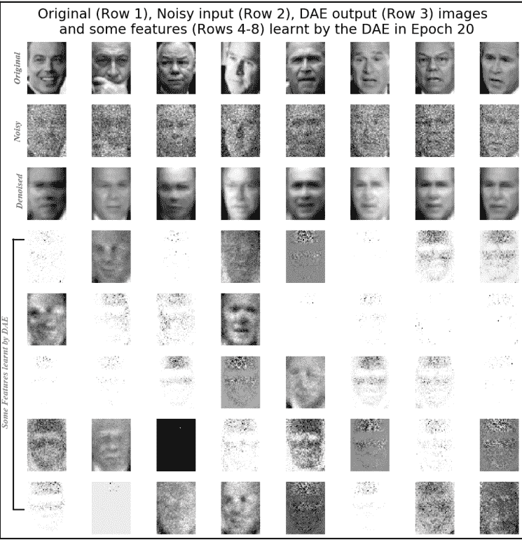

如下图所示，随着时代数量的增加，自动编码器输出生成的去噪图像与相应的原始图像越来越相似：

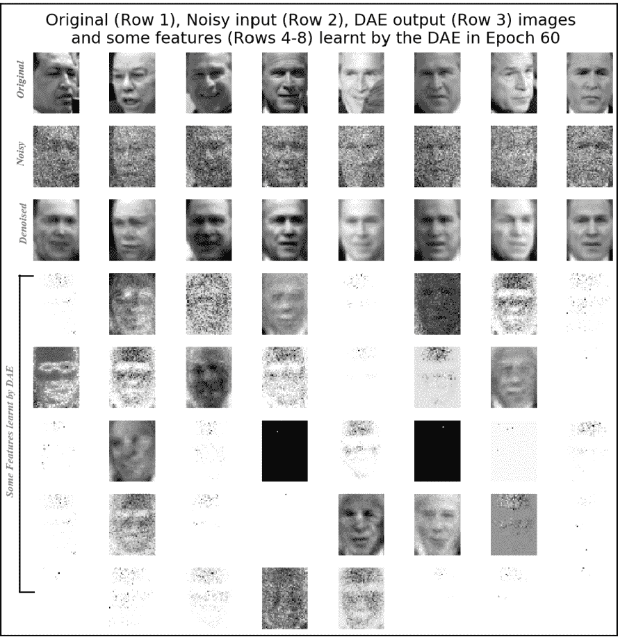

### 更多内容...

使用彩色图像（向 fetch_lfw_people() 函数传递 color=True）重复上述去噪过程。使用噪声图像训练一个过完备自动编码器（隐藏层节点数大于输入节点数，且只有一个隐藏层）。如果同时将原始图像用作输入和输出进行训练，会发生什么？现在，使用原始图像同时作为输入和输出，但在隐藏层使用 L1 正则化器，训练一个稀疏过完备自动编码器。

### 另请参见

如需更多信息，请参阅以下链接：

- http://vis-www.cs.umass.edu/lfw/
- https://scikit-learn.org/0.15/datasets/labeled_faces.html
- https://pytorch.org/docs/stable/_modules/torch/nn/modules/linear.html
- https://www.youtube.com/watch?v=B6YO5_RLA1A

## 使用 PCA/DFT/DWT 进行图像去噪

主成分分析（PCA）、离散傅里叶变换（DFT）和离散小波变换（DWT）也是可用于去噪图像的传统机器学习技术。这些技术中的每一种都将学习图像空间的表示（近似），并主要保留图像中的信息内容，同时去除噪声。

### 准备工作

我们将为本示例使用 Olivetti 面部数据集。该数据集包含总共 400 张灰度人脸图像（每张大小为 64 x 64），每个对象 10 张，共 40 个对象。和往常一样，让我们先导入所需的库：

```python
import numpy as np
from numpy.random import RandomState
import matplotlib.pyplot as plt
from sklearn.datasets import fetch_olivetti_faces
from sklearn import decomposition
from skimage.util import random_noise
from skimage import img_as_float
```

```python
from time import time
import scipy.fftpack as fp
import pywt
```

### 操作步骤

执行以下步骤实现滤波器：

- 1. 首先下载人脸数据：

```python
dataset = fetch_olivetti_faces(shuffle=True, random_state=rng)
original = img_as_float(dataset.data)
faces = original.copy()
print(faces.shape)
# (400, 4096)
```

- 2. 向图像添加方差为 0.005 的随机高斯噪声：

```python
image_shape = (64, 64)
rng = RandomState(0)
n_samples, n_features = faces.shape
faces = random_noise(faces, var=0.005)
```

- 3. 使用 PCA 且仅使用 50 个主成分重建图像：

```python
n_components = 50 # 256
estimator = decomposition.PCA(n_components=n_components,
                              svd_solver='randomized', whiten=True)
print("Extracting the top %d PCs..." % (n_components))
t0 = time()
faces_recons = estimator.inverse_transform(estimator.fit_transform(faces))
train_time = (time() - t0)
print("done in %0.3fs" % train_time)
```

- 4. 随机选择五个图像索引，显示原始图像、噪声图像和 PCA 重建图像：

```python
indices = np.random.choice(n_samples, 5, replace=False)
plt.figure(figsize=(20, 4))
for i in range(len(indices)):
    plt.subplot(1,5,i+1),
    plt.imshow(np.reshape(faces_recons[indices[i],:], image_shape)),
    plt.axis('off')
plt.suptitle('PCA reconstruction with {} components (eigenfaces)'.format(n_components), size=25)
plt.show()
```

- 5. 使用 FFT 低通滤波器（LPF），丢弃除三十个最低频率分量外的所有分量，并使用这些基向量重建噪声图像。显示重建的图像：

```python
n_components = 30
plt.figure(figsize=(20, 4))
for i in range(len(indices)):
    freq = fftshift(fft2((np.reshape(faces[indices[i], :],
    image_shape)).astype(float)))
    freq[:freq.shape[0]//2 - n_components//2, :] = 0
    freq[freq.shape[0]//2 + n_components//2:, :] = 0
    freq[:, :freq.shape[1]//2 - n_components//2] = 0
    freq[:, freq.shape[1]//2 + n_components//2:] = 0
    plt.subplot(1, 5, i+1),
    plt.imshow(ifft2(ifftshift(freq)).real), plt.axis('off')
    plt.suptitle('FFT LPF reconstruction with {} basis vectors'.format(n_components), size=25)
plt.show()
```

- 6. 使用 DWT 并丢弃第七个频带来重建图像。显示重建的图像：

```python
plt.figure(figsize=(20, 4))
wavelet = pywt.Wavelet('haar')
for i in range(len(indices)):
    wavelet_coeffs = pywt.waverec2((np.reshape(faces[indices[i], :],
    image_shape)).astype(float), wavelet)
    plt.subplot(1, 5, i+1),
    plt.imshow(pywt.waverec2(wavelet_coeffs[:-1], wavelet)),
    plt.axis('off')
    plt.suptitle('Wavelet reconstruction with {} subbands'.format(len(wavelet_coeffs)-1), size=25)
plt.show()
```

### 工作原理...

scikit-learn 的 `decomposition.PCA()` 函数用于实例化 PCA 对象。首先使用 `fit_transform()` 函数将图像投影到更低维度（从 4096 维到 50 维），然后使用 `inverse_transform()` 函数从较低维度的表示中重建图像。


使用 `scipy.fftpack` 的 `fft2()` 函数将图像从空间域变换到频域，方法是将所有高频基向量强制设为零（除最低三十个基向量外），然后使用 `ifft2()` 重建图像。

最后，使用 `pywt.Wavelet( 'haar' )` 函数实例化 Haar 小波对象。使用 `pywt.wavdec2()` 函数获取所有小波系数，然后使用 `pywt.waverec2()` 从系数重建图像，丢弃最后一个频带。

如果运行前面的代码块，将得到类似于以下的输出：

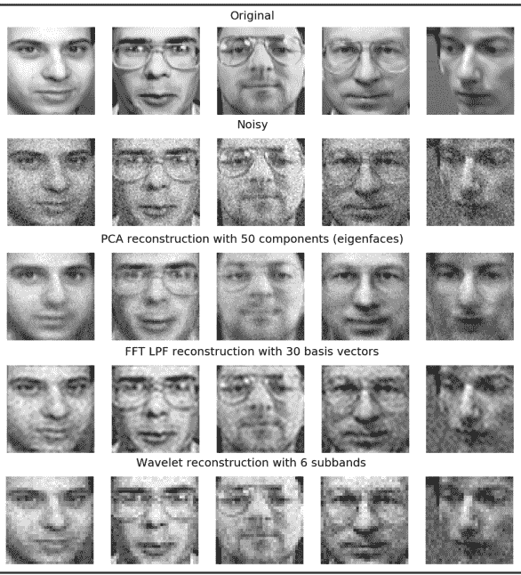

如前面的截图所示，PCA 在重建方面似乎表现最好。

### 还有更多...

尝试使用 SVD 自己实现 PCA，然后将图像投影到主奇异向量上（也可以使用 scikit-learn 的 `TruncatedSVD()` 函数）。使用 PSNR 值比较不同技术的输出（去噪）图像质量。

### 另请参阅

有关更多信息，请参阅以下链接：

- https://scikit-learn.org/0.19/datasets/olivetti_faces.html
- https://scikit-learn.org/stable/modules/generated/sklearn.decomposition.TruncatedSVD.html
- https://www.youtube.com/watch?v=jDnIkyxwX4Y

## 使用各向异性扩散进行图像去噪

在本示例中，你将学习如何使用 `medpy` 库函数中的各向异性（热）扩散方程去噪图像，同时保留边缘。另一方面，各向同性扩散相当于应用高斯滤波器，它不会保留图像中的边缘，这一点我们已经了解。

### 准备工作

在本示例中，我们将使用 cameraman 灰度图像。像往常一样，先导入所需的库：

```
from medpy.filter.smoothing import anisotropic_diffusion
from skimage.util import random_noise
from skimage.io import imread
from skimage import img_as_float
import matplotlib.pyplot as plt
import numpy as np
```

### 操作步骤

执行以下步骤，使用 Perona-Malik 各向异性扩散实现去噪图像：

- 1. 首先，从磁盘读取 cameraman 灰度图像，并向其添加随机高斯噪声（方差为 0.025）。将加噪图像裁剪，使其值位于 0 和 1 之间（包含边界）：

```
img = img_as_float(imread('images/cameraman.png'))
noisy = random_noise(img, var=0.005)
noisy = np.clip(noisy, 0, 1)
```

- 2. 绘制原始图像和加噪图像：

```
plt.figure(figsize=(15,18))
plt.gray()
plt.subplots_adjust(0,0,1,1,0.05,0.05)
plt.subplot(221), plt.imshow(img), plt.axis('off'),
plt.title('Original', size=20)
plt.subplot(222), plt.imshow(noisy), plt.axis('off'),
plt.title('Noisy', size=20)
```

- 3. 应用各向异性扩散（根据 Perona-Malik 方程 1），参数为 kappa=20 和 niter=20，去噪加噪图像。绘制平滑后的图像：

```
diff_out = anisotropic_diffusion(noisy, niter=20, kappa=20,
option=1)
plt.subplot(223), plt.imshow(diff_out), plt.axis('off'), \\
plt.title(r'Anisotropic Diffusion (Perona Malik eq 1, \\
iter=20, $\kappa=20$)', size=20)
```

- 4. 再次应用各向异性扩散（这次根据 Perona-Malik 方程 2），参数为 kappa=50 和 niter=50，去噪加噪图像。绘制平滑后的图像：

```
diff_out = anisotropic_diffusion(noisy, niter=50, kappa=50,
option=2)
plt.subplot(224), plt.imshow(diff_out), plt.axis('off'), \\
plt.title(r'Anisotropic Diffusion (Perona Malik eq 2, \\
iter=50, $\kappa=50$)', size=20)
plt.show()
```

如果运行前面的代码片段，将得到类似于以下的图表：

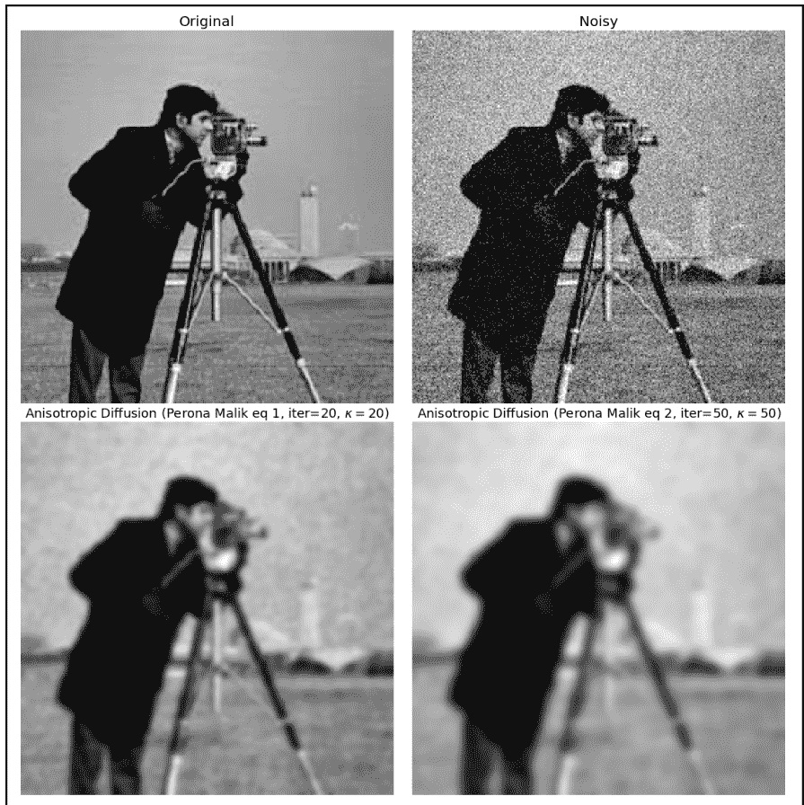

从前面的输出可以看到，随着 $\kappa$ 值和迭代次数的增加，图像会变得更加模糊。

### 工作原理

各向异性扩散用于通过保持边缘基本不变（甚至增强）来平滑（去噪）图像。在各向异性扩散过程（这是一个迭代过程）中，高斯核被用作传导函数（c），依据 Perona-Malik 方程 1，如下面的截图所示：

各向异性热扩散方程

$I_t = div(c(x, y, t)\nabla I) = c(x, y, t).\Delta I + \nabla c \cdot \nabla I$
时刻 t 的图像 差分 梯度 传导函数 拉普拉斯算子

$= \nabla \cdot (c\nabla I) = \frac{\partial}{\partial x}(cI_x) + \frac{\partial}{\partial y}(cI_y)$

根据当前图像 I 每次迭代计算传导函数 c

$c(x, y, t) = g(\| \nabla I(x, y, t) \|)$

Perona-Malik 边缘停止函数

$g(\nabla I) = e^{( - (\| \nabla I \| / K)^2 )} \quad (\text{equation 1})$

$g(\nabla I) = \frac{1}{1 + \left( \frac{\| \nabla I \|}{K} \right)^2} \quad (\text{equation 2})$

摘自 http://image.diku.dk/imagecanon/material/PeronaMalik1990.pdf

medpy 库的 filter.smoothing 模块中的 `anisotropic_diffusion()` 函数用于实现扩散过程。该函数的 niter 参数表示运行扩散过程的迭代次数。kappa (K) 参数是一个整数，表示传导系数（例如，取值在 20 – 100 之间）。K 控制传导，传导是梯度的函数。当 K 很小时，陡峭边缘处的传导和扩散会被阻塞。K 值越大，强度梯度对传导的影响越小。gamma 参数控制扩散速度，为稳定起见，gamma 值应 ≤ 0.25。

### 还有更多...

比较使用各向异性扩散得到的去噪图像与使用高斯核卷积得到的图像（也称为 **各向同性扩散**）。使用 PSNR 比较质量。尝试自己实现各向异性扩散（请参阅以下 *另请参阅* 部分中给出的第二个链接）。

### 另请参阅

有关更多信息，请参阅以下链接：

- http://image.diku.dk/imagecanon/material/PeronaMalik1990.pdf
- https://sandipanweb.wordpress.com/2017/10/08/some-more-variational-image-processing-diffusiontv-denoising-image-inpainting/

## 使用直方图均衡化改善图像对比度

在 *第 1 章，图像操作与变换* 中，我们了解到对比度拉伸操作可用于增加图像的对比度。然而，它只是应用于图像像素值的线性缩放函数，因此图像增强不如其更复杂的对应物——直方图均衡化——那么显著。本示例将展示如何使用直方图均衡化实现对比度拉伸。这也是一种点变换，它使用非线性映射，以这种方式重新分配输入图像中的像素强度值，使得输出图像具有均匀的强度分布（平直直方图），从而增强图像的对比度。

### 准备工作

在本示例中，我们将使用自定义函数实现直方图均衡化，并使用 scikit-image 的全局和局部（自适应）直方图均衡化函数，起始图像为 RGB 图像。像往常一样，先导入所需的库：

```
import numpy as np
import matplotlib.pyplot as plt
from skimage.io import imread
from skimage.exposure import equalize_hist, equalize_adapthist
```

### 操作步骤

要执行本示例，请执行以下步骤：

- 1. 定义 `plot_image()` 和 `plot_hist()` 函数，分别用于显示图像并返回其累积分布函数 (cdf)：

```
def plot_image(image, title):
    plt.imshow(image)
    plt.title(title, size=20)
    plt.axis('off')

def plot_hist(img):
    colors = ['r', 'g', 'b']
    cdf = np.zeros((256, 3))
    for i in range(3):
        hist, bins = np.histogram(img[..., i].flatten(), 256, [0, 256], \
            normed=True)
        cdf[..., i] = hist.cumsum()
        cdf_normalized = cdf[..., i] * hist.max() / cdf.max()
        plt.plot(cdf_normalized, color = colors[i], \
            label='cdf ({})'.format(colors[i]))
        binWidth = bins[1] - bins[0]
        plt.bar(bins[:-1], hist*binWidth, binWidth,
            label='hist ({})'.format(colors[i]))
    plt.xlim([0, 256])
    plt.legend(loc = 'upper left')
    return cdf
```


- 2. 使用以下代码，通过为每个像素重新分配与该像素对应的 cdf 值来实现直方图均衡化：

```
img = imread('images/train.png')
cdf = plot_hist(img)
img2 = np.copy(img)
for i in range(3):
    cdf_m = np.ma.masked_equal(cdf[...,i],0)
    cdf_m = (cdf_m - cdf_m.min() ) *255/ (cdf_m.max() -cdf_m.min())
     # min-max normalize
    cdf2 = np.ma.filled(cdf_m, 0).astype('uint8')
    img2[...,i] = cdf2[img[...,i]]
```

- 3. 使用 scikit-image 库中实现全局直方图均衡化和自适应直方图均衡化的函数，对同一输入图像执行直方图均衡化：

```
equ1 = (255*equalize_hist(img) ).astype(np.uint8)
equ2 = (255*equalize_adapthist(img) ).astype(np.uint8)
```

### 工作原理...

对于每个图像通道，每个像素值都需要重新分配为该像素对应的 cdf 值，如下图所示：

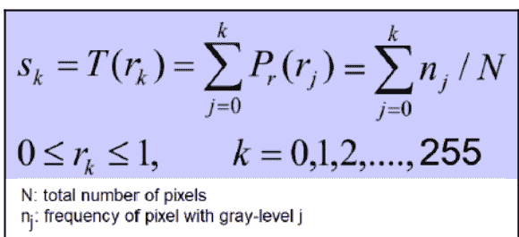

使用 scikit-image.exposure 模块中的 equalize_hist() 和 equalize_adapthist() 函数，分别获得全局和局部对比度增强后的图像。

如果运行上述代码，并绘制输入图像和输出图像以及相应的直方图和 cdf，您将获得以下输出（截图仅为输出的一部分）：

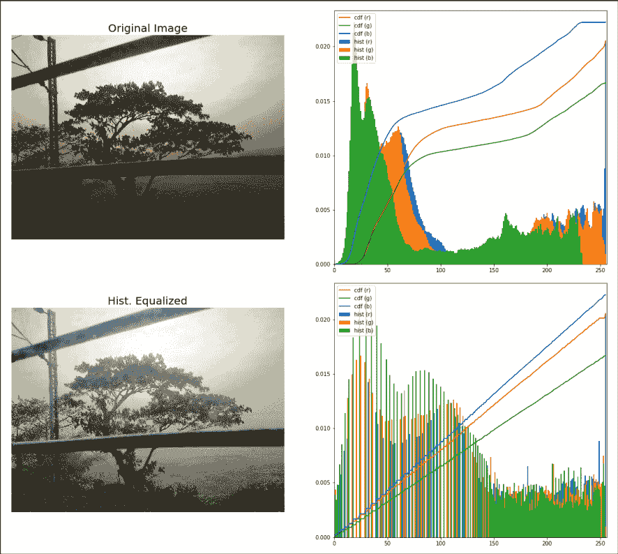

### 更多内容...

使用 OpenCV-Python 中的 `createCLAHE()` 函数执行自适应直方图均衡化。比较使用不同实现获得的输出结果的质量。另外，尝试使用几张不同的低对比度图像运行。

## 实现直方图匹配

直方图匹配是一项图像处理任务，通过修改图像使其直方图与另一张参考（模板）图像的直方图匹配。该算法描述如下：

- 1. 计算每个图像的累积直方图。
- 2. 对于输入图像中任意给定的像素值 \(x_i\)，通过将输入图像的直方图与模板图像的直方图匹配（\(G(x_j)=H(x_i)\)），在输出图像中找到对应的像素值 \(x_j\)，如下图所示。
- 3. 将输入中的像素 \(x_i\) 替换为 \(x_j\)，如下图所示：

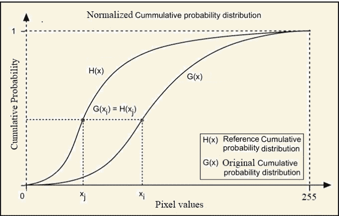

在本示例中，我们将自行实现彩色图像的直方图匹配。

### 准备工作

与往常一样，首先导入所需的库：

```
from skimage.exposure import cumulative_distribution
from skimage.color import rgb2gray
import matplotlib.pyplot as plt
import numpy as np
```

### 操作步骤...

按以下步骤实现直方图匹配：

- 1. 让我们使用 hist_matching() 函数实现直方图匹配算法，该函数接受原始图像和模板图像的 cdf 以及原始图像：

```
def hist_matching(c, c_t, im):
    b = np.interp(c, c_t, np.arange(256))
    # find closest matches to b_t
    pix_repl = {i:b[i] for i in range(256)}
    # dictionary to replace the pixels
    mp = np.arange(0,256)
    for (k, v) in pix_repl.items():
        mp[k] = v
    s = im.shape
    im = np.reshape(mp[im.ravel()], im.shape)
    im = np.reshape(im, s)
    return im
```

- 2. 使用以下函数计算图像的 cdf：

```
def cdf(im):
    c, b = cumulative_distribution(im)
    for i in range(b[0]):
        c = np.insert(c, 0, 0)
    for i in range(b[-1]+1, 256):
        c = np.append(c, 1)
    return c
```

- 3. 最后，读取输入图像和模板图像，计算它们的 cdf，并使用 hist_matching() 函数创建输出图像。运行以下代码绘制输入图像、模板图像和输出图像：

```
im = imread('images/goddess.png').astype(np.uint8)
im_t = imread('images/leaves.png')

im1 = np.zeros(im.shape).astype(np.uint8)
for i in range(3):
    c = cdf(im[...,i])
    c_t = cdf(im_t[...,i])
    im1[...,i] = hist_matching(c, c_t, im[...,i])

plt.figure(figsize=(20,17))
plt.subplots_adjust(left=0, top=0.95, right=1, bottom=0, \
    wspace=0.05, hspace=0.05)
plt.subplot(221), plt.imshow(im), plt.axis('off'), \
    plt.title('Input Image', size=25)
plt.subplot(222), plt.imshow(im_t), plt.axis('off'), \
    plt.title('Template Image', size=25)
plt.subplot(223), plt.imshow(im1[...,:3]), plt.axis('off'), \
    plt.title('Output Image', size=25)
plt.show()
```

### 工作原理...

使用 scikit-image.exposure 模块中的 cumulative_distribution() 函数计算图像的 cdf。

> 请注意，cumulative_distribution() 函数按连续像素值的递增顺序返回箱，范围从图像中存在的最小像素值到最大像素值。

由于需要从 0 到 255 的所有像素值，我们使用了 np.insert() 并配合适当的 cdf 值（所有较小像素值为 0，不存在的较高像素值为 1）。

对于每个颜色通道，使用 cdf() 函数分别计算输入图像和模板图像的 cdf，然后将这些值与输入图像一起传递给 hist_matching() 函数，以构建输出图像中对应的颜色通道。

下图显示了针对给定输入图像和模板图像生成的输出图像：

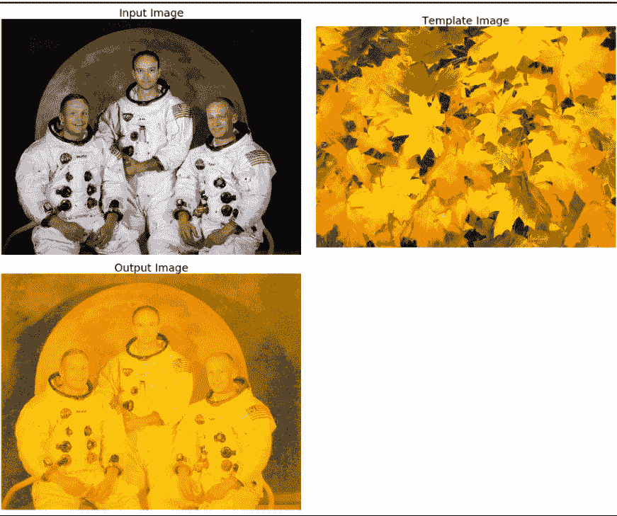

### 更多内容...

您可以使用直方图匹配，结合合适的模板图像将白天拍摄的图像转换为夜视图像。下一个示例展示了直方图匹配的另一个有趣应用：

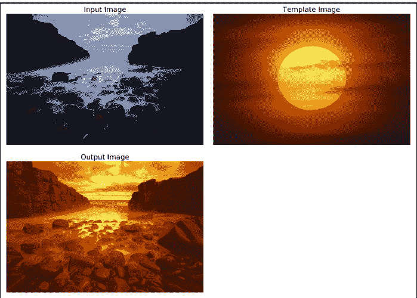

### 另请参见

有关更多信息，请参阅以下链接：

- https://scikit-image.org/docs/dev/api/skimage.exposure.html#skimage.exposure.cumulative_distribution
- https://www.youtube.com/watch?v=4VLMlI90tLE
- 《使用 Python 进行图像处理实战》一书中的直方图匹配章节（第 4 章）

## 执行梯度混合

泊松图像编辑的目标是执行源图像（由掩码图像捕获）中对象或纹理与目标图像之间的无缝（梯度）混合（克隆）。我们希望使用泊松图像编辑将图像区域粘贴到新背景上，从而创建照片拼贴。该想法源自 Perez 等人发表在 SIGGRAPH 2003 论文、*泊松图像编辑*中的思想，该论文表明使用图像梯度进行混合能产生更逼真的结果。

无缝克隆完成后，掩码区域内源图像和输出图像的梯度将相同。此外，掩码区域边界处目标图像和输出图像的强度也将相同。下图展示了源图像块 g 如何与目标图像 f*（在区域 Ω 上）无缝集成，并通过泊松求解器获得新图像块 f（在区域 Ω 上）作为解：

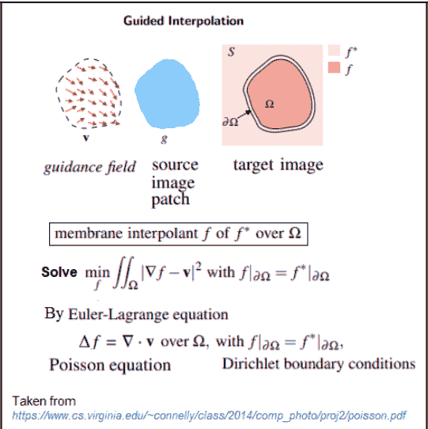

在本示例中，我们将使用 OpenCV-Python 演示无缝克隆。

### 准备工作

我们将使用自由女神像图像作为源图像，使用维多利亚纪念堂图像作为目标图像。首先导入库。确保 OpenCV-Python 的主版本至少为 3：

```
import cv2
import numpy as np
print(cv2.__version__)
# 3.4.2
```

### 操作步骤...

本示例的步骤如下：

- 1. 读取源图像、目标图像和掩码图像：

```
src = cv2.imread("images/liberty.png")
dst = cv2.imread("images/victoria.png")
src_mask = cv2.imread("images/cmask.png")
print(src.shape, dst.shape, src_mask.shape)
# (480, 698, 3) (576, 768, 3) (480, 698, 3)
```

- 2. 运行无缝克隆，在目标图像的中心周围混合掩码源图像，并保存输出图像：

```
center = (275,250)
output = cv2.seamlessClone(src, dst, src_mask, center, \
cv2.MIXED_CLONE)
cv2.imwrite("images/liberty_victoria.png", output)
```


### 工作原理

以下屏幕截图显示了用于梯度混合的输入图像和掩码图像：

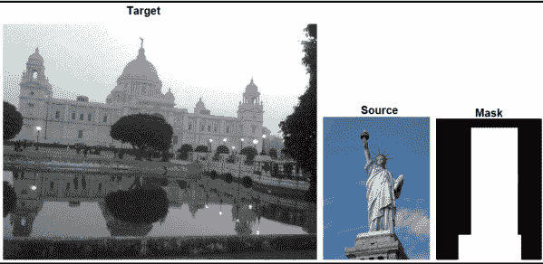

使用了 `cv2.seamlessClone()` 函数，并将 `flags` 参数值设置为 `cv2.MIXED_CLONE`，这是一种 `classic` 方法。该函数实现了泊松图像编辑，使用泊松求解器求解（泊松）方程组，仅在边缘位置保留梯度（作为 Dirichlet 边界条件）。

如果运行前面的代码片段，您将得到类似于以下内容的输出图像：

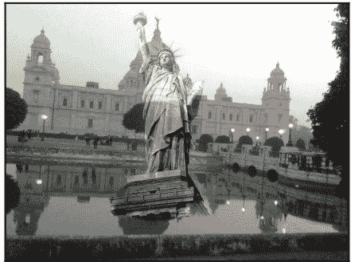

## 基于 Canny、LoG/零交叉和小波的边缘检测

边缘检测是一种预处理技术，其输入通常为二维（灰度）图像，输出为一组曲线（称为边缘）。构成图像边缘的像素是图像强度函数中出现突变（不连续）的那些像素，边缘检测的目标是识别这些变化。通常通过寻找一阶导数（梯度）的局部极值，或寻找二阶导数（拉普拉斯算子）的零交叉点来检测边缘。在本节中，我们将首先实现两种非常流行的边缘检测技术，即 Canny 和 Marr-Hildreth（带零交叉的 LoG）。然后，我们将实现基于小波的边缘检测。

### 准备工作

像往常一样，让我们先导入所需的库：

```
import numpy as np
from scipy import ndimage, misc
import matplotlib.pyplot as plt
from skimage.color import rgb2gray
from skimage.filters import threshold_otsu
import pywt
import SimpleITK as sitk
```

### 如何操作

让我们先从最流行的边缘检测器开始，即 Canny 边缘检测器。我们将使用 SimpleITK 对标量值图像（例如灰度图像）的 Canny 边缘检测器实现。该实现使用二阶方向导数和零交叉来查找边缘。

### Canny/滞后阈值处理

执行以下步骤，使用 SimpleITK 库函数实现基于 Canny 的边缘检测：

- 1. 读取输入灰度图像并将其转换为 float64 数据类型：

```
image = sitk.ReadImage('images/cameraman.png')
# 8-bit cameraman grayscale image
image = sitk.Cast(image, sitk.sitkFloat64)
```

- 2. 对高斯模糊的两个 σ 值（1 和 3）计算 Canny 滤波器，并使用相同的滞后阈值：

```
edges1 = sitk.CannyEdgeDetection(image, lowerThreshold=5, \
 upperThreshold=10, variance=[1, 1])
edges2 = sitk.CannyEdgeDetection(image, lowerThreshold=5, \
 upperThreshold=10, variance=[3, 3])
```

- 3. 将输出转换为 NumPy 数组以供显示：

```
image = sitk.GetArrayFromImage(image)
edges1 = sitk.GetArrayFromImage(edges1)
edges2 = sitk.GetArrayFromImage(edges2)
```

- 4. 显示输入图像和边缘图像：

```
fig = plt.figure(figsize=(20, 6))
plt.subplot(131), plt.imshow(image, cmap=plt.cm.gray), \
plt.axis('off')
plt.title('Input image', fontsize=20)
plt.subplot(132), plt.imshow(edges1, cmap=plt.cm.gray), \
plt.axis('off')
plt.title('Canny filter, $\sigma=1$', fontsize=20)
plt.subplot(133), plt.imshow(edges2, cmap=plt.cm.gray), \
plt.axis('off')
plt.title('Canny filter, $\sigma=3$', fontsize=20)
fig.tight_layout()
plt.show()
```

如果运行前面的代码片段，您将得到类似于以下内容的输出：

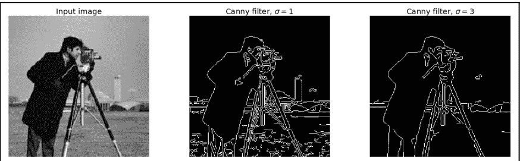

从前面的图像可以看出，高斯模糊的较低 σ 值输出更详细的边缘，而较高的值生成更突出的边缘。

接下来，让我们使用另一种称为 Marr-Hildreth 算法的流行算法实现边缘检测，为此我们需要计算高斯拉普拉斯（LoG）卷积图像中的零交叉点。可以通过将 LoG 平滑图像视为二值图像并确定像素的符号来识别边缘像素。

### LoG/零交叉

执行以下步骤，使用 LoG 和零交叉实现边缘检测：

- 1. 首先，让我们定义 any_neighbor_zero() 函数，该函数以图像中的一个像素作为输入，如果该像素的任何（8 连通）邻居为零，则返回 True：

```
def any_neighbor_zero(img, i, j):
    for k in range(-1, 2):
        for l in range(-1, 2):
            if k == 0 and l == 0: continue # skip the input pixel
            if img[i+k, j+l] == 0:
                return True
    return False
```

- 2. 接下来，让我们定义 zero_crossing() 函数：

```
def zero_crossing(img):
    img[img > 0] = 1
    img[img < 0] = 0
    out_img = np.zeros(img.shape)
    for i in range(1, img.shape[0]-1):
        for j in range(1, img.shape[1]-1):
            if img[i,j] > 0 and any_neighbor_zero(img, i, j):
                out_img[i,j] = 255
    return out_img
```

- 3. 最后，在 LoG 卷积的输入图像上调用 zero_crossing() 函数并绘制输出：

```
img = rgb2gray(misc.imread('images/tiger.png'))
fig = plt.figure(figsize=(25,15))
plt.gray() # show the filtered result in grayscale
for sigma in range(2, 10, 2):
    plt.subplot(2, 2, sigma/2)
    result = ndimage.gaussian_laplace(img, sigma=sigma)
    result = zero_crossing(result)
    plt.imshow(result)
    plt.axis('off')
    plt.title('LoG with zero-crossing, sigma=' + str(sigma), size=30)
plt.tight_layout()
plt.show()
```

下图显示了用于边缘检测的输入图像：


如果运行前面的代码片段，您将得到类似于以下内容的输出（使用前面的输入图像）：

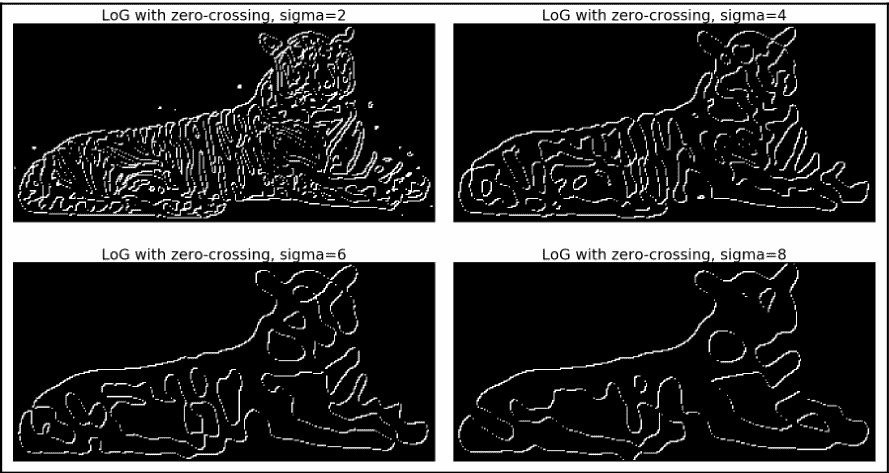

### 小波

执行以下步骤，使用 pywt 库函数实现基于小波的边缘检测：

- 1. 加载输入图像并将其转换为灰度图：

```
original = rgb2gray(imread('images/bird.png'))
```

- 2. 对灰度图像使用 haar 小波对图像应用 2D-DWT。这将返回小波系数：

```
coeffs2 = pywt.dwt2(original, 'haar')
```

- 3. 使用以下代码分别提取近似图像以及水平、垂直和对角细节（边缘）：

```
titles = ['Approximation', ' Horizontal detail', 'Vertical detail',
\
'Diagonal detail']
LL, (LH, HL, HH) = coeffs2
```

- 4. 绘制近似图像以及检测到的水平、垂直和对角边缘（细节）：

```
fig = plt.figure(figsize=(15, 20))
for i, a in enumerate([LL, LH, HL, HH]):
    ax = fig.add_subplot(2, 2, i + 1)
    a = abs(a)
    if i > 0:
        th = threshold_otsu(a)
        a[a > th] = 1
        a[a <= th] = 0
    ax.imshow(a, interpolation="nearest", cmap=plt.cm.gray)
    ax.set_title(titles[i], fontsize=20)
    ax.set_xticks([])
    ax.set_yticks([])
fig.tight_layout()
plt.show()
```

下图显示原始输入图像：

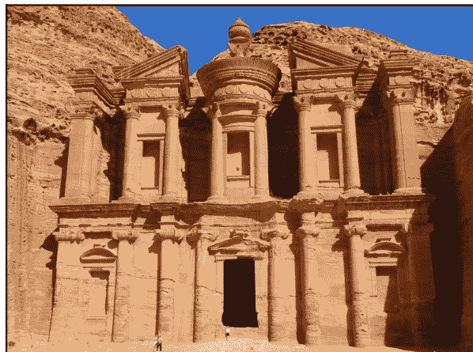

下图显示运行前面代码后您将获得的输出：

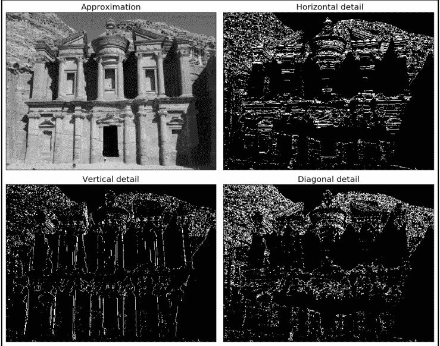

### 工作原理

使用 SimpleITK 中的 `CannyEdgeDetection()` 函数进行边缘检测的算法如下：

- 1. 使用高斯滤波器进行平滑（即去除噪声，因为边缘检测对噪声敏感）。该函数的方差参数用于高斯平滑。
- 2. 计算前一步骤获得的图像的二阶（方向）导数。
- 3. 应用非极大值抑制（以细化边缘并删除不需要的像素），查找二阶导数的零交叉点，并使用三阶导数的符号找到正确的极值。
- 4. 对梯度幅值（乘以零交叉点）应用滞后阈值处理，以查找并连接边缘。传递给该函数的 lowerThreshold 和 upperThreshold 参数是滞后阈值。确定的边缘是强度梯度值高于 upperThreshold 参数的边缘。确定的非边缘是强度梯度值低于 lowerThreshold 参数的边缘。对于强度梯度值介于滞后阈值之间的边缘，根据它们是否连接到确定边缘像素，将其分类为边缘或非边缘。

使用 scipy ndimage 模块的 gaussian_laplace() 函数（该函数将 σ 作为高斯平滑的参数）对输入图像应用 LoG 卷积。

计算零交叉的算法（使用 zero_crossing() 函数实现）如下：

- 1. 从 LoG 卷积图像创建二值图像：分别将正像素值和负像素值替换为 1 和 0。
- 2. 考虑所得二值图像中非零像素的直接邻居，以计算零交叉像素。
- 3. 通过查找任何具有直接零邻居的非零像素来标记边界。
- 4. 总而言之，对于二值图像中的每个非零像素，检查其任何（八个）邻近像素是否为零，如果是，则将（中心）像素标识为边缘像素——这是使用 any_neighbor_zero() 函数实现的。

使用 pywt 库的 dwt2() 函数实现了 DWT。作为参数传递的小波对象是 HAAR 家族小波。

使用 scikit-image.filters 模块的 threshold_otsu() 函数对使用 DWT 获得的边缘（细节）图像进行二值化。


## 还有更多...

尝试使用来自不同小波家族的不同小波对象（db、sym、bior 等等）来提取边缘（您也可以定义自定义小波）。实现高斯差分（DoG）运算以近似 LoG 用于边缘检测并比较结果（从速度和质量方面）。使用各向异性扩散在图像中查找边缘，并将结果与 Canny 进行比较（使用各向异性扩散您将得到沿以下线条的图表）：

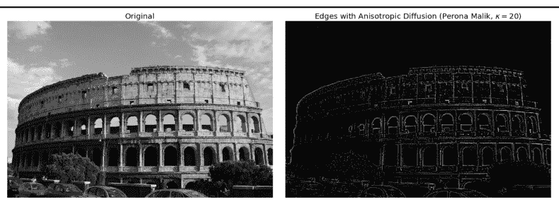

## 另请参见

有关更多信息，请参阅以下链接：

- http://citeseerx.ist.psu.edu/viewdoc/download?doi=10.1.1.420.3300rep=rep1&type=pdf
- https://www.cs.virginia.edu/~connelly/class/2014/comp_photo/proj2/poisson.pdf
- https://pywavelets.readthedocs.io/en/latest/regression/wavelet.html
- http://image.diku.dk/imagecanon/material/PeronaMalik1990.pdf
- https://www.youtube.com/watch?v=Wpq0kMCPBU4
