# 3 图像恢复

图像恢复是一种图像处理技术，它试图通过使用先验知识对退化过程进行建模来恢复损坏的图像（例如，在大多数情况下假设退化滤波器是已知的）。然后，它通过应用逆过程来改进图像以恢复原始图像。与图像增强技术不同，在图像恢复中，退化是建模的。这使得退化的影响可以（很大程度上）被消除。挑战在于信息丢失和噪声。下图显示了一个基本的图像退化模型，其中观察到的（退化的）图像被假定为原始（无噪声）图像与退化核卷积之和加上一个加性噪声分量：

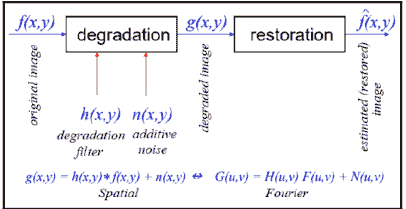

在本章中，我们将介绍以下图像恢复的配方：

- 使用维纳滤波器恢复图像
- 使用 CLS 滤波器恢复图像
- 马尔可夫随机场图像恢复
- 图像修复
- 使用深度学习修复进行图像补全
- 字典学习图像恢复
- 小波图像压缩
- 使用隐写术和隐写分析

## 使用维纳滤波器恢复图像

维纳滤波器是 **均方误差（MSE）** 滤波，它同时考虑了退化函数和噪声的统计特性。基本假设是噪声和图像不相关。它优化滤波器以最小化 MSE。在本配方中，您将学习如何使用 scikit-image 恢复模块中的函数实现维纳滤波器，以及如何以有监督和无监督的方式应用该滤波器来恢复退化图像。

### 准备工作

在本配方中，我们将使用仙人掌图像作为输入，并用噪声/模糊将其损坏。像往常一样，让我们首先使用以下代码行导入所有所需的库：

```
from skimage.io import imread
import numpy as np
import matplotlib.pyplot as plt
from matplotlib.ticker import LinearLocator, FormatStrFormatter
```

### 操作方法

按照列出的步骤实现维纳滤波器，并将其应用于恢复受模糊/噪声损坏的图像：

- 1. 读取图像并将其转换为灰度：

```python
im = color.rgb2gray(imread('images/cactus.png'))
```

- 2. 定义 `convolve2d()` 在频域中实现卷积（根据卷积定理，此实现比空间域中的实现快得多）。构建 7x7 平均（盒模糊）点扩散函数，并将其作为卷积核用于模糊图像，使用以下代码：

```
def convolve2d(im, psf, k):
    M, N = im.shape
    freq = fp.fft2(im)
    # assumption: min(M,N) > k > 0, k odd
    psf = np.pad(psf, (((M-k) // 2, (M-k) // 2 + 1), \
                     ((N-k) // 2, (N-k) // 2 + 1)), mode='constant')
    freq_kernel = fp.fft2(fp.ifftshift(psf))
    return np.abs(fp.ifft2(freq*freq_kernel))
```

- 3. 向模糊图像添加噪声以获得退化图像：

```
im1 += 0.2 * im.std() * np.random.standard_normal(im.shape)
```

- 4. 在退化图像上应用无监督维纳滤波器，并以核作为输入来恢复图像：

```
im2, _ = restoration.unsupervised_wiener(im1, psf)
```

- 5. 在退化图像上应用维纳滤波器（这次带有 balance 参数），并以核作为输入来恢复图像：

```
im3 = restoration.wiener(im1, psf, balance=0.25)
```

如果您绘制输入和输出图像，您将得到如下的截图：

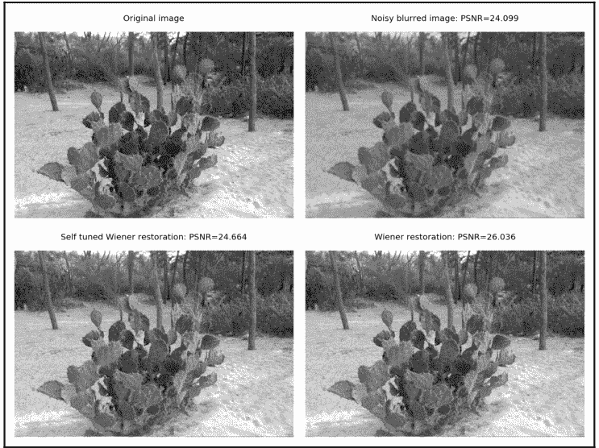

从前面的截图可以看出，带有 balance 参数的维纳恢复优于无监督维纳恢复。我们使用 **峰值信噪比**（PSNR）指标测量了恢复图像的质量。

- 6. 使用以下代码以 3D 形式绘制输入/输出图像和核的频谱：

```
def plot_freq_spec_3d(freq):
    fig = plt.figure(figsize=(10,10))
    ax = fig.gca(projection='3d')
    Y = np.arange(-freq.shape[0]//2, freq.shape[0]-freq.shape[0]//2)
    X = np.arange(-freq.shape[1]//2, freq.shape[1]-freq.shape[1]//2)
    X, Y = np.meshgrid(X, Y)
    Z = (20*np.log10(0.01 + fp.fftshift(freq))).real
    surf = ax.plot_surface(X, Y, Z, cmap=plt.cm.coolwarm, \
         linewidth=0, antialiased=True)
    ax.zaxis.set_major_locator(LinearLocator(10))
    ax.zaxis.set_major_formatter(FormatStrFormatter('%.02f'))
    plt.show()

plot_freq_spec_3d(fp.fft2(im))
plot_freq_spec_3d(fp.fft2(im1))
plot_freq_spec_3d(fp.fft2(im2))
plot_freq_spec_3d(fp.fft2(im3))
```

运行前面的代码后，您将得到的输出部分如下所示：

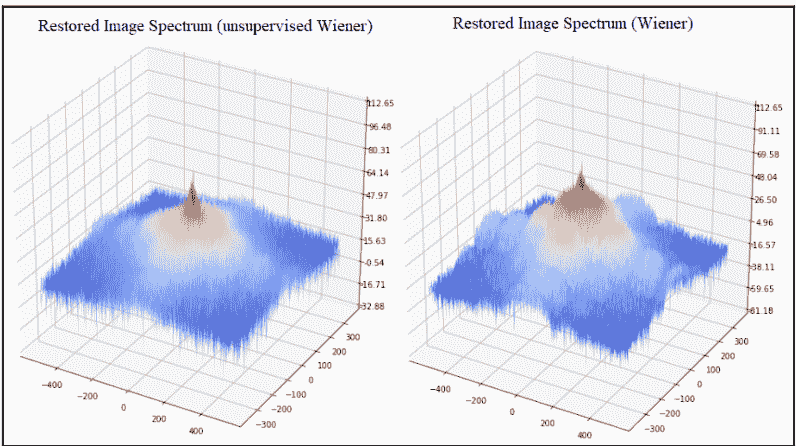

### 工作原理

下图显示了如何计算维纳滤波器。可以看出，维纳滤波器是目标函数为最小化恢复图像与原始图像之间 MSE 的滤波器：

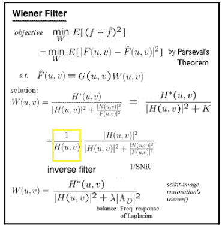

从前面的图可以看出，当输入图像未添加噪声（N=0）时，维纳滤波器退化为逆滤波器。在此，K 是一个常数（即，它不依赖于 u、v），应根据对噪声的先验知识来选择。

来自 scikit-image.restoration 模块的 `unsupervised_wiener()` 函数被用于使用维纳-亨特方法的去卷积来对退化图像进行去噪，其中超参数会自动估计。对于无监督维纳算法，估计图像被定义为贝叶斯分析的后验均值。均值被定义为所有可能图像的总和，根据其概率加权。精确求和不可行，因此使用 **马尔可夫链蒙特卡罗（MCMC）** 方法（吉布斯采样器）在后验定律下绘制图像。

吉布斯采样器会绘制更多高概率图像（比低概率图像更多），因为它们对均值有更高的贡献。这些样本的经验均值被用作均值的估计。默认情况下，拉普拉斯算子用作正则化算子。来自 scikit-image.restoration 模块的 `wiener()` 函数被使用，这次带有额外的 balance 参数，以使用维纳滤波器对退化图像进行去噪。同样，此滤波器返回带有维纳-亨特方法的去卷积（即，带有傅里叶对角化）。

正则化参数（balance 或 λ）的值会改变数据与先验适当性之间的平衡。数据适当性有助于改善频率恢复，而先验适当性有助于减少频率恢复以避免噪声工件。默认情况下，拉普拉斯算子用作正则化算子。

### 另请参见

请参阅以下文章以了解更多关于本配方的信息：

- https://scikit-image.org/docs/dev/api/skimage.restoration.html#skimage.restoration.unsupervised_wiener
- http://sce2.umkc.edu/csee/lizhu/teaching/2018.fall.digital-image-processing/notes/lec11.pdf


## 使用约束最小二乘滤波器恢复图像

在此示例中，我们将展示名为 **约束最小二乘（CLS）** 滤波器的又一个频域滤波器。正如滤波器名称所暗示的，它是一种带有额外平滑性约束的逆（最小二乘）滤波器，该约束通过施加平滑性约束，不允许恢复图像中出现任意高频波动。您将学习如何实现 CLS 滤波器，以及如何通过在图像上应用该滤波器来恢复退化图像。此外，您将使用反滤波、维纳滤波和 CLS 等不同频域滤波器实现来比较恢复图像的质量。

### 准备工作

让我们先导入所有所需的库，使用以下代码：

```
import numpy as np
import scipy.fftpack as fp
from skimage.io import imread
from skimage.color import rgb2gray
from skimage.restoration import wiener, unsupervised_wiener
from skimage.measure import compare_psnr
import matplotlib.pylab as plt
```

### 操作步骤

执行以下步骤以实现 CLS 滤波器，并比较不同频域滤波器下的恢复图像：

- 1. 首先，定义 `cls_filter()` 函数以实现约束最小二乘滤波器：

```
def cls_filter(y,h,c,lambd):
    Hf = fp.fft2(fp.ifftshift(h))
    Cf = fp.fft2(fp.ifftshift(c))
    Hf = np.conj(Hf) / (Hf*np.conj(Hf) + lambd*Cf*np.conj(Cf))
    Yf = fp.fft2(y)
    I = Yf*Hf
    im = np.abs(fp.ifft2(I))
    return (im, Hf)
```

- 2. 读取输入图像并将其转换为灰度图像。使用方框核（在频域中完成）对输入灰度图像进行模糊处理，并使用给定标准差（σ）的白高斯噪声（WGN）对图像进行退化：

```
x = rgb2gray(imread('images/building.png'))
M, N = x.shape
h = np.ones((4,4))/16 # blur filter
h = np.pad(h, [(M//2-2, M//2-2), (N//2-2, N//2-2)], \
mode='constant')
sigma = 0.05
Xf = fp.fft2(x)
Hf = fp.fft2(fp.ifftshift(h))
Y = Hf*Xf
y = fp.ifft2(Y).real + sigma*np.random.normal(size=(M,N))
```

- 3. 对退化图像应用伪逆滤波器，以获得恢复图像及伪逆滤波器核的频率响应：

```
epsilon = 0.25
pix, F_pseudo = pseudo_inverse_filter(y, h, epsilon)
```

- 4. 将平衡参数设置为 0.25 应用维纳滤波器，以获得恢复图像：

```
wx = wiener(y, h, balance=0.25)
```

- 5. 接下来，应用无监督维纳滤波器以获得恢复图像：

```
uwx, _ = unsupervised_wiener(y, h)
```

- 6. 构建高通滤波器（二维拉普拉斯算子）并将其转换为频域，以将其用作约束核。使用所创建的约束核以及正则化参数（λ）的值，对退化图像应用 CLS 滤波器：

```
c = np.array([[0,1/4,0],[1/4,-1,1/4],[0,1/4,0]])
c = np.pad(c, [(M//2-1, M//2-2), (N//2-2, N//2-1)], \
mode='constant')
Cf = fp.fft2(fp.ifftshift(c))
lambd = 20
clx, F_restored = cls_filter(y, h, c, lambd)
print(r'Restored (CLS, $\lambda$=${}) PSNR: {}'.format(lambd, \
      np.round(compare_psnr(x, clx),3))
# Restored (CLS, $\lambda$=20) PSNR: 28.924
```

如果运行上述代码片段并绘制所有输入/输出图像及滤波器的频率响应，您将得到类似于以下截图的输出（这只是实际输出的一部分）：

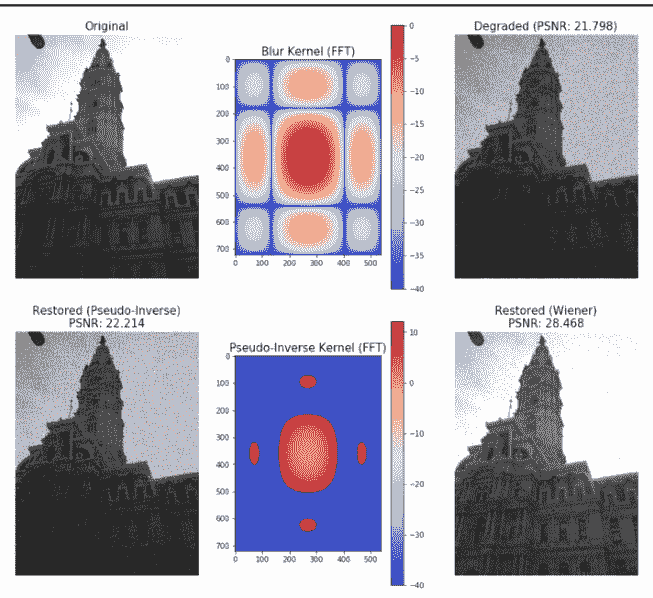

从前面的输出中可以看出，CLS 滤波器（$\lambda$ 值较高）和 $wiener$ 滤波器在恢复图像的质量方面表现相当出色。

- 7. 使用以下代码以 3D 形式绘制核的频率响应：

```
plot_freq_spec_3d(F_restored) # frequency response of CLS filter \ kernel
plot_freq_spec_3d(fp.fft2(x))
plot_freq_spec_3d(fp.fft2(y))
plot_freq_spec_3d(fp.fft2(clx))
plot_freq_spec_3d(fp.fft2(uxx))
```

您将作为输出的一部分获得以下截图：

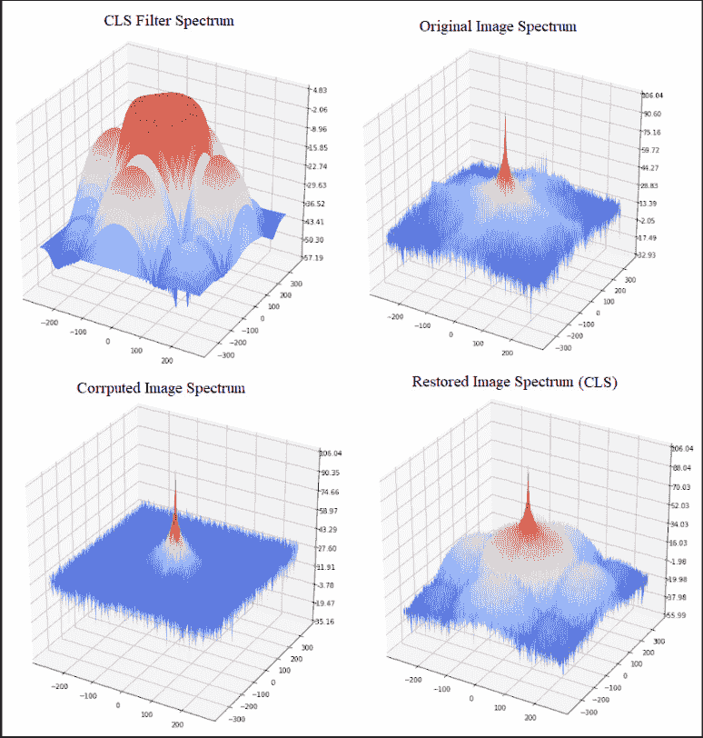

### 工作原理

以下图示展示了如何在频域中计算 CLS 滤波器并使用它恢复退化图像：

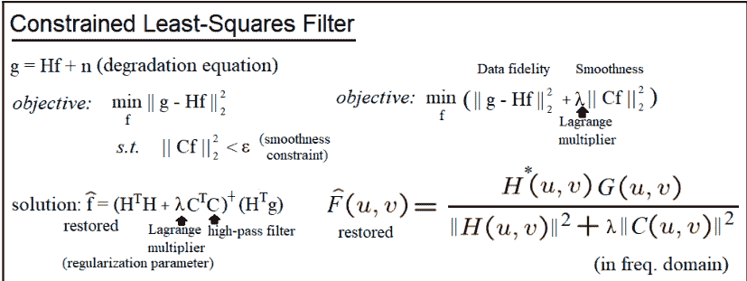

如我们所见，当 $\lambda=0$ 时，CLS 滤波器变为逆滤波器。参数 $\lambda$（正则化器）控制平滑度——$\lambda$ 值越高，恢复的图像越平滑。

二维拉普拉斯核 [[0, 1/4, 0], [1/4, -1, 1/4], [0, 1/4, 0]] 用作 CLS 滤波器的高通滤波器约束核（C）。恢复图像的质量使用 `compare_psnr()` 函数从 skimage.measurement 模块中进行比较，即通过将使用不同滤波器获得的恢复（估计）图像与原始图像进行比较。

`cls_filter()` 函数用于实际实现 CLS 滤波器。它接受退化图像、模糊核、约束高通滤波器（拉普拉斯核）和正则化参数 $\lambda$ 作为输入，并返回恢复的图像以及 CLS 滤波器的频率响应。

### 更多内容

为 CLS 滤波器使用不同的正则化参数值（从 0 等低值到 100 等高值），并观察恢复图像质量如何变化。比较维纳滤波器和 CLS 滤波器，用于恢复带有运动模糊的退化图像（例如，以下书籍图像）。您将得到类似于以下截图的输出（还要使用 MSE 指标来测试图像质量）：

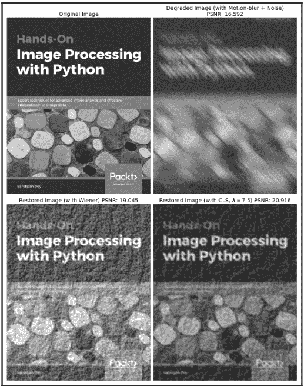

### 另请参阅

Refer to the following article to learn more about this recipe:
http://www.cs.uoi.gr/~cnikou/Courses/Digital_Image_Processing/Chapter_05b_Image_Restoration_(Linear_Restoration).pdf

## 使用马尔可夫随机场进行图像恢复

在此示例中，我们将讨论如何使用 **马尔可夫随机场（MRF）** 来对图像进行去噪。假设我们有一个噪声二值图像 X，其像素值为 \(X_{ij} \in \{-1, +1\}\)，我们希望恢复无噪声图像 Y。如果假设噪声量较小，则 X 中的一个像素与 Y 中对应的像素之间存在良好的相关性，并且在 4 连通邻域中，X 的像素之间相关性也很好。这可以建模为如下图所示的 MRF，包含我们希望最小化的总能量函数：

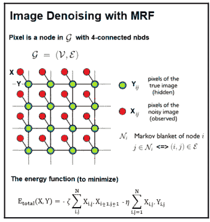

### 准备工作

在此示例中，我们将使用 cameraman 灰度图像，并对图像添加噪声。接下来，我们将使用 MRF 通过最小化能量函数来对图像进行去噪。让我们先导入所需的库：

```
import numpy as np
from skimage.color import rgb2gray
import matplotlib.pyplot as plt
```

### 操作步骤

执行以下步骤以使用 MRF 对图像进行去噪：

- 1. 首先，让我们实现 `read_image_and_binarize()` 函数以读取图像并将其二值化（作为预处理步骤）。请注意，输出的二值图像的像素值将来自 {-1, 1}：

```
def read_image_and_binarize(image, threshold=128):
    im = (rgb2gray(plt.imread(image))).astype(int)
    im[im < threshold] = -1
    im[im >= threshold] = 1
    return im
```

- 2. 让我们实现 `compute_energy_helper()` 函数，以根据噪声输入图像 X 和要生成的输出去噪图像 Y 来计算能量：

```
def compute_energy_helper(Y, i, j):
    try:
        return Y[i][j]
    except IndexError:
        return 0

def compute_energy(X, Y, i, j, zeta, eta, Y_i_j):
    energy = -eta * X[i][j] * Y_i_j
    for (k, l) in [(-1,0), (1,0), (0,-1), (0,1)]: # 4-connected nbd
        energy -= zeta * Y_i_j * compute_energy_helper(Y, i+k, j+l)
    return energy
```

- 3. 现在让我们实现一个向图像添加噪声的函数。以下函数通常向图像添加 10% 的噪声：

```
def add_noise(im):
    im_noisy = im.copy()
    for i in range(im_noisy.shape[0]):
        for j in range(im_noisy.shape[1]):
            r = np.random.rand()
            if r < 0.1:
                im_noisy[i][j] = -im_noisy[i][j]
    return im_noisy
```


- 4. 接下来，让我们实现 `denoise_image()` 函数，它实际上会迭代地对图像进行去噪（通常，它会运行多次迭代，次数等于图像大小的 10 倍）：

```
def denoise_image(O, X, zeta, eta):
    m, n = np.shape(X)
    Y = np.copy(X)
    max_iter = 10*m*n
    iters = []
    errors = []
    for iter in range(max_iter):
        # randomly pick a location
        i, j = np.random.randint(m), np.random.randint(n)
```

- 5. 计算 Yij = +1 和 -1 的能量：

```
energy_neg = compute_energy(X, Y, i, j, zeta, eta, -1)
energy_pos = compute_energy(X, Y, i, j, zeta, eta, 1)
```

- 6. 将 Yij 分配给能量最小的值：

```
if energy_neg < energy_pos:
    Y[i][j] = -1
else:
    Y[i][j] = 1
```

- 7. 如果迭代次数是 100,000 的倍数，打印重建图像中的错误。绘制错误随迭代变化的图表，并返回恢复的输出图像：

```
if iter % 100000 == 0:
    print ('Completed', iter, 'iterations out of', max_iter)
    error = get_mismatched_percentage(O, Y)
    iters.append(iter)
    errors.append(error)
plot_error(iters, errors)
return Y
```

- 8. 最后，调用函数来读取并二值化输入图像，向其添加 10% 的噪声，然后使用先前定义的函数，基于带有能量最小化的 MRF 进行去噪，前提是先初始化参数 ζ 和 η：

```
orig_image = read_image_and_binarize('images/cameraman.png')
zeta = 1.5
eta = 2

noisy_image = add_noise(orig_image)
denoised_image = denoise_image(orig_image, noisy_image, zeta, eta)
print ('Percentage of mismatched pixels: ', \\
       get_mismatched_percentage(orig_image, denoised_image))
plot_images(orig_image, noisy_image, denoised_image)
```

### 工作原理

compute_energy() 函数将特定像素的位置作为输入，并计算输出像素不同值的能量。通常有两种类型的能量：

- 第一个能量在该位置的输入和输出像素值匹配时保持较低（负值），否则会升高。η 参数用于放大此能量。
- 第二个能量在噪声输入图像中的像素值与其邻域值匹配时保持较低（负值），否则会升高。ζ 参数用于放大此能量。

在每次去噪迭代中，您会随机选择一个像素位置，并在输出图像的该位置选择使图像对能量最小化的像素值。以下截图显示了去噪过程中能量如何随迭代而降低：

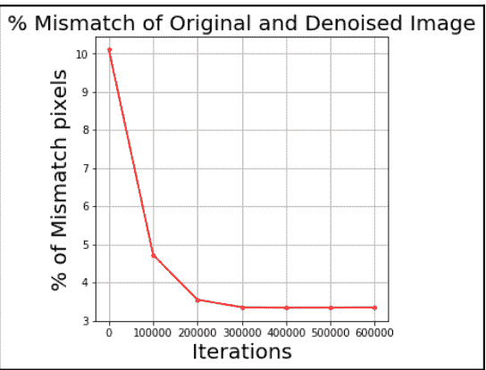

最后，如果您绘制原始图像、带噪声的输入图像和去噪后的输出图像，将得到以下输出：

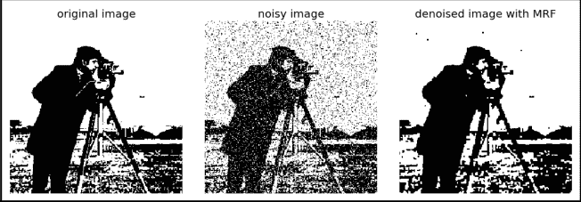

### 另请参阅

- http://homepages.ecs.vuw.ac.nz/~marslast/MLbook.html
- https://www.youtube.com/watch?v=YAc0i36drEs

## 图像修复

图像修复是恢复图像中损坏或缺失部分的过程。假设我们有一个二值输入图像 D，它指定了输入图像 f 中损坏像素的位置，如下方方程所示：

```
D(x, y) = { 0 if pixel (x, y) is damaged in image f
         { 1 if pixel (x, y) is not damaged in image f
```

一旦使用掩码定位了图像中的损坏区域，就必须使用某些算法（例如，全变分修复）来重建丢失/损坏的像素。重建应通过利用未损坏区域中呈现的信息，完全自动地执行。在本示例中，您将学习如何使用 OpenCV-Python 库函数实现图像修复，采用两种不同的算法。

### 准备工作

在开始之前，导入以下库：

```
import cv2
import numpy as np
import matplotlib.pyplot as plt
```

### 操作步骤

按照给定的步骤，使用 OpenCV-Python 库中的两种不同算法实现图像修复：

- 1. 读取 RGB 图像和灰度掩码图像：
  ```
  im = cv2.imread('images/cat.png')
  mask = cv2.imread('images/cat_mask.png',0)
  ```

- 2. 使用阈值对掩码图像进行二值化：
  ```
  _, mask = cv2.threshold(mask, 100, 255, cv2.THRESH_BINARY)
  ```

- 3. 使用二值掩码图像的 bitwise_and 从输入图像中移除被掩码的像素：
  ```
  src = cv2.bitwise_and(im, im, mask=mask)
  mask = cv2.bitwise_not(mask)
  ```

- 4. 获取使用 cv2.INPAINT_NS 算法的 cv2.inpaint() 方法返回的修复后的目标图像：
  ```
  dst1 = cv2.inpaint(src, mask, 5, cv2.INPAINT_NS)
  ```

- 5. 获取使用 cv2.INPAINT_TELEA 算法的 cv2.inpaint() 方法返回的修复后的目标图像：
  ```
  dst2 = cv2.inpaint(src, mask, 5, cv2.INPAINT_TELEA)
  ```

如果运行前面的代码，您将得到类似于以下截图的输出图像：

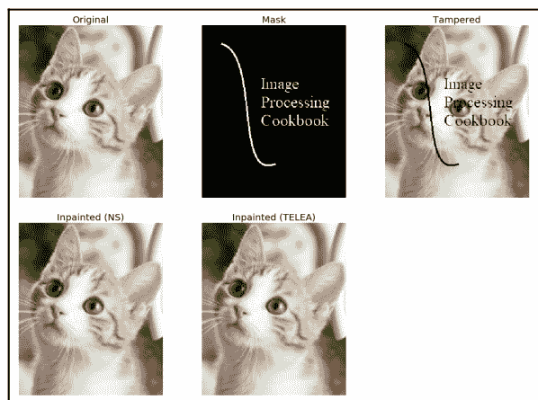

### 工作原理

cv2.inpaint() 函数用于修复猫图像中缺失的部分。该函数接受的参数如下：

- 源图像
- 指示要修复的像素的二值修复掩码
- 要修复的像素周围的邻域半径（对于细薄的修复区域，较小的半径会产生模糊程度较低的结果）
- 作为标志的修复算法—cv2.INPAINT_NS（一种基于纳维尔-斯托克斯的方法）或 cv2.INPAINT_TELEA（一种基于快速行进算法的方法）

cv2.INPAINT_NS 使用一种基于纳维尔-斯托克斯的修复算法，强加以下两个约束：

- 保留梯度（即边缘等特征）
- 将颜色传播到平滑区域

在目标区域（待修复区域）内，像素强度在上述约束下使用 **偏微分方程**（PDE）进行更新。拉普拉斯用于估计平滑度，颜色沿等强度轮廓（等光度线）传播。

`cv2.INPAINT_TELEA` 使用一种基于快速行进法的修复算法，该算法对每个待修复像素，利用已知邻域像素和梯度的加权平均来估计像素颜色。图像的缺失区域被视为水平集，并使用快速行进法来更新已修复像素的边界。

### 更多内容

比较两种算法生成的输出的速度（运行时间）和质量。您也可以使用凸优化进行图像修复（例如，由前向-后向分裂算法求解的图像重建问题）。凸优化问题是数据保真项与正则化项之和，表达了对解的平滑性的先验，如下所示：

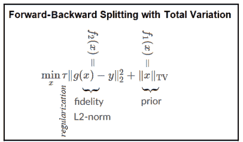

这里，\(\|x\|_{\text{TV}}\) 表示全变分，_y_ 是测量值，_g_ 是掩码算子，\(\tau\) 表达了两项之间的权衡（一个正则化参数）。

## 基于凸优化的图像修复

按照以下步骤将修复问题表述为凸优化问题，并使用 pyunlocbox 库的求解器求解：

- 1. 导入所需的库函数，加载输入的猫图像，并将其转换为灰度：
  ```
  #!pip install pyunlocbox
  from pyunlocbox import functions, solvers
  im_original = rgb2gray(imread('images/cat.png'))
  ```

- 2. 生成一个随机掩码矩阵，屏蔽 80% 的像素，将其应用于图像，并获取损坏的图像：
  ```
  np.random.seed(1) # Reproducible results.
  mask = np.random.uniform(size=im_original.shape)
  mask = mask > 0.8
  g = lambda x: mask * x
  im_corrupted = g(im_original)
  ```

- 3. 要最小化的先验目标由 f1(x)=||x||TV 定义。使用工具箱的 functions.norm_tv 对象来表达它：
  ```
  f1 = functions.norm_tv(maxit=50, dim=2)
  ```

- 4. 要最小化的保真目标由 f2(x)=tau||g(x)-y||^2 定义。使用工具箱的 functions.norm_l2 对象来表达它：
  ```
  f2 = functions.norm_l2(y=im_corrupted, A=g, lambda_=tau) #tau = 100
  ```

- 5. 将 tau 参数设置为较大的值，因为我们信任我们的测量值，并希望解与它们接近。对于带噪声的测量值，应考虑较小的值：
  ```
  tau = 100
  ```

- 6. 最后，实例化前向-后向分裂算法，并使用 solvers.solve() 方法求解优化问题：
  ```
  solver = solvers.forward_backward(step=0.5/tau)
  x0 = np.array(im_corrupted) # Make a copy to preserve im_corrupted.
  ret = solvers.solve([f1, f2], x0, solver, maxit=100)
  im_restored = ret['sol']
  ```


如果你运行前面的代码块并绘制使用 solver 获得的原始、带噪声和修复后的图像，你将得到如下截图：

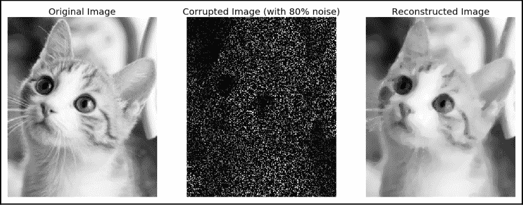

你也可以使用 cvxpy 库进行基于 TV 优化的修复；请自行尝试（参阅以下“另请参阅”部分中的第五个链接）。
你也可以使用 scikit-image 修复模块的 inpaint_biharmonic() 函数使用另一种算法来修复图像（参阅以下“另请参阅”部分中的第六个链接）。

### 另请参阅

参阅以下链接，以进一步扩展对此示例的技能：

- https://www.math.ucla.edu/~bertozzi/papers/cvpr01.pdf
- https://pdfs.semanticscholar.org/622d/5f432e515da69f8f220Fb92b17c8426d0427.pdf
- https://www.learnopencv.com/image-inpainting-with-opencv-c-python/
- https://pyunlocbox.readthedocs.io/en/stable/tutorials/reconstruction.html
- https://web.stanford.edu/~boyd/papers/pdf/cvx_opt_intro.pdf
- 第 12 章，图像处理中的附加问题，出自 Sandipan Dey 所著《Python 图像处理实战》，Packt 出版社

## 使用深度学习的基于修复的图像补全

在此示例中，你将学习如何使用全卷积深度学习网络（FCN，即来自 SIGGRAPH 2017 论文《全局和局部一致图像补全》（Globally and Locally Consistent Image Completion）中的补全网络模型）来补全（先前未见过的）图像中缺失的部分。我们将特别使用该神经网络模型的预训练版本来预测图像中缺失的部分。该模型将接受一张输入图像和一个掩码（对应图像中缺失的部分），并尝试从其余（不完整）图像提供的信息中预测缺失的部分。

### 准备工作

从 http://hi.cs.waseda.ac.jp/~iizuka/data/completionnet_places2.t7 下载全局和局部一致图像补全的预训练 Torch 模型。

然后，导入所需的库：

```
import os
import torch
from torch import nn
from torch.nn.Sequential import Sequential
import cv2
import numpy as np
from torch.utils.serialization import load_lua
import torchvision.utils as vutils
```

### 操作步骤...

执行以下步骤来补全图像中缺失的部分：

- 1. 使用以下代码片段定义 `tensor2image()` 和 `image2tensor()` 函数，以便在 PyTorch 张量和 OpenCV-Python 图像之间进行转换：

```
def tensor2image(src):
out = src.copy() * 255
out = out.transpose((1, 2, 0)).astype(np.uint8)
out = cv2.cvtColor(out, cv2.COLOR_RGB2BGR)
return out
```

```
def image2tensor(src):
    out = src.copy()
    out = cv2.cvtColor(out, cv2.COLOR_BGR2RGB)
    out = out.transpose((2, 0, 1)).astype(np.float64) / 255
    return out
```

- 2. 定义输入图像和掩码图像的路径以及模型路径。检查 GPU 是否可用：

```
image_path = 'images/zebra.png'
mask_path = 'images/inpaint_mask.png'
model_path = 'models/completionnet_places2.t7'
gpu = torch.cuda.is_available()
```

- 3. 加载预训练的补全网络模型（评估模式）：

```
data = load_lua(model_path, long_size=8)
model = data.model
model.evaluate()
```

- 4. 读取用于修复的输入图像和掩码图像。通过阈值处理从掩码图像创建二值掩码图像：

```
image = cv2.imread(image_path)
mask = cv2.imread(mask_path)
mask = cv2.cvtColor(mask, cv2.COLOR_BGR2GRAY) / 255
mask[mask <= 0.5] = 0.0
mask[mask > 0.5] = 1.0
```

- 5. 将输入图像和二值掩码图像转换为 PyTorch 张量：

```
I = torch.from_numpy(image2tensor(image)).float()
M = torch.from_numpy(mask).float()
M = M.view(1, M.size(0), M.size(1))
assert I.size(1) == M.size(1) and I.size(2) == M.size(2)
```

- 6. 通过减去均值来对图像进行居中处理：

```
for i in range(3):
    I[i, :, :] = I[i, :, :] - data.mean[i]
```

- 7. 按模型所需的方式设置输入张量（例如，创建一个 3 通道输入张量）。然后，在预训练模型上运行前向传播以获取输出结果（作为预测）。如果可用，请使用 GPU 以加快预测速度：

```
M3 = torch.cat((M, M, M), 0)
im = I * (M3*(-1)+1)
input = torch.cat((im, M), 0)
input = input.view(1, input.size(0), input.size(1), \
              input.size(2)).float()
if gpu:
    model.cuda()
    input = input.cuda()
res = model.forward(input)[0].cpu() # predict
```

- 8. 从结果中提取输出图像：

```
for i in range(3):
    I[i, :, :] = I[i, :, :] + data.mean[i]
out = res.float() * M3.float() + I.float() * (M3*(-1)+1).float()
```

- 9. 获取带掩码的输入图像以供绘图：

```
image[mask == 1] = 255
```

- 10. 最后，绘制带掩码的输入不完整图像和使用 CompletionNet 修复的已完成输出图像：

```
plt.figure(figsize=(20,30))
plt.subplot(211), plt.imshow(cv2.cvtColor(image, \
        cv2.COLOR_BGR2RGB)), plt.axis('off'), \
        plt.title('Incomplete Image', size=20)
plt.subplot(212), plt.imshow(cv2.cvtColor \
        (tensor2image(out.numpy()), cv2.COLOR_BGR2RGB)), \
        plt.axis('off'), plt.title('Completed Image \
        (with CompletionNet)', size=20)
plt.show()
```

如果你运行前面的代码并绘制输入不完整图像和输出已完成图像，你将得到如下截图中显示的输出：

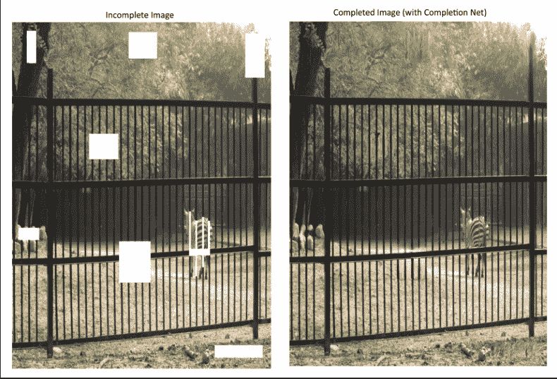

### 更多内容...

使用你自己的图像训练一个补全网络（参阅“另请参阅”部分中提供的 GitHub 仓库以获取训练代码；你需要大量图像、较长时间和一块 GPU）。此外，你还可以使用预训练的补全网络来补全（修复）人脸。请自行尝试——你应该得到如下截图中显示的输出：

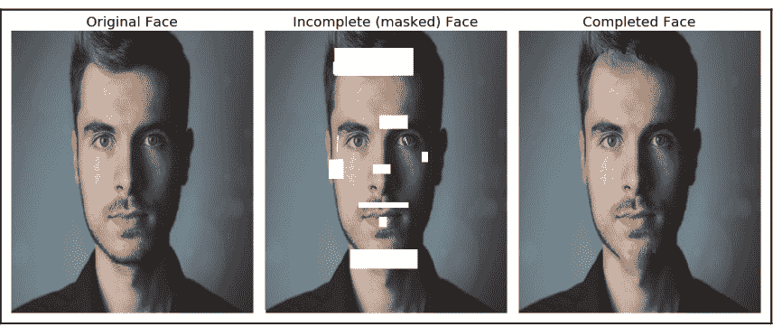

### 另请参阅

参阅以下作品，以了解更多关于此示例的信息：

- http://iizuka.cs.tsukuba.ac.jp/projects/completion/data/completion_sig2017.pdf
- https://github.com/akmtn/pytorch-siggraph2017-inpainting
- http://iizuka.cs.tsukuba.ac.jp/projects/completion/en/
- https://www.youtube.com/watch?v=musgEEVatXs

## 使用字典学习的图像修复

字典学习（也称为稀疏编码）是一种表征学习技术，它试图将输入数据表示为基元素（称为原子）构建的超完备张成集（称为字典）的（稀疏）线性组合的稀疏表示。哺乳动物初级视觉皮层也以同样的方式工作，利用此类表示的冗余性和灵活性。在图像处理中，字典学习已应用于图像补丁，并在图像修复、图像补全和去噪等不同图像处理问题中显示出了有希望的结果。在此示例中，你将学习如何使用字典学习进行图像去噪。

### 准备工作

在此示例中，我们将使用 Lena 灰度图像进行字典学习重建。让我们先导入所需的库和相关模块：

```
from skimage.io import imread
from skimage.color import rgb2gray
from sklearn.decomposition import MiniBatchDictionaryLearning
from sklearn.feature_extraction.image import extract_patches_2d
from sklearn.feature_extraction.image import reconstruct_from_patches_2d
import numpy as np
import matplotlib.pyplot as plt
from time import time
```

### 操作步骤 ...

你需要执行以下步骤，以使用 scikit-learn 库函数实现基于字典学习的图像修复：

- 1. 读取 Lena 图像，并使用高斯随机噪声降低图像下半部分的质量，同时保持上半部分不变：

```
lena = rgb2gray(imread('images/lena.png'))
height, width = lena.shape
print ('Distorting the lower half of the image...')
distorted = lena.copy()
distorted[height // 2:, :] += 0.085 * \
np.random.randn(height // 2, width)
```

- 2. 从图像上半部分提取所有 7x7 参考补丁。计算提取补丁的均值和标准差并对提取的补丁进行归一化：

```
print ('Extracting reference patches...')
patch_size = (7, 7)
data = extract_patches_2d(distorted[height // 2:, :], patch_size)
data = data.reshape(data.shape[0], -1)
data -= np.mean(data, axis=0)
data /= np.std(data, axis=0)
```

- 3. 从提取的参考补丁中学习字典（包含 256 个分量）：

```
print ('Learning the dictionary...')
dico = MiniBatchDictionaryLearning(n_components=256, alpha=1, \
n_iter=600)
V = dico.fit(data).components_
```


绘制从补丁中学习的字典的组件。您将获得如下截图所示的图形：

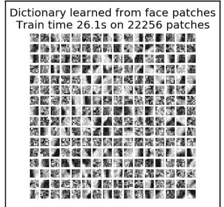

- 4. 定义 show_with_diff() 函数并调用它以显示失真的图像：

```python
def show_with_diff(image, reference, title):
    plt.figure(figsize=(10, 5))
    plt.subplot(121, plt.title('Image'))
    plt.imshow(image, vmin=0, vmax=1, cmap=plt.cm.gray, \
               interpolation='nearest'), plt.axis('off')

    plt.subplot(122)
    difference = image - reference
    plt.title('Difference (norm: %.2f)' % \
              np.sqrt(np.sum(difference ** 2)))
    plt.imshow(difference, vmin=-0.5, vmax=0.5, cmap=plt.cm.gray_r, \
               interpolation='nearest')
    plt.axis('off'), plt.suptitle(title, size=20)
    plt.subplots_adjust(0.02, 0.02, 0.98, 0.79, 0.02, 0.2)
    plt.show()

show_with_diff(distorted, lena, 'Distorted image')
```

如果运行前面的代码片段，您将获得如下截图所示的输出：

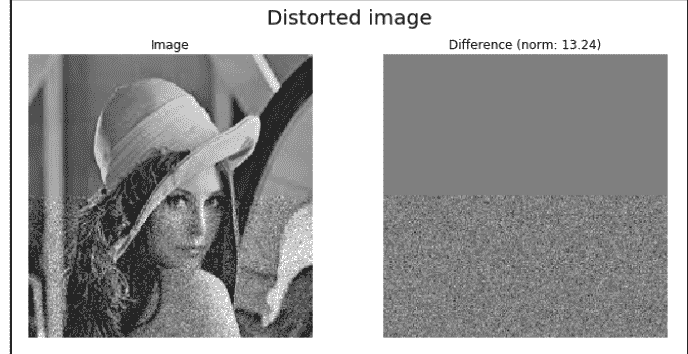

- 5. 从图像的噪声下半部分提取补丁并归一化提取的噪声补丁：

```python
print('Extracting noisy patches... ')
data = extract_patches_2d(distorted[height // 2:, :], patch_size)
data = data.reshape(data.shape[0], -1)
intercept = np.mean(data, axis=0)
data -= intercept
```

- 6. 使用字典组分（原子）重建图像的（噪声）下半部分：

```python
print('Orthogonal Matching Pursuit\n2 atoms' + '...')
kwargs = {'transform_n_nonzero_coefs': 2}
reconstruction = lena.copy()
dico.set_params(transform_algorithm='omp', **kwargs)
code = dico.transform(data)
patches = np.dot(code, V)
patches += intercept
patches = patches.reshape(len(data), *patch_size)
reconstruction[height // 2:, :] = reconstruct_from_patches_2d(patches, (height // 2, width))
show_with_diff(reconstruction, lena, 'Orthogonal Matching Pursuit 2 atoms')
```

如果运行前面的代码片段，您将获得以下输出，该输出显示重建后的图像：

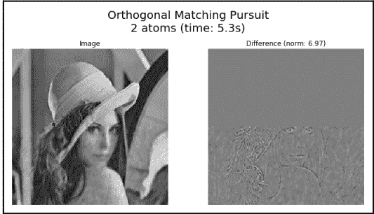

从前面的截图可以看出，差异范数大幅降低，这表明重建后的图像是原始图像的更好近似。

### 更多内容...

您也可以以在线方式从图像补丁中学习字典；例如，不必一次性将所有 22,256 个图像补丁（来自上半部分）提供给 MiniBatchDictionaryLearning 对象，而是可以一次提供 128 个补丁（作为一个批次），并在线学习字典并重建图像的噪声下半部分，如下一节所示。

### 在线字典学习

以下是用于在线学习和重建的几个步骤：

- 1. 定义常量：

```python
batch_size = 128
n_epochs = 2
n_batches = len(data) // batch_size
```

- 2. 实例化 MiniBatchDictionaryLearning 对象，这次向构造函数传递额外参数 batch_size：

```python
dico = MiniBatchDictionaryLearning(n_components=256, alpha=1, \
                                   n_iter=1, batch_size=batch_size)
# Now extract noisy patches as before
```

- 3. 迭代提取当前批次的补丁，并使用 `partial_fit()` 从当前批次拟合/更新字典：

```python
for epoch in range(n_epochs):
    for i in range(n_batches):
        batch = data[i * batch_size: (i + 1) * batch_size]
        dico.partial_fit(batch)
    V = dico.components_
    n_updates += 1
    # Now reconstruct lower noisy half of the image using the current dictionary
```

- 4. 如果运行几个批次并绘制字典原子、重建后的图像和重建误差，您将获得如下截图所示的输出：

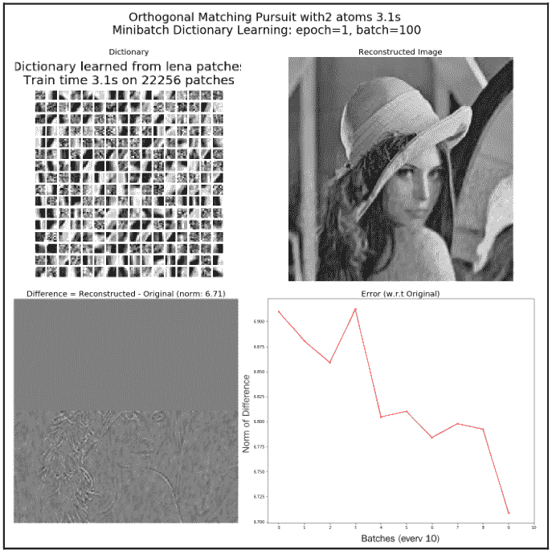

### 另请参阅

请参阅以下链接以了解有关此配方的更多信息：

- https://www.cs.technion.ac.il/~ronrubin/Publications/KSVD-OMP-v2.pdf
- https://github.com/scikit-learn/scikit-learn/blob/7813f7efb/sklearn/decomposition/dict_learning.py
- https://scikit-learn.org/stable/modules/linear_model.html#omp
- https://www.youtube.com/watch?v=Efbr3YP9wGw

## 使用小波压缩图像

在本配方中，您将学习如何使用小波变换图像，并丢弃变换输出中的低阶比特，以便大部分值为零（或非常小），但大部分信号（像素）被保留。我们将使用 mahotas 库函数进行演示。

### 准备工作

在本配方中，我们将使用 cameraman 灰度图像作为输入。让我们先导入所需的库和模块：

```python
import numpy as np
import mahotas
from mahotas.thresholding import soft_threshold
from matplotlib import pyplot as plt
import os
```

### 操作步骤...

执行以下步骤使用 *小波* 实现图像压缩：

- 1. 首先，读取输入图像并将其转换为灰度图：

```python
im = mahotas.imread('images/cameraman.png', as_grey=True)
im = im.astype(np.uint8)
print(im.shape)
# (256, 256)
f = np.mean(im==0)
print("Fraction of zeros in original image: {}".format(f))
# Fraction of zeros in original image: 0.0021514892578125
```

- 2. 尝试使用简单的下采样（保留每隔一个像素）且仅保留高阶比特的基线压缩方法：

```python
im1 = im[::2, ::2].copy()
im1 = im1 / 8
im1 = im1.astype(np.uint8)
f1 = np.mean(im1==0)
print("Fraction of zeros in original image (after division \
   by 8): {}".format(f1))
# Fraction of zeros in original image (after division by 8):
# 0.01788330078125
```

- 3. 尽管在上一步中您已经丢弃了图像中 75% 的值，但零值仍然很少。现在，让我们使用 Daubechies 小波（D8）变换图像，然后丢弃低阶比特。检查使用相同数量的值是否获得了更好的图像：

```python
imw = mahotas.daubechies(mahotas.wavelet_center(im), 'D8')
imw /= 8 # discard lower order bits
imw = imw.astype(np.int8)
f2 = np.mean(imw==0)
print("Fraction of zeros in wavelet transform (after division \
   by 8): {}".format(f2))
# Fraction of zeros in wavelet transform (after division by 8):
# 0.8892402648925781
im2 = mahotas.wavelet_decenter(mahotas.idaubechies(imw, 'D8'), \
   im.shape)
# min-max normalization to have pixel values in between 0-255
im2 = (255 * (im2 - np.min(im2)) / (np.max(im2) - \
   np.min(im2))).astype(np.uint8)
```

- 4. 应用软阈值处理以进一步增加变换图像中零值的百分比：

```python
imw = soft_threshold(imw, 12)
f3 = np.mean(imw==0)
print ("Fraction of zeros in wavelet transform (after division \
 by 8 & soft thresholding): {:}".format(f3))
# Fraction of zeros in wavelet transform (after division by 8 & soft thresholding): 0.945472172851562
im3 = mahotas.wavelet_decenter(mahotas.idaubechies(imw, 'D8'), \
 im.shape)
im3 = (255 * (im3 - np.min(im3)) / (np.max(im3) - \
 np.min(im3))).astype(np.uint8)
```

使用此图像可以实现更高的压缩比，从而实现更快的通信信道传输和更少的带宽消耗，传输后，您将能够以比使用基线压缩（仅保留每四个像素和低阶比特）重建的图像更高的质量重建图像。

### 工作原理...

如果执行前面的代码并绘制图像，您将获得如下截图：

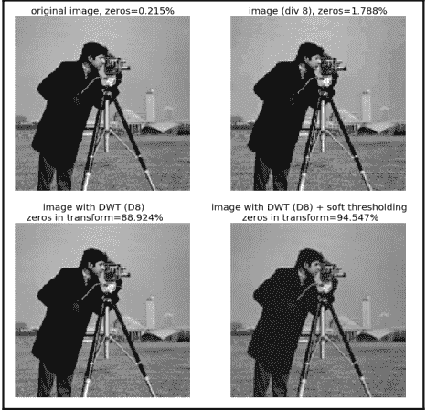

代码 im[::2, ::2] 从 im 图像中选择每隔一个像素，NumPy 的 copy() 函数创建 ndarray 的副本。mahotas 的 wavelet_center() 和 wavelet_decenter() 函数分别创建图像的中心版本，并在对变换后的图像应用时撤销 wavelet_center() 函数的效果。这些函数正确处理边界并消除否则会在图像边界创建的伪影。mahotas.daubechies() 和 mahotas.idaubechies() 函数分别执行 Daubechies 小波变换和 Daubechies 逆小波变换，并接受小波的代码（D8）以获得变换/逆变换后的图像。

### 另请参阅

请参阅以下链接以了解有关此配方的更多信息：

- https://mahotas.readthedocs.io/en/latest/api.html?highlight=mahotas%20daubechies#mahotas.daubechies
- https://mahotas.readthedocs.io/en/latest/wavelets.html
- https://mahotas.readthedocs.io/en/latest/thresholding.html?highlight=soft_threshold

## 使用隐写术和隐写分析

隐写术旨在将一条消息（称为隐写文本）以不可察觉的方式隐藏在输入图像（称为封面图像）中，生成输出隐写图像（无可见失真），从而不怀疑消息的存在。它通过隐蔽性提供安全性，并用于在发送者和接收者之间秘密传递消息。隐写术隐藏消息，使其难以被观察到，而密码学则加密消息，使其（在计算上）难以被解密或理解。相反，隐写分析是指检测使用隐写术隐藏的秘密消息的过程；隐写分析与密码分析与密码学之间具有类似的关系。

在本配方中，我们将演示一种非常流行的隐写术技术，称为 LSB 数据隐藏（通过将信息存储在图像的最低有效位中可以隐藏秘密消息；这样，像素值的变化最多为一，因此隐写图像在人眼看来与封面图像无法区分），并在 RGB 彩色图像中演示隐写分析技术以检测秘密消息。


### 准备工作

我们将使用 Lena RGB 彩色图像来演示使用 stegano 库的隐写术/隐写分析技术。让我们从一开始就导入所需的包、模块和函数，使用以下代码块：

```python
# !pip install Stegano
import stegano
from PIL import Image, ImageChops
from stegano import lsb, lsbset
from stegano.steganalysis import statistics, parity
import matplotlib.pylab as plt
import pandas as pd
from stegano import lsbset
from stegano.lsbset import generators
from stegano import exifHeader
```

### 操作步骤...

执行以下步骤，使用 LSB 数据隐藏在 Lena 图像中隐藏秘密消息，并使用（非盲）隐写分析来检测秘密消息：

- 1. 读取（覆盖）图像，并在图像内隐藏一条长消息（通过将消息连接 10 次）。保存隐写图像：

```python
cover = Image.open('images/lena.png')
stego = lsb.hide("images/lena.png", 10*"Python Image Processing \
Cookbook - LSB data hiding with Stegano")
stego.save("images/lena-secret.png")
```

- 2. 打印隐藏在隐写图像内的消息：

```python
print(lsb.reveal("images/lena-secret.png"))
```

- 3. 执行奇偶校验隐写分析并提取奇偶编码的覆盖图像和隐写图像。然后，使用统计隐写分析检索常见的覆盖图像和隐写图像，使用以下代码片段：

```python
parity_encoded_cover = parity.steganalyse(cover)
parity_encoded_stego = parity.steganalyse(stego)
_, cover_common = statistics.steganalyse(cover)
_, stego_common = statistics.steganalyse(stego)
```

如果您绘制所有图像，以及隐写图像与覆盖图像之间的差异和奇偶编码隐写图像与覆盖图像之间的差异，您将得到类似下图的截图：

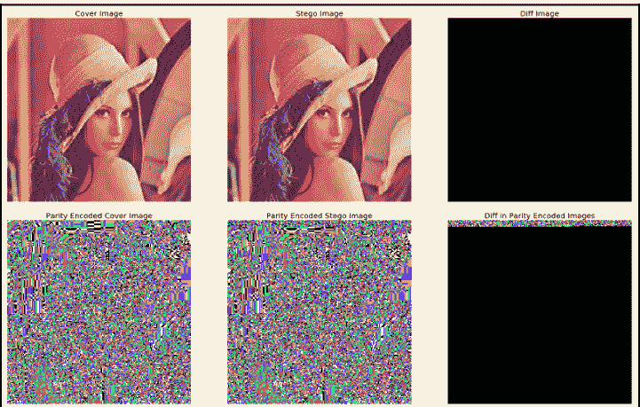

从前面的截图可以看出，通过观察隐写图像与覆盖图像之间的图像差异，无法检测到秘密消息的存在。奇偶编码的隐写图像和覆盖图像不相同，差异揭示了隐写图像内嵌入了一些秘密消息。

- 4. 定义一个 `plot_freq()` 函数来绘制覆盖图像和隐写图像不同时的常见像素频率的直方图（之前通过统计隐写分析获得）：

```python
plot_freq(cover_common, stego_common)
```

您将得到如下图所示的输出，它清楚地显示隐写图像和覆盖图像是不同的：

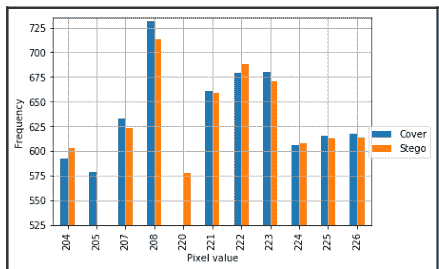

- 5. 接下来，使用基于生成器（埃拉托斯特尼筛法）的集合的 LSB 技术来隐藏秘密消息：

```python
cover = Image.open("images/lena.png").convert('RGB')
secret_message = "Python Image Processing Cookbook – LSB data \
hiding with Stegano lsbset!"
n = 1000
stego = lsbset.hide("images/lena.png",
secret_message,
generators.eratosthenes(),
shift = n).convert('RGB')
stego.save("images/stego.png")
```

如果您绘制隐写图像与覆盖图像之间的差异与奇偶编码隐写图像与覆盖图像之间的差异的对比图，您将得到如下图：

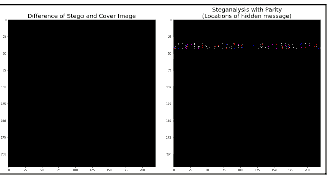

- 6. 现在，尝试使用相同的生成器（将会成功）和不同的生成器（将会失败）来检索隐藏的消息：

```python
try:
    message = lsbset.reveal("images/stego.png",
                        generators.fibonacci())
except:
    print('Could not decode with the generator provided!')
    # Could not decode with the generator provided!

message = lsbset.reveal("images/stego.png", \
                        generators.eratosthenes())
message
# 'Python Image Processing Cookbook - LSB data hiding with Stegano
lsbset!'
```

- 7. 最后，对于 JPEG 和 TIFF 图像，您可以使用以下代码在 exifHeader 中隐藏消息（并揭示它）：

```python
secret = exifHeader.hide("images/butterfly.jpg", \
                   "images/stego.png",
                   secret_message=5*"Python
Image Processing Cookbook - LSB data hiding with Stegano")
print(exifHeader.reveal("images/stego.png"))
```

### 工作原理...

PIL Image 对象的 `open()` 和 `save()` 方法分别用于加载和保存图像。`lsb.hide()` 函数用于 LSB 数据隐藏，它将覆盖图像和隐写文本作为输入参数并返回隐写图像。`lsb.reveal()` 函数用于从隐写图像中获取隐写文本。`parity.steganalyse()` 用于从图像（隐写图像和覆盖图像）中获取奇偶编码图像。

PIL ImageChops 的 `difference()` 函数用于计算两个输入图像（例如，隐写图像和覆盖图像）之间的差异图像。`statistics.steganalyse()` 返回覆盖图像和隐写图像在频率上不同的像素值及其频率（直方图）。

### 更多内容...

有多种不同类型的隐写术技术。您可以找到一种基于数系统的技术（参考以下“另请参见”部分中的第一个链接），并自行实现。

### 另请参见

参考以下文章，以进一步扩展您与此配方相关的技能：

- https://arxiv.org/pdf/1003.3672.pdf
- https://buildmedia.readthedocs.org/media/pdf/stegano/latest/stegano.pdf
