# 二进制图像处理

形态学图像处理是指应用一组与图像特征形状（即形态）相关的非线性运算。这些操作特别适合二进制图像的处理（其中像素表示为 0 或 1，按照惯例，对象的前景 = 1 或白色，背景 = 0 或黑色），因为它们不依赖于像素的精确数值，而仅依赖于像素值的相对顺序——尽管这些运算可以扩展到灰度图像。

因此，在本章中，我们将讨论带有形态学运算的二进制图像处理，尽管为了完整性，也将讨论一些灰度形态学运算。在形态学运算中，使用结构元素（一个小模板图像）来探测输入图像。结构元素（SE）被放置在输入图像的所有可能位置，然后算法使用集合运算符将其与相应像素的邻域进行比较。形态学运算测试 SE 是否适配于，或者命中或相交于相应的邻域。

在本章中，您将学习以下配方：

- 对二进制图像应用形态学运算符
- 应用形态学滤波器
- 形态学模式匹配
- 使用形态学对图像进行分割
- 计数对象

## 对二进制图像应用形态学运算符

膨胀和腐蚀是两种基本的形态学运算符。腐蚀从前景（白色）对象的边界去除一个像素层，从而缩小二进制图像中的前景。小规模细节被去除，感兴趣区域的大小由二进制图像中的腐蚀减少。另一方面，膨胀向前景对象的边界添加一个像素层，从而扩展前景。单个前景对象内部包含的空洞以及前景对象（和边界）之间的间隙被减少。

许多形态学运算可以通过腐蚀、膨胀和基本集合运算（例如，补集）的组合获得。形态学开运算、闭运算和击中或不击中变换是最常见的几种。开运算是一种幂等运算（先膨胀后腐蚀实现），它可以断开由薄像素层连接的前景对象，同时保持存活对象的大小不变。同样，闭运算（开运算的对偶运算符：先腐蚀后膨胀实现）是另一种幂等运算，它可以填充前景区域中的空洞，同时保持区域大小不变。下图展示了如何使用集合论中的运算符来定义基本的和一些复合的形态学运算符：

| 运算符 | 定义 |
| :--- | :--- |
| 腐蚀 | \( A \ominus B = \{z | (B)_z \subseteq A \} \) 收缩（前景）对象 |
| 膨胀 | \( A \oplus B = \{z | (\hat{B})_z \cap A \neq \emptyset \} \) 增长（前景）对象 |
| 开运算 | \( A \circ B = (A \ominus B) \oplus B \) |
| 闭运算 | \( A \bullet B = (A \oplus B) \ominus B \) |
| 击中或不击中变换 | \( A * \{B_1, B_2\} = (A \ominus B_1) \cap (A^c \ominus B_2) \) |
| 对偶性 | \( (A \bullet B)^c = (A^c \circ \hat{B}) \) |

在本配方中，您将学习如何将几个形态学运算符应用于二进制图像。


### 准备工作

在本配方中，我们将使用二值长颈鹿图像来演示如何将几种形态学操作应用于二值图像。让我们先导入所需的库：

```
%matplotlib inline
from skimage.io import imread
from skimage.color import rgb2gray
from skimage.filters import threshold_otsu
from scipy.ndimage.morphology import binary_erosion, binary_dilation,
binary_fill_holes
from scipy.ndimage.morphology import morphological_gradient,
distance_transform_edt
from skimage import morphology as morph
import numpy as np
import matplotlib.pyplot as plt
```

### 如何执行...

您需要执行以下步骤，才能使用 scipy.ndimage.morphology 模块中的函数将一些形态学运算符应用于二值图像：

- 1. 读取输入的长颈鹿图像，并使用阈值处理将其转换为二值图像。使用 Otsu 算法获取最优阈值，然后将高于阈值的像素值改为白色和黑色：

```
im = rgb2gray(imread('images/giraffe.jpg'))
thres = threshold_otsu(im)
im = (im > thres).astype(np.uint8)
```

- 2. 使用 2 x 2 方形结构元素（SE/内核）对图像进行腐蚀，并反转图像：

```
eroded = binary_erosion(im, structure=np.ones((2, 2)),
iterations=20)[20:, 20:]
eroded = 1 - eroded
```

- 3. 现在，使用 11 x 11 方形 SE 对腐蚀后的图像进行膨胀，并通过膨胀图像与腐蚀图像之差计算图像的边界。接着，在反转后的边界图像上使用（欧氏）距离变换：

```
dilated = binary_dilation(eroded, structure=np.ones((11, 11)))
boundary = np.clip(dilated.astype(np.int) - eroded.astype(np.int),
0, 1)
dt = distance_transform_edt(np.logical_not(boundary))
```

- 4. 计算二值图像的形态学梯度。反转输出以获取边缘：

```
edges = 1 - morphological_gradient(im, size=3)
```

如果您绘制前面的图像，将得到类似于下图的输出：

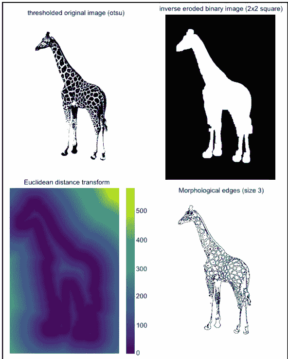

再次执行以下步骤，以便能够将更多形态学运算符应用于二值图像，但这次使用 scikit-image.morphology 模块中的函数：

- 1. 读取输入圆形图像并将其转换为二值图像（这次选择阈值为 0）：

```
im = rgb2gray(imread('images/circles.png'))
im = (im > 0).astype(np.uint8)
```

- 2. 使用不同大小的圆盘 SE 对二值图像进行腐蚀。然后，使用连通性为 1 对腐蚀后图像的连通分量进行标记：

```
disk2 = morph.disk(radius=2)
disk8 = morph.disk(radius=8)
eroded2 = morph.binary_erosion(im, selem=disk2)
eroded8 = morph.binary_erosion(im, selem=disk8)
labeled = morph.label(eroded8, connectivity=1)
```

- 3. 膨胀图像并计算图像中的边缘，这次通过膨胀图像与腐蚀图像之差来计算形态学梯度：

```
dilated2 = morph.binary_dilation(im, selem=disk2)
edges = dilated2.astype(np.int) - eroded2.astype(np.int)
```

- 4. 对二值图像进行骨架化：

```
skeleton = morph.skeletonize(im)
```

- 5. 绘制获得的所有图像：

```
plt.figure(figsize=(15,15))
plt.subplot(221), plt.imshow(im), plt.axis('off'),
plt.title('original binary image', size=15)
plt.subplot(222), plt.imshow(labeled, cmap='spectral'),
plt.axis('off')
plt.title('eroded with connected components (radius 8)', size=15)
plt.subplot(223), plt.imshow(edges), plt.axis('off'),
plt.title('edges (radius 2)', size=15)
plt.subplot(224), plt.imshow(skeleton), plt.axis('off')
plt.title('skeleton binary image', size=15)
plt.show()
```

如果运行前面的代码，您将得到类似于以下内容的结果：

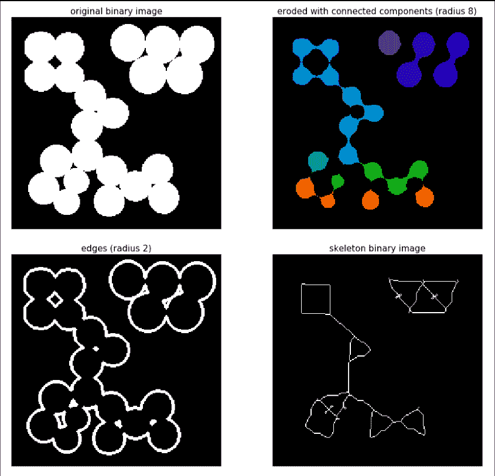

### 工作原理...

在步骤 1 中，使用了 `scikit-image.filters` 模块的 `threshold_otsu()` 函数来寻找创建二值图像的最优阈值（通过对灰度图像进行阈值处理）。

在步骤 2 中，分别使用了 scipy.ndimage 的 binary_erosion() 和 binary_dilation() 函数将腐蚀和膨胀操作应用于二值图像。这些函数接受要腐蚀/膨胀的二值图像、要使用的结构元素（默认 SE 为连通性为 1 的方形）以及操作重复的次数（默认 1）。非零元素被视为 True。

如您所见，np.ones((2, 2)) 用于创建大小为 2 的方形 SE，而 morph.disk(radius=2) 用于生成圆盘形状的结构元素。该函数来自 scikit-image 形态学模块。在这里，如果两个像素之间的欧氏距离不超过半径值，则认为一个像素是另一个像素的邻居。复合运算符形态学梯度用于计算输入二值图像中的边缘，其计算方法是使用相同的 SE（半径为 2 的圆盘）求膨胀图像与腐蚀图像之差，如下所示：

> $g_B(A) = A \oplus B - A \ominus B$

使用了 scikit-image.morphology 模块的 skeletonize() 函数来计算二值图像的骨架。它使用形态学细化操作将每个连通分量收缩为单像素宽的骨架。从数学上讲，形态学算子骨架定义如下：

> nB = \underbrace{B \oplus \cdots \oplus B}_{n \text{ times}},
> 0B = \{o\}, \quad \text{origin } o
> S - n(A) = (A \ominus nB) - (A \ominus B) \circ B,
> n = 0, 1, \dots, N, \text{size of the structuring element } B
> S(X) = \bigcup_n S_n(X)
> skeleton

使用了 scikit-image.morphology 模块的 label() 函数为二值图像中的每个连通区域分配一个唯一值（作为整数数组）。该函数的 connectivity 参数表示可以认为一个像素是另一个像素邻居的最大正交跳跃次数——对于二值图像，默认值为 2。

### 更多内容...

使用形态学运算符检测链环栅栏中的孔洞，并找出以下链环图像中孔洞的位置（共有两个）（提示：首先将其转换为二值图像）：

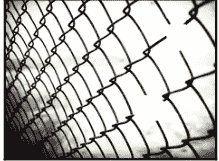

同样，对提供的 Tetris 图像使用形态学操作以检测模式并生成输出，如下截图所示：

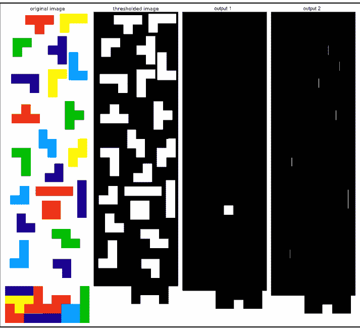

使用形态学操作在以下卡片图像中查找菱形，如下所示：

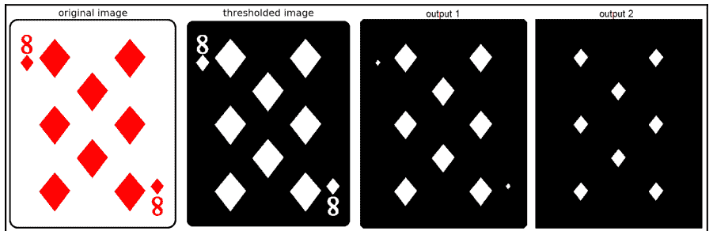

使用以下彩色骰子图像，并使用形态学操作在其中查找点：


比较不同库中 *膨胀* 和 *腐蚀* 的实现（例如，scikit-image 的 morphology 模块或 scipy.ndimage 的实现与 Mahotas、OpenCV-Python 和 SimpleITK 的实现），就速度、提供的功能、输出质量等方面进行比较。

形态学运算符也可以扩展到处理灰度输入图像；有关示例，请参阅以下 *另请参阅* 部分中的第二个链接。

### 另请参阅

请参阅以下链接以了解有关此配方的更多信息：

- https://web.stanford.edu/class/ee368/Handouts/Lectures/2019_Winter/7-Morphological.pdf
- https://www.cs.auckland.ac.nz/courses/compsci773s1c/lectures/ImageProcessing-html/topic4.htm
- 《Hands-on Image Processing with Python》一书，第 6 章

## 应用形态学滤波器

从上一个配方中可以看到，形态学运算符（例如腐蚀、膨胀、腐蚀、开运算和闭运算）可以通过二值图像过滤来生长/缩小图像区域，以及移除或填充图像区域边界像素。在本配方中，您将学习如何将更多形态学滤波器应用于二值图像，以增强图像或获得所需结果。更多形态学滤波器包括顶帽变换、形态学梯度和形态学拉普拉斯。

### 准备工作

要开始，请使用以下代码块导入所需的库、模块和函数：

```
#!pip install itk
from skimage.morphology import flood_fill, diameter_closing,
binary_erosion, rectangle, reconstruction
from skimage.filters import threshold_otsu
import mahotas as mh
import itk
import SimpleITK as sitk
import matplotlib.pyplot as plt
import numpy as np
```


### 如何执行...

在本示例中，您将学习如何使用不同库（例如，mahotas、skimage 和 SimpleITK）中的函数，对输入的二值图像应用几种不同的形态学滤波器。首先执行以下步骤，使用 mahotas 计算二值图像的几个基本指标（例如，欧拉数），并使用 flood_fill 和 diameter_closing 等滤波器（使用 skimage.morphology 模块）。

### 使用 mahotas/scikit-image 计算欧拉数、离心率和质心

执行以下步骤，使用 mahotas 和 skimage 库函数计算不同的指标：

- 1. 读取 NASA 黑洞图像（https://www.nasa.gov/sites/default/files/thumbnails/image/blackhole.png），并使用手动阈值（t=60）将其转换为二值图像。计算二值图像的欧拉数：

```python
blackhole = mh.imread('images/blackhole.png')
blackhole_gray = mh.colors.rgb2grey(blackhole).astype(np.uint8)
t = 60
bin_blackhole = (blackhole_gray > t).astype(np.uint8)
print(mh.euler(bin_blackhole))
# 0.0
```

- 2. 计算二值图像的 center_of_mass 和 eccentricity：

```python
cms = mh.center_of_mass(bin_blackhole)
print('Eccentricity = ', mh.features.eccentricity(bin_blackhole))
# 0.5449847073316407
```

- 3. 使用 flood_fill（从黑洞内部的种子点开始）或 diameter_closing（移除面积小于或等于 100 的所有空洞）之一来填充黑洞：

```python
bin_blackhole2 = flood_fill(bin_blackhole, (200, 400), 1)
bin_blackhole3 = diameter_closing(bin_blackhole, 100,
connectivity=2)
```

如果运行上述代码片段并绘制图像，您将得到类似于下图的图表：

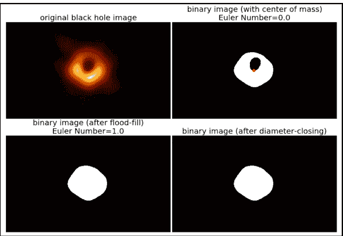

二值图像的拓扑通过欧拉数来衡量。它定义为图像中对象总数与这些对象中存在的空洞数量之差。对于第一个二值图像，欧拉数为 0 = 1 - 1（它包含一个对象，该对象包含一个空洞）。另一方面，对于第二个二值图像，欧拉数为 1 - 0 = 1（因为它包含的单个对象中没有任何空洞）。

## 使用 mahotas 的形态学图像滤波器

执行以下步骤，再次使用 mahotas 库函数查看应用几种形态学图像滤波器的结果：

- 1. 读取彩色分形（mandelbrot）图像，将其转换为灰度图像，然后使用 Otsu 阈值法将其转换为二值图像：

```python
fractal = mh.imread('images/mandelbrot.jpg')
fractal_gray = mh.colors.rgb2grey(fractal).astype(np.uint8)
t = mh.otsu(fractal_gray)
bin_fractal = (fractal_gray > t).astype(np.uint8)
```

- 2. 使用以下代码行计算白色和黑色像素之间的边界：

```python
mh.border(bin_fractal, 0, 1)
```

- 3. 使用以下代码行计算区域最小值（区域定义为围绕每个像素的 3 x 3 十字形结构元素，并考虑整个对象）：

```python
mh.regmin(bin_fractal)
```

- 4. 使用半径为 3 的圆盘结构元素闭合图像中的空洞，使用以下代码行：

```python
mh.close_holes(bin_fractal, mh.disk(3))
```

- 5. 使用以下代码行将 majority_filter 应用于二值图像：

```python
mh.majority_filter(bin_fractal)
```

最后，如果绘制所有图像以及原始二值图像的质心，您将得到类似于下图的图表：

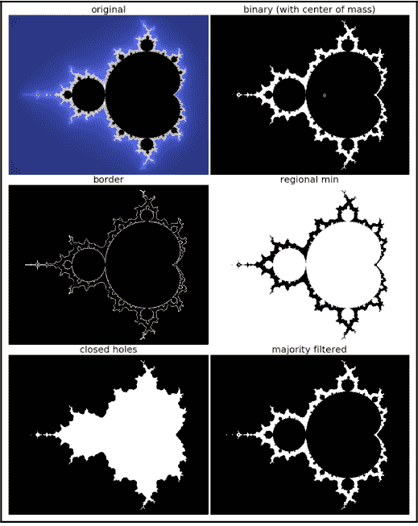

## 使用 SimpleITK 的二值图像滤波器

执行以下步骤，演示使用 SimpleITK 库函数对二值图像应用几个额外的二值滤波器：

- 1. 首先，读取 NASA 超新星图像（https://www.nasa.gov/image-feature/goddard/2019/hubble-sets-sights-on-an-explosive-galaxy）并将图像转换为二值图像。对二值图像取反：

```python
supernova_gray = sitk.ReadImage('images/supernova.jpg',
sitk.sitkFloat32)
supernova_bin =
sitk.BinaryNotImageFilter().Execute(sitk.OtsuThresholdImageFilter()
.Execute(supernova_gray))
```

- 2. 实例化对应于开运算和闭运算形态学滤波器的 SimpleITK 滤波器对象。将结构元素设置为半径为 3 的圆盘。首先对二值超新星图像应用开运算滤波器，然后应用闭运算滤波器：

```python
open_f = sitk.BinaryMorphologicalOpeningImageFilter()
close_f = sitk.BinaryMorphologicalClosingImageFilter()
open_f.SetKernelRadius(3)
close_f.SetKernelRadius(3)
supernova_bin1 = close_f.Execute(open_f.Execute(supernova_bin))
```

- 3. 再次对输入二值图像应用开运算滤波器，然后应用闭运算滤波器，但这次将结构元素设置为半径为 7 的圆：

```python
open_f.SetKernelRadius(7)
close_f.SetKernelRadius(7)
supernova_bin2 = close_f.Execute(open_f.Execute(supernova_bin))
```

- 4. 接下来，将结构元素为半径为 3 的圆盘的中值滤波器应用于输入二值图像：

```python
med_f = sitk.BinaryMedianImageFilter()
med_f.SetRadius(3)
supernova_bin3 = med_f.Execute(supernova_bin)
```

- 5. 使用以下代码片段将 BinaryMinMaxCurvatureFlowImageFilter() 应用于二值图像（模板半径为 2，阈值参数值为 60）：

```python
curv_f = sitk.BinaryMinMaxCurvatureFlowImageFilter()
curv_f.SetStencilRadius(2)
curv_f.SetThreshold(60)
supernova_bin4 = curv_f.Execute(sitk.Cast(supernova_bin,
sitk.sitkFloat32))
```

- 6. 实例化相应对象后，将 BinaryContourImageFilter() 应用于图像：

```python
cont_f = sitk.BinaryContourImageFilter()
supernova_bin5 = cont_f.Execute(supernova_bin)
```

- 7. 最后，在二值图像上实例化 VotingBinaryImageFilter()：

```python
vote_f = sitk.VotingBinaryImageFilter()
vote_f.SetRadius(5)
supernova_bin6 = vote_f.Execute(sitk.Cast(supernova_bin2,
sitk.sitkInt32))
```

如果运行上述代码片段并绘制所有图像，您将得到类似于下图的图表：

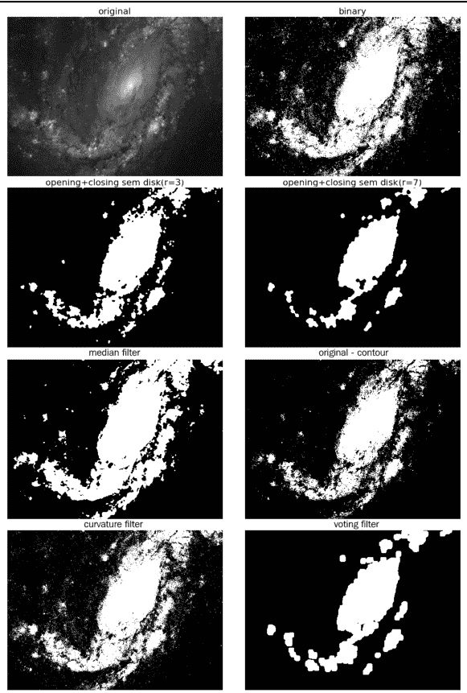

## 使用 skimage 的重建膨胀

执行以下步骤，使用 skimage 库函数通过重建膨胀将绘图与文本分开：

- 1. 读取输入图像（泰戈尔手写的一首歌曲的充满插图的孟加拉语手稿），并使用阈值处理然后进行二值反转将其转换为二值图像（您希望将字母作为前景对象，即白色）：

```python
img = rgb2gray(imread('images/tagore_manuscript.jpg'))
th = 0.6 #threshold_otsu(img)
img[img <= th] = 0
img[img > th] = 1
img = 1 - img
```

- 2. 重建膨胀所需的掩码图像就是先前获得的二值图像。使用带有垂直线滤波器的 binary_erosion 操作创建种子图像（重建膨胀）。最后，使用创建的掩码图像和种子图像执行重建膨胀：

```python
mask = img
seed = binary_erosion(img, rectangle(1, 50))
words = reconstruction(seed, mask, 'dilation')
```

如果运行上述代码片段并绘制所有图像，您将看到如下图所示，绘图与书写（单词）已分开：

### 泰戈尔充满插图的手稿

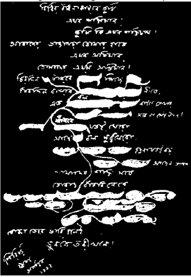

### 重建的种子

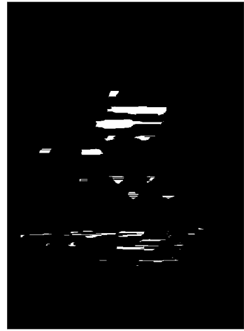

### 泰戈尔的绘图

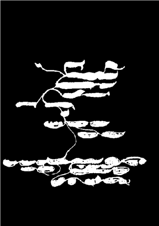

### 泰戈尔的无插图手稿

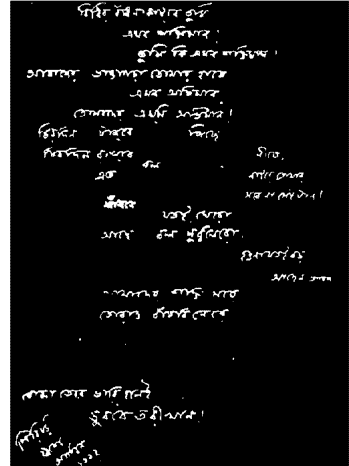

### 工作原理

使用 `mahotas` 库的 `euler()` 函数来计算输入二值图像的欧拉数（或特征）。默认情况下，它使用 8 连通性。

使用 `skimage.morphology` 模块的 `flood_fill()` 函数对黑洞二值图像执行泛洪填充，起始于黑洞内部暗区域的特定种子点 (200,400)（作为第二个参数传递给函数）；找到等于 `seed pixel value`（此处为 0 或黑色）的连接点，然后将其设置为 `new_value`（此处为 1 或白色），这是函数的第三个输入参数。

使用 `skimage.morphology` 模块的 `diameter_closing()` 函数移除黑洞图像中所有最大延伸（围绕 `hole` 的 `bounding box` 的一边）小于 `diameter_threshold` 参数（即 100）的所有 `holes`。该操作也称为 **边界框闭运算**。

使用 `skimage.morphology` 模块的 `reconstruction()` 函数实现了重建膨胀。

重建膨胀操作使用一个 `seed` 和一个 `mask` 图像。种子图像指定起始值（该值使用结构元素用于 `dilation` 迭代 `spread`），而掩码图像（原始图像用作掩码图像）指定每个像素允许的最大值。掩码图像对 `foreground` 值的 `spread` 施加约束。

使用 `BinaryMedianImageFilter()` 构造函数实例化了二值中值滤波器（用于去噪超新星图像），并使用 `SetRadius()` 方法设置了该形态学滤波器的圆盘结构元素半径。该滤波器使用 `Execute()` 方法应用于输入二值图像，其他 SimpleITK 滤波器也是如此。


### 还有更多内容...

Here are a few more useful morphological functions that you can try on your own (similar to the ones shown in this recipe). Use the mahotas.bwperim() function in the fractal binary image to compute the border and the mahotas.thin() function for morphological thinning/skeletonization.

这里有几个更有用的形态学函数，你可以自己尝试（与本示例中显示的类似）。在分形二值图像中使用 mahotas.bwperim() 函数计算边框，并使用 mahotas.thin() 函数进行形态学细化/骨架化。

Use morphological filters to get rid of the noise and the smaller planets (as shown in the following screenshot) from the binary image obtained by thresholding the image of the colored planet from NASA public domain images (https://www.flickr.com/photos/nasacommons/), as shown here:

使用形态学滤波器去除由NASA公共域图像（https://www.flickr.com/photos/nasacommons/）中的彩色行星图像阈值处理得到的二值图像中的噪声和较小的行星（如下一张屏幕截图所示），如下所示：

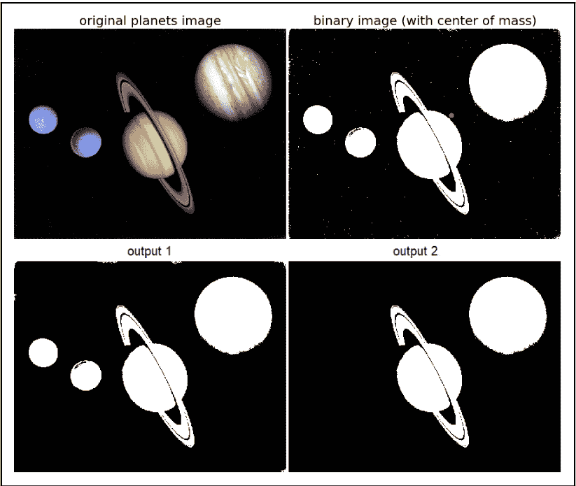

Also, start with the following MRI grayscale image and apply white/black top hat morphological filters to obtain the output shown:

此外，从以下MRI灰度图像开始，应用白/黑顶帽形态学滤波器，以获得所示输出：

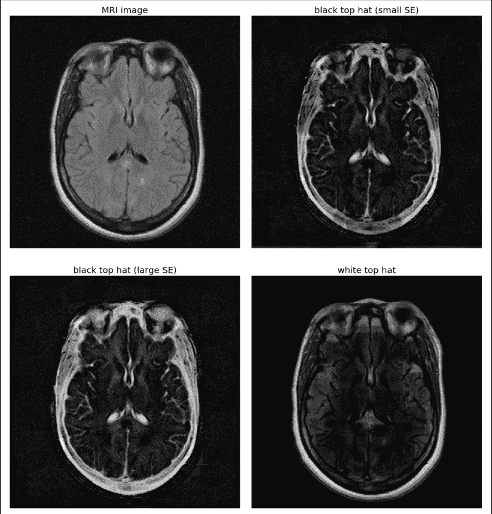

Start with the keyboard binary image and get rid of all of the symbols to get the output image shown here (hint: use binary erosion by reconstruction with an appropriate structuring element):

从键盘二值图像开始，去除所有符号以获得此处所示输出图像（提示：使用适当结构元素的重建二值腐蚀）：

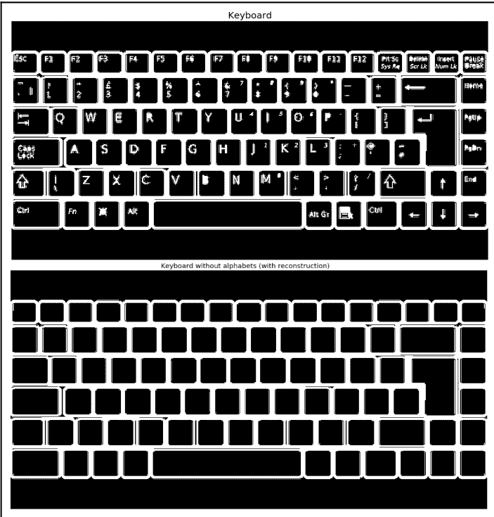

Compare morphological diameter closing with closing by applying them to binary images where the results obtained are different when these two filters are applied.

将这两个滤波器应用于结果不同的二值图像，以比较形态学直径闭运算与闭运算。

Apply `mahotas` functions to apply the morphological local minima (and maxima) filters to a binary image. How are regional minima (and maxima) different from local minima (maxima)? Demonstrate with a binary image where these two are different. You can apply morphological filters to grayscale images as well (refer to the first link in the following See also and Grayscale operations sections for a demonstration of such an implementation).

应用 `mahotas` 函数将形态学局部极小值（和极大值）滤波器应用于二值图像。区域极小值（和极大值）与局部极小值（极大值）有何不同？请使用一个二值图像进行演示，其中这两者有所不同。你也可以将形态学滤波器应用于灰度图像（请参阅以下“另请参阅”和“灰度操作”部分中的第一个链接，以了解此类实现的示例）。

### See also

### 另请参阅

Refer to the following works to further enrich your knowledge of this recipe:

请参阅以下著作，以进一步丰富对本示例的了解：

- Chapter 6 of the book, Hands-on Image Processing with Python
- 《使用Python进行图像处理实战》一书的第6章
- https://mahotas.readthedocs.io/en/latest/api.html
- https://simpleitk.readthedocs.io/en/master/Documentation/docs/source/filters.html
- http://people.ciirc.cvut.cz/~hlavac/TeachPresEn/11ImageProc/71-3MatMorpholBinEn.pdf
- http://www.cs.uu.nl/docs/vakken/ibv/reader/chapter6.pdf

## Morphological pattern matching

## 形态学模式匹配

In this recipe, you will learn how to use the morphological compound operation, hit-or-miss-transform, to find patterns from a binary image. **Hit-or-miss transform** is a morphological operation that is used to detect a given pattern in a binary image. It uses a pair of disjointed structuring elements to define the pattern to be matched and the morphological erosion operator to implement the pattern matching. The hit-or-miss transform returns a binary image as output in which only those sets of positions are non-zero where the first SE matches and the second SE completely misses the foreground, respectively, in the input binary image.

在本示例中，你将学习如何使用形态学复合运算（命中或不命中变换）从二值图像中查找模式。**命中或不命中变换**是一种用于在二值图像中检测给定模式的形态学运算。它使用一对不相连的结构元素来定义要匹配的模式，并使用形态学腐蚀运算符来实现模式匹配。命中或不命中变换返回一个二值图像作为输出，其中仅在第一个SE匹配且第二个SE完全未命中前景的那些位置集合为非零（在输入二值图像中）。

### Getting ready

### 准备工作

In this recipe, we will use an image of a script of a Bengali poem by Tagore and search the image to find the occurrence of a Bengali character (ঈ) using morphological pattern matching. Let's start by importing the Python libraries, modules, and functions required:

在本示例中，我们将使用泰戈尔孟加拉语诗歌手稿的图像，并使用形态学模式匹配在图像中查找孟加拉语字符（ঈ）的出现。首先，让我们导入所需的Python库、模块和函数：

```
import numpy as np
import matplotlib.pyplot as plt
from skimage.io import imread
from skimage.color import rgb2gray, gray2rgb
from scipy import ndimage
```

### How to do it...

### 操作步骤

Perform the following steps to implement morphological pattern matching with hit-or-miss-transform:

执行以下步骤，使用命中或不命中变换实现形态学模式匹配：

- 1. Define the hit_or_miss_transform() function that accepts the filenames corresponding to the input image and two SEs (the first one for *hit* and the second one for *miss*) as input:

- 1. 定义 hit_or_miss_transform() 函数，该函数接受输入图像和两个SE的文件名作为输入（第一个用于 *hit*，第二个用于 *miss*）：

```
def hit_or_miss_transform(im, s1, s2):
```

- 2. Inside the function, read the input image and structuring elements, consequently converting them into grayscale:

- 2. 在函数内部，读取输入图像和结构元素，并将其相应地转换为灰度：

```
im = rgb2gray(imread(im))
m, n = im.shape
s1 = rgb2gray(imread(s1))
s2 = rgb2gray(imread(s2))
```

- 3. Apply the hit-or-miss transform using corresponding functions from the scipy.ndimage module, which returns a Boolean NumPy ndarray where the elements corresponding to the match position are set to True. Convert the output type into an unsigned 8-bit integer:

- 3. 使用scipy.ndimage模块中的相应函数应用命中或不命中变换，该函数返回一个布尔NumPy ndarray，其中匹配位置对应的元素设置为True。将输出类型转换为无符号8位整数：

```
hom_transformed = ndimage.binary_hit_or_miss(im, structure1=s1, \
                                      structure2=s2).astype(np.uint8)
```

- 4. Now, highlight the matches (pixels with the value 1) with red squares and plot the highlighted output image using the following code snippet:

- 4. 现在，使用红色方块突出显示匹配项（值为1的像素），并使用以下代码片段绘制突出显示的输出图像：

```
xs, ys = np.where(hom_transformed == 1)
hom_transformed = gray2rgb(hom_transformed)
w, h = 10, 12
for i in range(len(xs)):
    x, y = (xs[i], ys[i])
    for j in range(max(0, x-h), min(m-1, x+h)):
        for k in range(max(0, y-w), min(n, y+w)):
            hom_transformed[j, k, 0] = 1.
    for j in range(max(0, x-h), min(m, x+h)):
        for k in range(max(0, y-w), min(n-1, y+w)):
            hom_transformed[j, k, 0] = 1.
# plot the highlighted output image hom_transformed here with
matplotlib
```

- 5. Finally, call the hit_or_miss_transform() function to match patterns such as the Bengali letter ড only, but not similar to letters such as ঢ. The first SE matches both the patterns ড and ঢ, but the second SE discards the pattern ড by ensuring the corresponding mismatch:

- 5. 最后，调用 hit_or_miss_transform() 函数仅匹配孟加拉字母 ড 等模式，而不匹配类似于 ঢ 等字母。第一个SE同时匹配 ড 和 ঢ 模式，但第二个SE通过确保相应的不匹配来排除 ড 模式：

```
hit_or_miss_transform('images/poem.png', 'images/bo.png',
 'images/bo_inv_1.png')
```

The structuring elements you need to specify (corresponding to hit and miss, respectively) are shown in the following screenshot:

你需要指定的结构元素（分别对应 hit 和 miss）如下一张屏幕截图所示：

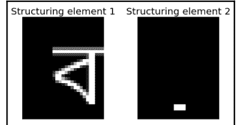

If you run the preceding code snippets with the given structuring elements and plot the input and output images, you will get a diagram along the lines of the following:

如果使用给定的结构元素运行前面的代码片段并绘制输入和输出图像，你将得到类似于以下内容的图表：

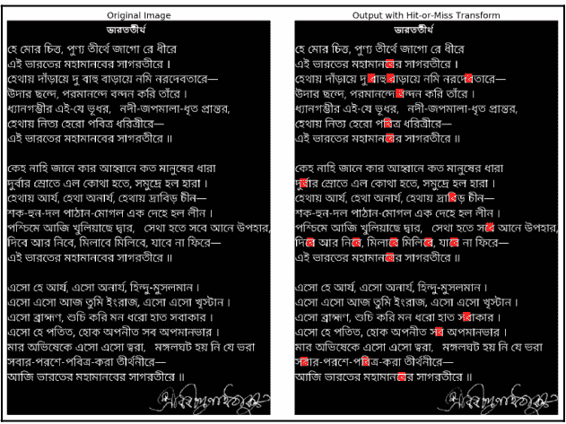

As you can see from the preceding screenshot, all of the র patterns are matched but not the ণ pattern.

从前面的屏幕截图可以看出，所有 র 模式都被匹配，但 ণ 模式未被匹配。

- 6. Again, call the hit_or_miss_transform() function to match patterns such as the Bengali letter র, except for the ones with vowel signs, such as রি and রে:

- 6. 再次调用 hit_or_miss_transform() 函数，以匹配孟加拉字母 র 等模式，但不包括带元音符号的模式，如 রি 和 রে：

```
hit_or_miss_transform('images/poem.png', 'images/bo.png', 'images/bo_inv_2.png')
```

The structuring elements you need to specify (corresponding to hit and miss, respectively) this time are shown in the following screenshot:

这次你需要指定的结构元素（分别对应 hit 和 miss）如下一张屏幕截图所示：

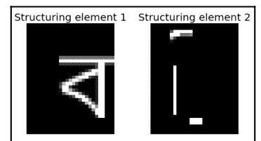

If you run the code snippets with the new given structuring elements and plot the input and output images, you will get a diagram along the lines of the following:

使用新给定的结构元素运行代码片段并绘制输入和输出图像，你将得到类似于以下内容的图表：

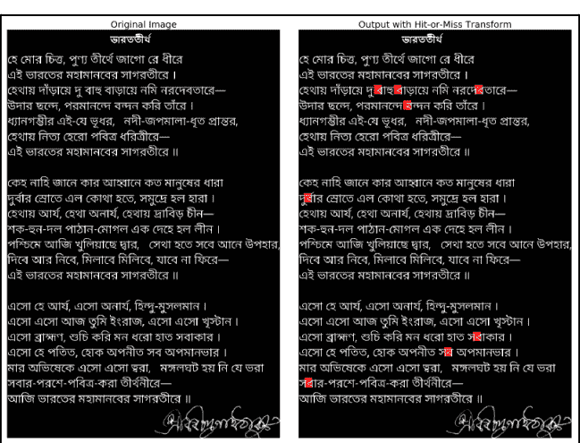

### How it works...

### 工作原理

As you can see in the preceding section, the `binary_hit_or_miss()` function from the `scipy.ndimage.morphology` module was used to apply the morphological hit-or-miss transform operation (shown in the following screenshot) to a binary image:

如前面一节所示，`scipy.ndimage.morphology` 模块的 `binary_hit_or_miss()` 函数用于将形态学命中或不命中变换操作（如下一张屏幕截图所示）应用于二值图像：

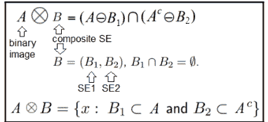

The input binary image, along with a couple of disjointed structuring elements, are passed to the function. The first SE argument represents part of the SE that must match (hit) the foreground. The second SE argument represents part of the SE that must miss the foreground completely.

输入二值图像和几个不相连的结构元素被传递给该函数。第一个SE参数表示必须匹配（命中）前景的SE部分。第二个SE参数表示必须完全未命中前景的SE部分。

This `binary_hit_or_miss()` function finds the locations inside the input image that match the given pattern (defined by the SEs).

此 `binary_hit_or_miss()` 函数查找输入图像内与给定模式（由SEs定义）匹配的位置。

The `np.where()` function was used to find the match coordinates and those matched pixels were then highlighted in red (using the `gray2rgb()` function from the `skimage.color` module to convert the 2D binary image into a 3D color image).

使用 `np.where()` 函数查找匹配坐标，然后将匹配像素以红色突出显示（使用 `skimage.color` 模块的 `gray2rgb()` 函数将2D二值图像转换为3D彩色图像）。

### There's more...

### 还有更多内容...

Let's now apply the morphological pattern extraction to organic chemistry: find -O- and =O bonding from the following structure of the triglyceride molecule and highlight them, as shown in the next screenshot:

现在，让我们将形态学模式提取应用于有机化学：从三酰甘油分子的以下结构中查找 -O- 和 =O 键并将其突出显示，如下一张屏幕截图所示：

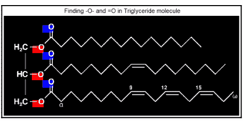

### See also

### 另请参阅

Refer to the following link to learn more about this recipe:

请参阅以下链接以了解更多有关本示例的信息：

- https://docs.scipy.org/doc/scipy-0.14.0/reference/generated/scipy.ndimage.morphology.binary_hit_or_miss.html

## Segmenting images with morphology

## 使用形态学对图像进行分割

Image segmentation is the partitioning of an image into distinct regions or categories that correspond to different objects or parts of objects. In this recipe, you will learn how to use a region-based segmentation method to a binary image using the morphological watershed algorithm. We can think of a grayscale image as a topographic surface. If we flood this surface from its minimum values and prevent the merging of waters from different sources, then the image gets partitioned into two different sets, namely, the _catchment basins_ (segments) and the _watershed lines_. To prevent over-segmentation, a pre-defined set of markers is used and the flooding of the surface starts from these markers. The following are the steps involved in the segmentation of an image by the watershed transformation:

图像分割是将图像划分为与不同对象或对象部分对应的不同区域或类别。在本示例中，你将学习如何使用基于形态学的分水岭算法对二值图像应用基于区域的分割方法。我们可以将灰度图像视为地形表面。如果我们从其最小值开始淹没此表面并防止来自不同源的水合并，那么图像将被划分为两组不同的区域，即 _集水盆地_（分段）和 _分水岭线_。为防止过度分割，使用预定义的一组标记，并且表面的淹没从这些标记开始。以下是通过分水岭变换对图像进行分割所涉及的步骤：

- 1. Find the markers and the segmentation criterion (the function that is to be used to split the regions; often, this is the contrast/gradient).

- 1. 查找标记和分割标准（用于拆分区域的函数；通常，这是对比度/梯度）。

- 2. Run a marker-controlled watershed algorithm with these two elements.

- 2. 使用这两个元素运行标记控制的分水岭算法。

### Getting ready

### 准备工作

Let's import all of the packages, modules, and functions required to demonstrate morphological segmentation with the watershed algorithm:

让我们导入演示使用分水岭算法进行形态学分割所需的所有包、模块和函数：

```
from scipy import ndimage as ndi
from skimage.morphology import watershed, binary_dilation, binary_erosion,
remove_small_objects
from skimage.morphology import disk, square
from scipy.ndimage import distance_transform_edt
from skimage.measure import label, regionprops
from skimage.segmentation import clear_border
from skimage.filters import rank, threshold_otsu
from skimage.feature import peak_local_max, blob_log
from skimage.util import img_as_ubyte
from skimage.io import imread
from skimage.color import rgb2gray
import numpy as np
import matplotlib.pyplot as plt
```


### 操作方法...

在此示例中，我们将使用 scikit-image 的形态学分水岭实现对两幅图像进行分割（第一幅是二值图像，第二幅是灰度图像），通过两种不同的方式创建标记：

- 在欧氏距离图像中寻找峰值
- 在梯度图像中寻找低梯度区域

## 形态学分水岭

执行以下步骤，以使用 skimage.morphology 模块的形态学分水岭实现进行二值图像分割：

1. 首先，读取输入的二值圆图像，并将其转换为无符号整数类型的灰度图：

```python
image = img_as_ubyte(rgb2gray(imread('images/circles.png')))
```

2. 计算精确的欧氏距离变换，并在其中寻找峰值，随后对其进行标记，以便用作分水岭算法的标记：

```python
distance = ndi.distance_transform_edt(image)
local_maximum = peak_local_max(distance, indices=False, footprint=np.ones((3, 3)), labels=image)
markers = ndi.label(local_maximum)[0]
```

3. 现在，使用创建的标记运行分水岭算法，以获取输出分割标签。如有需要，移除小对象以消除噪声：

```python
labels = watershed(-distance, markers, mask=image)
labels = remove_small_objects(labels, min_size=100)
```

4. 计算输出中分割对象（标签）的数量以及唯一类别（标签）的数量：

```python
props = regionprops(labels)
print(len(np.unique(labels)), len(props))
# 23 22
```

如果你运行前面的代码片段并绘制图像，将得到类似于下面的图示：

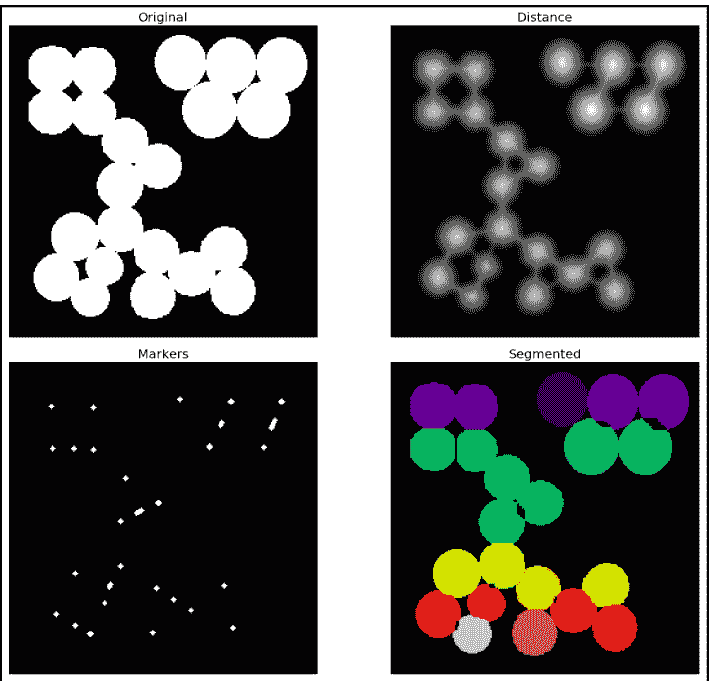

5. 现在，对另一幅图像（一幅莲花图像）运行形态学分水岭算法，但这次，通过对梯度进行阈值处理来创建标记（将连续的低梯度区域作为标记，并使用半径为 5 的圆盘结构元素以获得更平滑的图像）。首先使用 `median` 滤波器对图像进行去噪：

```python
denoised = rank.median(image, disk(2))
markers = rank.gradient(denoised, disk(5)) < 20
markers = ndi.label(markers)[0]
```

6. 像上次一样运行形态学分水岭算法，但这次，使用梯度和标记作为输入（使用半径为 2 的小圆盘结构元素的局部梯度，以保持边缘细薄）：

```python
gradient = rank.gradient(denoised, disk(2))
labels = watershed(im, basins)
labels = remove_small_objects(labels, min_size=100)
props = regionprops(labels)
print (len(np.unique(labels)), len(props))
# 111 110
```

如果你运行前面的代码片段并绘制图像，将得到以下输出：

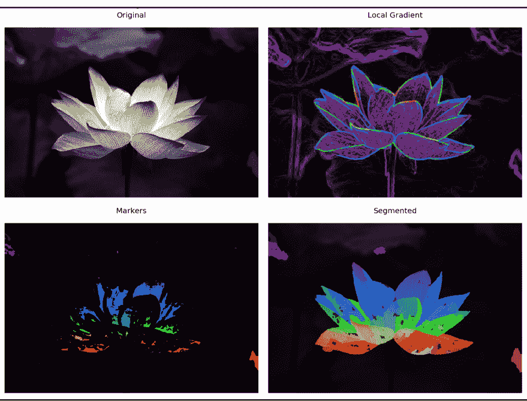

如果你以 3D 方式绘制梯度图像，将得到以下输出：

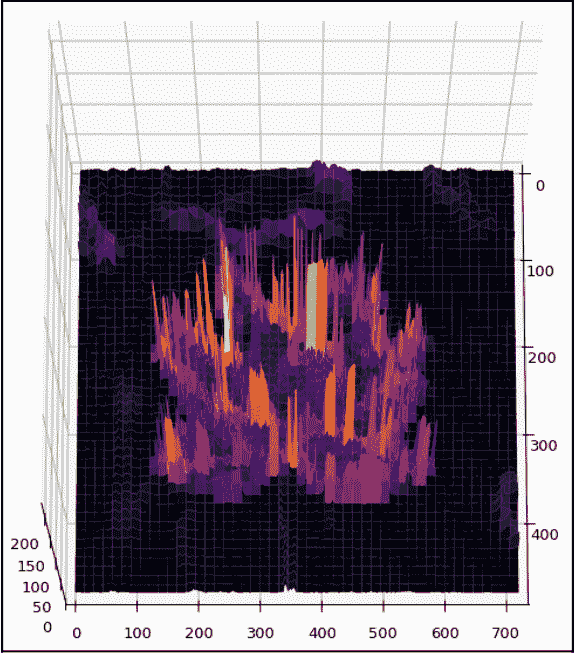

## 使用形态学分水岭进行斑点检测

执行以下步骤，以再次使用 `skimage.morphology` 模块的分水岭算法，这次用于斑点检测：

1. 实现 `segment_with_watershed()` 函数，用于检测图像中的斑点：

```python
def segment_with_watershed(im, cell_thresh, bg_thresh):
    if np.max(im) != 1.0:
        im = (im - im.min()) / (im.max() - im.min())
    im_mask = im < cell_thresh
```

2. 生成集水区和流域：

```python
basins = np.zeros_like(im)
basins[im < cell_thresh] = 2
basins[im > bg_thresh] = 1
```

3. 通过淹没流域运行分水岭分割：

```python
flood_seg = watershed(im, basins)
flood_seg = flood_seg > 1.0
```

4. 现在，腐蚀边界并计算距离变换：

```python
selem = square(3)
flood_erode = binary_erosion(flood_seg, selem=selem)
flood_seg = clear_border(flood_seg, buffer_size=10)
```

5. 使用以下代码行计算距离矩阵：

```python
distances = distance_transform_edt(flood_seg)
```

6. 在距离矩阵中寻找局部极大值：

```python
local_max = peak_local_max(distances, indices=False,
footprint=None, labels=flood_seg,
min_distance=1)
max_lab = label(local_max)
```

7. 执行拓扑分水岭。移除任何散落的小对象：

```python
final_seg = watershed(-distances, max_lab, mask=flood_seg)
final_seg = remove_small_objects(final_seg, min_size=100)
```

8. 提取区域属性并确定细胞数量。返回结果：

```python
props = regionprops(final_seg)
num_cells = len(props)
return final_seg, distances, basins, num_cells
```

9. 现在，读取输入图像，将其转换为灰度图，进行去噪，并通过调用 `img_as_ubyte()` 函数在其中查找斑点。打印返回的分段数量：

```python
image = img_as_ubyte(rgb2gray(imread('images/sunflowers.jpg')))
image = rank.median(image, disk(2))
labels, distances, markers, nseg = segment_with_watershed(image,
0.25, 0.28)
```

```python
print(nseg)
# 44
```

如果你运行前面的代码片段，将得到如下输出，其中已检测到斑点，如所示：

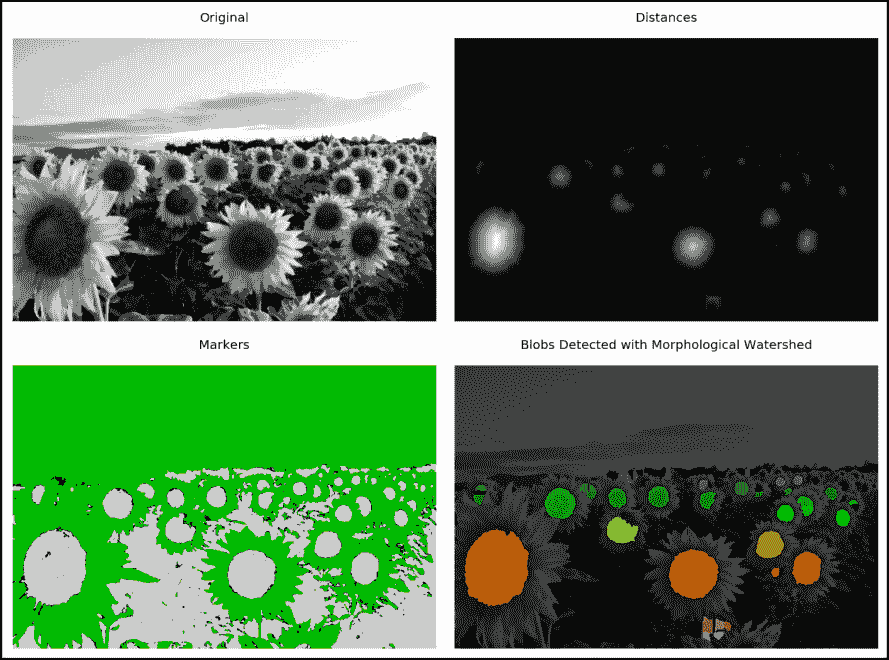

### 工作原理

来自 skimage.morphology 模块的 `watershed()` 函数被用于查找输入图像中的分水岭流域，淹没过程从给定的标记开始。该函数接受图像和标记（可选）作为输入参数。`watershed()` 函数接受一个 ndarray 标记作为第二个参数，其中标记了流域的位置（像素值用于为标签矩阵中的像素分配标签），0 表示不是标记。

来自 `scipy.ndimage.morphology` 的 `distance_transform_edt()` 函数用于计算由以下方程给出的精确欧氏变换：

$d_p = \sqrt{(p_x - b_x)^2 + (p_y - b_y)^2}$

在这里，$b$ 是输入像素 $p$ 最近的背景像素（具有最小的欧氏距离）；返回 $p$ 和 $b$ 之间的距离 $d_p$。

来自 `skimage` 模块的 `label()` 函数用于对从欧氏距离变换的局部极大值峰值中获得的标记，或通过对梯度图像进行阈值处理所获得的标记中的特征进行标记。该函数为输入图像中的每个唯一特征分配一个唯一标签。来自 `skimage.measure` 模块的 `regionprops()` 函数用于获取区域属性列表，其中每个项描述一个标记区域。

### 更多内容

你也可以使用 LOG 尺度空间检测斑点。下面是使用此方法进行斑点检测的演示；请将其与使用形态学分水岭获得的结果进行比较。

## 使用 LOG 尺度空间进行斑点检测

执行以下步骤，在 LOG 空间中进行斑点检测：

1. 使用 `blob_log()` 函数在图像中查找斑点：

```python
blobs_log = blob_log(np.invert(image), max_sigma=40, num_sigma=10, threshold=.2)
```

2. 计算第三列中的半径：

```python
blobs_log[:, 2] = blobs_log[:, 2] * np.sqrt(2)
```

3. 遍历找到的斑点并在输出图像上绘制它们，忽略半径较小的斑点：

```python
for blob in blobs_log:
    y, x, r = blob
    if np.pi*r**2 > 150:
        c = plt.Circle((x, y), r, color=[0.75] +
        np.random.rand(2).tolist(), linewidth=2,
        fill=True, alpha=.7)
# add the blobs to the plot
```

如果你运行前面的代码片段并绘制图像，将得到类似于下面的图示：

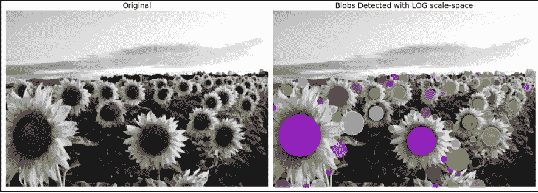

### 另请参阅

请参阅以下链接以了解更多有关此示例的信息：

- https://www.doc.ic.ac.uk/~dfg/vision/v02.html
- https://scikit-image.org/docs/dev/api/skimage.morphology.html#skimage.morphology.watershed
- https://docs.scipy.org/doc/scipy/reference/generated/scipy.ndimage.label.html

## 对象计数

在此示例中，你将学习如何使用形态学滤波器在二值图像中计数对象。通常，二值图像中的对象（斑点）是重叠的，在计数之前，我们需要进行一些必要的预处理，例如斑点分离和检测。形态学腐蚀在这些情况下非常有用。然后，可以使用轮廓查找来计数分离后的对象。你也可以使用形态学分水岭分割来分离斑点，然后对它们进行计数。


### 准备工作

让我们导入开始所需的包和模块：

```
import cv2
import numpy as np
import matplotlib.pyplot as plt
```

### 操作步骤...

首先，我们将检测并分离斑块，然后开始对象计数。

## 使用腐蚀进行斑块分离与检测

使用形态学腐蚀检测和分离斑块，这次使用 OpenCV-Python 函数，请执行以下步骤：

- 1. 读取灰度圆图像并使用阈值处理将其转换为二值图像：

```
image = cv2.imread('images/circles.png', 0)
image = cv2.threshold(image, 100, 255, cv2.THRESH_BINARY)[1]
```

- 2. 创建二值腐蚀的 SE（内核，使用不同内核大小）并腐蚀图像：

```
kernel = np.ones((21,21),np.uint8)
eroded = cv2.morphologyEx(image, cv2.MORPH_ERODE, kernel)
kernel = np.ones((11,11),np.uint8)
eroded1 = cv2.morphologyEx(image, cv2.MORPH_ERODE, kernel)
```

- 3. 现在，使用以下代码行查找腐蚀图像的轮廓：

```
cnts, _ = cv2.findContours(eroded, cv2.RETR_EXTERNAL,
cv2.CHAIN_APPROX_SIMPLE)
```

- 4. 最后，使用不同颜色在输入图像上绘制轮廓：

```
output = cv2.cvtColor(image.copy(), cv2.COLOR_GRAY2RGB)
count = 0
for c in cnts:
    cv2.drawContours(output, [c], -1, (np.random.randint(0,255), \
np.random.randint(0,255), np.random.randint(0,255)), 2)
    count += 1
```

如果你运行前面的代码片段并绘制图像，你将得到以下输出：

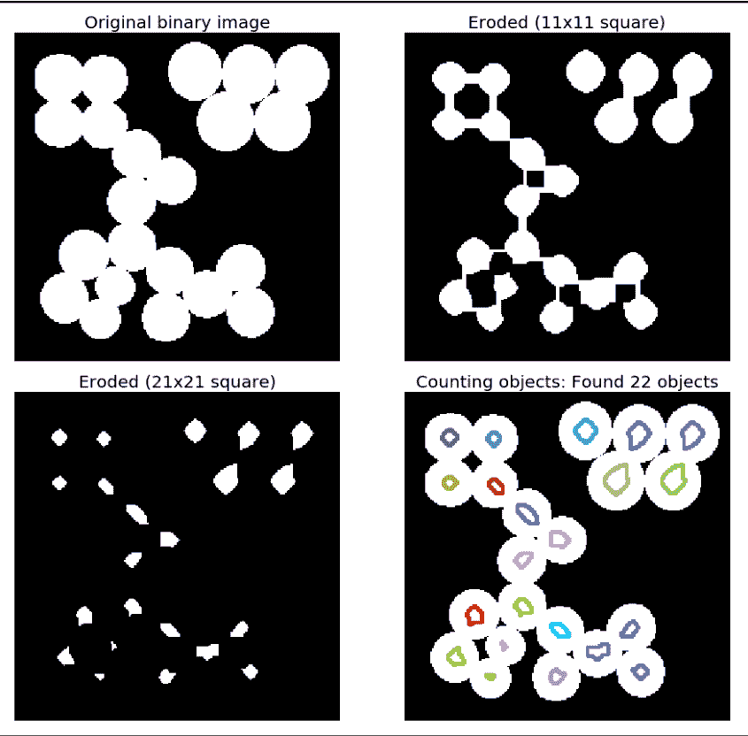

如前面的输出所示，连接的圆圈已被分离，所有 22 个圆圈都已检测到。

## 使用闭运算和开运算进行对象计数

使用形态学闭运算和开运算计数对象，再次使用 OpenCV-Python 函数，请执行以下步骤：

- 1. 读取 rasagolla 输入（一种典型的孟加拉甜点）图像，将其转换为灰度，并反转：

```
image = cv2.imread('images/rasagolla.jpg')
gray = cv2.cvtColor(image, cv2.COLOR_BGR2GRAY)
gray = cv2.bitwise_not(gray) #255 - gray
```

- 2. 使用 Canny 边缘检测器查找图像中的边缘，对边缘图像进行阈值处理，然后，使用 4 x 4 方形 SE，对阈值化的边缘图像应用二值闭运算，接着是二值开运算（以分离对象）：

```
edged = cv2.Canny(gray, 50, 150)
thresh = cv2.threshold(gray, 100, 255, cv2.THRESH_BINARY_INV)[1]
kernel = np.ones((4, 4), np.uint8)
thresh = cv2.morphologyEx(thresh, cv2.MORPH_CLOSE, kernel) #Close
thresh = cv2.morphologyEx(thresh, cv2.MORPH_OPEN, kernel) #Open
```

- 3. 现在，查找前面代码获得的图像中前景对象的轮廓（即轮廓线）：

```
_, cnts, _ = cv2.findContours(thresh.copy(), cv2.RETR_EXTERNAL,
cv2.CHAIN_APPROX_SIMPLE)
```

- 4. 最后，遍历找到的轮廓，在输出图像上绘制它们（再次使用不同颜色），忽略小对象：

```
output = image.copy()
count = 0
for c in cnts:
    if cv2.contourArea(c) > 5: # ignore small objects
        cv2.drawContours(output, [c], -1, \
            (np.random.randint(0, 255), \
            np.random.randint(0, 255), \
            np.random.randint(0, 255)), 2)
        count += 1
```

如果你运行前面的代码片段并绘制图像，你将得到以下输出，检测到所有八个对象：

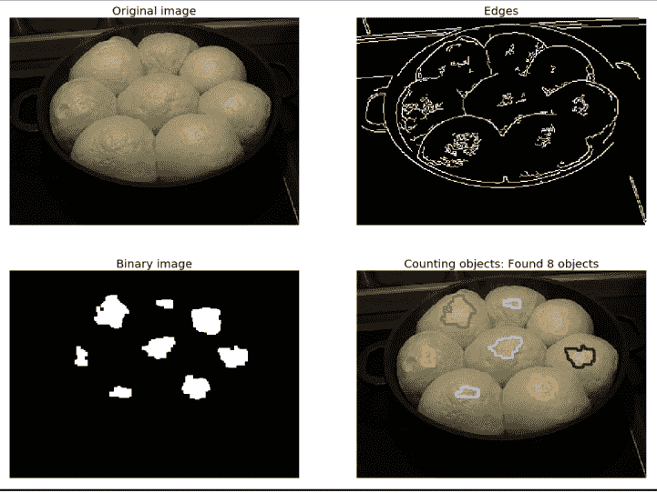

### 工作原理...

opencv-python 的 morphologyEx() 函数用于对图像应用形态学操作。该函数接受源图像（即二值图像）、形态学操作（例如 cv2.MORPH_CLOSE 和 cv2.MORPH_OPEN）以及 SE 内核（例如，用于 4 x 4 方形内核的 np.ones((4, 4), np.uint8)）来执行形态学操作。

cv2.findContours() 和 cv2.drawContours() 函数分别用于查找和绘制轮廓。输出图像上的每个轮廓都绘制了随机颜色的轮廓线，然后通过循环找到的轮廓逐个显示。

(np.random.randint(0, 255), np.random.randint(0, 255), np.random.randint(0, 255)) 被用于生成随机 BGR 元组。cv2.contourArea() 函数被用于丢弃面积小于或等于 5 的小对象。

### 更多内容...

使用形态学操作从以下二值图像中检测并分离对象：

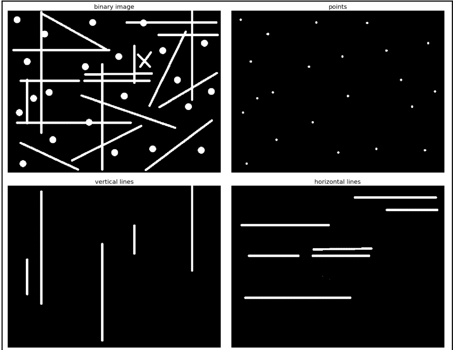

你也能从二值输入图像中检测出既不是垂直也不是水平的线条吗？

现在，进行一些地理空间图像处理：从以下地图图像（印度名为 Sundarban 的红树林森林）中计算岛屿数量，你将得到类似以下的图表：

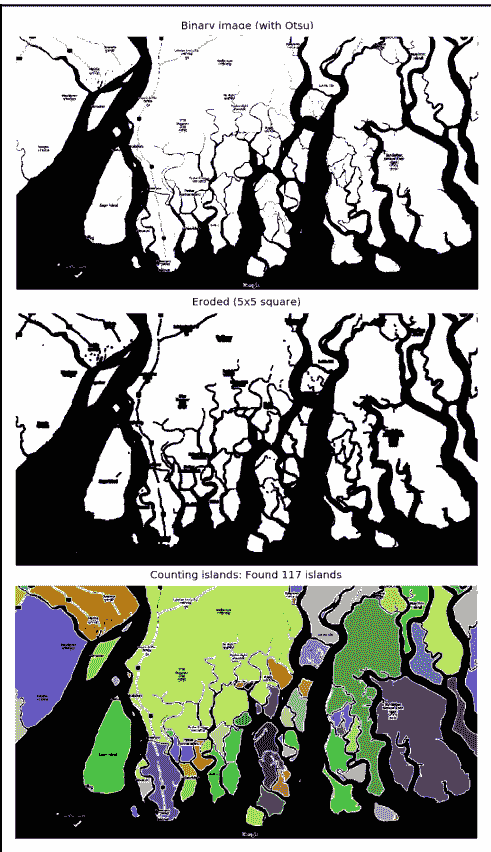

### 另请参阅

请参阅以下文章以了解有关此配方的更多信息：

- https://docs.opencv.org/3.0-beta/doc/py_tutorials/py_imgproc/py_morphological_ops/py_morphological_ops.html
- https://docs.opencv.org/trunk/d4/d86/group__imgproc__filter.html#ga67493776e3ad1a3df63883829375201f
- https://www.pyimagesearch.com/2015/11/02/watershed-opencv/
