# 图像配准

图像配准是指一种图像处理任务，其目标是将目标图像与源图像对齐。从更广义的角度来说，它旨在计算空间变换（函数），将一张图像中的（某些）点映射到另一张图像中的对应点。通常，从一张图像到另一张图像查找变换被称为对齐，然后使用估计的变换实际执行图像变形过程被称为**配准**。有三种一般哲学用于比较以确定对齐：

- 基于强度（比较一张图像与另一张图像的实际像素值，例如，使用互信息）
- 基于分割（注册二值分割）
- 基于地标（或特征）（在两张图像中标记关键点，并推导出使每对地标匹配的变换）

我们将估计（用于注册图像）的变换可能是以下任何一种类型：

- 刚性（旋转、平移）
- 仿射（刚性 + 缩放和剪切/倾斜）
- 可变形（自由形式 = 仿射 + 向量场）

也有许多其他类型的变换。

在本章中，我们将专注于基于强度和特征的图像配准技术及其应用，并将介绍以下配方：

- 使用 SimpleITK 进行医学图像配准
- 使用 ECC 算法和变形进行图像对齐
- 使用 dlib 进行人脸对齐
- 使用 RANSAC 算法进行鲁棒匹配和单应性
- 图像拼接（全景）
- 人脸变形
- 实现图像搜索引擎

## 使用 SimpleITK 进行医学图像配准

如前所述，配准的目标是估计关联给定输入图像中点的变换。通过配准估计的变换据说将点从**固定**图像坐标系映射到**移动**图像坐标系。SimpleITK 提供了一个可配置的多分辨率配准框架，在 `ImageRegistrationMethod` 类中实现。要使用 `ImageRegistrationMethod` 创建特定的配准实例，你需要选择几个共同定义配准实例的组件：

- 变换
- 相似度度量
- 优化器
- 插值器

以下图显示了 SimpleITK 中配准框架的组件：

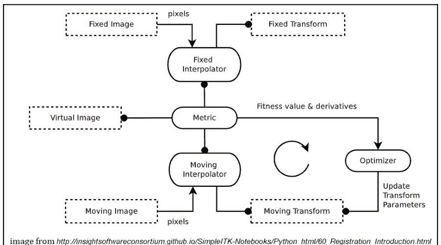

图像配准是在参数空间中使用优化完成的（要应用于移动图像以与固定图像对齐的变换由参数定义）；这些参数使用优化算法进行调整，以优化图像之间计算的相似度度量。

### 准备工作

我们将使用 CT 扫描图像和 MRI-T1 图像来演示使用 SimpleITK 进行图像配准。这些图像从从 https://www.insight-journal.org/rire/download.php 下载的原始 (.mhd) 文件中提取（同意许可后下载 ZIP 并提取文件）。让我们开始加载所需的库，一如既往：

```
%matplotlib inline
import SimpleITK as sitk
import numpy as np
import matplotlib.pyplot as plt
```

### 操作步骤...

执行以下步骤以使用 SimpleITK 实现图像配准：

- 1. 首先，读取要对齐的图像，将 CT 扫描图像作为固定（目标）图像，将 MRI-T1 图像作为移动（源）图像：

```
fixed_image = sitk.ReadImage("images/ct_scan_11.jpg", \
sitk.sitkFloat32)
moving_image = sitk.ReadImage("images/mr_T1_06.jpg", \
sitk.sitkFloat32)
```

- 2. 将 SimpleITK Image 对象转换为 NumPy 数组，以便使用 matplotlib 显示图像：

```
fixed_image_array = sitk.GetArrayFromImage(fixed_image)
moving_image_array = sitk.GetArrayFromImage(moving_image)
print(fixed_image_array.shape, moving_image_array.shape)
# (512, 512) (512, 512)
```


以下截图显示了固定图像和移动图像及其初始对齐情况（如您所见，它们未正确对齐）：

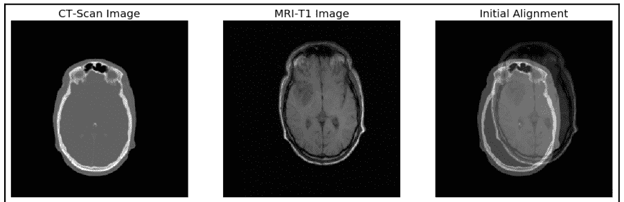

- 3. 创建 `ImageRegistrationMethod` 类的实例，该类在 SimpleITK 中实现了可配置的多分辨率注册框架：

```
registration_method = sitk.ImageRegistrationMethod()
```

- 4. 使用 CenteredTransformInitializer() 方法对齐输入图像的中心，并将固定图像的中心定义为旋转中心：

```
initial_transform = sitk.CenteredTransformInitializer(fixed_image, \
                    moving_image, sitk.Similarity2DTransform())
```

- 5. 使用以下代码行将相似度度量设置为 MattesMutualInformation 度量，将插值器设置为简单线性插值器：

```
registration_method.SetMetricAsMattesMutualInformation(numberOfHistogramBins=50)
registration_method.SetInterpolator(sitk.sitkLinear)
```

- 6. 将优化器设置为梯度下降优化器，学习率参数初始化为 1.0，迭代次数设置为 100：

```
registration_method.SetOptimizerAsGradientDescent(learningRate=1.0,
                     numberOfIterations=100, convergenceMinimumValue=1e-6,
                     convergenceWindowSize=10)
```

- 7. 应用初始变换，然后使用前面步骤中的设置执行注册，以获得估计的最终变换：

```
registration_method.SetInitialTransform(initial_transform,
inPlace=False)
final_transform =
registration_method.Execute(sitk.Cast (fixed_image,
sitk.sitkFloat32),
sitk.Cast (moving_image, sitk.sitkFloat32))
```

- 8. 根据上一步获得的最终变换重采样移动（源）图像，以获取与固定（目标）图像对齐的图像：

```
resampler = sitk.ResampleImageFilter ()
resampler.SetReferenceImage (fixed_image)
resampler.SetInterpolator (sitk.sitkLinear)
resampler.SetDefaultPixelValue(100)
resampler.SetTransform(final_transform)
out = resampler.Execute (moving_image)
```

- 9. 最后，将目标图像与变换后的（对齐的）源图像合并（以可视化对齐效果）：

```
simg1 = sitk.Cast (sitk.RescaleIntensity(fixed_image), \
sitk.sitkUInt8)
simg2 = sitk.Cast(sitk.RescaleIntensity(out), sitk.sitkUInt8)
cimg = sitk.Compose(simg1, simg2, simg1//2.+simg2//2.)
```

如果运行上述代码片段并绘制目标（CT 扫描）图像、对齐后的源（MRI-T1）图像和合并图像，您将得到类似以下截图的输出：

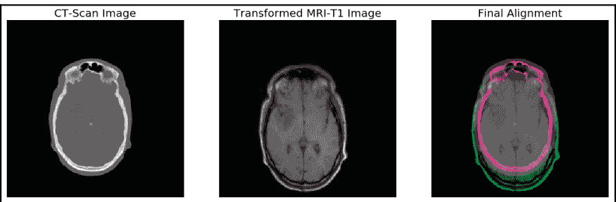

### 工作原理

ImageRegistrationMethod 类提供了一个接口方法，用于访问模块化的 SimpleITK (v4) 注册框架。该类捕获了在两个图像之间执行简单图像注册所需的所有必要元素。

注册将使用优化来完成；SetOptimizerAsGradientDescent() 方法实现了一个简单的梯度下降优化器。在每次迭代中，当前参数将根据以下公式更新（其中 f 是优化的目标函数，$p_n$ 表示第 n 次迭代时参数 p 的值，该参数可以用一个小的随机值初始化）：

$p_{n+1} = p_n - \text{learningRate} \frac{\delta f(p_n)}{\delta p_n}$

传递给梯度下降函数的参数包括 learningRate（默认值为 1.0）、numberOfIterations（运行梯度下降算法的迭代次数）、convergenceMinimumValue（当收敛值达到此值时，算法被视为已收敛）以及 convergenceWindowSize。

SetMetricAsMattesMutualInformation() 方法使用 Mattes 等人的方法基于两幅图像之间的互信息来注册这两幅图像。

### 更多内容

在梯度下降迭代期间绘制度量值（使用 SimpleITK 观察者）；曲线应类似于以下图形（通常，度量值应随迭代增加，因为正在最大化互信息，并且需要突出显示获得的局部最大值）：

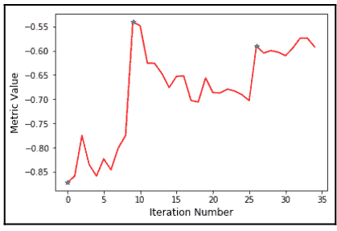

首先使用一张 MRI-T1 图像及其平移版本（如以下图像所示），并使用 SimpleITK 对图像进行注册。使用两个不同的相似度度量（例如，均方误差和互信息度量）以及梯度下降优化器。您应该得到类似以下截图的输出（请注意，互信息可用于输出更好的对齐效果）：

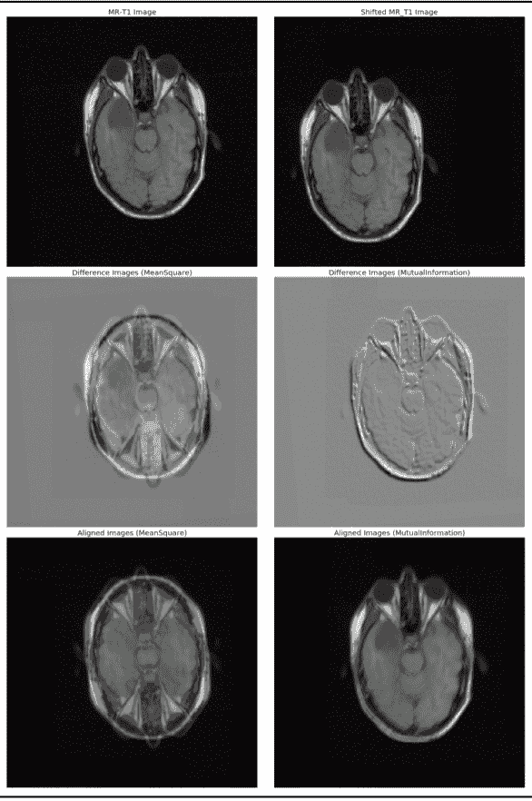

使用棋盘可视化（提示：使用 SimpleITK 滤波器）显示注册前后的图像（通过将两个输入/输出图像的像素以棋盘模式组合）：

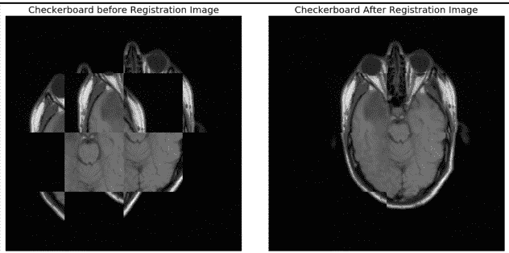

使用 SimpleITK 的注册框架，通过变形（非仿射）变换（例如，弹性变换）对两幅图像进行注册。

### 另请参阅

- https://www.cs.cmu.edu/~galeotti/methods_course/ITK_Registration.pdf
- https://buildmedia.readthedocs.org/media/pdf/simpleitk/master/simpleitk.pdf
- http://insightsoftwareconsortium.github.io/SimpleITK-Notebooks/Python_html/60_Registration_Introduction.html
- https://simpleitk.readthedocs.io/en/master/Documentation/docs/source/registrationOverview.html
- https://stackoverflow.com/questions/41692063/what-is-the-difference-between-image-registration-and-image-alignment
- https://www.youtube.com/watch?v=MaFiP6RerpM

## 使用 ECC 算法和变形进行图像对齐

参数图像对齐问题涉及查找可对齐两幅图像的变换。在本示例中，您将学习如何使用 OpenCV-Python 库的实现，基于 ECC 准则来估计两幅图像之间的几何变换（即变换矩阵）。给定一对图像剖面（强度），\(I_i(x)\)（参考图像）和 \(I_w(y)\)（变换后的图像），以及一组坐标 \(T=\{x_k, k=1,\ldots,K\}\)（称为目标区域），对齐问题即在变换后的图像中查找对应的坐标集。假设 \(\varphi\) 是给定的变换模型，则对齐问题可以外推为估计参数 \(p\) 的问题，如以下截图所示：

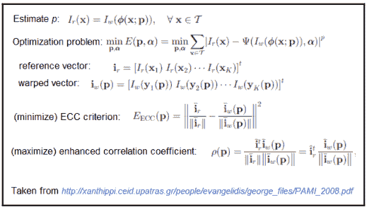

\(\rho(p)\) 使用基于梯度的方法进行最大化。ECC 准则不依赖于对比度/亮度的变化。相反，会对非线性目标函数的近似进行迭代优化，以使优化器在计算上更简单。

### 准备工作

在本示例中，我们将使用一张彩色（RGB）图像，其颜色通道未正确对齐（导致彩色图像可视化效果不佳）。您将使用 ECC 算法对齐颜色通道，然后渲染彩色图像以改善其可视化效果。首先，像往常一样导入所需的库：

```
import cv2
import numpy as np
import matplotlib.pyplot as plt
```

### 操作步骤

按照以下步骤使用 OpenCV-Python 实现 ECC 算法：

- 1. 由于图像的颜色通道在梯度域中的相关性强于在强度域中的相关性，我们将在梯度域中运行 ECC 算法。定义您不久将使用的 `get_gradient ()` 函数：

```
def get_gradient(im) :
 grad_x = cv2.Sobel(im,cv2.CV_32F,1,0,ksize=3)
 grad_y = cv2.Sobel(im,cv2.CV_32F,0,1,ksize=3)
 grad = cv2.addWeighted(np.absolute(grad_x), 0.5, \
         np.absolute(grad_y), 0.5, 0)
 return grad
```

- 2. 读取输入 RGB 图像并绘制原始图像及其未对齐的颜色通道：

```
im_unaligned = cv2.imread("images/me_unaligned.jpg")
height, width = im_unaligned.shape[:2]
print(height, width)
# 992 610
channels = ['B', 'G', 'R']
plt.figure(figsize=(30,12))
plt.gray()
plt.subplot(1,4,1), plt.imshow(cv2.cvtColor(im_unaligned, \
 cv2.COLOR_BGR2RGB)), plt.axis('off'), \
 plt.title('Unaligned Image (ECC)', size=20)
for i in range(3):
 plt.subplot(1,4,i+2), plt.imshow(im_unaligned[...,i]), \
 plt.axis('off')
plt.title(channels[i], size=20)
plt.suptitle('Unaligned Image and Color Channels', size=30)
plt.show()
```

如果运行上述代码片段，您将得到类似以下截图的输出：


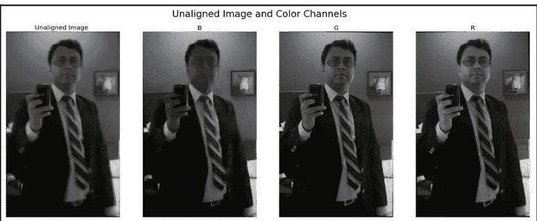

- 3. 使用输入图像的副本初始化输出图像：
  im_aligned = im_unaligned.copy()

- 4. 初始化 warp_mode 以选择要估计的运动模型：
  warp_mode = cv2.MOTION_HOMOGRAPHY

- 5. 初始化 warp_matrix（例如，初始化为单位矩阵）以存储运动模型：
  warp_matrix = np.eye(3, 3, dtype=np.float32)
  # if warp_mode == cv2.MOTION_HOMOGRAPHY

- 6. 定义迭代算法的终止准则：
  criteria = (cv2.TERM_CRITERIA_EPS | cv2.TERM_CRITERIA_COUNT, 500, 1e-6)

- 7. 假设你想将 B 通道和 G 通道对齐到 R 通道；首先使用以下代码行计算 R 通道的梯度：
  im_grad2 = compute_gradient(im_unaligned[...,2])

- 8. 使用 findTransformECC() 函数估计前两个通道（绿色和蓝色）到红色（第三个）通道的 warp 矩阵。请记住，OpenCV-Python 对于 RGB 图像使用 BGR 格式：

```python
for i in range(2) :
    (cc, warp_matrix) = cv2.findTransformECC(im_grad2, \\
        get_gradient(im_unaligned[...,i]), \\
        warp_matrix, warp_mode, criteria)
```

- 9. 将 warp_matrix 应用于绿色和蓝色通道，使其与红色通道对齐（由于这是单应性变换，请使用 warpPerspective）：

```python
im_aligned[...,i] = cv2.warpPerspective(im_unaligned[...,i], \\
    warp_matrix, (width,height), \\
    flags=cv2.INTER_LINEAR + cv2.WARP_INVERSE_MAP)
```

如果运行前面的代码片段，然后绘制输出的对齐 RGB 图像及其颜色通道，你将得到类似于以下截图的输出：

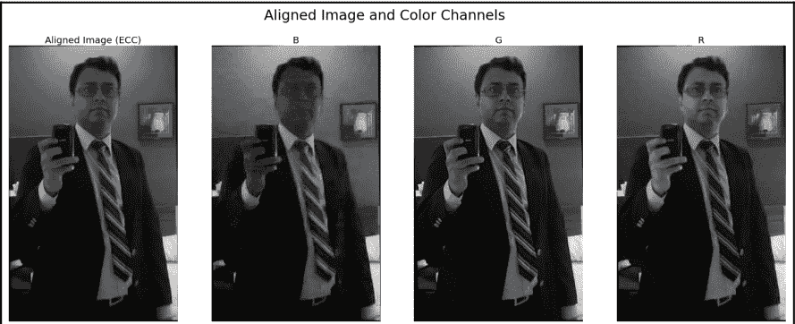

### 工作原理...

在 get_gradient() 函数中，使用了加权 Sobel 水平和垂直梯度来计算颜色通道的梯度。ECC 算法使用了 OpenCV-Python 中的 findTransformECC() 函数。该函数接受的前两个参数是（单通道）模板图像和输入图像。

红色通道被用作模板（参考），绿色/蓝色通道被用作输入。传递给该函数的第三个参数是 `warp_matrix`，它被初始化为 3x3 单位矩阵。

第四个参数是运动模型；在此处，`MOTION_HOMOGRAPHY` 被用作运动模型（在 3x3 warp 矩阵中估计 8 个参数）。下表列出了可以作为参数值传递的 OpenCV-Python 中所有可能的运动模型，`MOTION_AFFINE` 为默认运动模型：

| 运动模型 | Warp 矩阵维度 | 要估计的参数数量 |
|---|---|---|
| MOTION_TRANSLATION | 2x3 | 2 |
| MOTION_EUCLIDEAN | 2x3 | 3 |
| MOTION_AFFINE | 2x3 | 6 |
| MOTION_HOMOGRAPHY | 3x3 | 8 |

此函数根据 ECC 准则估计变换的最优 warp 矩阵，如下所示：

```
warpMatrix = arg max ECC(templateImage(x, y), inputImage(x', y'))
where [x'] = W . [y]
    [y']       [1]
```

该函数返回在 warped 输入图像和模板图像之间计算的最终增强相关系数。`findTransformECC()` 函数使用强度相似性来实现基于区域的对齐。它更新初始变换，大致对齐图像。

> 如果图像经过强位移/旋转，则需要先应用一个额外的变换来大致对齐图像（例如，一个简单的欧几里得变换，使图像内容大致相同）。

`warpPerspective()` 函数与 `cv2.WARP_INVERSE_MAP` 输入标志和估计的 warp 矩阵一起使用，以对输入图像应用反向 warping，将输入的绿色/蓝色颜色通道贴近参考红色颜色通道。

### 更多内容

使用 ECC 算法重建 Prokudin-Gorskii Collection（可在此处找到：https://www.learnopencv.com/image-alignment-ecc-in-opencv-c-python）的彩色图像。使用具有强位移/旋转的两个图像，并使用 ECC 算法对它们进行对齐，同时正确初始化 warp_matrix。

### 另请参阅

请参阅以下链接以了解有关此配方的更多信息：

- * http://xanthippi.ceid.upatras.gr/people/evangelidis/george_files/PAMI_2008.pdf
- * https://docs.opencv.org/3.0-beta/modules/video/doc/motion_analysis_and_object_tracking.html
- * https://stackoverflow.com/questions/45997891/cv2-motion-euclidean-for-the-warp-mode-in-ecc-image-alignment-method
- * https://www.learnopencv.com/image-alignment-ecc-in-opencv-c-python/

## 使用 dlib 进行面部对齐

面部对齐可以被视为由以下步骤组成的图像处理任务：

- 1. 识别面部标志点（或面部几何结构）。
- 2. 使用标志点估计要对齐面部的几何变换（例如，仿射变换）来计算规范对齐。

**面部对齐**是一个数据标准化过程——许多面部识别算法的重要预处理步骤。在本配方中，你将首先学习如何使用 dlib 库的面部检测器从包含面部的图像中检测面部，然后使用形状预测器从检测到的面部中提取面部标志点。之后，我们将使用提取的面部标志点（应用估计的变换）将输入面部 warping 到输出面部。

面部的关键面部属性（例如，嘴角、左右眼睛/眉毛、鼻尖、下颌等）被识别并使用面部标志点进行标记。dlib 库的面部检测器使用一组预训练的回归树直接从输入面部图像的像素强度中标记标志点（无需任何特征提取），精度很高。接下来，我们将使用 imutil 库中的 FaceAligner 类，通过先估计然后应用待对齐候选面部之间提取的标志点的仿射变换来对齐面部。

### 准备工作

要开始使用本配方，请导入以下库：

```
from imutils.face_utils import FaceAligner
from imutils.face_utils import rect_to_bb
import imutils
import dlib
import cv2
import matplotlib.pyplot as plt
```

### 操作步骤...

运行以下步骤，使用 imutil 库（来自 PyImagesearch）实现面部对齐：

- 1. 首先，从 dlib 初始化面部检测器。加载预训练模型作为面部标志点预测器，最后，从 imutils 实例化一个 FaceAligner 对象：

```
detector = dlib.get_frontal_face_detector()
predictor = dlib.shape_predictor('models/shape_predictor_68_face_landmarks.dat')
face_aligner = FaceAligner(predictor, desiredFaceWidth=256)
```

- 2. 从磁盘读取输入图像，调整图像大小，并将其转换为灰度图：

```
image = cv2.imread('images/scientists.png')
image = imutils.resize(image, width=800)
gray = cv2.cvtColor(image, cv2.COLOR_BGR2GRAY)
```

现在，如果绘制原始图像，你将得到类似于以下截图的输出：

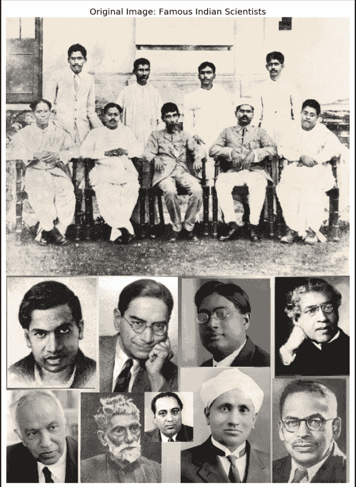

- 3. 使用以下代码行在灰度图像中检测面部。

```
rects = detector(gray, 2)
print ('Number of faces detected:', len(rects))
# 17
```

- 4. 遍历检测到的面部；对于每个面部，提取 ROI，使用面部标志点估计对齐的仿射变换，并应用变换来对齐面部：

```
for rect in rects:
    (x, y, w, h) = rect_to_bb(rect)
    face_original = imutils.resize(image[y:y + h, x:x + w], width=256)
    face_aligned = face_aligner.align(image, gray, rect)
```

现在，如果运行前面的代码片段并绘制检测到的和对齐的面部，你将得到类似于以下截图的输出（仅显示四个面部）：

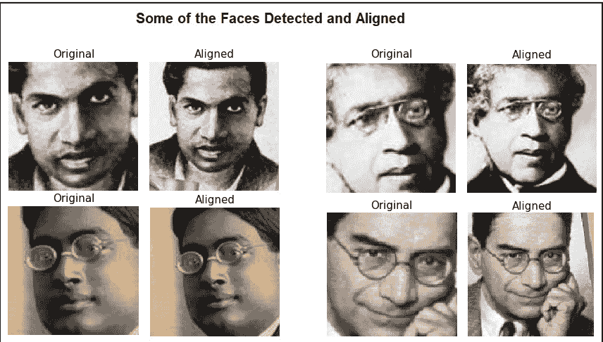


### 它是如何工作的...

get_frontal_face_detector() 函数（基于方向梯度直方图 (HOG) 特征）来自 dlib 库，用于检测人脸。从 dlib 调用 shape_predictor() 函数，并传入序列化的预训练面部标志检测器（数据文件），以估计给定检测到的人脸上 68 个关键点的 (x, y) 坐标，这些关键点映射到面部标志（结构）（dlib 形状预测器内部实现了 Kazemi 和 Sullivan 的算法，该算法使用回归树集成，直接从输入人脸像素估计面部标志，无需任何特征提取）。从人脸提取的标志如下面截图所示：

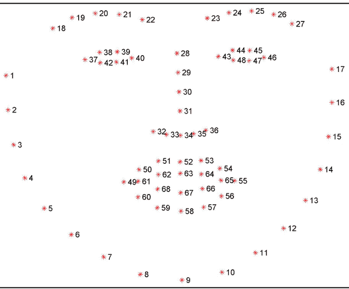

从 imutils 库实例化了一个 FaceAligner 类对象，以 shape_predictor 对象作为输入参数（因为需要访问提取的面部标志）。使用了其 align() 方法来对齐给定的检测到的人脸。

align() 方法对面部标志执行以下操作以对齐给定人脸。计算眼睛之间的旋转角度，从而允许纠正旋转。接下来，它计算新输出图像的缩放比例。最后，它使用 OpenCV-Python 库的 warpAffine() 函数，结合计算出的旋转矩阵和所需的输出大小作为函数参数，以获得对齐的输出图像。

### 还有更多

从以下截图开始（来自 https://www.needpix.com/photo/801551/mona-lisa-painting-leonardo-da-vinci-portrait-young-face-substitution），蒙娜丽莎面部在两个不同方向中出现两次，使用 dlib 库的人脸检测器和形状预测器来检测人脸及面部标志：

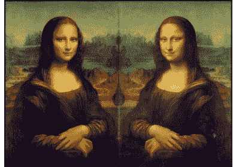

现在，使用提取的面部标志来估计仿射变换（使用 scikit-image），然后将左侧人脸 warp 到右侧人脸。如果你绘制检测到的人脸和 warped 后的人脸，以及提取的面部标志，你应该得到如下截图所示的图形：

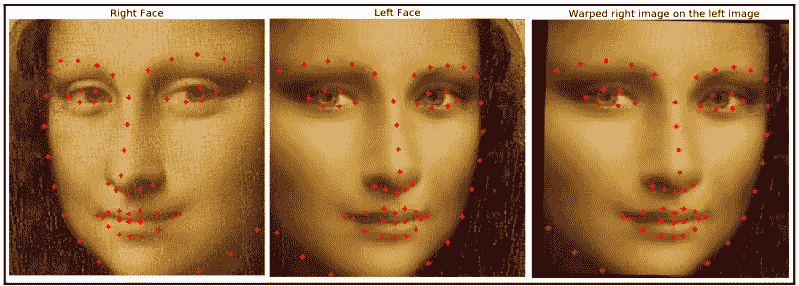

你也可以使用深度学习来对齐人脸。尝试使用以下 See also 部分链接中提供的 DeepLearningNetwork 和 face_alignment 库来对齐人脸。你也可以使用 face_alignment 库函数获取 2D 和 3D 面部标志（与 dlib 比较），如下所示（这留作你自行完成的练习），使用 Swami Vivekananda 的图像：

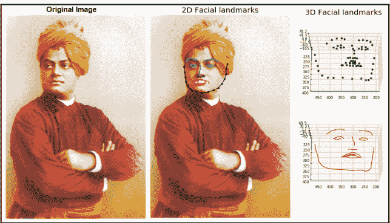

### 另请参阅

- https://www.pyimagesearch.com/2017/05/22/face-alignment-with-opencv-and-python/
- https://ibug.doc.ic.ac.uk/resources/facial-point-annotations/
- https://www.pyimagesearch.com/2017/05/22/face-alignment-with-opencv-and-python/
- https://github.com/jrosebr1/imutils/tree/master/imutils/face_utils
- https://github.com/MarekKowalski/DeepAlignmentNetwork
- https://github.com/1adrianb/face-alignment/
- http://www.nada.kth.se/~sullivan/Papers/Kazemi_cvpr14.pdf
- https://ieeexplore.ieee.org/document/6909637

## 使用 RANSAC 算法进行稳健匹配和单应性

随机样本一致性（RANSAC）是一种迭代非确定性算法，用于从完整数据集（包含异常值）中几个内点随机子集，稳健地估计数学模型的参数。在此配方中，我们将使用 `skimage.measure` 模块的 RANSAC 算法实现。RANSAC 算法的每次迭代执行以下操作：

1.  它从原始数据中选择大小为 `min_samples` 的随机样本（假设内点），并确保样本数据集适合拟合模型。
2.  它将模型（即估计模型参数）拟合到采样数据集，并确保估计的模型有效。
3.  它检查估计的模型是否适合所有其他数据点。通过计算到估计模型的某些特定于模型的损失函数（例如，残差），计算所有数据点中的共识集（`inliers`）和异常值。`inliers` 定义为残差小于指定残差阈值的数据点。
4.  如果共识集（`inliers`）中的样本数量是 *最大* 的，则它将模型（由 *估计的模型参数* 定义）保存为迄今看到的最佳模型。如果存在平局（就 `inliers` 的数量而言），则 *残差* 更少的模型被认为是最佳模型。

上述步骤会重复执行，要么达到最大次数（由 `max_trials` 定义），要么直到满足其中一个停止条件（使用 `stop_sample_num`、`stop_probability` 等指定）。最终模型是使用迄今找到的最佳模型对应的所有 `inlier` 样本获得的。所需试验次数（或选择的随机样本数）N，使得以概率 p，至少有一个随机样本不含异常值，由以下图中显示的表达式给出（我们希望 p 的典型值为 0.99 或更高）：

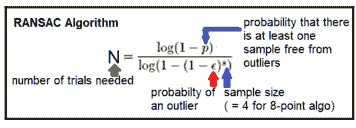

### 准备工作

在此配方中，我们将使用 RANSAC 算法计算两幅图像（加尔各答维多利亚纪念堂）之间的稳健匹配（基于特征的对齐），使用 Harris Corner 关键点和 **二元鲁棒独立基本特征**（BRIEF）二进制描述子，并估计稳健单应性矩阵（使用该矩阵将第二幅图像 warp 到第一幅图像上，可选使用 RANSAC）。让我们先导入所需的库：

```
from skimage.feature import (corner_harris, corner_peaks, BRIEF,
 match_descriptors, plot_matches)
from skimage.transform import ProjectiveTransform, warp
from skimage.measure import ransac
from skimage.io import imread
from skimage.color import rgb2gray
import numpy as np
import matplotlib.pyplot as plt
```

### 操作步骤

运行以下代码段，了解 RANSAC 算法如何使模型拟合更稳健：

1.  使用 numpy 设置随机种子（为了可重复的结果）：

```
np.random.seed(2)
```

2.  读取要匹配的输入图像：

```
img1 = rgb2gray(imread('images/victoria3.png'))
img2 = rgb2gray(imread('images/victoria4.png'))
```

3.  使用以下几行代码从输入图像中提取 Harris Corner 关键点（特征）：

```
keypoints1 = corner_peaks(corner_harris(img1), min_distance=1)
keypoints2 = corner_peaks(corner_harris(img2), min_distance=1)
```

4.  为两个输入图像中找到的关键点提取二进制 BRIEF 描述子：

```
extractor = BRIEF(patch_size=10)
extractor.extract(img1, keypoints1)
descriptors1 = extractor.descriptors
extractor.extract(img2, keypoints2)
descriptors2 = extractor.descriptors
```

5.  匹配两个图像中的描述子，并仅选择匹配的图像中的关键点：

```
matches = match_descriptors(descriptors1, descriptors2)
src_keypoints = keypoints1[matches[:, 0]]
dst_keypoints = keypoints2[matches[:, 1]]
```

6.  使用源图像和目标图像中所有匹配的关键点计算两个图像的单应性矩阵。如你所见，有 39 个匹配关键点：

```
homography = ProjectiveTransform()
homography.estimate(src_keypoints, dst_keypoints)
print(len(matches))
# 39
```

7.  现在，使用 RANSAC 算法和 ProjectiveTransform 类计算具有最多内点的稳健匹配。这次你将获得不同的单应性矩阵。如你所见，使用 RANSAC 算法后，关键点匹配数减少到 6（只有稳健匹配保留下来）：

```
homography_robust, inliers = ransac((src_keypoints, dst_keypoints),
                                     ProjectiveTransform, min_samples=4,
                                     residual_threshold=2, max_trials=500)
robust_matches = match_descriptors(descriptors1[matches[:, 0]]
                                   [inliers], descriptors2[matches[:, 1]][inliers])
print(len(robust_matches))
# 6
```


- 8. 使用带/不带 RANSAC 获得的 `ProjectiveTransform` 对象将第二张图像变形到第一张图像上并绘制它们：

```
img2_proj_with_homography = warp(img2, homography,
output_shape=img2.shape)
img2_proj_with_robust_homography = warp(img2, homography_robust,
output_shape=img2.shape)
```

### 工作原理

如果运行前述代码片段，并绘制从使用/不使用 RANSAC 算法获得的关键点和描述子所起始的匹配，接着使用估计的 `homography` 矩阵将第二张图像变形到第一张图像上并绘制，您将得到类似下面截图的输出：

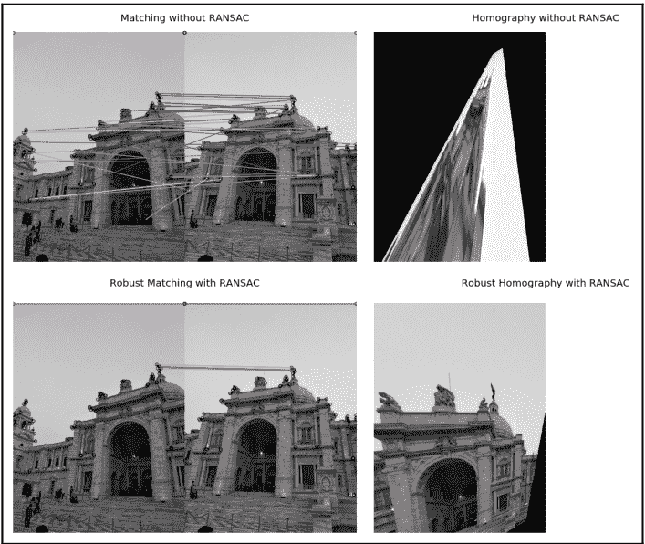

从下一个截图可以看出，使用 RANSAC 算法可删除所有错误匹配，并生成更好的投影变换。

skimage.feature 模块的 corner_harris() 和 corner_peaks() 函数用于从输入图像中获取 Harris 角点关键点（它通过在 R 中选取局部极大值来查找具有较大角响应函数 R 的点，如下一个截图所示）：

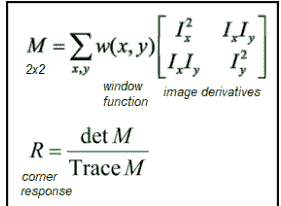

skimage.feature 模块的 BRIEF 类已被实例化，其 extract() 方法被用于计算两幅图像对应关键点的二进制描述子。BRIEF 是一种高效的二进制特征描述子，通常具有很强的区分度。海明距离常与二进制描述子（例如 BRIEF）一起用于特征匹配，与 L2 范数相比，计算成本更低（不需要浮点运算）。

> 关于 BRIEF 的版权，请参阅以下链接：
> https://scikit-image.org/docs/dev/license.html

同样，使用了 skimage.feature 模块的 match_descriptors() 函数来匹配对应的关键点，并且只返回匹配的关键点。使用了 skimage.feature 模块的 ransac() 函数，利用 RANSAC 算法为变换拟合单应性模型。

ransac() 函数的参数包括源/目标图像、模型类（ProjectiveTransform）、min_samples 的数量（设置为 4，因为估计单应性所需的最小数据点数为 8，使用 8 点算法）、residual_threshold（数据点被归类为内点的最大距离）以及 max_trials（算法的最大迭代次数）。

最后，使用 `warp()` 函数对目标图像应用投影变换（将 `homography` 对象作为函数的 `inverse_map` 参数，以便使用使用/不使用 RANSAC 估计的单应性矩阵的逆矩阵）。下图详细说明了这一点：

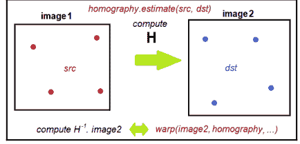

### 另请参阅

要了解有关此配方的更多信息，请参阅以下链接：

- https://scikit-image.org/docs/dev/api/skimage.feature.html
- https://scikit-image.org/docs/dev/api/skimage.measure.html
- https://sandipanweb.wordpress.com/2017/10/22/feature-detection-with-harris-corner-detector-and-matching-images-with-feature-descriptors-in-python/
- https://www.cs.ubc.ca/~lowe/525/papers/calonder_eccv10.pdf
- https://www.youtube.com/watch?v=l7pna8xYC4I
- 书籍《使用 Python 进行图像处理》的第 7 章

## 图像拼接（全景图）

图像拼接（也称为图像镶嵌）是指将多个重叠图像组合以创建（分割的）全景图像（也称为图像镶嵌）的图像处理任务。图像拼接有三个主要组成部分：

- 配准图像（使其特征对齐）
- 确定重叠区域
- 混合

在本示例中，您将学习如何通过使用 **尺度不变特征变换**（**SIFT**）特征（使用 OpenCV-Python）来配准一组重叠图像，从而实现图像拼接，将它们变形以匹配重叠区域，并迭代添加当前图像镶嵌中尚不存在的新区域。您还将学习如何使用 OpenCV-Python 库的 stitch 类方法，通过单个方法调用来创建图像镶嵌。

### 准备工作

在本示例中，我们将使用加尔各答维多利亚纪念堂的几张（重叠）图像，并使用 OpenCV-Python 库函数将它们拼接在一起。和往常一样，让我们先导入所需的库：

```python
import cv2
import numpy as np
from matplotlib import pyplot as plt
import math
import glob
```

### 操作步骤

以下是您将遵循的步骤（需要实现几个函数）以实现图像拼接/镶嵌：

- 1. 首先，实现 `compute_homography()` 函数，该函数从两个给定输入图像中计算单应性矩阵 h：

```python
def compute_homography(image1, image2, bff_match=False):
```

- 2. 与前一个示例类似，首先计算关键点/描述子（这次使用 SIFT）：

```python
sift = cv2.xfeatures2d.SIFT_create(edgeThreshold=10, sigma=1.5, \
contrastThreshold=0.08)
kp1, des1 = sift.detectAndCompute(image1, None)
kp2, des2 = sift.detectAndCompute(image2, None)
```

- 3. 使用暴力 `knnMatch()` 匹配描述子，然后使用 Lowe 比率测试选择良好匹配：

```python
bf = cv2.BFMatcher() # Brute force matching
matches = bf.knnMatch(des1, trainDescriptors=des2, k=2)
good_matches = []
for m, n in matches:
    if m.distance < 0.75 * n.distance: # Lowe's Ratio
        good_matches.append(m)
```

- 4. 使用与良好匹配对应的关键点估计单应性矩阵 H，并返回 H：

```python
src_pts = np.float32([kp1[m.queryIdx].pt for m in \\
                       good_matches]).reshape(-1, 1, 2)
dst_pts = np.float32([kp2[m.trainIdx].pt for m in \\
                       good_matches]).reshape(-1, 1, 2)
if len(src_pts) > 4:
    H, mask = cv2.findHomography(dst_pts, src_pts, cv2.RANSAC, 5)
else:
    H = np.array([[0, 0, 0], [0, 0, 0], [0, 0, 0]])
return H
```

- 5. 接下来，实现 warp_image 函数，该函数使用单应性矩阵 H 对图像进行变形（与前一个示例中所做的相同）：

```python
def warp_image(image, H):
    image = cv2.cvtColor(image, cv2.COLOR_BGR2BGRA)
    h, w, _ = image.shape
```

- 6. 查找新图像中 x 和 y 的最小值和最大值：

```python
p = np.array([[0, w, w, 0], [0, 0, h, h], [1, 1, 1, 1]])
p_prime = np.dot(H, p)
yrow = p_prime[1] / p_prime[2]
xrow = p_prime[0] / p_prime[2]
ymin, xmin, ymax, xmax = min(yrow), min(xrow), max(yrow), \
                         max(xrow)
```

- 7. 创建一个移除偏移量的新矩阵，并将其与单应性矩阵 H 相乘：

```python
new_mat = np.array([[1, 0, -1 * xmin], [0, 1, -1 * ymin], \
                    [0, 0, 1]])
H = np.dot(new_mat, H)
```

- 8. 计算新图像帧的高度和宽度：

```python
height, width = int(round(ymax - ymin)), int(round(xmax - xmin))
size = (width, height)
```

- 9. 使用单应性矩阵 H 创建输入图像的球形变形，并返回变形后的图像：

```python
warped = cv2.warpPerspective(src=image, M=H, dsize=size)
return warped, (int(xmin), int(ymin))
```

- 10. 接下来，使用给定的单应性矩阵 H 实现一个创建输入图像柱形变形的函数，使用以下代码片段：

```python
def cylindrical_warp_image(img, H):
    h, w = img.shape[:2]
```

- 11. 将像素坐标转换为齐次坐标：

```python
y_i, x_i = np.indices((h, w)) # pixel coordinates
X = np.stack([x_i, y_i, np.ones_like(x_i)], axis=-1).reshape(h*w, 3)
# to homogeneous
```

- 12. 归一化坐标：

```python
Hinv = np.linalg.inv(H)
X = Hinv.dot(X.T).T # normalized coords
```

- 13. 计算圆柱坐标（sinθ, h, cosθ），并使用以下代码片段从齐次坐标转换回像素坐标：

```python
A = np.stack([np.sin(X[:,0]), X[:,1], np.cos(X[:,0)]), \
    axis=-1).reshape(w*h, 3)
B = H.dot(A.T).T # project back to image-pixels plane
B = B[:, :-1] / B[:, [-1]] # back from homogeneous coordinates
```

- 14. 确保仅在图像边界内变形坐标：

```python
B[(B[:,0] < 0) | (B[:,0] >= w) | (B[:,1] < 0) | \
    (B[:,1] >= h)] = -1
B = B.reshape(h, w, -1)
```

- 15. 根据圆柱坐标变形图像并返回 cv2.remap：

```python
return cv2.remap(img_rgba, B[:,:,0].astype(np.float32), \
    B[:,:,1].astype(np.float32), cv2.INTER_AREA, \
    borderMode=cv2.BORDER_TRANSPARENT)
```


- 16. 实现一个函数，根据一组输入图像及其对应的原点作为参数来创建图像马赛克：

```
def create_mosaic(images, origins):
```

- 17. 首先找到中心图像及其对应的原点：

```
for i in range(0, len(origins)):
    if origins[i] == (0, 0):
        central_index = i
        break

central_image = images[central_index]
central_origin = origins[central_index]
```

- 18. 将原点和图像一起压缩，并按与原点的距离排序（从高到低）：

```
zipped = list(zip(origins, images))
# sort by distance from origin
func = lambda x: math.sqrt(x[0][0] ** 2 + x[0][1] ** 2)
dist_sorted = sorted(zipped, key=func, reverse=True)
x_sorted = sorted(zipped, key=lambda x: x[0][0])
# sort by x value
y_sorted = sorted(zipped, key=lambda x: x[0][1])
# sort by y value
```

- 19. 确定中心图像在新帧中的坐标：

```
if x_sorted[0][0][0] > 0: cent_x = 0
    # leftmost image is central image
else: cent_x = abs(x_sorted[0][0][0])
if y_sorted[0][0][1] > 0: cent_y = 0
    # topmost image is central image
else: cent_y = abs(y_sorted[0][0][1])
```

- 20. 创建一个新列表，包含每个图像在新帧中的起始点：

```
spots = []
for origin in origins:
    spots.append((origin[0]+cent_x, origin[1] + cent_y))
zipped = zip(spots, images)
# get height and width of new frame
total_height = 0
total_width = 0
for spot, image in zipped:
    total_width = max(total_width, spot[0]+image.shape[1])
    total_height = max(total_height, spot[1]+image.shape[0])
```

- 21. 使用以下代码行创建输出缝合图像的新帧：

```
stitch = np.zeros((total_height, total_width, 4), np.uint8)
```

- 22. 按距离顺序将图像缝合到创建的帧中，并返回获得的图像马赛克：

```
for image in dist_sorted:
    offset_y = image[0][1] + cent_y
    offset_x = image[0][0] + cent_x
    end_y = offset_y + image[1].shape[0]
    end_x = offset_x + image[1].shape[1]
    stitch_cur = stitch[offset_y:end_y, offset_x:end_x, :4]
    stitch_cur[image[1]>0] = image[1][image[1]>0]

return stitch
```

- 23. 现在，实现一个函数，使用`create_mosaic()`函数创建输出全景图像，输入为待缝合的图像和中心图像的索引（作为中心）：

```
def create_panorama(images, center):
    h,w,_ = images[0].shape
    f = 1000 # 800
    H = np.array([[f, 0, w/2], [0, f, h/2], [0, 0, 1]])
    for i in range(len(images)):
        images[i] = cylindrical_warp_image(images[i], H)
```

- 24. 首先，使用以下代码片段缝合中心图像左侧的所有图像：

```
panorama = None
for i in range(center):
    print ('Stitching images {}, {}'.format(i+1, i+2))
    image_warped, image_origin = warp_image(images[i], \
        homography(images[i + 1], images[i]))
    panorama = create_mosaic([image_warped, images[i+1]], \
        [image_origin, (0,0)])
    images[i + 1] = panorama

#print ('Done left part')
```

- 25. 使用以下代码片段缝合中心图像右侧的所有图像。返回获得的全景图：

```
for i in range(center, len(images)-1):
    print ('Stitching images {}, {}'.format(i+1, i+2))
    image_warped, image_origin = warp_image(images[i+1], \
        homography(images[i], images[i + 1]))
    panorama = create_mosaic([images[i], image_warped], \
        [(0,0), image_origin])
    images[i + 1] = panorama
    #print ('Done right part')
return panorama
```

- 26. 最后，调用`create_panorama()`函数以获取输出图像马赛克：

```
center = len(images) // 2
panorama = create_panorama(images, center)
```

如果你绘制输入图像，将得到如下截图所示的输出：

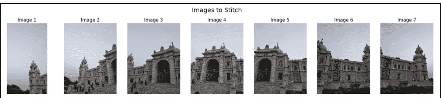

如果你绘制输出全景图像，将得到如下截图所示的输出：

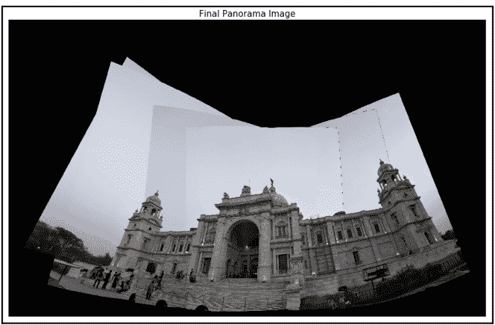

## 使用 OpenCV-Python 进行全景拼接

你可以直接使用 OpenCV-Python 库的 Stitcher 类方法实现图像拼接（无需显式执行拼接步骤，例如特征提取/匹配/融合）。只需运行以下步骤：

- 1. 首先，确保你使用的 OpenCV 版本 <= 3.4.2（直到 SIFT 专利到期）：

```
print(cv2.__version__)
# 3.4.2
```

- 2. 初始化待拼接图像列表：

```
images = [ cv2.cvtColor(cv2.imread(img), cv2.COLOR_BGR2RGB) for \
img in glob.glob('images/victoria*.png')]
print('Number of images to stitch: {}'.format(len(images)))
# Number of images to stitch: 7
```

- 3. 实例化 OpenCV-Python 库的图像拼接器对象，然后使用 `stitch()` 方法生成图像马赛克：

```
stitcher = cv2.createStitcher()
(status, stitched) = stitcher.stitch(images)
#print(status)
```

- 4. 最后，绘制全景图像：

```
plt.figure(figsize=(20,10))
plt.imshow(stitched), plt.axis('off'), plt.title('Final Panorama Image', size=20)
plt.show()
```

你将获得最终的全景图像，如下所示：

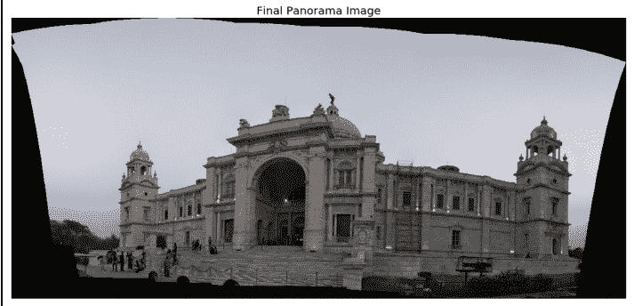

### 工作原理...

使用了 SIFT 描述子来注册/对齐图像。使用了 OpenCV-Python 函数 `findHomography()` 来计算两个图像之间的单应性矩阵。使用了 `opencv-python` 函数 `warpPerspective()`，利用获得的单应性矩阵将一个图像扭曲到其相邻图像上。

直接使用了来自 `opencv-python` 的 `Stitcher` 类的 `stitch()` 方法来创建图像马赛克。它有自己的流水线，如下面的截图所示：

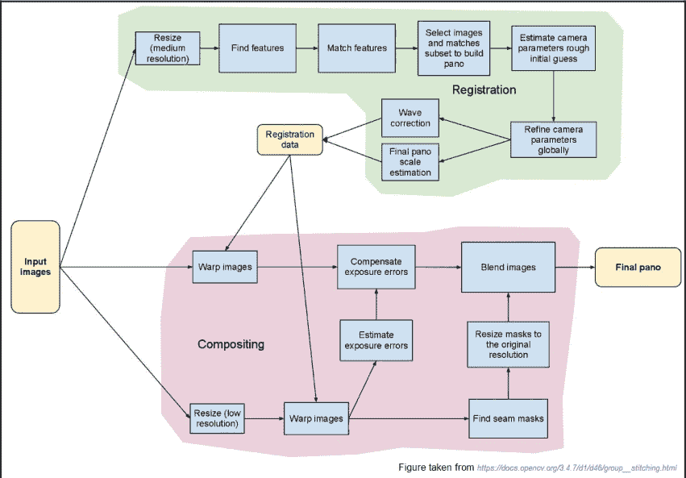

### 更多内容

在拼接过程中使用金字塔融合或梯度（Poisson）融合来融合图像（提示：修改 `create_mosaic()` 函数），使输出的全景图像看起来像一张单一的真实图像（缝合图像的边界应消失）。

### 另请参阅

- http://www.cs.toronto.edu/~kyros/courses/2530/papers/Lecture-14/Szeliski2006.pdf
- http://6.869.csail.mit.edu/fa15/lecture/6.869-Lec5-ImageFeatures-web.pdf
- https://www.microsoft.com/en-us/research/wp-content/uploads/2004/10/tr-2004-92.pdf
- http://matthewalunbrown.com/papers/ijcv2007.pdf
- https://en.wikipedia.org/wiki/Image_stitching
- https://docs.opencv.org/3.4.7/d1/d46/group__stitching.html
- https://www.youtube.com/watch?v=UpUdj9rbQ_O

## 人脸变形

图像/人脸变形的目标是找到图像中两个对象/人脸的平均值。它不是两个对象（人脸）图像的平均值；相反，它是平均对象（人脸）的图像。首先想到的可能是一个两步过程：

- 1. 全局对齐两张人脸图像（使用仿射变换进行扭曲）。

- 2. 交叉溶解（带 alpha 混合的图像线性组合）以创建输出图像。

但这通常行不通。我们可以再次求助于（局部）特征匹配。例如，进行人脸变形时，匹配可以发生在鼻子对鼻子、眼睛对眼睛等关键点之间——这是一种局部（非参数）扭曲。

以下是使用网格扭曲算法实现人脸变形的步骤：

- 1. **定义对应关系**：人脸变形算法使用两张人脸共有的一组特征点（手动创建或通过每张人脸的面部特征检测自动生成面部标志）将源人脸转换为目标人脸。你需要找到待对齐人脸之间的点对应关系（例如，使用两张人脸中相同的关键点顺序，对特征点进行一致标记）。

- 2. **Delaunay 三角剖分**：你需要提供用于变形的点的三角剖分。Delaunay 三角剖分不会输出非常瘦长的三角形，因此这种算法常被使用。在任意一组点上（而不是两组）计算 Delaunay 三角剖分，并且三角剖分在整个变形过程中必须保持一致。


- **计算中间（变形）人脸**：在计算完整的变形序列之前，先计算源图像和目标图像的中间人脸。这涉及计算平均形状（即两个人脸中每个关键点位置的平均值）：计算变形图像 M 中特征点的位置。对于源图像中的每个三角形，计算将三角形三个角映射到变形图像中对应三角形相应角点的仿射变换，然后使用刚刚计算的仿射变换将三角形内部的所有像素变换到变形图像中。最后，对这两幅图像进行 alpha 混合，这就是你最终的变形图像。

在本示例中，你将学习如何实现人脸与狮子脸之间的人脸变形，其中人脸的面部标志使用 dlib 库的面部标志提取自动获取，狮子脸中相应的特征点是手动创建的。

### 准备工作

让我们首先导入实现人脸变形所需的所有库：

```
from scipy.spatial import Delaunay
from skimage.io import imread
import scipy.misc
import cv2
import dlib
import numpy as np
from matplotlib import pyplot as plt
```

### 操作步骤

请按照以下步骤实现人脸变形：

- 1. 首先，使用 `dlib` 库的人脸检测器和形状预测器（如你在 *使用 dlib 进行人脸对齐* 示例中所做的那样），通过实现 `get_face_landmarks()` 函数自动计算人脸的面部标志。该函数接收输入图像、一个布尔标志（指示是否添加边界点）以及 `dlib` 库 `shape_predictor` 模型的路径：

```
def get_face_landmarks (img, add_boundary_points=True,
predictor_path = 'images/shape_predictor_68_face_landmarks.dat') :
detector = dlib.get_frontal_face_detector ()
predictor = dlib.shape_predictor(predictor_path)
```

- 2. 对检测到的每张人脸（在此例中只有一张人脸）使用 `dlib` 和人脸图像的形状预测器对象计算 68 个面部标志（关键点），并返回标志点：

```
dets = detector(img, 1)
points = np.zeros((68, 2))
for k, d in enumerate(dets):
shape = predictor(img, d) # get the landmarks for the face \
in box d.
for i in range(68):
points[i, 0] = shape.part(i).x
points[i, 1] = shape.part(i).y
points = points.astype(np.int32)
return points
```

- 3. 狮子脸上相应的标志在文本文件中手动定义。使用以下函数读取标志：

```
def read_lion_landmarks ():
with open("images/lion_face_landmark.txt") as key_file:
keypoints = [list(map(int, line.split())) for line in \
key_file]
return(keypoints)
```

- 4. 使用以下函数计算两组点（像素）和两幅图像的 alpha 混合：

```
def weighted_average_points(start_points, end_points, percent=0.5):
if percent <= 0: return end_points
elif percent >= 1: return start_points
else: return np.asarray(start_points*percent + \
end_points*(1-percent), np.int32)

def weighted_average(img1, img2, percent=0.5):
    if percent <= 0: return img2
    elif percent >= 1: return img1
    else: return cv2.addWeighted(img1, percent, img2, \
    1-percent, 0)
```

- 5. 实现 bilinear_interpolate() 函数，用于对每个图像通道进行插值：

```
def bilinear_interpolate(image, coords):
    int_coords = coords.astype(np.int32)
    x0, y0 = int_coords
    dx, dy = coords - int_coords
    q11, q21, q12, q22 = image[y0, x0], image[y0, x0+1], \
    image[y0+1, x0], image[y0+1, x0+1]
    btm = q21.T * dx + q11.T * (1 - dx)
    top = q22.T * dx + q12.T * (1 - dx)
    interpolated_pixels = top * dy + btm * (1 - dy)
    return interpolated_pixels.T
```

- 6. 实现 get_grid_coordinates() 函数，生成输入点感兴趣区域（ROI）内所有可能的 (x, y) 网格坐标数组：

```
def get_grid_coordinates(points):
    xmin, xmax = np.min(points[:, 0]), np.max(points[:, 0]) + 1
    ymin, ymax = np.min(points[:, 1]), np.max(points[:, 1]) + 1
    return np.asarray([(x, y) for y in range(ymin, ymax)
    for x in range(xmin, xmax)], np.uint32)
```

- 7. 实现 process_warp() 函数，将 src_img 中位于 result_img 感兴趣区域（ROI）内的三角形（对应 dst_points 中的点）进行变形：

```
def process_warp(src_img, result_img, tri_affines, dst_points,
    delaunay):
    roi_coords = get_grid_coordinates(dst_points)
    roi_tri_indices = delaunay.find_simplex(roi_coords)
    for simplex_index in range(len(delaunay.simplices)):
    coords = roi_coords[roi_tri_indices == simplex_index]
    num_coords = len(coords)
    out_coords = np.dot(tri_affines[simplex_index],
    np.vstack((coords.T, np.ones(num_coords))))
    x, y = coords.T
    result_img[y, x] = bilinear_interpolate(src_img, out_coords)
return None
```

- 8. 实现一个 Python 生成器函数 gen_triangular_affine_matrices()，用于计算从 dest_points 到 src_points 中相应向量的每个三角形顶点的仿射变换矩阵：

```
def gen_triangular_affine_matrices(vertices, src_points,
dest_points):
    ones = [1, 1, 1]
    for tri_indices in vertices:
        src_tri = np.vstack((src_points[tri_indices, :].T, ones))
        dst_tri = np.vstack((dest_points[tri_indices, :].T, ones))
        mat = np.dot(src_tri, np.linalg.inv(dst_tri))[:2, :]
        yield mat
```

- 9. 现在，实现 warp_image() 函数，它接收源/目标图像和相应的控制点，并使用已定义的函数计算变形输出图像及控制点（面部标志）的对应 Delaunay 三角剖分：

```
def warp_image(src_img, src_points, dest_points, dest_shape):
    num_chans = 3
    src_img = src_img[:, :, :3]
    rows, cols = dest_shape[:2]
    result_img = np.zeros((rows, cols, num_chans), np.uint8)
    delaunay = Delaunay(dest_points)
    tri_affines =
    np.asarray(list (gen_triangular_affine_matrices (delaunay.simplices,
    src_points, dest_points)))
    process_warp(src_img, result_img, tri_affines, dest_points,
    delaunay)
    return result_img, delaunay
```

- 10. 从文件中读取源图像（人脸）、目标图像（狮子脸）和狮子脸标志。将源图像大小调整为与目标图像大小匹配。使用 get_face_landmarks() 函数计算人脸标志：

```
src_path = 'images/me.png'
dst_path = 'images/lion.png'
src_img = imread(src_path)
dst_img = imread(dst_path)
size = dst_img.shape[:2]
src_img = cv2.resize(src_img[...,:3], size)
src_points = get_face_landmarks(src_img)
dst_points = read_lion_landmarks()
```

如果你绘制源图像和目标图像以及标志，你将得到类似于以下屏幕截图的输出：

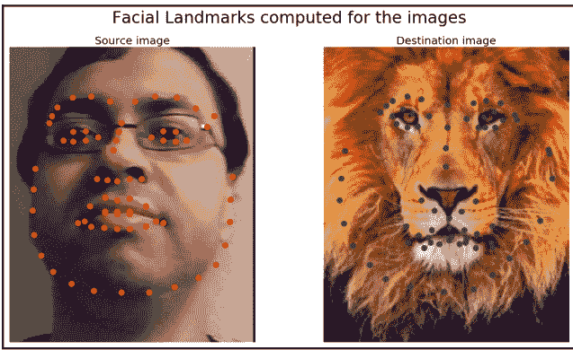

- 11. 运行以下代码，使用面部标志作为三角形顶点的 Delaunay 三角剖分来可视化带有三角形的人脸：

```
fig = plt.figure(figsize=(20,10))
plt.subplot(121), plt.imshow(src_img)
plt.triplot(src_points[:,0], src_points[:,1],
src_d.simplices.copy())
plt.plot(src_points[:,0], src_points[:,1], 'o', color='red')
plt.title('Source image', size=20), plt.axis('off')
plt.subplot(122), plt.imshow(dst_img)
plt.triplot(dst_points[:,0], dst_points[:,1],
end_d.simplices.copy())
plt.plot(dst_points[:,0], dst_points[:,1], 'o')
plt.title('Destination image', size=20), plt.axis('off')
plt.suptitle('Delaunay triangulation of the images', size=30)
fig.subplots_adjust(wspace=0.01, left=0.1, right=0.9)
plt.show()
```

如果你运行前面的代码片段，你将得到以下屏幕截图作为输出：

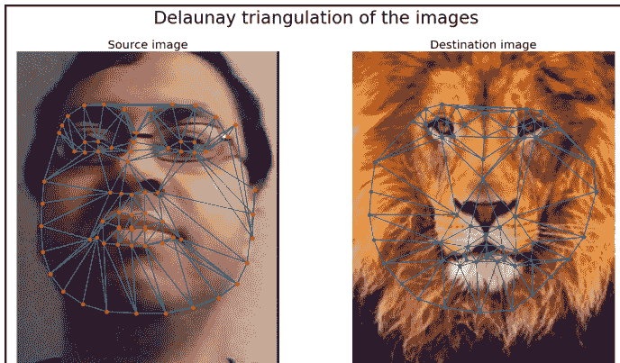

- 12. 最后，使用递增的 alpha 值（从 0 到 1）计算不同混合比例的变形图像，并对其进行动画处理，以观察从源图像到目标图像的平滑过渡：

```
fig = plt.figure(figsize=(18,20))
fig.subplots_adjust(top=0.925, bottom=0, right=1, \
wspace=0.01, hspace=0.08)

i = 1
for percent in np.linspace(1, 0, 16):
    points = weighted_average_points (src_points, dst_points, percent)
    src_face, src_d = warp_image(src_img, src_points, points, size)
    end_face, end_d = warp_image(dst_img, dst_points, points, size)
    average_face = weighted_average(src_face, end_face, percent)
    plt.subplot(4,4,i), plt.imshow(average_face)
    plt.title('alpha = ' + str(round(percent, 4)), size=20), \
    plt.axis('off')

i += 1
plt.suptitle('Face morphing', size=30)
plt.show()
```

如果你运行前面的代码块，你将得到类似于以下屏幕截图的输出：


### How it works

要将源图像 I<sub>s</sub> 变形为目标图像 I<sub>d</sub>，首先需要建立两幅图像之间的像素对应关系。需要找到图像 I<sub>s</sub> 中每个像素在图像 I<sub>d</sub> 中对应的像素。一旦找到这些对应关系，图像可以分两步进行融合：

- 1. 计算变形图像中像素的位置（它是使用 `weighted_average_points()` 函数计算的）。
- 2. 计算变形图像中该位置像素的强度（它是使用 `weighted_average()` 函数计算的）。

为源图像中每个像素在目标图像中查找对应像素计算开销非常大，而且其实并非必要；相反，少量控制点就足够了。给定像素在 \( I_s \) 和 \( I_d \) 中的位置，计算 \( I_M \) 中控制像素位置的公式如下截图所示：

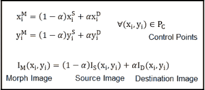

`weighted_average_points()` 和 `weighted_average()` 函数都接受 \(\alpha\)（或百分比）作为第三个参数。

`bilinear_interpolate()` 函数接受几个输入参数，第一个是输入图像（假设图像中的通道数最大为三），第二个是输入坐标 coords（一个具有两行的 np 数组；第一行和第二行分别表示输入点的 x 和 y 坐标）。该函数返回与输入 coords 指定的像素对应的插值像素。

`gen_triangular_affine_matrices()` 函数是一个 Python 生成器函数，接受三个输入参数，第一个（`vertices`）是对应三角形角点的三元索引的 NumPy 数组，第二个（`src_points`）是对应源图像面部标志点的 (x, y) 点的 NumPy 数组，第三个（`dest_points`）是对应目标图像标志点的 (x, y) 点的 NumPy 数组。该函数为每个三角形生成一个估计的 2x3 仿射变换矩阵。

### There is more

根据源图像和目标图像的人脸大小，您可能需要实现一个 `resize_crop()` 函数，该函数将图像中的人脸居中，并提取控制点的边界矩形作为输入图像；否则，在迭代融合过程中，变形人脸的区域可能会不断增大或减小。

您刚刚实现了用于人脸变形的 `mesh warping` 算法。或者，您也可以实现 `Beier-Neely field morphing` 算法来进行人脸变形。请根据“另请参阅”部分提供的参考/链接来实现此算法。

### See also

参阅以下链接以了解有关此配方的更多信息：

- https://www.studocu.com/en/document/university-of-pennsylvania/computer-vision-computational-photography/lecture-notes/cis581-morph-2018-morphing-lecture-notes/3317837/view
- https://www.seas.upenn.edu/~cse399b/Lectures/CSE399b-07-triangle.pdf
- http://alumni.media.mit.edu/~maov/classes/comp_photo_vision08f/lect/07_Image%20Morphing.pdf
- http://en.wikipedia.org/wiki/Bilinear_interpolation
- https://www.cs.toronto.edu/~mangas/teaching/320/slides/CSC320T12.pdf
- https://www.cs.princeton.edu/courses/archive/fall100/cs426/papers/beier92.pdf
- https://inst.eecs.berkeley.edu/~cs194-26/fa18/hw/proj4/index.html
- https://www.learnopencv.com/face-morph-using-opencv-cpp-python
- http://davis.wpi.edu/~matt/courses/morph/2d.htm
- https://www.youtube.com/watch?v=i_tG7XRLPmU

## Implementing an image search engine

在本配方中，您将学习如何实现一个简单的图像搜索引擎（SE）。它将是一个基于示例的搜索系统，仅依赖于图像内容，即基于内容的图像检索（CBIR）系统。存储图像及其提取的特征，以便系统在搜索期间可以返回相似图像（基于特征）。以下描述了任何 CBIR 系统的四个步骤：

- 1. 定义图像描述符（图像的描述性特征）
- 2. 索引搜索图像（用于快速检索与查询图像具有相似描述符的图像。使用高效的数据结构以实现快速检索）
- 3. 定义要使用的相似度度量（欧几里得/余弦/卡方距离，等等）
- 4. 搜索（用户向 SE 提交查询图像，SE 从此查询图像提取特征并使用存储图像的索引特征，利用相似度度量快速返回最相关的图像——检索应使用高效的索引数据结构快速进行）

您将首先学习如何计算查询图像与一组搜索图像之间的相似度，然后将该想法扩展以实现一个简单的 SE。

### Getting ready

首先，使用以下代码片段导入所有所需的库：

```python
import cv2
import matplotlib.pyplot as plt
from collections import defaultdict
from skimage.feature import hog
from scipy.spatial.distance import cdist
from sklearn.neighbors import BallTree
from skimage.io import imread
from skimage.exposure import rescale_intensity
import pickle
import numpy as np
from matplotlib.pyplot import plt
from glob import glob
import time, os
```

### How to do it...

首先，让我们学习如何计算查询图像与一组搜索图像之间的基于特征的相似度。然后，您将学习如何通过扩展该想法来实现一个简单的搜索引擎。

## Finding similarity between an image and a set of images with SIFT

您将使用 SIFT 关键点/描述符来计算两幅图像之间的相似度（使用 opencv-python）。需要遵循的步骤如下：

- 1. 首先，读取查询图像。同时，读取搜索目录中的所有图像以找到最佳匹配：

```python
query = cv2.imread("images/query.jpg")
matched_images = defaultdict(list)
for image_file in glob.glob('images/search/*.jpg'):
    search_image = cv2.imread(image_file)
```

查询图像如下所示：

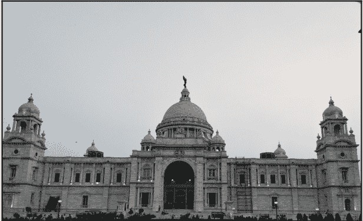

- 2. 使用以下代码提取查询图像和所有搜索图像的 SIFT 关键点和描述符：

```python
sift = cv2.xfeatures2d.SIFT_create()
kp_1, desc_1 = sift.detectAndCompute(query, None)
kp_2, desc_2 = sift.detectAndCompute(search_image, None)
```

- 3. 使用基于近似最近邻的匹配来快速匹配描述符（您可以使用自己的数据结构进行快速检索，例如，使用 scikit-learn 中的 kd 树）：

```python
index_params = dict(algorithm=FLANN_INDEX_KDTREE, trees=5)
search_params = dict()
flann = cv2.FlannBasedMatcher(index_params, search_params)
matches = flann.knnMatch(desc_1, desc_2, k=2)
```

- 4. 再次，使用比率测试（与早期配方中一样）来找出良好匹配：

```python
good_points = []
ratio = 0.6
for m, n in matches:
    if m.distance < ratio*n.distance:
        good_points.append(m)
num_good_points = len(good_points)
```

- 5. 使用以下代码绘制一些非常好的匹配（> 300 个良好匹配，表示最相似的图像）和一些非常差的匹配（< 10 个良好匹配，表示非常不相似的图像）。更新 matched_images 字典，使其拥有一个值为 k 的键，以及所有与查询图像恰好有 k 个匹配的搜索图像：

```python
if (num_good_points > 300) or (num_good_points < 10):
    result = cv2.drawMatches(query, kp_1, search_image, kp_2, \
                             good_points, None)
matched_images[len(good_points)].append(search_image)
```

如果您将查询图像与搜索图像（对应于一些良好和一些不良匹配）的关键点匹配进行绘制，您将得到类似以下截图的输出：

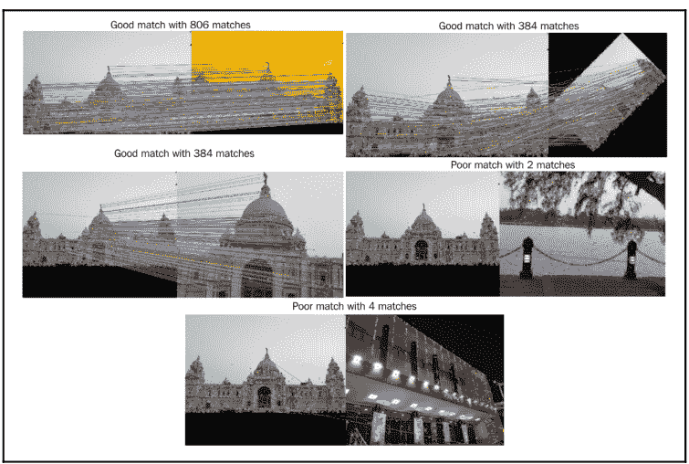


最后，如果你根据与查询图像的良好匹配数量（使用 matched_images 字典）对搜索图像进行排名，你将得到类似于以下截图的输出（这只是输出的一部分）：

## 按匹配数量对与查询图像匹配的图像进行排名

| 匹配数为 993 的图像 | 匹配数为 806 的图像 | 匹配数为 581 的图像 | 匹配数为 512 的图像 |
|-------------------|-------------------|-------------------|-------------------|
| 匹配数为 384 的图像 | 匹配数为 304 的图像 | 匹配数为 327 的图像 | 匹配数为 152 的图像 |
| 匹配数为 129 的图像 | 匹配数为 114 的图像 | 匹配数为 109 的图像 | 匹配数为 106 的图像 |
| 匹配数为 99 的图像 | 匹配数为 76 的图像 | 匹配数为 62 的图像 | 匹配数为 55 的图像 |
| 匹配数为 48 的图像 | 匹配数为 44 的图像 | 匹配数为 43 的图像 | 匹配数为 39 的图像 |
| 匹配数为 39 的图像 | 匹配数为 39 的图像 | 匹配数为 36 的图像 | 匹配数为 34 的图像 |

## 实现简单图像搜索引擎的步骤

执行列出的步骤来实现你的简单搜索引擎：

- 1. 首先，下载一组图像来构建你的搜索数据库（例如，从 https://www.open-tour.org/en/dataset.html 下载约 250 张图像，或从 http://www.robots.ox.ac.uk/~vgg/data/oxbuildings/ 下载约 5,000 张图像）。

- 2. 实现 SimpleSearchEngine 类，该类具有以下成员（在构造函数或 __init__() 方法中初始化它们）：
  - search_dir（保存搜索图像的位置）
  - save_dir（保存搜索图像描述符的位置）
  - search_ds（用于存储搜索图像的数据结构，以便快速检索与查询描述符最相似的搜索图像描述符）

```python
class SimpleSearchEngine:
    def __init__(self, search_dir, save_dir):
        self.search_dir = search_dir
        self.save_dir = save_dir
        self.search_ds = None
```

- 3. 实现 read_preprocess() 方法，将每张图像转换为 HSV 颜色空间：

```python
def read_preprocess(self, imfile):
    return cv2.cvtColor(cv2.imread(imfile), cv2.COLOR_BGR2HSV)
```

- 4. 实现 compute_descriptor() 方法来提取并返回图像的描述符（此处将使用基于区域的 HSV 直方图，针对图像中的 5 个区域，每个区域的面积为图像面积的四分之一，即左上四分之一、右上四分之一、右下四分之一和左下四分之一，以及图像的中心四分之一区域。鼓励你使用任何其他特征描述符，例如 SIFT，并比较搜索结果以培养一些直觉）：

```python
def compute_descriptor(self, im):
    bins = (8, 12, 3)
    (h, w) = im.shape[:2]
    (c_x, c_y) = (int(w * 0.5), int(h * 0.5))
    regions = [(c_x, 0, 0, c_y), (c_x, 0, w, c_y), \
               (0, c_y, c_x, h), (c_x, c_y, w, h)]
    descriptor = []
    for (start_x, start_y, endX, endY) in regions:
        region_mask = np.zeros(im.shape[:2], dtype=np.uint8)
        cv2.rectangle(region_mask, (start_x, start_y), (endX, endY), 255, -1)
        hist = cv2.calcHist([im], [0, 1, 2], region_mask, bins, [0, 180, 0, 256, 0, 256])
        hist = cv2.normalize(hist, np.zeros(hist.shape[:1], dtype="float")).flatten()
        descriptor += list(hist)
    return np.array(descriptor)
```

- 5. 实现 cosine_cdist() 方法来计算查询图像与搜索图像数据库之间的余弦距离：

```python
def cosine_cdist(self, descriptor):
    descriptor = descriptor.reshape(1, -1)
    return cdist(self.search_ds, descriptor, 'cosine').reshape(-1)
```

- 6. 实现 store_ds() 方法，将搜索图像描述符存储在高效的数据结构中：

```python
def store_ds(self, descriptors):
    # self.search_ds = BallTree(descriptors)
    self.search_ds = descriptors
```

- 7. 实现 query_ds() 方法，使用查询图像描述符查询搜索图像数据结构，并根据余弦距离度量返回前 k 个最相似的图像：

```python
def query_ds(self, descriptor, k):
    img_distances = self.cosine_cdist(descriptor)
    return np.argsort(img_distances)[:k].tolist()
```

- 8. 实现 build_index() 方法，在搜索图像数据库上构建索引，即创建一个数据结构，用于根据与查询图像的相似性高效存储（使用 store_ds()）和检索（使用 query_ds()）搜索图像：

```python
def build_index(self):
    t_before = time.time()
    descriptors = np.array([])
    search_pat = self.search_dir + '*.jpg'
    i = 0
    for imfile in glob(search_pat):
        print(i, imfile)
        im = self.read_preprocess(imfile)
        descriptor = self.compute_descriptor(im)
        descriptors = np.hstack((descriptors, descriptor)) if i == 0 else np.vstack((descriptors, descriptor))
        i += 1
    self.store_ds(descriptors)
    t_after = time.time()
    t_build = t_after - t_before
    print("Time to build SE model (seconds): ", t_build)
    with open(self.save_dir + 'SE.pkl', 'wb') as pickle_file:
        pickle.dump(self.search_ds, pickle_file, pickle.HIGHEST_PROTOCOL)
```

- 9. 实现 `query_search_engine()` 方法，该方法接受查询图像文件和一个数字 `k`（要输出的最相似图像的数量）作为输入。它从搜索数据库中返回与查询图像最相似的前 `k` 张图像：

```python
def query_search_engine(self, imfile, k=10):
    if self.search_ds is None:
        if not os.path.exists(self.save_dir + 'SE.pkl'):
            self.build_index()
        with open(self.save_dir + 'SE.pkl', 'rb') as pickle_file:
            self.search_ds = pickle.load(pickle_file)
    im = self.read_preprocess(imfile)
    descriptor = self.compute_descriptor(im)
    t_before = datetime.datetime.now() # time.time()
    neighbors = self.query_ds(descriptor, k)
    t_after = datetime.datetime.now() # time.time()
    t_search = (t_after - t_before).microseconds / 1000
    print("Time to query SE (milliseconds): ", t_search)
    imfiles = glob(self.search_dir + '*.jpg')
    return [cv2.imread(imfiles[id]) for id in neighbors]
```

- 10. 最后，在一开始就实例化搜索引擎并构建一次索引（或者如果搜索引擎中添加了新图像，则定期构建）。选择一个查询图像，并请求搜索引擎查找与此图像相似的图像。使用 query_search_engine() 方法检索与查询图像最相似的前 k=10 张图像：

```python
se = SimpleSearchEngine('images/oxford_buildings/', 'models/')
# db_milano
query_image = 'images/oxford_buildings/all_souls_000051.jpg'
# First build index then search the index with the query
# se.build_index()
knbrs = se.query_search_engine(query_image, 10)
```

使用前面的代码片段，用以下查询图像搜索引擎：

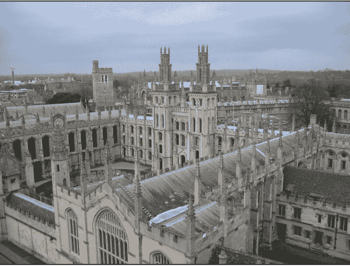

你将得到搜索引擎返回的前 10 张图像，如以下截图所示：

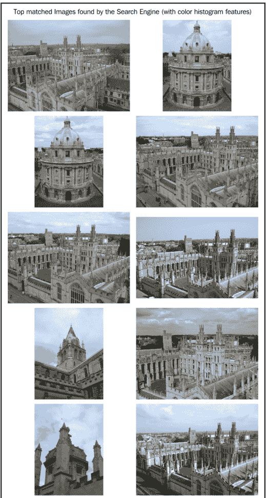

### 更多内容

对于两幅图像之间基于特征的相似性比较，你也可以使用匹配比例（百分比）作为排名标准（例如，将关键点中的匹配百分比作为 matched_images 字典中的键）。此外，为了可扩展性和可重用性，你应该将搜索目录中所有搜索图像的描述符序列化（例如，使用 pickle），并在想要与查询图像描述符进行匹配时加载/反序列化所有描述符——这也留给你作为练习。你可以使用 SURF、KAZE 或任何其他特征进行匹配，以及描述符之间的任何距离/相似度度量。对于生产环境，请使用一种算法来快速计算数百万张图像之间的相似性（例如，尝试 Annoy Index，它使用简单且速度相当快——搜索 1,000,000 张图像大约需要 2 毫秒）。

使用不同的特征（SIFT/SURF/KAZE）、不同的相似度度量（余弦/欧氏距离）和不同的存储数据结构（kd-tree/ball-tree）来实现你的搜索引擎，并比较前 10 个搜索结果。如果你有可用的基准真值（即应该返回哪些前 10 张图像），你可以使用 precision10（定义为在前 10 个搜索结果中，有多少比例在前 10 个基准真值中）/ recall10（定义为在前 10 个基准真值中，有多少比例在前 10 个搜索结果中被返回）来比较不同搜索引擎的性能。此外，比较检索速度。

#### 另请参阅

- https://www.pyimagesearch.com/2014/12/01/complete-guide-building-image-search-engine-python-opencv/
- https://www.pyimagesearch.com/2019/08/26/building-an-image-hashing-search-engine-with-vp-trees-and-opencv/
- https://medium.com/machine-learning-world/feature-extraction-and-similar-image-search-with-opencv-for-newbies-3c59796bf774


