# 图像分割

图像分割是指将图像划分为不同的区域或类别，每个区域包含具有相似属性的像素，图像中的每个像素都被分配到其中一个类别。

图像分割通常旨在将图像简化为更有意义、更易于分析的段表示。如果分割做得好，图像分析中的所有其他阶段都会变得更简单，这意味着分割的质量和可靠性决定了图像分析是否会成功。但将图像划分为正确的段往往是一个非常具挑战性的问题。

在本章中，我们将学习以下方法：

- 使用 Otsu 和 Ridder–Calvard 进行阈值分割
- 使用自组织映射进行图像分割
- 使用 scikit-image 进行 RandomWalk 分割
- 使用 GMM–EM 算法进行皮肤颜色分割
- 医学图像分割
- 深度语义分割
- 深度实例分割

## 使用 Otsu 和 Ridder-Calvard 进行阈值分割

阈值分割是指一类使用像素值作为阈值，从灰度图像创建二值图像（仅包含黑白像素的图像）的算法（这是最简单的方法，将图像中的前景对象与背景分离）。阈值可以手动选择（通过查看像素值的直方图），也可以使用算法自动选择。图像分割技术可以是非上下文的（不考虑图像中特征之间的空间关系，仅根据某些全局属性（例如颜色/灰度级）对像素进行分组）或上下文的（此外利用空间关系）。在本方法中，你将学习如何使用 `mahotas` 库函数中的几种流行的基于直方图的阈值分割方法，即 Otsu 方法（假设直方图为双峰分布）和 Ridder–Calvard 方法。使用 Otsu 方法，对于阈值的每个可能值，都会计算由该阈值分隔的两个像素类别之间的加权类内方差。最优阈值是使此方差最小的阈值，如下图所示：

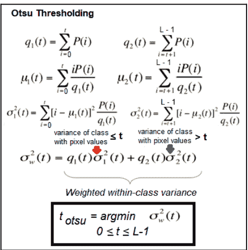

相比之下，Ridder–Calvard 方法通过一个迭代过程自动选择（最优）阈值，该过程在一系列迭代后提供对对象区域越来越干净的提取。

### 准备工作

我们将使用苏巴斯·钱德拉·鲍斯雕像的灰度图像来演示使用 mahotas 进行二值图像分割。像往常一样，让我们先加载所需的库：

```
%matplotlib inline
import mahotas as mh
import numpy as np
import matplotlib.pyplot as plt
```

### 操作步骤

按照以下步骤使用 mahotas 实现阈值分割算法：

1. 首先，读取图像并使用以下代码片段中的 mahotas 库函数获取输入灰度图像的最优阈值。如你所见，对于给定的输入图像，上述两种算法得到的阈值非常接近：

```
image = mh.imread('images/netaji.png')
thresh_otsu, thresh_rc = mh.otsu(image), mh.rc(image)
print(thresh_otsu, thresh_rc)
# 161 161.5062276206947
```

2. 使用为像素值获得的最优阈值对输入图像执行二值分割。你将得到两个不同的二值输出图像，分别对应上述算法：

```
binary_otsu, binary_rc = image > thresh_otsu, image > thresh_rc
```

3. 最后，使用以下代码绘制输入图像、输入图像的直方图、计算的阈值以及获得的输出图像：

```
fig, axes = plt.subplots(nrows=2, ncols=2, figsize=(20, 15))
axes = axes.ravel()
axes[0].imshow(image, cmap=plt.cm.gray)
axes[0].set_title('Original', size=20), axes[0].axis('off')
axes[1].hist(image.ravel(), bins=256, density=True)
axes[1].set_title('Histogram', size=20)
axes[1].axvline(thresh_otsu, label='otsu', color='green', lw=3)
axes[1].axvline(thresh_rc, label='rc', color='red', lw=2)
axes[1].legend(loc='upper left', prop={'size': 20}), axes[1].grid()
axes[2].imshow(binary_otsu, cmap=plt.cm.gray)
axes[2].set_title('Thresholded (Otsu)', size=20),
axes[2].axis('off')
axes[3].imshow(binary_rc, cmap=plt.cm.gray)
axes[3].set_title('Thresholded (Ridder-Calvard)', size=20),
axes[3].axis('off')
plt.tight_layout()
plt.show()
```

### 工作原理

在 `mahotas` 中，阈值函数具有简单的接口：它们接受一个图像并返回一个值。

使用 `otsu()` 函数计算输入图像的最优 Otsu 阈值。

同样，使用 `rc()` 函数计算给定输入图像的 Ridder–Calvard 阈值。

最后，运行代码块后，你将得到如下图形作为输出：

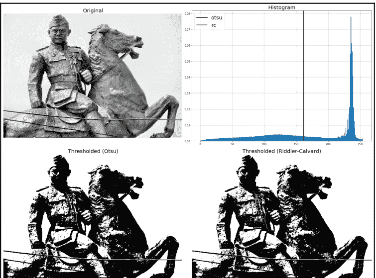

所有值小于或等于最优阈值的像素都被赋值为零（黑色前景对象），而值高于阈值的像素被赋值为一（白色背景），以便为这两种算法分别获得输出二值图像。

### 更多内容

二值分割有许多阈值分割算法；scikit-image 库提供了其中一些算法的实现。你也可以评估这些算法，并选择为你的图像提供最佳结果的算法。对于每种算法，如果你想使用局部版本，必须指定半径；否则，将默认调用全局版本。下图展示了不同的（全局）阈值分割函数在 MIT 统计学课程的输入灰度黑板图像上的表现。请自行实现；你也可以尝试使用不同半径为不同算法实现局部版本，并观察半径对二值输出图像的影响。如下图所示，对于给定的输入图像，Isodata 和 Otsu 在基于阈值的二值分割方面优于其他方法：

### 原始图像

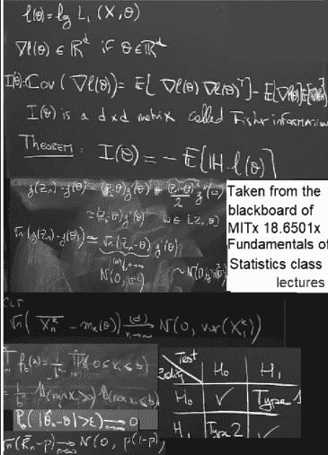

摘自 MITx 18.6501x 统计学基础课程的黑板讲义

### Isodata

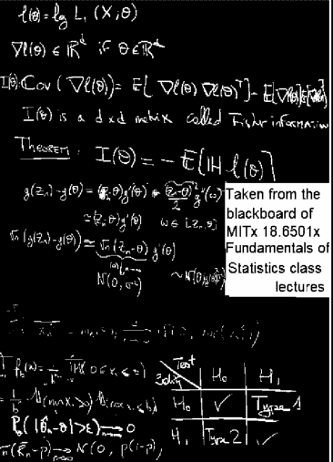

摘自 MITx 18.6501x 统计学基础课程的黑板讲义

### Li

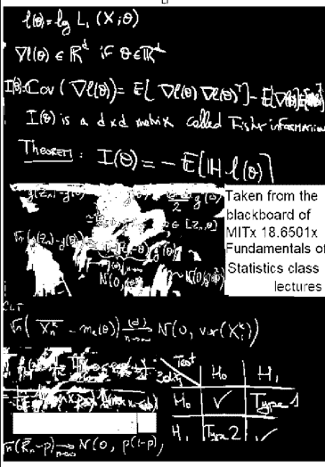

摘自 MITx 18.6501x 统计学基础课程的黑板讲义

### Mean

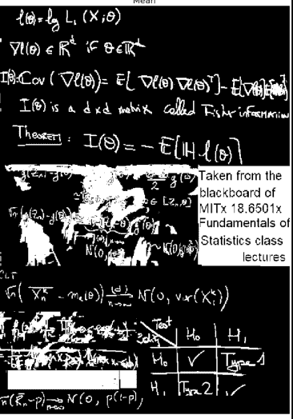

摘自 MITx 18.6501x 统计学基础课程的黑板讲义

### 另请参阅

请参阅以下文章，了解有关此方法的更多信息：

- https://ieeexplore.ieee.org/stamp/stamp.jsp?arnumber=4310039
- https://engineering.purdue.edu/kak/computervision/ECE661.08/OTSU_paper.pdf
- https://scikit-image.org/docs/dev/api/skimage.filters.html#skimage.filters.try_all_threshold
- https://mahotas.readthedocs.io/en/latest/thresholding.html
- 第 8 章，图像分割，出自 Packt 出版社的《使用 Python 进行图像处理实战》一书。

## 使用自组织映射进行图像分割

自组织映射（SOM）是一种竞争性学习网络（一类有趣的无监督机器学习），也是最受欢迎的神经网络模型之一。在这个网络中，在任何给定时间只有一个神经元被激活，因此输出神经元之间相互竞争以被激活。这个被激活的神经元称为**获胜神经元**。当一个神经元放电时，它最近的邻居往往比更远处的邻居更容易兴奋（定义了一个距离衰减的拓扑邻域）。因此，神经元被迫通过自适应或学习过程自行组织，并在输入和输出之间创建一个特征映射。这就是为什么这个网络被称为自组织映射。

SOM 算法的自适应过程分为以下两个步骤：

1. **排序（自组织）阶段**：在此阶段，权重向量发生拓扑排序。通常，这一阶段需要大约 1,000 次迭代。
2. **收敛阶段**：在此阶段，特征映射被精细调整，并对输入空间形成准确的统计量化。通常，这一阶段至少需要神经元数量 500 倍的迭代次数。


SOM 可用于类标签不可用时对数据进行聚类。它也被称为自组织特征图（SOFM），因为它可以用于检测固有于问题的特征。映射单元（神经元）通常形成一个二维格，这提供了从高维空间到平面的拓扑保持映射。SOM 模型还具有泛化能力，其中新的输入数据点会被其映射到的神经元同化。

要了解 SOM 算法的步骤以及如何通过颜色量化将其用于图像分割，请参考以下链接：


- http://www.math.le.ac.uk/people/ag153/homepage/AkindukoMirkesGorbanInfTech2016.pdf
- https://genome.tugraz.at/MedicalInformatics2/SOM.pdf
- http://www.cs.bham.ac.uk/~jxb/NN/116.pdf

## 准备工作

在本示例中，我们将使用苹果和橙子的 RGB 图像，并使用 SOM 对图像进行分割。让我们先导入所需的包：

```python
!pip install MiniSom
from minisom import MiniSom
import numpy as np
import matplotlib.pyplot as plt
from matplotlib.pyplot import GridSpec
from pylab import pcolor
from collections import defaultdict
from sklearn import datasets
from sklearn.preprocessing import scale
```

### 操作步骤...

执行以下步骤以使用 SOM 实现图像颜色量化：

- 1. 让我们定义以下函数，使用 SOM 对 RGB 彩色图像进行分割。该函数接受输入图像以及 SOM 网格的维度（$n_x \times n_y$）和参数 $\sigma$ 与 $n$（用于训练网络——即，学习神经元上的权重向量——而随机选择的像素数量）。在训练 SOM 之前，图像需要被展平（即，每一行应代表单个像素的 RGB 值）：

```python
def segment_with_SOM(image, nx, ny, sigma=1., n=500):
    pixels = np.reshape(image, (image.shape[0]*image.shape[1], 3))

    # SOM initialization and training
    som = MiniSom(x=nx, y=ny, input_len=3, sigma=sigma, learning_rate=0.2) # nx x ny final colors
    som.random_weights_init(pixels)
    starting_weights = som.get_weights().copy() # saving the starting weights
    som.train_random(pixels, n)
```

- 2. 训练完成后，使用 SOM 对图像中的所有像素进行量化（使用每个神经元上的权重向量），可使用以下代码片段。

```python
# quantization
qnt = som.quantization(pixels)
```

- 3. 使用以下代码将原始像素值替换为量化值，并返回量化图像及神经元上的权重：

```python
clustered = np.zeros(image.shape)
for i, q in enumerate(qnt): # place the quantized values into a new image
    clustered[np.unravel_index(i, dims=(image.shape[0], image.shape[1]))] = q
final_weights = som.get_weights()
return clustered, starting_weights, final_weights
```

- 4. 读取输入图像并调用函数，使用 SOM 量化将图像分割为两个簇（使用 1 x 2 SOM 网格）。绘制分割后的二值图像：

```python
image = plt.imread('images/apples.png')
clustered, starting_weights, final_weights = segment_with_SOM(image, 1, 2, .1)
colors = np.unique(clustered.reshape(-1,3), axis=0)
clustered_binary = np.zeros_like(clustered)
clustered_binary[np.where((clustered[...,0]==colors[1][0]) & (clustered[...,1]==colors[1][1]) & (clustered[...,2]==colors[1][2]))] = 1.
```

- 5. 如果你运行此代码块并绘制输入/输出图像（两个簇），将得到如下图示：

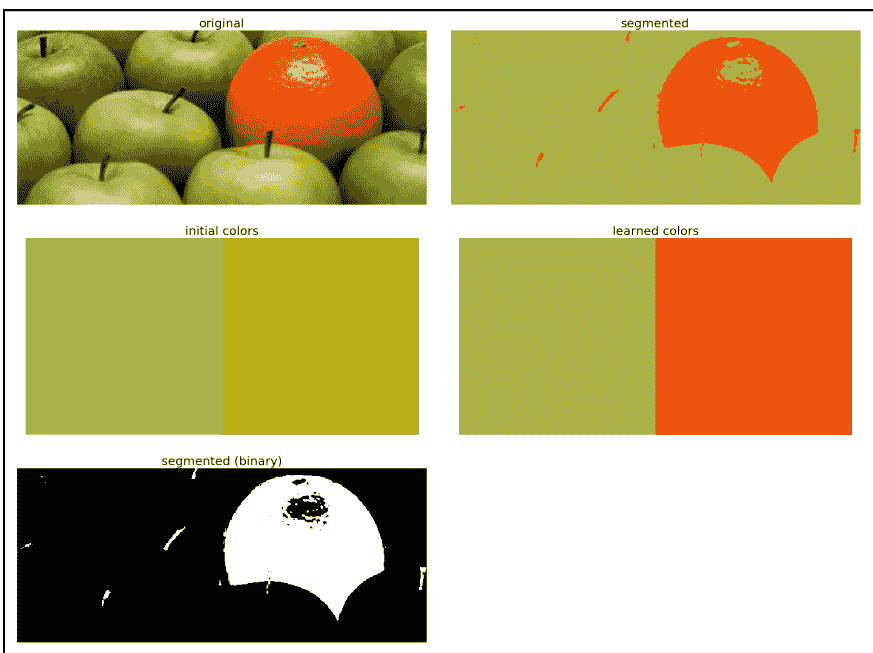

- 6. 如果你运行以下代码行并绘制输入/输出图像（25 个簇，使用 5 x 5 SOM 网格），将得到如下图示：

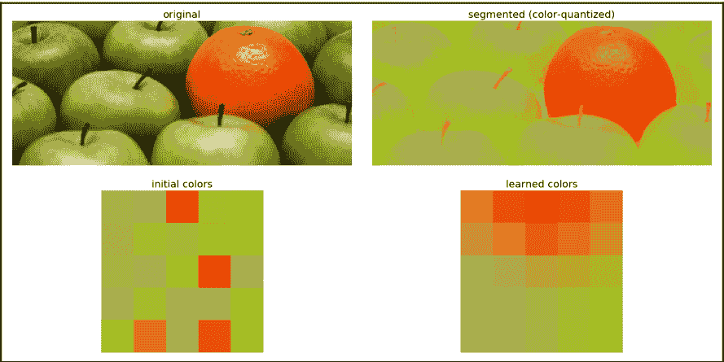

### 工作原理...

我们使用 `train_random()` 函数，从（展平的）图像数据中随机选取像素样本来训练 SOM。除了输入图像外，它还接受第二个参数 `num_iteration`，表示最大迭代次数（每个样本像素一次迭代）。

然后我们使用 quantization 函数为每个像素分配一个码本（获胜神经元的权重向量），从而执行颜色量化。

### 更多内容...

我们还可以使用 SOM 对图像进行聚类。现在你将学习如何使用 SOM 对手写数字图像进行聚类。

## 使用 SOM 对手写数字图像进行聚类

执行以下步骤，对 scikit-image 数据集中的数字图像进行聚类：

- 1. 加载数字并进行缩放：

```python
digits = datasets.load_digits(n_class=10)
data = digits.data # matrix where each row is a vector that represent a digit.
data = scale(data)
num = digits.target # num[i] is the digit represented by data[i]
```

- 2. 创建一个包含 900（30 x 30）个神经元的 SOM 网格。使用 PCA 权重初始化神经元：

```python
som = MiniSom(30, 30, 64, sigma=4, learning_rate=0.5, neighborhood_function='triangle')
som.pca_weights_init(data)
```

- 3. 使用以下代码行随机选择 5,000 个数字来训练 SOM：

```python
som.train_random(data, 5000) # random training
```

- 4. 最后，绘制权重的距离图（每个单元是神经元与其邻居之间距离的归一化和），并将数字图像叠加在单元（神经元）上：

```python
plt.figure(figsize=(15, 12))
pcolor(som.distance_map().T, cmap='coolwarm')
plt.colorbar()
wmap = defaultdict(list)
im = 0
for x, t in zip(data, num): # scatterplot
    w = som.winner(x)
    wmap[w].append(im)
    plt.text(w[0]+.5, w[1]+.5, str(t), color=plt.cm.Dark2(t / 10.), fontdict={'weight': 'bold', 'size': 11})
im = im + 1
plt.axis([0, som.get_weights().shape[0], 0, som.get_weights().shape[1]])
plt.show()
```

如果你运行此代码块，将得到如下图示。从距离图及其右侧的颜色条可以注意到，邻域分配了不同数字的单元（神经元）在距离图上具有高值（而所有邻域都分配了相同数字的单元通常在距离图上具有低值），这与预期一致：

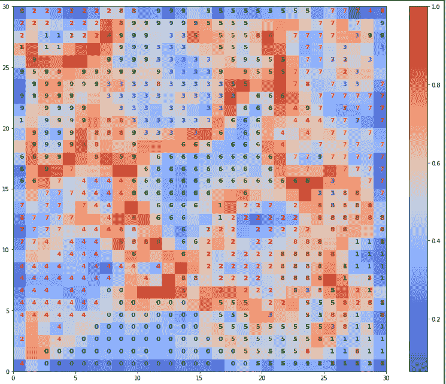

- 5. 使用以下代码绘制映射到网格坐标 (23,15) 特定单元的数字：

```python
print(wmap[23,15])
# [581, 598, 1361] # 3 digits assigned to node (23,15)
plt.gray()
for index in wmap[23,15]:
    plt.figure(figsize=(1,1))
    plt.imshow(np.reshape(digits.images[index], (8,-1))),
    plt.title(digits.target[index]), plt.axis('off')
plt.show()
```

你将得到以下输出：

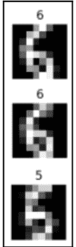

正如你所见，有三个数字被分配给了同一个神经元。

### 另请参阅

- http://www.cs.bham.ac.uk/~jxb/NN/116.pdf
- https://genome.tugraz.at/MedicalInformatics2/SOM.pdf
- https://github.com/JustGlowing/minisom
- http://www.math.le.ac.uk/people/ag153/homepage/AkindukoMirkesGorbanInfTech2016.pdf
- https://www.youtube.com/watch?v=-_d0h3VhpAs

## 使用 scikit-image 进行 RandomWalk 分割

RandomWalk 分割是一种交互式多标签图像分割方法。它从少数带有用户定义标签的种子像素开始，然后，对于每个未标记的像素，计算从该特定像素出发的随机行走者首先到达某个预标记像素的概率。然后，将未标记像素分配给概率值较高（表示首先到达的概率）对应的标签。这会产生高质量的图像分割。以下图示描述了算法步骤：

| 图像分割的随机步行 | 组合狄利克雷问题 |
| :--- | :--- |
| 算法<br>1) 将图像强度映射到格点上的边权重<br>\( w_{ij} = \exp(-\beta(g_i - g_j)^2) \),<br>\( g_i := \) 像素 \( i \) 处的图像强度<br>2) 获取一组带 \( K \) 个标签的标记（标记）像素 \( V_M \)，可交互或自动获得。<br>3) 求解势能<br>\( L_U x^s = -B^T m^s \)<br>对每个标签（最终标签 \( f \) 除外，出于计算效率考虑）求解。设置 \( x_f^s = 1 - \sum_{s<f} x_f^s \)。<br>4) 通过为每个节点 \( v_i \) 分配对应于 \( \max_s (x_i^s) \) 的标签来获得最终分割。<br>Ref: http://vision.cse.psu.edu/people/chenping/Y/paper/grady2006random.pdf | 狄利克勒积分 \( D[u] = \frac{1}{2} \int_\Omega |\nabla u|^2 d\Omega \)。<br>调和函数 \( \nabla^2 u = 0 \)<br>拉普拉斯方程<br>组合拉普拉斯矩阵<br>\( L_{ij} = \begin{cases} d_i & \text{if } i = j, \\ -w_{ij} & \text{if } v_i \text{ 和 } v_j \text{ 是相邻节点,} \\ 0 & \text{否则,} \end{cases} \)<br>\( x_i^s := \) 节点 \( v_i \) 对标签 \( s \) 的概率（势能）<br>\( Q(v_j) = s, \forall v_j \in V_M, \sum x^s = 1, \forall v_i \in V \)<br>标签种子点集合<br>对于种子点 *<br>\( m_j^s = \begin{cases} 1 & \text{if } Q(v_j) = s, \\ 0 & \text{if } Q(v_j) \neq s. \end{cases} s \in \mathbb{Z}, 0 < s \le K \) |

在本示例中，你将学习如何使用 scikit-image 分割模块的 random walker 分割实现函数对图像进行分割，起始点是少数标记图像前景和背景的种子像素。


### 准备工作

在本示例中，我们将使用 ISRO 公共图像画廊中火星轨道器航天器 MCC 拍摄的第一张地球图像（https://www.isro.gov.in/pslv-c25-mars-orbiter-mission/pictures-mars-colour-camera-mcc-onboard-india%E2%80%99s-mars-orbiter），并尝试使用随机行走分割（一种二值分割）将陆地（前景）与海洋（背景）分开。首先，让我们导入所有所需的库：

```
import numpy as np
import matplotlib.pyplot as plt
from skimage.segmentation import random_walker
from skimage import img_as_float
from skimage.exposure import rescale_intensity
from skimage.io import imread
from skimage.color import rgb2gray
```

### 如何操作...

通过以下步骤使用 scikit-image 函数实现随机行走分割：

- 1. 同样，您首先需要通过从前景（对象）和背景中（手动）选取一些种子像素来为输入图像创建掩码。在此实现中，前景/背景种子像素分别标记为绿色和红色。为要分割的输入图像提供了一个标记了种子像素的掩码图像。首先，读取输入图像和掩码图像：

```
img = imread('images/earth_by_MCC.png')
mask = imread('images/earth_by_MCC_mask.png')
```

- 2. 使用以下代码从掩码图像中提取对象和背景种子像素，并以 random_walker 函数期望的方式创建新的标记图像（即，为每个分段用不同的正标签标记种子像素，并将未标记像素保留为零标签）：

```
markers = np.zeros(img.shape[:2], np.uint8)
markers[(mask[..., 0] >= 200) & (mask[..., 1] <= 20) & (mask[..., 2] <= 20)] = 1
markers[(mask[..., 0] <= 20) & (mask[..., 1] >= 200) & (mask[..., 2] <= 20)] = 2
```

- 3. 运行随机行走算法对图像进行分割，以获得二值分割和分配给像素的完整概率，使用以下代码行：

```
labels = random_walker(img, markers, beta=9, mode='bf',
multichannel=True)
labels2 = random_walker(img, markers, beta=9, mode='bf',
multichannel=True, return_full_prob = True)
```

- 4. 最后，绘制输入图像和获得的结果：

```
fig, ((ax1, ax2), (ax3, ax4)) = plt.subplots(2, 2, figsize=(20,
                             18), sharex=True, sharey=True)
fig.subplots_adjust(0, 0, 1, 0.95, 0.01, 0.01)
ax1.imshow(mask, interpolation='nearest'), ax1.axis('off')
ax1.set_title('Original Image with Markers', size=25)
ax2.imshow(img, interpolation='nearest'), ax2.contour(labels,
                     linewidths=5, colors='r'), ax2.axis('off')
ax2.set_title('Segmentation Contour', size=25)
ax3.imshow(labels, cmap='gray', interpolation='nearest'),
ax3.axis('off')
ax3.set_title('Segmentation', size=25)
prob = ax4.imshow(labels2[1, ...], cmap='inferno',
                  interpolation='nearest')
ax4.axis('off'), ax4.set_title('Segmentation Probabilities',
                   size=25)
fig.colorbar(prob, ax=ax4)
plt.show()
```

### 工作原理...

如果运行这些代码块，您将获得以下输出：

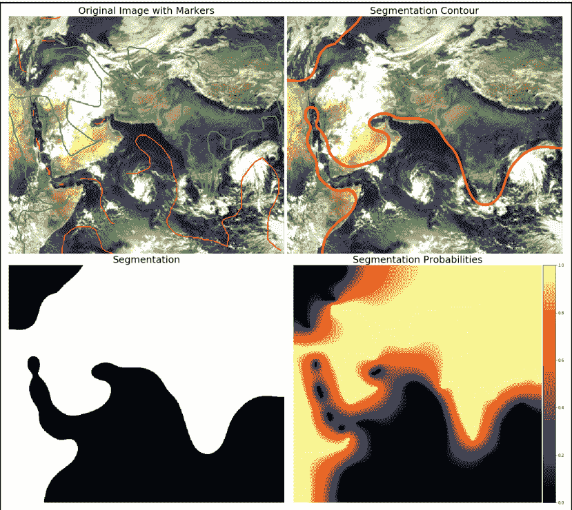

来自 scikit-image 分割的 `random_walker()` 函数用于根据标记实现随机行走算法进行分割。我们使用了彩色输入图像，因此将 multichannel 参数设置为 `True`。

将相同函数的 `return_full_prob` 参数设置为 `True`，以获取像素属于每个标签的所有概率值。当该参数为 `False`（即默认情况）时，它只返回最可能的标签。

该算法求解无限时间扩散方程，源点位于各阶段（即标签）的标记上。扩散到未标记像素概率最高的阶段（标签）即为该像素所分配的标签。

扩散方程通过最小化图像的加权图拉普拉斯亚 \(x^TLx\) 来求解，\(x\) 表示给定阶段（标签）的标记首先通过扩散到达某个像素的概率。

### 更多内容...

尝试使用随机行走分割进行两个以上标签的多标签分割。例如，如果使用适当的种子像素标记对骨骼图像进行分割，运行分割并绘制所有输入/输出图像，您应该得到类似以下的输出，输入图像取自 https://www.rsipvision.com/ct-segmentation-orthopedic-surgery/：

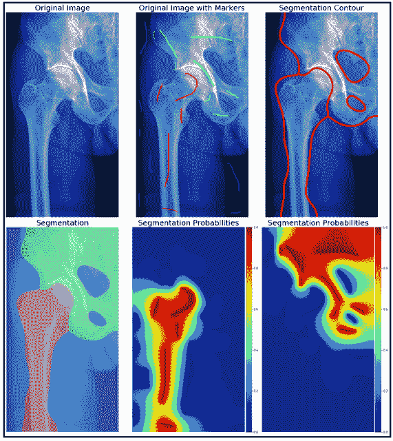

## 另请参阅

请参阅以下文章以了解有关此示例的更多信息：

- http://vision.cse.psu.edu/people/chenpingY/paper/grady2006random.pdf
- https://scikit-image.org/docs/dev/api/skimage.segmentation.html#skimage.segmentation.random_walker
- https://www.rsipvision.com/ct-segmentation-orthopedic-surgery/

## 使用 GMM-EM 算法的人类皮肤分割

在本示例中，您将学习如何使用参数模型（即高斯混合模型）来检测颜色并分割图像中对应人类皮肤的像素。您将获得一个数据集，其中包含一组 RGB 像素值及其标签（它们是否对应人类皮肤）。该数据集来自 UCI 机器学习库，通过从不同年龄组（青年、中年、老年）、地区和性别的人脸图像中随机采样 R、G、B 值收集而成。下表显示了要使用的数据集中样本的大小：

| 总学习样本大小 | 皮肤样本大小 | 非皮肤样本大小 |
| --- | --- | --- |
| 245057 | 50859 | 194198 |

我们将使用 YCbCr 颜色空间而非 RGB，因为它通过线性变换将 RGB 值中的亮度与色度分离。然后，我们将在给定数据集上训练参数模型，但仅使用色度通道。

我们数据集中人类皮肤/非皮肤样本的颜色通道值可被视为由多个来源的多模态随机变量分布混合生成。我们将使用有限高斯混合模型（GMM）来估计概率密度函数（pdf），因为我们数据集中的皮肤颜色样本生成多模态随机变量。在此，我们假设每个单一来源的 (2D) 高斯形式已足够。因此，您将在给定数据集上训练高斯混合模型，并使用期望最大化（EM）算法估计混合模型的参数。一旦参数被学习，您将使用模型来预测新测试图像中哪些像素属于人类皮肤。

要了解用于估计 GMM 参数的 EM 算法，请访问 https://courses.edx.org/courses/course-v1:ColumbiaX+CSMM.102x+2T2017/course/。

我们将在正例（皮肤）上拟合一个 GMM，在负例（非皮肤）上拟合另一个 GMM。对于图像中的每个像素，我们将使用训练好的 GMM 计算其属于人类皮肤的得分（例如对数似然）。在本示例中，您将学习如何使用 scikit-learn 的高斯混合模型实现来进行皮肤颜色检测和分割。

### 准备工作

首先，从 UCI 机器学习库下载皮肤分割数据集 https://archive.ics.uci.edu/ml/datasets/skin+segmentation。该数据集的维度为 245057 x 4，前三列为 B、G、R 值（分别对应变量 x1、x2 和 x3），第四列为类标签（决策变量 y，其中 y = 1 表示正例（即皮肤示例），y = 2 表示非皮肤示例）。让我们先导入所有所需的库：

```
import numpy as np
import matplotlib as mpl
import matplotlib.pyplot as plt
from sklearn.mixture import GaussianMixture
import pandas as pd
import seaborn as sns
from skimage.io import imread
from skimage.color import rgb2ycbcr, gray2rgb
```

### 如何操作...

通过以下步骤使用 scikit-learn 的 GaussianMixture 分割皮肤：

- 1. 将下载的训练数据集读取为 pandas DataFrame：

```
df = pd.read_csv('images/Skin_NonSkin.txt', header=None,
delim_whitespace=True)
df.columns = ['B', 'G', 'R', 'skin']
```


下一个截图显示了数据的前几行是什么样子：

| B | G | R | 皮肤 |
|---|---|---|---|
| 74 | 85 | 123 | 1 |
| 73 | 84 | 122 | 1 |
| 72 | 83 | 121 | 1 |
| 70 | 81 | 119 | 1 |
| 70 | 81 | 119 | 1 |

- 2. 分别使用箱线图绘制皮肤和非皮肤示例的 RGB 值分布：

```
g = sns.factorplot(data=pd.melt(df, id_vars='skin'),
                   x='variable', y='value', hue='variable', col='skin',
                   kind='box', palette=sns.color_palette("hls", 3) [::-1])
plt.show()
```

如果运行此代码片段，您将得到类似下面的图形：

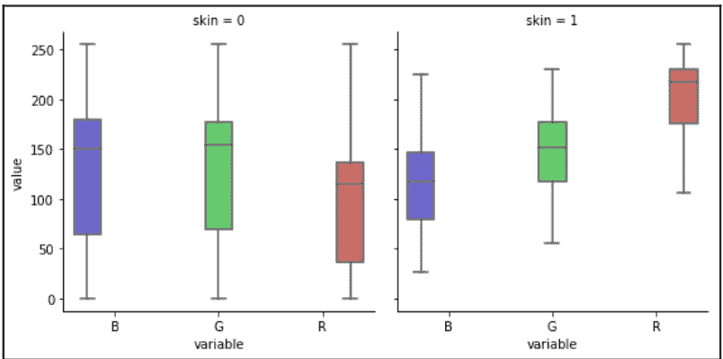

- 3. 从像素的 RGB 值中获取 C<sub>b</sub> 和 C<sub>r</sub> 通道值，并分别使用箱线图绘制皮肤和非皮肤示例的分布：

```
#Y = .299*r + .587*g + .114*b # not needed
df['Cb'] = np.round(128 - .168736*df.R - .331364*df.G +
    .5*df.B).astype(int)
df['Cr'] = np.round(128 + .5*df.R - .418688*df.G -
    .081312*df.B).astype(int)
df.drop(['B', 'G', 'R'], axis=1, inplace=True)
g = sns.factorplot(data=pd.melt(df, id_vars='skin'),
                   x='variable', y='value', hue='variable',
                   col='skin', kind='box')
plt.show()
```

如果运行此代码片段，您将得到类似下面的图形：

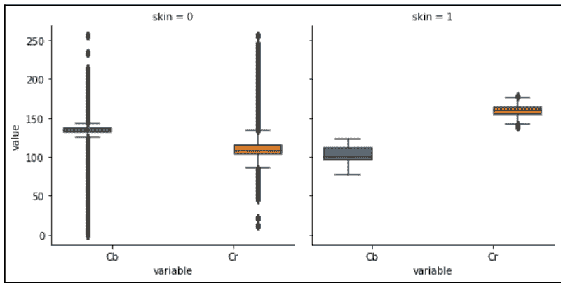

- 4. 现在，使用以下代码块，分离皮肤和非皮肤训练示例，并拟合两个高斯混合模型，一个用于皮肤示例，另一个用于非皮肤示例，每个使用 4 个高斯分量：

```
skin_data = df[df.skin==1].drop(['skin'], axis=1).to_numpy()
not_skin_data = df[df.skin==2].drop(['skin'], axis=1).to_numpy()
skin_gmm = GaussianMixture(n_components=4,
    covariance_type='full').fit(skin_data)
not_skin_gmm = GaussianMixture(n_components=4,
    covariance_type='full').fit(not_skin_data)
colors = ['navy', 'turquoise', 'darkorange', 'gold']
```

- 5. 定义以下函数以可视化为皮肤和非皮肤拟合的高斯混合模型：

```
def draw_ellipses(gmm, ax):
    for n, color in enumerate(colors):
        covariances = gmm.covariances_[n][:2, :2]
        v, w = np.linalg.eigh(covariances)
        u = w[0] / np.linalg.norm(w[0])
        angle = np.arctan2(u[1], u[0])
        angle = 180 * angle / np.pi  # convert to degrees
        v = 2. * np.sqrt(2.) * np.sqrt(v)
        ell = mpl.patches.Ellipse(gmm.means_[n, :2], v[0], v[1],
                                 180 + angle, color=color)
        ell.set_clip_box(ax.bbox)
        ell.set_alpha(0.5)
        ax.add_artist(ell)
    ax.set_aspect('equal', 'datalim')
```

如果运行代码块来绘制拟合的皮肤和非皮肤 GMM，您将得到类似下图的输出：

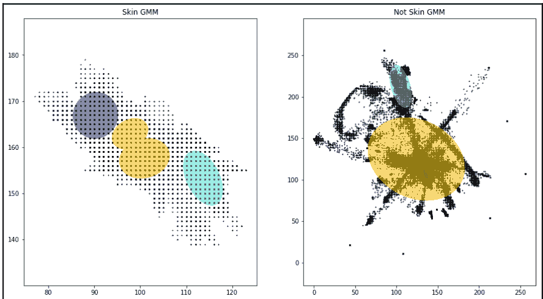

- 6. 现在加载要分割的输入图像（包含人脸/皮肤），将其转换为 YCbCr 颜色空间，并使用两个混合模型对图像中的每个像素进行评分。掩码掉皮肤 GMM 预测分数较低的像素（即预测为非皮肤的像素），并获得最终分割结果：

```
image = imread('images/skin.png')[..., :3]
proc_image = np.reshape(rgb2ycbcr(image), (-1, 3))
skin_score = skin_gmm.score_samples(proc_image[..., :1])
not_skin_score = not_skin_gmm.score_samples(proc_image[..., 1:])
result = skin_score > not_skin_score
result = result.reshape(image.shape[0], image.shape[1])
result = np.bitwise_and(gray2rgb(255*result.astype(np.uint8)), image)
```

### 工作原理

如果运行代码片段并绘制输入图像和结果图像，您将得到类似下面的图形：

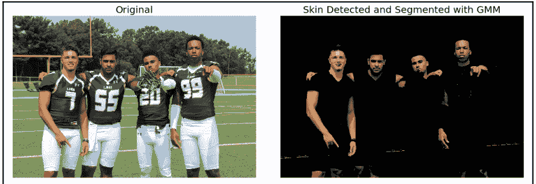

使用 scikit-learn 的 mixture 模块中的 GaussianMixture 类实现了 GMM。可以使用此类估计高斯混合分布的参数（使用 MLE）。

我们创建了 GaussianMixture 类的两个实例：一个用于皮肤（在皮肤样本上拟合），另一个用于 NonSkin（在非皮肤样本上拟合）。使用该类的 `fit()` 方法结合 EM 算法估计了 GMM 的参数。

使用该类的 `score()` 方法计算输入图像中每个像素的对数似然。

### 另请参阅

- https://ce-publications.et.tudelft.nl/publications/465_adaptive_gaussian_mixture_model_for_skin_color_segmentation.pdf
- http://www.jatit.org/volumes/Vol95No17/28Vol95No17.pdf
- https://archive.ics.uci.edu/ml/datasets/skin+segmentation
- http://people.csail.mit.edu/dsontag/courses/ml12/slides/lecture21.pdf

## 医学图像分割

**医学图像分割**旨在检测二维或三维医学图像内部不同对象与背景之间的边界。医学图像本身具有高度可变性，这使得医学图像分割变得困难。这些差异源于人体解剖学的主要变化模式，以及用于获取医学图像的图像分割的不同模态（例如，X 光、MRI、CT、显微镜、内镜、OCT 等）。可以从分割结果中获得进一步的诊断见解，以帮助医生做出决策。边缘缺失、缺乏纹理对比度等区域会产生主要问题，已经提出了许多分割方法来解决这些问题。器官的自动测量、细胞计数以及基于提取的边界信息的模拟是医学分割的一些应用。在本示例中，您将学习如何使用 Python 库（如 SimpleITK）和深度学习库（如 Keras）来分割一些医学图像。

### 准备工作

让我们使用以下代码片段导入所需的库：

```
import SimpleITK as sitk
import numpy as np
import matplotlib.pyplot as plt
from scipy.stats import norm
from sklearn.mixture import GaussianMixture
```

### 操作步骤

让我们先使用 scikit-learn 通过 GMM-EM 对 MRI 图像进行分割。

### 使用 GMM-EM 进行分割

运行以下步骤使用 GMM-EM 对 MR T1 脑图像进行分割，这次使用 scikit-learn 库函数：

- 1. 首先，从 https://github.com/curiale/Medical-Image-Analysis-IPython-Tutorials/tree/master/tutorial_3/data 下载 atlas 图像 atlas_slicez90.nii.gz（这是一个高质量图像，通过注册和平均住院患者 T1 脑图像获得）。使用以下代码片段读取脑切片图像：

```
max_int_val = 512;
image = sitk.ReadImage("images/atlas_slicez90.nii.gz",
sitk.sitkFloat32)
image = sitk.RescaleIntensity(image, 0.0, max_int_val)
image_data = sitk.GetArrayFromImage(image)
```

- 2. 计算高斯混合模型的参数：

```
g = GaussianMixture(n_components=4, covariance_type='diag',
tol=0.01, max_iter=100, n_init=1, init_params='kmeans')
```

- 3. 使用期望最大化（EM）算法估计 GMM 模型参数（使用 MLE）：

```
g.fit(image_data[0].flatten().reshape(-1, 1))
```

- 4. 定义以下函数以绘制每个高斯模型的 pdf：

```
def plot_pdf_models(x, g):
    we = g.weights_
    mu = g.means_
    si = np.sqrt(g.covariances_)
    for ind in range(0,we.shape[0]):
        plt.plot(x,we[ind]*norm.pdf(x, mu[ind], si[ind]),linewidth=4)
```

- 5. 绘制类 pdf：

```
x = np.linspace(0,max_int_val,500)
plt.figure(figsize=(16, 5), dpi=100)
plot_pdf_models(x,g)
plt.hist(image_data.flatten(), bins=int(max_int_val/6), range=(0,
max_int_val), density=True)
plt.title('Class specific probability distribution functions',fontsize=20)
plt.show()
```

如果运行代码块，您将得到以下图形作为输出：

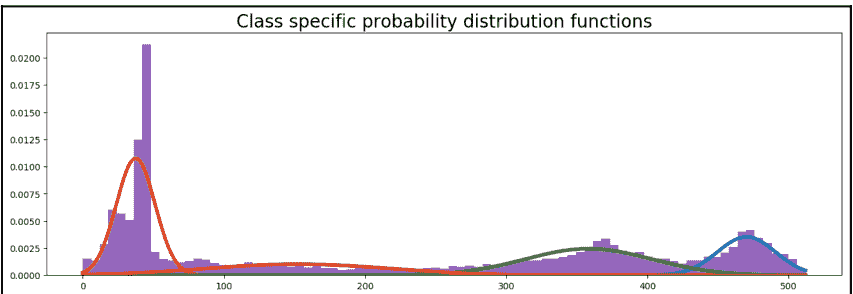

- 6. 计算并绘制模型中每个高斯的类后验概率：

```
plt.figure(figsize=(16, 3), dpi=100)
print(x.shape, g.predict_proba(x.reshape(-1,1)).shape)
plt.plot(x,g.predict_proba(x.reshape(-1,1)), linewidth=4)
plt.title('Class posterior probability under each Gaussian in the model',fontsize=20)
plt.show()
```


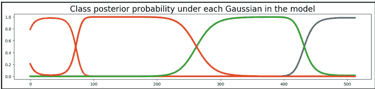

- 7. 最后，计算使用GMM分割后得到的标签图像：

```
label_data = g.predict(image_data[0].flatten().reshape(-1, 1))
# .flatten()
label_data = label_data.reshape(image_data[0].shape)
```

如果使用GMM-EM绘制输入图像和分割（标签）图像，你应该得到如下图形：

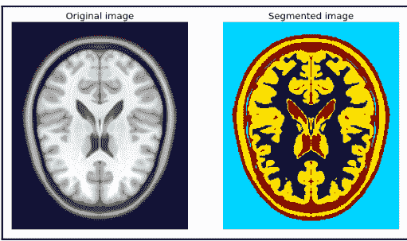

## 使用深度学习进行脑肿瘤分割

运行以下步骤来分割MR T2/flair脑图像，这次使用Keras中的预训练深度学习模型：

- 1. 首先导入所需的库：

```
import keras                #version 2.3.1
from keras.models import model_from_json
from keras.utils.vis_utils import plot_model
from skimage.transform import resize
from keras.utils.vis_utils import model_to_dot
keras.utils.vis_utils.pydot = pydot
```

- 2. 首先，从 https://drive.google.com/file/d/1hE9ItOzOoeIuSFvt6GdiR_0cq9inWdTy/view 下载深度学习（Unet）模型的预训练权重（已上传到GitHub仓库 https://github.com/polo8214/Brain-tumor-segmentation-using-deep-learning/）。从.json文件加载模型结构，从weights-full-best.h5文件加载（预训练）权重。绘制Unet深度学习模型架构：

```
loaded_model_json = open ('models/model.json', 'r').read()
model = model_from_json (loaded_model_json)
model.load_weights ('models/weights-full-best.h5')
plot_model(model, to_file='images/model_plot.png',
show_shapes=True, show_layer_names=True)
```

如果运行此代码片段，权重将加载到模型中。Unet模型架构的部分如下所示：

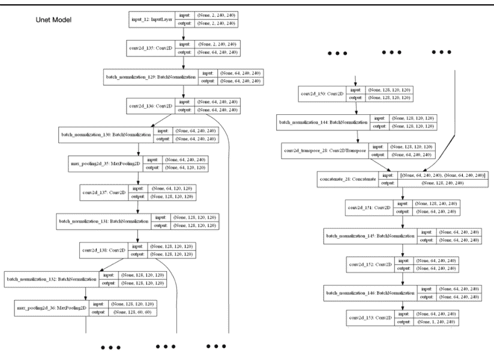

- 3. 使用MRI flair和T2图像（两个输入图像的尺寸都必须为240 x 240）作为全脑肿瘤分割的输入图像。使用以下代码片段预处理输入图像（例如，调整大小、z-score归一化、重塑等），以准备深度学习模型的输入：

```
x = np.zeros((1, 2, 240, 240), np.float32)
Flair = resize((rgb2gray(imread('images/Flair.png')).astype('float32')), (240, 240))
T2 = resize((rgb2gray(imread('images/T2.png')).astype('float32'), (240, 240))
ground_truth = resize(rgb2gray(imread('images/ground_truth.png')), (240, 240))
T2 = (T2-T2.mean()) / T2.std()
Flair = (Flair-Flair.mean()) / Flair.std()
x[:, :, :, :] = np.reshape(Flair, (1, 1, 240, 240))
x[:, :, :, :] = np.reshape(T2, (1, 1, 240, 240))
```

- 4. 最后，通过对输入运行Unet前向传递来预测肿瘤：

```
pred_full = model.predict(x)
pred_full = np.reshape(pred_full, (240, 240))
```

- 5. 如果运行代码块并绘制输入图像、基准真值（显示为红色）和预测肿瘤（显示为黄色补丁），那么你将得到如下图形：

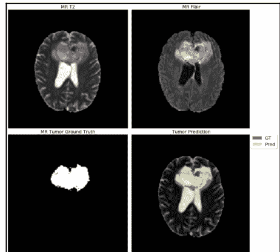

## 分水岭分割

在本示例中，你将学习如何使用SimpleITK库函数从三维聚焦离子束扫描电子显微镜（FIB-SEM）图像中分割细菌。该细菌的名称为枯草杆菌（bacillus subtilis）——它是一种棒状生物，自然存在于植物和土壤中。涉及的步骤如下：

- 1. 读取细菌图像，并使用手动选择的阈值进行阈值处理，将前景（细菌）与背景（树脂）分开。使用形态学开运算和闭运算来去除小的组件/空洞，使用以下代码块：

```
img = sitk.ReadImage('images/fib_sem_bacillus_subtilis_slice_118.png', sitk.sitkFloat32)
f = sitk.RescaleIntensityImageFilter()
img = f.Execute(img, 0, 255)
thresh_value = 120
thresh_image = img > thresh_value
cleaned_thresh_img = sitk.BinaryOpeningByReconstruction(thresh_img, [10, 10, 10])
cleaned_thresh_img = sitk.BinaryClosingByReconstruction(cleaned_thresh_img, [10, 10, 10])
```

- 2. 计算距离图。与物体边界距离≥ 10的种子将被唯一标记。在去除所有大小≤ 15像素的种子时，对种子对象使用连续对象标签进行重新标记：

```
dist_img = sitk.SignedMaurerDistanceMap(cleaned_thresh_img != 0, \\
insideIsPositive=False, squaredDistance=False, \\
useImageSpacing=False)
radius = 10
seeds = sitk.ConnectedComponent(dist_img < -radius)
seeds = sitk.RelabelComponent(seeds, minimumObjectSize=15)
```

- 3. 在计算的距离图上运行分水岭分割算法，将种子作为标记：

```
ws = sitk.MorphologicalWatershedFromMarkers(dist_img, seeds,
markWatershedLine=True)
ws = sitk.Mask( ws, sitk.Cast(cleaned_thresh_img, ws.GetPixelID())))
```

如果运行这些代码片段并绘制获得的所有图像，你应该得到如下图形：

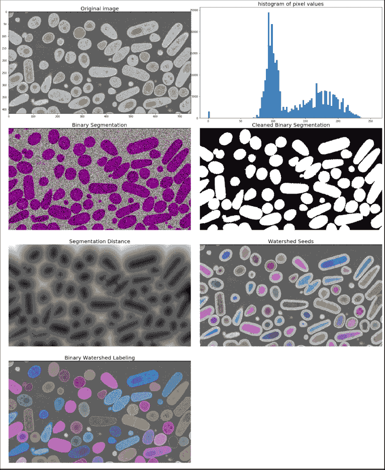

### 工作原理...

我们使用SimpleITK的MorphologicalWatershedFromMarkers类，配合形态学算子实现分水岭分割。

分水岭像素被标记为0。输出图像标签被重新排序，使得对象标签变为连续。然后使用RelabelComponent图像滤波器按对象大小对这些对象进行排序。

### 更多...

使用连通分量标记来分割MRI图像（从 https://github.com/loli/medpy/tree/master/notebooks/scripts/resources 获得）。你应该得到如下图形：

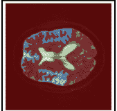

使用SimpleITK实现区域生长分割，来分割MR T1图像，如下图所示：

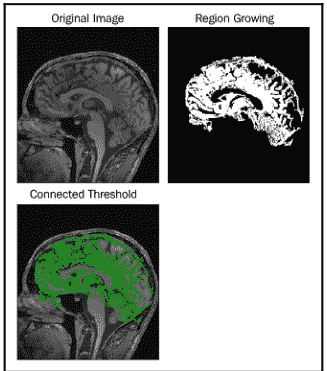

### 另请参见

请参阅以下文章以了解有关此配方的更多信息：

- https://github.com/curiale/Medical-Image-Analysis-IPython-Tutorials
- https://www5.cs.fau.de/research/groups/medical-image-segmentation/
- https://www.sciencedirect.com/topics/engineering/medical-image-segmentation
- http://yaniresearch.info/writtenMaterial/simpleITKNotebooks.pdf
- https://link.springer.com/epdf/10.1007/s10278-017-0037-8?author_access_token=yinJkOXIy1CDH5qFryMpife4Rw1QNchNByi7wbcMAY7nZiB2CrLz3lP8Z2z58a70zrQ5n2ygVseS4B2xRjmiywqPJHeGzjIWwgaNNDOjYBtsruXKIaTRDTIL4Ik2OSejaIJvtA9KgG0s0zbeOADArw%3D%3D
- https://stackoverflow.com/questions/47568515/simpleitk-installation-in-anaconda
- https://electron.nci.nih.gov/
- https://www.insight-journal.org/browse/publication/92
- https://www.youtube.com/watch?v=3zobt404ibs
- 第8章，图像分割，来自Packt Publishing出版的《使用Python进行图像处理》一书。

## 深度语义分割

语义分割是指对图像进行像素级理解，也就是说，当我们想要为图像中的每个像素分配一个对象类（语义标签）时。这是一种获得从粗到细推断的过程。它通过对每个像素进行密集预测来推断标签，从而实现细粒度推断。每个像素都被分配了其周围对象/区域的类别标签。在本配方中，你将学习如何使用几个深度学习（预训练）模型来执行图像的语义分割，使用DeepLab V3+和Caffe FCN。

### 准备工作

首先，从 https://github.com/tensorflow/models/blob/master/research/deeplab/g3doc/model_zoo.md 下载deeplabv3_pascal_trainval_2018_01_04.tar.gz中的预训练模型。使用以下代码块导入所有所需库（tensorflow和keras库模块）：

```
from PIL import Image
import tensorflow as tf
from tensorflow.python.platform import gfile
from keras.models import *
from keras.layers import *
from keras.optimizers import *
from keras.callbacks import ModelCheckpoint, LearningRateScheduler
from keras.preprocessing.image import ImageDataGenerator
from keras import backend as keras
import numpy as np
import skimage.io as io
import skimage.transform as trans
import matplotlib.pyplot as plt
import imutils
from glob import glob
import os, time
```

### 操作方法...

让我们先使用预训练的DeepLab V3模型，然后使用FCN进行语义分割。

### 使用DeepLabV3进行语义分割

运行以下步骤以使用DeepLabV3实现语义分割：

- 1. 定义以下函数来加载预训练的DeepLab V3模型（冻结推理图），并使用tensorflow运行前向传递以获取分割图：

```
def run_semantic_segmentation(image, model_path):
    input_tensor_name = 'ImageTensor:0'
    output_tensor_name = 'SemanticPredictions:0'
    input_size = 513

graph = tf.Graph()
```


```
graph_def = None
with gfile.FastGFile(model_path, 'rb') as f:
    graph_def = tf.GraphDef()
    graph_def.ParseFromString(f.read())
if graph_def is None:
    raise RuntimeError('Cannot find inference graph in tar \\
    archive.')
with graph.as_default():
    tf.import_graph_def(graph_def, name='')

sess = tf.Session(graph=graph)
width, height = image.size
resize_ratio = 1.0 * input_size / max(width, height)
target_size = (int(resize_ratio * width), \\
                int(resize_ratio * height))
resized_image = image.convert('RGB').resize(target_size, \\
    Image.ANTIALIAS)
batch_seg_map = sess.run(
    output_tensor_name,
    feed_dict={input_tensor_name: [np.asarray(resized_image)]})
seg_map = batch_seg_map[0]
return resized_image, seg_map
```

### 2. 定义以下函数以创建 Pascal 标签和颜色映射：

```
def create_pascal_label_colormap():
    colormap = np.zeros((256, 3), dtype=int)
    ind = np.arange(256, dtype=int)
    for shift in reversed(range(8)):
        for channel in range(3):
            colormap[:, channel] |= ((ind >> channel) & 1) << shift
        ind >>= 3
    return colormap
```

### 3. 接下来，定义一个函数，将分割图像的标签转换为所需颜色映射中的颜色：

```
def label_to_color_image(label):
    colormap = create_pascal_label_colormap()
    if np.max(label) > len(colormap):
        raise ValueError('label value too large.')
    return colormap[label]
```

### 4. 定义以下函数以可视化分割图像：

```python
def visualize_segmentation(image, seg_map):
    plt.figure(figsize=(20, 15))
    plt.subplots_adjust(left=0, right=1, bottom=0, top=0.95, \
        wspace=0.05, hspace=0.05)
    plt.subplot(221), plt.imshow(image), plt.axis('off'), \
        plt.title('input image', size=20)
    plt.subplot(222)
    seg_image = label_to_color_image(seg_map).astype(np.uint8)
    plt.imshow(seg_image), plt.axis('off'), \
        plt.title('segmentation map', size=20)
    plt.subplot(223), plt.imshow(image), plt.imshow(seg_image, \
        alpha=0.7), plt.axis('off')
    plt.title('segmentation overlay', size=20)
    unique_labels = np.unique(seg_map)
    ax = plt.subplot(224)
    plt.imshow(full_color_map[unique_labels].astype(np.uint8), \
        interpolation='nearest')
    ax.yaxis.tick_right(), plt.yticks(range(len(unique_labels)), \
        label_names[unique_labels])
    plt.xticks([], [])
    ax.tick_params(width=0.0, labelsize=20), plt.grid('off')
    plt.show()
```

### 5. 读取输入图像，使用 DeepLab V3 运行语义分割，并使用以下代码片段可视化结果：

```python
label_names = np.asarray([
    'background', 'aeroplane', 'bicycle', 'bird', 'boat', 'bottle',
    'bus', 'car', 'cat', 'chair', 'cow', 'diningtable', 'dog',
    'horse', 'motorbike', 'person', 'pottedplant', 'sheep', 'sofa',
    'train', 'tv'
])

full_label_map = np.arange(len(label_names)).reshape(len(label_names), 1)
full_color_map = label_to_color_image(full_label_map)
image, seg_map = run_semantic_segmentation(Image.open('images/pets.png'),
    'models/frozen_inference_graph.pb')
visualize_segmentation(image, seg_map)
```

如果运行此代码块，你将获得以下图形。请注意此图与上一示例中的实例分割之间的区别：

### 输入图像

### 分割图

### 分割叠加图

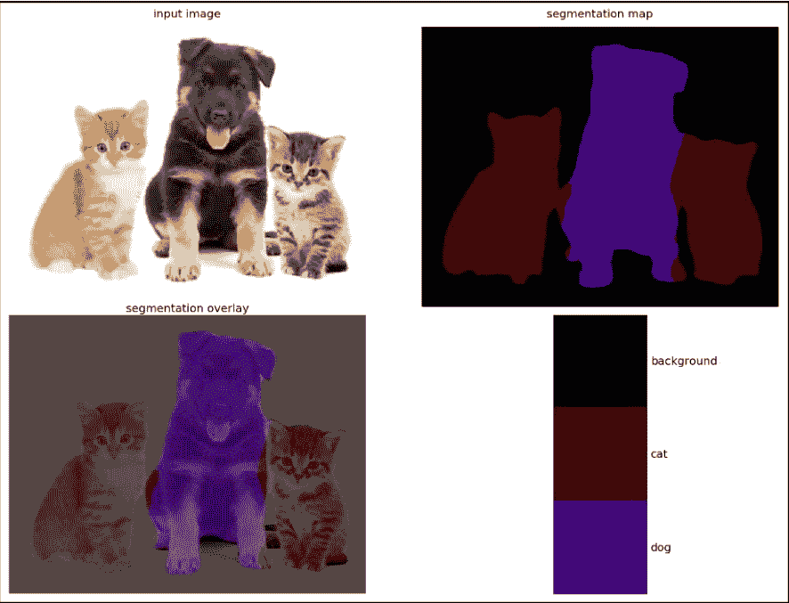

背景

猫

狗

对另一张（道路）图像运行相同的函数。你将获得以下输出：

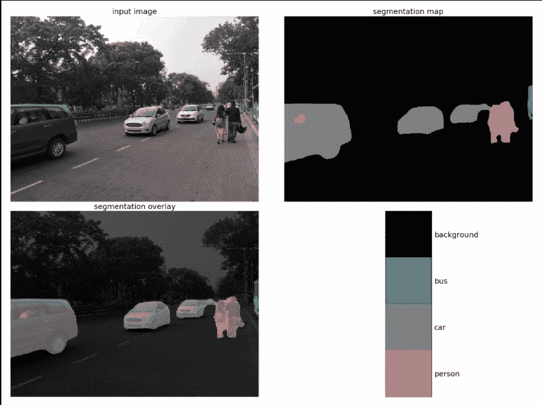

## 带有 FCN 的语义分割

运行以下步骤以使用预训练的全卷积网络（FCN）模型实现语义分割：

- 1. 从 http://dl.caffe.berkeleyvision.org/fcn8s-heavy-pascal.caffemodel 下载预训练的 Caffe FCN 模型，并将其保存到 models 文件夹。使用以下代码块加载类标签名称并初始化图例可视化：

```
lines = open('models/pascal-classes.txt').read().strip().split("\n")
classes, colors = [], []

for line in lines:
    words = line.split(' ')
    classes.append(words[0])
    colors.append(list(map(int, words[1:])))
colors = np.array(colors, dtype="uint8")
legend = np.zeros(((len(classes) * 25) + 25, 300, 3),
                  dtype="uint8")
```

```
# iterate over the class names and colors and draw
for (i, (className, color)) in enumerate(zip(classes, colors)):
    color = [int(c) for c in color]
    cv2.putText(legend, className, (5, (i * 25) + 17), \
                cv2.FONT_HERSHEY_SIMPLEX, 0.5, (0, 0, 255), 2)
    cv2.rectangle(legend, (100, (i * 25)),
                  (300, (i * 25) + 25), \
                  tuple(color), -1)
```

### 2. 从磁盘加载序列化的 FCN 模型，将输入图像 blob 设置为模型输入，并使用 opencv-python 函数对其运行前向传递：

```
model = cv2.dnn.readNetFromCaffe \
    ('models/fcn8s-heavy-pascal.prototxt', \
     'models/fcn8s-heavy-pascal.caffemodel')
image = cv2.imread('images/cycling.jpeg')
image = cv2.cvtColor(image, cv2.COLOR_BGR2RGB)
image = imutils.resize(image, width=500)
blob = cv2.dnn.blobFromImage(image, 1, (image.shape[1], \
     image.shape[0]))
model.setInput(blob)
output = model.forward()
```

### 3. 从获得的输出中获取类的总数和掩码图像形状。对于图像中的每个像素坐标，找到具有最大概率的类标签。找到与该标签对应的颜色（该颜色将在输出掩码图像中表示像素）。将掩码和类图调整为输入图像大小：

```
(num_classes, height, width) = output.shape[1:4]
labels = output[0].argmax(0)
mask = colors[labels]
mask = cv2.resize(mask, (image.shape[1], image.shape[0]), \
                  interpolation=cv2.INTER_NEAREST)
labels = cv2.resize(labels, (image.shape[1], image.shape[0]), \
                    interpolation=cv2.INTER_NEAREST)
```

4. 计算输入图像和掩码图像的加权线性组合以创建分割叠加图（例如，output = 0.3 * image + 0.7 * mask）并绘制图像。你将得到类似于以下图像的输出：


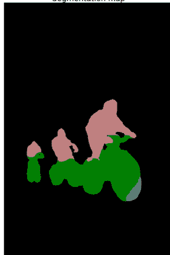

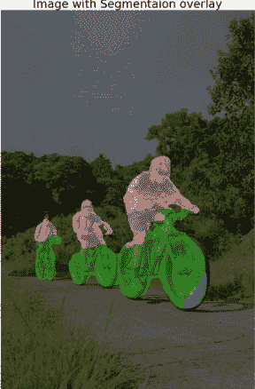

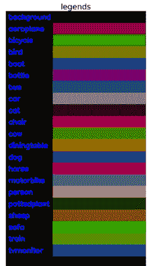

### 另请参阅

参考以下文章以了解更多有关本示例的信息：

- http://brainiac2.mit.edu/isbi_challenge/
- http://dl.caffe.berkeleyvision.org/
- https://github.com/tensorflow/models/blob/master/research/object_detection/g3doc/detection_model_zoo.md
- https://github.com/zhixuhao/unet
- https://www.youtube.com/watch?v=nLuYZAcuhrU
- https://www.youtube.com/watch?v=fh6AQN_0uDU

## 深度实例分割

类似于深度语义分割，深度实例分割也为图像中的每个像素分配一个标签。这些标签共同为输入图像中的每个对象生成基于像素的掩码。这两种技术之间的区别在于，即使多个对象具有相同的类标签（例如，以下图中显示的输入图像中有两只猫和一条狗），实例分割也应将每个对象实例报告为唯一的对象（例如，总共有三个唯一对象：两只猫和一条狗），而不是像语义分割那样报告找到的唯一类标签总数（例如，两个唯一类，即猫和狗），如下图所示：

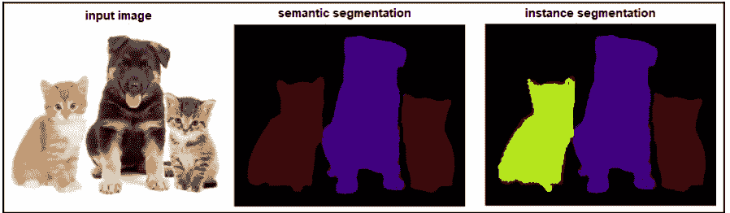

在本示例中，你将学习如何使用预训练的 Mask R-CNN 深度学习模型执行实例分割。

基于区域的 CNN（R-CNN）是一种开创了基于深度学习的对象检测的模型。该算法有以下四个步骤：

- 1. 将图像输入网络。
- 2. 使用诸如选择性搜索之类的算法计算区域建议（可能包含对象的图像区域）。
- 3. 使用预训练的 CNN 为每个建议提取特征（ROI）。
- 4. 使用支持向量机（SVM）分类器（使用提取的特征）对每个建议进行分类。

但是，由于 R-CNN 模型在实际中非常缓慢，可以引入快速 R-CNN 模型，使用可端到端训练的网络，并使用以下算法步骤：

- 1. 将图像和相应的实测边界框输入。
- 2. 提取特征图。
- 3. 引入 ROI 池化并提取 ROI 特征向量。
- 4. 使用两组全连接层来预测类标签并计算每个建议中分类对象的相应边界框。


> 有关快速 R-CNN 和 Mask R-CNN 的更详细介绍，请阅读 https://www.pyimagesearch.com/2018/11/19/mask-r-cnn-with-opencv/ 上的文章。

### 准备工作

首先，从模型动物园（http://download.tensorflow.org/models/object_detection/mask_rcnn_inception_v2_coco_2018_01_28.tar.gz）下载预训练的 Mask-RCNN 模型，提取 frozen_inference_graph.pb 文件，并将其保存到 models 文件夹。导入开始所需的所有库：

```
import numpy as np
import time
import cv2
import os
import random
import matplotlib.pyplot as plt
print(cv2.__version__)
# 4.1.0
```


### 如何操作...

按照以下步骤使用 opencv-python 函数实现深度实例分割：

- 1. 使用 HSV 颜色空间定义以下函数，生成 N 个随机（亮色）颜色：

```
def random_colors(N, bright=True):
    brightness = 1.0 if bright else 0.7
    hsv = [(i / N, 1, brightness) for i in range(N)]
    colors = list(map(lambda c: colorsys.hsv_to_rgb(*c), hsv))
    random.shuffle(colors)
    return 255*np.array(colors)
```

- 2. 初始化模型常量和下载模型所用的路径：

```
model_path = 'models\\'
conf = 0.5
thresh = 0.3
```

- 3. 读取 mask R-CNN（预训练）模型训练所用的 COCO 类标签：

```
labels_path = os.path.sep.join([model_path,
"object_detection_classes_coco.txt"])
labels = open(labels_path).read().strip().split("\\n")
```

- 4. 初始化预训练 mask R-CNN 模型权重和配置文件的路径：

```
weights_path = os.path.sep.join([model_path,
"frozen_inference_graph.pb"])
config_path = os.path.sep.join([model_path,
"mask_rcnn_inception_v2_coco_2018_01_28.pbtxt"])
```

- 5. 从磁盘加载预训练的 mask R-CNN 模型：

```
net = cv2.dnn.readNetFromTensorflow(weights_path, config_path)
```

- 6. 现在，读取待分割的输入图像，将其设为加载模型的输入，并对模型进行前向传播，以获取对象掩码和边界框：

```
image = cv2.imread('images/pets.jpg')
blob = cv2.dnn.blobFromImage(image, swapRB=True, crop=False)
net.setInput(blob)
(boxes, masks) = net.forward(["detection_out_final",
"detection_masks"])
num_classes = masks.shape[1]
num_detections = boxes.shape[2]
print('# instances: {}'.format(num_detections))
# instances: 4
colors = random_colors(num_detections)
print("# classes: {}".format(num_classes))
# classes: 90
```

- 7. 对于检测到的每个对象，如果分数高于置信度阈值，则计算边界框角点：

```
h = image.shape[0]
w = image.shape[1]
for i in range(num_detections) :
    box = boxes[0, 0, i]
    mask = masks[i]
    score = box[2]
    if score > conf:
        class_id = int(box[1])
        left, top, right, bottom = int(w * box[3]), int(h * box[4]), \
        int(w * box[5]), int(h * box[6])
        left, top = max(0, min(left, w - 1)), max(0, min(top, h - 1))
        right, bottom = max(0, min(right, w - 1)), \
        max(0, min(bottom, h - 1))
        class_mask = masks[class_id]
```

- 8. 提取模型检测到的每个对象的掩码，使用对应类别标签的颜色对掩码进行着色，并将掩码与输入图像混合（以创建叠加层）：

```
    label = labels[class_id]
    class_mask = cv2.resize(class_mask, (right - left + 1, \
    bottom - top + 1))
    mask = (class_mask > thresh)
    roi = image[top:bottom+1, left:right+1][mask]
    color_index = np.random.randint(0, len(colors)-1)
    color = np.array(colors[color_index])
```

```
    image[top:bottom+1, left:right+1][mask] = (0.4*color + \
    0.6 * roi).astype(np.uint8)
```

- 9. 使用以下代码块在分割叠加图像上绘制对象边界（带轮廓）：

```
    mask = mask.astype(np.uint8)
    contours, hierarchy = cv2.findContours(mask, cv2.RETR_TREE, \
    cv2.CHAIN_APPROX_SIMPLE)

    cv2.drawContours(image[top:bottom+1, left:right+1], contours, \
    -1, color, 3, cv2.LINE_8, hierarchy, 100)
    label_size, _ = cv2.getTextSize(label, \
    cv2.FONT_HERSHEY_SIMPLEX, 0.5, 1)

    top = max(top, label_size[1])
    cv2.putText(image, label, ((left + right)//2, top), \
    cv2.FONT_HERSHEY_SIMPLEX, 0.75, (0,0,0), 2)
    cv2.imwrite('images/instance_seg_out.png', image)
```

### 工作原理...

如果运行代码块并绘制输入和输出的分割图像，您将得到以下图形：

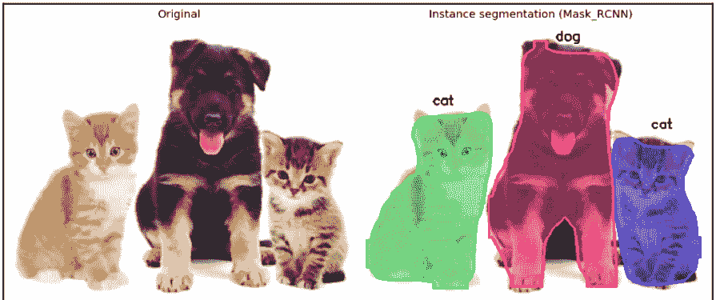

Mask R-CNN 可以检测 90 个类别，包括人、动物、车辆、标志、食物等（参考 object_detection_classes_coco.txt 文件查看支持的类别）。

使用 cv2.dnn.blobFromImage() 函数从输入图像构建一个 blob，然后将其传递给深度神经网络模型。

在将输入图像馈送到深度学习模型之前，需要对其进行预处理（这也是由同一个 cv2.dnn.blobFromImage() 函数完成的）。预处理步骤通常涉及均值减去、缩放和可选的通道交换。

从模型输出中提取了每个检测对象的类别标签和置信度。弱预测被过滤掉了（即置信度低的预测，也就是置信度低于置信度阈值的预测）。

从模型输出中提取了掩码图像。对其进行阈值处理以获取二值图像，并且对于检测到的每个对象，提取了 ROI。

最后，将掩码区域与 ROI 混合，以创建分割叠加图像——即深度实例分割的输出。

### 另请参见

参考以下文章以了解更多有关此配方的信息：

- https://arxiv.org/pdf/1311.2524.pdf
- https://arxiv.org/pdf/1504.08083.pdf
- https://arxiv.org/pdf/1506.01497.pdf
- https://arxiv.org/pdf/1703.06870.pdf
- https://www.pyimagesearch.com/2018/11/19/mask-r-cnn-with-opencv/
- http://cocodataset.org/
