# 图像分类

本章将学习图像分类问题，这是一项有监督机器学习任务，即从固定的标签（类别）集中为输入图像分配（最可能的）标签。我们还将学习如何使用不同的 Python 库对图像进行分类。这是图像处理中的核心问题之一，具有大量实际应用。此外，许多其他看似不同的图像处理任务（如目标检测和分割）都可以归结为图像分类。图像分类是指根据图像的视觉内容为图像分配标签（即对其进行分类）的过程。例如，可以开发一种二进制图像分类算法（模型）来预测图像中是否有人。

本章将主要学习如何实现两种类型的图像分类器。第一种是基于特征的，其中特征生成（预处理）算法提取一组用于表示图像的图像特征。然后，使用图像分类算法（一种经典的有监督机器学习算法）利用这些特征对图像进行分类。下图显示了基于特征的图像分类：

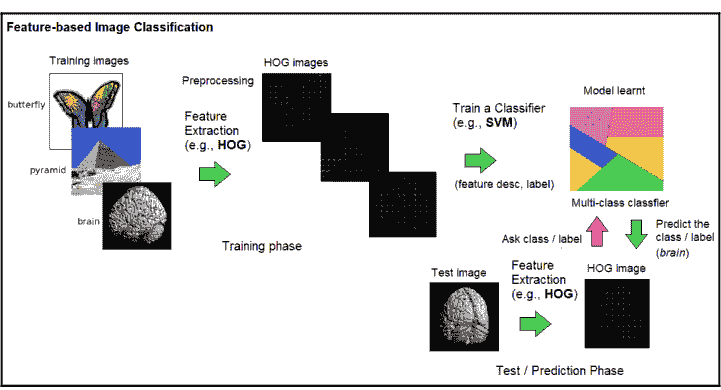

第二种分类器是深度学习分类器，其中未实现任何预处理步骤（如特征提取），而是训练一个端到端的深度神经网络来执行分类任务。下图显示了基于深度学习（端到端）的图像分类：

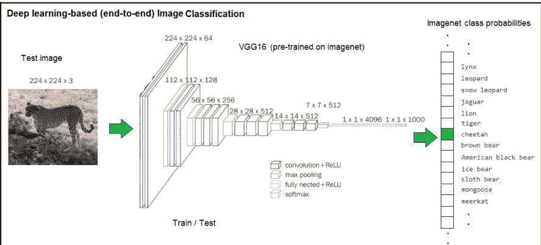

图像分类是一项包含两个阶段的有监督机器学习任务：训练和测试。在训练阶段，将一组带标签的输入图像（带有已知类标签）提供给分类算法，该算法使用输入训练一个分类模型（通常，模型参数是学习得到的）。通常，会使用一组验证（留出）图像来评估模型在未见图像上的当前性能。训练完成后，学习到的模型可用于分类或预测新（测试）图像的标签——这被称为测试阶段。可以将预测标签与基准真值标签进行比较，以比较分类器的准确性。

在本章中，我们将查看以下配方：

- 使用 scikit-learn 对图像进行分类（HOG 和逻辑回归）
- 使用 Gabor 滤波器组对纹理进行分类
- 使用 VGG19/Inception V3/MobileNet/ResNet101 对图像进行分类（使用 PyTorch）
- 用于图像分类的微调（使用迁移学习）
- 使用深度学习模型对交通标志进行分类（使用 PyTorch）
- 使用深度学习模型估计人体姿态


## 使用 scikit-learn 对图像进行分类（HOG 和 logistic 回归）

在本示例中，你将使用 scikit-image 和 scikit-learn 库函数实现一个基于特征的图像分类器。多类 logistic 回归（softmax 回归）分类器将在从训练图像中提取的方向梯度直方图（HOG）描述子上进行训练。下面的方程展示了如何在训练阶段（例如，使用随机梯度下降）估计 K 类 softmax 回归分类器的参数，然后在测试阶段使用学习到的模型来预测给定输入图像的类标签概率：

> **多类 logit 分类器（Softmax 回归）**
>
> **训练（参数估计）**
>
> \(J(\theta) = - \left[ \sum_{i=1}^m \sum_{k=1}^K 1 \{y^{(i)} = k\} \log \frac{\exp(\theta^{(k) \top} x^{(i)})}{\sum_{j=1}^K \exp(\theta^{(j) \top} x^{(i)})} \right]\)
>
> \(\nabla_{\theta^{(k)}} J(\theta) = - \sum_{i=1}^m \left[ x^{(i)} \left( 1\{y^{(i)} = k\} - P(y^{(i)} = k | x^{(i)}; \theta) \right) \right]\)
>
> SGD: \(\theta = \theta - \alpha \nabla_\theta J(\theta; x^{(i)}, y^{(i)})\)
>
> **预测**
>
> \(P(y^{(i)} = k | x^{(i)}; \theta) = \frac{\exp(\theta^{(k) \top} x^{(i)})}{\sum_{j=1}^K \exp(\theta^{(j) \top} x^{(i)})}\)

### 准备工作

在本示例中，我们将使用 scikit-learn 的多类 logistic 回归分类器实现，结合从图像中提取的 HOG 特征来对图像进行分类。让我们先使用以下代码片段导入所有所需的库：

```
%matplotlib inline
import numpy as np
from skimage.io import imread
from skimage.color import gray2rgb
from skimage.transform import resize
from skimage.feature import hog
from sklearn.linear_model import LogisticRegression
from sklearn.model_selection import train_test_split
from sklearn.metrics import classification_report, accuracy_score
from glob import glob
from matplotlib import pyplot as plt
```

### 操作步骤

按照以下步骤执行本示例：

- 1. 首先，从 http://www.vision.caltech.edu/Image_Datasets/Caltech101/ 下载 Caltech101 图像并解压。共有 101 个类别对应的图像对象，但我们只使用了其中的一个子集，对应 12 个类标签（即 brain、butterfly、Buddha、chair、elephant、laptop、piano、pigeon、pizza、pyramid、rhino、sunflower），以加快预处理和训练阶段，但如果需要，你可以使用所有类别进行训练。

- 2. 从各文件夹中读取对应 12 个不同类别的图像（它们被提取到不同文件夹中），并使用以下代码从图像中提取 HOG 图像/描述子。打印每个类标签存在的图像数量：

```
images, hog_images = [], []
X, y = [], []
ppc = 16
sz = 200
for dir in glob('images/Caltech101_images/*'):
    image_files = glob(dir + '/*.jpg')
    label = dir.split('\\')[-1]
    print(label, len(image_files))
    for image_file in image_files:
        image = resize(imread(image_file), (sz,sz))
        if len(image.shape) == 2: # if a gray-scale image
            image = gray2rgb(image)
        fd,hog_image = hog(image, orientations=8, \
                pixels_per_cell=(ppc,ppc),
                cells_per_block=(4, 4), \
                block_norm= 'L2',visualize=True)
        images.append(image)
        hog_images.append(hog_image)
        X.append(fd)
        y.append(label)
# brain 98
# butterfly 91
# buddha 85
# chair 62
# elephant 64
# laptop 81
# piano 99
# pigeon 45
# pizza 53
# pyramid 57
# rhino 59
# sunflower 85
```

- 3. 如果使用 matplotlib 绘制几个输入图像，你将得到类似于下面的图像：

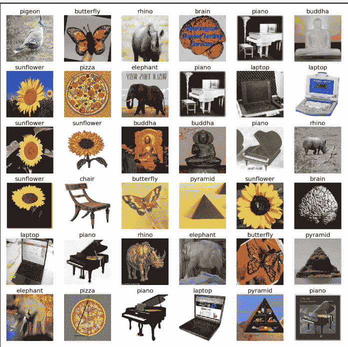

- 4. 使用前面的代码片段绘制由前面图像生成的 HOG 图像。你将得到类似于下面的图像：

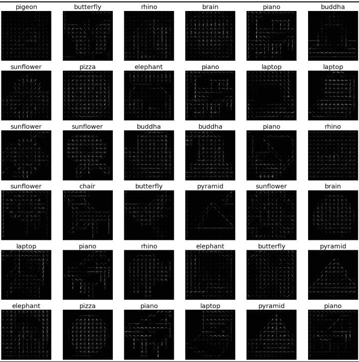

- 5. 使用每个图像的 HOG 描述子和标签创建分类器将使用的图像数据集。将图像数据集分为两部分：90% 作为训练集，10% 作为测试集。最后，实例化一个 `LogisticRegression` 类用于多类分类，并在创建的训练数据集上训练分类器：

```
X = np.array(X)
y = np.array(y)
indices = np.arange(len(X))
X_train, X_test, y_train, y_test, id_train, id_test = train_test_split(X, y, indices,
test_size=0.1, random_state=1)
clf = LogisticRegression(C=1000, random_state=0, solver='lbfgs',
multi_class='multinomial')
clf.fit(X_train, y_train)
```

- 6. 预测创建的测试数据集中图像的标签，并计算在测试数据集（模型在训练期间未见过的数据集）上的预测准确率：

```
y_pred = clf.predict(X_test)
print("Accuracy: " + str(accuracy_score(y_test, y_pred)))
print('\\n')
# Accuracy: 0.7439024390243902
print(classification_report(y_test, y_pred))
```

你将得到如下所示的分类报告，展示了使用当前模型在测试数据集上的图像分类准确率。如你所见，我们在测试图像数据集上可获得约 80.6% 的准确率：

| | 精确率 | 召回率 | F1 分数 | 样本数 |
|---|---|---|---|---|
| 大脑 | 0.90 | 0.75 | 0.82 | 12 |
| 佛 | 0.75 | 0.60 | 0.67 | 5 |
| 蝴蝶 | 0.88 | 0.78 | 0.82 | 9 |
| 椅子 | 1.00 | 0.25 | 0.40 | 4 |
| 大象 | 0.78 | 0.88 | 0.82 | 8 |
| 笔记本电脑 | 0.88 | 1.00 | 0.93 | 7 |
| 钢琴 | 1.00 | 1.00 | 1.00 | 12 |
| 鸽子 | 1.00 | 0.60 | 0.75 | 5 |
| 披萨 | 0.38 | 0.75 | 0.50 | 4 |
| 金字塔 | 0.60 | 0.75 | 0.67 | 4 |
| 犀牛 | 0.70 | 1.00 | 0.82 | 7 |
| 向日葵 | 0.90 | 0.82 | 0.86 | 11 |
| 准确率 | | | 0.81 | 88 |
| 宏观平均 | 0.81 | 0.76 | 0.76 | 88 |
| 加权平均 | 0.85 | 0.81 | 0.81 | 88 |

- 7. 最后，绘制所有测试图像，并附上实际（实况）标签和图像分类器预测的标签：

```
plt.figure(figsize=(20,20))
j = 0
for i in id_test:
    plt.subplot(10,10,j+1), plt.imshow(images[i]), plt.axis('off')
    plt.title('{}/{}'.format(y_test[j], y_pred[j]))
    j += 1
plt.suptitle('Actual vs. Predicted Class Labels', size=20)
plt.show()
```

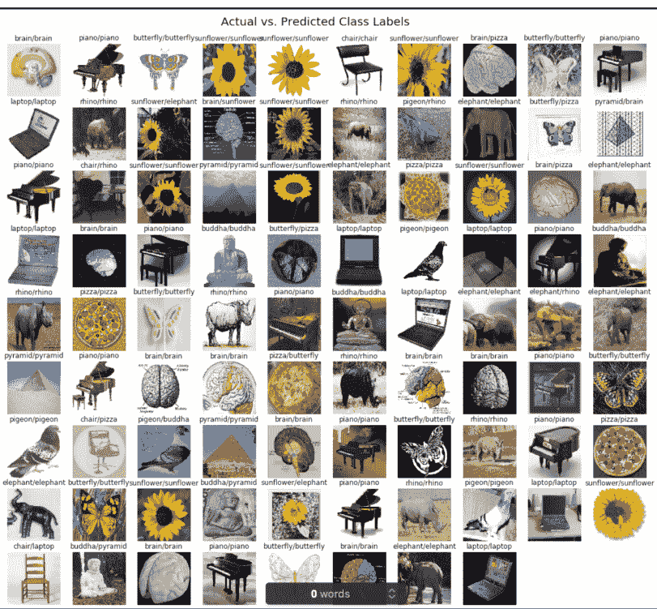

### 工作原理

如果运行前面的代码块并绘制预测结果以及测试数据集中图像的实际标签，你将得到类似于下面的图像：


使用 scikit-image 特征模块中的 hog() 函数来提取给定图像的 HOG。它使用以下步骤来计算 HOG：

- 1. （可选）对图像进行全局归一化。
- 2. 计算梯度图像。
- 3. 计算梯度直方图。
- 4. 执行块归一化。
- 5. 展平为特征向量（特征描述子）。

该函数的 multichannel 参数设置为 True，因为最后一个图像维度被视为颜色（RGB）通道。有些图像是灰度图（二维）；为了将每个图像转换为三维数组，使用了 scikit-image 颜色模块中的 gray2rgb() 函数。

该函数返回输入图像的 HOG 描述子和一张 HOG 图像。当参数 feature_vector 设置为 True 时，返回一个展平的一维数组作为特征向量。如果参数 visualize 设置为 True，还将返回 HOG 图像的可视化结果。

使用 sklearn.model_selection 模块中的 train_test_split() 函数，通过将 test_size 参数设置为 0.1，将图像数据集拆分为随机的训练和测试子集（90% 训练，10% 测试）。

实例化了 sklearn.linear_model 中的 LogisticRegression 类，以使用训练数据集拟合 logistic 回归（logit）分类器模型。在多类分类的情况下，当 multi_class 参数设置为 multinomial 时，使用交叉熵损失（由我们使用的 lbfgs 求解器支持）。

使用 predict() 方法预测测试图像的类别。使用 sklearn.metric 中的 classification_report() 和 accuracy_score() 函数在测试数据集（相对于实况标签）上评估模型性能。

### 更多内容

使用支持向量机（SVM）分类器（使用 scikit-learn 中的 svm.SVC() 和 svm.LinearSVC() 函数）来代替带有 HOG 特征的 logistic 回归分类器。这能提高测试图像上的准确率吗？现在使用迁移学习/微调（提示：参考接下来的几个示例以了解如何操作）来提高分类准确率。


### 另请参阅

有关更多信息，请阅读以下来源：

- https://scikit-learn.org/stable/modules/generated/sklearn.linear_model.LogisticRegression.html#sklearn.linear_model.LogisticRegression
- https://scikit-learn.org/stable/modules/generated/sklearn.model_selection.train_test_split.html
- http://www.vision.caltech.edu/Image_Datasets/Caltech101/
- https://www.sciencedirect.com/topics/computer-science/image-classification
- http://deeplearning.stanford.edu/tutorial/supervised/SoftmaxRegression/
- 第 8 章“图像中的目标检测”和第 9 章“人脸识别、图像字幕及其他”，选自 Packt 出版社的书籍《用 Python 进行图像处理实战》。

### 使用 Gabor 滤波器组对纹理进行分类

在本示例中，您将学习如何使用 scikit-image 滤波模块的函数通过 Gabor 滤波器组对纹理进行分类。频率和方向是 Gabor 滤波器的两个关键参数，用于检测图像在 ROI 邻域内给定方向上的特定频率内容是否存在。Gabor 核同时具有实部和虚拟部，其中实部用于图像滤波。用于（纹理）分类的特征是滤波后图像的均值和方差（通常基于 LSE）。Gabor 滤波器的冲激响应是正弦函数与高斯函数的乘积，如下图所示：

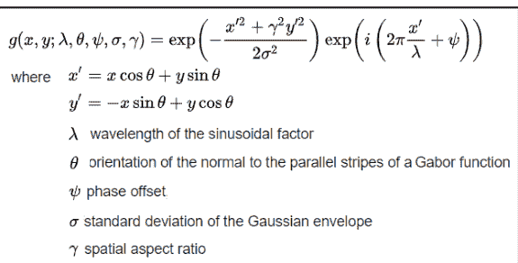

### 准备工作

从 http://slazebni.cs.illinois.edu/research/uiuc_texture_dataset.zip 下载纹理图像，并解压数据以获取纹理图像。共有 25 个纹理类，每个类都有单独的文件夹，每个文件夹内包含 41 张图像。为演示目的，我们将使用 4 个纹理类，并将类重命名为 woods、stones、bricks 和 checks。首先，让我们使用以下代码片段导入所需的库：

```
import numpy as np
import matplotlib.pyplot as plt
from skimage.io import imread
from skimage.color import rgb2gray
from skimage.filters import gabor_kernel
import scipy.ndimage as ndi
```

### 操作步骤

以下是使用 scikit-learn 的 Gabor 滤波器实现纹理分类的步骤：

- 1. 首先，使用以下代码片段准备 Gabor 滤波器组核：

```
kernels = []
for theta in range(4):
    theta = theta / 4. * np.pi
    for sigma in (1, 3):
        for frequency in (0.05, 0.25):
            kernel = np.real(gabor_kernel(frequency, \
                theta=theta, sigma_x=sigma, sigma_y=sigma))
            kernels.append(kernel)
```

- 2. 定义以下函数，将输入图像与 Gabor 核（包括实部和虚拟部）进行卷积：

```
def power(image, kernel):
    # Normalize images for better comparison.
    image = (image - image.mean()) / image.std()
    return np.sqrt(ndi.convolve(image, np.real(kernel), \
        mode='wrap')**2 + ndi.convolve(image, \
        np.imag(kernel), mode='wrap')**2)
```

- 3. 对于四个纹理类中的每一个，我们将使用两张图像——一张作为参考，另一张作为测试图像。首先，让我们使用以下代码片段加载我们选定的四个类的参考图像：

```
image_names = ['images/UIUC_textures/woods/T04_01.jpg',
    'images/UIUC_textures/stones/T12_01.jpg',
    'images/UIUC_textures/bricks/T15_01.jpg',
    'images/UIUC_textures/checks/T25_01.jpg']
labels = ['woods', 'stones', 'bricks', 'checks']

images = []
for image_name in image_names:
    images.append(rgb2gray(imread(image_name)))
```

- 4. 使用不同的参数值（theta 和 frequency）创建四个滤波器组核：

```
results = []
kernel_params = []
for theta in (0, 1):
    theta = theta / 4. * np.pi
    for frequency in (0.1, 0.4):
        kernel = gabor_kernel(frequency, theta=theta)
        params = 'theta=%d, \nfrequency=% .2f' % \
            (theta * 180 / np.pi, frequency)
        kernel_params.append(params)
        results.append((kernel, [power(img, kernel) for img \
            in images]))
```

- 5. 如果运行上述代码片段并绘制原始输入图像、Gabor 滤波器组及其响应（卷积后的图像），您将得到类似于以下截图的输出：

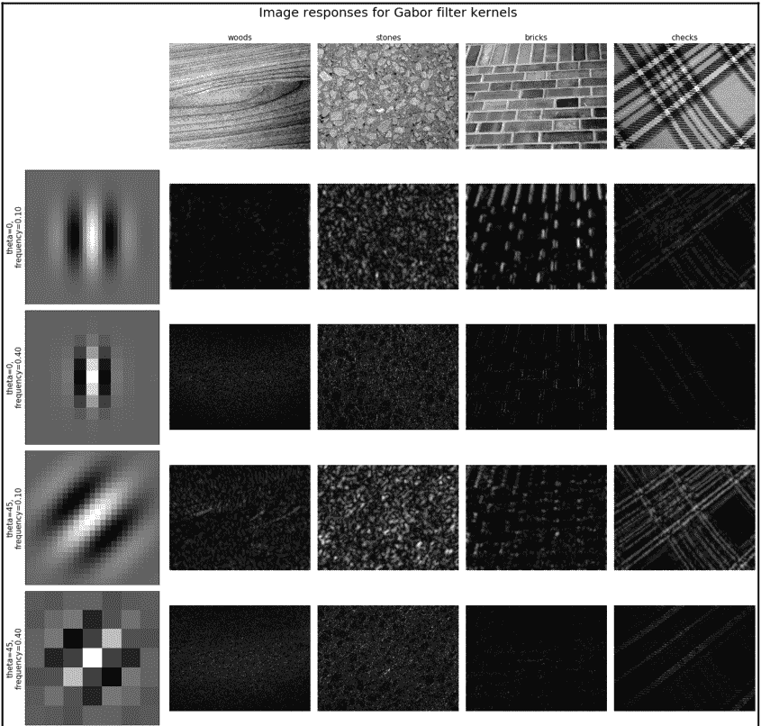

- 6. 现在，实现提取图像与 Gabor 滤波器组核对应特征的函数：

```
def compute_feats(image, kernels):
    feats = np.zeros((len(kernels), 2), dtype=np.double)
    for k, kernel in enumerate(kernels):
        filtered = ndi.convolve(image, kernel, mode='wrap')
        feats[k, 0] = filtered.mean()
        feats[k, 1] = filtered.var()
    return feats
```

- 7. 实现一个执行分类任务的 match 函数——也就是说，它接受新图像的提取特征以及参考图像的特征作为参数，然后将新图像与参考图像进行匹配，并返回特征空间中最近的参考图像的索引（这里我们使用欧几里得距离）：

```
def match(feats, ref_feats):
    min_error = np.inf
    min_i = None
    for i in range(ref_feats.shape[0]):
        error = np.sum((feats - ref_feats[i, :])**2)
        if error < min_error:
            min_error = error
            min_i = i
    return min_i
```

- 8. 现在，提取参考图像的特征和新测试图像的特征。对测试图像进行分类——也就是说，将每个新（测试）图像与最近的参考图像匹配，并使用参考图像的类别为测试图像打标签：

```
ref_feats = np.zeros((4, len(kernels), 2), dtype=np.double)
for i in range(4):
    ref_feats[i, :, :] = compute_feats(images[i], kernels)

print('Images matched against references using Gabor filter banks:')

new_image_names = ['images/UIUC_textures/woods/T04_02.jpg',
                   'images/UIUC_textures/stones/T12_02.jpg',
                   'images/UIUC_textures/bricks/T15_02.jpg',
                   'images/UIUC_textures/checks/T25_02.jpg',
                   ]

for i in range(4):
    image = rgb2gray(imread(new_image_names[i]))
    feats = compute_feats(image, kernels)
    mindex = match(feats, ref_feats)
    print('original: {}, match result: {}'.format(labels[i], labels[mindex]))
```

如果运行上述代码块，并将原始测试图像与为这些图像识别的参考图像并排绘制，您将得到以下类别输出：

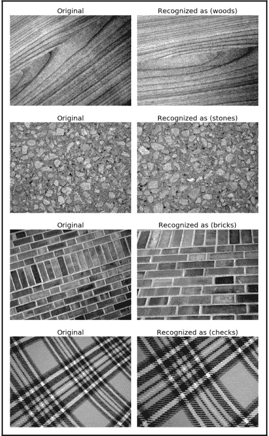

我们可以看到，测试图像与最近的参考图像匹配。

### 工作原理

从 skimage.filters 中，使用 gabor_kernel() 函数返回复数二维 Gabor 滤波器核。

Gabor 核是一个高斯核，乘以（调制）一个（复数）谐波函数，该函数由实数余弦项和虚拟正弦项组成。

传递给该函数的 frequency 参数表示谐波的空间频率（以像素为单位）。

频率与波长成反比（∝ 1/wavelength），并且也与 σ 成反比。同样，带宽与 1/σ 成正比（∝ 1/σ），其中 σ 是高斯核的标准差。

θ 参数表示以弧度为单位的方向（例如，θ=0 意味着谐波指向 x 方向）。

bandwidth 参数表示 Gabor 滤波器捕获的带宽。对于给定的带宽，当频率增加时，σx 和 σy 会减小。

（可选）参数 σx 和 σy 分别表示 x 和 y 方向的标准差。例如，当 θ = π/2 时，核会进行 90 度旋转，且 σx 控制垂直方向。

match() 函数通过计算测试图像的 Gabor 特征与每个参考图像的 Gabor 特征之间的距离，找到测试图像的最佳匹配，并返回最接近的参考图像。

### 更多内容

局部二值模式（LBP）和 Haralick 特征（使用 GLCM 矩阵）也可用于纹理分类（使用 skimage.feature 中的 local_binary_pattern() 函数和 mahotas.features 中的 haralick() 函数）。使用这些特征实现纹理分类。

### 另请参阅

有关更多信息，请阅读以下来源：

- http://slazebni.cs.illinois.edu/research/uiuc_texture_dataset.zip
- https://scikit-image.org/docs/dev/auto_examples/features_detection/plot_gabor.html
- https://scikit-image.org/docs/dev/api/skimage.filters.html#skimage.filters.gabor_kernel
- https://dsp.stackexchange.com/questions/14714/understanding-the-gabor-filter-function
- https://en.wikipedia.org/wiki/Gabor_filter
- https://web.archive.org/web/20180127125930/http://mplab.ucsd.edu/tutorials/gabor.pdf


## 使用 VGG19/Inception V3/MobileNet/ResNet101 对图像进行分类 (PyTorch)

在本教程中，你将学习如何使用 torchvision 中针对少数知名模型的预训练（在 ImageNet 上）深度学习模型。ImageNet 是一个按照 WordNet 层次结构组织的图像数据库。数百/数千张图片属于层次结构中的每个节点。

下图展示了几个流行的深度神经网络在 ImageNet 挑战赛中取得的 top-1 准确率，从最左边的 AlexNet (Krizhevsky et al., 2012) 到最右边性能最好的 Inception-v4 (Szegedy et al., 2016)：

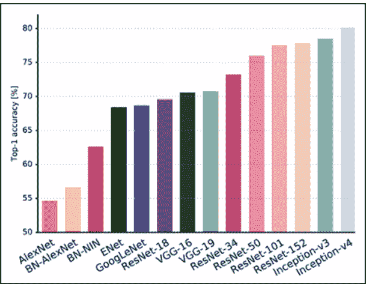

top-1 准确率定义为图像的正确标签为 CNN 对该图像预测的概率最高类别的平均次数。在尺度的另一端，top-1 错误显示当模型预测的类别（模型赋予最高置信度的类别标签）与实际类别（基础真值）不同时发生的错误。

### 准备工作

首先，使用以下代码块导入所需的库：

```python
import torch
from torchvision import models, transforms
from PIL import Image, ImageDraw, ImageFont
import matplotlib.pyplot as plt
```

### 操作步骤...

按照以下步骤，使用 PyTorch/torchvision 的预训练深度神经网络模型对图像进行分类：

- 1. 实现一个 `classify()` 函数，它接受输入图像和一个预训练模型（在 ImageNet 上），以及模型名称和 ImageNet 类别标签，返回对应最高预测概率的分类器：

```python
def classify(img, model_index, model_name, model_pred, labels):
    _, index = torch.max(model_pred, 1)
    model_pred, indices = torch.sort(model_pred, dim=1,\
    descending=True)
    percentage = torch.nn.functional.softmax(model_pred, dim=1)\
    [0] * 100
    draw = ImageDraw.Draw(img)
    font = ImageFont.truetype(r'arial.ttf', 50)
    draw.text((5, 5+model_index*50), '{} pred: {}, {:.2f}%'.format(model_name, labels[index[0]], percentage[0].item()), (255, 0, 0), font=font)
    return indices, percentage
```

- 2. 读取 ImageNet 类别（共有 1,000 个类别）并列出 torchvision 中可用的模型：

```python
with open('models/imagenet_classes.txt') as f:
    labels = [line.strip() for line in f.readlines()]
print(dir(models))
```

```python
['AlexNet', 'DenseNet', 'GoogLeNet', 'Inception3', 'MNASNet',
'MobileNetV2', 'ResNet', 'ShuffleNetV2', 'SqueezeNet', 'VGG',
'_builtins_', '_cached_', '_doc_', '_file_', '_loader_',
'_name_', '_package_', '_path_', '_spec_', '_utils',
'alexnet', 'densenet', 'densenet121', 'densenet161', 'densenet169',
'densenet201', 'detection', 'googlenet', 'inception',
'inception_v3', 'mnasnet', 'mnasnet0_5', 'mnasnet0_75',
'mnasnet1_0', 'mnasnet1_3', 'mobilenet', 'mobilenet_v2', 'resnet',
'resnet101', 'resnet152', 'resnet18', 'resnet34', 'resnet50',
'resnext101_32x8d', 'resnext50_32x4d', 'segmentation',
'shufflenet_v2_x0_5', 'shufflenet_v2_x1_0', 'shufflenet_v2_x1_5',
'shufflenet_v2_x2_0', 'shufflenetv2', 'squeezenet',
'squeezenet1_0', 'squeezenet1_1', 'utils', 'vgg', 'vgg11',
'vgg11_bn', 'vgg13', 'vgg13_bn', 'vgg16', 'vgg16_bn', 'vgg19',
'vgg19_bn', 'video', 'wide_resnet101_2', 'wide_resnet50_2']
```

- 3. 使用以下代码块组合要应用于输入图像作为预处理步骤的转换（例如，调整大小、中心裁剪和 z-score 归一化转换，然后将图像转换为张量）：

```python
transform = transforms.Compose([
 transforms.Resize(256),
 transforms.CenterCrop(224),
 transforms.ToTensor(),
 transforms.Normalize(
 mean=[0.485, 0.456, 0.406],
 std=[0.229, 0.224, 0.225]
 ])
)
```

- 4. 读取要使用预训练深度神经网络进行分类的输入图像。将前面定义的预处理转换应用于这些图像：

```python
for imgfile in ["images/cheetah.png", "images/swan.png"]:
 img = Image.open(imgfile).convert('RGB')
 img_t = transform(img)
 batch_t = torch.unsqueeze(img_t, 0)
```

- 5. 使用以下代码片段实例化几个预训练（带 ImageNet 权重）的知名深度学习模型（例如，VGG16、MobileNetV2、InceptionV3 和 ResNet101）。对输入图像运行前向传递并获取预测（以及 ImageNet 中每个 1,000 个类别对应的概率值），用于可能的图像类别：

```python
vgg19 = models.vgg19(pretrained=True)
vgg19.eval()
pred = vgg19(batch_t)
classify(img, 0, 'vgg19', pred, labels)

mobilenetv2 = models.mobilenet_v2(pretrained=True)
mobilenetv2.eval()
pred = mobilenetv2(batch_t)
classify(img, 1, 'mobilenetv2', pred, labels)

inceptionv3 = models.inception_v3(pretrained=True)
inceptionv3.eval()
pred = inceptionv3(batch_t)
classify(img, 2, 'inceptionv3', pred, labels)

resnet101 = models.resnet101(pretrained=True)
resnet101.eval()
pred = resnet101(batch_t)
indices, percentages = classify(img, 3, 'resnet101', pred, labels)
```

### 工作原理...

在运行上述代码块时，绘制输入图像及其最可能的类别（以及每个 1,000 个类别标签的概率）。如你所见，输入 **猎豹** 图像被所有四个预训练模型以高成功概率正确分类：

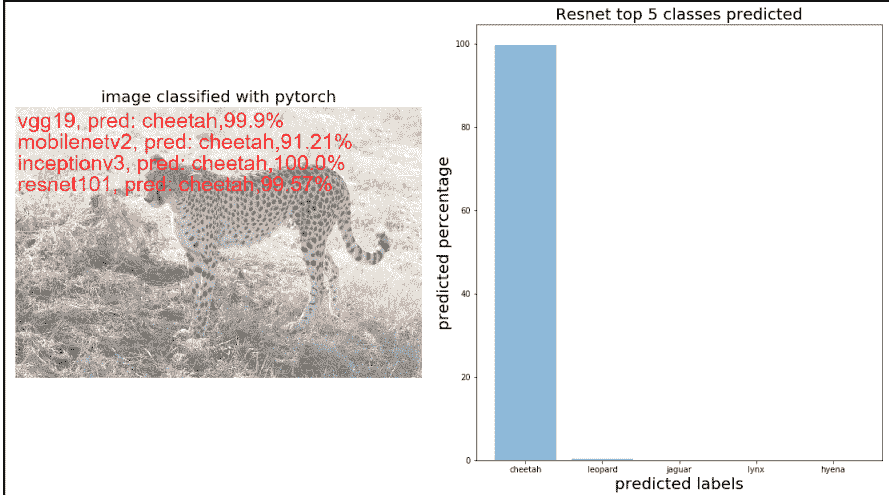

如果你使用天鹅图像作为输入，那么除了 `mobilenetv2` 之外的所有模型都将图像分类为 `goose`，而 `mobilenetv2` 将图像分类为美国白鹭，如下图所示：

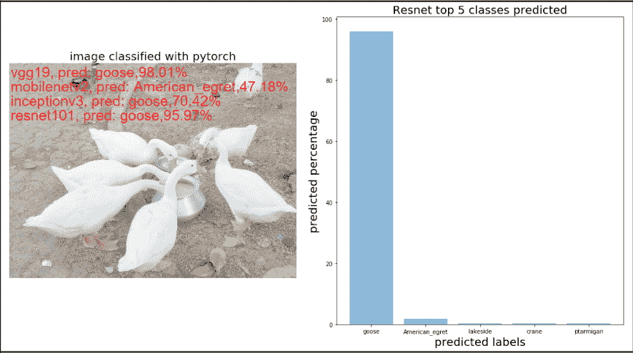

当第一次实例化预训练模型时，其权重会被缓存到一个目录，该目录可以使用 `TORCH_MODEL_ZOO` 环境变量设置（使用 `torch.utils.model_zoo.load_url()` 函数）。

> 请注意，有一个名为 **ResNet** 的条目（指 Python 类）和一个名为 resnet（一个实例化 ResNet 的便捷函数）。还要注意，每个便捷函数 `resnet50`、`resnet101` 和 `resnet152` 都实例化 ResNet 类，但层数不同（例如，分别为 50、101 和 152）。ResNet101 的参数数量约为 44.5。

首先，加载并预处理了输入图像（使其具有相应模型所期望的形状、均值或标准差），以确保模型输出有意义的结果。

输入图像使用 `torchvision.transforms` 进行了转换，`Compose()` 函数用于将一系列图像转换分组（创建一个名为 transform 的变量，作为要作为预处理步骤应用于输入图像的所有转换的组合；例如，调整大小、中心裁剪和归一化）。

通过从预训练模型（在 ImageNet 上）加载模型权重，创建了一个深度神经网络实例。例如，使用 `models.vgg19(pretrained=True)` 时，模型权重将首次下载并随后缓存（PyTorch 模型通常具有 `.pt/.pth` 扩展名）。

使用 `resnet101.eval()` 方法将模型设置为 eval 模式（例如，对于 ResNet101 模型）。

要运行推理（即，使用输入图像通过预训练模型运行前向传递），调用了 `resnet101()` 方法（例如，对于 ResNet101 模型），它输出了一个 1,000 元素（类）向量，其中每个元素值代表输入图像属于特定类的概率（根据预训练模型）。

最后，我们需要从输出向量中找到对应最高得分的类索引（使用 `np.argmax()` 函数）。该类索引用于从类别列表中提取预测类的名称。我们可以从输出概率向量中获取对应预测类的概率（例如，ResNet101 以 99.57% 的置信度正确预测了猎豹图像）。

可以使用以下评估标准比较预训练模型的性能：top-1/top-5 错误、CPU/GPU 上的推理时间、模型大小。一个好的模型需要具有较小的 top-1/top-5 错误、推理时间和模型大小。

### 更多...

使用 Keras 的预训练模型执行图像分类任务。比较不同模型的 top-1 与 top-5 准确率。另外，使用 Caffe 的预训练模型对图像进行分类。最后，训练自己的图像数据集并学习模型的权重（例如，VGG19），然后使用它来预测未见图像。

### 另请参阅

有关更多信息，请阅读以下来源：

- http://cs231n.github.io/classification/
- https://pytorch.org/docs/stable/torchvision/models.html
- https://arxiv.org/pdf/1512.00567.pdf
- https://arxiv.org/pdf/1801.04381.pdf
- https://arxiv.org/pdf/1512.03385.pdf


- https://arxiv.org/pdf/1409.1556.pdf
- https://www.learnopencv.com/pytorch-for-beginners-image-classification-using-pre-trained-models/
- http://www.image-net.org/
- https://www.researchgate.net/publication/331980242_A_Deep_Learning-Based_Intelligent_Medicine_Recognition_System_for_Chronic_Patients/figures?lo=1&utm_source=google&utm_medium=organic
- https://ai.googleblog.com/2018/04/mobilenetv2-next-generation-of-on.html
- https://www.researchgate.net/publication/328017644_Benchmark_Analysis_of_Representative_Deep_Neural_Network_Architectures/figures

## 基于迁移学习的图像分类微调

迁移学习的一般定义是，它是一种深度学习技术，通过将解决一个问题所获得的知识应用到相关但不同的问题上来重复利用这些知识。让我们通过一个例子来理解这一点。假设我们有三种花——即玫瑰、向日葵和郁金香。我们可以使用标准预训练模型，例如 VGG16/19、ResNet50 或 InceptionV3 模型（在 ImageNet 上预训练，包含 1,000 个输出类别，列于 https://gist.github.com/yrevar/942d3a0ac9e9ce9eb3a）来对花卉图像进行分类，但我们的模型无法正确分类它们，因为这些花卉类别不在模型训练所基于的真实类别中。换句话说，它们是模型未知的类别。以下图片展示了预训练 VGG16 模型如何错误地对花卉图像进行分类（使用来自 keras 的预训练模型进行分类）：

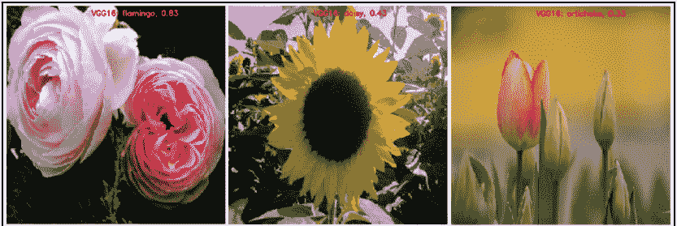

当从头训练深度神经网络时，需要大量数据（以及强大的计算资源）来训练网络（因为神经网络有数百万个参数，我们希望通过训练获得一组最优参数）。当我们拥有的小型数据集不足以训练深度网络时，这会带来问题。在这里，迁移学习解决了这一难题。

由于标准模型（例如 VGG16/19）体积较大且在大量图像上进行了训练，它们能够为不同类别学习许多不同的特征。我们可以简单地重复使用卷积层作为特征提取器来学习低级和高级图像特征，并仅训练**全连接**（FC）层权重（参数）。这就是迁移学习的含义。但是，如果你使用仅训练 FC 层（而卷积层固定，使用在 ImageNet 上预训练的 VGG16 深度神经网络）的迁移学习来分类包含玫瑰、向日葵和郁金香图像的小型数据集，你会发现迁移学习在测试数据集上的预测准确率不佳。在本教程中，你将学习如何使用微调（类似于迁移学习，但具有更多可训练层）来训练在测试数据集上具有更高准确率的模型。

对深度神经网络进行微调，再次尝试通过部分训练选定的少数几层来修改预训练网络的参数，以使其适应新任务（例如，使用新的类别标签对花卉进行分类）。由于深度神经网络的初始层学习非常通用的特征（例如，图像中的边缘），而更深层学习与所训练任务相关的更具体模式，因此在微调过程中，初始层保持不变（通过冻结），而少数几个更深层被重新训练以适应新任务。这种部分训练所需的数据量不大，因为整个网络未被训练，我们不需要从头开始训练（因此需要更新的参数较少，重新训练所需的时间也更少）。

### 准备工作

首先，从 TensorFlow 示例图像数据集下载输入图像，可在 `http://download.tensorflow.org/example_images/flower_photos.tgz` 获取。让我们为每个类别使用 600 张图像，总计 1,800 张图像，这是一个较小的图像数量，正是使用迁移学习的合适时机。我们将使用每个类别的 500 张图像进行训练，并保留每个类别的剩余 100 张图像来测试训练好的模型。我们还创建一个名为 `flower_photos` 的文件夹，并在其中创建两个名为 `train` 和 `test` 的子文件夹，分别将训练图像和测试图像保存到这些文件夹中。文件夹结构应如下所示：

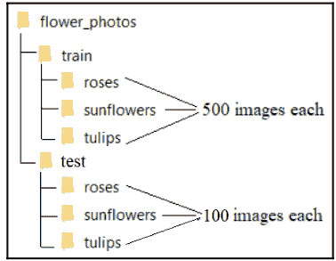

让我们使用以下代码块导入所有所需的库：

```
from keras.applications import VGG16
from keras.preprocessing.image import ImageDataGenerator
from keras.models import layers, optimizers
from keras.layers.normalization import BatchNormalization
from keras.preprocessing.image import load_img
from keras import models
from keras import layers
from keras import optimizers
import pydot_ng as pydot
from keras.utils import plot_model
import matplotlib.pyplot as plt
import numpy as np
```

### 操作步骤

运行以下步骤，使用 keras 实现微调（含迁移学习）。

- 1. 定义训练和测试目录，以及输入图像在训练前将被调整大小的尺寸：

```
train_dir = 'images/flower_photos/train'
test_dir = 'images/flower_photos/test'
image_size = 224
```

- 2. 加载预训练的 VGG16 网络，但不包含顶层 FC 层：

```
vgg_conv = VGG16(weights='imagenet', include_top=False,
input_shape=(image_size, image_size, 3))
```

- 3. 冻结除最后两个卷积层之外的所有卷积层，以及 FC 层，以重复使用这些层的预训练权重（不重新训练它们）：

```
for layer in vgg_conv.layers[:-2]:
    layer.trainable = False
```

- 4. 现在让我们使用以下代码验证每个层的状态（可训练或不可训练）：

```
for layer in vgg_conv.layers:
    print(layer, layer.trainable)
```

- 5. 现在使用 Keras 创建一个序贯模型并添加 VGG16 基础模型（含卷积层）。然后添加几个新的 FC 层。打印模型摘要以查看模型结构以及可训练参数的数量：

```
model = models.Sequential()
model.add(vgg_conv)
model.add(layers.Flatten())
model.add(layers.Dense(1024, activation='relu'))
model.add(layers.Dropout(0.5))
model.add(layers.Dense(3, activation='softmax'))
model.summary()
# Total params: 40,408,899
# Trainable params: 25,694,211
# Non-trainable params: 14,714,688
```

- 6. 加载训练和测试输入图像。将验证集划分比例设置为 0.2——即，20% 的训练图像将被保留（作为验证数据集）以评估在其余 80% 训练图像上训练的分类器模型（验证是一种流行的机器学习技术，通过降低模型方差来帮助提高模型的泛化能力；然后模型更有可能在未见的测试图像上获得更高的准确率）。定义训练批次大小（即，一次前向/后向传递中传递的训练图像数量）：

```
train_datagen = ImageDataGenerator(rescale=1./255,
validation_split=0.2) # set validation split
test_datagen = ImageDataGenerator(rescale=1./255)
train_batchsize = 100
```

- 7. 定义训练、验证和测试数据生成器，以从相应目录读取/生成图像和标签的批次。配置先前创建的模型以进行训练：

```
train_generator = train_datagen.flow_from_directory(
    train_dir,
    target_size=(image_size, image_size),
    batch_size=train_batchsize,
    class_mode='categorical',
    subset='training')
```

```
validation_generator = train_datagen.flow_from_directory(
    train_dir,
    target_size=(image_size, image_size),
    batch_size=train_batchsize,
    class_mode='categorical',
    classes = ['roses', 'sunflowers', 'tulips'],
    subset='validation') # set as validation data
```

```
test_generator = test_datagen.flow_from_directory(
    test_dir,
    target_size=(image_size, image_size),
    batch_size=1,
    class_mode='categorical',
    classes = ['roses', 'sunflowers', 'tulips'],
    shuffle=False)
```

```
model.compile(loss='categorical_crossentropy',
    optimizer=optimizers.RMSprop(lr=1e-5),
    metrics=['acc'])
```

- 8. 使用以下代码行绘制模型架构：

```
plot_model(model, to_file='images/model.png')
```


如果你运行上述代码行，模型结构将保存到提供的 .png 文件中。保存的模型架构将如下图所示：

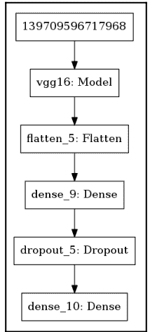

- 9. 使用以下代码片段训练模型。保存获得的权重：

```python
history = model.fit_generator(
    train_generator,
    steps_per_epoch=train_generator.\
    samples/train_generator.batch_size,
    epochs=20,
    validation_data=validation_generator,
    validation_steps=validation_generator.\
    samples/validation_generator.batch_size,
    verbose=1)
model.save('all_frozen.h5')
```

- 10. 从训练历史记录中提取准确率和损失值：

```python
acc = history.history['acc']
val_acc = history.history['val_acc']
loss = history.history['loss']
val_loss = history.history['val_loss']
```

- 11. 从生成器中获取测试文件名和对应的真实标签，并将类索引映射为标签：

```python
test_generator.reset()
fnames = test_generator.filenames
ground_truth = test_generator.classes
label2index = test_generator.class_indices
index2label = dict((v,k) for k,v in label2index.items())
```

- 12. 最后，使用测试数据生成器预测测试图像的标签。使用生成器和以下代码片段从模型中获取预测结果，将其与相应的真实标签进行比较，并计算模型出错的次数（错误数）：

```python
predictions = model.predict_generator(test_generator,
steps=len(fnames))
predicted_classes = np.argmax(predictions,axis=-1)
predicted_classes = np.array([index2label[k] for k in
predicted_classes])
ground_truth = np.array([index2label[k] for k in ground_truth])
errors = np.where(predicted_classes != ground_truth)[0]
print("No of errors = {}/{}".format(len(errors),test_generator.samples))
# No of errors = 45/300
```

### 工作原理...

如果你运行上述代码片段，并绘制训练和验证图像数据集在不同时代数下的准确率和损失变化图，你将得到如下截图所示的输出：

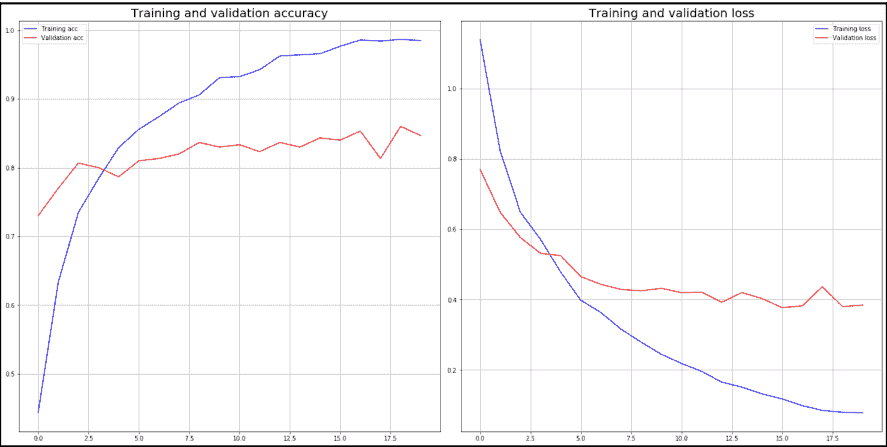

这次，微调模型错误分类了 45 张测试图像（共 300 张图像，即预测标签 ≠ 真实标签）；其中几张如下截图所示。预测准确率已提高：

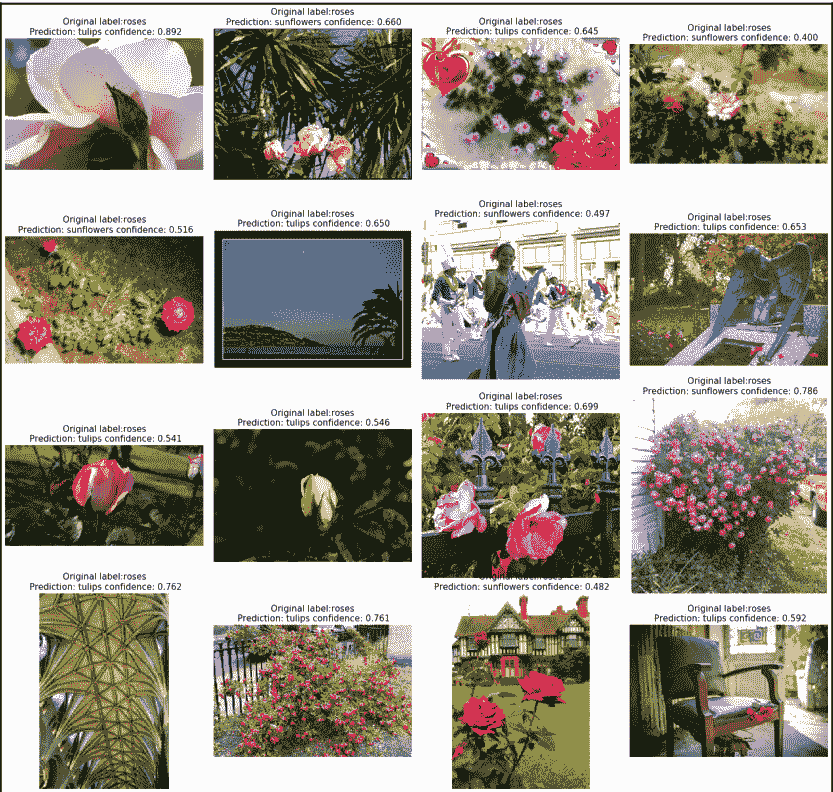

对于预训练的 VGG16 模型，仅加载了卷积层的权重（使用 `include_top=False`，未加载最后两个全连接层对应的权重）；该模型被用作分类器模型。请注意，最后一层的大小为 7 x 7 x 512。

在预训练卷积层之上添加了几个新的全连接层（这些层的权重将使用前向/反向传播在训练图像分区上进行训练），随后是一个包含三个类别的 softmax 输出层。

使用 ImageDataGenerator 类加载图像，并使用 flow_from_directory() 函数生成图像和标签的批次。使用 model.compile() 函数配置模型，采用类别交叉熵损失（因为我们有三个类别）和学习率为 10^-5 的 RMSProp 优化器。

使用 model.fit_generator() 方法训练模型。

使用 Keras 实现的微调部分训练了 VGG16 模型——即，它只从训练分区中学习了全连接层和最后两个卷积层的权重。

使用 model.predict_generator() 方法预测测试图像的标签。

在 Keras 中，网络的每一层都有一个可训练参数。要冻结（即停止训练）任何给定层，需要将该层对应的参数设置为 False。

我们逐层检查以选择需要重新训练的层。

### 更多内容...

如果选择更多卷积层进行重新训练（微调），可能会发生什么情况？例如，如果你选择最后四个（或六个）卷积层并通过调整前面的代码对其进行重新训练，会怎样？这对测试准确率有何影响？准确率会提高吗？将优化器更改为 Adam，并调整超参数（时代数、学习率和批次大小）。记录超参数调整对测试准确率的影响。仅使用迁移学习能否获得更高准确率的模型？尝试同时使用 PyTorch 和 TensorFlow 实现迁移学习/微调。

### 另请参阅

要了解更多信息，请阅读以下资源：

- https://www.learnopencv.com/keras-tutorial-fine-tuning-using-pre-trained-models/
- https://www.learnopencv.com/image-classification-using-convolutional-neural-networks-in-keras/#cnn-hierachical

## 使用深度学习模型分类交通标志（使用 PyTorch）

在本教程中，你将学习如何使用 PyTorch 从零开始训练自定义神经网络，并使用模型的预测结果对交通标志进行分类。我们将使用德国交通标志识别基准（GTSRB）数据集（https://sid.erda.dk/public/archives/daaeac0d7ce1152aea9b61d9f1e19370/published-archive.html）作为训练/测试的输入图像。图像标记了 43 种不同的交通标志。数据集包含 39,209 张训练图像和 12,630 张测试图像。对于本教程，还建议使用带有 GPU 的计算机以加快训练过程。

### 准备工作

首先，从 https://s3-us-west-1.amazonaws.com/udacity-selfdrivingcar/traffic-signs-data.zip 下载压缩的 Pickle 数据集。将其解压到 images 文件夹内的 traffic_signs 文件夹中（它包含三个 Pickle 文件，分别包含训练、验证和测试图像）。以下是 Pickle 数据集的摘要：

- 34,799 张训练图像
- 4,410 张验证图像
- 12,630 张测试图像
- 图像大小 = (32, 32)
- 43 个唯一类别

要开始，请导入以下软件包：

```python
import pickle
import numpy as np
import pandas as pd
import matplotlib.pyplot as plt
import seaborn as sns
import cv2
import torch
from torch.utils.data.dataset import Dataset
from torch.utils.data import DataLoader
import torchvision.transforms as transforms
from torchvision.utils import make_grid
import torch.utils.data.sampler as sampler
from torch import nn, optim
from livelossplot import PlotLosses
import torch.nn.functional as F
import os
```

### 操作步骤...

按照以下步骤在 GTSRB 图像上训练深度神经网络以进行交通标志分类：

- 1. 加载与训练、验证和测试数据集对应的 pickle 文件：

```python
training_file = "traffic_signs/train.p"
validation_file = "traffic_signs/valid.p"
testing_file = "traffic_signs/test.p"
with open(training_file, mode='rb') as f: train = pickle.load(f)
with open(validation_file, mode='rb') as f: valid = pickle.load(f)
with open(testing_file, mode='rb') as f: test = pickle.load(f)
```

- 2. 使用以下代码片段从训练、验证和测试图像中提取特征（图像）和标签（交通标志）：

```python
X_train, y_train = train['features'], train['labels']
X_valid, y_valid = valid['features'], valid['labels']
X_test, y_test = test['features'], test['labels']
n_signs = len(np.unique(y_train))
print(X_train.shape, X_valid.shape, X_test.shape, n_signs)
# (34799, 32, 32, 3) (4410, 32, 32, 3) (12630, 32, 32, 3) 43
```

- 3. 加载信号名称 .csv 文件，并在交通信号类 ID 与名称之间创建映射：

```python
signal_names = pd.read_csv('images/signal_names.csv')
signal_names.head()
```

- 4. 带有交通信号 `ClassId` 和 `SignName` 的数据框的前几行如下图所示：

| | ClassId | SignName |
|---|---|---|
| 0 | 0 | 速度限制（20km/h） |
| 1 | 1 | 速度限制（30km/h） |
| 2 | 2 | 速度限制（50km/h） |
| 3 | 3 | 速度限制（60km/h） |
| 4 | 4 | 速度限制（70km/h） |

- 5. 如果将交通信号类别 ID 与其频率绘图，你将得到如下所示的图表（注意数据非常不平衡）：

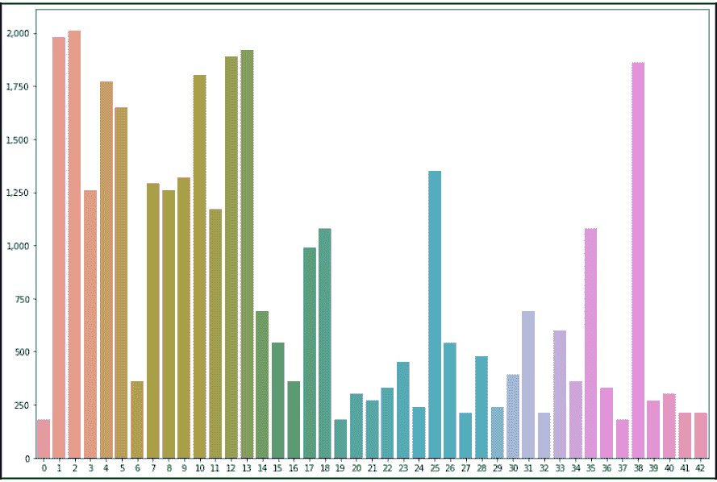


## 6. 如果你从训练图片中选取少量样本，并将它们与标签一起绘制，你将得到类似于下面的图表：

| 限速 (20km/h) | 限速 (30km/h) | 限速 (50km/h) | 限速 (60km/h) | 限速 (70km/h) | 限速 (80km/h) |
| :--- | :--- | :--- | :--- | :--- | :--- |
| 限速结束 (80km/h) | 限速 (100km/h) | 限速 (120km/h) | 禁止超车 | 3.5公吨以上车辆禁止超车 | 下一路口优先通行 |
| 优先道路 | 让行 | 停车 | 禁止车辆通行 | 禁止3.5公吨以上车辆通行 | 禁止驶入 |
| 一般警告 | 左侧危险弯道 | 右侧危险弯道 | 连续弯道 | 颠簸路面 | 路面滑湿 |
| 右侧路面变窄 | 道路施工 | 交通信号灯 | 行人 | 儿童过马路 | 自行车过道 |
| 结冰/积雪警告 | 野生动物穿越 | 所有限速和禁超结束 | 前方右转 | 前方左转 | 仅限直行 |
| 直行或右转 | 直行或左转 | 靠右行驶 | 靠左行驶 | 前方环形交叉路口 | 禁超结束 |
| 3.5公吨以上车辆禁超结束 | | | | | |

## 7. 通过定义TrafficNet类来实现IDSIA MCDNN模型
（继承自nn.Module）。使用构造函数（__init__()方法）
来定义神经网络（包含卷积、池化和全连接层），并使用forward()
方法在神经网络中实现前向传播，使用如下代码片段：

```
class TrafficNet(nn.Module):

    def __init__(self, gray=False):
        super(TrafficNet, self).__init__()
        input_chan = 1 if gray else 3
        self.conv1 = nn.Conv2d(input_chan, 6, 5)
        self.pool = nn.MaxPool2d(2, 2)
        self.conv2 = nn.Conv2d(6, 16, 5)
        self.fc1 = nn.Linear(16 * 5 * 5, 120)
        self.fc2 = nn.Linear(120, 84)
        self.fc3 = nn.Linear(84, 43)

    def forward(self, x):
        x = self.pool(F.relu(self.conv1(x)))
        x = self.pool(F.relu(self.conv2(x)))
        x = x.view(-1, 16 * 5 * 5)
        x = F.relu(self.fc1(x))
        x = F.relu(self.fc2(x))
        x = self.fc3(x)
        return x
```

## 8. 输入图像具有高对比度变化，并使用CLAHE变换进行对比度归一化
（即，使用opencv-python函数对图像应用自适应直方图均衡化）：

```
class ClaheTransform:
    def __init__(self, clipLimit=2.5, tileGridSize=(4, 4)):
        self.clipLimit = clipLimit
        self.tileGridSize = tileGridSize

    def __call__(self, im):
        img_y = cv2.cvtColor(im, cv2.COLOR_RGB2YCrCb)[:, :, 0]
        clahe = cv2.createCLAHE(clipLimit=self.clipLimit,
                                tileGridSize=self.tileGridSize)

        img_y = clahe.apply(img_y)
        img_output = img_y.reshape(img_y.shape + (1,))
        return img_output
```

## 9. 你下载的输入数据集使用pickle进行了序列化。让我们通过从PyTorch数据集类继承来定义PickledTrafficSignsDataset类：

```
class PickledTrafficSignsDataset(Dataset):
    def __init__(self, file_path, transform=None):
        with open(file_path, mode='rb') as f:
            data = pickle.load(f)
            self.features = data['features']
            self.labels = data['labels']
            self.count = len(self.labels)
            self.transform = transform

    def __getitem__(self, index):
        feature = self.features[index]
        if self.transform is not None:
            feature = self.transform(feature)
        return (feature, self.labels[index])

    def __len__(self):
        return self.count
```

## 10. 定义train()函数以实现整个训练过程，从加载数据、应用变换开始，然后运行训练轮次：

```
def train(model, device):

    data_transforms = transforms.Compose([
            ClaheTransform(),
            transforms.ToTensor()
        ])
    liveloss = PlotLosses()
    torch.manual_seed(1)
    train_dataset = PickledTrafficSignsDataset(training_file,
                                               transform=data_transforms)
    valid_dataset = PickledTrafficSignsDataset(validation_file,
                                               transform=data_transforms)
    test_dataset = PickledTrafficSignsDataset(testing_file,
                                               transform=data_transforms)

    class_sample_count = np.bincount(train_dataset.labels)
    weights = 1 / np.array([class_sample_count[y] for y in
                                train_dataset.labels])

    samp = sampler.WeightedRandomSampler(weights, 43 * 2000)
    train_loader = DataLoader(train_dataset, batch_size=64,
                              sampler=samp)
    valid_loader = DataLoader(valid_dataset, batch_size=64,
                              shuffle=False)
    test_loader = DataLoader(test_dataset, batch_size=64,
                             shuffle=False)
    optimizer = optim.SGD(model.parameters(), lr=0.005, momentum=0.7)
    train_epochs(model, device, train_loader, valid_loader, optimizer)
```

## 11. 定义以下函数以运行实际的训练轮次（让我们运行20个轮次）。对于每个轮次，先使用训练数据加载器对模型运行前向传播，然后使用验证数据加载器。分别将模型模式从train切换到eval，以使用输入的训练数据集和验证数据集：

```
def train_epochs(model, device, train_data_loader,
                 valid_data_loader, optimizer):
    liveloss = PlotLosses()
    loss_function = nn.CrossEntropyLoss()
    running_loss = 0.0
    running_corrects = 0
    data_loaders = {'train': train_data_loader,
                    'validation': valid_data_loader}

    for epoch in range(20):
        logs = {}
        for phase in ['train', 'validation']:
            if phase == 'train':
                model.train()
            else:
                model.eval()
            running_loss = 0.0
            running_corrects = 0
            total = 0
```

## 12. 对于训练阶段，计算训练损失并运行反向传播（back propagation）以更新模型权重。对于验证阶段，只需计算验证损失（使用`loss_function()`，使用交通信号实例的实际类标签和预测类标签）：

```
for batch_idx, (data, target) in enumerate(data_loaders[phase]):
    if phase == 'train':
        output = model(data.to(device))
        target = target.long().to(device)
        loss = loss_function(output, target)
        optimizer.zero_grad()
        loss.backward()
        optimizer.step()
    else:
        with torch.no_grad():
            output = model(data.to(device))
            target = target.long().to(device)
            loss = loss_function(output, target)
    if batch_idx % 100 == 0:
        print('Train Epoch: {} [{}/{} ({:.0f}%)]\tLoss: {:.6f}'.format(
            epoch, batch_idx * len(data), len(data_loaders[phase].dataset),
            100. * batch_idx / len(data_loaders[phase]), phase,
            loss.item()))
```

## 13. 最后，比较模型预测的类和地面真实标签，以计算正确预测的示例数量。跟踪运行损失，并使用`livelossplot`自动绘制训练和验证损失：

```
pred = torch.argmax(output, dim=1)
running_loss += loss.detach()
running_corrects += torch.sum(pred == target).sum().item()
total += target.size(0)
epoch_loss = running_loss / len(data_loaders[phase].dataset)
epoch_acc = running_corrects / total

prefix = ''
if phase == 'validation': prefix = 'val_'
logs[prefix + 'log loss'] = epoch_loss.item()
logs[prefix + 'accuracy'] = epoch_acc.item()
liveloss.update(logs)
liveloss.draw()
```

如果运行前面的代码块，并使用`livelossplot`在训练期间自动绘制日志损失/准确率，你将得到类似于下面的输出：

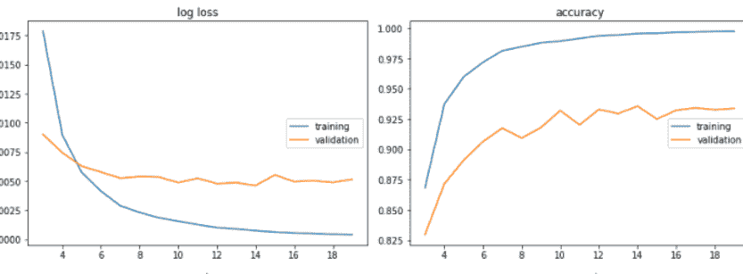

```
log loss:
training (min: 0.000, max: 0.145, cur: 0.000)
validation (min: 0.005, max: 0.058, cur: 0.005)
accuracy:
training (min: 0.028, max: 0.997, cur: 0.997)
validation (min: 0.035, max: 0.936, cur: 0.934)
Train Epoch: 19 [0/34799 (0%)] train Loss: 0.002379
Train Epoch: 19 [6400/34799 (7%)] train Loss: 0.002805
Train Epoch: 19 [12800/34799 (15%)] train Loss: 0.003652
```


如果你运行前面的代码块，并使用预测标签绘制测试数据集中的几张图片，你将得到类似于下面的输出：

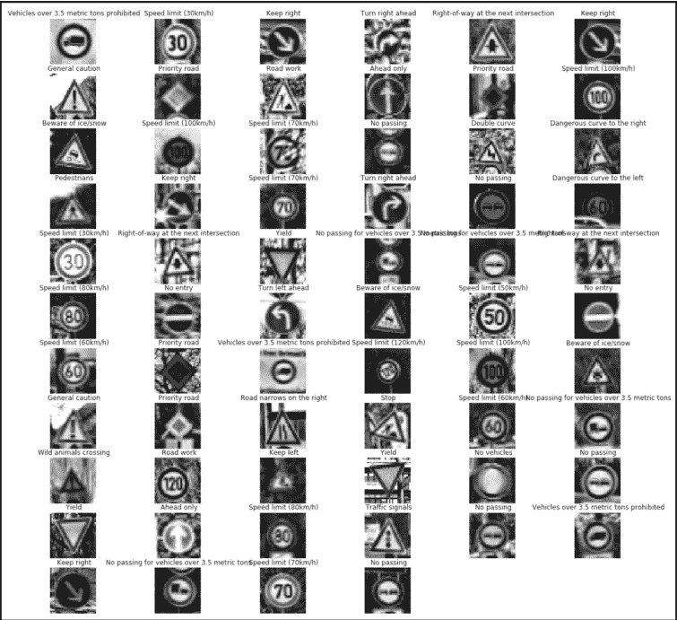

### 工作原理...

从最后一个条形图可以看出，数据集非常不平衡：有些类别对应的样本图像多达 2,000 张，而有些类别只有 200 张样本图像。

训练数据集中的这种类别不平衡可能会导致学习到一个有偏差的模型，因为模型仅仅是更频繁地看到某些交通标志类别的图像，而非其他类别。

采样被用来解决类别不平衡问题，同时也用于防止过拟合。

使用了 `WeightedRandomSampler()` 以等频率采样所有 43 个类别的图像（每个类别 2,000 张图像，这也增加了输入图像的总数），然后将它们传递给 PyTorch 数据加载器。

使用了**对比度受限自适应直方图均衡化**（CLAHE）算法将图像划分为上下文区域，然后对每个区域应用直方图均衡化。与普通直方图均衡化相比，使用 CLAHE 后图像的隐藏特征似乎更加明显，因为使用的灰度值分布被均衡化了。

输入的彩色图像首先被从 RGB 颜色空间转换为 YCbCr 颜色空间，然后从 YCbCr 颜色空间提取强度通道 Y，从而转换为灰度图像。

抽象类 `torch.utils.data.Dataset` 表示一个可以使用 `torch.utils.data.DataLoader` 进行迭代的数据集。

为了防止过拟合，使用了 dropout 和批量归一化正则化技术。

使用了 `livelossplot` 库来绘制实时训练损失。

`torch.no_grad()` 函数会停止验证阶段的梯度计算（因为我们只想在留出的验证数据集上评估迄今学习到的模型，而不希望在此阶段更新权重）。

### 更多内容...

计算在测试数据集上训练的模型的准确率并绘制混淆矩阵。达到了多少测试准确率？如何提高它？

### 另请参阅

- https://pytorch.org/tutorials/beginner/blitz/cifar10_tutorial.html
- https://medium.com/@wolfapple/traffic-sign-recognition-2b0c3835e104
- https://github.com/wolfapple/traffic-sign-recognition/blob/master/notebook.ipynb
- https://sid.erda.dk/public/archives/daaeac0d7ce1152aea9b61d9f1e19370/published-archive.html
- https://github.com/mohamedameen93/German-Traffic-Sign-Classification-Using-TensorFlow
- https://github.com/vxy10/ImageAugmentation/blob/master/img_transform_NB.ipynb
- https://towardsdatascience.com/recognizing-traffic-signs-with-over-98-accuracy-using-deep-learning-86737aedc2ab
- https://people.lu.usi.ch/mascij/data/papers/2012_nn_traffic.pdf

## 使用深度学习模型估计人体姿态

人体姿态估计是图像处理/计算机视觉任务，旨在预测人体骨骼中不同关键点（关节/标志点，例如肘部、膝盖、颈部、肩部、臀部和胸部）的位置，以表示人体的姿态（方向）（一组坐标被连接以找出人的整体姿态）。肢体/对由两个部分之间的有效连接定义；某些两个部分的组合可能无法形成有效对。

多人姿态估计比单人姿态估计更困难，因为图像中的人数和位置都未知。作为解决此问题的自下而上方法，首先检测所有特色人物图像的所有部分，然后将对应于个体的部分关联/分组。一种流行的自下而上方法是 OpenPose 网络（来自卡内基梅隆大学），它首先提取输入图像特征（使用 VGG19 的前几层，如下图所示），并将其馈入两个并行的卷积层分支。以下三个步骤总结了 OpenPose 的工作原理：

1. **关键点定位**：第一个分支预测所有关键点（一组 18 个置信度图），带有置信度得分，其中每个图表示人体骨骼的特定部分。
2. **部件关联字段 (PAFs)**：第二个分支预测一个二维向量场，由一组 38 个 PAF 组成，表示部件之间的关联程度。连续阶段细化每个分支的预测。
3. **贪婪推理**：所有关键点使用贪婪算法连接（在部件对之间构建二分图，并使用 PAF 值修剪图中的较弱链接）：

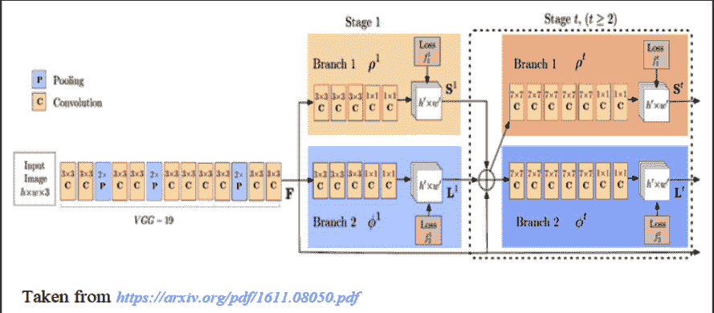

在此示例中，你将学习如何使用 opencv-python 库函数配合预训练的 Caffe 模型，利用 OpenPose 深度神经网络模型进行人体姿态估计（该模型在 2016 年赢得了 COCO 关键点挑战赛）。

### 准备工作

首先，从 http://posefs1.perception.cs.cmu.edu/OpenPose/models/pose/mpi/pose_iter_160000.caffemodel 下载预训练的 Caffe 模型——该模型在多人数据集（MPI）上进行训练。让我们先使用以下代码片段导入所有必需的库：

```
import cv2
import time
import numpy as np
import matplotlib.pyplot as plt
print(cv2.__version__)
# 3.4.4
```

### 操作步骤

运行以下步骤，使用预训练的 Caffe 模型实现人体姿态估计：

1. 此 MPI 数据集有对应于人体不同部位的 15 个关键点——让我们先定义它们。你还需要定义连接关键点的肢体的姿态对。肢体是使用姿态关联图预测的：

```
n_points = 15
body_parts = {"Head": 0, "Neck": 1, "RShoulder": 2, "RElbow": 3,
"RWrist": 4, "LShoulder": 5, "LElbow": 6, "LWrist": 7, "RHip": 8,
"RKnee": 9, "RAnkle": 10, "LHip": 11, "LKnee": 12, "LAnkle": 13,
"Chest": 14, "Background": 15}
```

```
pose_pairs = [ ["Head", "Neck"], ["Neck", "RShoulder"],
["RShoulder", "RElbow"], ["RElbow", "RWrist"], ["Neck", "LShoulder"],
["LShoulder", "LElbow"], ["LElbow", "LWrist"], ["Neck", "Chest"], ["Chest",
"RHip"],
["RHip", "RKnee"], ["RKnee", "RAnkle"], ["Chest", "LHip"], ["LHip",
"LKnee"], ["LKnee", "LAnkle"] ]
```

2. 接下来，加载你下载的预训练模型（在 Caffe 深度学习框架上训练）。Caffe 模型有几个文件——即，一个 .prototxt 文件（描述神经网络模型的架构）和一个 .caffemodel 文件（存储训练模型的权重）。让我们通过读取这些文件使用以下代码片段将模型加载到内存中：

```
proto_file = "models/pose_deploy_linevec_faster_4_stages.prototxt"
weights_file = "models/pose_iter_160000.caffemodel"
net = cv2.dnn.readNetFromCaffe(proto_file, weights_file)
```

3. 让我们读取输入图像，图像中包含我们将要估计姿态的人（或多人）。使用以下代码片段准备传递给网络的输入：

```
image = cv2.imread("images/leander.jpg")
height, width = image.shape[:2]
blob = cv2.dnn.blobFromImage(image, 1.0 / 255, (368, 368), (0, 0,
0), swapRB=False, crop=False)
net.setInput(blob)
```

4. 只需在神经网络模型上运行一次前向传播，将输入图像馈送到网络中即可生成模型预测：

```
output = net.forward()
```

输出是一个具有四个维度的矩阵。其内容和维度如下：

   - 图像 ID（当多个图像输入模型时需要）。
   - 关键点的索引。模型生成串联的置信度图和部件关联图作为输出。对于 MPI 模型，它生成 44 个点，对应于 15 个关键点置信度图 + 1 个背景 + 14 x 2 个部件关联图。我们将使用对应于关键点的前几个点。
   - 输出图的高度。
   - 输出图的宽度。

5. 使用以下代码绘制前五个关键点的关键点置信度图：

```
h, w = output.shape[2:4]

plt.figure(figsize=[14,10])
plt.imshow(cv2.cvtColor(image, cv2.COLOR_BGR2RGB))
prob_map = np.zeros((width, height))
for i in range(1,5):
    pmap = output[0, i, :, :]
    prob_map += cv2.resize(pmap, (height, width))
    plt.imshow(prob_map, alpha=0.6)
    plt.colorbar()
    plt.axis("off")
    plt.show()
```


如果你运行上面的代码块，将得到以下热图作为输出：

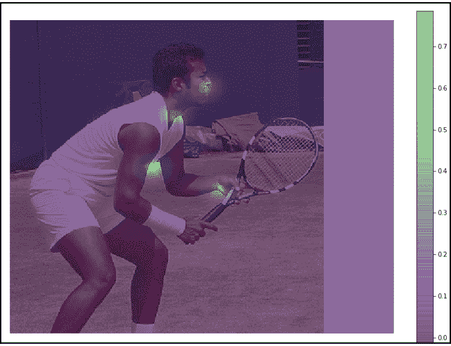

6. 对每个关键点，检查图像中是否存在该关键点，并从该关键点的置信度图中检索对应最大值的关键点坐标（同时使用一个阈值来减少误报）：

```
threshold = 0.1
image1 = image.copy()
points = []
for i in range(n_points):
    prob_map = output[0, i, :, :] # confidence map of \
        corresponding body's part.
    min_val, prob, min_loc, point = cv2.minMaxLoc(prob_map)
    # scale the point to fit on the original image
    x = (width * point[0]) / w
    y = (height * point[1]) / h
    if prob > threshold:
        cv2.circle(image1, (int(x), int(y)), 8, (255, 0, 255), \
            thickness=-1, lineType=cv2.FILLED)
        cv2.putText(image1, "{}".format(i), (int(x), int(y)), \
            cv2.FONT_HERSHEY_SIMPLEX, 0.6, (0, 255, 0), 2, \
            lineType=cv2.LINE_AA)
        cv2.circle(image, (int(x), int(y)), 8, (255, 0, 255), \
thickness=-1, lineType=cv2.FILLED)
points.append( (int(x), int(y)) )
else:
    points.append(None)
```

7. 最后，由于关键点的索引事先已知，只需连接各对即可在图像上绘制骨架：

```
for pair in pose_pairs:
    part_from = body_parts[pair[0]]
    part_to = body_parts[pair[1]]
    if points[part_from] and points[part_to]:
        cv2.line(image, points[part_from], points[part_to], \
                 (0, 255, 0), 3)

plt.figure(figsize=[20,12])
plt.subplot(121), plt.imshow(cv2.cvtColor(image1,
cv2.COLOR_BGR2RGB)), plt.axis('off'), plt.title('Keypoints',
size=20)
plt.subplot(122), plt.imshow(cv2.cvtColor(image,
cv2.COLOR_BGR2RGB)), plt.axis('off'), plt.title('Pose', size=20)
plt.show()
```

如果你运行上面的代码块，将得到以下输出：

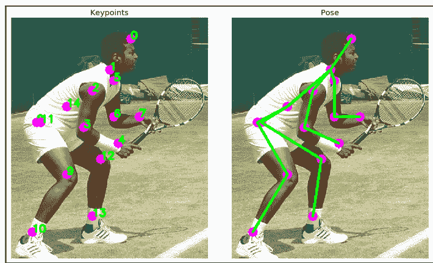

### 工作原理...

cv2.dnn.blobFromImage() 函数用于将图像从 OpenCV 格式转换为 Caffe blob 格式。首先，将像素值归一化，使其在 (0,1) 范围内。然后，提供了调整大小的目标图像尺寸。最后，减去了均值。由于 OpenCV 和 Caffe 都使用相同的 BGR 颜色格式，因此不需要交换颜色通道。

cv2.minMaxLoc() 函数用于计算置信度图的局部最大值。

### 另请参阅

- https://www.learnopencv.com/deep-learning-based-human-pose-estimation-using-opencv-cpp-python/
- https://cv-tricks.com/pose-estimation/using-deep-learning-in-opencv/
- https://medium.com/beyondminds/an-overview-of-human-pose-estimation-with-deep-learning-d49eb656739b
- https://arxiv.org/pdf/1812.08008.pdf
- https://arxiv.org/pdf/1611.08050.pdf
- https://github.com/CMU-Perceptual-Computing-Lab/openpose
