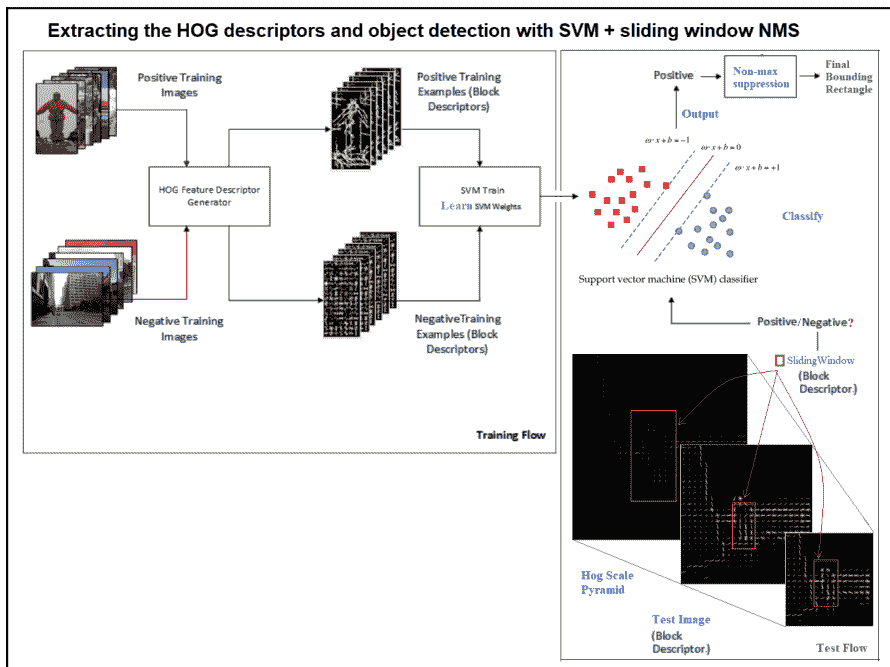
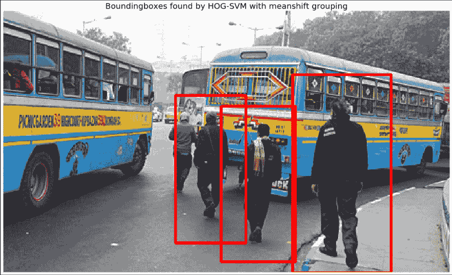
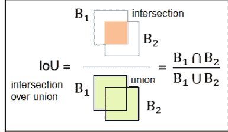
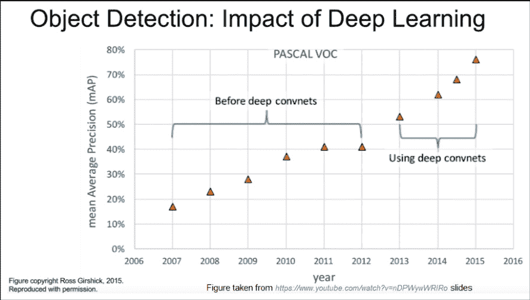
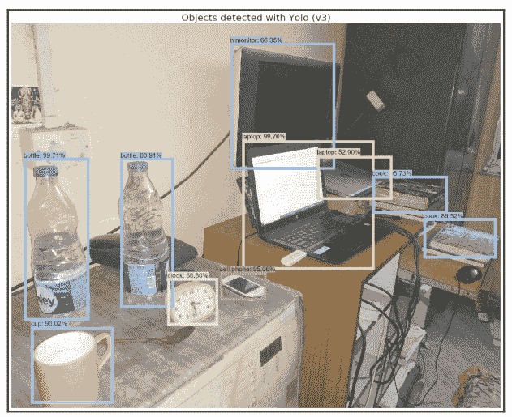
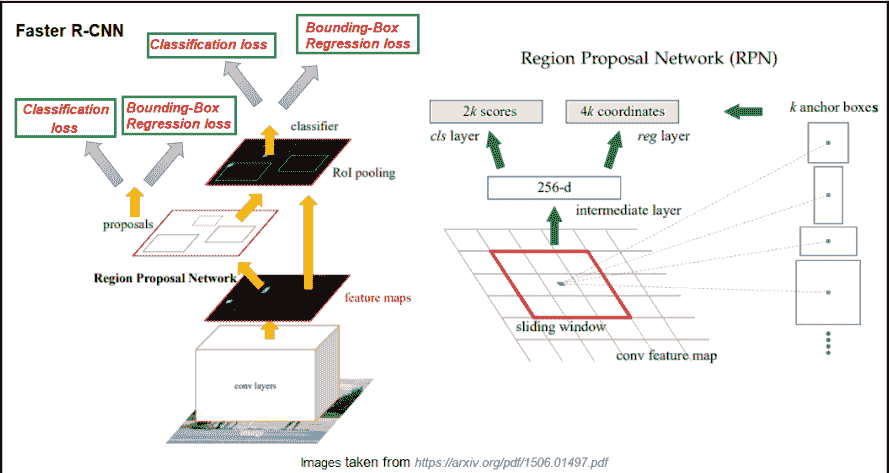
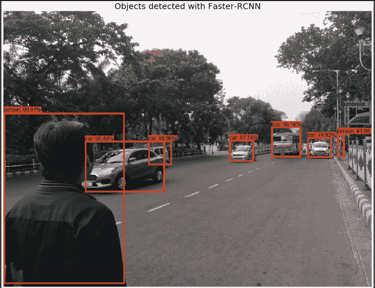
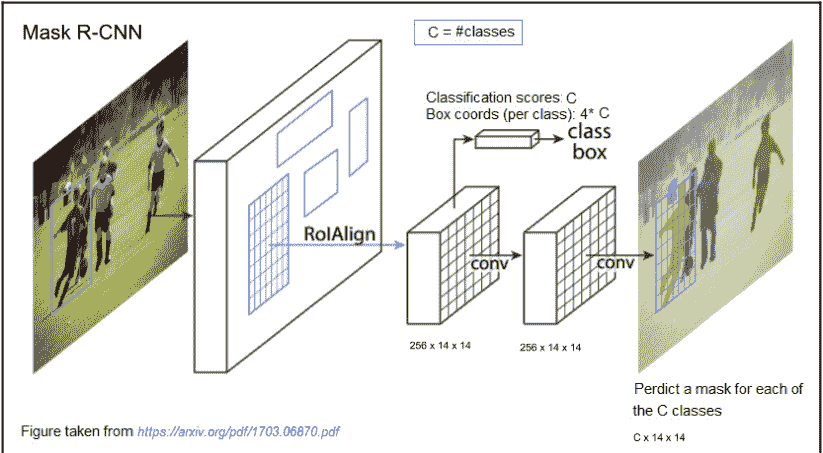
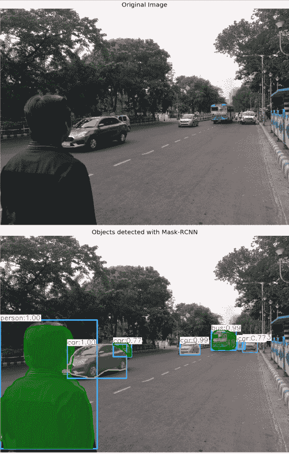

# 图像中的目标检测

目标检测是一种图像处理/计算机视觉任务，用于在图像中检测给定类型（例如人脸、人体、车辆和建筑物）的（语义）对象实例。在本章中，你将学习如何实现几种最先进的目标检测技术。以下图像处理任务相互关联（尽管它们指代不同的任务）：图像分类、目标定位和目标检测。图像分类（在上一章中讨论）旨在为图像预测类标签，而目标定位则涉及识别图像中对象的位置并在其周围绘制边界框。目标检测结合了这两项任务（分类 + 定位）——它在图像中每个感兴趣对象（可能有多个对象）周围绘制边界框，并为每个对象分配一个类标签。所有这些问题统称为目标识别。以下截图说明了这些技术之间的区别：

| 分类 | 分类 + 定位 | 目标检测 |
|---|---|---|
| 汽车 | 汽车 | 卡车 汽车 |
| 单个对象 | | 多个对象 |

在本章中，我们将介绍以下配方：

- 基于 HOG/SVM 的目标检测
- 基于 Yolo V3 的目标检测
- 基于 Faster R-CNN 的目标检测
- 基于 Mask R-CNN 的目标检测
- 使用 `opencv-python` 进行多目标跟踪
- 使用 EAST/Tesseract 进行图像中的文本检测/识别
- 基于 Viola-Jones/类 Haar 特征的人脸检测

## 基于 HOG/SVM 的目标检测

目标检测中一种流行的特征描述子是**定向梯度直方图（HOG）**。HOG 描述子可通过首先计算水平和垂直梯度图像，然后计算梯度直方图并跨块归一化，最后将其展平为特征描述符向量来从图像中计算得出。最终获得的这些归一化块描述子称为 HOG 描述子，是一种用于各种计算机视觉和图像处理应用中的目标检测特征描述子。

HOG 描述子在检测人类、动物、人脸和文本方面尤其成功。我们已经描述了如何从图像中计算 HOG 描述子。首先，使用多张正负训练示例图像训练一个（线性）**支持向量机（SVM）**二元分类器模型。正图像是包含我们要检测对象的示例。负训练集可以是任何不包含我们要检测对象的图像。正负源图像被转换为 HOG 块描述子。SVM 训练器选择最佳超平面/决策边界（使用一组支持向量定义），以在训练图像数据集中分隔正负示例。支持向量后来由 SVM 模型用于对测试图像中的 HOG 描述子块进行分类，以检测对象的存在或缺失。

传统上，通过在测试图像上反复移动一个滑动窗口（例如宽 64 像素、高 128 像素）并计算 HOG 描述子来进行分类。由于 HOG 描述子计算不具有固有的尺度感，且对象可以在图像中以多个尺度出现，因此 HOG 描述子计算在金字塔的每个尺度级别上重复进行。金字塔每个级别之间的缩放因子通常在 1.05 到 1.2 之间，图像会反复缩小，直到缩放后的源图像无法再容纳完整的 HOG 窗口。如果 SVM 分类器在任何尺度下预测检测到对象，则返回相应的边界框。以下图显示了典型的 HOG 对象（人体）检测工作流：



在本配方中，你将学习如何使用 OpenCV-Python 库函数来检测图像中的人体对象。

## 开始使用

让我们先导入所需的库，使用以下代码片段：

```
import numpy as np
import cv2
import matplotlib.pyplot as plt
```

## 如何操作...

执行以下步骤，使用 opencv-python 库函数检测图像中的人：

1. 首先，使用以下代码行读取图像并初始化 HOG 检测器：

```
img = cv2.imread("images/walk.jpg")
hog = cv2.HOGDescriptor()
```

2. 将 SVM 检测器初始化为默认的人体检测器：

```
hog.setSVMDetector(cv2.HOGDescriptor_getDefaultPeopleDetector())
```

3. 运行检测算法，空间步幅为 4 像素（水平和垂直），缩放步幅为 1.1，不分组矩形框（以便注意到 HOG 在金字塔的多个尺度下检测同一对象）。如你所见，检测到了 314 个潜在边界框（对同一对象进行了多次检测）：

```
(found_bounding_boxes, weights) = hog.detectMultiScale(img, \
                       winStride=(4, 4), padding=(8, 8), \
                       scale=1.1, finalThreshold=0)
print(len(found_bounding_boxes)) # number of bounding boxes
# 314
```

4. 定义以下函数以实现非最大值抑制，以忽略冗余且重叠的边界框：

```
def non_max_suppression(boxes, scores, threshold):
    assert boxes.shape[0] == scores.shape[0]
    ys1, xs1, ys2, xs2 = boxes[:, 0], boxes[:, 1], boxes[:, 2], \
        boxes[:, 3]
    areas = (ys2 - ys1) * (xs2 - xs1)
    scores_indexes = scores.argsort().tolist()
    boxes_keep_index = []
```


while len(scores_indexes):
    index = scores_indexes.pop()
    boxes_keep_index.append(index)
    if not len(scores_indexes):
        break
    ious = compute_iou(boxes[index], boxes[scores_indexes],
                       areas[index], areas[scores_indexes])
    filtered_indexes = set((ious > threshold).nonzero()[0])
    scores_indexes = [v for (i, v) in enumerate(scores_indexes)
                      if i not in filtered_indexes]
return np.array(boxes_keep_index)

- 5. 定义以下函数，为给定框与所有其他框计算交并比（iou）指标：

```
def compute_iou(box, boxes, box_area, boxes_area):
    assert boxes.shape[0] == boxes_area.shape[0]
    ys1 = np.maximum(box[0], boxes[:, 0])
    xs1 = np.maximum(box[1], boxes[:, 1])
    ys2 = np.minimum(box[2], boxes[:, 2])
    xs2 = np.minimum(box[3], boxes[:, 3])
    intersections = np.maximum(ys2 - ys1, 0) * \
                    np.maximum(xs2 - xs1, 0)
    unions = box_area + boxes_area - intersections
    ious = intersections / unions
    return ious
```

- 6. 使用 detectMultiScale 函数在输入图像中检测人（行人），并获取相应的边界框：

```
(found_bounding_boxes, weights) = hog.detectMultiScale(img,
    winStride=(4, 4), padding=(8, 8),
    scale=1.1, finalThreshold=0)
print(len(found_bounding_boxes)) # number of bounding boxes
# 70
found_bounding_boxes[:,2] = found_bounding_boxes[:,0] + \
found_bounding_boxes[:,2]
found_bounding_boxes[:,3] = found_bounding_boxes[:,1] + \
found_bounding_boxes[:,3]
```

- 7. 应用 non_max_suppression 来消除重复检测，使用以下代码片段：

```
box_indices = non_max_suppression(found_bounding_boxes,
weights.ravel(), threshold=0.2)
found_bounding_boxes = found_bounding_boxes[box_indices,:]
found_bounding_boxes[:,2] = found_bounding_boxes[:,2] -
found_bounding_boxes[:,0]
found_bounding_boxes[:,3] = found_bounding_boxes[:,3] -
found_bounding_boxes[:,1]
print (len( found_bounding_boxes) ) # number of bounding boxes
# 4
```

- 8. 或者，您可以使用 meanshift-grouping 来处理可能重叠的边界框，如以下代码块所示：

```
(found_bounding_boxes, weights) = hog.detectMultiScale(img,
winStride=(4, 4), padding=(8, 8),
scale=1.01,
useMeanshiftGrouping=True)
print (len( found_bounding_boxes) ) # number of bounding boxes
# 3
```

- 9. 最后，将获得的最终边界框（应用非极大值抑制或 meanshift-grouping 后）绘制在图像上：

```
img_with_raw_boxes = img.copy()
for (hx, hy, hw, hh) in found_bounding_boxes:
    cv2.rectangle(img_with_raw_boxes, (hx, hy), (hx + hw, hy + hh), (0, 0, 255), 2)
plt.figure (figsize=(20, 12))
img_with_raw_boxes = cv2.cvtColor(img_with_raw_boxes,
cv2.COLOR_BGR2RGB)
plt.imshow(img_with_raw_boxes, aspect='auto'), plt.axis('off')
plt.title('Bounding boxes found by HOG-SVM with meanshift grouping',
size=20)
plt.show()
```

如果运行前面的代码块，您将得到类似于以下输出的图表：



### 工作原理...

将输入图像的 HOG 描述符计算出来，然后输入到预训练的 SVM 分类器中（使用 cv2 的 HOGDescriptor_getDefaultPeopleDetector() 获得），该分类器用于通过 OpenCV-Python 的 detectMultiScale() 函数在多个尺度上预测图像块中是否存在人。

对象在不同尺度下被多次检测，并通过非极大值抑制融合在一起（此外，我们可能还会看到一些误检）。

调用了 non_max_suppression() 函数，以避免在多个次数和尺度下检测到同一对象。

非极大值抑制使用 IoU 来计算两个不同边界框 **B1** 和 **B2** 之间的重叠程度。IoU 定义如下：



如果 **IoU** 较低（使用的阈值为 0.2），即重叠不大，那么两个不同的边界框很可能对应两个不同的被检测人员。非极大值抑制算法不会丢弃任何边界框预测；否则，将丢弃其中一个边界框。

最终边界框绘制在图像上方，检测到的对象（人员）由边界框（红色矩形）指示。

### 更多内容...

比较非极大值抑制和 meanshift-grouping 后处理方法，以避免对象的多次检测和误检。使用 `winStride`、scale 等不同参数值来检测 `MultiScale()` 函数，并观察参数调优对检测输出对象的影响。

### 另请参阅

请参阅以下链接以了解有关此配方的更多信息：

- https://gist.github.com/CMCDragonkai/1be3402e261d3c239a307a3346360506
- https://lear.inrialpes.fr/people/triggs/pubs/Dalal-cvpr05.pdf
- https://www.youtube.com/watch?v=kI6-NHXcn-k
- https://www.youtube.com/watch?v=qRouVgXb1G4

## 使用 Yolo V3 进行目标检测

以下截图（图片版权：Ros Girshick）显示了多年来在 PASCAL VOC 图像数据集上进行目标检测的平均精度（mean average precision）的提升。如您所见，直至 2012 年，目标检测的性能开始停滞并略有放缓。2013 年，深度学习方法应运而生，从此性能获得提升，并不断改进：



已开发出诸如 Region-based-CNN（例如 Faster/Mask R-CNN）和 YOLO 等算法，利用深度学习大幅提高目标检测的精度。在本配方中，我们将讨论几种流行的全卷积网络目标检测模型，其中之一是 YOLO（You Only Look Once）。与其他算法相比，它具有较高的准确率并能实时运行。正如其名称所示，该算法只查看图像一次，这意味着它只需要一次前向传播即可计算出检测图像中对象的准确预测。

在本配方中，您将学习如何使用 **全卷积网络**（FCN）深度学习模型 **YOLO**（v3）在图像中检测对象。给定包含一些对象（例如动物和汽车）的输入图像，我们将使用预训练的 YOLO（v3）模型，带有边界框来检测图像中的对象。

YOLO v3 在 YOLO v2 的基础上有若干渐进式改进：

- YOLO v3 使用 Darknet-53（具有快捷连接的更深层网络）代替 YOLO v2 使用的 Darknet-19。
- 它使用特征图上采样/拼接的更先进的特征提取器/目标检测器。
- 为了更高效地检测小对象，YOLO v3 在三个不同的尺度上进行检测。
- YOLO v3 使用九个锚框（每个尺度三个，而不是 YOLO v2 使用的总共五个锚框），在输入相同尺寸的图像时预测的边界框比 YOLO v2 更多。
- YOLO v3 使用独立的逻辑回归分类器而非 softmax（通过计算交叉熵误差项而非平方损失函数）来计算对象置信度分数和类别标签。

在本配方中，您将学习如何使用 `opencv-python` 库函数与预训练的 YOLO v3 模型来检测图像中的对象。

## 入门

首先，从 https://pjreddie.com/darknet/yolo/ 下载预训练的 YOLO v3 模型文件（例如 YOLOv3-416 的 .cfg 和 .weights 文件，输入图像尺寸为 416 x 416），并将文件保存在 `models` 文件夹中。现在，让我们使用以下代码片段导入所有必需的库：

```
import cv2
import numpy as np
import matplotlib.pyplot as plt
from PIL import Image, ImageDraw, ImageFont
import colorsys
from random import shuffle
```


## 如何操作...

使用opencv-python库函数，执行以下步骤，利用Yolo v3预训练模型实现目标检测：

- 1. 首先，使用适当的值初始化所有参数（例如，非极大值抑制阈值和分类置信度阈值）：

```
conf_threshold = 0.5 # Confidence threshold
nms_threshold = 0.4 # Non-maximum suppression threshold
width = 416 # Width of network's input image
height = 416 # Height of network's input image
```

- 2. 从提供的文本文件中加载对象类别名称（共有80个类别，对应MS-COCO数据集，包括人、自行车、汽车、摩托车和飞机）。为每个对象类别创建唯一颜色（以区分检测到的不同对象的边界框）。另外，使用以下代码片段初始化模型配置和预训练权重路径：

```
classes_file = "models/yolov3/coco_classes.txt";
classes = None
with open(classes_file, 'rt') as f:
    classes = f.read().rstrip('\n').split('\n')
HSV_tuples = [(x/len(classes), x/len(classes), 0.8) for x in
    range(len(classes))]
shuffle(HSV_tuples)
colors = list(map(lambda x: colorsys.hsv_to_rgb(*x), HSV_tuples))
model_configuration = "models/yolov3/yolov3.cfg"
model_weights = "models/yolov3/yolov3.weights"
```

- 3. 使用Darknet模型配置文件和权重文件加载预训练深度神经网络模型：

```
net = cv2.dnn.readNetFromDarknet(model_configuration,
model_weights)
net.setPreferableBackend(cv2.dnn.DNN_BACKEND_OPENCV)
net.setPreferableTarget(cv2.dnn.DNN_TARGET_CPU)
```

- 4. 定义以下函数以获取网络中输出层的名称：

```
def get_output_layers(net):
    layers_names = net.getLayerNames()
    return [layers_names[i[0] - 1] for i in
    net.getUnconnectedOutLayers()]
```

- 5. 要在预测对象周围绘制边界框（以及带有预测置信度的预测类别标签），请定义以下函数：

```python
def draw_box(img, class_id, conf, left, top, right, bottom):
    label = "{}: {:.2f}%".format(classes[class_id], conf * 100)
    color = tuple([int(255*x) for x in colors[class_id]])
    top = top - 15 if top - 15 > 15 else top + 15
    pil_im = Image.fromarray(cv2.cvtColor(img, cv2.COLOR_BGR2RGB))
    thickness = (img.shape[0] + img.shape[1]) // 300
    font = ImageFont.truetype("arial.ttf", 25)
    draw = ImageDraw.Draw(pil_im)
    label_size = draw.textsize(label, font)
    text_origin = np.array([left, top-label_size[1]] if \
                                   top-label_size[1] >= 0 else [left, top+1])
    for i in range(thickness):
        draw.rectangle([left + i, top + i, right - i, \
                        bottom - i], outline=color)
    draw.rectangle([tuple(text_origin), tuple(text_origin + \
                        label_size)], fill=color)
    draw.text(text_origin, label, fill=(0, 0, 0), font=font)
    del draw
    img = cv2.cvtColor(np.array(pil_im), cv2.COLOR_RGB2BGR)
    return img
```

- 6. 使用非极大值抑制来去除具有相应低置信度分数的边界框，方法是使用以下代码块：

```python
def post_process(img, outs):
    img_height, img_width = img.shape[0], img.shape[1]
    class_ids = []
    confidences = []
    boxes = []
    for out in outs:
        for detection in out:
            scores = detection[5:]
            class_id = np.argmax(scores)
            confidence = scores[class_id]
            if confidence > conf_threshold:
                center_x, center_y = int(detection[0] * \
                    img_width), int(detection[1] * img_height)
                width = int(detection[2] * \
                    img_width)
                height = int(detection[3] * img_height)
                left, top = int(center_x - width / 2), \
                    int(center_y - height / 2)
                class_ids.append(class_id)
                confidences.append(float(confidence))
                boxes.append([left, top, width, height])
    indices = cv2.dnn.NMSBoxes(boxes, confidences, \
conf_threshold, nms_threshold)
for i in indices:
    i = i[0]
    box = boxes[i]
    left, top, width, height = box[0], box[1], box[2], box[3]
    img = draw_box(img, class_ids[i], confidences[i], left, \
    top, left + width, top + height)
return img
```

- 7. 读取输入图像，从输入图像中获取blob（进行所需的预处理），并以图像blob作为输入对YOLO v3模型运行前向传递。最后，调用post_process()函数，为模型检测到的所有对象绘制边界框及其对象类：

```
img = cv2.imread('images/mytable.png')
blob = cv2.dnn.blobFromImage(img, 1/255, (width, height), [0,0,0],
1, crop=False)
net.setInput(blob)
outs = net.forward(get_output_layers(net))
img = post_process(img, outs)
```

运行上述代码块，在图像中绘制检测到的对象周围的边界框，以及与预测类别相对应的置信度。您将获得类似于以下的输出：



### 工作原理...

在`post_process()`函数中，会扫描所有边界框（由模型作为输出返回），随后丢弃置信度分数较低的边界框。检测到对象的类别标签是对应最高概率分数的标签。运行非极大值抑制算法以剪除重叠/冗余的边界框。

使用`opencv-python`函数`cv2.dnn.readNetFromDarknet()`读取预训练Darknet模型，将提供的包含网络架构文本描述的`.cfg`文件路径和包含预训练网络的`.weights`文件路径作为参数。

使用`cv2.dnn.blobFromImage()`函数从输入图像创建4D blob（深度学习模型期望的输入格式）。使用`net.setInput()`函数设置网络的输入。

使用`net.forward()`函数运行前向传递并获取输出层的输出。

最后，使用`post_process()`函数去除重叠的边界框以及置信度较低（低于提供的置信度阈值）的边界框。

### 更多内容...

预训练权重是通过使用MS-COCO图像数据集（从此处获取：http://cocodataset.org/）作为输入来训练模型获得的。尝试自行训练模型，然后使用该模型在一些未见图像中检测对象。

### 另请参阅

请参阅以下链接以了解有关此配方的更多信息：

- https://pjreddie.com/darknet/yolo/
- https://arxiv.org/abs/1506.02640
- https://arxiv.org/abs/1612.08242
- https://arxiv.org/abs/1804.02767
- http://cocodataset.org/
- https://sandipanweb.wordpress.com/2018/03/11/autonomous-driving-car-detection-with-yolo-in-python/
- https://www.youtube.com/watch?v=nDPWywWRlRo
- https://www.youtube.com/watch?v=9s_FpFpdYW8
- https://www.youtube.com/watch?v=iSB_xbYA0wE
- https://www.youtube.com/watch?v=iSB_xbYA0wE
- 《使用Python进行图像处理实战》一书的第10章

## 使用Faster R-CNN进行目标检测

如前一章第7章“图像分割”中的深度实例分割配方所讨论的，基于区域的目标检测方法（例如，R-CNN和Fast R-CNN）依赖于区域建议算法（选择性搜索）来猜测对象位置。Faster R-CNN是另一种基于区域的目标检测模型，由Girshick等人再次提出，作为对R-CNN（2013）和Fast R-CNN（2015）的改进。Fast R-CNN通过引入ROI Pooling降低了检测执行时间（例如，对于较慢的R-CNN模型），但区域建议计算仍然成为瓶颈。Faster R-CNN引入了区域建议网络（RPN）。它通过与检测网络共享卷积特征，实现了几乎零成本的区域建议。

区域建议网络（RPN）是一种全卷积网络（FCN），它在每个位置预测潜在包含对象的区域，并给出对象边界框以及对象性分数（即，区域包含对象的概率）。RPN的端到端训练使其能够预测高质量的区域建议（使用锚点和最近的注意力机制）。随后，Fast R-CNN使用这些区域进行可能的检测。RPN和Fast R-CNN被连接以形成单个网络。该网络使用四个损失进行联合训练：

- RPN提供对象/非对象的分类（带有对象性分数）。
- RPN使用回归计算边界框坐标。
- 最终分类器（来自Fast R-CNN）对对象进行分类（带有分类分数）。
- 通过回归计算输出的对应对象的边界框。


RPN 在 CNN 特征之上实现了一个滑动窗口。对于窗口的每个位置，它会计算一个得分和一个（每个锚点的）边界框（如果 k 是锚点的数量，则需要计算 4k 个边界框坐标）。由此，Faster R-CNN 使得在测试图像上进行目标检测可以实时完成。下图展示了 Faster R-CNN 网络的架构：



在本示例中，你将学习如何在 TensorFlow 中使用预训练的 Faster-RCNN 模型来检测图像中的对象。

## 开始使用

首先，从 TensorFlow 目标检测模型动物园（https://github.com/tensorflow/models/blob/master/research/object_detection/g3doc/detection_model_zoo.md）下载一个 Faster R-CNN 的预训练模型（例如 faster_rcnn_resnet101_coco，以 ResNet101 为骨干网络并在 MS-COCO 数据集上训练），并将模型的 .pb 文件（冻结的推理图）提取/保存到 models 文件夹的相应位置。现在，让我们使用以下代码片段导入所有必需的包：

```python
import numpy as np
import cv2
from PIL import Image, ImageFont, ImageDraw
```

```python
import json
import colorsys
import matplotlib.pyplot as plt
import tensorflow as tf
print(tf.__version__)
# 2.0.0
```

## 操作步骤...

执行以下步骤，在 TensorFlow 中使用预训练的 Faster R-CNN 网络实现目标检测：

- 1. 初始化 MobileNet SSD 模型用于检测的类别标签列表：

```python
with open('models/image_info_test2017.json','r') as R: js = json.loads(R.read())
labels = {i['id']:i['name'] for i in js['categories']}
print(len(labels))
# 80
```

- 2. 为每个类别的边界框生成一组唯一的颜色：

```python
HSV_tuples = [(x/len(labels), 0.8, 0.8) for x in range(len(labels))]
colors = list(map(lambda x: colorsys.hsv_to_rgb(*x), HSV_tuples))
```

- 3. 读取输入图像和预训练的 TensorFlow 模型的冻结推理图：

```python
img = cv2.imread('images/bus.jpg')
with tf.io.gfile.GFile('models/faster_rcnn/frozen_inference_graph.pb', 'rb') as f:
    graph_def = tf.compat.v1.GraphDef()
    graph_def.ParseFromString(f.read())
```

- 4. 预处理输入图像以作为输入馈送到模型中，恢复会话，并使用以下代码对模型运行前向传播：

```python
rows, cols = img.shape[:2]
conf = 0.2
with tf.compat.v1.Session() as sess:
    inp = cv2.resize(img, (300, 300))
    inp = inp[:, :, [2, 1, 0]] # BGR2RGB
    sess.graph.as_default()
    tf.import_graph_def(graph_def, name='')
    out = sess.run([sess.graph.get_tensor_by_name('num_detections:0'),
                    sess.graph.get_tensor_by_name('detection_scores:0'),
                    sess.graph.get_tensor_by_name('detection_boxes:0'),
                    sess.graph.get_tensor_by_name('detection_classes:0')],
                   feed_dict={'image_tensor:0': inp.reshape(1, inp.shape[0], inp.shape[1], 3)})
```

- 5. 使用以下代码块绘制 Faster R-CNN 预训练模型检测到的对象的边界框（置信度超过阈值 confidence 时）：

```python
for i in range(num_detections):
    idx = int(out[3][0][i])
    score = float(out[1][0][i])
    bbox = [float(v) for v in out[2][0][i]]
    if score > conf:
        x, y, right, bottom = bbox[1] * cols, bbox[0] * rows, bbox[3] * cols, bbox[2] * rows
        label = "{}: {:.2f}%".format(labels[idx], score * 100)
        color = tuple([int(255 * x) for x in colors[idx]])
        y = y - 15 if y - 15 > 15 else y + 15
        thickness, font = (img.shape[0] + img.shape[1]) // 300, ImageFont.truetype("arial.ttf", 15)
        draw = ImageDraw.Draw(Image.fromarray(cv2.cvtColor(img, cv2.COLOR_BGR2RGB)))
        label_size = draw.textsize(label, font)
        text_origin = np.array([x, y - label_size[1]] if y - label_size[1] > 0 else [x, y + 1])
        for i in range(thickness):
            draw.rectangle([x + i, y + i, right - i, bottom - i], outline=color)
        draw.rectangle([tuple(text_origin), tuple(text_origin + label_size)], fill=color)
        draw.text(text_origin, label, fill=(0, 0, 0), font=font)
```

如果运行前面的代码，你将得到类似以下的截图：



### 工作原理...

对于图像中检测到的每个对象，通过运行模型的前向传播返回的输出（out）包含以下内容：

- 对象的边界框矩形坐标（`out[2][0][i]`，即第 $i^{th}$ 个对象）
- 分配给对象的带置信度的类别标签（`out[3][0][i]`，第 $i^{th}$ 个对象最可能的类别）
- 对象每个类别标签的概率（置信度）（`out[1][0][i]`，对应第 $i^{th}$ 个对象最可能类别的置信度）

图（计算图）是 TensorFlow 用于表示计算的核心概念。GraphDef 是图的序列化版本，预训练模型的 GraphDef 对象可以使用 ParseFromString() 函数进行解析。

可以使用 import_graph_def() 函数导入序列化的 TensorFlow GraphDef 协议缓冲区。它将单独的 GraphDef 对象提取为 tf.Tensor/tf.Operation 对象。提取后，这些对象会被放置在当前默认图中。

### 更多内容...

使用 opencv-python 加载 TensorFlow 预训练模型并运行推理，以检测图像中的对象。使用 GPU 在 Pascal-VOC 图像上训练你自己的 Faster R-CNN 模型（从此处下载标注的图像数据集：http://host.robots.ox.ac.uk/pascal/VOC/voc2012/VOCtrainval_11-May-2012.tar）。

若要使用 Keras 进行训练，请参阅 https://github.com/kbarboo/keras-frcnn。使用原始 R-CNN 和 Fast R-CNN 模型实现目标检测，并在测试图像上与 Faster-RCNN 进行速度和精度对比。

### 另请参阅

请参阅以下链接以了解更多关于本示例的信息：

- https://arxiv.org/pdf/1506.01497.pdf
- https://papers.nips.cc/paper/5638-faster-r-cnn-towards-real-time-object-detection-with-region-proposal-networks.pdf
- https://github.com/tensorflow/models/blob/master/research/object_detection/g3doc/detection_model_zoo.md
- https://stackoverflow.com/questions/47059848/difference-between-tensorflows-graph-and-graphdef
- https://www.tensorflow.org/api_docs/python/tf/graph_util/import_graph_def
- http://host.robots.ox.ac.uk/pascal/VOC/voc2012/VOCtrainval_11-May-2012.tar
- https://www.youtube.com/watch?v=Z-CmHOoOJJA

## 使用 Mask R-CNN 进行目标检测

由 Girshick 等人提出的 **Mask R-CNN 算法**（2017 年）在用于基于区域的目标检测的 Faster R-CNN 算法基础上包含了多项改进，主要有以下两点贡献：

- ROI Pooling 被 **ROI Align 模块** 取代（更准确）。
- 在 ROI Align 模块的输出处插入一个额外的分支（该分支接收来自 ROI Align 的输出，随后将其馈送到两个连续的卷积层中。最后一个卷积层的输出构成对象掩码）。

`RoIAlign` 模块在所选特征映射区域和输入图像区域之间提供了更精确的对应关系。像素级分割需要更精细的对齐，而不仅仅是计算边界框。下图展示了 **Mask R-CNN** 的架构：



在本示例中，你将学习如何使用预训练的 Mask R-CNN (`tensorflow`) 模型检测图像中的对象，这次使用 `opencv-python` 库函数。

## 开始使用

首先，从 http://download.tensorflow.org/models/object_detection/mask_rcnn_inception_v2_coco_2018_01_28.tar.gz 下载预训练的 Mask R-CNN 模型（该模型再次在 MS-COCO 数据集上用 tensorflow 训练，并以 Inception v2 作为骨干网络），并在 models 文件夹内的相应路径中解压缩该模型。使用以下命令导入所有必要的包：

```python
import cv2
print(cv2.__version__)
# 4.1.1
import numpy as np
import os.path
import sys
import random
import matplotlib.pylab as plt
```

## 操作步骤...

执行以下步骤，使用 opencv-python 函数和 Mask R-CNN 预训练模型实现目标检测：

- 1. 初始化参数（例如，Confidence 和 Mask 的阈值），使用以下代码片段：

```python
conf_threshold = 0.5 # Confidence threshold
mask_threshold = 0.3 # Mask threshold
```

- 2. 定义以下函数，用于绘制检测对象的预测边界框，根据预测的对象类为其着色，并将计算出的掩码叠加在输入图像上：

```python
def draw_box(img, class_id, conf, left, top, right, bottom,
             class_mask):
    cv2.rectangle(img, (left, top), (right, bottom), \
                  (255, 178, 50), 3)
    label = '%.2f' % conf
    classes:
    assert(class_id < len(classes))
    label = '%s:%s' % (classes[class_id], label)
    label_size, base_line = cv2.getTextSize(label, \
                                           cv2.FONT_HERSHEY_SIMPLEX, 0.5, 1)
    top = max(top, label_size[1])
    cv2.rectangle(img, (left, top - round(1.5*label_size[1])), \
                  (left + round(1.5*label_size[0])), \
```


```
top + base_line), (255, 255, 255), cv2.FILLED)
cv2.putText(img, label, (left, top), cv2.FONT_HERSHEY_SIMPLEX, \
0.75, (0, 0, 0), 1)
class_mask = cv2.resize(class_mask, (right - left + 1, \
bottom - top + 1))
mask = (class_mask > mask_threshold)
roi = img[top:bottom+1, left:right+1][mask]
# color = colors[class_id%len(colors)]
# comment the above line and uncomment below two lines to generate
different instance colors
color_index = random.randint(0, len(colors)-1)
color = colors[color_index]
img[top:bottom+1, left:right+1][mask] = [(0.3*color[0], \
0.3*color[1], 0.3*color[2])] + \
0.7 * roi).astype(np.uint8)
mask = mask.astype(np.uint8)
contours, hierarchy = cv2.findContours(mask, \
cv2.RETR_TREE, cv2.CHAIN_APPROX_SIMPLE)
cv2.drawContours(img[top:bottom+1, left:right+1], contours, \
-1, color, 3, cv2.LINE_8, hierarchy, 100)
```

3. 定义以下函数，以后处理从网络获得的输出，提取检测到的对象对应的边界框和掩码：

```
def post_process(boxes, masks):
    num_classes, num_detections = masks.shape[1], boxes.shape[2]
    img_height, img_width = img.shape[0], img.shape[1]
    for i in range(num_detections):
        box = boxes[0, 0, i]
        mask = masks[i]
        score = box[2]
        if score > conf_threshold:
            class_id = int(box[1])
            left, top, right, bottom = int(img_width*box[3]), \
            int(img_height*box[4]), \
            int(img_width*box[5]), \
            int(img_height*box[6])
            left, top = max(0, min(left, img_width - 1)), \
            max(0, min(top, img_height - 1))
            right, bottom = max(0, min(right, img_width - 1)), \
            max(0, min(bottom, img_height - 1))
            class_mask = mask[class_id]
            draw_box(img, class_id, score, left, top, right, \
            bottom, class_mask)
```

4. 使用以下代码片段从标签名称文件加载类名称：

```
classes_file = "models/mask_rcnn/mscoco_labels.names";
classes = None
with open(classes_file, 'rt') as f:
    classes = f.read().rstrip('\n').split('\n')
```

5. 通过加载 TensorFlow 图和模型的权重文件来加载预训练的 Mask R-CNN 模型：

```
text_graph = "models/mask_rcnn/mask_rcnn_inception_v2_coco_2018_01_28.pbtxt"
model_weights = "models/mask_rcnn/frozen_inference_graph.pb"
net = cv2.dnn.readNetFromTensorflow(model_weights , text_graph)
net.setPreferableBackend(cv2.dnn.DNN_BACKEND_OPENCV)
net.setPreferableTarget(cv2.dnn.DNN_TARGET_CPU)
```

6. 准备用于绘制不同类对象边界框的颜色：

```
colors_file = "models/mask_rcnn_inception_v2_coco_2018_01_28/colors.txt"
with open(colors_file, 'rt') as f:
    colors_str = f.read().rstrip('\n').split('\n')
colors = []
for i in range(len(colors_str)):
    rgb = colors_str[i].split(' ')
    color = np.array([float(rgb[0]), float(rgb[1]), float(rgb[2])])
    colors.append(color)
```

7. 读取输入图像，预处理图像以创建模型所需的 blob，并使用以下代码片段将 blob 设置为预训练模型的输入：

```
img = cv2.imread('images/road.png')
blob = cv2.dnn.blobFromImage(img, swapRB=True, crop=False)
net.setInput(blob)
```

8. 在预训练网络上使用输入 blob 运行前向传递，然后对获得的输出进行后处理，使用以下代码块绘制检测到的对象周围的边界框和掩码：

```
boxes, masks = net.forward(['detection_out_final',
'detection_masks'])
post_process(boxes, masks)
```

如果运行代码并绘制输入图像与后处理的输出图像，将获得以下输出：



可以看出，Mask R-CNN 正确检测了输入（测试）图像中被部分遮挡的对象（汽车）。

### 工作原理...

`draw_box()` 函数执行以下操作：

- 1. 它在检测到的对象周围绘制边界框。
- 2. 它打印对象分配的（最可能的）类标签。
- 3. 它在边界框的左上角显示标签。
- 4. 然后，它调整掩码、阈值和颜色的大小，并将其应用到图像上。
- 5. 最后，它在图像上绘制与掩码对应的轮廓。

`post_process()` 函数提取每个图像中每个检测对象的边界框及其掩码。然后，它选择合适的颜色（对应于对象的类标签）来绘制对象边界框，并在图像上叠加掩码。

### 更多内容...

在 MS-COCO 数据集上训练 Mask R-CNN 网络（从这里下载数据集：`http://cocodataset.org/`）并保存训练好的模型（强烈推荐使用 GPU）；使用它来预测图像中的对象。

### 另请参阅

- `https://arxiv.org/pdf/1703.06870.pdf`
- `https://www.pyimagesearch.com/2018/11/19/mask-r-cnn-with-opencv/`
- `https://github.com/facebookresearch/Detectron`
- `https://arxiv.org/pdf/1405.0312.pdf`
- `https://www.youtube.com/watch?v=g7z4mkfRjI4`
- `https://www.youtube.com/watch?v=FR25P1lMBY8`
- `https://www.youtube.com/watch?v=FR25P1lMBY8`
