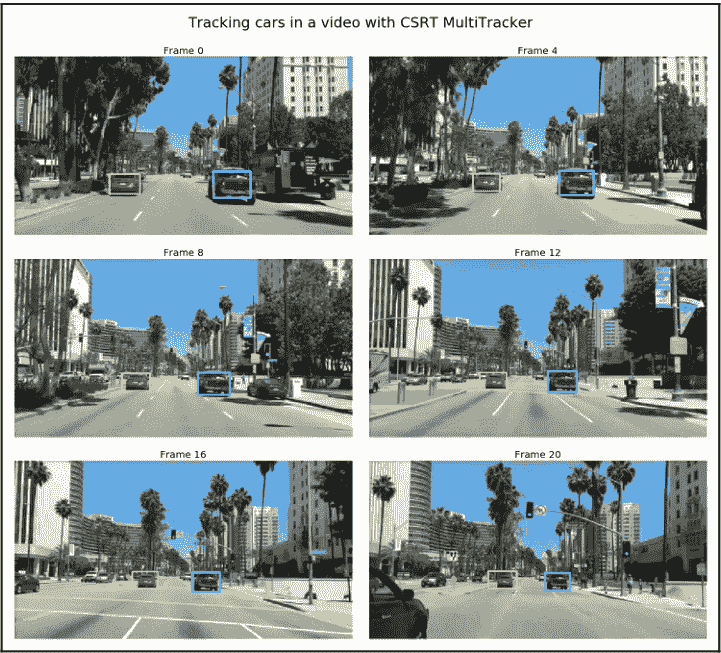

## 使用 Python-OpenCV 进行多对象跟踪

**对象跟踪**（在视频中）是一项图像/视频处理任务，用于随时间定位一个或多个移动对象。该任务的目标是在连续视频帧中找到目标对象之间的关联。当对象相对于帧率移动得更快，或要跟踪的对象随时间改变其方向时，任务会变得困难。对象跟踪系统使用运动模型，考虑目标对象在不同可能运动下的变化方式。

对象跟踪在人机交互、安全/监控、交通控制以及更多领域都很有用。由于它考虑了过去帧中对象的外观和位置，在某些情况下，即使对象检测失败，我们仍然可能能够跟踪对象。执行本地搜索的少数跟踪算法非常快。因此，一旦对象首次被检测到，无限期跟踪它通常是一个好的策略。大多数现实世界的应用程序同时实现跟踪和检测。

在本示例中，您将学习如何使用 `opencv-python` 函数在视频中跟踪多个对象，其中视频第一帧中的对象位置将以边界框坐标的形式提供给您。

### 入门

首先导入所需的库。请注意，本示例使用的 `opencv` 版本为 3.4.4：

```
#pip install opencv-python==3.4.4.19
#pip install opencv-contrib-python==3.4.4.19
import time
import cv2
import matplotlib.pyplot as plt
from imutils import resize
print(cv2.__version__)
# 3.4.4
```

### 如何执行...

执行以下步骤，使用 opencv-python 函数实现多对象跟踪：

- 1. 首先，使用以下代码行创建 `MultiTracker` 对象：

  ```
  multi_tracker = cv2.MultiTracker_create()
  ```

- 2. 您将在视频中跟踪几辆移动的汽车。汽车的位置已为视频的第一帧提供给您。您可以尝试从视频中提取帧，并使用您喜欢的对象检测算法来获取第一帧中汽车的边界框：

  ```
  car_bbox = (141,175,45,29)
  car2_bbox = (295,170,55,39)
  bboxes = [car_bbox, car2_bbox]
  colors = [(0, 255, 255), (255, 255, 0)]
  ```

- 3. 读取输入视频的第一帧，并使用以下代码片段使用帧和提供的边界框坐标（首先定位第一帧中的对象）初始化 OpenCV 多对象跟踪器来启动它：

  ```
  vs = cv2.VideoCapture('images/road.mp4')
  _, frame = vs.read()
  frame = resize(frame, width=500)
  for bbox in bboxes:
      multi_tracker.add(cv2.TrackerCSRT_create(), frame, bbox)
  ```

- 4. 使用以下代码块迭代地从视频流中读取帧（例如，每秒读取 3 帧以减少要读取的帧数），直到读取所有帧：

  ```
  j = 0
  while True:
      vs.set(cv2.CAP_PROP_POS_MSEC, (j*300)) # 1 sec read 3 frames
      _, frame = vs.read()
      if frame is None:
          break
  ```


- 5. 调整帧大小（以便更快地处理）并获取帧尺寸。获取后续帧中对象的更新位置。检查跟踪是否成功，如果成功，则绘制跟踪对象：

```
frame = resize(frame, width=500)
success, boxes = multi_tracker.update(frame)
if success:
    for i, box in enumerate(boxes):
        p1 = (int(box[0]), int(box[1]))
        p2 = (int(box[0] + box[2]), int(box[1] + box[3]))
        cv2.rectangle(frame, p1, p2, colors[i], 2, 1)

j += 1
```

如果运行上述代码片段并绘制不同帧中对象的更新位置（即边界框），你将得到以下输出：



### 工作原理

OpenCV 的 `MultiTracker` 类用于实现多对象跟踪。多对象跟踪器（本质上只是一组单对象跟踪器的集合）独立处理跟踪对象。

多对象跟踪器需要两个输入，即：参考视频帧（我们使用第一个视频帧作为参考）和要跟踪的所有对象（在参考帧中）的位置（将以边界框指定）。然后，跟踪器同时跟踪后续帧中目标对象的位置。

OpenCV 有八种不同的对象跟踪器（类型）：BOOSTING、MIL、KCF、TLD、MEDIANFLOW、GOTURN、MOSSE 和 CSRT。**KCF** 跟踪器速度快且准确，**CSRT** 跟踪器比 KCF 更准确但更慢，而 **MOSSE** 跟踪器速度极快，但不如 KCF 或 CSRT 准确。

在本示例中，使用了 CSRT 跟踪器；其实现基于具有空间和通道可靠性的判别性相关滤波器。

### 更多内容

使用 KCF、MOSSE 和 GOTURN 跟踪器（最后一个是基于深度学习的对象跟踪器）跟踪多个对象，并将获得的结果与 CSRT 跟踪器进行比较。

### 另请参阅

请参阅以下链接以了解更多关于本示例的信息：

- https://en.wikipedia.org/wiki/Video_tracking
- https://www.learnopencv.com/multitracker-multiple-object-tracking-using-opencv-c-python/
- https://docs.opencv.org/3.4/d9/df8/group__tracking.html
- https://www.youtube.com/watch?v=GPT1MZQ6f8o
