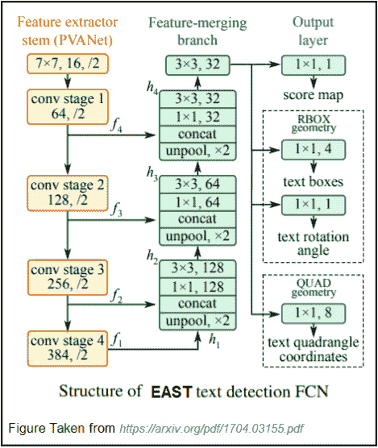
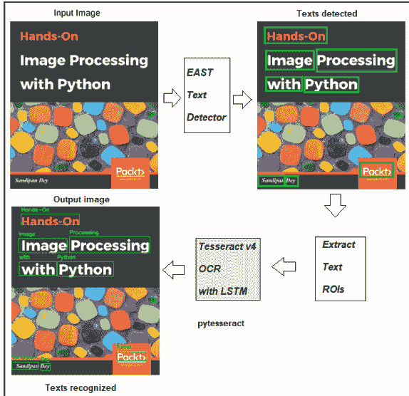
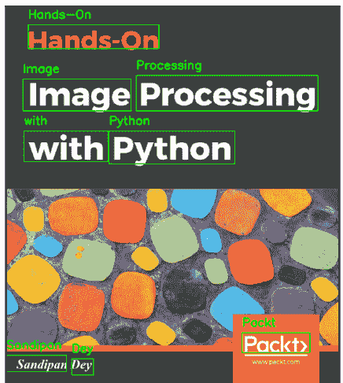

## 使用 EAST/Tesseract 进行图像中的文本检测/识别

文本检测是指检测并定位图像中包含的文本的边界框坐标的图像处理任务。提取和理解图像中包含的文本信息已变得重要且流行。文本检测充当其预处理任务。在本示例中，你将首先学习如何使用预训练的深度学习模型（称为 EAST）在图像中检测文本，然后使用 `pytesseract` 和 `opencv-python` 库函数识别文本。

EAST（代表高效且准确的场景文本检测）文本检测器是一个用于准确且快速文本检测的强大流水线。该模型是 FCN（单个深度神经网络），它直接预测输入图像中存在的单词/文本行的边界框（具有任意方向），从而消除不必要的预处理步骤（例如候选聚合和单词分区）。只需对预测的几何形状应用阈值处理和 NMS 作为后处理步骤。以下图表显示了 EAST 流水线：



**光学字符识别（OCR）**/文本识别是指从图像中提取文本的任务。在本示例中，我们将使用 Tesseract v4 进行文本识别。Tesseract v4 默认使用基于 LSTM 的识别引擎。`pytesseract` 模块只是对 Tesseract 命令行工具的封装（我们可以使用 `config` 参数指定命令行参数）。以下屏幕截图显示了文本检测和识别过程的完整流水线：



## 入门

首先，从 https://codeload.github.com/ZER-0-NE/EAST-Detector-for-text-detection-using-OpenCV/zip 下载预训练的 EAST 文本检测器模型，并在 `models` 文件夹内的适当路径中提取压缩模型。例如，从 http://mop.tamu.edu/Installing-Tesseract-Windows8 安装 Tesseract (v4)，并使用 `pip` 安装 `pytesseract` 包。使用以下代码片段导入所需的库：

```
import pytesseract
from imutils.object_detection import non_max_suppression
import cv2
import numpy as np
```

## 如何操作

执行以下步骤，使用 opencv-python 函数实现文本检测和识别：

- 1. 定义以下函数以解码 EAST 的预测并提取边界框（检测到的文本位置）及其相关置信度：

```
min_confidence = 0.5

def decode_predictions(scores, geometry):
    (num_rows, num_cols) = scores.shape[2:4]
    rects, confidences = [], []
    for y in range(0, num_rows):
        scores_data = scores[0, 0, y]
        x_data0, x_data1 = geometry[0, 0, y], geometry[0, 1, y]
        x_data2, x_data3 = geometry[0, 2, y], geometry[0, 3, y]
        angles_data = geometry[0, 4, y]
        for x in range(0, num_cols):
            if scores_data[x] < min_confidence: continue
            (offset_x, offset_y) = (x * 4.0, y * 4.0)
            angle = angles_data[x]
            cos, sin = np.cos(angle), np.sin(angle)
            h, w = x_data0[x] + x_data2[x], x_data1[x] + x_data3[x]
            end_x = int(offset_x + (cos * x_data1[x]) + \
                (sin * x_data2[x]))
            end_y = int(offset_y - (sin * x_data1[x]) + \
                (cos * x_data2[x]))
            start_x, start_y = int(end_x - w), int(end_y - h)
            rects.append((start_x, start_y, end_x, end_y))
            confidences.append(scores_data[x])
    return (rects, confidences)
```

- 2. 读取输入图像并获取图像形状。通过将原始图像调整大小为 320 x 320 获取新图像，并使用以下代码片段确定原始图像与新图像的宽度和高度之比：

```
im = 'images/book_cover.png'
image = cv2.imread(im)
orig = image.copy()
(orig_height, orig_width) = image.shape[:2]
width = height = 320
(w, h) = (width, height)
r_width, r_height = orig_width / float(w), orig_height / float(h)
image = cv2.resize(image, (w, h))
(h, w) = image.shape[:2]
```

- 3. 加载预训练的 EAST 文本检测器模型。定义我们感兴趣的模型的几个输出层名称（分别是输出概率和检测文本的边界框坐标）：

```
layer_names = ["feature_fusion/Conv_7/Sigmoid",
"feature_fusion/concat_3"]
net = cv2.dnn.readNet('models/text_detection/frozen_east_text_detection.pb')
```

- 4. 将输入图像转换为 blob 并在模型上运行前向传播以获取输出预测：

```
b, g, r = np.mean(image[..., 0]), np.mean(image[..., 1]), np.mean(image[..., 2])
blob = cv2.dnn.blobFromImage(image, 1.0, (w, h), (b, g, r),
swapRB=True, crop=False)
net.setInput(blob)
(scores, geometry) = net.forward(layer_names)
```

- 5. 接下来，解码预测以获取检测到的文本的边界框，最后，使用非极大值抑制来消除弱且重叠的边界框：

```
(rects, confidences) = decode_predictions(scores, geometry)
boxes = non_max_suppression(np.array(rects), probs=confidences)
```

- 6. 对于 EAST 检测到的每个位置（边界框），提取相应的 ROI，然后使用 pytesseract 提取 ROI 内部的文本，使用以下代码片段：

```
padding = 0.001 #0.01 #0.5
results = []
# loop over the bounding boxes
for (start_x, start_y, end_x, end_y) in boxes:
    start_x, start_y = int(start_x*r_width), int(start_y*r_height)
    end_x, end_y = int(end_x*r_width), int(end_y*r_height)
    d_x, d_y = int((end_x - start_x) * padding), \
    int((end_y - start_y) * padding)
    start_x, start_y = max(0, start_x - d_x*2), \
    max(0, start_y - d_y*2)
    end_x, end_y = min(orig_width, end_x + (d_x * 2)), \
    min(orig_height, end_y + (d_y * 2))
```


roi = orig[start_y:end_y, start_x:end_x]
config = ("-l eng --oem 1 --psm 11")
text = pytesseract.image_to_string(roi, config=config)
results.append(((start_x, start_y, end_x, end_y), text))
results = sorted(results, key=lambda r:r[0][1])

- 7. 最后，遍历检测到的ROI中提取的文本，并在图像的适当位置绘制这些文本：

```python
output = orig.copy()
for ((start_x, start_y, end_x, end_y), text) in results:
    # strip out non-ASCII text so we can draw the text on the image
    text = "".join(c if ord(c) < 128 else "" for c in text).strip()
    cv2.rectangle(output, (start_x, start_y), (end_x, end_y),
        (0, 255, 0), 2)
    cv2.putText(output, text, (start_x, start_y-20),
        cv2.FONT_HERSHEY_SIMPLEX, 1.2, (0,255,0), 3)
```

如果运行前面的代码块并绘制带有检测到的文本的原始图像，您将得到类似于以下截图的内容：



### 工作原理...

对预训练EAST模型进行前向传递将返回分数和几何信息，这些信息使用`decode_predictions()`函数解码，以获取预测包含文本的边界框（ROI）。接下来，将使用`pytesseract image_to_string()`方法提取这些ROI内部的文本。

要使用Tesseract v4 OCR将文本提取为字符串，需要将命令行参数作为配置传递给`pytesseract`的`image_to_string()`方法（例如，我们使用"-l eng --oem 1 --psm 11"作为配置）：

- 一种语言（英语，配置）
- OEM标志=1（使用LSTM（长短期记忆）模型进行OCR）
- PSM标志=11（视为稀疏文本，即以无特定顺序查找尽可能多的文本）

### 另请参阅

参阅以下链接以了解更多关于此配方的信息：

- https://stackoverflow.com/questions/44619077/pytesseract-ocr-multiple-config-options
- https://github.com/tesseract-ocr/tesseract/wiki/Command-Line-Usage
- https://github.com/ZER-0-NE/EAST-Detector-for-text-detection-using-OpenCV/
- https://www.learnopencv.com/deep-learning-based-text-recognition-ocr-using-tesseract-and-opencv/
- https://arxiv.org/pdf/1704.03155.pdf
- https://pdfs.semanticscholar.org/d933/a6d0049f53344c5384c0905afe463a086bdb.pdf?ga=2.137491379.201554747.1577481675-754696371.1577481675
