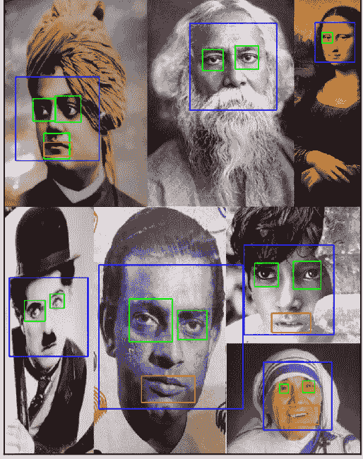

## 使用Viola-Jones/Haar-like特征进行人脸检测

Haar-like特征是物体检测中非常有用的图像特征。它们由Viola和Jones在最早的实时人脸检测器中引入。使用积分图，任何大小（尺度）的Haar-like特征都可以在常数时间内高效计算。计算速度是Haar-like相对于大多数其他特征的关键优势。使用Viola-Jones人脸检测算法，可以使用这些Haar-like特征在图像中检测人脸。每个Haar-like特征仅充当一个弱分类器，因此需要大量这些特征才能以较高的准确率检测人脸。因此，使用积分图，为每个Haar-like内核的所有可能位置和大小计算大量特征。然后，使用AdaBoost集成分类器从海量特征中选择重要特征，并在训练阶段将它们组合成一个强分类器模型。学习到的模型随后用于使用选定的特征对人脸区域进行分类，并可用作人脸检测器。

在本配方中，您将学习如何使用OpenCV预训练的分类器（即检测器）来检测面部和眼睛，从而在图像中检测人脸。这些预训练的分类器序列化为XML文件，并随OpenCV安装一起提供（可以在'opencv/data/haarcascades/'文件夹中找到）。您可能需要下载用于微笑检测的预训练分类器——如果不存在，可以在此处找到：https://github.com/opencv/opencv/blob/master/data/haarcascades/haarcascade_e_smile.xml.

### 准备工作

像往常一样，首先使用以下代码片段导入所需的库：

```python
import cv2
import numpy as np
import matplotlib.pyplot as plt
```

### 操作步骤

执行以下步骤，使用`opencv-python`实现基于预训练Haar-Cascade分类器的人脸检测：

1. 首先，从相应的`xml`文件中加载用于分别检测面部、眼睛和微笑的预训练分类器：

```python
face_cascade = cv2.CascadeClassifier('models/haarcascade_frontalface_alt2.xml')
eye_cascade = cv2.CascadeClassifier('models/haarcascade_eye.xml')
# haarcascade_eye_tree_eyeglasses.xml
smile_cascade = cv2.CascadeClassifier('models/face_detect/haarcascade_smile.xml')
```

2. 读取输入图像（包含七张人脸）并将其转换为灰度图。使用人脸级联分类器模型检测图像中存在的人脸：

```python
img = cv2.imread('images/all.png')
gray = cv2.cvtColor(img, cv2.COLOR_BGR2GRAY)
faces = face_cascade.detectMultiScale(gray, 1.01, 8) # scaleFactor=1.2, minNbr=5
print(len(faces)) # number of faces detected
# 7
```

3. 在每个人脸边界框内，使用加载的相应预训练模型检测眼睛和微笑。使用以下代码片段在图像上绘制检测到的面部、眼睛和微笑对应的边界框：

```python
for (x,y,w,h) in faces:
    img = cv2.rectangle(img, (x,y), (x+w,y+h), (255,0,0),2)
    roi_gray = gray[y:y+h, x:x+w]
    roi_color = img[y:y+h, x:x+w]
    eyes = eye_cascade.detectMultiScale(roi_gray, 1.04, 10)
    for (ex,ey,ew,eh) in eyes:
        cv2.rectangle(roi_color, (ex,ey), (ex+ew,ey+eh), (0,255,0),2)
    smile = smile_cascade.detectMultiScale(roi_gray, 1.38, 6)
    for (mx,my,mw,mh) in smile:
        cv2.rectangle(roi_color, (mx,my), (mx+mw,my+mh), (0,0,255),2)
```

如果运行前面的代码，您将得到类似于以下的输出：



### 工作原理...

可以使用预训练人脸级联分类器和cv2.detectMultiScale()函数在图像中查找人脸。此函数接受以下参数：

- scaleFactor：指定每个图像尺度下图像大小减少的程度，并用于创建尺度金字塔（例如，尺度因子1.2表示将大小减少20%）。scaleFactor参数越小，找到匹配尺寸的可能性就越高（用于模型检测）。
- minNeighbors：指定每个候选矩形需要保留的邻居数量。该参数影响检测到的人脸质量——较大的值可实现更高质量的检测，但数量更少。
- minSize和maxSize：分别是可能对象的最小和最大尺寸。超出这些值的对象将被忽略。

检测到人脸后，函数将以Rect(x, y, w, h)列表的形式返回人脸位置。

一旦获得人脸边界框，它就定义了人脸的ROI，然后可以对该ROI应用眼睛/微笑检测（因为眼睛/微笑总是在人脸上找到）。

### 更多内容...

使用基于dlib HOG的正面人脸检测器和OpenCV的预训练深度学习模型Single Shot MuliBox Detector（SSD）来检测图像中的人脸。比较不同人脸检测器的性能（就准确性和时间复杂度而言）。尝试使用不同角度/方向的面部图像以及佩戴眼镜的图像。使用dlib面部标志检测来检测眼睛。

### 另请参阅

参阅以下链接以了解更多关于此配方的信息：

- https://www.cs.cmu.edu/~efros/courses/LBMV07/Papers/viola-IJCV-01.pdf
- https://www.learnopencv.com/face-detection-opencv-dlib-and-deep-learning-c-python/
- https://arxiv.org/abs/1512.02325
- https://github.com/opencv/opencv_extra/blob/master/testdata/dnn/
- https://github.com/opencv/opencv/blob/master/data/haarcascades/haarcascade_smile.xml
- https://docs.opencv.org/3.4/d1/de5/classcv_1_1CascadeClassifier.html#a90fe1b7778bed4a27aa8482e1eecc116
- 《使用Python进行图像处理实战》第7章


