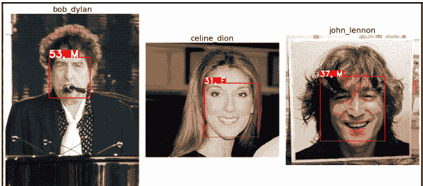
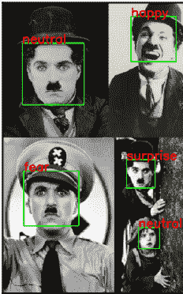

## 使用深度学习模型进行年龄、性别和情绪识别

面部图像的年龄估计可以被视为使用 CNN 之后跟随预期 softmax 值细化的深度分类问题（可以使用 **深度期望（DEX）模型** 来实现）。在本配方中，你将首先学习如何使用预训练的深度学习模型（在其顶部添加了两个分类层的 **WideResNet**，使用单个 CNN 同时估计年龄和性别）来从面部图像进行年龄和性别识别。我们将使用名人面部数据集中的面部图像进行年龄和性别识别。然后，你将使用另一个预训练的深度学习模型实现情绪识别，但这次你需要使用面部检测器检测面部（你也可以使用迁移学习，并在自己的图像上使用你的分类器，但这留给你作为练习去尝试）。

## 准备工作

从 https://drive.google.com/drive/folders/0BxYs69jJi4kU0I1YUQyY1ZDRUE 和 https://drive.google.com/file/d/0B6yZu81NrMhSVOzYWZrenJxD1E 下载预训练的深度学习模型。将模型提取到 models 文件夹中的相应路径。导入所需的库以开始：

```
import cv2
import dlib
import numpy as np
from keras.models import load_model
from keras import backend as K
from keras.models import model_from_json
from glob import glob
import matplotlib.pyplot as plt
```

## 操作步骤...

执行以下步骤，在 Keras 中使用预训练模型实现年龄、性别和情绪识别：

- 1. 首先，从提供的 JSON 文件加载预训练模型的配置，并从预训练权重文件加载模型权重，使用以下代码片段：

```
json_file = open('models/model.json', 'r')
loaded_model_json = json_file.read()
json_file.close()
loaded_model = model_from_json(loaded_model_json)
loaded_model.load_weights('models/weights.29-3.76_utk.hdf5')
```

- 2. 你将使用 dlib 的正面面部检测器来检测和提取输入面部图像中的面部。使用下一行代码获取 dlib 的面部检测器：

```
detector = dlib.get_frontal_face_detector()
```

- 3. 对于使用 dlib 检测器在输入图像中检测到的每个面部，使用深度学习模型以面部作为输入运行前向传递来预测检测到的面部的年龄和性别，并提取预测的年龄和性别：

```
img_size = 64
for img_file in glob('images/musicians/*.jpg'):
    img = cv2.cvtColor(cv2.imread(img_file), cv2.COLOR_BGR2RGB)
    detected = detector(img, 0)
    if len(detected) > 0:
```


```python
faces = np.empty((len(detected), img_size, img_size, 3))
for i, d in enumerate(detected):
    x1, y1, x2, y2, w, h = d.left(), d.top(), d.right() + 1, \
    d.bottom() + 1, d.width(), d.height()
    faces[i, :, :, :] = cv2.resize(img[y1:y2+1, \
    x1:x2+1, :], (img_size, img_size))
results = loaded_model.predict(faces)
predicted_genders = results[0]
ages = np.arange(0, 101).reshape(101, 1)
predicted_ages = results[1].dot(ages).flatten()
```

如果运行上述代码块并绘制检测到的人脸以及图片中人物的年龄和性别，您将得到如下截图所示的输出：



keras.models.model_from_json() 函数用于解析 JSON 模型配置文件并获取模型实例。

keras.models.predict() 函数用于运行前向传递并生成输入人脸的输出年龄和性别预测。

### 还有更多...

同样，使用另一个预训练模型来预测给定图像中人脸的情绪（先使用人脸检测函数检测人脸）。如果绘制查理·卓别林面部的预测情绪，您将得到类似这样的输出：



您可能需要从 https://www.kaggle.com/dansbecker/5-celebrity-faces-dataset 下载五位名人的数据集，并尝试使用不同的人脸图像进行情绪、性别和年龄识别。

### 另请参阅

- https://github.com/yu4u/age-gender-estimation
- https://github.com/jalajthanaki/Facial_emotion_recognition_using_Keras
- https://stackoverflow.com/questions/53859419/dlib-get-frontal-face-detector-gets-faces-in-full-image-but-does-not-get-in-c
- https://www.vision.ee.ethz.ch/en/publications/papers/articles/eth_biwi_01299.pdf
