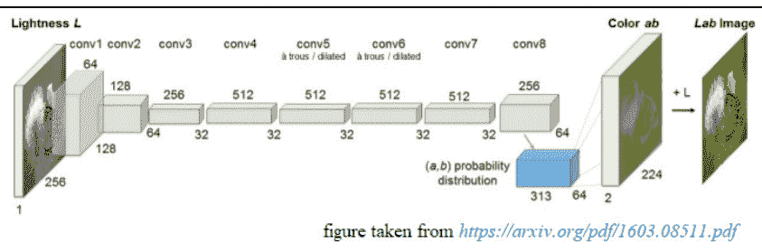
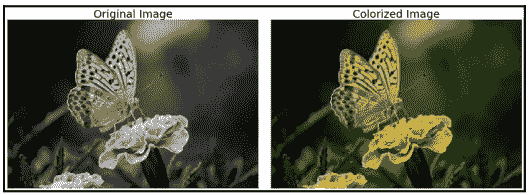

## 基于深度学习的图像着色

在本示例中，您将学习如何使用预训练的深度学习模型将灰度图像转换为逼真的彩色版本。Zhang et al. 提出了一种全自动图像着色模型，该模型在给定灰度输入图像时可生成逼真着色的图像。该模型在超过一百万张目标彩色图像上进行了训练。在测试阶段，我们只需对 CNN 运行前向传递，即可在给定灰度输入时预测输出彩色图像。该算法使用着色图灵测试进行了评估，其中人类参与者被要求在模型生成的彩色图像和真实彩色图像之间进行选择（结果模型在 32% 的测试中成功愚弄了人类）。以下图表显示了深度 CNN 的架构：



## 准备工作

首先，从 https://github.com/richzhang/colorization/tree/master/colorization/models 下载预训练的 Caffe 模型（例如，colorization_deploy_v2.prototxt 和 .caffemodel 文件），以及 https://github.com/richzhang/colorization/blob/master/colorization/resources/pts_in_hull.npy。使用以下代码块导入所有必要的软件包：

```python
import numpy as np
import cv2
import matplotlib.pyplot as plt
import imutils
```

## 操作步骤

- 1. 从 Caffe `prototxt` 和模型 `weights` 文件中将模型读入内存：

```python
proto_file = "models/colorization_deploy_v2.prototxt"
weights_file = "models/colorization_release_v2.caffemodel"
net = cv2.dnn.readNetFromCaffe(proto_file, weights_file)
```

- 2. 加载箱中心，并使用以下代码片段将群集中心填充为 1 x 1 卷积核：

```python
pts_in_hull = np.load('models/pts_in_hull.npy')
pts_in_hull = pts_in_hull.transpose().reshape(2, 313, 1, 1)
net.getLayer(net.getLayerId('class8_ab')).blobs = [pts_in_hull.astype(np.float32)]
net.getLayer(net.getLayerId('conv8_313_rh')).blobs = [np.full([1, 313], 2.606, np.float32)]
```

- 3. 对每个输入图像，从磁盘读取图像，将其转换为 Lab 颜色空间，并使用以下代码片段提取 `L` 通道：

```python
width = height = 224
for f in glob('images/tocolorize/*.png'):
    image = cv2.cvtColor(cv2.cvtColor(cv2.imread(f), cv2.COLOR_BGR2GRAY), cv2.COLOR_GRAY2BGR)
    img_rgb = (image[:,:,[2, 1, 0]] * 1.0 / 255).astype(np.float32)
    img_lab = cv2.cvtColor(img_rgb, cv2.COLOR_RGB2Lab)
    img_l = img_lab[:,:,0]
```

- 4. 将亮度（L）通道和图像调整为网络输入大小。运行前向传递以获取预测输出，如下所示：

```python
img_l_rs = cv2.resize(img_l, (width, height))
img_l_rs -= 50 # subtract 50 for mean-centering
net.setInput(cv2.dnn.blobFromImage(img_l_rs))
ab_dec = net.forward()[0,:,:,:].transpose((1,2,0))
```

- 5. 将预测输出重塑为输入图像大小，并从 `Lab` 转换为 `BGR` 空间以获取着色输出图像：

```python
(orig_height, orig_width) = img_rgb.shape[:2]
ab_dec_us = cv2.resize(ab_dec, (orig_width, orig_height))
img_lab_out = np.concatenate((img_l[:, :, np.newaxis], \
                              ab_dec_us), axis=2)
img_bgr_out = np.clip(cv2.cvtColor(img_lab_out, \
                              cv2.COLOR_Lab2BGR), 0, 1)
```

如果运行上述代码块并绘制从输入灰度图像获得的输出彩色图像，您将得到如下截图所示的输出：



步骤 1 中下载的 OpenCV-Python 的 `readNetFromCaffe()` 函数用于加载以 Caffe 框架格式存储的预训练深度神经网络模型。它接受 `.prototxt` 文件（描述神经网络架构的文本文件）的路径和 `.caffemodel` 文件（存储模型预训练权重的文件）的路径。

### 另请参阅

- https://arxiv.org/pdf/1603.08511.pdf
- https://github.com/richzhang/colorization/blob/master/colorization/
- https://github.com/opencv/opencv/blob/master/samples/dnn/colorization.py
- http://richzhang.github.io/colorization/
- https://www.youtube.com/watch?v=M4WOPN3qjVI
- https://www.youtube.com/watch?v=vEoAGeu3NLQ
