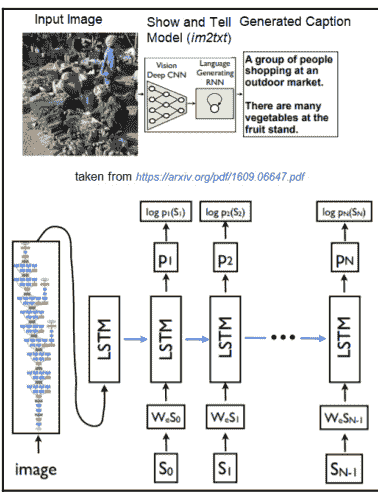
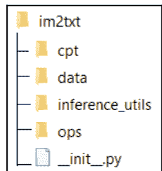
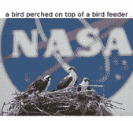
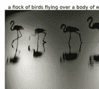
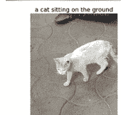
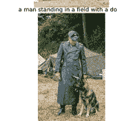
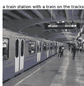
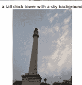

## 使用 CNN 和 LSTM 进行自动图像字幕生成

图像自动字幕生成是 AI 中的一个热门问题，它连接了图像处理、计算机视觉与 NLP。在本示例中，您将学习如何使用一种基于深度循环神经网络架构的预训练生成模型（称为 Show and Tell）来生成字幕（描述图像内容的自然语言完整句子）。该模型的训练目标是最大化给定输入训练图像的输入字幕文本的可能性。

im2txt 是 Show and Tell 模型的 TensorFlow 实现，它可以接受图像作为输入并生成描述图像的人类风格字幕。该模型在超过 300,000 张图像上进行了测试。该模型是一个端到端的深度神经网络，由一个 CNN（用于学习输入图像的隐式特征）和一个 RNN（用于在给定 CNN 特征时生成字幕）组成。该实现使用 BeamSearch 迭代为输入图像选择最佳的 k 个字幕。以下图表显示了 Show and Tell 模型的架构：



## 准备工作

首先，使用 `https://github.com/tensorflow/models/` 将仓库克隆到本地机器上的一个文件夹中。然后，将 `models/tree/master/research/im2txt/im2txt` 文件夹复制到本章使用的 `models` 文件夹中。创建一个名为 `cpt` 的子文件夹，并从 `https://drive.google.com/file/d/0Bw6m_66JSYLlRFVKQ2tGcUJaWjA/` 在 `cpt` 中下载预训练模型检查点文件（`model.ckpt-2000000`）。在 `im2txt` 中创建一个空的 `__init__.py` 文件，以将该文件夹标记为 Python 包目录。文件夹结构应如下所示：



让我们使用以下代码块导入所需的库：

```python
import os, sys
import tensorflow as tf
from glob import glob
from skimage.io import imread
import matplotlib.pyplot as plt
from im2txt import configuration
from im2txt import inference_wrapper
from im2txt.inference_utils import caption_generator
from im2txt.inference_utils import vocabulary

checkpoint_dir = 'models/im2txt/cpt/'
sys.path.append(os.path.join(os.getcwd(), 'models/'))
```


### 如何操作...

运行以下步骤，在TensorFlow上使用预训练的im2txt模型实现图像字幕生成：

- 1. 下载的预训练权重检查点文件（`model.ckpt-2000000`）包含一些问题，你很可能无法加载它。在这种情况下，请通过修改它并在`models`文件夹中使用来自`https://github.com/tensorflow/models/issues/466`或`https://github.com/PacktPublishing/Python-Image-Processing-Cookbook/blob/master/Chapter%2009/Chapter%2009.ipynb`的代码创建新的检查点文件（`model2.ckpt-2000000`）来修复检查点中的问题。

- 2. 从修改后的检查点文件构建推理图，然后加载LSTM的词汇表（一种可以学习长期依赖关系的特殊RNN类型）：

```
checkpoint_path = checkpoint_dir + 'model2.ckpt-2000000'
vocab_file = checkpoint_dir + 'word_counts.txt'

g = tf.Graph()
with g.as_default():
    model = inference_wrapper.InferenceWrapper()
    restore_fn = model.build_graph_from_config\
        (configuration.ModelConfig(), checkpoint_path)

g.finalize()

vocab = vocabulary.Vocabulary(vocab_file)
```

- 3. 使用restore_fn()函数从模型检查点文件加载预训练模型。使用预训练模型参数初始化字幕生成器。这里，我们将使用默认的光束搜索参数（如果您想尝试，始终可以显式指定参数值）。忽略开头和结尾单词（句子的起始和结束标记），并使用以下代码片段输出生成的字幕：

```
filenames = glob('images/captioning/*.png')
tf.logging.info("Running caption generation on %d files matching
%s", len(filenames), filenames)
with tf.Session(graph=g) as sess:
    restore_fn(sess)
    generator = caption_generator.CaptionGenerator(model, vocab)
    for filename in filenames:
        with tf.gfile.GFile(filename, "rb") as f: image = f.read()
        captions = generator.beam_search(sess, image)
        print("Captions for image %s: " %
            os.path.basename(filename))
        for i, caption in enumerate(captions):
            sentence = " ".join([vocab.id_to_word(w) for w in \
            caption.sentence[1:-1]])
        print(" %d) %s (p=%f) " % (i, sentence, \
            math.exp(caption.logprob)))
```

如果在`images`和`captions`文件夹的输入图像上运行前面的代码块，您将生成以下字幕：

## 使用深度学习预训练模型进行自动图像字幕生成
















如您所见，生成的大多数字幕都相当不错且准确。

### 工作原理...

`build_graph_from_config()`函数从配置对象构建推理图。它接受一个包含构建模型配置的模型`config`对象和一个包含`checkpoint`文件的`checkpoint`路径。它返回一个可用于从`checkpoint`文件加载模型变量的函数。

`beam_search()`函数在单个图像上运行光束搜索字幕生成。它接受TensorFlow会话对象和CNN编码的图像字符串作为输入，并返回按分数降序排列的字幕列表。

有关可用光束搜索参数的说明，请参见`caption_generator.py`。

### 另请参见

- https://github.com/tensorflow/models/tree/master/research/im2txt/im2txt
- https://edouardfouche.com/Fun-with-Tensorflow-im2txt/
- https://github.com/tensorflow/models/issues/466
- https://github.com/tensorflow/tensorflow/issues/30794
- https://arxiv.org/pdf/1609.06647.pdf
- https://www.youtube.com/watch?v=yk6XDFm3J2c
