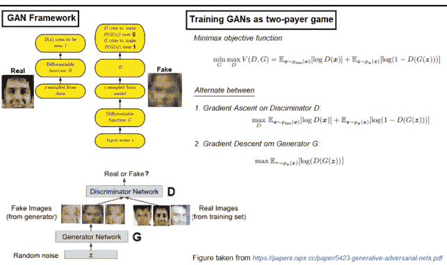
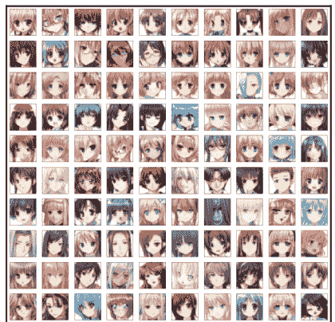
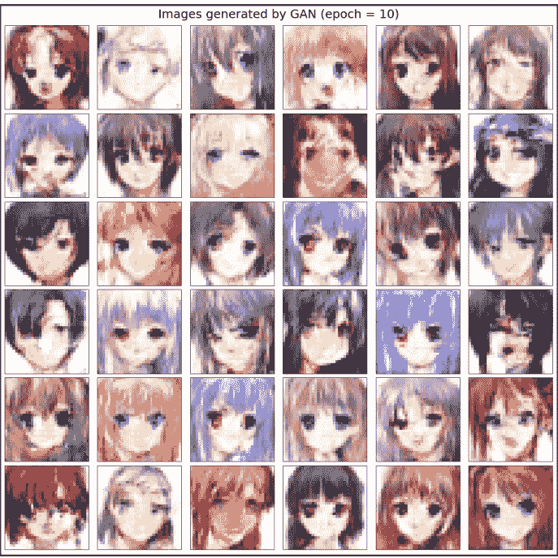

## 使用GAN进行图像生成

生成对抗网络（**生成对抗网络 (GAN)**）是一种生成模型，它定义了对抗网络框架，由几个模型组成（两个模型通常都是CNN），即生成器和判别器，其目的是在给定一组训练图像时生成新的逼真图像。这两个模型相互充当对手：生成器学习生成看起来像真实图像的新假图像（从随机噪声开始），而判别器学习判断样本图像是**真实**图像还是**假**图像。

生成器扮演伪造者的角色，试图生成假图像并欺骗判别器，而判别器扮演警察的角色，试图检测由生成器生成的假图像。我们可以将此视为一个双人游戏，游戏中的竞争推动双方改进其方法，直到假图像与真实图像无法区分（例如，判别器和生成器对手之间的纳什均衡）。训练结束后，只需在生成器上运行前向传播即可生成新的样本图像（类似于真实图像）。两个CNN模型在**零和**游戏中试图优化对立的目标（损失）函数。下图描述了基本的GAN框架以及GAN的训练方式（在此，它是在人脸上训练的）：



在本教程中，您将学习如何使用PyTorch训练GAN，在给定一组真实面部图像的情况下生成逼真的面部图像。由于训练GAN可能需要相当长的时间，强烈建议使用GPU来训练GAN。

### 准备工作

首先，从`https://www.kaggle.com/splcher/animefacedataset`下载动漫面部数据集（如果您还没有Kaggle帐户，请创建一个），并将图像提取到`images`目录下的`anime`子目录中（目前有63,565张图像）。使用以下代码块导入所有所需的包：

```
import numpy as np
from PIL import Image
import matplotlib.pyplot as plt
import pickle as pkl
import torch
import torch.nn as nn
from torchvision import datasets
from torchvision import transforms
from torch.utils.data.sampler import SubsetRandomSampler
import torch.nn.functional as F
import torch.optim as optim
```

### 如何操作...

运行以下步骤，使用PyTorch在动漫面部上训练GAN并生成新的逼真动漫面部图像：

- 1. 定义以下函数，以便PyTorch数据加载器对给定目录中给定批量大小的图像应用`transform`以调整大小，然后使用Python生成器返回它们：

```
def get_data_loader(batch_size, image_size, data_dir='anime/'):
    image_transforms = transforms.Compose(\
        [transforms.Resize(image_size), \
         transforms.ToTensor(), ])
    indices = np.random.choice(63565, 50000) # get 50k random samples
    data_loader = torch.utils.data.DataLoader( \
        datasets.ImageFolder(data_dir, \
        transform=image_transforms), \
        sampler=SubsetRandomSampler(indices), \
        batch_size=batch_size)
    return data_loader

batch_size = 128
image_size = 32
anime_train_loader = get_data_loader(batch_size, image_size)
images, _ = iter(anime_train_loader).next()
```

如果您绘制动漫数据集中的一些示例输入图像并使用matplotlib显示它们，您将得到类似这样的输出：




- 2. 使用 CNNs 定义判别器 (D) 对应的 Python 类，代码片段如下：

```
class Discriminator(nn.Module):

def __init__(self, conv_dim):
    super(Discriminator, self).__init__()
    self.conv_dim = conv_dim
    self.conv1 = nn.Conv2d(3, conv_dim, kernel_size=4, stride=2, \
    padding=1, bias=False)
    self.batch_norm1 = nn.BatchNorm2d(conv_dim)
    self.conv2 = nn.Conv2d(conv_dim, conv_dim*2, kernel_size=4, \
    stride=2, padding=1, bias=False)
    self.batch_norm2 = nn.BatchNorm2d(conv_dim*2)
    self.conv3 = nn.Conv2d(conv_dim*2, conv_dim*4, kernel_size=4, \
    stride=2, padding=1, bias=False)
    self.batch_norm3 = nn.BatchNorm2d(conv_dim*4)
    self.conv4 = nn.Conv2d(conv_dim*4, conv_dim*8, kernel_size=4, \
    stride=2, padding=1, bias=False)
    self.batch_norm4 = nn.BatchNorm2d(conv_dim*8)
    self.conv5 = nn.Conv2d(conv_dim*8, conv_dim*16, kernel_size=4, \
    stride=2, padding=1, bias=False)
    self.fc = nn.Linear(conv_dim*4*4, 1)

def forward(self, x):
    x = F.leaky_relu(self.batch_norm1(self.conv1(x)), 0.2)
    x = F.leaky_relu(self.batch_norm2(self.conv2(x)), 0.2)
    x = F.leaky_relu(self.batch_norm3(self.conv3(x)), 0.2)
    x = F.leaky_relu(self.batch_norm4(self.conv4(x)), 0.2)
    x = self.conv5(x)
    x = x.view(-1, self.conv_dim*4*4)
    x = F.sigmoid(self.fc(x))
    return x
```

- 3. 使用 CNNs 定义生成器 (G) 对应的 Python 类，代码片段如下：

```
class Generator(nn.Module):
    def __init__(self, z_size, conv_dim):
        super(Generator, self).__init__()
        self.conv_dim = conv_dim
        self.t_conv1=nn.ConvTranspose2d(conv_dim, conv_dim*8, \
            kernel_size=4, stride=2, padding=1, bias=False)
        self.batch_norm1 = nn.BatchNorm2d(conv_dim*8)
        self.t_conv2 = nn.ConvTranspose2d(conv_dim*8, conv_dim*4, \
            kernel_size=4, stride=2, padding=1, bias=False)
        self.batch_norm2 = nn.BatchNorm2d(conv_dim*4)
        self.t_conv3 = nn.ConvTranspose2d(conv_dim*4, conv_dim*2, \
            kernel_size=4, stride=2, padding=1, bias=False)
        self.batch_norm3 = nn.BatchNorm2d(conv_dim*2)
        self.t_conv4 = nn.ConvTranspose2d(conv_dim*2, 3, kernel_size=4, \
            stride=2, padding=1, bias=False)
        self.fc = nn.Linear(z_size, conv_dim*4)

def forward(self, x):
    batch_s = x.shape[0]
    x = self.fc(x)
    x = x.view(batch_s, self.conv_dim, 2, 2)
    x = F.relu(self.batch_norm1(self.t_conv1(x)))
    x = F.relu(self.batch_norm2(self.t_conv2(x)))
    x = F.relu(self.batch_norm3(self.t_conv3(x)))
    x = self.t_conv4(x)
    x = F.tanh(x)
    return x
```

- 4. 为卷积层和线性层应用初始权重，初始化模型权重，并构建 GAN（使用 D 和 G CNN 的给定维度）以获取判别器和生成器实例，使用以下代码块：

```
def init_weights_normal(m):
    classname = m.__class__.__name__
    if hasattr(m, 'weight') and (classname.find('Conv') != -1 or \
        classname.find('Linear') != -1):
        nn.init.normal_(m.weight.data, 0.0, 0.02)
    if hasattr(m.bias, 'data'):
        nn.init.constant_(m.bias.data, 0.0)
```

```
def build_GAN(d_conv_dim, g_conv_dim, z_size):
    D = Discriminator(d_conv_dim)
    G = Generator(z_size=z_size, conv_dim=g_conv_dim)
    D.apply(init_weights_normal)
    G.apply(init_weights_normal)
    return D, G
```

```
# define model hyperparams
d_conv_dim = 32
g_conv_dim = 32
z_size = 100

D, G = build_GAN(d_conv_dim, g_conv_dim, z_size)
```

- 5. 定义用于训练判别器和生成器网络的真实损失和假损失函数：

```
def real_loss(D_out, smooth=False):
    batch_size = D_out.size(0)
    if smooth: # smooth, real labels = 0.9
        labels = torch.ones(batch_size)*0.9
    else: # real labels = 1
        labels = torch.ones(batch_size)
    if train_on_gpu: labels = labels.cuda()
    criterion = nn.BCELoss()
    loss = criterion(D_out.squeeze(), labels)
    return loss
```

```
def fake_loss(D_out):
    batch_size = D_out.size(0)
    labels = torch.zeros(batch_size)
    if train_on_gpu: labels = labels.cuda()
    criterion = nn.BCELoss()
    loss = criterion(D_out.squeeze(), labels)
    return loss
```

- 6. 初始化判别器和生成器要使用的优化器（Adam）。定义训练 GAN 的函数：

```
train_on_gpu = torch.cuda.is_available()
lr = 0.0005
g_optimizer = optim.Adam(G.parameters(), lr=lr, betas=(0.3, 0.999))
d_optimizer = optim.Adam(D.parameters(), lr=lr, betas=(0.3, 0.999))
```

```
def train(D, G, n_epochs, print_every=50):
    if train_on_gpu:
        D.cuda()
        G.cuda()
    samples = []
    losses = []
```

- 7. 获取一些用于采样的固定数据（均匀随机噪声）。这些图像在整个训练过程中保持不变，允许我们检查模型的性能。使用批量输入图像训练判别器和生成器，并按给定的时代数迭代训练过程：

```
sample_size=36
fixed_z = np.random.uniform(-1, 1, size=(sample_size, z_size))
fixed_z = torch.from_numpy(fixed_z).float()
if train_on_gpu:
    fixed_z = fixed_z.cuda()
for epoch in range(n_epochs):
    for batch_i, (real_images, _) in enumerate(anime_train_loader):
        batch_size = real_images.size(0)
        real_images = scale(real_images)
```

- 8. 在来自数据的真实图像和生成器生成的假图像上训练判别器，目的是区分假图像和真实图像：

```
if train_on_gpu: real_images = real_images.cuda()
d_optimizer.zero_grad()
D_real = D(real_images)
d_real_loss = real_loss(D_real)
z_flex = np.random.uniform(-1, 1, size=(batch_size, z_size))
z_flex = torch.from_numpy(z_flex).float()
if train_on_gpu: z_flex = z_flex.cuda()
fake_images = G(z_flex)
D_fake = D(fake_images)
d_fake_loss = fake_loss(D_fake)
d_loss = d_real_loss + d_fake_loss
d_loss.backward()
d_optimizer.step()
```

- 9. 使用对抗损失训练生成器，以生成更真实的图像来欺骗判别器：

```
g_optimizer.zero_grad()
z_flex = np.random.uniform(-1, 1, size=(batch_size, z_size))
z_flex = torch.from_numpy(z_flex).float()
if train_on_gpu: z_flex = z_flex.cuda()
fake_images = G(z_flex)
D_fake = D(fake_images)
g_loss = real_loss(D_fake, True) # use real loss to flip labels
g_loss.backward()
g_optimizer.step()
```

- 10. 每个时代结束时，切换到评估模式，并通过在生成器 CNN 上运行前向传播使用生成器生成新图像，然后再次切换回训练模式：

```
G.eval() # switch to eval mode for generating samples
samples_z = G(fixed_z)
samples.append(samples_z)
G.train() # switch back to training mode
```

以下屏幕截图显示了生成器在 10 个时代后生成的假图像。请注意，它们看起来像逼真的动漫人脸图像：



### 工作原理...

生成器（网络）生成新的图像实例，而判别器评估其真实性。

对抗训练着重于系统的弱点，迫使彼此随时间不断改进（生成器在生成逼真图像方面变得更好，判别器在区分真实图像和假图像方面变得更好），直到生成器生成的假图像与真实图像无法区分，判别器无法将它们区分开来（此时，生成器已学会如何生成好图像）。

判别器只是一个二元分类器，它接收两批图像作为输入（来自真实训练数据和来自生成器），并判断图像是真实的还是假的。

判别器优化 `loss` 函数，该函数由真实损失和假损失之和组成，分别由 `real_loss()` 和 `fake_loss()` 函数实现。

生成器优化真实损失以欺骗判别器，使生成的图像越来越像真实图像（从随机噪声开始）。

`build_GAN()` 函数的实现是为了创建和初始化判别器和生成器网络。

### 更多内容...

你可能需要从 `http://mmlab.ie.cuhk.edu.hk/projects/CelebA.html` 下载 **名人脸属性（CelebA）** 数据集。（例如，从 `https://drive.google.com/drive/folders/0B7EVK8r0v71pWEZsZE9oNnFzTm8` 下载对齐的人脸，并尝试使用 GAN 生成人脸图像。）

### 另请参阅

- https://arxiv.org/pdf/1406.2661.pdf
- https://www.youtube.com/watch?v=5WoItGTWV54
- https://www.youtube.com/watch?v=HGYYEUSm-0Q


- * https://papers.nips.cc/paper/5423-generative-adversarial-nets.pdf
- * https://www.youtube.com/watch?v=2MLjMBEQNDs
