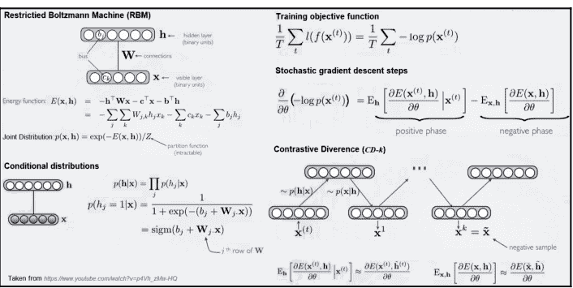
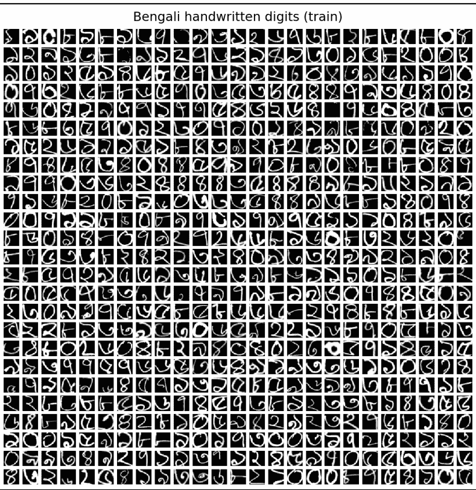
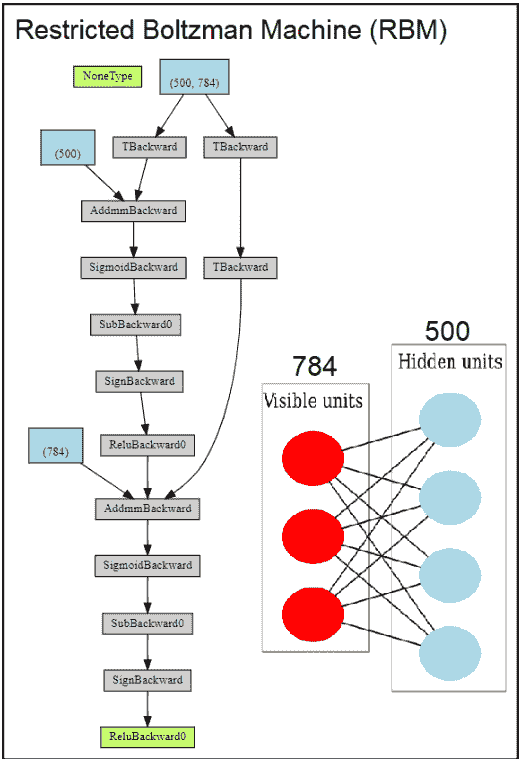
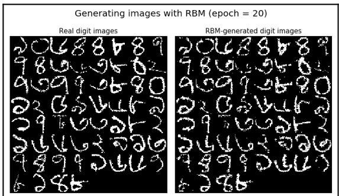
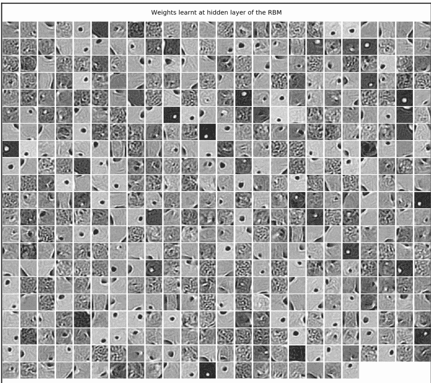
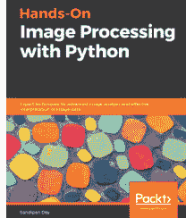
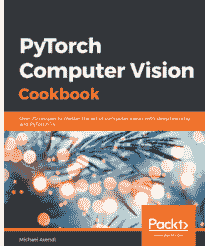

## 使用受限玻尔兹曼机重建 Bangla MNIST 图像

受限玻尔兹曼机（RBM）是一种无监督模型。作为具有两层（可见层和隐藏层）的无向图模型，它在隐藏层沿线学习输入数据的不同表示很有用。这是深度学习的第一个结构构建块，特别是在没有可用计算资源来使用反向传播学习深度神经网络时（当时使用堆叠的 RBM 代替）。它限制了网络的连接性（仅在隐藏节点集和可见节点集之间允许二分图），以使推断变得容易。它是一种基于能量的模型；联合分布使用能量函数进行建模。为了推断最可能的观测值，我们需要选择能量最小的那个。该模型通常在二值图像上进行训练。计算可见层和隐藏层的联合分布是难以处理的（因为配分函数 Z 难以计算），尽管条件分布易于计算和采样（因为完整的条件分布可分解）。对比发散（CD）算法用于训练 RBM 并最小化平均负对数似然。对于每个训练样本 x(t)，使用 k 步吉布斯采样生成一个负样本，起始于 x(t)，采用 k 步对比发散（CD-k）算法。

使用吉布斯采样获得点估计，随后更新参数 W、b 和 c。基本数学如下图所示：



在本配方中，我们将使用 Numta 数据集（一个孟加拉语手写数字数据集）来实现 RBM，并使用 PyTorch 从隐藏表示生成数字。

## 准备工作

首先，从 https://www.kaggle.com/BengaliAI/numta 下载 Numta 数据集，并提取 images/Numta 文件夹中的图像。导入使用 PyTorch 实现 RBM 所需的库：

```
import os
from glob import glob
import pandas as pd
import numpy as np
import torch
import torch.utils.data
import torch.nn as nn
import torch.nn.functional as F
import torch.optim as optim
from torch.autograd import Variable
from torchvision import datasets, transforms
from torchvision.utils import make_grid, save_image
from torch.utils.data import DataLoader
```

## 操作步骤…

按照以下步骤使用 PyTorch 实现 RBM 并使用 Numta 图像数据集运行推理：

- 1. 使用以下代码读取训练图像和测试图像：

```
n = 28
df = pd.read_csv('images/Numta/training-e.csv')
X_train = np.zeros((df.shape[0], n*n))
for i in range(df.shape[0]):
    img = rgb2gray(imread('images/Numta/training-e/' + \
        df.iloc[i]['filename']))
    img = resize(img, (n,n))
    X_train[i,:] = np.array([np.ravel(img)])

test_images = glob('images/Numta/testing-e/*.png')
X_test = np.zeros((len(test_images), n*n))
for i in range(len(test_images)):
    img = rgb2gray(imread(test_images[i]))
    img = resize(img, (n,n))
    X_test[i,:] = np.array([np.ravel(img)])
```

如果显示训练数据集中随机选取的几个图像，你将得到类似这样的输出：



- 2. 实现 RBM 类，包含 `sample_from_p()`、`v_to_h()`、`h_to_v()` 和 `forward()` 方法以实现 CD-k 算法。使用 `free_energy()` 计算 RBM 的能量函数：

```
class RBM(nn.Module):
    def __init__(self, n_vis=784, n_hin=500, k=5):
        super(RBM, self).__init__()
        self.W = nn.Parameter(torch.randn(n_hin,n_vis)*1e-2)
        self.v_bias = nn.Parameter(torch.zeros(n_vis))
        self.h_bias = nn.Parameter(torch.zeros(n_hin))
        self.k = k

def sample_from_p(self,p):
    return F.relu(torch.sign(p - Variable(torch.rand(p.size()))))

def v_to_h(self,v):
    p_h = F.sigmoid(F.linear(v,self.W,self.h_bias))
    sample_h = self.sample_from_p(p_h)
    return p_h,sample_h

def h_to_v(self,h):
    p_v = F.sigmoid(F.linear(h,self.W.t(),self.v_bias))
    sample_v = self.sample_from_p(p_v)
    return p_v,sample_v

def forward(self,v):
    pre_h1,h1 = self.v_to_h(v)
    h_ = h1
    for _ in range(self.k):
        pre_v_,v_ = self.h_to_v(h_)
        pre_h_,h_ = self.v_to_h(v_)
    return v,v_

def free_energy(self,v):
    v_bias_term = v.mv(self.v_bias)
    wx_b = F.linear(v,self.W,self.h_bias)
    hidden_term = wx_b.exp().add(1).log().sum(1)
    return (-hidden_term - v_bias_term).mean()
```

如果绘制 PyTorch 模型，你将得到如下截图所示的 RBM 架构输出：



- 3. 训练 RBM 并使用学习到的模型，通过以下代码块使用低维表示和隐藏单元重建图像：

```
batch_size = 256 #64
train_loader = DataLoader(np.reshape(X_train, (-1, 28, \\
28)).astype(np.float32), batch_size=batch_size,
shuffle=True)
test_loader = DataLoader(np.reshape(X_test, (-1, 28, \
28) ).astype(np.float32), batch_size=batch_size,
    shuffle=True)
rbm = RBM(k=1)
train_op = optim.SGD(rbm.parameters(), 0.1) #, weight_decay=1e-4)
for epoch in range(20):
    loss_ = []
    for data in train_loader:
        data = Variable(data.view(-1, 784))
        sample_data = data.bernoulli()
        v,v1 = rbm(sample_data)
        loss = rbm.free_energy(v) - rbm.free_energy(v1)
        loss_.append(loss.item())
        train_op.zero_grad()
        loss.backward()
        train_op.step()
```

如果在 20 个 epoch 后绘制原始数字图像和使用 RBM 重建的图像，你将得到以下输出：



如你所见，随着训练 epoch 增加，生成的数字看起来更像原始数字。

下一个截图展示了隐藏层中作为权重的学习特征是什么样子。如果绘制几个隐藏层中学习到的特征，你可能会观察到这些是相当有趣的特征，它们大致代表了绘制数字时的笔触：



### 另请参阅

有关此配方的更多详细信息，请使用以下链接：

- https://www.youtube.com/watch?v=UcAWwySuUZM
- https://www.youtube.com/watch?v=p4Vh_zMw-HQ
- https://www.cs.toronto.edu/~hinton/absps/guideTR.pdf
- https://www.youtube.com/watch?v=VdVYpjBWqWs


## 其他您可能喜欢的图书

如果您喜欢这本书，可能会对 Packt 的这些其他图书感兴趣：



### 使用 Python 进行图像处理实战

Sandipan Dey

ISBN: 978-1-78934-373-1

- 在 Python 中执行基本数据预处理任务，例如图像去噪和空间滤波
- 在 Python 中实现快速傅里叶变换 (FFT) 和频率域滤波器（例如，维纳滤波器）
- 进行形态学图像处理，并使用不同算法对图像进行分割
- 学习从图像中提取特征并匹配图像的技术
- 编写 Python 代码，为图像处理实现监督 / 非监督机器学习算法
- 使用深度学习模型进行图像分类、分割、目标检测和风格迁移



### PyTorch 计算机视觉实用指南

Michael Avendi

ISBN: 978-1-83864-483-3

- 使用 PyTorch 1.x 开发、训练和部署深度学习算法
- 了解如何微调和更改超参数以训练深度学习算法
- 执行各种计算机视觉任务，例如分类、检测和分割
- 基于 CNN 和预训练模型实现神经风格迁移网络
- 使用 GAN 生成新图像并实现对抗性攻击
- 基于 RNN、LSTM 和 3D-CNN 实现视频分类模型
- 发现用于训练和部署计算机视觉应用程序深度学习算法的最佳实践

## 发表评论 - 让其他读者了解您的想法

请在您购买该书的网站上留下评论，与其他人分享您对本书的看法。如果您是从 Amazon 购买的本书，请在本书的 Amazon 页面上留下诚实的评论。这一点至关重要，以便其他潜在读者可以看到并使用您的无偏见意见来做出购买决策，我们可以了解客户对我们产品的看法，而我们的作者可以看到他们对与 Packt 合作创作的书名的反馈。这只需要花费您几分钟时间，但对其他潜在客户、我们的作者和 Packt 都很有价值。谢谢！
