## Chapter 1. Quantum Circuits and Operations

## 第 1 章. 量子电路与操作

### A NOTE FOR EARLY RELEASE READERS

### 早期发布读者的说明

通过 Early Release 电子书，您可以在这些书籍的官方发布之前就获得书籍的最早形式——作者在写作时的原始未编辑内容，以便您能够在这些技术正式发布之前就利用它们。

这将是最终书籍的第 1 章。请注意，GitHub 仓库将在稍后激活。

如果您对如何改进本书的内容和/或示例有任何建议，或如果您注意到本章中缺少材料，请联系编辑 sevans@oreilly.com。

在 Qiskit 中，量子程序通常通过将量子操作放置在量子电路上来表达。量子电路由 QuantumCircuit 类表示，量子操作由 Instruction 类的子类表示。

### Constructing Quantum Circuits

### 构建量子电路

可以通过提供一个参数来创建量子电路，该参数指示该电路所需的量子线路数量。这通常以整数提供：

```
QuantumCircuit(2)
```

可选地，还可以指定所需的经典线路数量：

```
QuantumCircuit(2, 2)
```

所需的量子和经典线路数量也可以通过向 `QuantumCircuit` 提供 `QuantumRegister` 和 `ClassicalRegister` 的实例作为参数来表达。这些类在“Using the QuantumRegister Class”和“Using the ClassicalRegister Class”中进行了介绍。

### Using the QuantumCircuit Class

### 使用 QuantumCircuit 类

QuantumCircuit 类包含大量方法和属性。其许多方法的目的是将量子操作应用于量子电路。其大多数其他方法和属性要么操作量子电路，要么报告有关量子电路的信息。

### Commonly used gates

### 常用门

表 1-1 包含一些常用的单量子位门和代码示例。变量 `qc` 指的是包含至少四个量子线路的 `QuantumCircuit` 实例：

*Table 1-1. Commonly used single-qubit gates in Qiskit*

*表 1-1. Qiskit 中常用的单量子位门*

| Names | Example | Notes |
|---|---|---|
| 名称 | 示例 | 注释 |
| H, Hadamard | `qc.h(0)` | 将 H 门应用于量子位 0。参见“HGate”。 |
| I, Identity | `qc.id(2)` or `qc.i(2)` | 将 I 门应用于量子位 2。参见“IGate”。 |
| P, Phase | `qc.p(math.pi/2,0)` | 将具有 π/2 相位旋转的 P 门应用于量子位 0。参见“PhaseGate”。 |
| RX | `qc.rx(math.pi/4,2)` | 将具有 π/4 旋转的 RX 门应用于量子位 2。参见“RXGate”。 |
| RY | `qc.ry(math.pi/8,0)` | 将具有 π/8 旋转的 RY 门应用于量子位 0。参见“RYGate”。 |
| RZ | `qc.rz(math.pi/2,1)` | 将具有 π/2 旋转的 RZ 门应用于量子位 1。参见“RZGate”。 |
| S | `qc.s(3)` | 将 S 门应用于量子位 3。等价于具有 π/2 相位旋转的 P 门。参见“SGate”。 |
| S† | `qc.sdg(3)` | 将 S† 门应用于量子位 3。等价于具有 3π/2 相位旋转的 P 门。参见“SdgGate”。 |
| SX | `qc.sx(2)` | 将 SX（X 的平方根）门应用于量子位 2。这等价于具有 π/2 旋转的 RX 门。参见“SXGate”。 |
| T | `qc.t(1)` | 将 T 门应用于量子位 1。等价于具有 π/4 相位旋转的 P 门。参见“TGate”。 |
| T† | `qc.tdg(1)` | 将 T† 门应用于量子位 1。等价于具有 7π/4 相位旋转的 P 门。参见“TdgGate”。 |
| U | `qc.u(math.pi/2,0,math.pi,1)` | 将具有 3 个欧拉角的旋转应用于量子位 1。参见“UGate”。 |
| X, NOT | `qc.x(3)` | 将 X 门应用于量子位 3。参见“XGate”。 |
| Y | `qc.y([0,2,3])` | 将 Y 门应用于量子位 0、2 和 3。参见“YGate”。 |
| Z | qc.z(2) | 将 Z 门应用于量子位 2。等价于具有 π 相位旋转的 P 门。参见“ZGate”。 |

图 1-1 包含一个无意义的电路，其中包含表 1-1 中的所有单量子位门示例

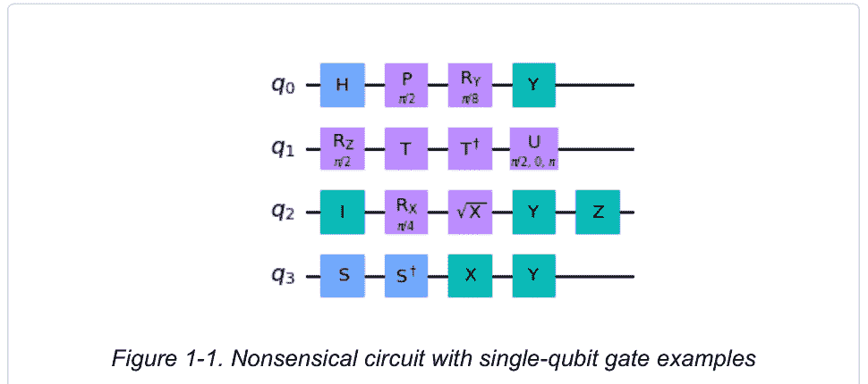

Figure 1-1. Nonsensical circuit with single-qubit gate examples

图 1-1. 包含单量子位门示例的无意义电路

表 1-2 包含一些常用的多量子位门和代码示例。变量 qc 指的是包含至少四个量子线路的 QuantumCircuit 实例：

Table 1-2. Commonly used multi-qubit gates in Qiskit

表 1-2. Qiskit 中常用的多量子位门

| Names | Example | Notes |
|---|---|---|
| 名称 | 示例 | 注释 |
| CCX, Toffoli | qc.ccx(0,1,2) | 将 X 门应用于量子线路 2，受控于线路 0 和 1 上的控制量子位的状态。参见“CCXGate”。 |
| **CH** | `qc.ch(0,1)` | 将 H 门应用于量子线路 1，受控于线路 0 上的控制量子位的状态。参见“CHGate”。 |
| **CP, Control-Phase** | `qc.cp(math.pi/4,0,1)` | 将 Phase 门应用于量子线路 1，受控于线路 0 上的控制量子位的状态。参见“CPhaseGate”。 |
| **CRX, Control-RX** | `qc.crx(math.pi/2,2,3)` | 将 RX 门应用于量子线路 3，受控于线路 2 上的控制量子位的状态。参见“CRXGate”。 |
| **CRY, Control-RY** | `qc.cry(math.pi/8,2,3)` | 将 RY 门应用于量子线路 3，受控于线路 2 上的控制量子位的状态。参见“CRYGate”。 |
| **CRZ** | `qc.crz(math.pi/4,0,1)` | 将 RZ 门应用于量子线路 1，受控于线路 0 上的控制量子位的状态。参见“CRZGate”。 |
| **CSwap, Fredkin** | `qc.cswap(0,2,3)` or `qc.fredkin(0,2,3)` | 在受控于线路 0 上的控制量子位的状态下交换线路 2 和 3 的量子位状态。参见“CSwapGate”。 |
| **CSX** | `qc.csx(0,1)` | 将 SX（X 的平方根）门应用于量子线路 1，受控于线路 0 上的控制量子位的状态。参见“CSXGate”。 |
| **CU** | `qc.cu(math.pi/2,0,math.pi,0,0,1)` | 将具有额外全局相位参数的 U 门应用于量子线路 1，受控于线路 0 上的控制量子位的状态。参见“CUGate”。 |
| **CX, CNOT** | `qc.cx(2,3)` or `qc.not(2,3)` | 将 X 门应用于量子线路 3，受控于线路 2 上的控制量子位的状态。参见“CXGate”。 |
| **CY, Control-Y** | `qc.cy(2,3)` | 将 Y 门应用于量子线路 3，受控于线路 2 上的控制量子位的状态。参见“CYGate”。 |
| **CZ, Control-Z** | `qc.cz(1,2)` | 将 Z 门应用于量子线路 2，受控于线路 1 上的控制量子位的状态。参见“CYGate”。 |
| **DCX** | `qc.dcx(2,3)` | 应用两个 CNOT 门，其控制量子位位于线路 2 和 3 上。参见“DCXGate”。 |


| 名称 | 示例 | 注释 |
|---|---|---|
| iSwap | `qc.iswap(0,1)` | 交换线路 0 和 1 的量子比特态，并将 |01⟩ 和 |10⟩ 振幅的相位改变为 i。参见 "iSwapGate"。 |
| MCP, 多控制相位 | `qc.mcp(math.pi/4, [0,1,2],3)` | 在控制量子比特处于线路 0、1 和 2 的状态下，对量子线路 3 应用相位门。参见 "MCPhaseGate"。 |
| MCX, 多控制 X | `qc.mcx([0,1,2],3)` | 在控制量子比特处于线路 0、1 和 2 的状态下，对量子线路 3 应用 X 门。参见 "MCXGate"。 |
| Swap | `qc.swap(2,3)` | 交换线路 2 和 3 的量子比特态。参见 "SwapGate"。 |

图 1-2 包含一个无意义的电路，其中包含表 1-2 中的所有多量子比特门示例

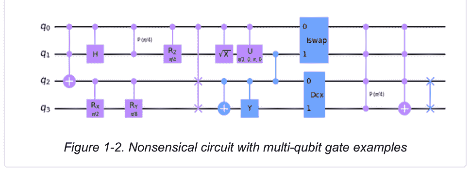

### 绘制量子电路

draw() 方法以各种格式绘制量子电路。

*使用 draw() 方法*

示例 1-1 包含一个使用默认格式的 draw() 方法的示例。

#### 示例 1-1. 使用 draw() 方法的示例

```
qc = QuantumCircuit(3)
qc.h(0)
qc.cx(0, 1)
qc.cx(0, 2)
qc.draw()
```

图 1-3 显示了绘制的电路。

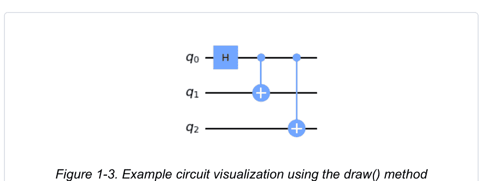

### 创建屏障

barrier() 方法在电路上放置屏障（如图 1-4 所示），在量子电路上的门之间提供视觉和功能上的分离。屏障两侧的门在电路转换为在量子硬件或模拟器上运行时，不会被视为可以一起优化的候选门。

#### 注意

使用 Qiskit 表示的门集是对给定量子计算机或模拟器上实际实现的门的抽象。Qiskit 将门转译为目标平台上实现的门，并在可能的情况下合并门以优化电路。

#### 使用 barrier() 方法

barrier() 方法可选择性地接受要在其上放置屏障的量子比特线路作为参数。如果未提供参数，则屏障将放置在所有量子线路上。此方法创建 Barrier 实例（参见“Barrier”）。

示例 1-2 演示了有参数和无参数使用 barrier() 方法的情况。

#### 示例 1-2. 使用 barrier() 方法的示例

```
qc = QuantumCircuit(2)
qc.h([0,1])
qc.barrier()
qc.x(0)
qc.x(0)
qc.s(1)
qc.barrier([1])
qc.s(1)
```

图 1-4 显示了生成的电路。

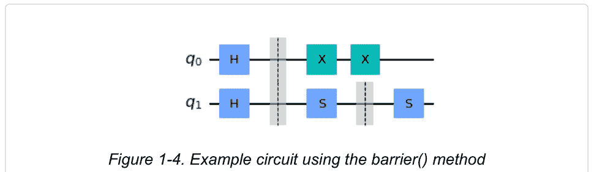

请注意，电路中的 **S** 门被屏障分隔，因此不是合并为 **Z** 门的候选门。然而 **X** 门可以通过移除两者来合并，因为它们相互抵消。

### 测量量子电路

 commonly used to measure quantum circuits are `measure()` and `measure_all()`. The former is useful when the quantum circuit contains classical wires on which to receive the result of a measurement. The latter is useful when the quantum circuit doesn’t have any classical wires. These methods create `Measure` instances (see “Measure”).

#### *使用 measure() 方法*

`measure()` 方法接受两个参数：

- 要测量的量子比特线路
- 用于存储结果比特的经典线路

以下是使用 `measure()` 方法的示例，以及生成的电路的绘制：

#### 示例 1-3. 使用 measure() 方法的示例

```
qc = QuantumCircuit(3, 3)
qc.h([0,1,2])
qc.measure([0,1,2], [0,1,2])
qc.draw()
```

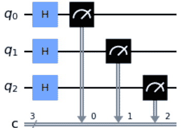

图 1-5. 使用 measure() 方法的示例电路

请注意，`measure()` 方法将请求的测量操作附加到电路上。

#### 使用 measure_all() 方法

`measure_all()` 方法可以不带参数调用。以下是使用 `measure_all()` 方法的示例，以及生成的电路的绘制：

#### 示例 1-4. 使用 measure_all() 方法的示例

```
qc = QuantumCircuit(3)
qc.h([0,1,2])
qc.measure_all()
qc.draw()
```

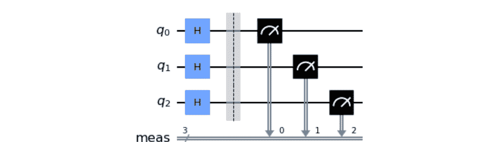

图 1-6. 使用 measure_all() 方法的示例电路

请注意，`measure_all()` 方法创建了三个经典线路，并在附加测量操作之前向电路添加了屏障。

### 获取量子电路的信息

 commonly used to obtain information about a quantum circuit include `depth()`, `size()`, and `width()`. These are listed in Table 1-3. Note that variable `qc` refers to an instance of QuantumCircuit.

表 1-3. commonly used to obtain information about a quantum circuit

| 名称 | 示例 | 注释 |
|---|---|---|
| `depth` | `qc.depth()` | 如果移除了 barrier 等指令，则返回电路的深度（关键路径） |
| `size` | `qc.size()` | 返回电路中门操作的总数 |
| `width` | `qc.width()` | 返回电路中量子线路和经典线路的总和 |

 commonly used to obtain information about a quantum circuit include `clbits`, `data`, `global_phase`, `num_clbits`, `num_qubits`, and `qubits`. These are listed in Table 1-4. Note that variable `qc` refers to an instance of `QuantumCircuit`.

#### 表 1-4. commonly used to obtain information about a quantum circuit

| 名称 | 示例 | 注释 |
|---|---|---|
| `clbits` | `qc.clbits` | 获取按寄存器添加顺序的经典比特列表 |
| `data` | `qc.data` | 获取电路中操作（例如门、屏障和测量操作）的列表 |
| `global_phase` | `qc.global_phase` | 获取电路的全局相位，单位为弧度 |
| `num_clbits` | `qc.num_clbits` | 获取电路中经典线路的数量 |
| `num_qubits` | `qc.num_qubits` | 获取电路中量子线路的数量 |
| `qubits` | `qc.qubits` | 获取按寄存器添加顺序的量子比特列表 |

### 操作量子电路

 commonly used to manipulate quantum circuits include `append()`, `bind_parameters()`, `compose()`, `copy()`, `decompose()`, `from_qasm_file()`, `from_qasm_str()`, `initialize()`, `reset()`, `qasm()`, `to_gate()`, and `to_instruction()`.

#### *使用 append() 方法*

`append()` 方法将指令或门附加到电路末端的指定线路上，原地修改电路。

示例 1-5 包含使用 `append()` 方法的示例，图 1-7 显示了生成的电路的绘制。

#### 示例 1-5. 使用 append() 方法的示例

```
qc = QuantumCircuit(2)
qc.h(1)
cx_gate = CXGate()
qc.append(cx_gate, [1,0])
qc.draw()
```

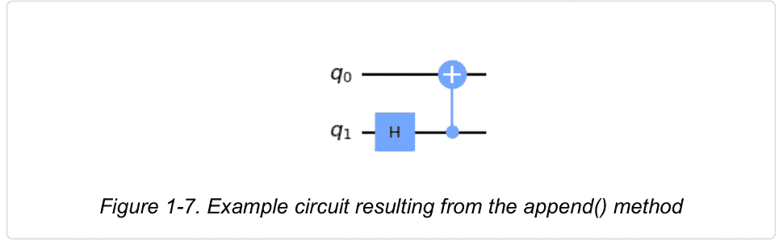

图 1-7. 使用 append() 方法生成的示例电路

注意
示例中使用的 CXGate 类（参见“CXGate”）是 qiskit.circuit.library 包中定义的一个门。

#### 使用 bind_parameters() 方法

bind_parameters() 方法将参数（参见“创建参数实例”）绑定到量子电路。示例 1-6 包含创建一个包含三个参数化相位门的电路的示例。图 1-8 显示了电路的绘制。

#### 示例 1-6. 创建参数化电路

```
theta1 = Parameter('θ1')
theta2 = Parameter('θ2')
theta3 = Parameter('θ3')

qc = QuantumCircuit(3)
qc.h([0,1,2])
qc.p(theta1,0)
qc.p(theta2,1)
qc.p(theta3,2)

qc.draw()
```

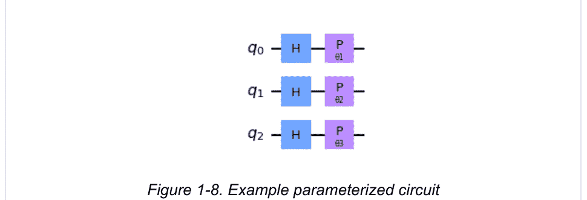

图 1-8. 示例参数化电路

要将参数值绑定到新电路，我们将包含参数引用和期望值的字典传递给 bind_parameters() 方法。示例 1-7 显示了此技术，图 1-9 显示了相位门参数被替换为所提供值的绑定电路。

#### 示例 1-7. 将参数值绑定到新电路

```
b_qc = qc.bind_parameters({theta1: math.pi/8,
    theta2: math.pi/4,
    theta3: math.pi/2})
```

```
b_qc.draw()
```


Figure 1-9. Example of bound circuit with the supplied phase gate rotation values

### Using the compose() method

The compose() method returns a new circuit composed of the original and another circuit. Example 1-8 contains an example of using the compose() method, and Figure 1-10 shows a drawing of the resultant circuit.

#### Example 1-8. Example of using the compose() method

```
qc = QuantumCircuit(2,2)
qc.h(0)
another_qc = QuantumCircuit(2,2)
another_qc.cx(0,1)
bell_qc = qc.compose(another_qc)
bell_qc.draw()
```


Figure 1-10. Example circuit resulting from the compose() method

Note that a circuit passed into the compose() method is allowed to have fewer quantum or classical wires than the original circuit.

### Using the copy() method

The copy() method returns a copy of the original circuit.
Example 1-9 contains an example of using the copy() method.

#### Example 1-9. Example of using the copy() method

```
qc = QuantumCircuit(3)
qc.h([0,1,2])
new_qc = qc.copy()
```

### Using the decompose() method

The decompose() method returns a new circuit after having decomposed the original circuit one level. Example 1-10 contains an example of using the decompose() method. Figure 1-11 shows a drawing of the resultant circuit in which S, H, and X gates are decomposed into the more fundamental U gate operations. See “UGate”.

#### Example 1-10. Example of using the decompose() method

```
qc = QuantumCircuit(2)
qc.h(0)
qc.s(0)
qc.x(1)
decomposed_qc = qc.decompose()
decomposed_qc.draw()
```

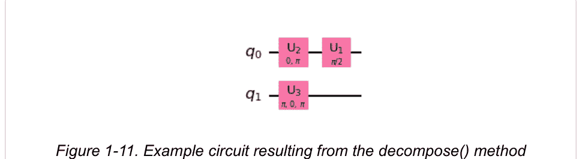

### Using the from_qasm_file() method

The from_qasm_file() method returns a new circuit from a file that contains a quantum assembly-language (OpenQASM) program.

#### Example 1-11. Example of using the from_qasm_file() method

```
new_qc = QuantumCircuit.from_qasm_file("file.qasm")
```

### Using the from_qasm_str() method

The from_qasm_str() method returns a new circuit from a string that contains an OpenQASM program. Example 1-12 contains an example of using the from_qasm_str() method, and Figure 1-12 shows a drawing of the resultant circuit.

#### Example 1-12. Example of using the from_qasm_str() method

```
qasm_str = """
OPENQASM 2.0;
include "qelib1.inc";
qreg q[2];
creg c[2];
h q[0];
cx q[0],q[1];
measure q[0] -> c[0];
measure q[1] -> c[1];
"""
new_qc = QuantumCircuit.from_qasm_str(qasm_str)
new_qc.draw()
```


Figure 1-12. Example circuit resulting from the from_qasm_str() method

### Using the initialize() method

The `initialize()` method initializes qubits of a quantum circuit to a given state. Example 1-13 contains an example of using the `initialize()` method, and Figure 1-13 shows a drawing of the resultant circuit. In this example, the circuit is initialized to the state |11⟩.

#### Example 1-13. Example of using the initialize() method

```
qc = QuantumCircuit(2)
qc.initialize([0, 0, 0, 1])
qc.draw()
```

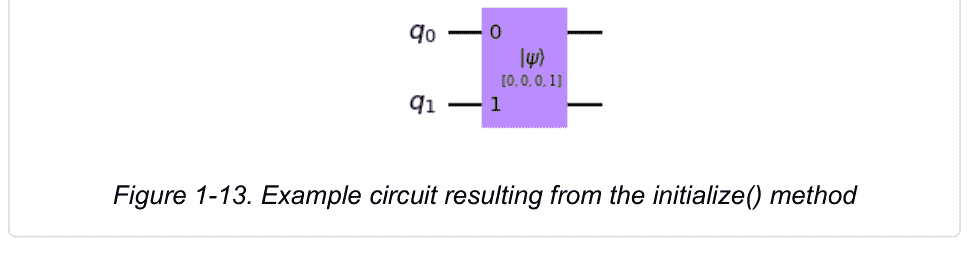

### Using the reset() method

The `reset()` method resets a qubit in a quantum circuit to the |0⟩ state. Example 1-14 contains an example of using the `reset()` method, and Figure 1-14 shows a drawing of the resultant circuit.

Note that the qubit state is |1⟩ before the reset operation. This method creates a Reset instance (see “Reset”).

#### Example 1-14. Example of using the reset() method

```
qc = QuantumCircuit(1)
qc.x(0)
qc.reset(0)
qc.draw()
```

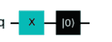

Figure 1-14. Example circuit resulting from the using the reset() method

### Using the qasm() method

The qasm() method returns an OpenQASM program that represents the quantum circuit. Example 1-15 contains an example of using the qasm() method, and Example 1-16 shows the resultant OpenQASM program.

#### Example 1-15. Example of using the qasm() method

```
qc = QuantumCircuit(2, 2)
qc.h(0)
qc.cx(0, 1)
qasm_str = qc.qasm()
print(qasm_str)
```

#### Example 1-16. OpenQASM program resulting from the using the qasm() method

```
OPENQASM 2.0;
include "qelib1.inc";
qreg q[2];
creg c[2];
h q[0];
cx q[0],q[1];
```

### Using the to_gate() method

The to_gate() method creates a custom gate (see “The Gate Class”) from a quantum circuit. Example 1-17 contains an example of creating a circuit that will be converted to a gate, and Figure 1-15 shows a drawing of the circuit.

#### NOTE

A gate represents a unitary operation. To create a custom operation that isn't unitary, use the to_instruction() method shown in “Using the to_instruction() method”.

#### Example 1-17. Creating a circuit that will be converted to a gate

```
anti_cnot_qc = QuantumCircuit(2)
anti_cnot_qc.x(0)
anti_cnot_qc.cx(0,1)
anti_cnot_qc.x(0)

anti_cnot_qc.draw()
```

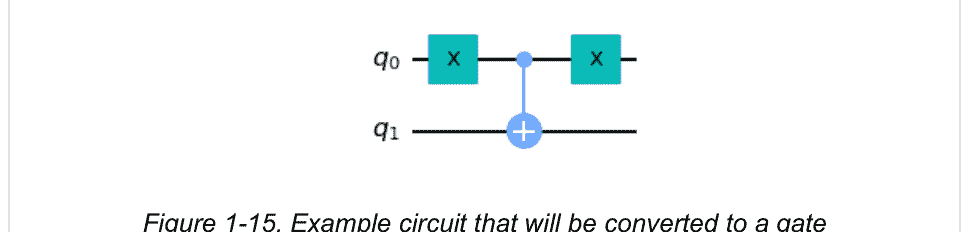

Figure 1-15. Example circuit that will be converted to a gate

This custom gate will implement an anti-control NOT gate in which the X gate is applied only when the control qubit is |0⟩. Example 1-18 creates a circuit that uses this custom gate, and Figure 1-16 shows a decomposed drawing of this circuit.

#### Example 1-18. Example of using a gate created by the to_gate() method

```
anti_cnot_gate = anti_cnot_qc.to_gate()

qc = QuantumCircuit(3)
qc.x([0,1,2])
qc.append(anti_cnot_gate, [0,2])

qc.decompose().draw()
```

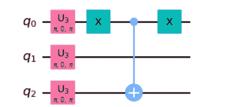

Figure 1-16. Decomposed circuit that uses a gate created by the to_gate() method

### Using the to_instruction() method

The to_instruction() method creates a custom instruction (see “The Instruction Class”) from a quantum circuit. Example 1-19 contains an example of creating a circuit that will be converted to an instruction, and Figure 1-17 shows a drawing of the circuit.

#### NOTE

An instruction represents an operation that isn’t necessarily unitary. To create a custom operation that is unitary, use the to_gate() method shown in “Using the to_gate() method”.

#### Example 1-19. Creating a circuit that will be converted to an instruction

```
reset_one_qc = QuantumCircuit(1)
reset_one_qc.reset(0)
reset_one_qc.x(0)

reset_one_qc.draw()
```

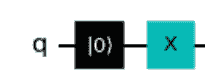

Figure 1-17. Example circuit that will be converted to an instruction

This custom instruction will reset a qubit and apply an X gate, in effect resetting the qubit to state |1⟩. Example 1-20 creates a circuit that uses this custom instruction, and Figure 1-18 shows a decomposed drawing of this circuit.

#### Example 1-20. Example of using an instruction created by the to_instruction() method

```
reset_one_inst = reset_one_qc.to_instruction()

qc = QuantumCircuit(2)
qc.h([0,1])
qc.reset(0)
qc.append(reset_one_inst, [1])

qc.decompose().draw()
```

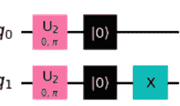

Figure 1-18. Circuit that uses an instruction created by the to_instruction() method

### Saving state when running a circuit on AerSimulator

When running a circuit on an AerSimulator backend (see [Link to Come]), simulator state may be saved in the circuit instance by using the QuantumCircuit methods in Table 1-5.

#### Table 1-5. Methods used to save simulator state in a circuit instance

| Method name | Description |
|---|---|
| save_state | Saves the simulator state as appropriate for the simulation method |
| save_density_matrix | Saves the simulator state as a density matrix |
| save_matrix_product_state | Saves the simulator state as a matrix product state tensor |
| save_stabilizer | Saves the simulator state as a Clifford stabilizer |
| save_statevector | Saves the simulator state as a statevector |
| save_superop | Saves the simulator state as a superoperator matrix of the run circuit |
| save_unitary | Saves the simulator state as a unitary matrix of the run circuit |

### Using the QuantumRegister Class

It is sometimes useful to treat groups of quantum or classical wires as a unit. For example, the control qubits of the CNOT gates in the quantum circuit expressed in Example 1-21 and Figure 1-19 expect three qubits in equal superpositions. The additional quantum wire in the circuit is used as a scratch area whose output is disregarded.

#### Example 1-21. Example of using QuantumRegister and ClassicalRegister classes

```
qr = QuantumRegister(3, 'q')
scratch = QuantumRegister(1, 'scratch')
cr = ClassicalRegister(3, 'c')
qc = QuantumCircuit(qr, scratch, cr)

qc.h(qr)
qc.x(scratch)
qc.h(scratch)
```


```
qc.cx(qr[0], scratch)
qc.cx(qr[2], scratch)
qc.barrier(qr)
qc.h(qr)
qc.measure(qr, cr)

qc.draw()
```

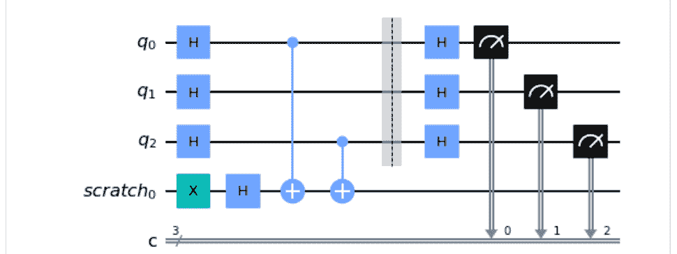

Figure 1-19. Example circuit using the QuantumRegister and ClassicalRegister classes

通过定义一个由三个量子比特组成的 QuantumRegister，可以通过传递 QuantumRegister 引用，将诸如 h()、barrier() 和 measure() 等方法应用于全部三个线路。类似地，定义一个由三个比特组成的 ClassicalRegister（参见“Using the ClassicalRegister Class”）可使 measure() 方法通过传递 ClassicalRegister 引用来指定全部三个经典线路。此外，提供给 QuantumRegister 和 ClassicalRegister 构造函数的名称会在电路绘图上显示。

### Some QuantumRegister attributes

常用的 QuantumRegister 属性包括 name 和 size。这些列在表 1-6 中。注意变量 qr 引用 QuantumRegister 的一个实例。

#### Table 1-6. Some QuantumRegister attributes

| Names | Example | Notes |
| --- | --- | --- |
| name | qr.name | 获取量子寄存器的名称 |
| size | qr.size | 获取量子寄存器中量子比特线路的数量 |

### Using the ClassicalRegister Class

请参考“Using the QuantumRegister Class”以了解使用 ClassicalRegister 类的动机。

### Some ClassicalRegister attributes

常用的 ClassicalRegister 属性包括 name 和 size。这些列在表 1-7 中。注意变量 cr 引用 ClassicalRegister 的一个实例。

#### Table 1-7. Some ClassicalRegister attributes

| Names | Example | Notes |
| --- | --- | --- |
| name | cr.name | 获取经典寄存器的名称 |
| size | cr.size | 获取经典寄存器中比特线路的数量 |

### Instructions and Gates

在 Qiskit 中，可应用于量子电路的所有操作都派生自 Instruction 类（参见“The Instruction Class”）。酉操作派生自 Gate 类（参见“The Gate Class”），它是 Instruction 的子类。受控酉操作派生自 ControlledGate 类（参见“The ControlledGate Class”），它是 Gate 的子类。这些类可分别用于定义新的指令、酉门和受控酉门。

### The Instruction Class

Qiskit 中的非酉操作（如 Measure 和 Reset）是 Instruction 的直接子类。虽然可以通过子类化 Instruction 来定义自己的自定义指令，但另一种方法是使用 QuantumCircuit 类的 to_instruction() 方法（参见“Using the to_instruction() method”中的示例）。

Instruction 类中的方法包括 copy()、repeat() 和 reverse_ops()。这些列在表 1-8 中。注意变量 inst 引用 Instruction 的一个实例。

#### Table 1-8. Commonly used methods in the Instruction class

| Names | Example | Notes |
|---|---|---|
| copy | inst.copy("My inst") | 返回指令的副本，并将提供的名称赋给副本 |
| repeat | inst.repeat(2) | 返回将此指令重复给定次数的指令 |
| reverse_ops | inst.reverse_ops() | 返回其操作顺序相反的指令 |

Instruction 类中常用的属性包括 definition 和 params。这些列在表 1-9 中。注意变量 inst 引用 Instruction 的一个实例。

#### Table 1-9. Commonly used attributes in the Instruction class

| Names | Example | Notes |
|---|---|---|
| definition | inst.definition | 返回以基本门表示的定义 |
| params | inst.params | 获取指令的参数 |

### The Gate Class

Qiskit 中的酉操作（如 HGate 和 XGate）是 Gate 的子类。虽然可以通过子类化 Gate 来定义自己的自定义门，但另一种方法是使用 QuantumCircuit 类的 to_gate() 方法（参见“Using the to_gate() method”中的示例）。

Gate 类中常用的方法包括表 1-8 中列出的 Instruction 方法，以及 control()、inverse()、power() 和 to_matrix()。这些全部列在表 1-10 中。注意变量 gate 引用 Gate 的一个实例。

#### Table 1-10. Commonly used methods in the Gate class

| Names | Example | Notes |
|---|---|---|
| control | gate.control(1) | 给定控制量子比特的数量，返回门的受控版本 |
| copy | gate.copy("My gate") | 返回门的副本，并将提供的名称赋给副本 |
| inverse | gate.inverse() | 返回门的逆 |
| power | gate.power(2) | 返回将门提升到给定幂次的门 |
| repeat | gate.repeat(3) | 返回将此门重复给定次数的门 |
| reverse_ops | gate.reverse_ops() | 返回其操作顺序相反的门 |
| to_matrix | gate.to_matrix() | 返回门的酉矩阵的数组 |

Gate 类中常用的属性包括表 1-9 中列出的 Instruction 属性，以及 label。这些全部列在表 1-11 中。注意变量 gate 引用 Gate 的一个实例。

#### Table 1-11. Commonly used attributes in the Gate class

| Names | Example | Notes |
|---|---|---|
| definition | gate.definition | 返回以基本门表示的定义 |
| label | gate.label | 获取指令的标签 |
| params | gate.params | 获取指令的参数 |

### The ControlledGate Class

Qiskit 中的受控酉操作（如 CZGate 和 CCXGate）是 ControlledGate 的子类。

ControlledGate 类中常用的方法是表 1-10 中列出的 Gate 方法

ControlledGate 类中常用的属性包括表 1-11 中列出的 Gate 属性，以及 num_ctrl_qubits 和 ctrl_state。

### Using the num_ctrl_qubits attribute

num_ctrl_qubits 属性保存一个整数，表示 ControlledGate 中控制量子比特的数量。示例 1-22 包含使用 Toffoli 门的 num_ctrl_qubits 属性的示例，其打印输出为 2。

#### Example 1-22. Example of using the num_ctrl_qubits attribute

```
toffoli = CCXGate()
print(toffoli.num_ctrl_qubits)
```

### Using the ctrl_state() method

ControlledGate 可能有一个或多个控制量子比特，其中每个量子比特实际上可以是控制量子比特或反控制量子比特（参见“Using the to_gate() method”中的反控制示例）。ctrl_state 属性保存一个整数，其二进制值表示哪些量子比特是控制量子比特，哪些是反控制量子比特。具体来说，二进制数字 1 表示控制量子比特，二进制数字 0 表示反控制量子比特。ctrl_state 属性支持访问和修改其值。示例 1-23 包含使用 ctrl_state 属性的示例，其中二进制值 10 使最上面的控制量子比特成为反控制量子比特。

#### Example 1-23. Example of using the ctrl_state attribute

```
toffoli = CCXGate()
toffoli.ctrl_state = 2

toffoli.definition.draw()
```

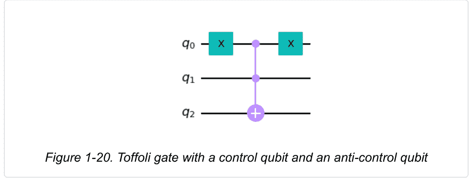

### Defining a custom controlled gate

虽然可以通过子类化 ControlledGate 来定义自己的自定义受控门，但另一种方法是遵循以下两个步骤：

- 1. 使用 `QuantumCircuit` 类的 `to_gate()` 方法创建一个自定义门（参见“Using the to_gate() method”中的示例）
- 2. 使用表 1-10 中所示的 `control()` 方法为自定义门添加控制量子比特

我们将遵循这两个步骤来定义一个自定义受控门，当其两个控制量子比特都为 |1⟩ 时应用 π/16 相位旋转。首先，示例 1-24 定义了一个包含 π/16 P 门的电路并将其转换为自定义门，图 1-21 显示了自定义门的绘图。

#### Example 1-24. Creating a custom π/16 phase gate

```
p16_qc = QuantumCircuit(1)
p16_qc.p(math.pi/16, 0)

p16_gate = p16_qc.to_gate()

p16_gate.definition.draw()
```


其次，示例 1-25 使用 `control()` 方法从我们的自定义门创建 `ControlledGate`，图 1-22 显示了自定义受控门的绘图。

#### Example 1-25. Example of using the control() method to add control qubits to a gate

```
ctrl_p16 = p16_gate.control(2)

ctrl_p16.definition.draw()
```


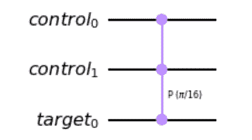

*Figure 1-22. Custom controlled π/16 phase gate drawing*

我们将利用 `append()` 方法（参见“Using the append() method”）在示例 1-26 中使用我们自定义的受控门构建量子电路。图 1-22 显示了该电路的绘制图。

#### *Example 1-26. Example of using a gate created by the to_gate() method*

```
qc = QuantumCircuit(4)
qc.h([0,1,2,3])
qc.append(ctrl_p16,[0,1,3])

qc.draw()
```

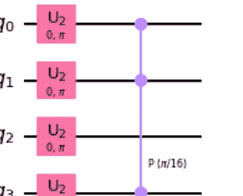

*Figure 1-23. Decomposed circuit that uses the custom controlled gate*

### Parameterized Quantum Circuits

有时创建在运行时可提供值的量子电路会很有用。在 Qiskit 中，此功能可通过 *parameterized circuits* 实现，部分由 `Parameter` 和 `ParameterVector` 类实现。

#### Creating a Parameter Instance

`Parameter` 类用于表示量子电路中的参数。参见“Using the bind_parameters() method”以了解定义和使用参数化电路的示例。如该示例所示，可通过向其构造函数提供 unicode 字符串来创建参数，如下所示：

```
theta1 = Parameter("θ1")
```

随后可将命名为 `theta1` 的 `Parameter` 对象引用用于 `QuantumCircuit` 类的 `bind_parameters()` 方法，或 alternatively `assign_parameters()` 方法。

#### Using the ParameterVector Class

可利用 `ParameterVector` 类以集合形式而非单个变量的形式创建和使用参数。示例 1-27 包含创建包含三个参数化相位门的电路的示例。图 1-24 显示了该电路的绘制图。

*Example 1-27. Leveraging ParameterVector to create a parameterized circuit*

```
theta = ParameterVector('θ', 3)

qc = QuantumCircuit(3)
qc.h([0,1,2])
qc.p(theta[0],0)
qc.p(theta[1],1)
qc.p(theta[2],2)

qc.draw()
```

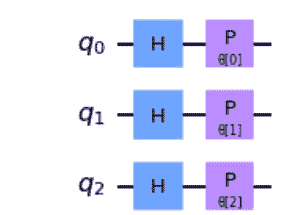

Figure 1-24. Example parameterized circuit leveraging ParameterVector

要将参数值绑定到新电路，我们将传递包含 ParameterVector 引用和期望值列表的字典给 bind_parameters() 方法。示例 1-28 展示了此技术，图 1-25 显示了绑定后的电路，其中相位门参数被替换为所提供的值。

#### Example 1-28. Binding parameter values to a new circuit

```
b_qc = qc.bind_parameters({theta: [math.pi/8,
    math.pi/4,
    math.pi/2]})

b_qc.draw()
```

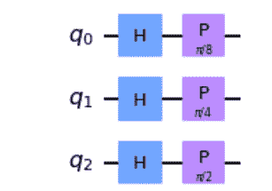

Figure 1-25. Example of bound circuit with the supplied phase gate rotation values
