## Chapter 2. Qiskit Circuit Library Standard Operations

### A NOTE FOR EARLY RELEASE READERS

使用 Early Release 电子书，您可以在这些标题的正式发布之前很久就利用这些技术——作者在撰写时提供的原始未编辑内容。

这将是最终书籍的第 4 章。请注意 GitHub 仓库将在稍后激活。

如果您对如何改进本书中的内容和/或示例有任何评论，或如果您注意到本章中缺少材料，请联系编辑 sevans@oreilly.com。

Qiskit Circuit Library 包含许多可作为实现量子算法构建块的操作和电路。以下是一些标准操作，按指令、单量子比特门和多量子比特门分类。

### Standard Instructions

标准指令类实现了不一定是幺正的量子操作。它们是 Instruction 类的子类（参见“The Instruction Class”）。

### Barrier

Barrier 类创建具有给定量子比特数的 barrier 指令（参见“Creating a Barrier”）。Barrier 在量子电路的导线上提供了视觉和功能上的分离。

### Measure

`Measure` 类创建用于在计算基中测量量子态的测量指令，将二进制结果放置在经典寄存器中（参见“Measuring a quantum circuit”）。

### Reset

`Reset` 类创建将量子比特状态重置为 |0⟩ 的重置指令（参见“Using the reset() method”）。

### Standard Single-Qubit Gates

标准单量子比特门实现了幺正量子操作。它们是 Gate 类的子类（参见“The Gate Class”）。这些门可通过 QuantumCircuit 类的单量子比特门方法创建并应用于电路，这些方法出现在表 1-1 中。

### HGate

HGate 类创建单量子比特 H 门。它在 X+Z 轴上执行 π 旋转。它还具有将计算基从 |0⟩,|1⟩ 更改为 |+⟩,|−⟩ 并反之的效果。

Signature: Appearance: Matrix:
HGate(label=None)  q — H —  1/√2 [1 1; 1 -1]

### IGate

IGate 类创建单量子比特 I 门，对量子比特的状态没有影响。

Signature: Appearance: Matrix:
IGate(label=None)  q — I —  [1 0; 0 1]

### PhaseGate

PhaseGate 类创建执行给定相位旋转的单量子比特 Phase 门。

### RXGate

RXGate 类创建执行给定 X 轴旋转的单量子比特 RX 门。

### RYGate

RYGate 类创建执行给定 Y 轴旋转的单量子比特 RY 门。

### RZGate

RZGate 类创建执行给定 Z 轴旋转的单量子比特 RZ 门。

```
PhaseGate(theta, label=None)
```

```
RXGate(theta, label=None)
```

```
RYGate(theta, label=None)
```

### SGate

`SGate` 类创建执行 π/2 相位旋转的单量子比特 **S** 门。

Signature: Appearance: Matrix:

```
SGate(label=None)
```

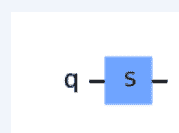

⎛1 0⎞
⎝0 i⎠

### SdgGate

`SdgGate` 类创建执行 -π/2 相位旋转的单量子比特 **S†** 门。

Signature: Appearance: Matrix:

```
SdgGate(label=None)
```

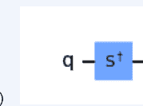

⎛1 0⎞
⎝0 -i⎠

### SXGate

`SXGate` 类创建执行 π/2 旋转围绕 X 轴同时将全局相位偏移 π/4 的单量子比特平方根 **X** 门。

Signature: Appearance: Matrix:

```
SXGate(label=None)
```

### SXdgGate

`SXdgGate` 类创建执行 -π/2 旋转围绕 X 轴同时将全局相位偏移 -π/4 的单量子比特逆平方根 **X** 门。

### TGate

`TGate` 类创建执行 π/4 相位旋转的单量子比特 **T** 门。

### TdgGate

`TdgGate` 类创建执行 -π/4 相位旋转的单量子比特 **T†** 门。

### UGate

UGate 类创建具有 3 个欧拉角的单量子比特 U 门。

Signature:

Appearance:

Matrix:

```
UGate(theta, phi, lam, label=None)
```

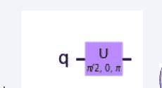

⎛ cos(θ)  -e^(iλ) sin(θ) ⎞
⎝ e^(iφ) sin(θ)  e^(i(φ+λ)) cos(θ) ⎠

### XGate

XGate 类创建执行 X 轴上 π 旋转的单量子比特 X 门。

Signature:

Appearance:

Matrix:

```
XGate(label=None)
```

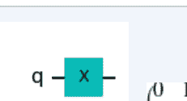

⎛ 0 1 ⎞
⎝ 1 0 ⎠

### YGate

YGate 类创建执行 Y 轴上 π 旋转的单量子比特 Y 门。

Signature:

Appearance:

Matrix:

```
YGate(label=None)
```

⎛ 0  -i ⎞
⎝ i   0 ⎠

### ZGate

ZGate 类创建执行 Z 轴上 π 旋转的单量子比特 Z 门。

| Signature: | Appearance: | Matrix: |
|---|---|---|
| ZGate(label=None) | q — [Z] — | (1 0
0 -1) |

### Standard Multi-Qubit Gates

标准多量子比特门实现了幺正量子操作。它们是 ControlledGate 类的子类（参见“The ControlledGate Class”）。其中一些门可通过 QuantumCircuit 类的多量子比特门方法创建并应用于电路，其中许多出现在表 1-2 中。

### C3XGate

C3XGate 类创建具有 X 门和三个控制量子比特的四量子比特门。

```
Signature:
C3XGate(angle=None, label=None, ctrl_state=None)
Appearance:
```


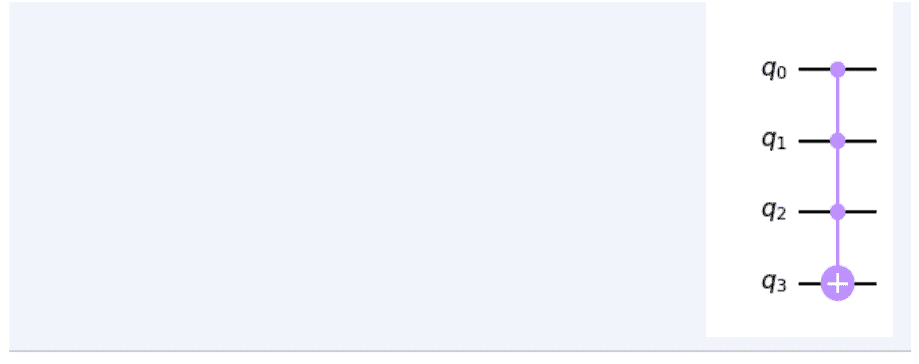

### C3SXGate

The C3SXGate class creates a four-qubit gate that has a square root of X gate and three control qubits.

Signature:

Appearance:

```
C3SXGate(label=None, ctrl_state=None, *,
angle=None)
```

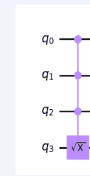

### C4XGate

The C4XGate class creates a five-qubit gate that has an X gate and four control qubits.

Signature:

Appearance:

```
C4XGate(label=None, ctrl_state=None)
```

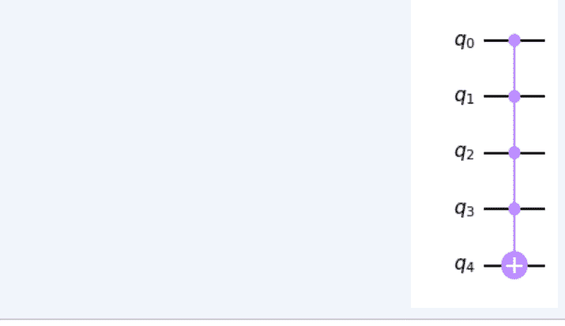

### CCXGate

The `CCXGate` class creates a three-qubit gate that has an **X** gate and two control qubits. This is also known as a Toffoli gate.

Signature:

Appearance:

```
CCXGate(label=None, ctrl_state=None)
```

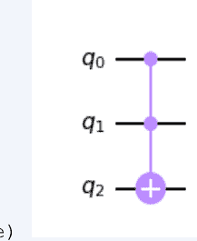

### CHGate

The `CHGate` class creates a controlled-Hadamard gate, applying the Hadamard according to the control qubit state.

Signature:

Appearance:

```
CHGate(label=None, ctrl_state=None)
```

### CPhaseGate

The `CPhaseGate` class creates a controlled-Phase gate, applying the `PhaseGate` according to the control qubit state.

Signature:

Appearance:

```
CPhaseGate(theta, label=None,
ctrl_state=None)
```

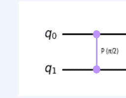

### CRXGate

The `CRXGate` class creates a controlled-RX gate, applying the RX according to the control qubit state.

Signature:

Appearance:

```
CRXGate(theta, label=None, ctrl_state=None)
```

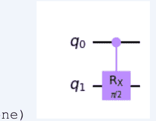

### CRYGate

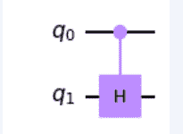

The `CRYGate` class creates a controlled-RY gate, applying the `RY` according to the control qubit state.

Signature:

Appearance:

```
CRYGate(theta, label=None, ctrl_state=None)
```

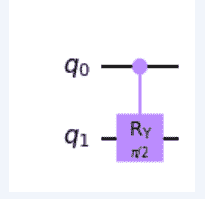

### CRZGate

The `CRZGate` class creates a controlled-RZ gate, applying the `RZ` according to the control qubit state.

Signature:

Appearance:

```
CRZGate(theta, label=None, ctrl_state=None)
```

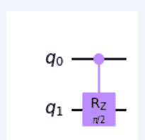

### CSwapGate

The `CSwapGate` class creates a three-qubit gate whose **Swap** gate is applied according to the control qubit state.

Signature:

Appearance:

```
CSwapGate(label=None, ctrl_state=None)
```

### CSXGate

The `CSXGate` class creates a controlled-SX (square root of X) gate, applying the √X gate according to the control qubit state.

Signature:

Appearance:

```
CSXGate(label=None, ctrl_state=None)
```

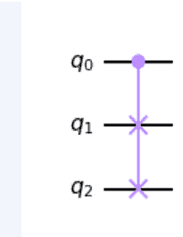

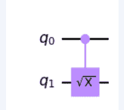

### CUGate

The `CUGate` class creates a controlled-U gate, applying the U gate including a global phase argument, according to the control qubit state.

Signature:

Appearance:

```
CUGate(theta, phi, lam, gamma, label=None,
ctrl_state=None)
```

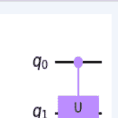

### CXGate

The `CXGate` class creates a controlled-X gate, applying the **X** gate according to the control qubit state.

Signature:

Appearance:

```
CXGate(label=None, ctrl_state=None)
```

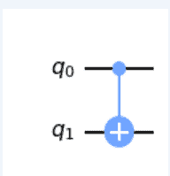

### CYGate

The `CYGate` class creates a controlled-Y gate, applying the **Y** gate according to the control qubit state.

Signature:

Appearance:

```
CYGate(label=None, ctrl_state=None)
```

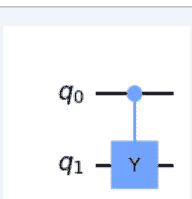

### CZGate

The `CZGate` class creates a controlled-Z gate, applying the **Z** gate according to the control qubit state.

Signature:

Appearance:

```
CZGate(label=None, ctrl_state=None)
```

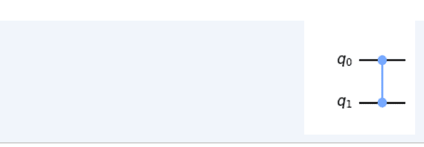

### DCXGate

The `DCXGate` class creates a double-CNOT gate. This is a two-qubit gate that has two **CNOT** gates with their control-qubits on different wires.

Signature: Appearance:

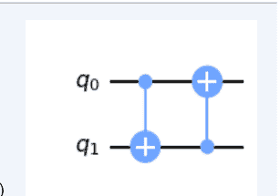

```
DCXGate()
```

### iSwapGate

The `iSwapGate` class swaps the qubit states of two quantum wires. It also changes the phase of |01⟩ and |10⟩ amplitudes by i.

Signature:

Appearance:

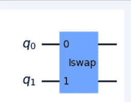

```
iSwapGate(label=None, ctrl_state=None)
```

### MCPhaseGate

The `MCPhaseGate` class creates a multi-controlled **Phase** gate with a given number of control qubits.

Signature:

Appearance:

```
MCPhaseGate(lam, num_ctrl_qubits,
label=None)
```

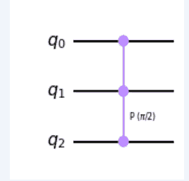

### MCXGate

The `MCXGate` class creates a multi-controlled **X** gate with a given number of control qubits.

Signature:

Appearance:

```
MCXGate(num_ctrl_qubits=None, label=None,
ctrl_state=None)
```

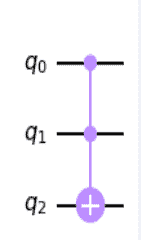

### SwapGate

The `SwapGate` swaps the qubit states of two quantum wires.

Signature:

Appearance:

```
SwapGate (label=None)
```

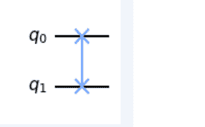

### About the Author

**James L. Weaver** is a developer, author, and speaker with a passion for quantum computing. He is a Java Champion, and a JavaOne Rockstar. James has written books including *Inside Java*, *Beginning J2EE*, the *Pro JavaFX* series, and *Java with Raspberry Pi*. As an IBM Quantum Developer Advocate, James speaks internationally about quantum computing with Qiskit at quantum and classical computing conferences.

- 1. 1. Quantum Circuits and Operations
- a. Constructing Quantum Circuits
- i. Using the QuantumCircuit Class
- ii. Using the QuantumRegister Class
- iii. Using the ClassicalRegister Class
- b. Instructions and Gates
- i. The Instruction Class
- ii. The Gate Class
- iii. The ControlledGate Class
- c. Parameterized Quantum Circuits
- i. Creating a Parameter Instance
- ii. Using the ParameterVector Class
- 2. 2. Qiskit Circuit Library Standard Operations
- a. Standard Instructions
- i. Barrier
- ii. Measure
- iii. Reset
- b. Standard Single-Qubit Gates
- i. HGate
- ii. IGate
- iii. PhaseGate
- iv. RXGate
- v. RYGate
- vi. RZGate
- vii. SGate
- viii. SdgGate
- ix. SXGate
- x. SXdgGate
- xi. TGate
- xii. TdgGate
- xiii. UGate
- xiv. XGate
- xv. YGate
- xvi. ZGate
- c. Standard Multi-Qubit Gates
- i. C3XGate
- ii. C3SXGate
- iii. C4XGate
- iv. CCXGate
- v. CHGate
- vi. CPhaseGate
- vii. CRXGate
- viii. CRYGate
- ix. CRZGate
- x. CSwapGate
- xi. CSXGate
- xii. CUGate
- xiii. CXGate
- xiv. CYGate
- xv. CZGate
- xvi. DCXGate
- xvii. iSwapGate
- xviii. MCPhaseGate
- xix. MCXGate
- xx. SwapGate

