# 第1章

# 线性代数简介

## 本章目标

阅读本章并完成复习题后，你将能够：

- 理解基本代数概念
- 计算点积和向量范数
- 能够使用向量和向量空间
- 能够处理基本线性代数
- 对矩阵和向量进行基本数学运算

如果没有至少掌握线性代数的工作知识，就不可能真正对量子物理和量子计算有基本的理解。

显然，一本书中的一章不可能让你成为任何主题的专家，包括线性代数。

这不是本书或本章的目标。

相反，本章的目的是为你提供足够的线性代数工作知识，以便促进对量子计算的理解。

考虑到这个目标，本章将努力充分解释概念，而不假设任何事先的知识。

这与许多数学书籍不同，那些书籍似乎总是假设有一定的事先知识。

此外，本章不会探讨数学证明。

这些当然对数学家非常重要，但你当然可以在没有证明的情况下继续探索量子计算。

此外，这类证明对于数学新手来说往往令人生畏。

线性代数对量子计算和量子物理如此重要，是因为量子态就是用这种方式表示的。

光子等粒子的量子态由向量表示。

量子逻辑门由矩阵表示。

向量和矩阵将在本章中探讨。

这不是说不需要其他数学。

当然，微积分和数论等领域与量子物理和量子计算有关。

然而，线性代数是你最需要掌握的关键数学技能。

还应该指出，如果你有线性代数背景，本章将是一次复习——坦白说，有时可能会显得有点琐碎。

目的是帮助没有事先知识的读者获得足够的基础，以便继续阅读本书。

相反，如果你是没有线性代数知识的读者，在继续之前完全掌握本章的主题非常重要。

你可能需要多次阅读本章的部分内容，并且章末有练习题，你可能应该做。

特别是如果你是线性代数新手，强烈建议你做这些练习。

首先，让我们定义一下什么是线性方程。

线性方程只是所有因子的指数都为1的方程，通常表示为没有指数。

因此，你在本章中不会看到任何 x^2 或 y^3。

这对一个看起来如此有前途的主题来说，可能看起来是个不太吉利的开端。

我向你保证，线性代数对许多主题至关重要。

除了量子计算，它对机器学习也很重要。

在本章中，你将掌握线性代数基础的工作知识。

本章和本书的重点将是线性代数在量子计算中的应用，但你在本章中获得（或复习）的技能可以应用到其他领域。

## 1.1 什么是线性代数？

这似乎是个相当基础的问题，但这是我们开始考察线性代数的好地方。

再次说明，本章不假设读者有任何事先知识。

虽然线性代数在许多领域都有应用，包括量子物理，但它最初是作为求解线性方程组的方法而产生的（因此得名）。

线性方程是所有元素都是一次方的方程。

因此，以下三个方程是线性方程：

```
a + b = 20
2x + 4 = 54
2x + 3y - z = 21
```

然而，以下不是线性方程：

```
2x^2 + 3 = 10
4y^2 + 2x + 3 = 8
```

前三个方程的所有元素都是一次方（通常写作 x^1 这种形式，1 只是默认且不写）。

然而，在第二组方程中，至少有一个元素被提升到了某个更高的幂。

因此，它们不是线性方程。


线性代数主题最早的书籍之一是赫尔曼·格拉斯曼于1844年撰写的《扩展理论》。该书还包含了其他主题，但也包含了一些线性代数的基本概念。1856年，阿瑟·凯莱引入了矩阵乘法，我们将在本章后面探讨这一点。1888年，朱塞佩·佩亚诺给出了向量空间的精确定义，这是本章和整本书中都将占据重要地位的另一个主题。我们将在本章后面探讨向量和向量空间。你可以看出，线性代数这门现代学科是在一段时间内发展而来的。

基本上，矩阵是重点。如果你考虑片刻，矩阵可以被视为一种特殊的数字。这听起来可能有点奇怪，但从一些基础代数入手可能会有所帮助。毕竟，线性代数是一种代数。

## 1.2 代数基础

本节内容很可能至少对许多读者来说是复习。如果你发现其中大部分或全部内容对你来说都是复习，那真是太棒了！但是，如果其中有任何内容对你来说是新的，请不要担心。本书不假设你拥有先前的数学功底，你需要的一切都会向你讲解。

可以肯定的是，你年轻时在学校至少接触过基础代数；然而，浏览任何大学的数学系都会发现，名称中包含代数的不同课程有很多。显然，线性代数是其中之一。还有抽象代数、代数图论以及其他几门课程。这可能会让你质疑，你年轻时获得的理解是否不足，而你是对的。

实际上，关于代数的定义有相当多，而且大多数都是正确的。一个简单的定义是：代数是根据一套规则操纵数学符号的研究。这是正确的，但有点局限。大英百科全书的定义是：“代数，数学的一个分支，其中将算术运算和形式操作应用于抽象符号，而非特定数字。”¹ MathWorks 表示：“代数涵盖了关系、符号的使用、建模以及数学变化的研究。”²

我最喜欢的一本书，适合那些数学基础薄弱但想了解更多的人，是莫里斯·克莱因的《非数学家的数学》，书中这样说道：“关于数字的推理——如果要超越算术最简单的程序——需要掌握两种技能，即词汇和技术，或者说，词汇和语法。此外，整个数学语言的特点是大量使用符号。事实上，使用符号以及以符号进行推理，通常被认为是算术向代数过渡的标志，尽管没有明确的分界线。”

让我们尝试将这些看似多样的定义汇总成一个你可以在本章中使用的连贯的工作定义。代数是关于符号及其相互关系规则的研究。这些符号有时是实际的数字（整数、实数等），有时是代表广泛概念的抽象符号。考虑这个简单的等式：

a² = a * a

使用抽象符号使我们能够思考“平方”一个数字意味着什么，而无需纠结于任何实际数字。尽管这是一个非常简单的等式，但它展示了脱离具体应用来研究概念的有用性。这是代数的一种用途。当然，它也可以用于具体问题，而且经常如此。

你可以根据不同的属性推导出数系。对年轻人讲授的初等代数只是可能的代数之一。表 1.1 概述了一些基本属性，这些属性在给定数系中可能存在也可能不存在。

| 公理 | 意义 |
| --- | --- |
| 加法结合律 | u + (v + w) = (u + v) + w |
| 加法交换律 | u + v = v + u |
| 乘法结合律 | u * (v * w) = (u * v) * w |
| 乘法交换律 | u * w = w * u |
| 标量乘法对向量加法的分配律 | a(u + v) = au + av |
| 标量乘法对域加法的分配律 | (a + b)v = av + bv |

虽然表 1.1 总结了一些基本属性，但稍作解释或许有必要。我们所说的加法结合性质是指，数字的分组方式实际上并不重要，和或积都会相同。交换性质是指，改变顺序不会改变和或积。一个有趣的点是，在处理矩阵时，这种性质不成立。我们将在本章后面探讨这一点。分配律是指括号外的值分配到括号内。

你无疑已经习惯于各种数字，例如整数、有理数、实数等。这些数系都是无限的；然而，这些并不是唯一可能的数字分组。通过考察抽象代数的一些基本概念，你的代数理解将得到增强。

在继续之前，我们应该确保你确实能熟练处理整数、有理数等。一个很好的起点是自然数。之所以这样称呼，是因为它们来得很自然。也就是说，这是儿童最初学习思考数字的方式。这些数字通常也被称为计数数。有些资料只计算正整数（1、2、3、4、...），不包括零。其他资料包括零。无论哪种情况，这些都是与计数相对应的数字。如果你数这本书有多少页，可以使用自然数来完成这项任务。

下一步是整数。虽然负数对你来说可能看起来再正常不过了，但在古代却是闻所未闻。负数最早出现在中国汉代的一本书中。然后在印度，负数最早在公元4世纪出现，并在公元7世纪之前常被用于财务事务中表示债务。现在，我们知道整数是所有正数或负数的整数，加上零：-3、-2、-1、0、1、2、3、...。

在整数之后，下一种数字是有理数。有理数最初被注意到是作为除法的结果。有理数的数学定义是“可以表示为两个整数之商的任何数”。然而，人们很快会发现，数字的除法会导致无法表示为两个整数之商的结果。经典例子来自几何。如果你尝试表示圆周长与半径之比，结果是一个无限数。它通常近似为 3.14159，但小数继续无重复模式地延伸。无理数有时是循环小数，但不一定是。只要一个数是实数且不能表示为两个整数之商，它就被归类为无理数。

实数是所有有理数和所有无理数的超集。你经常遇到的所有数字很可能都是实数，除非你从事数学或物理的某些领域。例如，-1、0、\(\sqrt{5}\)、\(\left(\frac{3}{17}\right)^5\) 和 \(\pi\) 都是实数。

虚数是作为对一个相当具体问题的回应而发展起来的。问题始于乘法的基本规则。如果你将一个负数乘以一个负数，你会得到一个正数。例如，-2 * -2 = 4。如果你思考负数的平方根，这就会成为问题。显然，正数的平方根也是正数：\(\sqrt{4} = 2\)，\(\sqrt{1} = 1\)，等等。但是 \(\sqrt{-1}\) 是什么？如果你回答是 -1，那行不通，因为 -1 * -1 得到正数 1。这个问题导致了虚数的发展。虚数定义如下：i² = -1（或者反过来，\(\sqrt{-1}\) = i）。因此，任何负数的平方根都可以表示为某个整数乘以 i。实数与虚数的组合被称为复数。第2章“复数”将更详细地探讨这一概念。

### 1.2.1 群、环与域

本章中我们将要探讨的第一个代数概念，对某些读者来说可能根本不像代数。数学背景不那么严谨的读者可能会认为代数就是解线性方程和二次方程，就像他们在中学可能做的那样。然而，这只是代数的一种应用。本节扩展了这一概念，以考察更抽象的概念。在本节中，我们将探讨代数结构，具体是群、环和域。

抽象代数中研究的主要概念之一是特殊的数集以及可以对这些数执行的操作。数学学生经常对这些概念感到困难，所以我将努力使它们尽可能简单，同时不遗漏任何重要细节。群、环和域的概念只是带有相关操作的数集。

首先，考虑一个数集。让我们先考虑实数集。可以肯定，这是一个无限集。现在问一下，你可以对这个集合中的数字进行什么运算，而结果仍然在该集合中？你当然可以将两个实数相加，结果总是一个实数。你可以将两个实数相乘，结果

将始终是一个实数。那这两个运算的逆运算呢？你可以减去两个实数，答案将始终是一个实数。你可以除以两个实数，答案将始终是一个实数。此刻，你可能认为这一切都显而易见得荒谬；你甚至可能觉得我花一段话来讨论这很奇怪。然而，有些运算的答案并不总是一个实数。考虑平方根运算。任何正数的平方根都是实数，但 –1 的平方根呢？那是一个虚数（我们将在第二章中详细探讨）。问题 √–1 的答案不是实数。你的答案超出了你所思考的数字集合。这是运算可能导致不在你集合中的数字的一个示例。

考虑所有整数的集合。这当然是一个无限集合，就像实数集一样。你当然可以将任意两个整数相加，和将是另一个整数。你可以将任意两个整数相乘，积仍将是一个整数。到目前为止，这听起来就像实数集。现在考虑逆运算。你当然可以用另一个整数减去任何整数，答案仍然是整数，但除法呢？有无数种场景，你无法用一个整数除以另一个整数且答案仍然是整数。当然，6 除以 2 得到的是整数，10 除以 5、21 除以 3 也是如此，还有无数其他例子。然而，如果我用 5 除以 2 呢？答案不是整数；它是一个有理数。另外，如果我用 20 除以 3，答案不是整数，还有无数其他例子，我无法相除且仍得到整数。因此，如果我希望仅限制自己使用整数，我不能将除法作为一种运算。

想象一下，你希望将你的数学限制在一个只存在整数的人造世界中。暂时搁置你可能这样做的任何原因，只专注于这个思想实验片刻。正如我们已经展示的，在这个你创造的人造世界中，加法运算存在并始终如常运作。加法的逆运算减法也是如此。乘法运算的行为与你一直看到的一样。然而，在这个想象的世界中，除法运算根本不存在，因为它有非常真实的可能性产生非整数答案——而这类答案在你“只有整数”的想象世界中并不存在。

在继续探讨抽象代数世界中的更多具体示例之前，请考虑另一个假设情境，这应该有助于澄清这些基本观点。如果你将自己限制在仅使用自然数（即计数数）呢？当然，你可以将任意两个计数数相加，答案将始终是一个自然数。你也可以将任意两个自然数相乘，并且可以确信积确实将是另一个自然数。但这些运算的逆运算呢？你当然可以减去某些自然数并得到仍然是自然数的答案，但有无数种情况并非如此。例如，如果你尝试从 5 中减去 7，答案是一个负数，它不是自然数。事实上，每当你尝试从较小的自然数中减去较大的自然数时，结果都不会是自然数。此外，除法在自然数中与整数中一样棘手。有无数种情况答案不会是自然数。因此，在这个只有自然数的想象世界中，加法和乘法完全按你预期的方式工作；然而，它们的逆运算——减法和除法——根本不存在。

抽象代数关注的正是这类结构。这些结构（群、环、域等）包含一组数字和可以对这些数字执行的某些运算。给定结构中唯一允许的运算是那些结果仍然在规定的数字集合内的运算。本章后面第 1.4 节关于向量空间的讨论将应用这里关于代数群的讨论。

不要过分担心“抽象代数”这个术语。抽象代数当然有实际应用。事实上，有些来源更喜欢称其为“现代代数”；然而，因为它可以追溯到几个世纪前，甚至那个名称可能也是一个误称。那么，让我们现在来研究一些这些结构。

#### 1.2.1.1 群

_群_ 是一个代数系统，由一个集合、一个单位元、一个运算及其逆运算组成。让我们先解释一下什么是单位元。单位元仅仅是集合中的某个数字，你可以用它对集合中任何其他数字应用某个运算，而那个数字仍然保持不变。用更数学化的说法，

```
a * I = a
```

其中 * 是我们可能指定的任何运算，不一定是乘法。例如，就加法运算而言，零是单位元。你可以将零加到任何给定群中的任何成员，你仍然会得到同一个数字。就乘法而言，1 是单位元。任何数字乘以 1 仍然是同一个数字。

任何群必须满足四个属性：

- **封闭性：** 封闭性是这些属性中最简单的。它只是意味着对集合中的一个成员执行运算将导致集合中的一个成员。这就是本节前面稍微讨论过的内容。重要的是，对特定集合允许的任何运算都应产生一个也是集合成员的答案。

- **结合性：** 结合性属性只是意味着你可以重新排列运算中特定值集合的元素而不改变结果。例如，(2 + 2) + 3 = 7。即使我改变顺序并改写为 2 + (2 + 3)，答案仍然是 7。这是结合性属性的一个示例。

- **单位元：** 单位元已经讨论过了。

- **可逆性：** 可逆性属性只是意味着对集合的给定运算可以被逆转。如前所述，减法是加法的逆运算；除法是乘法的逆运算。

回顾整数集合的示例。整数构成一个群。首先，有一个单位元，即零。还有一个运算（加法）及其逆运算（减法）。此外，你具有封闭性。将群中的任何元素（任何整数）加到群中的任何其他元素（任何其他整数）上，仍然会产生群中的一个成员（答案仍然是整数）。

#### 1.2.1.2 阿贝尔群

现在你已经掌握了群的一般概念，是时候继续讨论特定类型的群了。第一个也是最容易理解的是 _阿贝尔群_ 或交换群，它具有额外的属性。该属性即交换属性：如果运算是加法，则 a + b = b + a。如果运算是乘法，交换性意味着 ab = ba。

这种交换要求只是意味着应用群运算（无论该运算是什么）不取决于群元素的顺序。换句话说，无论群运算是什么，你都可以按任何你希望的顺序将其应用到群成员上。举个平凡的例子，考虑带有加法运算的整数群。顺序无关紧要：

```
4 + 2 = 2 + 4
```

因此，带有加法运算的整数集合是一个阿贝尔群。如你所见，阿贝尔群是群的一个子集。它们是具有额外限制的群：交换属性。

#### 1.2.1.3 循环群

_循环群_ 是一个具有元素的群，这些元素都是其某个元素的幂。例如，如果你从元素 x 开始，那么循环群的成员将是

```
x⁻², x⁻¹, x⁰, x¹, x², x³, ...
```

当然，先前讨论过的群的其他要求仍然适用于循环群。它必须是一组数字，带有一个运算及其逆运算。基本元素 x 被视为群的生成元，因为群中所有其他成员都由它推导出来。它也被称为群的 _原始元素_。整数可以被视为一个循环群，其中 1 是原始元素（即，生成元）。所有整数都可以表示为 1 的幂。这看起来可能是一个相当平凡的例子，但也是一个易于理解的例子。

#### 1.2.1.4 环

_环_ 是一个代数系统，由一个集合、一个单位元、两个运算及第一个运算的逆运算组成。这是环的正式定义，但初读时可能会让你觉得有点别扭，因此需要更多解释。

本质上，环只是一个带有第二个运算的阿贝尔群。此前，你了解到带有加法运算的整数集合构成一个群，而且它们还构成一个阿贝尔群。如果你加入乘法运算，那么带有加法和乘法运算的整数集合就构成一个环。

请注意，你只需要第一个运算的逆运算。因此，如果我们将整数集合的加法视为第一个运算，乘法视为第二个运算，那么我们确实拥有一个环。例如，4 + 5 = 9，它仍然是一个整数（仍在环中）。同样，4 – 5 = –1 也是。答案仍然是整数，因此仍在环中。对于乘法，我们不需要逆运算（除法）总是产生整数，但任何两个整数相乘，例如 4 * 5 = 20，总是会产生整数。


#### 1.2.1.5 域

字段是一个代数系统，由一个集合、每个运算的恒等元、两个运算及其各自的逆运算组成。你可以把字段看作是具有两个运算而非一个运算的群，并且对这两个运算都有逆运算。同时，每个字段都是一个环，但并非每个环都必然是一个字段。例如，如果你考虑加法和乘法运算，整数集合是一个环，但不是一个字段。乘法的逆运算即除法，并不总是能得出一个整数。

字段的一个经典示例是有理数字段。每个数都可以写成一个比率（即分数），例如 x/y（x 和 y 可以是你喜欢的任何整数），其加法逆元是 -x/y。乘法逆元是 y/x。字段在密码学中经常被使用，你将在第 11 章“当前非对称算法”、第 13 章“基于格的密码学”和第 15 章“后量子密码学的其他方法”中再次遇到它们。

## 1.3 矩阵数学

在深入学习矩阵数学之前，你需要了解什么是矩阵。矩阵是按行和列排列的数字矩形阵列。行水平延伸，列垂直延伸。矩阵的维度表示为 m x n，其中 m 是行数，n 是列数。以下是一个示例：

```
[ 1  2 ]
[ 2  0 ]
[ 3  1 ]
```

矩阵只是一个按列和行排列的数组。向量只是具有一列或一行的矩阵。本节的示例主要关注 2 x 2 矩阵，但矩阵可以有任意数量的行和列；它不必是方阵。向量可以被视为 1 x m 矩阵。垂直的向量称为列向量，水平的向量称为行向量。矩阵通常根据列和行进行标记：

```
[ a_ij  a_ij ]
[ a_ij  a_ij ]
```

字母 i 表示行，字母 j 表示列。一个更具体的示例如下所示：

```
[ a_11  a_12 ]
[ a_21  a_22 ]
```

此记法常用于包括行向量和列向量在内的矩阵。

矩阵有不同的类型，最常见的如下：

- 列矩阵：只有一列的矩阵。
- 行矩阵：只有一行的矩阵。
- 方阵：行数和列数相同的矩阵。
- 相等矩阵：如果两个矩阵具有相同的行数和列数（相同的维度）且所有对应元素完全相同，则认为它们相等。
- 零矩阵：包含所有零的矩阵。

这些类型在线性代数中各有其作用，随着你继续阅读本章将会看到。

### 1.3.1 矩阵加法和乘法

如果两个矩阵大小相同，则可以通过简单地将每个元素相加来相互相加。你从第一个矩阵的第一行和第一列开始，将其加到第二个矩阵的第一行和第一列，从而在和矩阵中得到结果。如下所示：

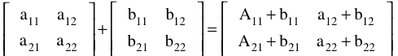

考虑以下更具体的示例：

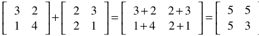

然而，乘法稍微复杂一些。只有当第一个矩阵的列数等于第二个矩阵的行数时，才能相乘两个矩阵。如果是这种情况，则将第一个矩阵第一行中的每个元素与第二个矩阵第一列中的每个元素相乘。然后将第一个矩阵第二行中的每个元素与第二个矩阵第二列中的每个元素相乘。让我们先使用变量而不是实际数字来检查这一点。该示例还使用方阵以使情况更加简单。

```
[ a b ]   [ e f ]
[ c d ]   [ g h ]
```

乘法按以下方式进行：

```
a * e + b * g   (a11 * b11 + a12 * b21)
a * f + b * h   (a11 * b12 + a12 * b22)
c * e + d * g   (a11 * b11 + a12 * b21)
c * f + d * h   (a11 * b11 + a12 * b21)
```

因此，乘积将为

```
(a*e + b*g)   (a*f + b*h)
(c*e + d*g)   (c*f + d*h)
```

值得记住这个过程。现在，考虑一个具体示例的实现：

```
[ 1 2 ]   [ 2 2 ]
[ 3 1 ]   [ 1 3 ]
```

我们从以下开始：

```
1 * 2 + 2 * 1 = 6
1 * 2 + 2 * 3 = 8
3 * 2 + 1 * 1 = 7
3 * 2 + 1 * 3 = 9
```

最终答案是

```
[ 6 8 ]
[ 7 9 ]
```

现在你可以明白为什么，如前所述，只有当第一个矩阵的列数等于第二个矩阵的行数时，才能相乘两个矩阵。

重要的是要记住，矩阵乘法（与传统的标量值乘法不同）不具备交换性。回顾一下，交换律指出：a * b = b * a。如果 a 和 b 是标量值，那么这是成立的；但是，如果它们是矩阵，则情况并非如此。例如，考虑方程 1.1 中所示的矩阵乘法。

```
\begin{bmatrix} 2 & 3 \\ 1 & 4 \end{bmatrix} \begin{bmatrix} 1 & 1 \\ 2 & 3 \end{bmatrix} = \begin{bmatrix} 8 & 11 \\ 9 & 13 \end{bmatrix}
```

### EQUATION 1.1 矩阵乘法

现在如果你简单地颠倒顺序，可以看到会产生完全不同的答案，如方程 1.2 所示。

```
\begin{bmatrix} 1 & 1 \\ 2 & 3 \end{bmatrix} \begin{bmatrix} 2 & 3 \\ 1 & 4 \end{bmatrix} = \begin{bmatrix} 3 & 7 \\ 7 & 15 \end{bmatrix}
```

### EQUATION 1.2 矩阵乘法不具备交换性

这个示例说明了一个相当重要的事实：矩阵乘法不具备交换性。

### 1.3.2 矩阵转置

矩阵转置只是将行和列的顺序互换。虽然目前为止的关注点是 2 x 2 矩阵，但转置操作在行数和列数不同的矩阵中最容易看到。考虑方程 1.3 中所示的矩阵。

```
\begin{bmatrix} 2 & 3 & 2 \\ 1 & 4 & 3 \end{bmatrix}
```

### EQUATION 1.3 3 x 2 矩阵

要对其进行转置，需要交换行和列，从而创建一个 2 x 3 矩阵。第一行现在变成了第一列。如方程 1.4 所示。

```
\begin{bmatrix} 2 & 1 \\ 3 & 4 \\ 2 & 3 \end{bmatrix}
```

### EQUATION 1.4 转置后的矩阵

如果将第一个矩阵标记为 A，则该矩阵的转置标记为 A^T。继续沿用原始矩阵标记为 A，需要描述一些矩阵的属性，如表 1.2 所列。

### TABLE 1.2 矩阵的基本属性

| 属性 | 说明 |
|---|---|
| \((A^T)^T = A\) | 如果对 A 的转置再次转置，则会得到 A 本身。 |
| \((cA)^T = cA^T\) | 常数 c 与数组 A 的乘积的转置，等于常数 c 与 A 的转置的乘积。 |
| \((AB)^T = B^T A^T\) | 将 A 与 B 相乘然后转置乘积，等于 B 的转置乘以 A 的转置。 |
| \((A + B)^T = A^T + B^T\) | 将矩阵 A 和矩阵 B 相加然后转置和，等于先转置 A 和 B 然后将这些转置相加。 |
| \(A^T = A\) | 如果一个方阵等于其自身的转置，则称为对称矩阵。 |

表 1.2 并非详尽无遗；相反，它列出了一些关于矩阵最常见的属性。这些属性通常并不特别难以理解；然而，存在一个关于为何要应用它们的问题。它们的含义是什么？入门级线性代数教材往往过于专注于帮助学生学习如何进行线性代数运算，以至于运算背后的含义被忽略了。让我们花一点时间来探讨什么是转置。转置是围绕对角线进行的旋转。请记住，矩阵可以以图形方式查看。考虑一个简单的行矩阵：

```
[1 2 4]
```

对该行矩阵进行转置会创建一个列矩阵：

```
[ 1 ]
[ 2 ]
[ 4 ]
```

将向量视为某个空间中的一条线。目前，我们将限制在 2D 和 3D 空间中。然后，你可以将矩阵视为对线或一组线的变换。

### 1.3.3 子矩阵

_子矩阵_ 是删除任意数量的行或列后矩阵中保留的任何部分。考虑方程 1.5 中所示的 \(5 \times 5\) 矩阵。

```
[ 2 2 4 5 3 ]
[ 3 8 0 2 1 ]
[ 2 3 2 2 1 ]
[ 4 3 1 2 4 ]
[ 1 2 2 0 3 ]
```

### EQUATION 1.5 5 x 5 矩阵


假设你移除第二列和第二行，如方程 1.6 所示。

| 2 | 1 | 4 | 5 | 3 |
| --- | --- | --- | --- | --- |
| 3 | 0 | 0 | 2 | 1 |
| 2 | 1 | 2 | 2 | 1 |
| 4 | 1 | 1 | 2 | 4 |
| 1 | 1 | 2 | 0 | 3 |

### 方程 1.6 移除行和列

你现在只剩下方程 1.7 所示的矩阵。

| 2 | 4 | 5 | 3 |
| --- | --- | --- | --- |
| 2 | 2 | 2 | 1 |
| 4 | 1 | 2 | 4 |
| 1 | 2 | 0 | 3 |

### 方程 1.7 子矩阵

方程 1.7 所示的矩阵是原始矩阵的子矩阵。

### 1.3.4 单位矩阵

单位矩阵其实很简单。回顾群的恒等性质。单位矩阵实现相同的目标：将矩阵乘以其单位矩阵，结果不变。要创建单位矩阵，只需将主对角线上的所有元素设为 1，其余元素设为 0。请考虑以下矩阵：

| 3 | 2 | 1 |
| --- | --- | --- |
| 1 | 1 | 2 |
| 3 | 0 | 3 |

现在考虑单位矩阵。它必须具有相同数量的列和行，主对角线上的元素全部设为 1，其余元素全部设为 0。单位矩阵如下所示：

| 1 | 0 | 0 |
| --- | --- | --- |
| 0 | 1 | 0 |
| 0 | 0 | 1 |

如果将原始矩阵乘以单位矩阵，乘积将是原始矩阵。你可以在方程 1.8 中看到这一点。

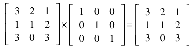

### 方程 1.8 矩阵乘法

目前为止的示例不仅关注方阵（例如 2 × 2 或 3 × 3 矩阵），也关注仅由整数组成的矩阵。矩阵可以由有理数、实数甚至复数组成；然而，因为目标只是向你介绍矩阵代数的概念，这些细微差别已被省略。

矩阵代数的一个应用是线性变换。线性变换有时被称为线性映射，甚至只是线性函数。它本质上只是两个向量空间之间的某种映射，具有加法和标量乘法运算。

> **注意**
> 
> Wolfram MathWorld 将向量空间定义如下：“向量空间 V 是一个在有限向量加法和标量乘法下封闭的集合。” 另一种说法是，向量空间是一组对象（在本例中为整数）的集合，称为向量，这些向量可以相互相加，并由称为标量的数字相乘（“缩放”）。

### 1.3.5 深入矩阵

在前一节之后，你应该基本掌握矩阵的基本概念和运算。如果没有，请在继续本节之前先复习。现在我们将探讨本书后面会用到的几个更多概念。

我们将从一个简单的内容开始——向量的长度，它使用勾股定理计算：

||vector|| = √(x² + y²)

考虑向量：

[2, 3, 4]

其长度为

√(2² + 3² + 4²) = 5.38

这很简单，但随着我们深入学习，它将非常重要。现在我们将对这个概念添加更多细节。非负长度称为向量的范数。给定一个向量 v，这写作 ||v||。这在本书后面将很重要。关于长度/范数还有一个概念要记住：如果长度为 1，则这称为单位向量。

接下来，我们将注意力转向另一个相对容易的计算——矩阵的行列式。

矩阵 A 的行列式记为 |A|。行列式的通用形式示例如下：

|A|[[a b],[c d]] = ad - bc

一个更具体的例子可能有助于阐明这个概念：

|A|[[2 3],[1 2]] = (2)(2) - (3)(1) = 1

行列式是从方阵的各个元素计算得出的一个值。它提供一个单一数字，也称为标量值。只有方阵才能有行列式。2 x 2 矩阵的计算足够简单；我们稍后将探讨更复杂的矩阵。然而，这个单一标量值意味着什么？行列式有很多用途，其中大部分在本文中不会用到。它在求解线性方程（即，积分中的变量替换——是的，线性代数与微积分密不可分）方面很有用；然而，对我们来说立即可用的是，如果行列式非零，那么该矩阵是可逆的。这在本书后面讨论各种量子算法时将很重要。

3 x 3 矩阵（如方程 1.9 所示）呢？

| a1 | b1 | c1 |
| --- | --- | --- |
| a2 | b2 | c2 |
| a3 | b3 | c3 |

### 方程 1.9 3 x 3 矩阵

此计算要复杂得多。有几种方法可以做到这一点。我们将使用一种称为“余子式展开法”的方法。该方法依赖于将 3 x 3 矩阵分解为 2 x 2 矩阵。由 b2、c2、b3、c3 组成的 2 x 2 矩阵（如方程 1.10 所示）是第一个。

[[a1 b1 c1],[a2 [b2 c2]],[a3 [b3 c3]]]

### 方程 1.10 3 x 3 矩阵行列式，第 1 部分

这个相当简单，因为它整齐地放入一个连续的 2 x 2 矩阵中。然而，要找到下一个，我们的选择略有不同，如方程 1.11 所示。

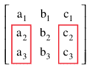

### 方程 1.11 3 x 3 矩阵行列式，第 2 部分

下一步是获取左下角的方阵，如方程 1.12 所示。

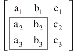

### 方程 1.12 3 x 3 矩阵行列式，第 3 部分

与第一个一样，这个形成一个非常漂亮的 2 x 2 矩阵。现在我们要对这些 2 x 2 矩阵做什么？公式实际上非常简单，如方程 1.13 所示。请注意，“det”只是行列式的简写。

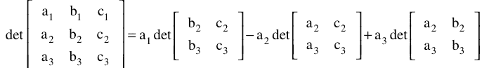

### 方程 1.13 3 x 3 矩阵行列式，第 4 部分

我们取第一列并将其乘以其代数余子式，通过简单的加减法，得到 3 x 3 矩阵的行列式。一个更具体的例子可能有用。让我们计算这个矩阵的行列式：

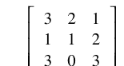

这得出

3 * det [ 1 2 ; 0 3 ] = 3 * ((1 * 3) - (2 * 0)) = 3(3) = 9

2 * det [ 1 2 ; 3 3 ] = 2 * ((1 * 3) - (2 * 3)) = 2(-3) = -6

1 * det [ 1 1 ; 3 0 ] = 1 * ((1 * 0) - (1 * 3)) = 1(-3) = -3

这得出 9 - (-6) + (-3) = 12。

是的，这可能显得有点麻烦，但计算并不过分困难。我们将把对行列式的探讨结束在 3 x 3 矩阵，但是，是的，可以对更大的方阵求行列式。可以对 4 x 4、5 x 5 以及你想要的任何大小的矩阵计算行列式。然而，本章的目标是为你提供线性代数的一般基础，而不是探索线性代数的每一个细微差别。

随着你在本书中深入学习，大部分重点将放在向量上。向量只是一个单列或单行的矩阵。这引出了向量的一些有趣性质。就像方阵的行列式一样，这些性质为我们提供信息。让我们从点积开始。两个向量的点积就是两个向量相乘。考虑向量 X 和 Y。方程 1.14 显示点积是什么样子。

∑ XᵢYᵢ

### 方程 1.14 点积

查看一个具体示例以了解其工作原理应该会有帮助。考虑两个列向量：

| 1 | 3 |
| --- | --- |
| 2 | 2 |
| 1 | 1 |

点积如下求得：(1 * 3) + (2 * 2) + (1 * 1) = 8。

这当然是一个容易执行的计算，但它意味着什么？更直白地说，你为什么要关心点积是什么？回想一下，向量也可以用图形描述。你可以使用点积，连同向量的长度，来找到两个向量之间的角度。我们已经知道点积是 8。回想一下长度：

||vector|| = √(x² + y²)

因此，向量 X 的长度为 √(1² + 2² + 1²) = 2.45。

向量 Y 的长度为 √(3² + 2² + 1²) = 3.74。

现在我们可以轻松计算角度。结果表明，cos θ = 点积 / 向量 X 长度 × 向量 Y 长度，或者如下所示：

cos θ = 8 / (2.45)(3.74) = 0.87307


从余弦值求角很简单；你可能在中学三角学中做过这一点。然而，即使只有点积，我们也有一些信息。如果点积为 0，那么这些向量是垂直的。这是因为 90° 角的 cos θ 为 0。这两个向量被称为正交向量。

回想一下，向量的长度在本书后面将频繁出现。如果该长度/范数为 1，则它是单位向量。这引出了另一个我们将在本书后面频繁看到的术语。如果两个向量既正交（即相互垂直）又具有单位长度（长度 1），则这些向量被称为标准正交向量。

本质上，点积用于从两个向量或两个矩阵中产生一个单一数字，即标量。这与张量积形成对比。在数学中，张量是具有多个索引的对象，例如向量或数组。两个向量空间 V 和 W 的张量积 V ⊗ W 也是一个向量空间。

另一种特殊的矩阵是单模矩阵。单模矩阵也用于一些基于格的算法。单模矩阵是整数构成的方阵，其行列式为 +1 或 -1。回想一下，行列式是从方阵的元素中计算出的一个值。矩阵 A 的行列式表示为 |A|。

循环格也用于一些密码学应用。循环格是在旋转移位算子下封闭的格。更严格的定义如下：

格 L ⊆ Z^n 是循环的，当且仅当 ∀ x ∈ L: rot(x) ∈ L。

这里的符号对某些读者来说可能有点令人困惑。符号 ⊆ 表示“是……的子集”。因此，我们是说这个格是整数（Z）的子集。如果对格中的所有（∀）x 进行旋转后仍在格中，则它是循环的。

特征值是与线性方程组（即矩阵方程）相关联的一组特殊标量，有时也被称为特征根、特征值、适当值或隐根。为了澄清，考虑一个我们将称之为 v 的列向量。然后考虑一个我们将称之为 A 的 n × n 矩阵。然后考虑某个标量 λ。如果成立

Av = λv

那么我们说 v 是矩阵 A 的特征向量，λ 是矩阵 A 的特征值。

让我们更仔细地看一下这一点。前缀 eigen 实际上是一个德语单词，可以翻译为“特定的”、“适当的”、“特殊的”等。用最基本的形式来说，某个线性变换 T 的特征向量是一个在对其应用 T 时不改变方向的向量；它只改变规模。它按标量值 λ（即特征值）改变规模。现在我们可以稍微回顾一下之前的方程，并扩展我们对线性代数的了解：

T(v) = λv

这与之前的方程一模一样，但有一个小区别：矩阵 A 现在被变换 T 所取代。这不仅告诉我们关于特征向量和特征值的信息，还告诉我们更多关于矩阵的知识。当矩阵应用于向量时，它会转换该向量。矩阵本身就是对向量的一种操作！在本书后面，你将频繁看到这些变换，特别是在与量子计算机逻辑门相关的方面。因此，在继续之前，请确保你对它们非常熟悉。

让我们补充一点。如何找到给定矩阵的特征值和特征向量？这当然不仅仅是用随机数进行试错的问题。幸运的是，有一种非常直接的方法——对于 2 × 2 矩阵来说，这种方法实际上相当简单。考虑以下矩阵：

```
[\begin{bmatrix} 5 & 2 \\ 9 & 2 \end{bmatrix}]
```

我们如何找到它的特征值？

好吧，凯莱-汉密尔顿定理为这一问题提供了洞察。该定理本质上指出，线性算子 A 是其特征多项式的一个零点。就我们的目的而言，这意味着

```
det|A - λI| = 0
```

我们知道什么是行列式，也知道 I 是单位矩阵。λ 是我们试图找到的特征值，A 是我们正在检查的矩阵。请记住，在线性代数中，你可以将矩阵应用于另一个矩阵或向量，因此矩阵至少潜在上是一个算子。所以我们可以填充这个方程：

```
det | [ 5 2 ]   [ 1 0 ] |   = 0 \\     [ 9 2 ] - λ [ 0 1 ]
```

现在，我们只需进行一些代数运算，首先将 λ 乘以我们的单位矩阵，这将给出

```
det | [ 5 2 ]   [ λ 0 ] |   = 0 \\     [ 9 2 ] -   [ 0 λ ]
```

这反过来导致

```
det | [ 5-λ   2   ] |   = 0 \\     [ 9   2-λ ] \\ = (5 - λ)(2 - λ) - 18 \\ = 10 - 7λ + λ² - 18 = 0 \\ λ² - 7λ - 8 = 0
```

这可以分解因式（注意，如果这里的结果无法分解因式，事情确实会变得更加困难，但这超出了我们的范围）：

```
(λ - 8)(λ + 1) = 0
```

这意味着我们有两个特征值：

$\lambda_1 = 8$

$\lambda_2 = -1$

对于 2 × 2 矩阵，你总会得到两个特征值。事实上，对于任何 n × n 矩阵，你都会得到 n 个特征值，但它们可能不是唯一的。

现在你已经有了特征值，如何计算特征向量呢？

我们知道如下：

$$ A = \begin{bmatrix} 5 & 2 \\ 9 & 2 \end{bmatrix} $$

$\lambda_1 = 8$

$\lambda_2 = -1$

我们正在寻找未知向量，因此让我们将向量 $\begin{bmatrix} x \\ y \end{bmatrix}$ 标记出来。

现在回想一下给出特征向量和特征值的方程：

$A\mathbf{v} = \lambda\mathbf{v}$

让我们取其中一个特征值并代入：

$$ \begin{bmatrix} 5 & 2 \\ 9 & 2 \end{bmatrix} \begin{bmatrix} x \\ y \end{bmatrix} = 8 \begin{bmatrix} x \\ y \end{bmatrix} $$ $$ \begin{bmatrix} 5x + 2y \\ 9x + 2y \end{bmatrix} = \begin{bmatrix} 8x \\ 8y \end{bmatrix} $$

这给出了两个方程：

$5x + 2y = 8x$

$9x + 2y = 8y$

现在我们采用第一个方程并进行一些代数运算来隔离 y 值。从两边各减去 5x 以得到

$2y = 3x$

然后将两边同时除以 2 以得到

$y = 3/2 x$

很容易看出，要用整数（这是我们想要的）来求解，x = 2 和 y = 3 是解。因此，我们的第一个特征向量是

```
\(\begin{bmatrix} 2 \\ 3 \\ \end{bmatrix}\text{ with }\lambda_1 = 8\)
```

你可以使用此方法自行求解第二个特征值的另一个特征向量。

## 1.4 向量和向量空间

向量是线性代数的重要组成部分。我们通常以向量的形式表示数据。在线性代数中，这些向量被视为数字。它们可以相加和相乘。一个向量将如下所示：

```
\(\begin{bmatrix} 1 \\ 3 \\ 2 \\ \end{bmatrix}\)
```

这个向量只有整数；但是，向量可以包含有理数、实数，甚至复数（将在本章后面讨论）。向量也可以是水平的，如下所示：

```
[1 3 2]
```

你经常会看到变量代替向量中的数字，例如

```
\(\begin{bmatrix} a \\ b \\ c \\ \end{bmatrix}\)
```

你在上一节中看到的主要观点是，可以像处理数字一样对这些向量进行数学运算。你可以将两个向量相乘；你也可以将向量与标量相乘。标量是单个数字，其名称来源于它们改变向量规模的事实。考虑标量 3 乘以本节中显示的第一个向量：

```
\(3\begin{bmatrix} 1 \\ 3 \\ 2 \\ \end{bmatrix}=\begin{bmatrix} 3 \\ 9 \\ 6 \\ \end{bmatrix}\)
```

你只需将标量乘以向量中的每个元素。我们将在下一节更详细地探讨这一点和其他数学排列，但让我们现在来解决为什么它被称为标量的问题。我们将数据视为向量；另一种看待方式是将其视为图形。考虑图 1.1 中显示的前一个向量 [1,3,2] 在图上的情况。

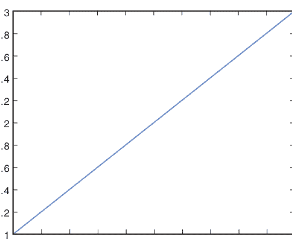

### 图 1.1 向量图

现在当我们对该向量执行标量运算 3 乘以该向量时会发生什么？我们实际上改变了向量的规模，如图 1.2 所示。

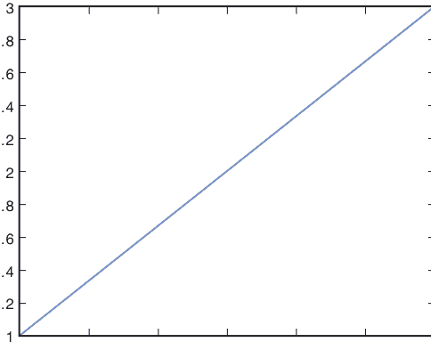

### 图 1.2 缩放向量

图 1.1 和图 1.2 可能看起来相同，但请仔细观察。在图 1.2 中，x 值变为 9，而在图 1.1 中，x 值仅变为 3。我们已经缩放了向量。使用标量一词是因为它实际上改变了向量的规模。形式上，向量空间是一组在加法和乘以实数的情况下封闭的向量。回想一下之前关于抽象代数中群、环的讨论，


以及域。向量空间是一个群。事实上，它是一个阿贝尔群。你可以进行向量加法及其逆运算。你还拥有第二个运算标量乘法，但没有逆运算。注意第一个运算（加法）是交换的，而第二个运算（乘法）则不是。

那么，什么是基向量？如果在某个向量空间 V 中有一组元素 E（即向量），当向量空间 V 中的每个向量都可以表示为 E 中元素的线性组合时，向量集 E 被视为一个基。换句话说，你可以从集合 E（即基）开始，通过 E 中向量的线性组合，生成向量空间 V 中的所有向量。正如敏锐的读者可能已经推测的那样，一个向量空间可以有多个基向量集。

什么是线性相关与线性无关？在本书后面讨论量子计算时，你将多次遇到这些术语。在向量空间理论中，如果一组向量中的某个向量可以定义为其他向量的线性组合，则称该组向量为线性相关；如果集合中没有向量可以以这种方式表示，则称这些向量为线性无关。

子空间是向量空间的一个子集，其本身也是一个向量空间；例如，平面 z=0 是 R³ 的一个子空间（它本质上是 R²）。我们将探讨 Rⁿ 及其子空间。

## 1.5 集合论

集合论是离散数学的重要组成部分。集合是对象的集合，这些对象称为该集合的成员或元素。如果我们有一个集合，可以说某些对象属于（或不属于）这个集合，或者在（或不在）该集合中。我们也说集合由其元素组成。

与大部分数学一样，术语和符号至关重要。因此，让我们以类似的方式开始学习，从简单概念构建到更复杂的概念。定义集合元素的最简单方法是说 x 是集合 A 的成员。可以表示为

x ∈ A

集合通常用括号列出。例如，所有小于 10 的奇数集合将显示如下：

A = {1, 3, 5, 7, 9}

同样，该集合的一个成员表示如下：

3 ∈ A

否定可以通过在符号上加一横线来表示。例如，在

2 ∉ A

2 不是集合 A 的元素。

如果一个集合没有结束，可以用省略号表示。例如，所有奇数（不仅限于小于 10 的奇数）集合可以表示如下：

A = {1, 3, 5, 7, 9, 11, ...}

你也可以使用定义该集合成员资格的方程或公式来表示集合。

集合之间可以相互关联；这里简要描述最常见的关系：

- **并集：** 如果你有两个集合 A 和 B，属于 A、B 或两者的元素表示 A 和 B 的并集，符号为 A ∪ B。如图 1.3 所示，阴影区域是 A 和 B 之间的共同区域。

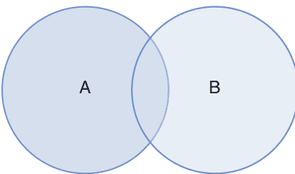

图 1.3 A 与 B 的并集

- **交集：** 如果你有两个集合 A 和 B，同时属于 A 和 B 的元素是集合 A 和 B 的交集，符号为 A ∩ B。如果集合 A 和 B 的交集为空（即两个集合没有公共元素），则称这两个集合互不相交，如图 1.4 所示。

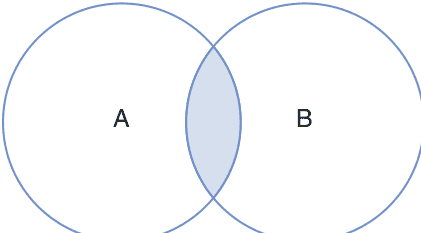

图 1.4 A 与 B 的交集

- **差集：** 如果你有两个集合 A 和 B，属于一个集合但不属于两个集合的元素是 A 和 B 之间的差集。表示为 A \ B。如图 1.5 所示。

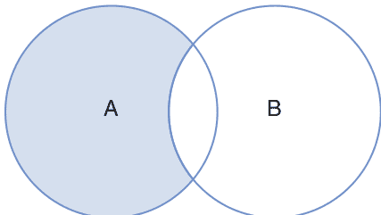

图 1.5 A \ B

- **补集：** 如果集合 B 没有同时属于 A 的元素，则称集合 B 是集合 A 的补集。表示为 B = Aᶜ，如图 1.6 所示。

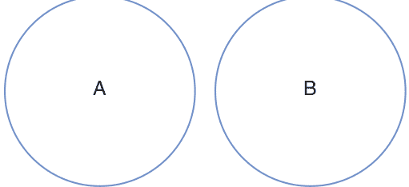

图 1.6 B = Aᶜ

- **双重补集：** 一个集合的补集的补集是该集合本身。换句话说，Aᶜ 的补集是 A。乍一看这可能很奇怪，但请花点时间思考集合补集的定义。集合的补集在该集合中没有元素。因此，可以推断，要成为一个集合之补集的补集，它必须包含集合中的所有元素。

这些是基本的集合关系。现在来看几个关于集合的事实：

- 顺序无关：{1, 2, 3} 与 {3, 2, 1}、{3, 1, 2} 或 {2, 1, 3} 相同。

- 子集：集合 A 可能是集合 B 的子集。例如，如果集合 A 是所有小于 10 的奇数的集合，而集合 B 是所有小于 100 的奇数的集合，那么集合 A 是集合 B 的子集。表示为 A ⊆ B。

- 幂集：正如你所见，集合可以有子集。假设集合 A 是所有小于 10 的整数。集合 B 是一个子集，即所有小于 10 的质数。集合 C 是 A 的子集，即所有小于 10 的奇数。集合 D 是 A 的子集，即所有小于 10 的偶数。我们可以继续这个练习，创建任意子集，例如 E = {4, 7}、F = {1, 2, 3} 等。给定集合的所有子集构成的集合称为该集合的 *幂集*。

集合还具有管理集合之间交互作用的属性。这些属性中最重要的是如下：

- **交换律：** 集合 A 与集合 B 的交集等于集合 B 与集合 A 的交集。并集也是如此。换句话说，在考虑集合的交集和并集时，集合呈现的顺序无关紧要。表示如下：

  (a) A ∩ B = B ∩ A

  (b) A ∪ B = B ∪ A

- **结合律：** 基本上，如果你有三个集合，并且它们之间的关系全部是并集或全部是交集，那么顺序就无关紧要。表示如下：

  (a) (A ∩ B) ∩ C = A ∩ (B ∩ C)

  (b) (A ∪ B) ∪ C = A ∪ (B ∪ C)

- **分配律：** 分配律与结合律略有不同，顺序无关紧要。集合 A 与 B 和 C 的交集的并集，等同于取 A 和 B 的并集与 A 和 C 的并集的交集。表示如下：

  (a) A ∪ (B ∩ C) = (A ∪ B) ∩ (A ∪ C)

  (b) A ∩ (B ∪ C) = (A ∩ B) ∪ (A ∩ C)

- **德·摩根定律：** 这些定律管理涉及并集、交集及其补集的问题。这些定律比之前讨论的属性更复杂。基本上，集合 A 和集合 B 的交集的补集，等于 A 的补集与 B 的补集的并集。德·摩根定律的符号表示如下：

  (a) (A ∩ B)ᶜ = Aᶜ ∪ Bᶜ

  (b) (A ∪ B)ᶜ = Aᶜ ∩ Bᶜ

这些是集合论的基本元素。在继续之前，你应该熟悉它们。

## 1.6 总结

在本章中，你学习了线性代数的基本原理——仅够你理解本书其余部分。线性代数的其他一些数学细节将在需要时介绍，但前提是你完全理解本章，即可继续。本章涵盖了基本代数、矩阵数学、点积、向量长度、正交性、向量范数和向量空间。虽然这只是线性代数的基础介绍，但在继续之前，你充分理解这些概念非常重要。

## 测试你的技能

## 复习问题

**1.** 你有一组数字，拥有两个运算，但只有其中一个运算具有逆运算。该集合不一定满足交换律。对这个集合最佳的描述是什么？

- a. 群
- b. 阿贝尔群
- c. 环
- d. 域

**2.** 求解以下方程：

3 \begin{bmatrix} 2 \\ 1 \\ 3 \end{bmatrix}

- a. \begin{bmatrix} 6 \\ 3 \\ 9 \end{bmatrix}
- b. \begin{bmatrix} 5 \\ 4 \\ 6 \end{bmatrix}
- c. 18
- d. 15

**3.** 这两个向量的点积是多少？

$$
\begin{bmatrix} 3 \\ 2 \\ 0 \\ \end{bmatrix} \cdot \begin{bmatrix} 1 \\ 3 \\ 2 \\ \end{bmatrix}
$$

- a. 11
- b. 10
- c. 28
- d. 0

**4.** 求解以下行列式：

$$
|A| = \begin{vmatrix} 2 & 1 \\ 1 & 3 \\ \end{vmatrix}
$$

- a. 8
- b. 6
- c. 0
- d. 5

**5.** 求解以下行列式：

$$
|A| = \begin{vmatrix} 1 & 2 & 3 \\ 2 & 1 & 4 \\ 3 & 1 & 2 \\ \end{vmatrix}
$$

- a. 11
- b. 12
- c. 15
- d. 10

**6.** 这两个向量的点积是多少？

$$
\begin{bmatrix} 1 \\ 2 \\ 2 \\ \end{bmatrix} \cdot \begin{bmatrix} 3 \\ 3 \\ 4 \\ \end{bmatrix}
$$

- a. 65
- b. 17
- c. 40
- d. 15


7. 这个向量的长度是多少？
[ 2 ]
[ 2 ]
[ 3 ]
a. 4.12
b. 2.64
c. 3.46
d. 4.56

8. 这两个矩阵的乘积是什么？
[ 2 3 ] [ 3 2 ]
[ 1 4 ] [ 3 7 ]
a. [ 15 25 ]
   [ 15 10 ]
b. [ 15 10 ]
   [ 15 30 ]
c. [ 10 15 ]
   [ 15 30 ]
d. [ 15 25 ]
   [ 15 30 ]

9. 这两个向量是否正交？
[ 1 ] [ 0 ]
[ 0 ] [ 1 ]
a. 是
b. 否

10. 写出该矩阵的单位矩阵：
[ 3 2 1 ]
[ 3 5 6 ]
[ 3 4 3 ]
