# 第 2 章

# 复数

## 章节目标

阅读本章并完成测验后，您将能够：

- 理解复数
- 计算复共轭
- 以图形表示复数
- 处理复数的向量表示
- 理解泡利矩阵

正如线性代数对于理解量子物理和量子计算至关重要，复数也是如此。有些资料试图在不使用复数的情况下解释量子物理和量子计算。在某种程度上，它们至少在传达量子现象的一般性理解方面是成功的；然而，量子物理学家和从事量子计算工作的人使用复数。如果您要超越普通外行的理解，那么您必须理解复数。

## 2.1 什么是复数？

有些人可能会觉得数学家只是为了自娱自乐而发明数系。幸运的是，情况通常并非如此。数系是出于特定原因而发展起来的。考察数字的历史有助于我们了解复数是如何发展起来的。我们自然地从所谓的计数数开始。这些是正整数（1, 2, 3, ...）。即使是年幼的孩子也会自然而然地掌握这些数字。各种考古发现表明古代使用过数字。最早使用十进制（您最熟悉的）可以追溯到公元前 3100 年的古埃及。在美索不达米亚的部分地区，早在公元前 3400 年就使用了六十进制系统。

然而，零的使用在一段时间内并未出现。这对现代思维方式来说可能显得有些奇怪。您很可能觉得零相当普通和自然；然而，零的首次有记载使用是由印度数学家 Brahmagupta 在公元 628 年进行的。他在各种运算中使用零，将其视为一个数字。鉴于他当时广泛使用它，很可能在此之前已使用了一段时间；然而，这是首次有记载将其作为数字使用的案例。需要注意的是，零之前有过更早的使用，但仅作为占位符。在古埃及，有能力记录零余额，但它未用于任何计算中。

这就引出了负数。在今天的我们看来，负数再自然不过了。例如，3 - 5 = -2 是一个平凡的方程。然而，与零一样，负数并不总是被认可。在一段时间里，负数曾作为抽象概念被使用。著名的希腊数学家 Diophantus 将有一个负数解的特定方程称为具有“荒谬的结果”。大约在公元 600 年的印度，负数与债务相关联。到公元十二世纪，负根被作为二次方程的解给出。现在我们将负数视为完全自然的事物。

随着我们对数字理解的增长，对新数系的需求也随之增加。我们理解演化中的另一步是有理数的出现。这可能看起来奇怪，但有理数或分数实际上比负数的使用更早。即使是欧几里得也使用了有理数。有理数当然是指任何可以表示为分数的数字。以下是有理数的示例：

| 1/4 | 3/7 | 2/3 |
|---|---|---|

这些都是有理数。那么无法以这种形式表示的数字呢？关于无理数有一个有趣的故事，可能真实也可能不真实。据说，Hippasus 发现 2 的平方根无法表示为分数。Pythagoras 认为数字是绝对的，不接受无理数。这个故事有多种不同的版本，但都以 Hippasus 因为提出无理数而被他的毕达哥拉斯同伴扔进海里淹死而告终。虽然当今的数学家们可能仍在就数学问题进行激烈的辩论，但这种辩论很少上升到谋杀的程度。

无理数和有理数的整体包括之前的整数、零和负数集合——所有这些共同构成了我们称之为实数的集合。这就引出了虚数的出现。我相信您知道，负数的平方会给出正乘积，例如 -2² = 4，-3² = 9，以及 -4² = 16。如果有人想知道负数的平方根，这就会带来一些困境。经典的例子是询问 -1 的平方根。我们知道它不是 1，因为 1² = 1。我们知道它不是 -1，因为 -1² = 1。这导致创建了一套新的数字，称为*虚数*。数字 i 被定义为 \(\sqrt{-1}\)。如下方程式所示：

```
i = \sqrt{-1}
```

虚数的运算方式与实数相同。如果您看到表达式 2i，它表示 \(2 * \sqrt{-1}\)。还应注意的是，虚数这个名称令人遗憾。它让人觉得这些数字只是凭空捏造且毫无用处。如您在本书后面将看到的，它们确实有用途，特别是在量子物理中。这些数字确实存在，您将在本书后面看到它们的使用。它们常用于量子物理和量子计算中。

复数只是将实数和虚数结合在一个表达式中。以下是一个复数示例：

```
3 + 4i
```

这里是实数 3，与虚数 4i 相结合，或 \(4 * \sqrt{-1}\)。让我们更正式地表述一下。复数是一个具有实系数且 i 满足 i² + 1 = 0 的多项式。您可以对复数执行所有与实数（即有理数、无理数、整数等）相同的常规算术运算。

虽然可以使用任何符号来表示数字组，但某些符号已变得常见。表 2.1 总结了这些符号。

| Symbol | Description |
| :--- | :--- |
| N | N 表示自然数。这些数有时也称为计数数。它们是 1, 2, 3 等等。 |
| Z | Z 表示整数。这些是整数（-1, 0, 1, 2 等等）。整数是自然数与零和负数的组合。 |
| Q | Q 表示有理数（整数的比值）。有理数是任何可以表示为两个整数比值的数。示例是 3/2, 17/4 和 1/5。 |
| P | P 表示无理数。示例是 √2。 |
| R | R 表示实数。这包括有理数和无理数。 |
| i | i 表示虚数。这些数的平方为负数。示例是 √-1 = 1i。 |

## 2.2 复数的代数

第 1 章，“基本线性代数简介”讨论了一些基本代数，包括交换律和结合律等性质（适用于加法和乘法）。第 1 章还讨论了群、环及类似代数结构等主题。在本节中，我们将探讨复数的基本代数。

让我们从一些基本的复数代数开始：

```
(a + bi) ± (c + di) := (a ± c) + (b ± d)i
```

在这里，符号 := 的意思是“定义为”。因此，当我们说 (a + bi) ± (c + di) := (a ± c) + (b ± d)i 时，我们的意思是 (a + bi) ± (c + di) 定义为 (a ± c) + (b ± d)i。让我们看几个例子：

```
(2 + 4i) + (3 + 2i)
```

```
= (2 + 3) + (4 + 2)i
```

```
= 5 + 6i
```

这里是另一个例子，这次是减法：

```
(1 + 2i) - (3 + 4i)
```

```
= (1 - 3) - (2i - 4i)
```

```
= 2 - 2i
```

如您所见，复数的基本加法和减法非常简单。复数乘法也相当直接。我们使用您可能在青少年时学过的初等代数中的相同方法：FOIL，即 First - Outer - Inner - Last，如图 2.1 所示。

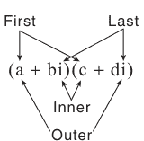

**图 2.1 FOIL 方法**

因此：

```
(a + bi)(c + di)
```

```
= ac + adi + cbi + bdi²
```

检查几个具体示例以确保充分理解这一概念是有益的。让我们从这个开始：

```
(2 + 2i)(3 + 2i)
```

```
= (2 * 3) + (2 * 2i) + (2i * 3) + (2i * 2i)
```

```
= 6 + 4i + 6i + 4i²
```

```
= 6 + 10i + 4i²
```

```
= 6 + 10i + -4 (remember that i² = -1)
```

```
= 2 + 10i
```


在继续之前，让我们再看一个示例：

```
(3 + 2i)(2 - 2i)
= (3 * 2) + (3 * -2i) + (2i * 2) + (2i * -2i)
= 6 + -6i + 4i + -4i²
= 6 - 2i - 4i²
= 6 - 2i + 4
= 10 - 2i
```

接下来自然似乎应该进入除法。然而，在这样做之前，我们必须先探索另一个概念：复共轭。这在本书后面你将频繁使用。幸运的是，它非常简单。复共轭具有相同的实部和虚部，但虚部的符号相反。表 2.2 提供了几个示例，以确保你理解这一概念。

### TABLE 2.2 Complex Conjugates

| 复数 | 复共轭 |
|---|---|
| 2 + 3i | 2 - 3i |
| 3 - 4i | 3 + 4i |
| 5 + 4i | 5 - 4i |

如果有一个复数 z，则复共轭通常用 z̄ 或 z* 表示。所以，如果你有

```
z = 3 + 2i
```

那么

```
z̄ = 3 - 2i
```

现在我们可以对复数进行除法了。第一步是将分子和分母同时乘以分母的复共轭。一般来说，这如等式 2.1 所示。

```
\frac{a+bi}{c+di} \times \frac{c-di}{c-di}
```

### EQUATION 2.1 Multiplying by the Complex Conjugate

### 等式 2.1 乘以复共轭

现在回顾一下，当我们相乘时，使用 FOIL 方法，因此这变成了等式 2.2 所示。

\frac{a + bi}{c + di} \times \frac{c - di}{c - di} = \frac{ac - adi + bci - bdi}{c^2 - cdi + cdi - di^2} = \frac{ac - adi + bci - bdi}{c^2 - d^2}

### EQUATION 2.2 Complex Multiplication

### 等式 2.2 复数乘法

让我们看一个具体的示例来理解这个过程。我们希望将 2 + 3i 除以 5 + 2i。这给出了等式 2.3 所示的内容。

\frac{2 + 3i}{5 + 2i} \times \frac{5 - 2i}{5 - 2i} = \frac{(5)(2) + 2(-2i) + 5(3i) + 3i(-2i)}{(5)(5) + 5(-2i) + 5(2i) + 2i(-2i)}

### EQUATION 2.3 Complex Division

### 等式 2.3 复数除法

当然，这可以进一步简化，如等式 2.4 所示。

= \frac{10 - 4i + 15i - 6i^2}{25 - 10i + 10i - 4i^2}

### EQUATION 2.4 Simplification, Step 1

### 等式 2.4 简化，步骤 1

这进一步简化为等式 2.5 所示。

= \frac{10 - 19i + (-6)}{25 - (-4)}

(记住 i^2 = -1)

### EQUATION 2.5 Simplification, Step 2

### 等式 2.5 简化，步骤 2

这最终将我们带到等式 2.6 所示的结果。

= \frac{4 - 19i}{29}

### EQUATION 2.6 The Answer to the Division Example

### 等式 2.6 除法示例的答案

首先需要注意的是，通过乘以复共轭，我们已经从分母中去除了虚因子。只剩一件事要做，就是将其写成 a + bi 的形式。因此，我们现在有

\frac{4}{29} - \frac{19}{29}i

到此，你应该能够对复数进行加、减、乘、除，并求出复共轭。你已掌握复数的基本代数技能。

## 2.3 Complex Numbers Graphically

## 2.3 以图形方式表示复数

以图形方式查看复数通常很有帮助。这通常是通过使用典型的直角坐标系来完成的，如图 2.2 所示。

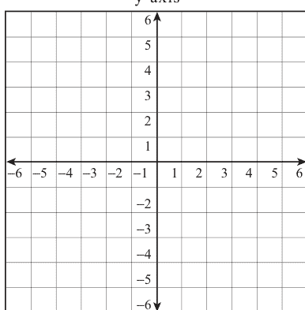

### FIGURE 2.2 Cartesian coordinate system

### 图 2.2 直角坐标系

x 轴用于实数，y 轴用于虚数。这相当易于使用。纯实数（如 3）将简单地出现在 x 轴上，如图 2.3 所示。

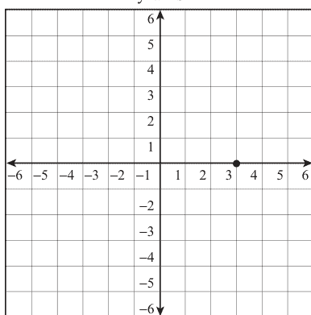

### FIGURE 2.3 Plotting the number 3

### 图 2.3 绘制数字 3

你可能已经猜到，纯虚数将在 y 轴上。例如，2i 将按图 2.4 所示进行绘制。

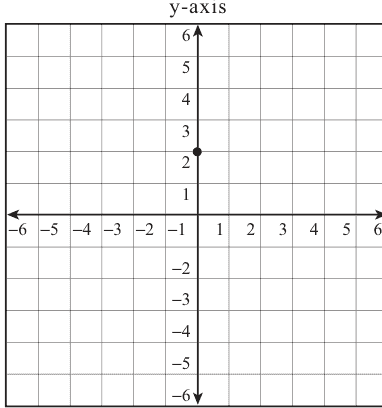

### FIGURE 2.4 Plotting the number 2i

### 图 2.4 绘制数字 2i

对于复数，只需结合 x 和 y 坐标即可。因此，像 3 + 2i 这样的数将按图 2.5 所示表示。

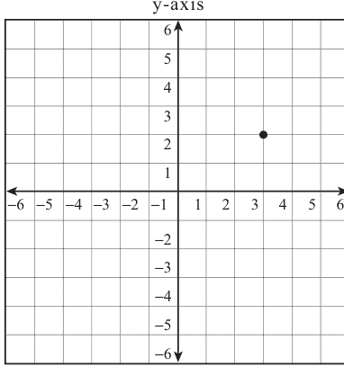

### FIGURE 2.5 Plotting the number 3 + 2i

### 图 2.5 绘制数字 3 + 2i

现在我们来谈谈一些应该让你想起第 1 章的内容。让我们精确确定我们的点 3 + 2i 距离原点 (0, 0) 有多远。就像处理向量时一样，我们将使用勾股定理。给定一个复数 z，z 从原点的长度是 z 的绝对值，即 |z|。这通常是 $\sqrt{a^2 + b^2}$。在此例中，它是

```
$\sqrt{(3)^2 + (2i)^2}$
3^2 = 9
i^2 = -1
Thus, 2i^2 = -2
So, |z| = \sqrt{9-4}
|z| = \sqrt{5}
|z| = 2.2361
```

如果你看图表，这实际上在直觉上似乎是正确的。这看起来大约是向量的长度。还必须注意的是，|z| 总是非负数。因此，如果公式得出负答案，则应使用正值。考虑这个示例：

```
4 + 4i
```

这是在图 2.6 中显示的图表。

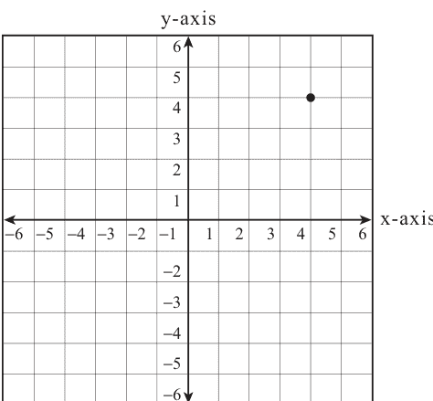

### FIGURE 2.6 Plotting the number 4 + 4i

### 图 2.6 绘制数字 4 + 4i

现在，要计算 |z|，我们将使用

\sqrt{(4)^2 + (4i)^2}

4^2 = 16

4i^2 = -4

这导致

\sqrt{8-4}

\sqrt{2}

即 2。

因为 |z| 总是正数且总是实数，所以说

|z| = 2

再次，如果你看图表，这在直觉上也是合理的。它看起来似乎小于 3，确实如此。

应该指出，当我们使用这个平面来描述复数时，它被称为复平面或 z 平面。有些资料会将这个平面称为阿甘图，因为这种表示复数的方法分别由卡斯帕·韦塞尔在 1797 年和让-皮埃尔·阿尔冕在 1806 年独立提出。韦塞尔使用这种表示法直到很久以后才为广泛所知，这就是为什么使用阿甘图这个名称而不是韦塞尔图的原因。

现在我们可以得到 z 的绝对值，或者使用正确的符号 |z|，我们准备好讨论点之间距离的绘制了。考虑由复数 3 + 1i 定义的点和由复数 1 + 4i 定义的点，如图 2.7 所示。

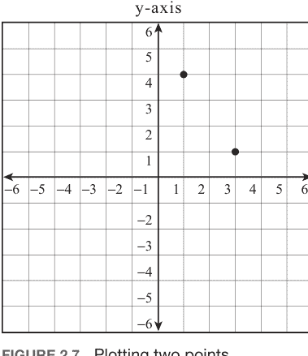

这两个点之间的距离是多少？一般来说，这些数的形式是 z1 = a1 + b1i 和 z2 = a2 + b2i。在此例中，z1 = 3 + 1i 且 z2 = 1 + 4i。距离仅仅是 |(a1 - a2) + (b1 - b2)i| 的绝对值。这与我们之前做的类似表达，如下：

\sqrt{(a1 - a2)^2 + (b1 - b2)^2}

因此，在我们的特定示例中，这将是以下内容（请注意我们不担心 i 本身，只关心实系数）：

\sqrt{(3-1)^2 + (1-4)^2}

= \sqrt{(2)^2 + (-3)^2}

= \sqrt{4 + 9}

= \sqrt{13}

= 3.873

首先要解决的是为什么我们舍弃了实际的 i 而只处理系数。这是因为我们只是在 x、y 或直角坐标系上绘制坐标。你可以将 -4 标记为 -4i 或任何你希望的东西（-4m、-4d 等等），这不会改变坐标。接下来要思考的是我们为什么要这样做。好吧，让我们通过从原点 (0, 0) 到每个点绘制一条线，为我们的图表添加一些内容，如图 2.8 所示。

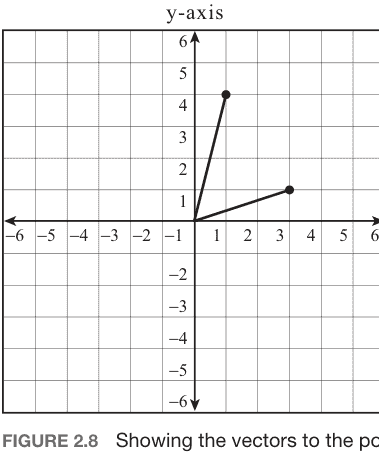

这几乎是一个三角形——只缺一边。我们可以用虚线红线填补它，如图 2.9 所示。

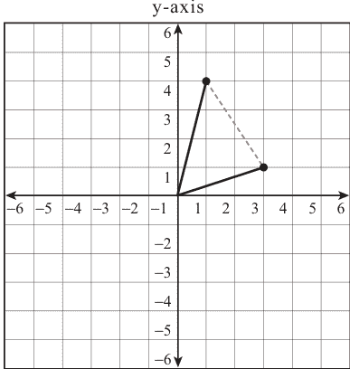

### FIGURE 2.9 Completing the triangle

### 图 2.9 完成三角形

这现在应该让你想起勾股定理：a² + b² = c²。

让我们用另一个示例来尝试，这应该有助于澄清这种情况：

z₁ = 7 + 3i
z₂ = 2 - 2i

回顾本章前面提到的基本形式：

```
\sqrt{(a_1 - a_2)^2 + (b_1 - b_2)^2}
```

因此，在我们的特定示例中，这将是以下内容（请注意我们不担心 i 本身，只关心实系数）：

```
\sqrt{(2-7)^2 + (-2-3)^2}
= \sqrt{(-5)^2 + (-5)^2}
= \sqrt{25+25}
= \sqrt{50}
= 7.07
```

这两个示例应该让你大致了解这个过程的工作原理。如果你需要，本章末尾有练习题。此时，由于我们正在探索图形表示，回到一个先前的概念——复共轭——是合适的。考虑复数 4 + 1i。以图形表示，它如图 2.10 所示。

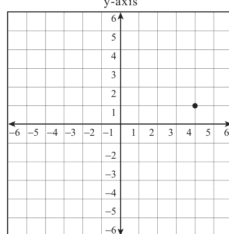

### FIGURE 2.10 Plotting the number 4 + 1i

### 图 2.10 绘制数字 4 + 1i

4 + 1i 的复共轭是 4 − 1i。如图 2.11 所示，这只是将数字围绕实轴（x）旋转。希望这能更深入地了解复共轭及其如何改变数字。它们保留实部不变并反转虚部，如图 2.11 所示。

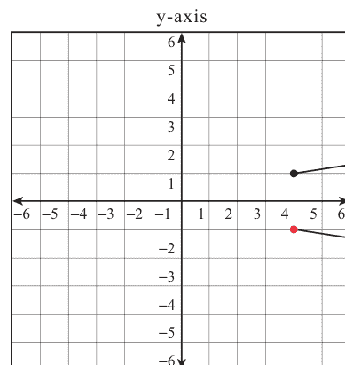

### FIGURE 2.11 The complex conjugate

### 图 2.11 复共轭


## 2.4 复数的向量表示

此时，你应该已经对复数很熟悉了。你也应该熟悉将它们图形地表示为坐标。现在将复数表示为向量只是一小步。这一点很重要，因为它在未来章节中将发挥巨大作用。事实上，你已经使用过向量了；我们只是没有按照你从第 1 章中习惯看到的方式来表示它们。考虑复数 4 + 1i。它可以表示为一个向量：

```
[ 4 ]
[ 1 ]
```

这其实非常简单。实部分在顶部，i 的系数在底部。用通用术语来说：

```
z = a + bi

= [ a ]
  [ b ]
```

现在回想一下，我们之前计算了两个复数之间的距离：

```
z1 = 7 + 3i
z2 = 2 - 2i
```

让我们把它们每个都看作是从原点 O 引出的向量，如下所示：

```
OZ1 = [ 7 ]
      [ 3 ]

OZ2 = [ 2 ]
      [ -2 ]
```

现在我们的目标是找到一个连接 OZ1 点到 OZ2 点的向量。用通用术语来说，这将是

```
OZ1 - OZ2
```

使用我们的具体向量，我们有

```
[ 7 ]   [ 2 ]
[ 3 ] - [ -2 ]
```

回想第 1 章中的矩阵和向量加减法；这其实很简单：

```
[ 7 ]   [ 2 ]   [ 5 ]
[ 3 ] - [ -2 ] = [ 5 ]
```

现在我们需要求该向量的模。回想之前我们这样做时，考虑的是

```
\sqrt{(a_1 - a_2) + (b_1 - b_2)^2}
```

这次几乎是一样的，但我们的向量已经是 a1 – a2 在 b1 – b2 上方。所以，我们需要的是更简单的东西：

```
\sqrt{(a)^2 + (b)^2}
```

在本例中，这就是

```
\sqrt{(5)^2 + (5)^2}
= \sqrt{50}
= 7.07
```

这与我们用前一种方法计算时的答案相同！这当然非常重要。两种方法都能奏效，前提是它们给出相同的答案。量子物理和量子计算大量涉及向量表示，因此理解这项技术至关重要。

当向量形式与图形表示相结合时，也效果不错。考虑两个复数，我们称之为 z1 和 z2。它们构成一个从原点到该点的向量。我们可以把这些向量称为 v1 和 v2。现在让我们更具体一点。我们将 z1 定义为 4 + 1i，z2 定义为 2 + 3i。从原点到每个这些点的线定义了一个向量，如图 2.12 所示。

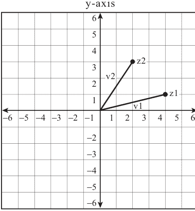

图 2.12 绘制两个复数点

向量和可以使用平行四边形法则计算。平行四边形法则指出，平行四边形四条边长度的平方和等于两条对角线长度的平方和。你可能会说我们没有两条对角线。不过，我们确实有两条边，这也会给我们另外两条边，如图 2.13 所示。

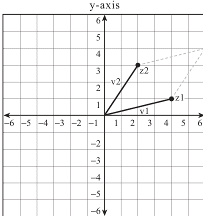

图 2.13 平行四边形法则

如果你只是简单地相加向量，z1 = 4 + 1i 和 z2 = 2 + 3i，你会得到 x = (4 + 2) y = (1i + 3i)，即点 z3 = 6 + 4i。即使粗略检查图 2.13 中的平行四边形，也会发现这正是我们找到的点。

描述从原点到任意复数 z 的向量的另外两个参数是点 z 的 r 和 θ，称为极坐标。r 是原点到 z 的距离，θ 是倾斜角。该角始终从正实轴逆时针测量。这通过以下方程为我们提供了更多关于复数坐标的信息：

```
x = r cos θ       y = sin θ
```

根据勾股定理，也应该清楚

```
r = |z| = \sqrt{(x)^2 + (y)^2}
```

因此，给定由复数 2 + 3i 定义的点，我们知道

```
r = \sqrt{(2)^2 + (3)^2}
r = \sqrt{4+9}
r = \sqrt{13}
r = 3.605
```

一点基本的三角学告诉我们

```
cos \theta = \frac{x}{|z|} \qquad sin \theta = \frac{y}{|z|}
```

然后对勾股定理进行一点代数运算，给出如下结果：

```
r cos \theta = x \quad \text{and} \quad r sin \theta = y \quad \text{and} \quad tan \theta = \frac{y}{x}
```

现在请记住，我们将点 z 表示为 a + bi（或更常见的 x + yi），这给出了：

```
z = a + bi
= r cos \theta + (r sin \theta)i
= r(cos \theta + i sin \theta)
```

你最常看到角度以弧度为单位。作为基本三角学的简要回顾，1 弧度等于 57.3 度，圆的完整 360 度等于 2\pi 弧度。

## 2.5 泡利矩阵

泡利矩阵的基础并不困难。泡利矩阵的“为什么”可能稍微复杂一些。这是一组三个 2 × 2 矩阵。这似乎像是回到了第 1 章；然而，在第 1 章中我们尚未讨论复数，这就是为什么在这里介绍泡利矩阵。三个矩阵是

```
[\begin{bmatrix} 0 & 1 \\ 1 & 0 \end{bmatrix}]
```

```
[\begin{bmatrix} 0 & -i \\ i & 0 \end{bmatrix}]
```

```
[\begin{bmatrix} 1 & 0 \\ 0 & -1 \end{bmatrix}]
```

这些通常用 \(\sigma\) 符号表示，如下所示：

```
$$
\sigma1 = \begin{bmatrix} 0 & 1 \\ 1 & 0 \end{bmatrix}
$$
```

```
$$
\sigma2 = \begin{bmatrix} 0 & -i \\ i & 0 \end{bmatrix}
$$
```

```
$$
\sigma3 = \begin{bmatrix} 1 & 0 \\ 0 & -1 \end{bmatrix}
$$
```

这三个矩阵的表示当然并不复杂，但它们有两个性质。这些矩阵既是厄米特的也是酉的。厄米特是指等于其自身共轭转置的方阵。共轭转置意味着先对矩阵进行转置，然后再取矩阵的共轭复数。在第 1 章中，我们使用 3 × 2 矩阵看到了转置。对于方阵也是同样的方式。回想转置符号是 T：

```
$$
\begin{bmatrix} a & b \\ c & d \end{bmatrix}^T = \begin{bmatrix} a & c \\ b & d \end{bmatrix}
$$
```

让我们来看其中一个泡利矩阵，以更具体的形式来了解这一点：

```
$$
\sigma1 = \begin{bmatrix} 0 & 1 \\ 1 & 0 \end{bmatrix}^T = \begin{bmatrix} 0 & 1 \\ 1 & 0 \end{bmatrix}
$$
```

这展示了转置，但共轭在哪里呢？回想本章前面我们探讨过复共轭。

如果一个方阵的共轭转置也是其逆矩阵，则称其为酉矩阵。换句话说，酉矩阵是正交矩阵的复数推广。酉矩阵对矩阵 A 具有以下特征性质：

```
$$
AA^T = A^TA = I
$$
```

考虑以下泡利矩阵：

```
$$
\sigma2 = \begin{bmatrix} 0 & -i \\ i & 0 \end{bmatrix}
$$
```

这可以表示如下：

```
$$
\sigma2 = \begin{bmatrix} 0+0i & 0-i \\ 0+i & 0+0i \end{bmatrix}
$$
```

好吧，如果你取复共轭（仅改变虚部的符号），你会得到以下结果：

```
\sigma 2 = \begin{bmatrix} 0 - 0i & 0 + i \\ 0 - i & 0 + 0i \end{bmatrix}
```

现在对其进行转置，如下所示：

```
\begin{bmatrix} 0 - 0i & 0 + i \\ 0 - i & 0 + 0i \end{bmatrix}^T = \begin{bmatrix} 0 - 0i & 0 - i \\ 0 + i & 0 + 0i \end{bmatrix}
```

这简化为

```
\begin{bmatrix} 0 & -i \\ i & 0 \end{bmatrix}
```

矩阵保持不变。

好吧，这些矩阵的基本机制似乎并不太困难。现在让我们更深入地了解一下“为什么”。这三个矩阵以物理学家沃尔夫冈·泡利的名字命名，它们出现在泡利方程中，该方程考虑了粒子在外部电磁场中的自旋。我们暂时不会深入探讨实际的泡利方程，但对于好奇的读者，方程 2.7 展示了它。

```
\hat{H}|\psi\rangle = \left[ \frac{1}{2m} [(\mathbf{p} - q\mathbf{A})^2 - q\hbar \hat{\sigma} \cdot \mathbf{B}] + q\phi \right] |\psi\rangle = i\hbar \frac{\partial}{\partial t} |\psi\rangle
```

### 方程 2.7 泡利方程

别慌——你现在不需要理解这个。几章之后，其中的大部分内容实际上会对你有意义。

关于泡利矩阵的一个有趣事实是，它们构成了 2 × 2 厄米特矩阵向量空间的一组基。回想第 1 章，基向量意味着这意味着所有 2 × 2 厄米特矩阵都可以写成泡利矩阵的某种线性组合。

允许我向你介绍一个与泡利矩阵相关的新数学符号。可以将所有三个泡利矩阵写成一个紧凑的表达式，如方程 2.8 所示。

```
\begin{pmatrix} \delta_{a3} & \delta_{a1} - i\delta_{a2} \\ \delta_{a1} + i\delta_{a2} & -i\delta_{a3} \end{pmatrix}
```

### 方程 2.8 泡利矩阵的紧凑形式


你已经知道符号 i 代表什么，即 \(\sqrt{-1}\)，但你可能不熟悉符号 \(\delta$，它表示 Kronecker delta。Kronecker delta 是一个迷人的函数。它以数学家 Leopold Kronecker 命名。它是一个两个变量的函数。如果变量相等，则函数返回 1。如果变量不相等，则函数返回 0。这在 Equation 2.9 中表达得更正式一些。

\(\delta_{ij} = \begin{cases} 0 & \text{if } i \neq j, \\ 1 & \text{if } i = j. \end{cases}\)

### EQUATION 2.9 克罗内克 Delta

请注意，Kronecker delta 必须始终有两个参数。它正是根据此来确定返回什么。在 Equation 2.8 中，你已经看到 Pauli 矩阵被表示为单个表达式。回顾一下，共有三个 Pauli 矩阵。将 Equation 2.8 中的 a 替换为 1、2 或 3，即可得到其中一个 Pauli 矩阵。让我们通过替换 \(a = 2\) 来做到这一点。这将得到你在 Equation 2.10 中看到的内容。

\(\begin{pmatrix} \delta_{33} & \delta_{31} - i\delta_{32} \\ \delta_{31} + i\delta_{32} & -i\delta_{33} \end{pmatrix}\)

### EQUATION 2.10 带 Pauli 矩阵的克罗内克 Delta

然后，使用所示输入的 Kronecker delta，你将得到 Equation 2.11 中所示的内容。

\(\begin{pmatrix} 1 & 0 - i0 \\ 0 & 1 \end{pmatrix}\)

### EQUATION 2.11 将克罗内克 Delta 应用于 Pauli 矩阵

当然，这可以简化为 Equation 2.12 中所示的内容。

\(\begin{pmatrix} 1 & 0 \\ 0 & 1 \end{pmatrix}\)

### EQUATION 2.12 得到的 Pauli 矩阵

这显然是 Pauli 矩阵之一。具体来说，它是 \(\sigma_1\) Pauli 矩阵。既然你已经了解了如何用单个表达式表示所有 Pauli 矩阵，并学习了新的符号和函数 Kronecker delta \(\delta\)，那么是时候学习另一个与矩阵相关的术语了。Pauli 矩阵具有一种称为 *involutory*（自逆，不要与 involuntary 混淆）的性质。自逆矩阵是指其自身为逆矩阵的矩阵。

让我们再进一步。如果我们将单位矩阵 I 与 Pauli 矩阵一起包含，它们将构成 2 × 2 复数厄米矩阵的实 Hilbert 空间的正交基。回顾第 1 章，正交是指互相垂直。

Hilbert 空间是一种向量空间，就像你在第 1 章中介绍的那样；然而，它将你熟悉的二维欧几里得平面和三维欧几里得空间扩展到任意数量的维度，包括无限维空间。德国数学家 David Hilbert 首先在其关于积分方程和傅里叶级数的著作中描述了以他命名的 Hilbert 空间。

Hilbert 空间本质上是推广到潜在无限维的向量空间。

内积基本上是具有三个性质的点积：

- 1. 点积是对称的，这意味着点积的顺序无关紧要。
- 2. 它在其第一个参数上是线性的，这意味着给定任何标量 a 和 b 以及任何向量 x1、x2 和 y，则 (ax1 + bx2) * y = ax1 * y + bx2 * y。
- 3. 对于向量空间（Hilbert 向量空间）中的任何元素 x，x 与其自身的内积是正定的（即，内积 > 0）。

所有这些都有点简化，但足够让你理解 Hilbert 空间和内积的要点。让我们稍微展开一下第 1 点。内积满足特定条件。内积必须具有共轭对称性。Hilbert 空间中两个元素的内积是这两个元素反序时的复共轭。

内积是点积的推广。它允许你将两个向量相乘并产生一个标量。在实际应用中，就计算而言，点积和内积之间并没有真正的区别。点积通常仅用于引用实数。如果使用复数或你正在处理非欧几里得空间，则通常使用内积一词。

### 2.5.1 Pauli 矩阵的代数性质

Pauli 矩阵有一些有趣的代数性质。首先，所有这些矩阵的行列式均为 –1。回顾第 1 章，方阵的行列式计算如下：

\(|A| = \begin{vmatrix} a & b \\ c & d \end{vmatrix} = ad - bc\)

现在考虑 Pauli 矩阵：

\(\sigma_1 = \begin{pmatrix} 0 & 1 \\ 1 & 0 \end{pmatrix}\)

\(\det = (0 \times 0) - (1 \times 1) = -1\)

\(\sigma_2 = \begin{bmatrix} 0 & -i \\ i & 0 \end{bmatrix}\)

\(\det = (0 \times 0) - (-i \times i) = -1\)
\(\det = 0 - (-i^2)\)
\(\det = 0 - (1)\)
\(\det = -1\)

\(\sigma_3 = \begin{bmatrix} 1 & 0 \\ 0 & -1 \end{bmatrix}\)

\(\det = (1 \times -1) - (0 \times 0) = -1\)

这是 Pauli 矩阵的一个有趣性质。Pauli 矩阵的特征值和特征向量呢？回顾第 1 章，特征值是与线性方程组相关的一组特殊标量。给定矩阵 A 和某个标量 \(\lambda\)，如果

\(A v = \lambda v\)

成立，则我们说 v 是矩阵 A 的特征向量，\(\lambda\) 是矩阵 A 的特征值。那么，考虑其中一个 Pauli 矩阵：

\(\begin{bmatrix} 0 & 1 \\ 1 & 0 \end{bmatrix}\)

我们正在寻找某个值，使得

\(\begin{bmatrix} 0 & 1 \\ 1 & 0 \end{bmatrix} v = \lambda v\)

我们先求特征值 \(\lambda\)，它将是满足公式

\(\det (A - \lambda I) = 0\)

的值，其中 A 是问题中的矩阵。

让我们从原始矩阵开始，从对角线上减去 \(\lambda\)：

\(\begin{bmatrix} 0 & 1 \\ 1 & 0 \end{bmatrix} \to \begin{bmatrix} 0-\lambda & 1 \\ 1 & 0-\lambda \end{bmatrix}\)

现在我们想知道该矩阵的行列式：

\(\det \begin{bmatrix} 0-\lambda & 1 \\ 1 & 0-\lambda \end{bmatrix}\)

回顾第 1 章，行列式的计算如下：

\(|A| = \begin{vmatrix} a & b \\ c & d \end{vmatrix} = ad - bc\)

因此，我们有 \((0 - \lambda)(0 - \lambda) - (1 \times 1)\)

\(= \lambda^2 - 1\)

这可以很容易地求解：

\(\lambda^2 = 1\)

因此，\(\lambda = 1\) 或 \(-1\)。

事实证明，所有 Pauli 矩阵的特征值都是 1 和 \(-1\)。你可以尝试用任何 Pauli 矩阵自己验证一下。我们现在准备好寻找特征向量了。回顾一下，我们正在寻找满足以下条件的向量：

\(Av = \lambda v\)

A 是我们的初始矩阵，我们现在知道 \(\lambda\) 可以是 +1 或 -1。更正式地说，我们有两个特征值：\(\lambda_1 = 1\)；\(\lambda_2 = -1\)。让我们从第二个特征值开始。这将带我们到以下内容：

\(\begin{bmatrix} 0 & 1 \\ 1 & 0 \end{bmatrix} \begin{pmatrix} x \\ y \end{pmatrix} = -1 \begin{pmatrix} x \\ y \end{pmatrix}\)

向量 \(\begin{pmatrix} x \\ y \end{pmatrix}\) 是我们要找的。我们可以从上半部分或下半部分开始，所以我们使用下半部分：

\(1x + 0y = -y\)

\(x = -y\)

因此，\(\begin{pmatrix} 1 \\ -1 \end{pmatrix}\) 是该 Pauli 矩阵的一个特征向量。让我们将其代回以检查：

\(\begin{bmatrix} 0 & 1 \\ 1 & 0 \end{bmatrix} \begin{pmatrix} 1 \\ -1 \end{pmatrix} = -1 \begin{pmatrix} 1 \\ -1 \end{pmatrix}\)

让我们从左边开始。我们将第 1 行与向量相乘：

\([0\ 1] \begin{pmatrix} 1 \\ -1 \end{pmatrix} = (0 \times 1) + (1 \times -1) = -1\)

同样对第 2 行：

\([1\ 0] \begin{pmatrix} 1 \\ -1 \end{pmatrix} = (1 \times 1) + (0 \times -1) = 1\)

这给出了 \(\begin{pmatrix} -1 \\ 1 \end{pmatrix}\)。

让我们检查一下它是否与右边匹配：

\(-1 \begin{pmatrix} 1 \\ -1 \end{pmatrix} = \begin{pmatrix} -1 \\ 1 \end{pmatrix}\)

因此，我们已经找到了其中一个 Pauli 矩阵的特征值和一个特征向量。现在让我们计算这个特定 Pauli 矩阵的另一个特征向量：

\(\begin{bmatrix} 0 & 1 \\ 1 & 0 \end{bmatrix} \begin{pmatrix} x \\ y \end{pmatrix} = 1 \begin{pmatrix} x \\ y \end{pmatrix}\)

我们再次从上半部分或下半部分开始；我们使用下半部分。这给出了

\(1x + 0y = y\)

它简化为

\(x = y\)

这表明 \(\begin{pmatrix} 1 \\ 1 \end{pmatrix}\) 是该 Pauli 矩阵的另一个特征向量。那么现在我们有：

\(\begin{bmatrix} 0 & 1 \\ 1 & 0 \end{bmatrix} \begin{pmatrix} 1 \\ 1 \end{pmatrix} = 1 \begin{pmatrix} 1 \\ 1 \end{pmatrix}\)

同样，我们从左边开始：

\(\begin{bmatrix} 0 & 1 \\ 1 & 0 \end{bmatrix} \begin{pmatrix} 1 \\ 1 \end{pmatrix}\)


第一行给出如下结果：

[0 1] (1/1) = (0 * 1) + (1 * 1)
= 1

现在是第二行：

[1 0] (1/1) = (1 * 1) + (0 * 1)
= 1

这给出了 (1/1)。
现在看右边：

1 (1/1)

这显然等于 (1/1)，我们已找到该泡利矩阵的第二个特征向量。如果这对你来说还不完全清楚，建议继续，并计算其他泡利矩阵的特征值和特征向量。你常会以另一种形式看到它，该形式将在第 3 章“面向量子计算的基础物理”中介绍。

## 2.6 超越数

与复数问题不直接相关，但有关联的话题是超越数。超越数是除代数数之外的数。这自然引出一个问题：什么是代数数？代数数是非零多项式的根。代数数包括实数和复数。

超越数的两个例子是 π 和 e；不过，实际上存在无限多个超越数。关于实超越数的一个事实是它们是无理数；然而，逆命题不成立。当然，并非所有无理数都是超越数。一个很好的例子是 √2，因为它实际上是多项式方程 x^2 − 2 = 0 的根。

欧拉数不仅是超越数较常见的例子之一，而且莱昂哈德·欧拉是最早给出超越数定义的人之一。他于 18 世纪这样做。1844 年，约瑟夫·刘维尔首先证明了超越数的存在。1873 年，夏尔·埃尔米特证明 (e) 确实是超越数。著名数学家大卫·希尔伯特提出了一系列问题。希尔伯特第七问题的表述如下：

如果 a 是一个非零且不为一的代数数，且 b 是一个无理代数数，那么 a^b 必然是超越数吗？

如果你认为超越数仅仅是数学上的好奇物，没有实际用途，那我们来看一个具有明确实际应用的例子。柴廷常数（有时也称为柴廷构造），本质上是随机构造的程序会停止的概率。由于对程序进行编码的可能性是无限的，因此实际上存在无限多个停止概率。通常这仅用单个符号 Ω 表示。格雷戈里·柴廷描述了这个以他名字命名的常数。每个停止概率都是一个超越实数。柴廷常数的细节超出了我们当前的范围，但感兴趣的读者鼓励深入研究该主题。

## 2.7 总结

本章首先介绍了复数的基础知识，包括复数的起源。你学习了如何对复数进行基本代数运算。接着介绍了复数的图形表示方法。下一个主题是向量表示。图形表示和向量表示在量子物理和量子计算中都非常常见，因此理解这些概念至关重要。

本章有一节专门介绍了泡利矩阵。这一主题对于理解量子计算至关重要。在继续之前，你必须确保自己完全掌握泡利矩阵的相关内容。本章还简要讨论了超越数。

## 测试你的技能

## 复习问题

- 1. 将以下两个复数相加：(3 + 2i)(2 + 3i)
- 2. (4 + 2i)(2 + 2i) 的积是多少？
- 3. (2 + 2i)(-2 + 3i) 的积是多少？
- 4. 用 (2 + 2i) 除 (6 + 4i)。
- 5. 已知两个复数 (3 + 2i) 和 (4 + 4i)，它们之间的距离是多少？
- 6. 以下哪个陈述准确描述了克罗内克三角函数？
  - a. 如果两个输入相等，则返回 1，否则返回 0。
  - b. 如果两个输入相等，则返回 0，否则返回 1。
  - c. 它计算两个复数之间的距离。
  - d. 它计算图上两点之间的距离。
- 7. 计算以下泡利矩阵的行列式：\(\sigma 2 = \left[ \begin{array}{cc} 0 & -i \\ i & 0 \end{array} \right]\)
- 8. 从实践角度来看，点积和内积的主要区别是什么？
- 9. 什么是自逆矩阵？
  - a. 具有复逆矩阵的矩阵
  - b. 行列式为 –1 的矩阵
  - c. 是其自身逆矩阵的矩阵
  - d. 没有逆矩阵的矩阵
- 10. 以下泡利矩阵的特征值是什么？
  ```
  [\begin{bmatrix} 1 & 0 \\ 0 & -1 \end{bmatrix}]
  ```
