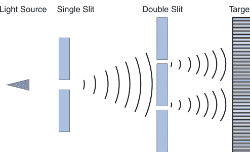
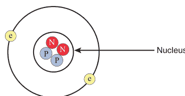
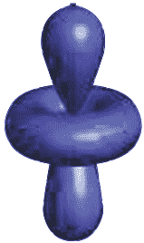
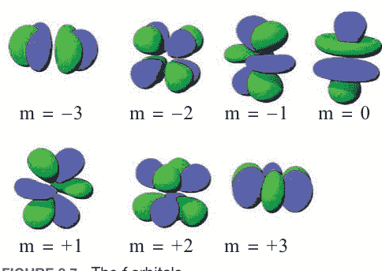
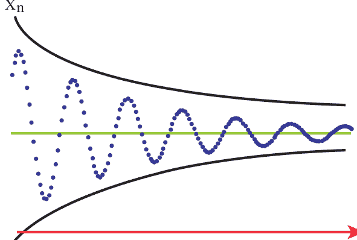
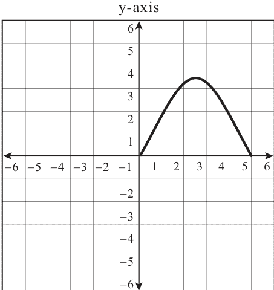
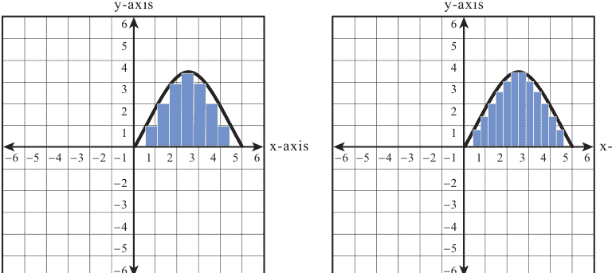

# 第 3 章

# 面向量子计算的基础物理

## 章节目标

阅读本章并完成测验后，你将能够：

- 基本理解量子物理
- 能够解释量子态
- 理解不确定性原理
- 描述量子纠缠

本书的最终目标是探索量子计算；然而，量子计算（很明显）基于量子物理。要理解量子计算，你必须对量子物理有一个概括性的了解。本章首先概述物理学，然后讨论导致量子物理的发现。这将为我们讨论量子物理的基础知识提供基础。显然，可以写几本书、开几门课来讲授量子物理这个话题。本章的目标是为你提供足以继续阅读本书其余部分的工作知识。

还必须指出，本章中的许多概念对初学者来说可能相当困难。如果你发现有些概念难以理解，甚至需要重新阅读某些章节，请不要惊讶。这对于初学量子物理的人来说非常正常。对于已有物理背景的人来说，请理解本章的目标是为初学者提供足以从事量子计算工作的知识。显然，关于量子物理可写的内容远比本章所载的多，本章的各个主题也都可以更详细地阐述。然而，本章的目的不是要成为一本量子物理教科书。它的目的是为读者提供足以继续学习本书后面所介绍概念的知识。

## 3.1 通往量子之旅

要想最好地理解量子物理，了解导致量子物理产生的历史是有利的。在十九世纪末和二十世纪初，出现了许多重要发现。这些发现中的每一个都增加了一系列证据，最终将要求修订经典物理学。

然而，量子物理的真正问题始于对光的本质的理解。光是波还是粒子？这场辩论可以追溯到 1600 年代。Isaac Newton 曾提出光是粒子或微粒。Christian Huygens 主张光是波，很像声波或水波。Huygens 并非唯一持光波观点的人，但 Isaac Newton 的显赫地位无疑为光的微粒观点增添了分量。这开启了后来成为量子力学诞生的进程。经典物理学无法解释几件事，包括光的本质。

这两种相互竞争的概念在相当长一段时间内继续推动着物理学界的辩论，直到可以进行实验来帮助解决问题。波通常通过某种介质传播。例如，声波通过空气传播。光波观点的支持者提出了一种以太，光通过这种以太传播。事实上，人们曾相信所有电磁辐射都通过这种以太（也拼作 *aether*）传播。以太的概念在物理学界占据主导地位，直到二十世纪初期。这种被认为是充满空间的物质或介质的以太，被认为不仅是光，而且是引力和其他力的传播介质。事实上，物理学家曾试图在以太的背景下理解行星运动。

1801 年，Thomas Young 进行了一项实验，展示了光的波动行为。Young 让光照射过屏障上的两个缝，并在另一侧放置了一个感光板。当光通过两个孔径时，在接收端似乎出现了干涉，很像水波或声波。图 3.1 展示了这些结果。



图 3.1 双缝实验

光先经过单缝，再经过双缝。当到达靶标时，来自双缝每个缝的两个光源会表现出干涉图样。靶标


会显示条纹，条纹会随着靶移离两缝而变宽。当时，这似乎解决了光是粒子还是波的问题。光看起来明显是波，而不是粒子（当时称为微粒）。基本上，人们认为如果光是粒子，那么对面的图案应该与缝隙的形状和大小相匹配。干涉图样的出现似乎证明光是波。

双缝实验的进一步变体开始揭示这一情况。首先，人们注意到，当波/粒子一次一个地通过双缝时，它们确实在靶上呈现为点，或粒子。这可以通过简单地关闭其中一个缝隙来实现。然而，当更多的波/粒子通过缝隙时，波的图案出现了。这种实验已用于光子、电子和其他粒子。基本上，这导致了光既是粒子又是波的观点。这也适用于其他亚原子粒子。这个概念通常被称为*波粒二象性*。我们将在本章稍后再回到这个概念。

量子力学的历史中也包括一些今天看来可能有些晦涩的问题。其中一个问题是黑体辐射的研究。这个主题在19世纪非常重要。*黑体*是不透明、不反射的物体。辐射是这种黑体内部及其周围的热辐射（热量）。完美吸收体吸收入射到其上的所有电磁辐射；这种物体称为黑体。显然，这样的物体是假设的，因为没有物体能完美地吸收能量。

当任何物体被加热时，该热量具有特定的波长。这些波长与强度成反比关系。当物体被加热且温度升高时，波长变短；因此，光会改变颜色。测量黑体辐射得出的结果似乎与现有理论不符。这一点在更高频率时尤其明显。

Balfour Stewart 进行了实验，比较了抛光板与灯黑表面发出的辐射，两者使用相同的温度。他使用了伽伐诺计和显微镜来读取辐射能量。在他的论文中，他没有提到波长或热力学。他声称，无论表面是灯黑还是反射性的，辐射热都是如此。最终，他错了。

1859年，Gustav Kirchhoff 证明，从黑体发出的能量仅取决于黑体的温度和被吸收能量的频率。他开发了Equation 3.1中所示的相当简单的公式。

```
E = J (T,v)
```

EQUATION 3.1 克尔希霍夫黑体能量

在这个公式中，E是能量。T是温度，v是频率。然而，Kirchhoff不知道函数J是什么，并挑战其他物理学家去找到它。

19世纪末和20世纪初是众多发现的时代。1887年，Heinrich Hertz 发现了光电效应，我们将在稍后详细讨论。Max Planck 在1900年提出，来自原子系统的辐射能量以离散元素的形式释放。这些离散元素称为*量子*，是*量子物理学*一词的词根。这导致了他相当著名的公式，如Equation 3.2所示。

$\epsilon = hv$

EQUATION 3.2 量子能量

该公式指出，能量元素($\epsilon$)与频率(v)乘以普朗克常数(h)成正比。普朗克常数是一个非常小的数字，我们将在本章稍后详细探讨。普朗克常数及随后的公式源于他尝试推导一个数学公式，以准确预测黑体辐射的观测光谱分布。

此外，Planck 定义了黑体辐射的普朗克定律。公式如Equation 3.3所示。

$B_v(v,T) = \frac{2hv^3}{c^2} \frac{1}{e^{hv/kT} - 1}$

EQUATION 3.3 普朗克定律

该公式具有以下值：

- h 是普朗克常数。
- c 是真空中光速。
- k 是玻尔兹曼常数。
- v 是电磁辐射的频率。
- T 是物体的绝对温度。

用经典物理学难以解释的另一个问题是光电效应。基本上，当某些电磁辐射（例如光）击中材料时，会发射电子（或其他粒子）。这看起来足够容易理解。经典（即，前量子或相对论）电磁理论认为，光的强度与发射电子的动能成正比。这意味着暗光产生的电子能量应低于亮光。然而，实验并未显示这一点。相反，实验表明频率与被击落的电子之间存在相关性。事实上，在低于某个频率时，根本不会发射电子。

Einstein 提出，这种光电效应是由于光是离散波包的集合，称为*光子*，而不是在空间中传播的波。Einstein、Planck 和其他人的工作最终确立了现在被称为波粒二象性的概念。这似乎与Young 等人之前明确表明光是波的实验相悖。

> 注：
> 对于具有强大数学背景并希望对相对论和量子物理学进行更严谨讨论的读者来说，由Pearson出版的Randy Harris 的《Modern Physics, Second Edition》是一个不错的选择。

经典物理学一直认为，任何形式的能量都是波。然而，Max Planck 通过实验证明，在某些情况下，能量可以表现得像物体或粒子一样。为此工作，他于1918年获得了诺贝尔物理学奖。

1923年，Louis de Broglie 在其博士论文中断言，可以通过公式确定任何粒子的波长

```
\lambda = h/p
```

其中

- \lambda，或lambda，是波长。
- h 是普朗克常数，为6.62607015 × 10⁻³⁴ J·s（焦耳每秒）。焦耳可以定义为产生一瓦特功率一秒钟所需的功。
- p 是动量。动量反过来可以定义为质量(m)乘以速度(v)。

你或许可以推断，鉴于普朗克常数是一个非常小的数字，在大多数情况下，波长将非常小。de Broglie 的工作本质上与光的波粒二象性平行。de Broglie 所假设的是，物质（即粒子）也可以表现得像波；然而，鉴于涉及的波长很小，我们通常在宏观世界中看不到这种行为。这就是为什么当你扔一只棒球时，它完全表现得像一个粒子。

已有各种实验证明了物质的波动行为。其中最著名的是Davisson-Germer 实验。不必深入该实验的所有细节，基本上在20世纪20年代，Clinton Davisson 和Lester Germer 表明，被镍金属表面散射的电子表现出衍射图样，如同波一样。

波粒二象性的概念是量子物理学的核心。它基本上表明，粒子可以被描述为粒子或波，而简单地将其视为粒子或波其中之一是不准确的。粒子一词指光子、电子和其他亚原子粒子。我们将在本章稍后更深入地探讨这一点，但目前，基本描述就足够了。这段简短的历史课应为我们进一步讨论量子物理学提供一些背景。

## 3.2 量子物理学要点

有了上一节对量子物理学的简要历史，你现在应该意识到，在亚原子世界中，事物既是粒子也是波，并且你应该意识到这些粒子的能量处于离散能级，或称量子中。让我们开始更详细地探讨这一事实。

### 3.2.1 基本原子结构

学习入门化学时，人们通常会学习一个原子模型：原子核中有质子和中子，电子围绕其运行，就像行星围绕恒星一样。这并非电子实际行为的方式，但它为学生研究原子结构提供了一个总体的起点。这个模型通常被称为波尔模型，以其创建者Niels Bohr 命名。图 3.2 说明了氦的波尔模型。



图 3.2 波尔模型

如前所述，这并不十分准确。首先，必须指出，电子并不像行星围绕恒星那样运行。我们所谓的原子轨道实际上是一个数学函数，用于计算在原子核周围特定区域找到电子的概率。这引出了关于量子物理学的一个非常重要的事实。在亚原子世界中，我们发现的大部分事物是概率性的，而不是决定性的。我们将在本章稍后回到这个概念；事实上，它将贯穿本书始终。找到电子的概率取决于轨道和能级。轨道本身是找到电子的概率区域。能级被赋予整数值1、2、3和4。

每个电子由四个数字描述。第一个是n，即主量子数。其次是l，即轨道量子数（有时也称为轨道角动量量子数）。接着是m，即磁量子数，以及ms，即电子自旋量子数。字母n，即主量子数，有时被称为轨层。l有时也被称为方位量子数。l的值可以是1到n−1之间的任何数字。所以，如果n = 2，那么l = 1。这个数字将告诉你轨道的形状。请记住，这种形状确定了找到电子的概率区域，而不是路径，例如行星围绕恒星运行。

轨道（即l值）使用字母来定义。它们是s、p、d和f轨道。s轨道被绘制为球体，但请记住，这只是找到电子的概率区域。图 3.3 显示了s轨道。


### 图 3.3 s 轨道

这是 l = 0。现在任何能级中都可以有 s 亚层或轨道。因此，可以有 n = 1 s 亚层、n = 2 s 亚层等等。

对于 l = 1（当 n 至少为 2 时发生这种情况），轨道开始呈现出有些奇怪的形状。它具有类似哑铃的形状，如图 3.4 所示。


### 图 3.4 p 轨道

更准确地说，p 轨道是 l = 1 的波函数。它们的分布是角度分布，但并非均匀，因此形成了其分布的形状。对于三个不同的 $m_l$ 值（–1、0 和 1），有三种不同的 p 轨道。基本上，这些轨道具有不同的取向。

如果波函数的 l = 2，则为 d 轨道。其分布更为奇特。d 轨道常被描述为四叶草形状，但对大多数 d 轨道来说，本质上就像平面上的两个哑铃，如图 3.5 所示。对于 $m_l$ 值 –2、–1、0、1 和 2，有五种不同的 d 轨道。


### 图 3.5 d 轨道

d 轨道也可以表现为两个瓣穿过一个环面——或者更通俗地说，一个哑铃穿过一个甜甜圈。基于 $m_l$ 值，这种形状有变体。图 3.6 显示了“甜甜圈”形状。



### 图 3.6 d 轨道的另一种形式

如果 $l$ 为 3，则为 $f$ 轨道。$f$ 轨道具有多种可能的形状。形状取决于 $m_l$ 值。共有七个 $m_l$ 值：-3、-2、-1、0、1、2 和 3。图 3.7 显示了它们各自的形状。



自旋由 +1/2 或 –1/2 表示。这就引出了泡利不相容原理。沃尔夫冈·泡利于 1925 年制定了以其名字命名的泡利不相容原理。它规定，在量子系统中，同一时间内不能有两个费米子占据相同的状态。费米子是具有半整数自旋的亚原子粒子。这包括电子，这是我们在此关注的对象。

泡利不相容原理对电子分布有一些实际影响。s 亚轨道最多可容纳两个电子，且前提是它们自旋不同。因此，在氦中，有两个电子，都在 s 亚轨道中但自旋不同；一个是 +1/2，另一个是 –1/2。p 亚层最多有六个电子，成对出现，每对中的每个成员自旋相反。d 亚层最多有十个电子，同样成对出现，每对中的每个成员自旋相反。

对原子结构的这一总体概述应能为你提供足够的工作知识，以便跟上本书其余部分的内容。我们在此部分仅初步探讨了这一主题；然而，这里的目标不是教授化学课程，而是确保你对原子结构有一个总体了解。

### 3.2.2 希尔伯特空间

现在我们可以关联第一章中涵盖的一些数学知识。回想一下向量，特别是单位向量。单位向量的长度为 1。回想一下，向量的长度计算如下：

```
||vector|| = √ x2 + y2
```

给定量子系统或波粒的可能状态由单位向量表示。当应用于量子状态时，它们称为状态向量。

各种状态向量是称为状态空间的向量空间的一部分。这个状态空间是一个复希尔伯特空间。现在，为了描述希尔伯特空间，我们将使用在第一章“线性代数简介”和第二章“复数”中所涵盖的信息。

你只需对希尔伯特空间有一个一般性了解就能读完并理解本书；然而，如果你打算在量子物理或量子计算方面深入研究，就需要更深入地理解希尔伯特空间。希尔伯特空间是欧几里得空间的推广。当然，这需要对欧几里得空间做一些解释。

欧几里得空间是古典几何的空间。它最初是三维空间。这可能是你在小学或中学学习过的空间。由勒内·笛卡尔在十七世纪发明的笛卡尔坐标系用于欧几里得空间。在相当长一段时间里，欧几里得空间仅限于三个维度，这与我们的日常经验吻合。

在十九世纪，路德维希·施列夫利将欧几里得空间扩展到包含 _n_ 个维度。与此同时，施列夫利在多胞体方面做了大量工作，多胞体是具有更多维度的传统柏拉图立体的类比。

欧几里得空间是实数系统上的空间。欧几里得向量空间是实数上的有限维内积空间。回想第二章，内积是具有对称性质的点积：其第一个参数是线性的且大于零。还要回想第一章，两个向量的点积就是两个向量相乘。

希尔伯特空间可以是任何维度，可以是有限维或无限维。希尔伯特空间也可以是实的或复的（回想第二章中的复数）。每个内积都会诱导出一个范数。回想第一章，非负长度称为向量的范数。

如果空间关于该范数是完备的，则它是希尔伯特空间。对于没有严格数学背景的读者，这部分可能有些困难，因此请允许我花一些篇幅详细解释这一点（如果你对这些内容早已了然，请随意跳过此解释）。

在这里，术语 _completeness_ 简单来说意味着该空间中每个柯西序列都收敛到该空间中的一个元素。对于至少部分读者来说，这引发了这样一个问题：什么是柯西序列，为什么它如此重要？柯西序列以奥古斯坦-路易·柯西命名。顺便说一句，Cauchy 发音为 _koh-shee_。柯西序列是指随着序列推进，其元素之间变得任意接近的序列。实际上，这里有几个相当简单的例子。以下是一个柯西序列的示例：

```
a_n = \frac{1}{2^n}
```

为什么这是一个柯西序列？好吧，让我们更仔细地研究一下。首先，选择任意 i > 0。现在选择一个 N，使得 2^-N < i。接下来，考虑 n 和 m 都大于 N 的情况。那么

```
|a_n - a_m| = \left| \frac{1}{2^n} - \frac{1}{2^m} \right| \le \frac{1}{2^n} + \frac{1}{2^m} \le \frac{1}{2^N} + \frac{1}{2^N} = i
```

这对某些读者来说可能仍不完全清楚。请考虑柯西序列的可视化表示，如图 3.8 所示。



### 图 3.8 柯西序列的图形表示

基本上，随着函数推进，它正在趋向某个特定点。对于那些只想了解量子计算基本概念的人来说，无需过分关注柯西序列的细节，但此解释应该能帮助你理解它们以及它们与希尔伯特空间的关系。

### 3.2.3 不确定性

现在我们进入了量子力学中一个在概念上非常困难的部分：海森堡不确定性原理。基本上，该原理指出，你对亚原子粒子的一个性质了解得越多，就对相关性质了解得越少。该原理由维尔纳·海森堡于 1927 年提出。虽然该原理适用于协议的任何性质，但通常表述为‘你对给定粒子的位置了解得越精确，就越不能精确地知道其动量’。反过来也成立：你对动量了解得越精确，就越不能精确地知道其位置。其实际效果是，你永远无法确定地知道给定粒子在特定时刻的精确位置和动量。

这一概念与我们对世界的理解不太吻合。当我坐在办公桌前时，我可以拿起办公室里的任何物体，并精确地知道其位置和动量。你可能会认为这些物体都是静止的，除非出了什么大问题，否则确实如此。然而，我可以将此应用于运动物体。当我看着我的狗穿过地板时，我可以非常轻松地在任何时刻精确测量其位置和动量。这只是我们日常世界的运作方式，但在亚原子世界中，事物的运作方式相当违反直觉。事实上，如果你能原谅我写作如此随意，量子世界坦率地说很怪异。虽然我们对它了解很多，但对于某些事情，我们“不知道为什么”。我们只是知道无数实验已经验证了它们。


现在你已经对海森堡不确定性原理有了概括性的了解，让我们对这个概念进行更严谨一些的探讨。请考虑这个公式：

$$
\sigma_p \sigma_x \ge \frac{h}{2}
$$

在这个方程中，\(\sigma_p\) 是动量，\(\sigma_x\) 是位置。如果你认为 \(h\) 是普朗克常数，那几乎正确。它实际上通常被称为 *约化普朗克常数*，即普朗克常数 h（6.626 × 10⁻³⁴ J·s）除以 2π。为什么要使用这个修正？在角度应用（频率、动量等）中，360 度是一个完整的圆。实际上，赫兹（频率的标准单位）表示每秒一个完整的 360 度周期。对于那些不记得三角函数的读者，360 度用弧度表示是 2π 弧度。

> **注意**
> 
> 对于只想了解足够量子物理以理解量子计算基础知识的读者，你现在对海森堡不确定性原理已有足够的信息。对于想要了解更多信息的读者，可以继续阅读本节的其余部分。

为了进一步解释海森堡不确定性原理的“为什么”，我们首先需要讨论傅里叶变换。这些是广泛用于任何可以描述为波形的事物上的函数。这包括电磁场、股票价格以及许多其他事物。傅里叶变换本质上接受一个函数（可以表示为波形的函数），并将其分解为其组成频率。

傅里叶变换有什么作用？给定某个波函数，它本质上提取该函数中存在的频率。这可能有些过于简化，但这是一个很好的起点。更准确地说，傅里叶变换将一个关于时间的函数转换为一个关于频率的函数。现在让我们看看实际的数学。傅里叶变换有多种形式，但其中一种常见形式如方程 3.4 所示。

$$
\hat{f}(\epsilon) = \int_{-\infty}^{\infty} f(x) e^{-2\pi i x \cdot \epsilon} dx
$$

### 方程 3.4 傅里叶变换

如果这是你初次接触，不要被其表面的复杂性所压倒。我们将逐一讲解每个符号，即使没有微积分背景，你也应该能够理解这个公式的本质。

首先，看起来奇怪的 _f_ 是傅里叶变换本身的符号。_f_ 上方的符号称为抑扬符。ε 表示某些实数。这个符号称为艾普西隆。移向方程的右边，我们会遇到

$$
\int_{-\infty}^{\infty}
$$

对于没有微积分背景的读者，这表示积分。积分可能难以掌握，但其本质非常简单。积分基本上将某物的小片取出并将它们相加得到总和。经典例子是曲线下的面积。想象你有一条曲线，如图 3.9 所示，想要知道它的面积。



图 3.9 X/y 轴

计算这一点的一种方法是使用越来越小的矩形切片，将这些切片的面积相加，如图 3.10 所示。



图 3.10 近似曲线下的面积

随着矩形越来越窄并将它们的面积相加，你对曲线总面积的计算会更加准确。现在计算积分实际上并不涉及相加越来越窄的矩形。事实上，正是因为有了积分，人们才不必这样做。然而，这就是其概念。积分符号后面跟着人们希望对其进行积分的函数。这让我们回到了傅里叶变换中剩余的部分，如方程 3.5 所示。

$$
f(x)e^{-2\pi i x \xi}
$$

### 方程 3.5 傅里叶变换，部分

函数 f(x) 是 e（还记得第 2 章中的欧拉数吗）的 –2πxε 次幂。这些特定数字之所以有效的确切原因远超本章的范围。不过，请记住 2π 弧度等于 360 度。最后的符号 dx 是微分符号。所有积分都是某个微分的积分。微分处理变化。微分过程在于找到特定点的变化率。认为积分和微分是相反运算并不不准确。

位置与动量之间的关系之所以产生，是因为希尔伯特空间中描述两个对应的标准正交基的波函数实际上互为傅里叶变换。这应该能让你更深入地了解海森堡不确定性原理的“为什么”。

### 3.2.4 量子态

请回顾第 1 章中关于特征向量和特征值的讨论。在第 1 章中，你被要求考虑一个我们称为 A 的 n×n 矩阵。然后考虑某个标量 \lambda。如果

$$
Av = \lambda v
$$

那么我们说 v 是矩阵 A 的一个特征向量，\lambda 是矩阵 A 的一个特征值。在量子力学研究中，量子态对应于希尔伯特空间中的向量。各种属性，例如粒子的动量，与某个算符相关联。此外，请记住向量是矩阵。这意味着这些向量有特征值和特征向量。在量子力学中，算符的特征值对应于属性的值，例如动量。与该特征值对应的特征向量是一个量子态。物理学家将其称为特征态。

在深入探讨量子态之前，我们需要解决另一个问题。为什么量子物理中甚至要使用向量和线性代数？这与没有线性代数就无法理解的结果有关。回到我们在海森堡不确定性原理中讨论的位置和动量，方程 3.6 表达了这种关系。

$$
QP - PQ = \frac{i\hbar}{2\pi}
$$

### 方程 3.6 位置和动量

请记住 h 是普朗克常数，而 2π 是用弧度表示的 360 度。i 是虚数，使得 i² = –1。请记住 h 是一个非常小的数字（6.62607004 × 10⁻³⁴ m² kg / s）。但 QP – PQ 不应该等于 0 吗？如果考虑我们通常遇到的数字，这是成立的。例如，4 × 3 – 3 × 4 = 0。这是因为乘法具有交换律；然而，对于矩阵和向量，不一定具有交换律。矩阵乘法不同于传统乘法（标量值），不具有交换律。在第 1 章中，这一点通过两张图示说明，如方程 3.7 中再次所示。

| [ 2 3 ] | [ 1 1 ] | [ 8 11 ] |
| [ 1 4 ] | [ 2 3 ] | [ 9 13 ] |

| [ 1 1 ] | [ 2 3 ] | [ 3 7 ] |
| [ 2 3 ] | [ 1 4 ] | [ 9 15 ] |

### 方程 3.7 非交换矩阵

因此，只有当状态（例如动量和位置）表示为向量时，量子力学的事实才说得通。物理学家选择使用线性代数来描述量子态并非如此；相反，这类状态天然最适合用线性代数来描述。

这些值可以表示为向量 (1,0) 或 (0,1)。然而，在量子物理领域，通常使用一种称为 bra-ket 记法的表示法。右边是 ket，通常显示为 | ψ⟩ 的向量。左半部分称为 bra，表示为 ⟨φ |。是的，这意味着 bracket。

一边是 bra，另一边是 ket，这种选择是故意为了组成 braket 或 bracket 这个词。这种记法由 Paul Dirac 引入，通常称为 Dirac 记法。也常见类似 α | ψ⟩ 这样的表示。

量子态具有系数。这些系数是复数（回顾第 2 章中关于复数的讨论）。这些系数随时间变化，意味着它们会随时间改变。现在，再进一步，将注意力重新放回到海森堡和波粒二象性上，量子对象（暂且如此称呼）处于不同状态的叠加态中。可能的不同状态用 Φₙ 表示。一个数 Pₙ 表示随机选择的系统处于状态 Φₙ 的概率。

这应该能让你更好地理解量子态。这对于后续章节中讨论的量子比特（qubits）将很重要。另一个事实——这对量子计算也同样具有重要意义——是测量或观察状态会改变状态。这与你在日常世界中发现的情况完全相反。当然，测量一个人的体重不会改变它，无论他多么希望如此。


本节为你提供了对量子态的整体理解。这将足以让你理解后续章节中关于量子比特的讨论。请记住，量子物理学的大部分内容都违背直觉。因此，如果其中有些内容让你觉得有点奇怪，那反而是一个好迹象，表明你确实理解了它。

### 3.2.5 量子纠缠

量子物理学的这个特定方面可能是迄今为止最奇怪的。事实上，阿尔伯特·爱因斯坦曾著名地将其称为“幽灵般的远距作用”。在本节中，我无法向你解释纠缠的“why”。这是因为我们根本不知道“why”。任何能够完全解释这一点的人肯定是诺贝尔奖的候选人；然而，无数实验已经证实它是真实的。

纠缠始于两个粒子以这样的方式生成：每个粒子的量子态与另一个粒子密不可分地相关联。在继续此描述之前，你必须意识到这并非某个理论概念。纠缠已在无数独立实验中得到严格验证。

如果纠缠粒子对中的一个粒子的自旋是顺时针的，那么该粒子对中的另一个粒子的自旋将是逆时针的。1935年，阿尔伯特·爱因斯坦、鲍里斯·波多尔斯基和内森·罗森的一篇论文将这一过程描述为后来被称为EPR悖论的内容。爱因斯坦坚持认为，这意味着我们对量子物理学的理解必然存在一些问题。EPR悖论涉及一个思想实验。在该实验中，人们考虑一对纠缠粒子。论文中的问题是，如果这些粒子纠缠到它们的状态是互补的，那么改变第一个粒子的状态可以立即改变另一个粒子的状态。这本质上意味着关于第一个粒子状态的信息被立即传输到了第二个粒子。相对论告诉我们，没有任何东西可以超过光速传播。另一种可能是，在对任一粒子进行任何测量之前，第二个粒子的状态必须已被设定。这与理论和实验都相悖，而理论和实验表明粒子在被测量前处于叠加态，然后波函数坍缩为单一状态。因此，一个悖论存在。

EPR悖论是物理学中大量辩论和众多论文的主题。1951年，大卫·玻姆发表了一篇论文，提出了EPR思想实验的一种变体。玻姆的思想可以用数学表达，如方程3.8所示，使用的是你在本书前面已经探索过的数学。

$$
S_x = \frac{\hbar}{2} \begin{bmatrix} 0 & 1 \\ 1 & 0 \end{bmatrix}, \quad S_y = \frac{\hbar}{2} \begin{bmatrix} 0 & -i \\ i & 0 \end{bmatrix}, \quad S_z = \frac{\hbar}{2} \begin{bmatrix} 1 & 0 \\ 0 & -1 \end{bmatrix}
$$

**方程3.8** 自旋矩阵

带横线的h是前面讨论过的约化普朗克常数。给定的矩阵是前几章讨论过的泡利矩阵。S_x、S_y和S_z分别是x、y和z轴上的自旋。玻姆接着使用这些基本数学来探索两个纠缠粒子的状态。然而，尽管存在明显的悖论，但众多实验已经证实了纠缠。

2013年，研究人员创建了两对纠缠光子，并证明它们的偏振与空间或时间距离无关，存在相关性。这是又一项证明纠缠为真的实验，即使我们不知道原因。直到2015年，仍在进行确认纠缠的实验。

本质上，纠缠粒子不被视为独立的粒子，而是被视为一个整体。这个复合系统的状态是各个局部成分的乘积态之和或叠加。粒子纠缠有多种方式。亚原子粒子衰变就是其中一种方式。我们始终发现，如果我们将两个纠缠粒子分开，然后测量其中一个粒子的某个属性（如自旋），再测量另一个粒子的属性，那么两者将是互补的。它们密不可分地纠缠在一起。

已经提出过几种不同的纠缠解释。都没有经过验证。更充分地探索纠缠超出了本章或本书的范围，但请记住，纠缠的事实已被无数次实验验证。然而，我们可以简要回顾一些提出的解释，甚至包括那些在物理学界可能已失宠的解释。

隐变量假说认为粒子实际上拥有一些隐变量，在粒子分离的那一刻就确定了自旋等属性的结果。这意味着实际上不存在非局域性，仅仅是我们不知道的一些变量。爱因斯坦是这一观点的支持者。然而，没有任何实验提供证据来支持这一点。

还已知纠缠会自然发生。例如，在多电子原子中，电子层始终由纠缠电子组成。因此，纠缠不仅仅是物理学家对自然进行实验的结果，它就是自然的运作方式。

## 3.3 总结

本章介绍了一些困难的主题；然而，这些是理解量子计算所需的最基本内容。因此，在继续之前，彻底理解本章内容非常重要。一些读者，特别是那些没有数学或物理学背景的读者，可能需要复习本章多次，甚至在继续之前回到前两章。

量子物理学的总体历史对于提供背景很重要。该历史中最重要的两个概念是黑体辐射和波粒二象性。对希尔伯特空间的一般理解也将有助于理解本书后面的内容。理解海森堡不确定性原理也很重要。本章最关键的主题是量子态。理解量子态以及所使用的符号，对于理解量子计算至关重要。量子比特本质上是存储在量子态中的数据。

第6章“基本量子理论”更深入地探讨了量子力学。在进入第6章之前，你必须对本章内容有基本的了解。本章与第1章和第2章一起，为形成对量子物理学及因此量子计算的更深入理解提供了基础。

## 测试你的技能

## 复习问题

- 1. 以下哪项是对光的最佳描述？
  - a. 它是一种粒子或微粒。
  - b. 它是一种波。
  - c. 它既不是粒子也不是波。
  - d. 它既是粒子也是波。

- 2. 量子物理学中*量子*一词的原因是什么？
  - a. 粒子具有特定的能级，而不是连续的状态。
  - b. 粒子的能量是可量化的。
  - c. 粒子的状态是可量化的。
  - d. 物理学高度数学化（即可量化的）。

- 3. 以下哪项是对泡利不相容原理的最佳描述？
  - a. 没有两个费米子可以同时占据同一子壳层。
  - b. 没有两个费米子可以同时占据量子系统中的同一状态。
  - c. 没有两个费米子可以同时占据同一能级。
  - d. 没有两个费米子可以同时占据同一壳层。

- 4. 以下哪项是对 $p$ 子壳层中电子的最佳描述？
  - a. 任何配置中最多可以有六个电子。
  - b. 必须有最多六个电子，但它们可以处于任何配置。
  - c. 最多可以有六个电子，但它们都必须具有相同的自旋。
  - d. 最多可以有六个电子，成对出现，每对具有相反的自旋。

- 5. 什么是柯西序列？
  - a. 收敛到向量空间中某个元素的序列
  - b. 一组量子态
  - c. 显示量子纠缠的序列
  - d. 定义向量空间的向量序列

- 6. 哪种数学函数在波函数中提取频率？
  - a. 泡利不相容原理
  - b. 柯西序列
  - c. 傅里叶变换
  - d. 积分

- 7. 以下哪项最能描述本征态？
  - a. 它是本征值的另一个名称。
  - b. 它是本征值和本征向量的组合。
  - c. 它是本征向量的当前状态。
  - d. 它是与某个操作对应的本征向量。

- 8. 符号 $\langle \phi |$ 表示什么？
  - a. 记法中的 ket 侧
  - b. 记法中的 bra 侧
  - c. 粒子的当前状态
  - d. 波函数

- 9. 以下方程描述的是什么？
  - \(B_{\nu}(v,T)=\frac{2hv^3}{c^2} \frac{1}{e^{hv/kT}-1}\)
  - a. 普朗克黑体辐射
  - b. 基尔霍夫黑体能量
  - c. 柯西序列
  - d. 傅里叶变换


