# 面向量子计算的基础计算机科学

## 本章目标

阅读本章并完成测验后，你将能够做到以下几点：

- 理解数据结构
- 了解算法及算法分析的工作原理
- 能够解释计算复杂性
- 理解逻辑门

我怀疑本书大多数读者都有计算机相关背景。如果没有，那反倒令人惊讶。你可能认为没有必要设立一章讲述基础计算机科学，但首先问自己一个简单的问题：什么是计算机科学？是编程吗？或许是网络设计？也许是机器学习？所有这些学科以及许多其他学科，都与计算机科学相关，并且常常出现在计算机科学学位课程中。然而，计算机科学更具基础性。它更关注算法的设计方式，而非在特定语言中如何编写算法。计算理论探讨如何使用特定算法和计算模型高效解决给定问题，这对于计算机科学至关重要。计算复杂性是计算机科学的另一个方面。这些主题大多数计算机科学课程都有涉及，但可能不会在计算机信息系统、软件工程、商业计算机或其他计算机相关学位等其他学位课程中涵盖。因此，许多读者很可能没有充分接触过这些主题，而那些学习过这些主题的读者可能也需要简单复习一下。

更确切地说，计算机科学是计算与信息的研究。人们常说，计算机科学的核心可以概括为这样一个问题：什么可以被高效自动化？

显然，一章无法替代计算机科学学位，甚至无法替代单门计算机科学课程。然而，就像你迄今所学的其他章节一样，本章的目标只是确保你具备足够的知识，以便继续阅读本书的其余部分，并掌握量子计算的工作知识。

你可能认为计算机科学始于二十世纪中叶，而确实是在那时它成为社会的重要组成部分。然而，早在 1672 年，戈特弗里德·莱布尼茨就演示了一台名为“阶梯计算器”（Stepped Reckoner）的机械计算器。然而，大多数科学史家认为查尔斯·巴贝奇是计算机科学之父。巴贝奇生于 1791 年，卒于 1871 年。他发明了第一台机械计算机。他最初提出了一种称为差分机（difference engine）的概念，但失败了。随后他转向解析机（analytical engine）。到 20 世纪 40 年代，计算机开始呈现出我们今天可能认识的模样。例如，ENIAC 计算机是第一台电子通用数字计算机。它于 1945 年为美国陆军弹道研究实验室建成。ENIAC 用仅 30 秒计算出一条弹道，而人类需要 20 小时才能完成，这清楚地证明了计算能力。

显然，自那时以来，计算机和计算机科学已有了长足发展。存在许多子领域，其中一个是理论计算机科学。数据结构、算法和计算理论与本书的目标更为相关，我们将在本章中涵盖这些主题。信息理论也与量子计算相关，第 5 章“基础信息理论”将专门讨论该主题。我们还将讨论一些关于计算机体系结构的内容。

## 4.1 数据结构

数据结构是一种正式的数据存储方式，同时也定义了数据的处理方式。这意味着，任何给定数据结构的定义都必须详细说明数据将如何存储，以及可用于将数据移入和移出该特定数据结构的方法。存在许多定义明确的数据结构，用于各种情况。不同的数据结构适用于不同的应用。在本节中，我们将考察几种更常见的数据结构。数据结构是计算机科学的基础。

量子计算机提供了非常不同的计算机科学实现方式，但它们仍然是计算机科学。这意味着像数据结构这样的基础内容仍然重要。因此，理解经典数据结构将使你更容易理解量子计算。

### 4.1.1 列表

列表是最简单的数据结构之一。它是一个由有序元素集合组成的结构，每个元素可以是数字、另一个列表等。列表通常表示为类似于你在这里看到的内容：

```
(a, b, c, d, ...)
```

许多其他数据结构都是这个基本概念的某种扩展。列表可以是同质的或异质的。这只是意味着列表中的元素可以全部是同一类型，也可以不是。如果你有集合论背景，这对你来说应该非常熟悉。列表就是一个集合。

在大多数编程语言中，列表最常见的实现是数组，在大多数编程语言中，数组通常是同质的（即，这意味着数组的所有元素都属于同一数据类型）。需要注意的是，几种面向对象编程语言提供一种称为集合（collection）的列表类型，它是异质的（即，该列表的元素可能属于多种数据类型）。

要向列表添加数据，只需将其追加到末尾或根据索引号在给定点插入即可。要删除数据，引用特定索引号并获取该数据。这只是列表的一个主要弱点：它可能会迅速变得无序。原因在于，你可以在列表中的任何位置插入项目并在任何位置删除它们。即使列表完全排序，按随机间隔添加项目也可能引入信息熵。

使用列表的理想场景是当你只需存储数据，并且数据进出存储的处理顺序不重要时。列表是一种适合使用的数据结构，尤其是当你的情况特别要求你能够在存储机制的任何点添加和删除数据，而不是按照特定顺序时。

最常见的列表类型是链表。这只是意味着每个项目都链接到下一个项目。还有双向链表，其中每个项目都链接到其前一个项目和后一个项目。图 4.1 显示了单链表的基本结构。

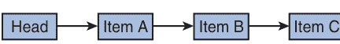

图 4.1 列表

以下是简单链表的代码：

```c
struct node {
   int data;
   int key;
   struct node *next;
};
//insert link at the first location
void insertFirst(int key, int data) {
   //create a link
   struct node *link = (struct node*) malloc(sizeof(struct node));
   link->key = key;
   link->data = data;
//point it to old first node
link->next = head;

//point first to new first node
head = link;
}

int length() {
	int length = 0;
	struct node *current;

	for(current = head; current != NULL; current = current->next) {
		length++;
	}

	return length;
 }
```

#### 4.1.1.1 队列

队列只是列表的一种特殊情况，它以与列表相同的方式存储数据。它通常也只是作为数组实现。列表与队列的区别在于对这两种数据结构中包含的数据进行处理的方式。与列表相比，队列具有更正式的添加和删除项目的流程。在队列中，数据按照先进先出（FIFO）的原则处理。通常有一些数值指针指示最后输入数据的位置（通常称为尾部）和最后提取数据的位置（通常称为头部）。将数据放入队列称为入队，将其移除称为出队。图 4.2 显示了队列结构。

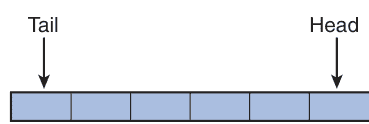

图 4.2 队列

显然，头部和尾部也必须向某个方向移动。这通常是通过简单的递增方法实现的（即 C、C# 和 Java 中的 ++ 运算符）。这意味着在图 4.2 中，它们正向右移动。队列是一种相对简单的数据结构，可以实现。以下是一个在类中实现的队列的 C 类伪代码示例：

```
class Q
{
	stringarray[20]; // this queue can hold up to 20 strings int head, tail;

	void enqueue(string item)
```

{
    stringarray[head] = item; head++;
}
string dequeue()
{
    return stringarray[tail]; tail++;
}
}

使用队列，数据以顺序方式添加和删除。这与列表非常不同，在列表中，数据可以在列表的任何位置添加。使用队列，数据始终在序列的下一个位置添加，并以类似方式处理；然而，队列会立即出现两个问题。第一个问题是如何处理到达队列末尾的情况。通常的解决方案是创建所谓的循环队列。当头（或尾）到达队列末尾时，它会从头开始。参考图 4.2，这意味着如果头或尾到达末尾，它只是被重新定位回开头。在代码中，你会在之前的代码示例中添加类似于此伪代码的内容：

```
if (head==20) head = 0;
```

和

```
if (tail == 20) tail = 0;
```

这仍然留下第二个问题：如果头添加新项目的速度快于尾处理它们的速度会怎样？没有适当的编码，头将超过尾，你将开始覆盖队列中尚未处理的项目；因此，它们丢失且永远不会被处理。这意味着你将项目添加到队列中已经包含未处理数据的空间，而该未处理数据将简单地丢失。解决此问题的答案是，每当头追上尾时，就停止允许添加新项目。这应通过“队列已满”消息传达给最终用户。

当然，除了循环队列之外，还有另一个选项，即有界队列。有界队列只是只能包含有限数据量的队列。当达到该限制时（即，当你到达队列末尾时），队列已达上限。显然，这种队列实现有些局限，你遇到它的频率远低于无界队列（即，任何没有任意有限限制的队列，例如循环队列）。

队列是一种非常高效的数据结构，你会在许多不同的场景中找到其实现。遇到队列最常见的地方是打印机。打印机通常有一个队列，打印任务在其中存储，等待处理。当然，它们使用循环队列。如果你使该队列过载，你会收到一条消息，告诉你打印队列已满。如果你的编程问题要求在先进先出的基础上对数据进行有序和顺序处理，那么队列是要使用的理想数据结构。

#### 4.1.1.2 栈

栈是列表的一种特例的数据结构。使用栈，元素只能从顶部添加或删除。将项目添加到栈称为 push，从栈中移除项目称为 pop。在这种情况下，最后添加的项目必须是第一个被移除的项目，这也称为后进先出（LIFO）。一个很好的类比是考虑一堆盘子。因为最后进入的是第一个移出，这种数据结构不需要指针。你可以在图 4.3 中看到描述的栈。

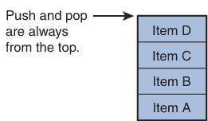

图 4.3 栈

这种特定数据结构的问题在于 LIFO 处理。如果你累积了一些数据项目，并且必须访问放入栈中的第一个项目之一，你首先需要处理所有后续的项目。出于这个原因，栈主要用于需要短时间存储少量项目的情况。你会在临时内存存储中找到栈。比较 LIFO 与 FIFO（先进先出）可能很有价值。FIFO 数据结构要求放入的第一个项目也是移出的第一个项目。这与栈类似，但弹出和推入发生在不同的端点。这在图 4.4 中显示。

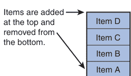

图 4.4 FIFO

如上所述，某些计算机内存结构和 CPU 寄存器通常会使用栈。然而，它们的 LIFO 方法使它们成为许多标准数据处理情况的糟糕选择。例如，如果网络打印机使用栈而不是队列，它将始终尝试先处理最后一个作业。由于新作业不断添加，发送到打印机的第一个作业可能需要等待数小时，甚至数天才能打印。显然，这是不可接受的。

下面是带有用于栈的所有操作的完整类的栈的代码：

```cpp
class MyStack
{
void push(int data) {
if(!isFull()) {
top = top + 1;
stack[top] = data;
} else {
printf("Could not insert data, Stack is full.\n");
}
}
int pop(int data) {
if(!isempty()) {
data = stack[top];
top = top - 1;
return data;
} else {
printf("Could not retrieve data, Stack is empty.\n");
}
}
bool isfull() {
if(top == MAXSIZE)
return true;
else
return false;
}
int peek() {
return stack[top];
}
}
```

#### 4.1.1.3 链表

链表是一种数据结构，其中每个项目都有一个指针（或链接）到列表中的下一个项目或前一个项目，但不能两者都有（稍后在本章中讨论的双向链表既指向下一个也指向前一个）。这可能非常有用，因为如果出于任何原因项目被移位，它知道列表中的下一个项目。每个项目都知道其后是什么或其前是什么，但不能两者都知道。

链表存在一个问题。如果你没有以数据以有序、顺序方式处理（例如 FIFO）的方式实现它，那么项目可以在任何地方被添加或删除（如同标准列表）。这意味着当插入或删除项目时，你必须调整其旁边项目的指针。例如，考虑图 4.5 所示的图表。

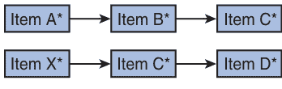

图 4.5 链表

方框中的每个项目（B*、C* 等）都是指向链表中下一个项目的指针。* 符号与 C 和 C++ 语言中用于表示指针的符号相同。请注意，当项目 X 插入到项目 A 和项目 B 之间时，项目 A 的指针也必须更改，以便它现在指向 X 而不是 B。如果删除项目，也会发生同样的情况。然而，如果项目始终以顺序方式（例如 FIFO）添加或删除，则此问题会被最小化。

#### 4.1.1.4 双向链表

双向链表是一种数据结构，其中每个项目都有一个指针（或链接）到其前面的项目和其后面的项目。这是链表的逻辑下一步。它非常高效，因为任何数据点都有到前一个和后继数据点的链接。源代码与链表的源代码几乎相同。它只是有两个指针：一个用于前一个项目，一个用于后继项目。这种数据结构非常高效。

请注意，还有一种特殊形式的双向链表，称为循环链表，其中第一个和最后一个节点彼此链接。这可以对单链表和双向链表都这样做。要遍历循环链表，你从任何节点开始，沿着列表的任何方向移动，直到返回到原始节点。从另一个角度看，循环链表可以被视为没有开始或结束。这种类型的列表非常适合管理缓冲区。

双向链表的循环链表版本使其非常适合打印机缓冲区。它允许打印机缓冲区使每个文档都了解其任一侧的文档。这是因为它有一个双向链表（每个项目都有一个指向前一个项目和下一个项目的指针），并且其最后一个项目链回到第一个项目。这种结构提供了项目的不间断链。

无论你使用哪种方法实现双向链表（循环等），它都有与链表相同的复杂性。当插入或删除项目时，你必须更新任何其他具有指向你删除的项目或你正在将项目插入到的空间的指针的项目。双向链表和单链表之间的唯一区别是，当在双向链表中插入或删除项目时，你必须更新该项目任一侧的指针，而不是仅更新一个指针（前一个或下一个）。双向链表在图 4.6 中显示。

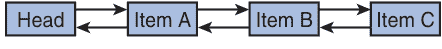

图 4.6 双向链表


### 4.1.2 二叉树

另一个有趣的数据结构是二叉树。二叉树是一种有序数据结构，其中每个节点最多有两个子节点。通常，子节点称为左节点和右节点。例如，在图 4.7 中，节点 Science 有一个名为 Physical 的左子节点和一个名为 Biological 的右子节点。

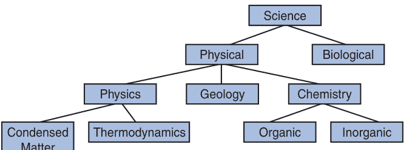

图 4.7 二叉树

二叉树的一个常见用途是二叉搜索树。可以在图 4.7 中看到，二叉树中的每个项目都有与父节点相关的子项目。这正是二叉树最有用的场景（即，项目之间存在强烈的父子关系时）。

二叉树是结构，而二叉搜索树是用于搜索的有序二叉树。实际上有多种不同的树类型。二叉树只是一个常见的示例。

## 4.2 算法

在开始研究算法之前，我们首先必须定义什么是算法。一个 *算法* 只是解决问题的一种系统方法。苹果派的食谱是一种算法。如果遵循该过程，您将得到所需的结果。算法是计算机编程的常规部分，也是计算机科学不可或缺的一部分。事实上，正是算法证明了量子计算机将颠覆网络安全和密码学。Peter Shor 开发了 Shor 算法，该算法证明了量子计算机可以在多项式时间内将整数分解为其质因数。我们将在本书后面详细讨论 Shor 算法。我们还将讨论其他量子算法，在第 16 章“使用 Q#”和第 17 章“使用 QASM”中，您将有机会编写量子算法。如果您希望深入了解算法，超过本节的内容，可以参考 Pearson（本书的出版商）提供的以下一些优秀算法书籍：

- 《算法（第4版）》，Robert Sedgewick，普林斯顿大学
- 《算法分析导论（第2版）》，Robert Sedgewick，普林斯顿大学

仅仅拥有一个能完成任务的算法是不够的。计算机科学寻求找到最高效的算法。因此，拥有一个清晰的方法来分析给定算法的效能也很重要。考虑任何算法时，如果达到了预期结果，那么显然该算法有效。然而，真正的问题是，它工作得如何？如果您对十个项目的列表进行排序，排序所需的时间不是特别令人担忧的问题。然而，如果您的列表有一百万个项目，那么排序列表所需的时间，以及您选择的算法，就至关重要了。幸运的是，有明确定义的方法来分析任何算法。

在分析算法时，我们通常会考虑渐近上界和下界。渐近分析是一种用于衡量计算机算法性能的过程。这种性能基于算法的复杂性。通常这是衡量算法工作所需时间或所需资源（内存）的指标。应当注意，通常只能优化时间或资源，而不能两者兼顾。渐近上界只是给定算法的最坏情况，而渐近下界是最好情况。

有些分析人士更喜欢简单地使用平均情况；但是，在某些情况下，了解最好情况和最坏情况可能很有用。简单来说，渐近上界和下界必须在您试图解决的问题参数范围内。您必须假设最坏情况会在某些情况下发生。

渐近上界和下界之间这种差异的原因与集合的初始状态有关。如果将排序算法应用于处于最大无序状态的集合，那么排序算法运行所需的时间将是渐近上界。另一方面，如果集合非常接近有序，那么可能会接近或达到渐近下界。

也许，正式评估给定算法效能最常见的方法是 Big O 表示法。这种方法是衡量算法执行情况的方法，通常是在问题规模 n 下所需的迭代次数。在排序算法中，n 是要排序的项目数量。声明某个算法 f(n) = O(g(n)) 意味着它小于 g(n) 的某个常数倍。该表示法读作“f of n is big oh of g of n”。这意味着说一个算法是 2n 意味着它必须执行列表中项目数量的两倍。Big O 表示法本质上衡量函数的渐近上界。Big O 也是最常用的分析方法。

Big O 表示法最初由数学家 Paul Bachmann 在其 1892 年的著作《Analytische Zahlentheorie》中提出。该表示法在另一位名叫 Edmund Landau 的数学家的著作中得到普及。由于 Landau 负责推广这种表示法，它有时被称为 Landau 符号。

Omega 表示法（Ω）是 Big O 表示法的对立面。它是算法的渐近下界，并给出该算法的最佳情况。它给出了算法的最小运行时间。

Theta 表示法（Θ）结合了 Big O 和 Omega 表示法，为算法提供平均情况（在此情况下，平均是指算术平均值）。在我们的分析中，我们将大量关注 Theta 表示法，它也常被称为 Big O 运行时间。这个平均时间更真实地描绘了算法的执行情况。

现在我们对如何分析给定算法的复杂性和效能有了一些了解，让我们来看看几种常用的排序算法并应用这些分析工具。本节选定的算法是其中最常见的一些。如果您修过算法分析课程，一定遇到过这些。

### 4.2.1 排序算法

排序算法常用于向初学者介绍算法的研究。这是因为它们相对容易理解，并且非常常见。有很多排序算法，我们将研究其中一些最常用的算法；不过，您当然也可以自行研究其他算法。以下是本节未涵盖的几种排序算法：

- 归并排序
- 梳排序
- 堆排序
- 希尔排序
- 桶排序
- 基数排序

#### 4.2.1.1 快速排序

快速排序是一种非常常用的算法。该算法是递归的，意味着它只是重复调用自身，直到列表排序完成。有些书籍甚至将快速排序称为归并排序的更高效版本。快速排序与归并排序相同（n ln n）；但区别在于，这也是其最佳情况。但是，它具有 O(n²)，这表明其最坏情况效率非常低。因此，对于非常大的列表，最坏情况可能无法接受。

这个递归算法由三个步骤组成（与归并排序非常相似）：

- 步骤 1. 在数组中选择一个元素作为基准点。
- 步骤 2. 将数组分成两部分。分割将在基准点处发生，因此一个数组将包含大于基准点的元素，另一个数组将包含小于基准点的元素。显然，其中一方也应包含基准点。
- 步骤 3. 对原始数组的两半递归重复该算法。

该算法一个非常有趣的方面是，算法的效率显著受到所选哪个元素作为基准点的影响。快速排序的最坏情况发生在列表已排序且选择最左侧元素时；这会导致 O(n²) 的复杂度。建议随机选择基准点，而不是使用最左侧元素，如果数据 to


排序并非随机。只要基准点选择是随机的，快速排序的算法复杂度就是 O(n log n)。以下快速排序源代码应该有助于澄清这一概念：

```
void quicksort(int number[25],int first,int last){
int i, j, pivot, temp;

if(first<last){
pivot=first;
i=first;
j=last;

while(i<j){
while (number[i]<=number[pivot]&&i<last)
i++;
while (number[j]>number[pivot])
j--;
if(i<j){
temp=number[i];
number[i]=number[j];
number[j]=temp;
}
}

temp=number[pivot];
number[pivot]=number[j];
number[j]=temp;
quicksort(number,first,j-1);
quicksort(number,j+1,last);
}
}
```

#### 4.2.1.2 冒泡排序

冒泡排序是目前使用中最古老、最简单的排序算法。这里所说的简单是指，从程序设计的角度来看，它非常容易实现。不幸的是，它也是速度最慢的算法之一。它的复杂度为 O(n²)，这意味着对于非常大的列表，它可能太慢。与大多数排序算法一样，其最佳情况（较低渐近界）是 O(n)。

冒泡排序的工作原理是将列表中的每个项目与其相邻项目进行比较，并在需要时交换它们。该算法重复此过程，直到完整遍历列表而无需交换任何项目为止（换句话说，所有项目都按正确顺序排列）。这导致较大的值“冒泡”到列表末尾，而较小的值“下沉”到列表开头，因此得名。

冒泡排序通常被认为是常用中最低效的排序算法。在最佳情况下（列表已排序），冒泡排序可以接近常数 O(n) 级别的复杂度。一般情况是 O(n^2)。

尽管这是可用算法中较慢的一种之一，但它之所以更常出现，仅仅是因为实现非常简单。许多缺乏对算法效率和分析足够深入理解的程序员都会依赖冒泡排序。

现在我们已经研究了两种常见的排序算法，你应该对这两种算法及算法分析有基本的了解了。

#### 4.2.1.3 欧几里得算法

欧几里得算法是一种用于求两个整数最大公约数的方法。这听起来可能是一项相当琐碎的任务，但在处理较大的数字时则并非如此。欧几里得算法分步进行，每一步的输出都作为下一步的输入。令 k 为计算算法步骤的整数，从零开始。因此，初始步骤对应 k = 0，下一步对应 k = 1、k = 2、k = 3，依此类推。

第一步之后的每一步都从前一步的两个余数 rk-1 和 rk-2 开始。你会发现，在每一步中，余数都小于前一步的余数，因此 rk-1 小于其前驱 rk-2。这是有意为之，也是算法运作的核心。第 k 步的目标是找到商 qk 和余数 rk，使得以下等式成立：

```
rk - 2 = qk rk - 1 + rk
```

这里，rk < rk - 1。换句话说，从较大的数 rk-2 中减去较小的数 rk-1 的倍数，直到余数小于 rk-1。

该解释可能不够清晰，因此让我们来看一个示例。

```
Let a = 2322, b = 654.
2322 = 654·3 + 360   (i.e. the 360 is the remainder).
```

这告诉我们，两个初始数的最大公约数 gcd(2322, 654) 等于 gcd(654, 360)。

这些仍然有些繁琐，因此让我们继续运行该算法：

```
654 = 360·1 + 294   (the remainder is 294).
```

这告诉我们 gcd(654, 360) 等于 gcd(360, 294)。

以下步骤继续此过程，直到没有后续步骤为止：

| 360 = 294·1 + 66 | gcd(360, 294) = gcd(294, 66) |
| :--- | :--- |
| 294 = 66·4 + 30 | gcd(294, 66) = gcd(66, 30) |
| 66 = 30·2 + 6 | gcd(66, 30) = gcd(30, 6) |
| 30 = 6·5 | gcd(30, 6) = 6 |

因此，gcd(2322, 654) = 6。

这个过程非常实用，可用于求任意两个数的最大公约数。

欧几里得算法之所以重要，有多方面原因。它与本书后面将介绍的某些加密方法相关。它也是递归算法的一个优秀示例。我们将在本书后面更详细地重新讨论该算法。

## 4.3 计算复杂度

计算复杂度理论关注计算问题，并根据其难度对其进行分类。这与之前讨论的算法分析密切相关。难度反过来由解决问题所需的资源来定义。也许最著名的此类问题就是 P 与 NP 问题。P 表示可以在多项式时间内解决的问题，而 NP 是指如果给出答案，可以在多项式时间内验证，但目前尚无已知方法在多项式时间内解决这些问题的问题。更简单地说：P 表示计算机可以在多项式时间内解决的问题，而 NP 是指无法在多项式时间内解决但可以在多项式时间内检查的问题。问题是：P 与 NP 问题询问，每个其解可以由计算机快速验证的问题，是否也可以由计算机快速求解？是否 P = NP？如果 P 确实等于 NP，那么对于所有 NP 问题，都存在一种在多项式时间内求解它们的方法；我们只是尚未发现它。截至本研究撰写时，大多数数学家认为 P 不等于 NP，但至今尚无人证明这一点。它是千年难题之一。你可以在 https://www.claymath.org/millennium-problems 上了解更多关于千年难题的信息。

计算复杂度和算法分析更关注的是找到可应用于整个问题类的解决方案，而不是解决问题的某个特定实例。因此，给定问题的复杂度相当重要。我们将在后续章节中探讨几种计算复杂度的度量方法。由于我们将在本书后面花费大量时间研究量子算法，因此你对算法的计算复杂度有总体了解很重要。后续章节将介绍各种计算复杂度度量方法的示例。

### 4.3.1 圈复杂度

1976 年，Thomas McCabe 开发了圈复杂度。圈复杂度定义为给定代码块中线性无关路径的数量。因此，如果没有代码分支，例如 if 语句、switch 语句和其他决策点，则圈复杂度为 1。代码中只存在一条线性无关路径。这是一个有向图，其中节点是程序或函数的基本块，边连接这些节点。圈复杂度定义如下：

```
C = E - N + 2P, where:
E = the number of edges of the graph.
N = the number of nodes of the graph.
P = the number of connected components.
```

McCabe 仅集成了图论中最基本的元素；然而，一旦将问题表示为图，就可以应用图论的全部威力。换句话说，扩展此定义以纳入一系列图论元素（例如带权节点和边、关联节点的关联函数，甚至更高级的图论方面，如谱图论）并非一件过于艰巨的工作。鉴于本研究对复杂度的关注，理解当前探索复杂度的方法与本研究相关。

### 4.3.2 哈尔斯塔德度量

1977 年，Maurice Halstead 提出了如今称为 Halstead 复杂度度量或指标的内容。这些是用于衡量软件复杂度的指标。Halstead 为软件复杂度提出了若干度量指标，如表 4.1 所示。

| 度量 | 值 |
|---|---|
| n1 | 不同运算符的数量 |
| n2 | 不同操作数的数量 |
| N1 | 运算符出现的总次数 |
| N2 | 操作数出现的总次数 |
| n1* | 潜在运算符的数量 |
| n2* | 潜在操作数的数量 |

使用这些度量指标，Halstead 得出了几个计算软件复杂度的相对简单的公式。

```
Program length: N = N1 + N2
Program vocabulary: n = n1 + n2
Volume: V = N x log2 n
Difficulty: D = n1/2 x N2/n2
Effort: E = D x V
```

尽管所呈现的数学非常简单，但这些概念是有效且有用的。举一个例子，程序长度是运算符出现的总次数加上操作数出现的总次数的函数。这种对软件复杂度的方法捕捉了程序中重要内容的本质。它捕捉了活动发生的点（操作数和运算符）。努力计算也非常有效：代码量乘以代码难度。而这反过来又基于难度计算，难度计算基于运算符和操作数。


## 4.4 编码理论

编码理论是计算机科学的另一个核心方面。其概念是研究各种代码并提高效率。主要有四种类型的代码：

- 错误控制
- 数据压缩
- 线路编码
- 密码编码

错误检测和纠正是计算机科学许多部分的核心，包括网络通信。有几种错误检测方法，但两种易于理解的是校验和和循环冗余检查（CRCs）。校验和是消息的和，通常使用模运算。接收者可以重新计算该和并将其与发送者计算的和进行比较，以检测任何错误。CRC 是一个非常相似的概念。通常，CRC 将基于消息内容的多项式除法的余数。

数据压缩非常常见。你很可能使用过某些数据压缩算法——也许是 WinZip、7-Zip 或 RAR。其概念是以一种压缩消息的方式，使得解压缩后数据仍然完整。主要有两种压缩类型。第一种是无损压缩。顾名思义，压缩过程中不会丢失任何位。第二种是有损压缩。一种流行的无损算法是 Lempel-Ziv 压缩方法。一些位会丢失，但它们是非关键的。JPEG、MPEG 和 MP3 格式使用有损压缩。

线路编码是用于在传输线上表示数据的模式。例如，如果你的计算机使用典型的有线网络接入，则数据必须表示为电压模式。在光纤电缆中，数据必须表示为光波。

密码编码是改变消息的过程，使得只有使用正确的密钥才能恢复。密码算法主要有两个分支：对称和非对称。对称算法使用相同的密钥进行加密和解密。示例包括 AES、Serpent、Blowfish 和 RC4。非对称算法使用一个密钥加密消息，使用另一个密钥解密。示例包括椭圆曲线密码学、RSA 和 NTRUEncrypt。

所有这些不同的编码方法都是编码理论的一部分。理解如何高效地编码和解码信息对于大多数计算机操作都至关重要。当然，没有线路编码，网络通信就不可能实现，而且如果没有压缩算法，多媒体可能也不切实际。

## 4.5 逻辑门

逻辑门在计算机科学中起着关键作用，并且是量子计算的核心问题。在传统计算机中，逻辑门通常通过晶体管或某些类似对象实现。它们对输入执行基本逻辑操作以产生输出。请记住，经典计算机只能识别 1 和 0。因此，二进制数和二进制运算最终是计算机所处理的一切。你最终可能正在进行三角学或微积分，但计算机必须将其分解为二进制数学步骤。

在进入逻辑门之前，有必要简要讨论基本二进制运算。对于许多读者来说，这将是一个复习，但如果不是，这对于理解经典计算机逻辑门至关重要。二进制数系统是由戈特弗里德·莱布尼茨以其现代形式发展起来的。他和艾萨克·牛顿独立发现了微积分。感兴趣的三种运算是 AND、OR 和 XOR 运算。

### 4.5.1 AND

要执行 AND 运算，你需要取两个二进制数并逐位比较。如果两个数字在相同位置都有 1，则结果数字为 1。否则，结果数字为 0，如下所示：

```
1 1 0 0
1 0 0 1
-------
1 0 0 0
```

### 4.5.2 OR

OR 运算用于测试给定位置中是否有一个或两个数字包含 1。如果是，则结果数字为 1。否则，结果数字为 0，如下所示：

```
1 1 0 0
1 1 0 1
-------
1 1 0 1
```

### 4.5.3 XOR

XOR 运算测试给定位置中是否有一个数字包含 1，但不在两个数字的该位置中都包含。如果它在一个数字中但不在另一个数字中，则结果数字为 1。否则，结果数字为 0，如下所示：

```
1 1 0 1
1 0 0 1
-------
0 1 0 0
```

术语 XOR 表示“异或”而非“和/或”。XOR 有一个非常有趣的特性，即它是可逆的。如果你将结果数字与第二个数字进行 XOR 运算，你会得到第一个数字；如果你将结果数字与第一个数字进行 XOR 运算，你会得到第二个数字：

```
0 1 0 0
1 0 0 1
1 1 0 1
```

20 世纪 30 年代，NEC 工程师中岛晓引入了基于二值布尔代数的开关电路理论。这通常被认为是现代逻辑门的开端。逻辑门中使用的符号有标准：首先是 ANSI/IEEE Std 91-1984，然后是修订版 ANSI/IEEE Std 91a-1991。

### 4.5.4 逻辑门的应用

AND 门实现了一个使用二进制 AND 运算的真值表。首先考虑 AND 门的 ANSI/IEEE 标准图可能会有所帮助，如图 4.8 所示。

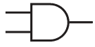

图 4.8 AND 门

两个输入导致一个单个输出。这是通过一个简单的真值表完成的，类似于表 4.2 所示的表格。

| 输入 A | 输入 B | 输出 |
|---|---|---|
| 1 | 1 | 1 |
| 1 | 0 | 0 |
| 0 | 0 | 0 |
| 0 | 1 | 0 |

因此，AND 门的作用是将两个比特作为输入并对它们执行二进制 AND 运算。然后它输出结果。

OR 门非常相似。ANSI/IEEE 符号如图 4.9 所示。

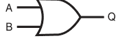

图 4.9 OR 门

两个输入导致一个单个输出。这是使用真值表完成的，类似于你在前一个表中看到的表格，只是使用二进制 OR 运算而不是 AND（参见表 4.3）。

表 4.3 OR 门真值表

| 输入 A | 输入 B | 输出 |
|---|---|---|
| 1 | 1 | 1 |
| 1 | 0 | 1 |
| 0 | 0 | 0 |
| 0 | 1 | 1 |

当然，还有用于“异或”运算的 XOR 门。这有时也被称为 EOR 门或 EXOR 门。图 4.10 显示了 XOR 门的 ANSI/IEEE 符号。

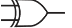

图 4.10 XOR 门

两个输入导致一个单个输出。这是使用与前两个表中看到的类似的真值表完成的，只是使用二进制 XOR 运算而不是 AND 或 OR（参见表 4.4）。

表 4.4 XOR 门真值表

| 输入 A | 输入 B | 输出 |
|---|---|---|
| 1 | 1 | 0 |
| 1 | 0 | 1 |
| 0 | 0 | 0 |
| 0 | 1 | 1 |

这三个是基于基本三个二进制运算的简单逻辑门；但是，有许多变体。一种非常常用的门是 NAND 门，它是一个非 AND 门。基本上，只有当所有输入都为 1（真）时，它才输出假。有许多系统使用 NAND 门。图 4.11 显示了 NAND 门的 ANSI/IEEE 符号。

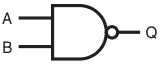

图 4.11 NAND 门

这个门的真值表基本上表示，如果不是 AND 值（即，不是两个值都为 1），则输出 0（参见表 4.5）。

表 4.5 NAND 门真值表

| 输入 A | 输入 B | 输出 |
|---|---|---|
| 1 | 1 | 0 |
| 1 | 0 | 1 |
| 0 | 0 | 1 |
| 0 | 1 | 1 |

NAND 门非常重要，因为任何布尔函数都可以使用一些 NAND 门的组合来实现。具有此属性的另一个门是 NOT-OR（或 NOR）门。图 4.12 显示了 NOR 门的 ANSI/IEEE 符号。

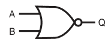

图 4.12 NOR 门

这个门的真值表基本上表示，如果不是 OR 值（即，两个值都不是 1），则输出 0（参见表 4.6）。

表 4.6 NOR 门真值表

| 输入 A | 输入 B | 输出 |
|---|---|---|
| 1 | 1 | 0 |
| 1 | 0 | 0 |
| 0 | 0 | 1 |
| 0 | 1 | 0 |

因为 NOR 门或 NAND 门都可以用来创建任何布尔函数，所以它们被称为通用门。

你可能会想知道 1 和 0 是如何在电路中明确实现的。一种常见的方法是，高电压值表示 1，低电压表示 0。因此，你可以看到最终数学运算是如何通过逻辑门的电流流动和对它们执行二进制运算来实现的。

Hadamard 门是量子计算机使用的更常见的逻辑门之一。我们将在后面章节中更详细地讨论这些门和其他门。然而，这里的简要介绍提供了与经典逻辑门的对比。Hadamard 门作用于单个量子比特，并且是一个


量子傅里叶变换的单量比特版本。它通常由方程 4.1 中所示的 Hadamard 矩阵表示。

```
$$ H = \frac{1}{\sqrt{2}} \begin{bmatrix} 1 & 1 \\ 1 & -1 \end{bmatrix} $$
```

### 方程 4.1 Hadamard 矩阵

Hadamard 矩阵以数学家 Jacques Hadamard 命名。它们是行正交的方阵。在量子计算中，它们用于表示逻辑门，即 Hadamard 门。

## 4.6 计算机体系结构

计算机体系结构是我们设计和描述计算机系统的方式。指令集架构是计算机体系结构的一个重要子主题。虽然人类程序涉及 C++ 和 Java 等编程语言，但机器具有用于低级操作的指令集。如果你曾经查看过汇编语言，你就会看到非常接近微处理器上的实际计算机指令的东西。汇编之所以得名，是因为名为汇编器的软件将汇编代码翻译成机器代码。

计算机体系结构领域有几个子主题。指令集架构（ISA）是体系结构的模型，体现在中央处理器等组件中。ISA 定义了数据类型、寄存器、寻址、虚拟内存以及计算机的其他基本特征。对体系结构的分类有很多种方法。两种常见的方式是 CISC（复杂指令集）和 RISC（精简指令集）。CISC 处理器拥有大量专用指令，而 RISC 实现了一组较小的指令。当然，这引出了一个问题：什么是指令？指令是对处理器应该做什么的简单说明。它通常涉及将小数据块移入和移出 CPU 中的寄存器。例如，在基本算术中，会使用两个寄存器的内容，然后将结果存储在一个寄存器中。还有控制流操作，例如分支到另一个位置（包括条件分支）和调用其他代码块。

汇编代码是直接为 CPU 编程的方式。与 Java、Python、C 等其他编程语言相比，汇编代码通常要长得多。这是因为程序员必须发出命令的每一步。为了展示差异，C 语言中的“Hello, World!”编写如下：

```
printf("Hello, World!");
```

在 Java 中，程序编写如下：

```
System.out.println("Hello, World!");
```

然而，在汇编代码中，它是这样编写的：

```
global _start

section .text

_start: mov rax, 1 ; system call for write
mov rdi, 1 ; file handle 1 is stdout
mov rsi, message ; address of string to output
mov rdx, 13 ; number of bytes
syscall ; invoke system to write
mov rax, 60
xor rdi, rdi ; exit code 0
syscall ; invoke system to exit

section .data

message: db "Hello, World", 10 ; note the newline at the end
```

这种表面复杂性的原因在于，程序员实际上必须将数据移入和移出特定的 CPU 寄存器。编程汇编能让人真正深入理解 CPU 架构。

微架构涉及处理器的实际组织方式。这是处理芯片的计算机工程，通常会产生类似图 4.13 所示的图。

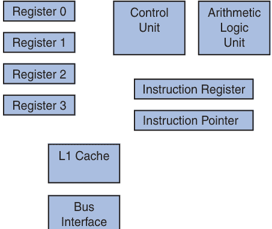

### 图 4.13 CPU 架构

图 4.13 中的图像是一个非常简化的 CPU 架构，但它有助于了解微架构的一般概念。其理念是设计各种处理路径。在图 4.13 中，我们仅看到 CPU 的总体概览。内存的映射方式类似，主板的各种组件（包括总线）也是如此。总线是计算机内部数据传输的通信通道。

设计计算机时，需要考虑多种因素。功耗要求、容量和延迟是其中三个因素。计算机性能通常以每周期指令数（也称为每时钟指令数）来衡量。这是每个时钟周期可以执行的指令的平均数量。时钟信号在高电平和低电平之间振荡，因此需要使用算术平均值来进行测量。将每周期指令数乘以时钟频率（每秒周期数，以赫兹为单位），即可得出处理器每秒处理的指令数。

这与量子计算相关；如我们在后面章节中将看到的，量子计算机的设计是量子计算的关键要素。我们将在本书后面探讨的两大主要分支（特别是在第 8 章“量子架构”中）是绝热量子计算和基于门的量子计算。这两种不同的架构方法对量子计算的发展至关重要。

## 4.7 总结

本章概述了计算机科学的基本概念。或许本章中最有助于你理解量子计算的主题是逻辑门。其次是算法主题。在继续之前，请确保你完全理解这两者。不过，我们也回顾了计算机体系结构的基础知识，并考察了数据结构。还简要介绍了计算复杂性。所有这些主题都将帮助你理解我们将在后面章节中探讨的量子计算主题。

算法分析和数据结构对量子计算和经典计算都至关重要。理解基本计算机体系结构对于理解任何形式的计算也很重要，如果不了解经典逻辑门，就无法真正理解量子逻辑门。本章的内容将为理解量子架构和量子逻辑门奠定基础。

## 测试你的技能

## 复习问题

- 1. 对于作为数据列表的结构，数据在哪里添加？
  - a. 按顺序方式
  - b. 在顶部
  - c. 任何位置
  - d. 在底部

- 2. 对于队列，数据如何添加？
  - a. 按顺序方式
  - b. 在顶部
  - c. 任何位置
  - d. 在底部

- 3. 哪种算法分析方法给出算法的最佳情况？
  - a. Omega
  - b. Big O
  - c. Theta
  - d. 循环复杂度

- 4. 哪种算法分析方法给出算法的平均情况？
  - a. Omega
  - b. Big O
  - c. Theta
  - d. 循环复杂度

- 5. 哪种排序算法最慢？
  - a. 冒泡排序
  - b. 快速排序
  - c. 归并排序
  - d. 这取决于实现。

- 6. 以下哪种逻辑门在计算机中最常用？
  - a. NAND
  - b. OR
  - c. AND
  - d. XOR

- 7. 以下符号用于哪种门？
  - a. NAND
  - b. OR
  - c. AND
  - d. XOR

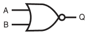

- 8. 哪种门只有在所有输入均为真（1）时才输出假？
  - a. AND
  - b. OR
  - c. XOR
  - d. NAND

- 9. 为什么 NOR 和 NAND 门被称为通用门？
  - a. 因为它们使用得如此广泛。
  - b. 不是；XOR 是通用门。
  - c. 它们可以用于创建任何布尔函数。
  - d. 它们用于所有架构。

- 10. ____________ 定义了计算机的数据类型、寄存器、寻址、虚拟内存和其他基本特征。
  - a. 复杂指令集
  - b. 微架构
  - c. 指令寄存器
  - d. 指令集架构
