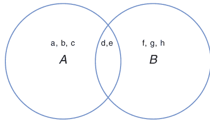
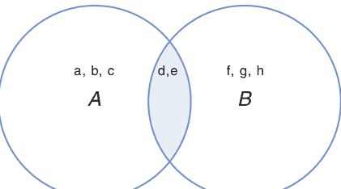
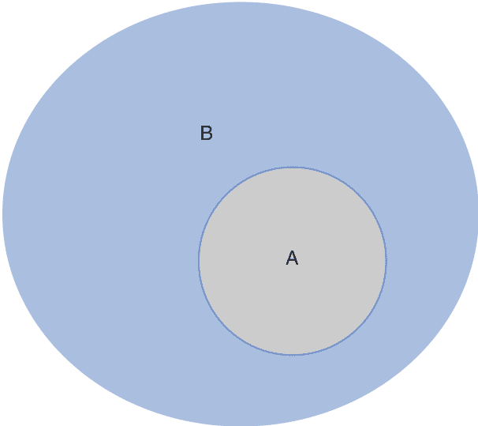

# 第 5 章

# 基本信息论

## 章节目标

阅读本章并完成复习问题后，你将能够做到以下几点：

- 了解基本信息论
- 计算信息熵
- 识别信息多样性

信息论是计算机科学的核心，在量子计算中也很重要。信息论这一主题由克劳德·香农在其 1948 年的论文《通信的数学理论》中提出。香农主要关注信号处理、数据压缩和相关主题。然而，自那时以来，信息论领域有了长足发展。信息论的重点是量化和传递信息。信息论领域与数据压缩、机器学习、复杂性科学以及许多其他主题密切相关。

本章将采用略有不同的方法。首先，你将了解概率论和集合论的基础知识。这些知识是理解信息论所必需的。对于许多读者来说，这些部分可能只是复习。然而，如果你对概率论和集合论没有基本掌握，这些部分对于理解信息论来说至关重要。

这些主题对于理解量子计算都非常重要。人们常常假设读者已经熟悉它们。概率首先很重要，因为正如你将在本书中看到的，量子物理学在很大程度上是概率性的，而不是确定性的。信息论对于理解计算的任何方面（包括量子计算）都很重要。


## 5.1 基础概率

信息论与概率之间存在密切关系。即使是计算信息熵的公式也使用概率。因此，要完全理解信息论，必须对概率有一个总体的了解。本节很可能对大多数读者来说都是复习。

第一项任务是定义什么是 *概率*。用最简单的话说，它是感兴趣的结果数量除以所有可能结果数量的比率。例如，如果我有一副52张的牌，由四种花色组成，每种花色13张，那么抽到某一特定花色的牌的概率是13/52，即¼，等于0.25。概率始终在零和一之间。零表示事件绝对不会发生。例如，如果我从一副牌中移除了所有13张梅花牌，那么再抽到一张梅花牌的概率为零。概率为1.0表示事件必定发生。例如，如果我移除了所有牌，只留下红桃牌，那么抽到红桃牌的概率就是1.0。事件A的概率是事件发生可能性的数值度量。在下一小节中，我们将探讨一些基础概率规则。

### 5.1.1 基础概率规则

任何事件的概率都将介于零和一之间，即 0 <= P <= 1.0。

事件的补集仅仅是指该事件不发生。如果我从一副牌中抽取一张牌，计算它是红桃牌的概率很容易。它不是红桃牌的概率是该概率的补集。事件补集的概率等于1减去该事件的概率——换句话说：P(Aᶜ) = 1 – P(A)。这意味着，如果给定事件A的概率是0.45，那么其补集就是1 – 0.45，即0.55。

与补集相关的是并集规则。这适用于两个非互斥事件。该规则指出，事件并集的概率等于事件A的概率加上事件B的概率，减去它们交集（即联合概率）的概率。这可以按方程5.1所示表示。

```
P(A ∪ B) = P(A) + P(B) – P(A ∩ B)
```

### 方程 5.1 非互斥事件的并集

这与第一章“线性代数基础简介”中讨论的集合论非常相似。当你遇到并集和交集等术语时，它们与集合论中的含义相同。

对于两个互斥事件，其并集的概率只是事件A的概率加上事件B的概率，如方程5.2所示。

```
P(A ∪ B) = P(A) + P(B)
```

### 方程 5.2 互斥事件的并集

两个独立事件同时发生的概率是多少？这被称为独立事件的联合概率。独立事件联合概率的计算方法是将事件A的概率乘以事件B的概率，但这仅适用于事件相互独立的情况。如果一个事件依赖于另一个事件，则适用不同的规则，如方程5.3所示。

```
P(A and B) = P(A) * P(B)
```

### 方程 5.3 两个独立事件的概率

因此，如果两个事件独立，事件A的概率为0.45，事件B的概率为0.85，那么两个事件同时发生的概率就是0.45 * 0.85 = 0.3825。

独立事件是指其概率彼此之间完全没有关系的事件。换句话说，如果以下条件成立，则两个事件独立（反之，如果两个事件独立，则以下陈述成立）：

- P(A|B) = P(A)
- P(B|A) = P(B)

条件概率是指在某个其他事件发生的情况下，某个事件发生的可能性。在事件B已经发生的条件下，事件A发生的可能性等于事件A和事件B交集的概率除以事件B的概率。这如方程5.4所示。

```
P(A|B) = \frac{P(A \cap B)}{P(B)} = \frac{P(B|A)P(A)}{P(B)}
```

### 方程 5.4 条件概率

显然，这条规则不是指事件B必须在事件A之后发生，而是指事件A可能导致事件B。例如，如果天冷，我有一定的概率会穿夹克，但这并不绝对意味着我会穿夹克。

这些是概率的基本规则。正如你将看到的，信息论依赖于概率，并且正如我们在前几章中讨论过的，量子物理学是概率性的而不是决定性的。

## 5.2 集合论

概率经常使用集合论；因此，我们对概率的讨论还将整合集合论的基本概述。第1章中曾讨论过一些集合论内容，这里将进行展开。集合是一组对象的集合，这些对象被称为该集合的成员或元素。如果我们有一个集合，我们说某些对象属于（或不属于）这个集合，或者在（或不在）这个集合中。我们也说集合由其元素组成。

与大部分数学一样，术语和符号至关重要。因此，让我们以类似的方式开始集合论的研究，从简单概念构建到更复杂的概念。我能想到的最简单的方法是定义集合的一个元素。我们说x是集合A的成员，可以表示如下：

```
x ∈ A
```

集合通常用括号列出。例如，所有小于10的奇数的集合将显示如下：

```
A = {1, 3, 5, 7, 9}
```

该集合的一个成员将表示如下：

```
3 ∈ A
```

否定可以用穿过符号的一条线来表示。例如，

```
2 ∉ A
```

表示2不是集合A的元素。

如果一个集合没有终止，可以用省略号表示。例如，所有奇数的集合（不仅仅是小于10的那些）可以表示如下：

```
A = {1, 3, 5, 7, 9, 11, ...}
```

你也可以使用定义该集合成员资格的方程或公式来表示集合。集合之间可以存在关系；本节将简要描述最常见的关系。

集合的并集是集合论中的一个关键概念。如果你有两个集合A和B，属于A、B或两者皆是元素表示A和B的并集，符号化为A ∪ B。图5.1描绘了这一点。



### 图 5.1 集合的并集

项目a、b和c在集合A中。项目f、g和h在集合B中。项目d和e同时在集合A和集合B中。所有项目，从a到h，都在集合A和集合B的并集中。

两个集合的交集是两个集合的重叠部分。如果你有两个集合A和B，同时在A和B中的元素是集合A和集合B的交集，符号化为A ∩ B。图5.2说明了这一点。



### 图 5.2 集合的交集

只有项目d和e在集合A和集合B的交集中。

如果集合A和集合B的交集为空（即，两个集合没有共同元素），则这两个集合被称为不相交。考虑一副牌。红桃牌集合与梅花牌集合没有共同项目。因此，这两个集合不相交。与不相交集合相关的是集合的补集。集合的补集，表示为A'，是给定全集U中不在A中的所有元素的集合。这符号化为A'。

还存在双补集的问题：集合的补集的补集是该集合。换句话说，A'的补集是A。乍一看这可能显得奇怪，但请花点时间思考集合补集的定义。集合的补集在该集合中没有元素。因此，可以推断，要成为集合的补集的补集，你必须拥有集合中的所有元素。

比较两个集合也可能令人感兴趣。这可能涉及确定两个集合之间的差异。如果你有两个集合A和B，在一个集合中但不在两个集合中的元素是A和B之间的差异。这表示为A \ B。

现在我们已经介绍了基本的集合术语，还需要讨论关于集合的几个额外事实。顺序无关紧要：{1, 2, 3}与{3, 2, 1}或{3, 1, 2}或{2, 1, 3}相同。

你会遇到的一个常见项目是子集。集合A可以是集合B的子集。例如，如果集合A是所有小于10的奇数的集合，集合B是所有小于100的奇数的集合，那么集合A是集合B的子集。这符号化为A ⊆ B，如图5.3所示。




图 5.3 子集

许多集合可能有子集。让我们将集合 A 视为所有小于 10 的整数。集合 B 是一个子集；它是所有小于 10 的质数。集合 C 是 A 的一个子集；它是所有小于 10 的奇数。集合 D 是 A 的一个子集；它是所有小于 10 的偶数。我们可以继续这个练习，创建任意子集，例如 E = {4, 7}、F = {1, 2, 3} 等。给定集合的所有子集的集合称为该集合的*幂集*。

集合还具有管理集合之间交互的属性。这些属性中最重要的列于此：

- 交换律：集合 A 与集合 B 的交集等于集合 B 与集合 A 的交集。并集也是如此。换句话说，在考虑集合的交集和并集时，集合呈现的顺序无关紧要。这在这里符号化为：
  - (a) A ∩ B = B ∩ A
  - (b) A ∪ B = B ∪ A

- 结合律：基本上，如果你有三个集合，且它们之间的关系全是并集或全是交集，那么顺序就不重要了。这符号化如下：
  - (a) (A ∩ B) ∩ C = A ∩ (B ∩ C)
  - (b) (A ∪ B) ∪ C = A ∪ (B ∪ C)

- 分配律：分配律与结合律略有不同，顺序不重要。集合 A 与集合 B 和 C 的交集的并集，与取 A 和 B 的并集再与 A 和 C 的并集取交集是相同的。这在这里符号化为：
  - (a) A ∪ (B ∩ C) = (A ∪ B) ∩ (A ∪ C)
  - (b) A ∩ (B ∪ C) = (A ∩ B) ∪ (A ∩ C)

- 德摩根定律：这些定律管理并集和交集及其补集的问题。这些定律比之前讨论的属性更复杂。基本上，集合 A 和集合 B 的交集的补集等于 A 的补集与 B 的补集的并集。德摩根定律的符号化如下所示：
  - (a) (A ∩ B)ᶜ = Aᶜ ∪ Bᶜ
  - (b) (A ∪ B)ᶜ = Aᶜ ∩ Bᶜ

这些是集合论的基本元素。结合概率，你应该具备深入学习信息论的基础，我们将在后续章节中进行。

## 5.3 信息论

克劳德·香农常被称为信息论之父。他是一位数学家和工程师，生卒年份为 1916 年 4 月 30 日至 2001 年 2 月 24 日。香农的里程碑式论文最终扩展为一本书，名为 _通信的数学理论_，与沃伦·韦弗合著，于 1963 年出版。

在他的原始论文中，香农阐述了一些基本概念，这些概念今天可能显得非常基础，特别是对于具有工程或数学背景的读者。然而，在那个时候，没有人曾试图量化信息或传递信息的过程。他首先量化了一些信息概念，使用了以下基本术语，如图 5.4 所示：

- 信息源：信息的生产者。消息的发送方。
- 发射机：对消息进行操作以创建可通过信道发送的信号。
- 信道：信号的介质。
- 接收机：将信号转换回要传递的消息。
- 目标：消息预期的个人或机器。


图 5.4 信息概念

除了这些概念，香农还开发了一些与信息传递重要的一般定理，如 5.3.1 节和 5.3.2 节所述。

### 5.3.1 定理 1：香农源编码定理

该定理可以简单地陈述如下：不可能压缩数据使得码率小于信源的香农熵，同时又几乎可以肯定不会丢失信息。*码率*是电信和信息论中的一个术语。它指有用数据所占的比例。这与纠错码有关。纠错很重要，如我们稍后将看到，并且与量子计算相关。

在信息论中，*熵*是与随机变量相关的不确定性的度量。该定理陈述的是，如果以使编码速率低于信息内容的方式压缩数据，那么很可能会丢失一些信息。在压缩数据时，香农编码定理很重要。

### 5.3.2 定理 2：嘈杂信道定理

该定理可以简单地陈述如下：对于通信信道的任何给定噪声污染程度，都有可能通过该信道以接近无误的速率传输离散数据（数字信息），该速率可计算出最大值。该定理解决了给定信道上的噪声问题。无论是无线电信号还是通过双绞线电缆传输的网络信号，信号传输通常都涉及噪声。该定理基本上指出，即使存在噪声，你也可以传输数字信息；但是，有一个你可以计算信息的最大速率。该速率是可计算的，并与信道中的噪声量有关。

### 5.3.3 信息熵

信息熵是信息论的关键部分。香农的里程碑式论文中有一个整章，标题为“选择、不确定性和熵”，以非常严谨的方式探讨了这一主题。熵在信息论中的含义与在物理学中的含义不同。在信息的语境下，熵是量化信息内容的一种方法。人们在掌握这一概念时有两个困难，我希望都予以解答。第一个困难在于将信息熵与热力学熵混淆，你可能在基础物理课程中接触过后者。在这样的课程中，熵常被描述为系统无序程度的度量。这通常接着讨论热力学第二定律，该定律指出在封闭系统中，熵倾向于增加。换句话说，在不添加能量的情况下，封闭系统会随时间变得更加无序。在讨论信息熵之前，你需要牢牢掌握信息熵和热力学熵根本就不是同一回事。你应该把在大一物理课程中学到的熵定义从脑海中抛开，至少暂时如此。

你在理解信息论时可能遇到的第二个问题是，许多参考资料以不同的方式解释这一概念，其中一些看似矛盾。在本节中，我将向你演示描述信息熵的一些常见方式，以便你能完整理解这些看似不相关的解释。

在信息论中，熵是给定消息中的信息量。这简单、易于理解，并且，如你将看到的，它本质上与你可能遇到的其他定义同义。信息熵的另一种解释示例是，它有时被描述为传递信息所需的比特数。该定义简单地指出，如果你希望传递一条消息，该消息包含信息，并且如果你以二进制格式表示信息，那么包含多少比特的信息。一条消息可能包含一些冗余，甚至包含你已经拥有的数据（按定义，那不算信息），这是完全可能的。因此，传递信息所需的比特数可能少于消息中的总比特数。

另一个可能让你觉得奇怪的定义示例是，许多文本将熵描述为消息中不确定性的度量。这听起来有点像我建议你抛诸脑后的热力学熵定义——这对某些读者来说可能令人困惑。我将信息熵定义为“消息中不确定性的度量”和“传递信息所需的比特数”。这两者如何都能成立？实际上，它们说的是同一件事。让我们审视最可能让你困惑的定义：熵作为不确定性的度量。以下思考方式可能对你有帮助：_只有不确定性才能提供信息。_ 例如，如果我告诉你此刻你正在阅读这本书，这并没有为你提供任何新信息。你早就知道这一点，而且对该问题绝对没有不确定性。然而，你即将在剩余章节中阅读的内容是不确定的。你不知道会遇到什么，至少不完全知道。因此，存在一定程度的不确定性，因而也就有信息内容。更直接地说，_不确定性就是信息。_ 如果你对某个给定事实已经确定，那么就不会向你传递任何信息。新信息显然要求你所接收的信息所消除的不确定性曾经存在。因此，消息中不确定性的度量就是消息中信息的度量。

让我们开始迈向信息熵的更数学化定义。考虑方程 5.5 中所示的公式。

```
H = -\sum_i p_i \log_2(p_i)
```

方程 5.5 香农熵

符号 $p_i$ 表示被检查字符串中第 $i$ 类符号出现的概率。符号 H 表示香农熵。该值以比特为单位给出，因此为 $log_2$。这个公式允许你计算给定消息中的信息熵（即香农熵）。


对于两个独立的变量或消息，它们的*联合熵*是两个熵之和。该公式所示于方程 5.6。

```
H(X,Y) = -\sum_{x,y} p(x,y) \log p(x,y)
```

### 方程 5.6 联合熵

如果两个变量不独立，而是变量 Y 依赖于变量 X，那么而不是联合熵，你将拥有*条件熵*。该公式所示于方程 5.7。

```
H(X|Y) = -\sum_{x,y} p(x,y) \log p(x|y)
```

### 方程 5.7 条件熵

*互信息*是指通过观察另一个随机变量可以获得关于某个随机变量的信息量。X 相对于 Y 的互信息所示于方程 5.8。

```
I(X; Y) = \sum_{x,y} p(x,y) \log \frac{p(x,y)}{p(x)p(y)}
```

### 方程 5.8 互信息

微分熵，有时也称为*连续熵*，是对 Shannon 熵的扩展，用于测量随机变量对连续概率分布的平均“意外性”。请记住，信息是消息中的不确定性或“惊喜”水平。不幸的是，Shannon 针对这一点的公式实际上并不正确。Shannon 的公式经调整以产生离散点极限密度（LDDP）。该公式给出于方程 5.9。

```
\lim_{N \to \infty} H_N(X) = \log(N) - \int p(x) \log \frac{p(x)}{m(x)} dx.
```

### 方程 5.9 离散点极限密度

该公式需要一些基础微积分知识。如果您记得在第 4 章“面向量子计算的基础计算机科学”中，我们对积分做了简要描述，任何即使只学过一个学期微积分的读者都会识别出极限。

如前所述，信息论自克劳德·香农以来不断发展。另一种信息是 Fisher 信息，它衡量可观测变量 X 关于对 X 进行建模的某个分布中未知参数 θ 的信息量。

**注**

Fisher 信息比本章所涵盖的内容在数学上稍微具挑战性一些。有兴趣的读者可以从 https://arxiv.org/pdf/1705.01064.pdf 获取更多关于 Fisher 信息的信息。

应该清楚，信息论和信息熵这一主题相当广泛。有许多用于在各种场景中量化信息的公式。您必须对信息论有基本的工作知识，才能继续学习后面将讨论量子信息论的章节。

表 5.1 总结了本节中介绍的信息论公式。

| 概念 | 公式 |
|---|---|
| Shannon 信息熵 | \( H = -\sum_i p_i \log_2 (p_i) \) |
| 联合熵 | \( H(X,Y) = -\sum_{x,y} p(x,y) \log p(x,y) \) |
| 条件熵 | \( H(X|Y) = -\sum_{x,y} p(x,y) \log p(x|y) \) |
| 互信息 | \( I(X; Y) = \sum_{x,y} p(x,y) \log \frac{p(x,y)}{p(x)p(y)} \) |
| 微分熵 | \( \lim_{N \to \infty} H_N(X) = \log(N) - \int p(x) \log \frac{p(x)}{m(x)} dx \) |

有兴趣的读者可以在 https://d2l.ai/chapter_appendix-mathematics-for-deep-learning/information-theory.html 上找到更多关于信息论的内容。

### 5.3.4 信息多样性

有不同的指标被用作特定应用的多样性索引。其中一种多样性指标是 Shannon-Weaver 指数。这有时也被称为 Shannon 多样性指数。以香农命名的 Shannon 多样性指数由克劳德·香农提出。香农使用该指标来量化给定文本字符串中的信息含量。香农最关注电子通信传输。在使用信息论时，消息的信息含量被称为*信息熵*。该公式所示于方程 5.10。

$H' = -\sum_{i=1}^n p_i \ln p_i$

### 方程 5.10 Shannon-Weaver 指数

在方程 5.10 中，$p_i$ 表示字符串中属于第 $i$ 类符号的符号的比例。H' 代表 Shannon 多样性指数（也称为 Shannon-Weaver 多样性指数）。这在方程 5.11 中所示。

$H = -\sum_{i=1}^S p_i \ln p_i$

### 方程 5.11 Shannon-Weaver 指数，形式 2

在方程 5.11 中，S 是研究中群体发现的物种个体数量。$p_i$ 仍然是感兴趣文本字符串中符号属于第 $i$ 类别的符号的比例。Simpson 指数有几种变体。这类变体的四个示例是 Berger-Parker 指数、逆 Simpson 指数、主导指数和 Gini-Simpson 指数。

Hartley 熵由 Ralph Hartley 于 1928 年引入，因此早于 Shannon 在信息论方面的工作。这通常简称为 Hartley 函数。如果从有限集 A 中随机均匀选取一个样本，则在已知结果后所揭示的信息由 Hartley 函数给出，如方程 5.12 所示。

$H_0(A) := \log_b |A|$

### 方程 5.12 Hartley 熵

在方程 5.12 中，$|A|$ 表示 A 的基数。如果对数的底数为 2，则不确定性的单位现在称为 Shannon。如果是自然对数，则单位是 nat。Hartley 使用底数为 10 的对数，以这个底数，信息单位为了纪念他而称为 Hartley。与 Shannon-Weaver 和 Simpson 指数一样，Hartley 熵对给定数据集中的多样性提供了洞察。

与迄今讨论的一些先前熵值相关的是 Rényi 熵，它推广了 Hartley 熵、Shannon 熵、碰撞熵和最小熵，如方程 5.13 所示。

$H_\alpha(X) = \frac{1}{1-\alpha} \log \left( \sum_{i=1}^n p_i^\alpha \right)$

### 方程 5.13 Rényi 熵

在方程 5.13 中，X 是具有可能结果 (1, 2, ..., n) 及其对应概率 p_i（i = 1 到 n）的离散随机变量。由于该指标通常用于信息论，对数通常为底数 2，阶数 alpha 满足 0 < alpha < 1。

碰撞熵基本上是 Rényi 熵的一个特例，其中 alpha = 0 且 X 和 Y 独立且同分布。碰撞熵的公式所示于方程 5.14。

```
H_2(X) = -\log P(X = Y)
```

### 方程 5.14 碰撞熵

最小熵是 Rényi 熵中最小的一个。最小熵始终小于或等于本节前面讨论的标准 Shannon 熵。

Rényi 熵是数据集中多样性的一种度量。Rényi 熵在量子信息中也很重要，在那里它可以用作纠缠的度量。与其他多样性指标一样，这对于充分理解两个或多个网络节点之间的数据流很有用。

信息熵的另一个重要度量是 Gibbs 熵。这将在下一节关于量子信息的内容中直接使用。Gibbs 熵通过微态的分布来刻画系统的状态。该公式实际上相当简单，如方程 5.15 所示。

```
S = -k_B \sum p_i \ln p_i
```

### 方程 5.15 Gibbs 熵公式

在方程 5.15 中，许多符号您应该已经很熟悉。一个新符号是 $k_B$。这是玻尔兹曼常数。玻尔兹曼常数与气体中粒子的平均动能相关。在此情况下，它与给定系统中的粒子相关。

## 5.4 量子信息

现在您已经了解了信息论，是时候讨论量子信息论的一些方面了。我们将在本节中讨论量子信息论的一些方面。其他内容将在以后章节（包括下一章）讨论量子算法和相关主题时根据需要介绍。

我们尚未深入研究 qubits。我们将在第 6 章“基本量子理论”、第 7 章“量子纠缠和 QKD”和第 10 章“量子算法”中更详细地讨论 qubits。目前，我们只需说这些是位的量子版本，并且这些 qubits 具有概率性而非确定性的结果。不可传输理论简单地声明，一个任意的


量子态（即量子比特的状态）不能转换为一系列经典比特。在此应用中，“遥测”（teleportation）一词有些不准确。这至少部分是由于我们在第 3 章“量子计算基础物理”中讨论的海森堡不确定性定理所致。

无遥测定理与无克隆定理密切相关。无克隆定理指出，不可能创建任意未知量子态的完全相同副本。换句话说，你无法制作状态未知的量子比特的完全相同副本。为了更好地理解这一点，请将其与经典比特进行比较。如果我知道某个比特或一系列比特的地址，我当然可以在不知道内容的情况下制作其完全相同的副本。但是，对于量子比特我无法做到这一点。

正如经典信息论存在信息熵的度量一样，量子信息论也存在量子信息熵的度量。最常见的熵可能是冯·诺伊曼熵。这是经典吉布斯熵的扩展。冯·诺伊曼熵公式如方程 5.16 所示。

```
s (p) = -tr(p ln p)
```

### 方程 5.16 冯·诺伊曼熵公式

p 表示密度矩阵，用于描述量子系统的状态。请记住，量子系统是概率性的；因此，密度矩阵描述的是系统的统计状态。tr 表示迹，在线性代数中，它是矩阵从左上角到右下角主对角线元素之和。冯·诺伊曼熵在量子信息论中有多种不同的应用，特别是用于描述纠缠熵。第 7 章将更详细地讨论纠缠。

另一个示例是条件相对熵。这是衡量两个量子态可区分性的一种度量。这些状态由矩阵表示，公式如方程 5.17 所示。

```
s(A|B)p
```

### 方程 5.17 条件量子熵

p 是参考冯·诺伊曼熵描述的密度矩阵。

对于希望深入研究该主题的读者，我推荐以下资源：

- https://authors.library.caltech.edu/66493/2/chap10_15.pdf
- https://arxiv.org/pdf/quant-ph/0412063.pdf
- https://sitp.stanford.edu/topic/quantum-information

## 5.5 总结

信息论对于理解量子计算非常重要。在本章中，您首先接触了基本概率和集合论。随后，您了解了应用概率和集合论的信息论。本章最重要的概念是如何计算概率和信息熵。您会在后续的量子语境中再次遇到这些概念。我们还介绍了量子信息论的一些基本概念。

## 测试你的技能

## 复习问题

- 1. 您关注两个独立事件发生的概率。事件 A 的概率为 0.5，事件 B 的概率为 0.2。两者同时发生的概率是多少？
- a. 0.7
- b. 0.1
- c. 0.6
- d. 1

- 2. 如果事件 A 和事件 B 互斥，且事件 A 的概率为 0.25，事件 B 的概率为 0.3，那么 A 或 B 发生的概率是多少？
- a. 0.55
- b. 0.075
- c. 0.475
- d. 0.3

- 3. 如果事件 A 和事件 B 不互斥，且事件 A 的概率为 0.25，事件 B 的概率为 0.3，那么 A 或 B 发生的概率是多少？
- a. 0.55
- b. 0.075
- c. 0.475
- d. 0.3

- 4. 已知 A = {1, 3, 5, 7, 9}，数字 4 的符号表示为以下哪项？
- a. 4 ∈ A
- b. 4 ∉ A
- c. 4 ∪ A
- d. 4 ∩ A

- 5. 已知集合 A 为所有水果的集合，集合 B 为所有红色食物的集合，以下哪项最能描述苹果？
- a. A 和 B 的并集。
- b. A 和 B 的交集。
- c. B 是 A 的一个元素。
- d. A 和 B 互不相交。

- 6. 当 3 位数据通过 CAT 6 电缆发送时，发送器是什么？
- a. 电缆
- b. 发送计算机
- c. 电流
- d. 交换机

- 7. 该定理本质上指出，即使存在噪声，您也可以传输数字信息。以下哪项最能描述这一点？
- a. 信息熵
- b. 源编码定理
- c. 噪声信道定理
- d. Rényi 熵

- 8. 对于两个独立变量或两个独立消息，如何计算它们的联合熵？
- a. 将两个熵相加
- b. 将两个熵相乘
- c. 将两个熵相加并除以条件熵
- d. 将两个熵相乘并除以条件熵

- 9. 以下公式描述的是什么？
- \( H(X,Y) = -\sum_{x,y} p(x,y) \log p(x,y) \)
- a. 联合熵
- b. 冯·诺伊曼熵
- c. Rényi 熵
- d. 香农熵

- 10. ____________ 描述量子系统的状态。
- a. 无遥测定理
- b. 无克隆定理
- c. 迹
- d. 密度矩阵
