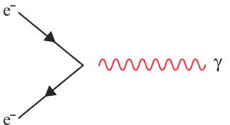

# 第 6 章

# 基本量子理论

## 章节目标

阅读本章并完成测验后，您将能够做到以下几点：

- 使用 bra-ket 记法
- 理解哈密顿算符
- 掌握波函数及波函数坍缩的工作知识
- 认识薛定谔方程的作用
- 了解量子退相干及其对量子计算的影响
- 对量子电动力学有概括性理解
- 展示量子色动力学的基础知识

本章将向您介绍量子理论的各个方面。其中一些主题在第 3 章“量子计算基础物理”中简要提及。要跟上本章内容，必须牢固掌握第 1 章至第 3 章。首先要解决的问题是：什么是量子理论？它实际上是一系列相关理论，包括量子场论、量子电动力学 (QED)，以及在某些物理学家看来，甚至包括处理夸克的量子色动力学。本章的目标是加深您在第 3 章获得的知识，并至少简要介绍一系列全部属于量子理论范畴的主题。

在本章中，比以往任何时候都更要牢记我们的目标。是的，我将呈现大量数学内容，其中一些可能超出某些读者的范围。但是，除非您的目标是在量子物理或量子计算研究领域进行实际工作，否则您只需要对等式的含义有一般性的理解即可。您不需要具备能够实际进行数学运算的数学能力。因此，如果您遇到令人望而生畏的数学内容，只需复习几次，确保您掌握其大致要点，然后继续即可。您当然可以在本书后续章节中使用量子比特、Q# 和其他量子工具，而无需深入理解如何进行数学运算。

## 6.1 进一步探讨量子力学

第 3 章介绍了量子物理学的一些基本概念。本节将进一步扩展我们对量子力学的探索。1932年，维尔纳·海森堡因“创立量子力学”而获得诺贝尔物理学奖。我不确定能否将量子力学的创立完全归功于一个人，但毫无疑问，海森堡与任何人一样都应得此荣誉。

为他赢得诺贝尔奖的论文标题为《运动学和力学关系的量子理论重新诠释》。该论文在数学上相当复杂，我们在此不详细探讨。该论文介绍了一系列构成量子物理学基础的概念。感兴趣的读者可参考多种资源，包括以下资源：

- https://arxiv.org/pdf/quant-ph/0404009.pdf
- https://www.heisenberg-gesellschaft.de/3-the-development-of-quantum-mechanics-1925-1927.html
- https://inis.iaea.org/collection/NCLCollectionStore/_Public/08/282/8282072.pdf

### 6.1.1 Bra-Ket 记法

bra-ket 记法在前面第 3 章中已稍作介绍。然而，这种记法对于理解量子物理学和量子计算如此重要，以至于我们将更详细地重新探讨它。请回顾，量子态本质上是向量。这些向量包含复数。但是，通常可以忽略向量的细节，而使用向量的表示形式。这种记法称为狄拉克记法或 bra-ket 记法。

bra 用 ⟨V| 表示，ket 用 |V⟩ 表示。是的，这些术语是有意为之，意为 braket，即括号。但这实际上是什么意思呢？bra 描述了一种线性函数，将 V 中的每个向量映射到复平面上的一个数。bra-ket 记法实际上是关于复向量空间上的线性算子，它是量子物理学和量子计算中表示状态的标准方式。采用这种记法的原因之一是避免混淆。线性代数中的向量一词与经典物理学中的向量略有不同；在经典物理学中，向量表示诸如速度之类具有大小和方向的事物；然而，在量子物理学中，向量（线性代数向量）用于表示量子态，因此需要不同的记法。重要的是要记住，这些本质上只是向量。因此，您在第 1 章“必要线性代数导论”中看到的线性代数知识适用。


### 6.1.2 哈密顿量

向你介绍哈密顿量很重要。哈密顿量是量子力学中的一个算符。它表示给定系统中所有粒子的动能与势能之和（即总能量）。哈密顿量可以用 H、<H> 或 $\hat{H}$ 表示。当测量一个系统的总能量时，可能结果的集合即为哈密顿量的谱。哈密顿量以 William Hamilton（威廉·汉密尔顿）命名。正如你可能推测的那样，有多种不同的方法来表示哈密顿量。在方程 6.1 中，你看到了哈密顿量的一个简化版本。

```
\hat{H} = \hat{T} + \hat{v}
```

*EQUATION 6.1 The Hamiltonian*
*方程 6.1 哈密顿量*

$\hat{T}$ 表示动能，$\hat{v}$ 表示势能。T 是 p（动量）的函数，V 是 q（空间坐标）的函数。这仅仅说明哈密顿量是动能与势能之和。这个特定的表述相当简单，帮助不大。它表示一个具有一个质量为 m 的单一粒子的一维系统。这是开始理解哈密顿量的好地方。方程 6.2 展示了一个更好的表述。

```
H_{\text{operator}} = -\frac{\hbar^2}{2m} \frac{\partial^2}{\partial x^2} + v(x)
```

*EQUATION 6.2 The Hamiltonian (Detailed)*
*方程 6.2 哈密顿量（详细）*

让我们来审视这个公式以便理解它。最简单的部分是 V(x)，它仅表示势能。x 是空间中的坐标。同样容易理解的是 m，即质量。正如你从第 3 章中回忆的，$-\hbar^2$ 是约化普朗克常数，即普朗克常数 h（6.626 × 10^-34 J·s）除以 2π。$\partial$ 符号表示偏导数。对于一些读者来说，这会相当熟悉。如果你不熟悉导数和偏导数，你不需要掌握这些主题就能继续阅读本书，但有必要做一个简要的概念解释。还应注意，表达这个方程的方式有很多种。你可以在 https://support.dwavesys.com/hc/en-us/articles/360003684614-What-Is-the-Hamiltonian- 看到一种替代方法。

对于任何函数，该函数的导数本质上是对函数输出相对于函数输入变化的敏感度的测量。一个经典的例子是计算物体位置相对于时间变化的值，这提供了速度。偏导数是多变量函数，导数是相对于其中一个变量计算的。

因此，你现在应该对哈密顿量有一个总体的概念性理解。我们之前的讨论仅涉及单个粒子。在多粒子系统中（大多数系统都是如此），系统的哈密顿量只是各个单独哈密顿量之和，如方程 6.3 所示。

\(\hat{H} = \sum_{n=1}^N \hat{T}_n + \hat{V}\)

### EQUATION 6.3 Hamiltonian (Another View)
### 方程 6.3 哈密顿量（另一种视角）

让我们深入探讨一下哈密顿量。任何算符都可以写成矩阵形式。现在回想一下我们在第 1 章中关于线性代数的讨论。哈密顿量的特征值就是系统的能级。就本书而言，你不需要在深层工作层面理解这一点，但你应该开始直观地理解为什么线性代数对量子物理如此重要。

还有哈密顿量与拉格朗量之间的关系也很有趣。首先，有必要定义拉格朗量。约瑟夫·路易·拉格朗日于 1788 年发展了拉格朗日力学。它本质上是对经典力学的一种重新表述。拉格朗日力学使用粒子的坐标、时间导数和时间的拉格朗日函数。

在哈密顿力学中，系统由一组标准坐标描述。标准坐标是相空间上的一组坐标，可以在任何给定时间点描述系统。事实上，你可以从拉格朗量推导出哈密顿量。我们不会在本章中深入探讨该主题，但有兴趣的读者可以在以下来源了解有关该过程以及哈密顿量的更多细节：

- https://scholar.harvard.edu/files/david-morin/files/cmchap15.pdf
- https://www.damtp.cam.ac.uk/user/tong/dynamics/four.pdf
- https://authors.library.caltech.edu/89088/1/1.5047439.pdf

### 6.1.3 波函数坍塌

在物理学中，波函数是对量子系统量子态的数学描述。它通常用希腊字母 psi 表示，可以是小写（\(\psi\)）或大写（\(\Psi\)）。波函数是量子系统自由度的函数。在这样的系统中，自由度表示描述系统状态的独立参数的数量。例如，光子和电子具有自旋值，这对于该粒子来说是一个离散自由度。

波函数是可能状态的叠加。更具体地说，它是特征态的叠加，会基于与环境的相互作用坍塌为单个特征态。第 1 章讨论了特征值和特征向量。特征态基本上就是物理学家所称的特征向量。

波函数可以相加，甚至可以相乘（通常由复数相乘，你在第 2 章“复数”中学习过）以形成新的波函数。回想一下我们在第 1 章中讨论的点积；内积只是点积的另一个术语。这有时也被称为数量积。回想一下内积/点积很容易计算，如方程 6.4 所示。

### EQUATION 6.4 Inner Product
### 方程 6.4 内积

两个波函数的内积是两个波函数物理状态之间重叠程度的度量。

这引出了量子力学的另一个重要方面：Born 规则。这个公设由 Max Born（马克斯·玻恩）提出，有时被称为 Born 定律或 Born 公设。公设给出了测量量子系统会产生特定结果的概率。这最简单的形式是在给定点找到粒子的概率。这个一般描述足够你继续阅读本书；然而，如果你有兴趣深入理解，我们现在将探讨它。Born 规则更具体地陈述：如果在具有归一化波函数 |ψ> 的系统中，测量与自伴算符 A 对应的某个可观测量（位置、动量等），则结果将是 A 的一个特征值。这应该能帮助你更习惯量子物理的概率性质。

对于不熟悉自伴算符的读者，这里简要概述一下。回想一下第 1 章，矩阵通常被用作算符。在具有内积的有限复向量空间上，自伴算符是从向量到其自身的线性映射，且它是自己的伴随。请注意，这是一个复向量空间。这引出了厄米特的概念。回想一下第 2 章，厄米特是指等于其自身共轭转置的方阵。共轭转置意味着先对矩阵进行转置，然后再对矩阵进行共轭。在复希尔伯特空间上的每个线性算符也有一个伴随算符，有时称为厄米特伴随。

自伴算符在函数分析等领域有应用；然而，在量子力学中，位置、动量、自旋和角动量等物理可观测量由希尔伯特空间上的自伴算符表示。

这也是讨论 Born 规则的好时机，它提供了测量量子系统会产生特定结果的概率。更具体地说，Born 规则指出，在特定点找到特定粒子的概率密度与该点粒子波函数模值的平方成正比。更详细地说，Born 规则指出，如果在具有归一化波函数的系统中测量与自伴算符对应的可观测量，结果将是该自伴算符的一个特征值。Born 规则还有更多细节，但这应该为你提供足够的信息。有兴趣的读者可以在以下来源找到更多信息：

- https://www.math.ru.nl/~landsman/Born.pdf
- https://www.quantamagazine.org/the-born-rule-has-been-derived-from-simple-physical-principles-20190213/


现在让我们回到波函数坍缩的话题，它将可能特征态的叠加，基于与环境的相互作用坍缩为单一特征态。什么是与环境的这种相互作用？这是量子物理学中经常被大众误解的一个方面。与环境的常见相互作用是测量，物理学家常将其描述为观测。这导致许多人将智能观测视为量子物理学乃至所有现实的必要条件。这根本不是量子物理学教给我们的准确描述。

所谓观测，实际上是与环境的相互作用。当进行测量时，这就是一种导致波函数坍缩的相互作用。

测量会导致波函数坍缩，这一事实对量子计算有重大影响。当测量一个粒子时，就会改变其状态。如您将在后续章节（特别是第 8 章“量子架构”和第 9 章“量子硬件”）中看到，这是量子计算必须考虑的问题。

波函数可以表示为可观测量（位置、动量、自旋等）的特征态（请回忆，这是您在第 1 章中学习的特征向量的物理术语）的线性组合。使用之前讨论过的 bra-ket 记法，这意味着波函数的形式如公式 6.5 所示。

```
| ψ ⟩ = Σᵢ cᵢ | φᵢ ⟩
```

### 公式 6.5 波函数

这看起来没有那么复杂。希腊字母 psi（ψ）表示波函数。Σ 符号表示对其后内容求和。φi 代表各种可能的量子态。i 用于枚举这些可能的状态，例如 φ1、φ2、φ3 等。ci 值（即 c1、c2、c3 等）是概率系数。字母 c 经常被用来表示这些值，因为它们由复数表示。

请回忆第 1 章的知识，如果两个向量既正交（即互相垂直）且单位长度（长度为 1），则这些向量被称为标准正交。bra-ket ⟨φi | φj⟩ 构成标准正交特征向量基。这通常写作如下形式：

```
⟨φi | φj⟩ = δij.
```

符号 δ 是克罗内克 delta，是一个两个变量的函数。如果变量相等，函数结果为 1；如果不相等，函数结果为 0。这通常定义如公式 6.6 所示。

```
δij = { 0 if i ≠ j, 1 if i = j }
```

### 公式 6.6 克罗内克 Delta

现在让我们讨论波函数坍缩的实际过程。请记住，对于任何可观测量，坍缩前的波函数都是特征基的某种线性组合。当存在某种环境相互作用（例如对可观测量的测量）时，函数坍缩为该基的单一特征态。这可以用如下相当简单的公式描述：

```
| ψ ⟩ → | φk ⟩
```

但它会坍缩到哪个态？这就是量子力学具有概率性的问题所在。我们可以说，它会以玻恩概率（如前面在本章中讨论过）P_k = | c_k |^2 坍缩到某个特定的特征态 | φk ⟩。c_k 值是该特定特征态的概率幅。测量后，所有其他不是 k 的可能特征态都坍缩为 0（更数学地说，c_{i≠k} = 0）。

测量已被讨论为一种与环境相互作用的类型。量子计算面临的挑战之一在于，这并非唯一类型的相互作用。粒子与其他粒子相互作用。事实上，宇宙射线等事物可以与粒子的量子态相互作用。这就是退相干成为量子计算如此大问题的原因之一。

### 6.1.4 薛定谔方程

薛定谔方程在量子物理学中非常重要。它描述了量子系统的波函数。该方程由埃尔温·薛定谔于 1926 年发表，并使他于 1933 年获得诺贝尔物理学奖。首先，让我们先考察方程本身，确保您对它有整体把握；随后我们可以进一步讨论其影响。呈现该方程有多种方式，我们将首先考察时间相关版本。您可以在公式 6.7 中看到它。

```
i\hbar \frac{\partial}{\partial t} | \psi (t) \rangle = \hat{H} | \psi (t) \rangle
```

### 公式 6.7 薛定谔方程

不要被这吓到。所使用的所有符号之前都已经讨论过，我将在此再次讨论它们以刷新您的记忆。

鉴于我们正在讨论薛定谔方程的时间相关版本，大多数读者应该清楚 t 代表时间。请记住 ∂ 符号表示偏导数。因此，我们可以在分母中看到对时间求偏导数。ℏ 您会回忆起，来自第 3 章和本章前面部分，是约化普朗克常数，即普朗克常数 h（6.626 × 10^-34 J·s）除以 2π。我们在本章前面见过 ψ 符号。您可能还回忆起，符号 Ĥ 表示汉密尔顿算符，即系统中粒子的总能量。

在考察薛定谔方程的影响之前，让我们先考察方程的另一种形式。您可以在公式 6.8 中看到它。

```
\frac{\partial^2 \psi}{\partial x^2} + \frac{8\pi^2 m}{h^2} (E-V)\psi = 0
```

### 公式 6.8 薛定谔方程（另一种形式）

您已经知道 ∂ 符号表示偏导数。其上方叠加的 2 表示这是二阶导数（即导数的导数）。对于没有坚实微积分基础或不记得微积分的读者来说，二阶导数其实很常见。一阶导数告诉您某个函数的变化率。二阶导数告诉您在一阶导数中找到的变化率的变化率。最常见的例子可能是加速度。速度是位置相对于时间的变化。这是一阶导数。加速度是速度的变化，这是二阶导数。ψ 符号表示波函数，您现在应该已经相当熟悉了。您熟悉的另一个符号是 h，即普朗克常数。请注意，在这种薛定谔方程形式中，是普朗克常数，而不是约化普朗克常数。E 是动能，V 是系统的势能。x 是位置。

请记住，在亚原子世界中，我们面临着波粒二象性的问题。薛定谔方程允许我们计算波函数随时间的变化。

## 6.2 量子退相干

量子退相干是一个非常重要的主题，实际上对于量子计算至关重要。退相干与前一节关于波函数的内容直接相关。请回忆，波函数是量子系统状态的数学表示。只要状态之间存在确定的相位关系，该系统就是相干的。另外，请回忆，与环境的相互作用会导致波函数坍缩。如果能绝对隔离一个量子系统，使其与任何环境都完全没有相互作用，它将无限期地保持相干性。然而，只有通过与环境相互作用才能进行测量；因此，才能提取数据。

状态之间具有确定相位关系是什么意思？首先，我们必须考察相空间的概念，这是动态系统理论中的一个概念。它是一个表示系统所有可能状态的空间。每个状态对应相空间中的一个唯一点。系统的每个参数代表一个自由度。反过来，每个自由度表示为多维空间的一个轴。如果是一维系统，则是相线。二维系统是相平面。

p 和 q 两个值在相空间中起着重要作用。在经典力学中，p 通常是动量，q 是位置。现在，在量子力学中，这个相空间是希尔伯特空间。因此，p 和 q 是该希尔伯特空间中的厄米算符。虽然动量和位置是最常见的可观测量，并且最常用于定义相空间，但还有角动量和自旋等其他可观测量。


为了让你恢复记忆，厄米算符也被称为自伴算符。请记住，我们处理的是矩阵/向量，因此算符本身就是矩阵。量子力学中的大多数算符都是厄米算符。厄米算符具有一些特定的性质。它们总是有实数特征值，但特征向量或特征函数可能包含复数。如果厄米算符出现在内积中，它可以被“翻转”到另一边——就像你在这里看到的那样：

\(\langle f|Ag\rangle = \langle Af|g\rangle\)

厄米算符的特征函数构成一个“完备集”。该术语表示任何函数都可以写成特征函数的某种线性组合。

一般来说，如果我们处理的是非相对论模型，系统相空间的维度等于自由度数乘以自由粒子数。非相对论时空在概念上相当简单。相对论时空使用 n 维空间和 m 维时间。非相对论时空将其融合为一个连续体。换句话说，它只是忽略了相对论效应。在亚原子水平上这是完全合理的，因为相对论效应基本上无关紧要。

因此，当系统与环境相互作用时，每个环境自由度都会给系统的相空间贡献另一个维度。最终，系统变得解耦。实际上有一个公式来描述这一点，称为威格纳准概率分布。这有时被称为威格纳-维尔分布或威格纳函数。细节可能超出本书所需；然而，大致轮廓当然是我们可以探讨的内容。尤金·威格纳于 1932 年首次引入该公式，以研究经典力学的量子修正。其目的是将我们在薛定谔方程中研究过的波函数与相空间中的概率分布联系起来。

方程 6.9 显示了威格纳分布。

\(W(x, p) \stackrel{\text{def}}{=} \frac{1}{\pi\hbar} \int_{-\infty}^{\infty} \psi^*(x+y)\psi(x-y)e^{2ipy/\hbar} dy\)

### 方程 6.9 威格纳分布

到这一点，你不应被外观复杂的方程所吓倒，而且这个方程中的许多符号你已经熟悉。但是，让我们简要地检查一下它们。显然，W 是威格纳分布。x 通常是位置，p 是动量，但它们可以是任何一对（信号的频率和时间等）。当然，\(\psi\) 是波函数，\(\hbar\) 是约化普朗克常数。我们此前在本书中讨论过 \(\int\) 符号；它表示积分。就我们的目的而言，你不必详细了解威格纳分布，也不必能够“做数学”。相反，你只需要对正在发生的事情有一个一般性的了解。

在经典力学中，谐振器的运动可以完全用相空间中的一个点来描述，该点具有粒子位置 x 和动量 p。在量子物理学中，情况并非如此。回顾第 3 章中我们关于海森堡不确定性原理的讨论。你不能同时精确地知道位置和动量，但通过对一组相同的量子态测量 x、p 或它们的线性组合，你可以实现与这些可观测量（x 和 p）相关的概率密度。威格纳函数实现了这一目标。我们的目标是理解退相干。威格纳分布展示了解耦过程，因为它显示了各种状态的概率。

## 6.3 量子电动力学

量子电动力学（QED）是一个可能被认为对于入门书籍来说太先进的主题。其目标仅仅是让你对该主题有一个一般性的了解，我相信这是一个可以实现的目标。QED 是适用于电动力学的相对论量子场论。它是第一个使量子力学和相对论完全一致的理论。QED 对涉及带电粒子的现象提供了数学描述。

让我们从定义量子场论（QFT）开始。QFT 结合了经典场论、狭义相对论和量子力学。到这一点，你应该对量子力学有总体的工作知识。因此，我们将把注意力转向经典场论和狭义相对论，对各自进行简要描述。

经典场论描述了一个或多个场如何通过场方程与物质相互作用。一个易于理解的例子是天气模式。给定时间的风速可以用一个向量来描述。每个向量描述特定点处空气的方向和运动。特定区域在给定时间点上所有此类向量的集合将是一个向量场。随着时间的推移，我们期望这些向量发生变化。这就是经典场论的本质。麦克斯韦的电磁场方程是最早的严格场理论之一。

狭义相对论你很可能已经熟悉。如果你需要稍微复习一下，它基本上给我们两个概念。第一个是物理定律是不变的；不存在特权参考点。另外，真空中光速是恒定的。

量子电动力学的发展始于对光与电子之间相互作用的研究。当这项研究开始时，唯一已知的场是电磁场，因此这是一个显而易见的起点。_量子电动力学_ 这一术语由保罗·狄拉克在 1927 年的论文“辐射的发射和吸收的量子理论”中提出。

经典电磁学会将两个电子之间的力描述为由每个电子的位置产生的电场。力本身可以使用库仑定律进行计算。然而，量子场论将电子之间的力可视化为源于虚拟光子的交换。

量子电动力学是描述光与物质相互作用的基本理论。为了更加严谨，作为电磁场源的带电粒子由相对论运动方程描述（更具体地说，对于整数自旋是克莱恩-戈登方程，对于自旋是狄拉克方程）。让我们简要地检查这些方程。

请记住，就本书的目的而言，你无需成为这些方程的专家。你只需要对它们的作用有一个一般性的了解。

克莱恩-戈登是一个相对论波方程，实际上与薛定谔方程相关，因此它至少看起来有点熟悉。方程 6.10 给出了该方程。

```
\frac{1}{c^2} \frac{\partial^2}{\partial t^2} \psi - \nabla^2 \psi + \frac{m^2 c^2}{\hbar^2} \psi = 0.
```

### 方程 6.10 克莱恩-戈登方程

现在，其中大部分你已经知道。稍微回顾一下记忆，\(\psi\) 是波函数，\(\hbar\) 是约化普朗克常数，m 是质量。我们也之前在本书中讨论过二阶导数和偏微分方程。c 是厘米每秒的光速。我想你已经可以看到这与爱因斯坦著名的 E = mc^2 之间的一些联系。我还有另一个符号尚未解释，\(\nabla\)。这个符号在量子物理学中实际上出现得很频繁。这是拉普拉斯算子，有时称为拉普拉斯亚。它有时用 \(\nabla V\) 表示，有时用 \(\nabla^2\) 表示。拉普拉斯亚的定义可能看起来有点令人困惑。它是一个二阶微分算子，定义为梯度的散度。在此情况下，梯度一词是向量微积分术语。它指的是多变量标量值函数 f，该函数是向量场。该向量场在某点的拉普拉斯亚是其分量为函数 f 在点 p 处偏导数的向量。

希望这个一般性解释没有让你完全困惑。从引言中回想一下，你不需要掌握本章中呈现的所有数学。只需确保你理解大致概念。那么，那个大致概念是什么？克莱恩-戈登方程是一个相对论波函数，它描述场随时间和空间变化而运动。

自旋的狄拉克方程也是一个相对论波函数。它描述电子和夸克等粒子。应当注意，电子和夸克是构成普通物质的粒子，被称为费米子。我们将在量子色动力学部分更多地讨论夸克。自旋数描述粒子在一次完整旋转中具有多少个对称面。因此，自旋 1/2 意味着粒子必须旋转两次（即 720 度）才能与开始时具有相同的构型。质子、中子、电子、中微子和夸克都有自旋 1/2，这足以让你继续本书的其余部分。然而，对于某些读者，你不仅希望看到更多数学，而且到本文的这一点，你已经习惯了它。所以，为了不让那些读者失望，方程 6.11 呈现了保罗·狄拉克最初提出的狄拉克方程。

```
(\beta mc^2 + c \sum_{n=1}^3 \alpha_n p_n) \psi(x,t) = i\hbar \frac{\partial \psi(x,t)}{\partial t}
```

### 方程 6.11 狄拉克方程


再次，你会看到现在已经很熟悉的偏微分符号、约化普朗克常数和波函数——到此时，这些对你来说都应该非常熟悉了。你也看到 mc²，我预计大多数读者意识到这就是质量和光速，就像在 E = mc² 中一样。在这个方程中，x 和 t 分别是空间和时间坐标。正在求和的 p 值（p1、p2 和 p3）是动量的分量。符号 α 和 β 是 4 × 4 矩阵。之所以是 4 × 4 矩阵，是因为它们有四个复数分量（即使用复数）。此类对象在物理学中被称为双旋量。

在对 QED 数学进行了相当广泛的探讨之后，让我们通过回到 QED 的基本事实来完成本节。顾名思义，电动力学涉及电力。然而，量子电动力学提供了光和物质如何相互作用的相对论解释。它用于从根本层面了解带电粒子之间的相互作用。它是量子物理学中非常重要的一部分。

## 6.4 量子色动力学

严格来说，可以在不了解太多量子色动力学（QCD）知识的情况下研究量子计算。然而，它支撑着物质的基本结构；因此，应该对该主题有基本了解。QCD 是夸克和胶子之间强相互作用的研究。夸克是构成质子和中子（也称为强子）的粒子。曾经有人认为质子和中子是基本粒子；然而，后来发现它们由夸克组成。夸克的名字乍看之下很俏皮，不必过多关注名字的含义。夸克具有电荷、质量、自旋等属性。将三个夸克组合可以产生质子或中子。共有六种夸克。命名法的俏皮之处在这里会变得清晰。这些类型被称为“味”，这些味分别是上、下、奇、魅、底和顶。图 6.1 展示了夸克的家族。

| 第一代 | 第二代 | 第三代 |
|---|---|---|
| u 上型 | c 魅型 | t 顶型 |
| d 下型 | s 奇型 | b 底型 |

图 6.1 夸克

夸克存在的证据最早于 1968 年在斯坦福直线加速器中心被发现。自那时起，实验已证实所有六种夸克味。因此，这些不仅仅是假设性构造，而是强子的实际构建块，并且在几十年来已被多次实验证实。例如，质子由两个上夸克和一个下夸克组成。胶子介导夸克之间的力，从而将它们结合在一起。

接下来这个稍显俏皮的命名法伴随着色电荷概念出现。这与产生可见光的光的频率完全无关。“颜色”一词，连同红、绿、蓝的具体标签，被用来识别夸克的电荷。然而，这个术语产生了深远影响。这就是为什么夸克和胶子之间相互作用的研究被称为色动力学的原因。

QCD 中有两个主要特性。第一个是色禁闭。这是两个色电荷在分离时产生的力的结果。将强子中的夸克分离，分离得越远所需能量就越多。如果你确实有足够能量将夸克完全分离，它们实际上会自发产生一个夸克-反夸克对，原强子变成两个强子。

第二个特性稍微复杂一些。它称为渐近自由。简单来说，这意味着随着距离减小，夸克和胶子之间相互作用的强度减弱。这可能看起来有点反直觉。而且正如我所说，它很复杂。发现 QCD 这一特性的人——大卫·格罗斯、弗兰克·维尔切克和大卫·波利策——因其工作获得了 2004 年诺贝尔物理学奖。

## 6.5 费曼图

对于本章中所有数学内容让读者感到有些疲惫的人，这里有帮助。理查德·费曼创建了费曼图，以提供描述亚原子粒子行为所用数学表达式的图形表示。这是一种更简单的方法，至少可以捕捉正在发生的事情的本质。让我们先来看看使用的基本图形符号，然后看看它们如何协同工作（见表 6.1）。

表 6.1 费曼图符号

| 描述 | 符号 |
|---|---|
| 费米子（即电子、正电子、夸克等）被绘制为指向自旋方向的直线并带有箭头。 | f → f |
| 反费米子被绘制为指向自旋方向的直线并带有箭头，主要区别在于 f 上方有一条线。 | f̄ → f̄ |
| 光子被绘制为波形线。 | γ ~~~~~~ |

因此，如果你希望绘制两个自旋相反的电子碰撞并产生一个光子，你可以使用费曼图而无需任何数学，如图 6.2 所示。



图 6.2 电子碰撞的费曼图

这只是对费曼图的非常简要的介绍，但随着你了解更多量子相互作用，会发现这些很有用。

## 6.6 总结

本章探讨了许多概念。它实际上是第 3 章的延伸，并应用了第 1 章的一些要素。这对于许多读者来说可能是较难的章节之一，强烈建议你阅读多次。虽然探讨了许多主题，但有些对于你理解量子计算至关重要。bra-ket 记法在量子计算中普遍使用，所以请确保你对其非常熟悉。哈密顿量在量子计算中也起着重要作用。量子退相干实际上是量子计算进展的一大障碍。要完全理解退相干，你需要理解波函数及相关方程。量子电动力学和色动力学被介绍出来，以帮助你完成对量子理论的基本介绍。然而，对于你在量子计算方面向前推进来说，这两个主题稍微不那么关键。

## 测试你的技能

## 复习问题

- 1. 为什么约化普朗克常数使用 2 π？
  - a. 2 π 表示原子的半径。
  - b. 2 π 是弧度制下的 360 度。
  - c. 2 π 考虑了量子涨落。
  - d. 2 π 是爱因斯坦普适常数的导数。

- 2. 在量子力学中，希腊字母 ψ 代表什么？
  - a. 哈密顿量
  - b. 约化普朗克常数
  - c. 波函数
  - d. 态的叠加

- 3. 在给定点找到粒子的概率时，什么最有帮助？
  - a. 玻恩准则
  - b. 哈密顿量
  - c. 约化普朗克常数
  - d. 波函数

- 4. 以下哪项是波函数坍缩最准确的描述？
  - a. 各种可能的量子态汇合为单一量子态。
  - b. 概率基于观察者汇合为单一实际性。
  - c. bra-ket \(\langle \phi_i | \phi_j \rangle\) 构成正交标准特征向量基。
  - d. 可能特征态的叠加基于与环境的相互作用坍缩为单一特征态。

- 5. 使用克罗内克三角函数并输入两个相同的特征态时，输出将是什么？
  - a. 特征态之和
  - b. 1
  - c. 特征态的叠加
  - d. 0

- 6. 薛定谔方程用于描述什么？
  - a. 特征态的叠加
  - b. 特征态
  - c. 波函数
  - d. 哈密顿算子

- 7. 以下哪个方程与退相干过程中的解耦最密切相关？
  - a. 哈密顿量
  - b. 薛定谔方程
  - c. 维格纳函数
  - d. 克莱因-戈登方程

- 8. 以下哪个是与量子电动力学相关的波函数，用于描述场随时间和空间变化的运动？
  - a. 哈密顿量
  - b. 薛定谔方程
  - c. 维格纳函数
  - d. 克莱因-戈登方程

- 9. 什么是双旋量？
  - a. 具有复数分量的 4 × 4 矩阵
  - b. 两个特征态的叠加
  - c. 狄拉克方程的乘积
  - d. 维格纳函数的乘积


