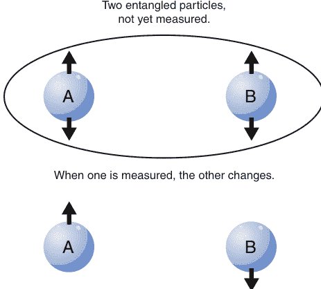
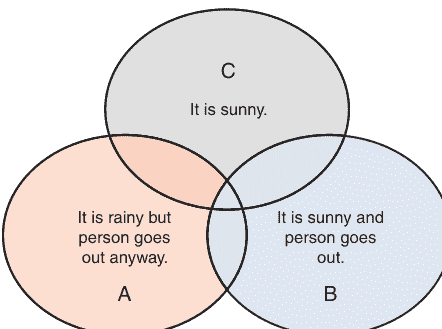
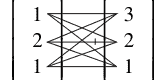
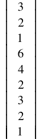

# 量子纠缠与 QKD
## 章节目标

**阅读本章并完成复习问题后，你将能够做到：**

- 理解量子纠缠
- 对量子态有更深入的理解
- 掌握量子密钥交换协议的实用知识

量子纠缠在概念上是一个难以理解的主题。它完全违背直觉，并且经过了许多实验才得以证实确实存在。然而，它是量子物理的关键要素，本章将探讨该话题。相关话题是量子密钥分发（QKD）。在本章中，你将学习 QKD 的基础知识以及 QKD 的实际实现。

## 7.1 量子纠缠

量子纠缠是量子物理中更为奇特的方面之一。它在量子密钥交换的某些方面起着关键作用，因此你必须对其有工作层面的理解。该概念相对简单，但“如何”和“为什么”要复杂得多。本质上，量子纠缠发生在一对粒子（或一组粒子对）以某种方式相互作用或生成，将对中每个粒子的量子态联系（或纠缠）在一起。这意味着对一粒子的偏振、动量、自旋或其他属性的测量将与纠缠粒子的属性相关联。例如，如果你测量一对纠缠光子中一个光子的偏振，你会发现另一个纠缠光子具有精确相反的偏振——就我们所知，距离没有影响。量子纠缠的本质在于，纠缠粒子的属性是完美相关的——例如动量、自旋、偏振等属性——以至于对任何一个纠缠粒子的测量都会导致波函数坍缩，两个粒子现在都具有确定态。你可以在图 7.1 中看到纠缠的简化示例。



图 7.1 纠缠

为什么两个粒子会发生纠缠？好吧，回想一下，在前几章中我们详细探讨了波函数。爱因斯坦称这种行为为“幽灵般的远距作用”。基于此及相关现象，他相信量子力学必定是不完备的。爱因斯坦与鲍里斯·波多尔斯基和纳森·罗森共同撰写了一篇关于后来被称为 EPR 悖论的论文。

在论文《量子力学对物理实在性的描述能否被视为完备？》中，爱因斯坦、波多尔斯基和罗森认为量子力学仅仅是不完备的，并且存在量子理论未涉及的额外实在性要素。在他们的论文中，他们提出了一个思想实验。在这个实验中，有一对处于纠缠态的粒子（所选粒子无关紧要）。如果你测量其中一个粒子（例如，其动量），那么第二个粒子的测量结果将是可预测的。一个纠缠粒子对另一个粒子产生这种瞬时效应令人不安，因为相对论告诉我们没有任何事物可以超过光速，而纠缠粒子似乎瞬时通信信息，这比光速还要快。EPR 悖论的实质在于：第二个纠缠粒子要么与第一个粒子进行瞬时通信（从而违反相对论），要么在测量之前已经具有确定态，这与我们所知的量子力学相悖。纠缠的另一个术语是将粒子称为处于单重态（一种常见态）。

EPR 悖论催生了量子力学中的非局域性概念：如果两个纠缠粒子可以瞬时相互影响，且距离任意远，那么量子态就不局限于任何一个粒子的局域性。我相信如果你反思一段时间，你会意识到这不仅违背直觉，而且与所有经典物理学相悖。

EPR 悖论为大量理论物理研究提供了燃料。1961 年，大卫·玻姆提出了 EPR 思想实验的一个变体。在玻姆的版本中，测量结果仅有离散的可能结果范围。以下是关于玻姆工作的更多详细信息的良好参考：

- https://www.nature.com/articles/milespin11
- http://philsci-archive.pitt.edu/3222/1/epr.pdf

对 EPR 悖论的一种回答是假设存在我们尚未发现的隐变量。实际上存在多种“局域隐变量”理论。每种理论都假设存在一些底层的、不可访问的变量，用来解释量子纠缠和/或量子力学的概率性质。

要理解玻姆对 EPR 悖论的修改，假设你已制备了一对处于纠缠自旋单重态的自旋-1/2 粒子，如方程 7.1 所示。

```
\frac{1}{\sqrt{2}}(|\uparrow\rangle \otimes |\downarrow\rangle - |\downarrow\rangle \otimes |\uparrow\rangle)
```

### 方程 7.1 单重态

此外，\(|\uparrow\rangle\)、\(|\downarrow\rangle\) 是自旋态空间的一组标准正交基。沿给定轴测量其中一个粒子的自旋，结果要么是“向上”，要么是“向下”。如果沿给定轴测量两个粒子的自旋，量子理论预测所得结果将互为相反。如果在两个空间分离的粒子上同时进行此类测量，局域性要求，由一侧测量触发的任何扰动都不能影响另一侧的测量结果。换句话说，非局域性是量子理论中的“不完备性”，确实存在一些隐变量可以表观非局域性。确保两侧结果之间完美相关性的唯一方法是让每个粒子携带预先存在的确定值。

这引出了量子力学中的一个重要定理：贝尔不等式（也称为贝尔定理）。1964 年，约翰·贝尔提出了一种检验所提隐变量是否存在的方法。为了直观理解贝尔不等式，让我们考虑两个纠缠光子。贝尔意识到，在不引入非局域性的情况下，解释量子纠缠粒子之间完美相关性的唯一方式是必须存在预先值。在深入探讨贝尔定理之前，其本质在于证明量子物理学与各种“隐变量”理论不兼容。这终止了关于隐变量作为表观非局域性解释的严肃猜测。

对贝尔不等式的基本直观理解其实相当简单：假设隐变量会导致从纠缠粒子对中获得的后续测量相关性的可能值有严格限制。然而，实验根本不支持这一点。

为了更深入地探讨贝尔定理，让我们回到方程 7.1 中看到的量子单重态粒子。此外，假设这些粒子现在相隔相当远。测量两个粒子会导致它们要么相关，要么不相关。使用自旋作为关注的属性，如果沿反平行方向测量纠缠粒子的自旋，结果始终完全相关。在垂直方向测量提供 50% 的相关概率。这两组数据说明了平行和反平行两种情况，如下所示：

### 粒子对

| | 1 | 2 | 3 | 4 | ... | n |
|---|---|---|---|---|---|---|
| **反平行** | | | | | | |
| 粒子 1, 0° | + | − | + | + | ... | − |
| 粒子 2, 180° | + | − | + | + | ... | − |
| 相关性 | +1 | +1 | +1 | +1 | ... | +1 / n = +1 |
| **平行** | **1** | **2** | **3** | **4** | **...** | **n** |
| 粒子 1, 0° | + | − | − | + | ... | + |
| 粒子 2, 0° 或 360° | − | + | + | − | ... | − |
| 相关性 | −1 | −1 | −1 | −1 | ... | −1 / n = −1 |

其他角度呢？事实证明，相关性是角度的负余弦值。请注意，许多来源也讨论了双子的正交情况，包括 90 度和 270 度角。

现在让我们更严谨地探讨贝尔定理。考虑随机变量 $Z_{i\alpha}$；i=1,2；$\alpha$=a,b,c，仅取值 $\pm1$。如果这些随机变量完全反相关（即，对于所有 $\alpha$，$Z_{1\alpha}$=-$Z_{2\alpha}$），则我们有方程 7.2 所示的公式。

```
\( P\left(Z^1_a \neq Z^2_b\right) + P\left(Z^1_b \neq Z^2_c\right) + P\left(Z^1_c \neq Z^2_a\right) \)
```

### 方程 7.2 贝尔不等式

如你所见，这是一个不等式（因此得名贝尔不等式）。让我们描述这些变量，以便你能更清楚地理解贝尔不等式。a、b 和 c 表示三个轴，任意两个轴之间的夹角为 $2\pi / 3$。带轴下标的 Z 值表示给定轴的自旋。因此，$Z^1_a$ 表示轴 a 的自旋。P 表示概率。因此，方程的第一部分陈述的是，$Z^1_a \neq Z^2_b$ 的概率是多少？

因为三个取值为 $\pm1$ 的随机变量 $Z_{1\alpha}$ 不能全部互不相等，事件 $\{Z_{1a}=Z_{1b}\}$、$\{Z_{1b}=Z_{1c}\}$ 和 $\{Z_{1c}=Z_{1a}\}$ 的并集等于整个样本空间。因此，它们概率之和必须大于或等于 1：

```
\( P(Z_{1a}=Z_{1b}) + P(Z_{1b}=Z_{1c}) + P(Z_{1c}=Z_{1a}) \ge 1 \)
```


然而，因为 Z1 β=-Z2 β，我们有 P(Z1 α=Z1 β)=P(Z1 α≠Z2 β)。

为了再现量子预测，不等式左侧的三个项都必须等于 1/4。但是，因为 1/4 + 1/4 + 1/4 = 3/4 < 1，完整的量子预测集无法匹配。

请记住，贝尔不等式是关于概率总和的。有时看图来描述这一点会有帮助。让我们先考虑各种概率，例如 $Z_a^1 \neq Z_b^2$，将其视为平凡行为的概率，比如是否下雨，以及一个人是否外出。该场景在图 7.2 中描绘。



图 7.2 贝尔不等式的简单解释

这些是重叠的概率，可以按照公式 7.3 所示进行计算。

```
$P(A \cap B) \leq P(A \cap C) + P(\bar{C} \cap B)$
```

### 公式 7.3 贝尔不等式，简化解释

在公式 7.3 中，值 $\bar{C}$ 不是 C。

用更简单的术语来说，本质上贝尔不等式预测，如果局域性成立，且隐变量对量子力学中观测到的表观非局域性负责，那么我们应该看到某些测量结果。但是，至少在某些情况下，我们看不到这些结果。因此，隐变量无法解释观测到的现象，量子力学确实包含非局域性。

尽管量子力学的预测违背直觉，你可能同意爱因斯坦、波多尔斯基和罗森提出的观点，但这些预测已经多次在实验中得到验证。利用自旋或偏振，量子纠缠粒子在不同位置进行了测量，一个粒子的变化确实会导致另一个粒子发生变化。有关验证纠缠和 EPR 悖论实验的几个优秀来源如下：

- https://arxiv.org/abs/2004.04352
- https://www.sciencedaily.com/releases/2018/04/180426141601.htm
- https://www.extremetech.com/extreme/295013-scientists-capture-photographic-proof-of-quantum-entanglement
- https://www.sciencemag.org/news/2018/04/einstein-s-spooky-action-distance-spotted-objects-almost-big-enough-see

理论物理学家花了大量心思试图理解这种纠缠是如何工作的。例如，有将时间视为由于量子纠缠而产生的涌现现象的概念。人们当然可以花很多时间思考这个和其他想法。但是，就我们的目的而言，我们不需要知道纠缠的原因。幸运的是，虽然提出了许多想法，但没有人真正知道纠缠的原因。

必须强调的是，无论纠缠看起来多么奇怪，它已经用电子、中微子、光子甚至分子在实验中得到证明。还必须强调这对量子物理学有多么重要。薛定谔说过：“我不愿称其为一种，而更愿意称之为量子力学的特征特质，正是这一特质迫使它完全偏离经典思路。”

## 7.2 诠释

虽然可以在不考虑量子力学含义的情况下研究量子计算机，但这可能是一个错误，因为它回避了量子力学的一些奇妙之处。因此，在本节中，您将了解一些更著名的诠释。

首先，有必要理解为什么需要诠释。考虑量子力学的两个主要特征。第一个是我们在上一节中讨论的纠缠问题。正如我们讨论的那样，EPR 悖论源于纠缠带来的问题。相距较远的两个粒子如何保持同步？许多人假设两个粒子中存在隐变量，使得数值早已预定，无需解释所谓的悖论。然而，贝尔不等式最终被用来证明这类变量不存在。那么，我们如何解释纠缠呢？

第二个问题是，我们只能以一定概率而非确定性知道量子测量的结果。这对宇宙的根本运作方式意味着什么？必须强调的是，我们通过无数实验知道量子力学是如何工作的（至少在一定细节程度上），但我们真的不知道它 *为什么* 起作用。因此，各种诠释被提出，寻求解释。

这些观点的另一点是回答一个非常基本的问题：经典世界如何从量子基础涌现？显然，我们的正常世界不展示波粒二象性、纠缠或其他量子现象，因此物理学家想要理解我们如何对一切事物都有量子基础。毕竟，万物都由原子组成，原子中的粒子按照量子力学表现，但我们最终得出经典行为。

### 7.2.1 哥本哈根诠释

纠缠至少需要对量子力学的哥本哈根诠释进行一些基本讨论。哥本哈根诠释由维尔纳·海森堡和尼尔斯·玻尔在 1925 年至 1927 年期间经过两年开发。该诠释断言，量子系统在被测量之前没有确定的属性。因此，人们只能预测给定量子系统具有特定值的概率。尽管这一观点有其批评者，但它或许是我们从量子力学中获得的数据中最广泛教授的诠释。

哥本哈根诠释认为，没有隐变量来解释量子态和纠缠。在这种观点中，波函数 ψ 表示系统的状态，以及在观测之前关于它的所有已知或可知之事。这也导致了海森堡不确定性原则，本书前面已提到。无法同时知道一个粒子的确切位置和动量。对量子系统的测量会导致波函数坍缩为被测可观测属性的特定本征态。

这一观点导致了臭名昭著的薛定谔猫思想实验，你可能对此有所了解。在这个思想实验中，一只猫被放入一个密封的盒子里。盒子里有一个装有毒气的小瓶。小瓶要么是打开的，猫死了，要么是关闭的，猫活着。如果将这个小瓶像亚原子粒子一样处理，那么在被测量之前，它只是一个尚未坍缩的波函数，这意味着，在有人查看盒子之前，猫处于既非活着也非死亡的叠加状态。然后，当盒子被打开并进行测量/观察时，波函数坍缩，猫此时要么活着，要么死去。如果您想深入研究这个话题，这里有几个外部参考：

- https://wtamu.edu/~cbaird/sq/2013/07/30/what-did-schrodingers-cat-experiment-prove/
- https://www.nationalgeographic.com/news/2013/8/130812-physics-schrodinger-erwin-google-doodle-cat-paradox-science/
- https://www.iflscience.com/physics/schr%C3%B6dinger%E2%80%99s-cat-explained/
- https://plato.stanford.edu/entries/qm-copenhagen/
- https://www.sciencedirect.com/topics/mathematics/copenhagen-interpretation

### 7.2.2 多世界诠释

量子力学的这一诠释确实可能是迄今我们讨论过的最离奇的东西。该诠释的本质是，每当进行量子测量时，各种可能的结果都会发生，在某个平行宇宙中。这最早由休·埃弗雷特于 1957 年提出，因此有时也被称为埃弗雷特诠释。这一观点的含义是存在许多宇宙，也许是无数个宇宙。

例如，如果测量光子的偏振，会得到某个特定值。在测量之前，光子处于所有可能状态叠加的不确定状态。

### 7.2.3 退相干历史

量子力学有许多诠释，没有哪个像哥本哈根诠释和多世界诠释那样广为人知，但仍然值得讨论。退相干历史（有时也称为一致历史）诠释是对哥本哈根诠释的一种概括尝试。在这种诠释中，量子测量的各种可能性被分配给系统的替代历史。通过这种方式，每个独立历史以本质上经典的方式表现。该诠释不关注波函数坍缩。

让我们用更严谨的数学方式来表述这一诠释。考虑不同的历史，其中 $H_i$ 是特定的（i）历史。这些历史在不同时刻被指定为命题 $J_{ij}$（j 是时间的标签）：

```
H_i = P_{i,1}, P_{i,2}, \cdots, P_{i,n}
```

这就引出了命题。给定的命题 $P_{i,1}$ 在时间 $t_{i,1}$ 为真，等等。

这被称为齐次历史。相比之下，非齐次历史具有多个时间命题，它们只是“或”关系（即，要么一个为真，要么另一个为真）。这一理论通常被称为一致历史。我们已经讨论了“历史”部分，但尚未讨论“一致性”部分。这就引出了公式 7.4。

```
\hat{C}_{H_i} := T \prod_{j=1}^{n} \hat{P}_{i,j}(t_{i,j}) = \hat{P}_{i,n} \cdots \hat{P}_{i,2} \hat{P}_{i,1}
```

### 公式 7.4 一致历史

这个公式没有看起来那么令人生畏。第一个符号 $\hat{C}_{H_i}$ 只是表示一致历史。你已经知道的 P 是一个命题，表示某事在某个特定时间为真。T 表示因子基于 t_{ij} 的值按时间顺序排列。

### 7.2.4 客观坍缩理论

客观坍缩理论与哥本哈根诠释不同之处在于，它认为波函数及其坍缩独立于观察者/测量而存在。坍缩发生在达到某个特定阈值时或随机发生。观察者/测量没有特殊作用。


## 7.3 QKE

在各种坍缩理论中，薛定谔方程得到了补充。有一些附加项会导致自发坍缩并定域波函数。在这些模型中，波函数在空间中定域，因此它基本上表现得像一个按照牛顿物理学移动的点。这类理论有不少。它们都试图解决所谓的测量问题。这是本章乃至前几章一直在讨论的事物所对应的术语。测量问题是指粒子状态在被测量之前是不确定的。这些理论试图避免薛定谔猫问题。

表 7.1 总结了测量问题的四种主要诠释。

| 诠释 | 描述 |
| :--- | :--- |
| 哥本哈根诠释 | 量子系统在被测量之前不具有确定的属性。 |
| 多世界诠释 | 每当进行量子测量时，各种可能的结果都会在某个平行宇宙中发生。 |
| 一致历史 | 在这种诠释中，量子测量的各种可能性被分配给系统的替代历史。这样一来，每个独立的历史基本上以经典方式行为。这种诠释不关注波函数坍缩。 |
| 客观坍缩理论 | 波函数及其坍缩独立于观察者/测量而存在。坍缩发生在达到某个特定阈值时或随机发生。观察者/测量没有特殊作用。 |

量子密钥交换（QKE），也称为量子密钥分发，利用量子力学产生一个共享的密钥。使用量子力学的一个优势在于，测量任何粒子都会改变其状态。因此，如果两方正在使用量子密钥分发，而第三方试图截取通信，该截取行为将被检测到。

### 7.3.1 BB84 协议

查尔斯·本尼特和吉勒斯·布拉萨德在 1984 年开发了 BB84 协议。该名称来源于发明者的姓氏以及协议发明的年份。这是一种可证明安全的密钥交换协议。让我们使用常见的虚构人物 Alice 和 Bob 来探讨该协议的工作原理。假设 Alice 想要与 Bob 交换密钥。Alice 开始拥有两个比特串，每个比特串的长度为若干比特，我们称之为 n 个比特长。我们将这两个字符串称为 a 和 b。这两个比特串被编码为 n 个量子比特的张量积。

回顾第 1 章中关于向量点积的讨论。现在让我们考虑两个列向量：

```
[ 1 ] [ 3 ]
[ 2 ] [ 2 ]
[ 1 ] [ 1 ]
```

点积的计算方法如下：(1 * 3) + (2 * 2) + (1 * 1) = 8.

两个向量空间的张量积基本上是取元素并将它们相乘。以下是张量积的表示：

```
[ 1 ] ⊗ [ 3 ]
[ 2 ] [ 2 ]
[ 1 ] [ 1 ]
```

图 7.3 说明了发生的情况。



图 7.3 张量积

因此，我们有 (1 * 3)、(1 * 2)、(1 * 1)、(2 * 3)、(2 * 2)、(2 * 1)、(1 * 3)、(1 * 2) 和 (1 * 1)，但我们并不只是将它们相加；相反，它们变成了一个新的向量，如 Equation 7.5 所示。

```
[ 1*3 ]
[ 1*2 ]
[ 1*1 ]
[ 2*3 ]
[ 2*2 ]
[ 2*1 ]
[ 1*3 ]
[ 1*2 ]
[ 1*1 ]
```

公式 7.5 张量积，步骤 2

这将导致一个新的向量空间，如 Equation 7.6 所示。



公式 7.6 张量积，步骤 3

现在回到 BB84 协议。Alice 首先选择两个基态之一：正交或直线。然后 Alice 将两个字符串（a 和 b）编码为张量积。aᵢ 和 bᵢ 共同提供四个量子比特状态的索引，如 Equation 7.7 所示。

```
|ψ₀₀⟩ = |0⟩
|ψ₁₀⟩ = |1⟩
|ψ₀₁⟩ = |+⟩ = 1/√2|0⟩ + 1/√2|1⟩
|ψ₁₁⟩ = |-⟩ = 1/√2|0⟩ - 1/√2|1⟩
```

公式 7.7 BB84 的量子比特状态

然后 Alice 根据比特值和基态准备光子偏振态。基态可以是直线基或正交基。例如，0 在直线基中编码为垂直偏振态，而 1 在对角基中编码为 135° 状态。通常，+ 符号用于直线基，X 用于对角基。Alice 然后将处于指定状态的光子传输给 Bob。此过程从随机比特阶段重复进行，Alice 记录每个发送光子的状态、基和时间。

根据量子力学，不存在可能的测量能区分四种不同的偏振态，因为它们并非全部正交。唯一可能的测量是在任意两个正交态之间（一组标准正交基）。例如，在直线基中测量会给出水平或垂直的结果。如果光子是水平或垂直创建的，那么这测量的是正确状态，但如果它是以 45° 或 135° 创建的，那么直线基测量则会随机返回水平或垂直。

由于 Alice 编码了比特，Bob 无法知道使用了什么基。因此，他必须随机选择一个基进行测量，可以是直线基或对角基。他对接收到的每个光子都这样做，并将结果连同时间和测量基一起记录。Bob 测量完所有光子后，通过传统通信通道通知 Alice。随后 Alice 发送每个光子发送时所用的基，Bob 发送每个光子测量时所用的基。两人都会丢弃 Bob 使用了不同基的光子测量结果（比特）。平均而言，这大约是一半的比特。剩下的一半比特现在被用作加密密钥。为了检查是否存在窃听者，Alice 和 Bob 现在比较他们剩余比特的一个预定子集。如果任何第三方获得了关于光子偏振的任何信息，这将在 Bob 的测量中引入错误。这是因为测量光子会改变它。Alice 采取的基本步骤总结如下：

- 1. Alice 开始拥有两个长度为 n 比特的字符串。这两个比特串被编码为 n 个量子比特的张量积。这将导致一个新的向量空间。
- 2. Alice 首先选择两个基态之一：正交或直线。然后 Alice 将两个字符串（a 和 b）编码为张量积。aᵢ 和 bᵢ 共同提供四个量子比特状态的索引。
- 3. Alice 然后根据比特值和基态准备光子偏振态。
- 4. Alice 然后将处于指定状态的光子传输给 Bob。此过程从随机比特阶段重复进行，Alice 记录每个发送光子的状态、基和时间。

### 7.3.2 B92 协议

B92 协议使用两个非正交态，例如 |A⟩ 和 |B⟩。该协议于 1992 年由查尔斯·本尼特（BB84 协议的发明者之一）开发。

在这种情况下，Alice 发送 0 或 1 比特。0 在一个基中，1 在另一个基中。使用哪个基是随机选择的。Bob 然后随机选择一个基（从两个可能性中选择）。他使用该基测量接收到的比特。根据结果，他将知道是否选择了正确的基。如果他的结果不明确，他将丢弃结果。在这个协议中，大量比特会被排除。

### 7.3.3 SARG04

SARG04 是一种源自 BB84 的协议。当要发送消息时，发送方开始拥有两个各为 n 比特长的比特串。这些被编码为 n 个量子比特的字符串，如 Equation 7.8 所示。

```
|ψ⟩ = ⨂ⁿᵢ₌₁|ω_{aᵢ, bᵢ}⟩
```

公式 7.8 SARG04 编码

a_i 和 b_i 共同提供四个量子比特状态的索引，如 Equation 7.9 所示。

```
|ψ_00⟩ = |0⟩
|ψ_10⟩ = |1⟩
|ψ_01⟩ = |+⟩ = 1/√2 |0⟩ + 1/√2 |1⟩
|ψ_11⟩ = |-⟩ = 1/√2 |0⟩ + 1/√2 |1⟩
```

公式 7.9 SARG04 的量子比特状态

请注意，比特 b_i 决定了 a_i 编码在哪个基中。发送方通过公共信道向接收方发送量子状态 |ψ⟩。接收方接收到一个状态 ε_P，它结合了信道噪声 ε 以及任何试图测量量子状态的第三方可能造成的干扰。然后，接收方生成一个与 b（来自发送方）长度相同的比特串，并在测量来自发送方的比特时将这些比特用作基。对于发送的每个量子比特，发送方必须选择一个计算基态和一个 Hadamard 基态，以便量子比特的状态是这两个状态之一。

要深入了解 SARG04 协议，我们首先必须探讨 Hadamard 基态。Hadamard 变换（Hadamard 变换，也称为 Walsh-Hadamard 变换）在量子计算中起着重要作用。这种变换通常被称为 Hadamard 门，我们将在后续章节中再次看到它。它是一个单量子比特旋转，将量子比特基态 |0⟩ 和 |1⟩ 映射到两个叠加态，这两个叠加态中计算基态 |0⟩ 和 |1⟩ 具有相等的权重。通常，相位被选择，使得 Equation 7.10 成立。

```
|0⟩ + |1⟩      |0⟩ + |1⟩
------- <0| + ------- <1|
√2             √2
```

公式 7.10 Hadamard 变换

许多量子算法将 Hadamard 变换作为初始步骤，因为它将初始化为 |0⟩ 的 n 个量子比特映射到 |0⟩、|1⟩ 基中所有 2n 个正交态的叠加，且权重相等。

现在我们回到 SARG04。发送方随后将宣布所选的两个状态。接收方知道其状态是发送方两个状态之一，然后可以判断其测量是否与任一状态一致。如果与任一状态一致，则该比特无效，因为他无法区分是哪个状态。如果仅与两个候选状态中的一个一致，则这是一个有效比特。这使得可以确定密钥的比特，从而得到一组 k 个有效比特。发送方可以随机选择 k/2 个比特，发送方和接收方可以确定它们是否一致，从而拥有一个共享密钥。


### 7.3.4 六态协议

六态协议，常简称为 SSP，由 Bechmann-Pasquinucci 和 Gisin 于 2019 年在一篇题为“量子密码学中六态协议的非相干与相干窃听”的论文中发表。该协议也是 BB84 的一种变体。SSP 的主要特点是，如果有人试图拦截通信，它会产生更高的错误率。这使得检测尝试的窃听变得容易得多。基本算法相对简单。发送者生成一串随机的量子比特，并使用随机选择的三个基之一对其进行编码。然后通过某个信道将该字符串发送给接收者。接收者然后随机选择三个基之一来测量接收到的量子比特的状态。发送者和接收者将丢弃那些接收者选择的解码基与编码时选择的不同的量子比特。剩下的量子比特即为密钥。

### 7.3.5 E91

牛津大学数学研究所量子物理学教授阿图尔·埃克特实现了一种名为 E91 的不同密钥交换协议。E91 利用纠缠的光子对。这让我们回到了之前关于量子纠缠的讨论。纠缠态是相关的，如果任何第三方拦截通信，该拦截将破坏状态并被检测到。

你可以在以下来源中了解更多关于这些协议的信息：

- https://www.cse.wustl.edu/~jain/cse571-07/ftp/quantum/
- https://eprint.iacr.org/2020/1074.pdf
- https://journals.sagepub.com/doi/10.1177/1550147718778192
- https://arxiv.org/abs/quant-ph/0510025

### 7.3.6 实现

已有多种量子密钥交换的成功实现，并且呈现出在越来越远的距离上实现该目标的明确趋势。2007 年，洛斯阿拉莫斯国家实验室能够在 148.7 公里光纤上进行量子密钥交换。2015 年，日内瓦大学和康宁公司能够在 307 公里上进行 QKE。

在美国，国防高级研究计划署（DARPA）创建了一个由十个节点组成的量子密钥分发网络，该网络能够连续运行四年。2016 年，中国在中国和奥地利维也纳之间（距离 7500 公里）建立了一条 QKE 通道。

## 7.4 总结

本章探讨了量子物理学中的量子纠缠概念。涵盖了这一现象的基本物理学，以及理解它所需的基础数学。这是量子物理学中一个基本，虽然难以掌握，但必不可少的方面。我们还研究了量子密钥交换（QKE），也称为量子密钥分发（QKD）。探讨了基本概念，以及一些具体的实现和协议。

## 测试你的技能

## 复习问题

- 1. 研究贝尔不等式的主要目的是什么？它帮助证明了什么？
  - a. 它证明了隐变量是纠缠的原因。
  - b. 它证明了隐变量不是纠缠的原因。
  - c. 它证明了一个有用的量子门。
  - d. 它证明了如何实现纠缠。

- 2. 计算这两个向量的张量积：

- 3. BB84 中使用多少个量子比特状态？
  - a. 4
  - b. 2
  - c. 根据需要使用任意数量
  - d. 与量子比特数量相同

- 4. 哪种 QKD 协议基于使用纠缠光子？
  - a. BB84
  - b. SARG04
  - c. E91
  - d. SSP

- 5. 在 ______________ 中，量子测量的各种可能性被分配给系统的替代历史。这样，每个独立的历史都以本质上经典的方式行为。这种解释不关注波函数坍缩。
  - a. 客观坍缩理论
  - b. 去相干历史诠释
  - c. 多世界诠释
  - d. 哥本哈根诠释

- 6. ____________ 提出了一种测试所提议隐变量是否存在的方法。
  - a. 埃尔温·薛定谔
  - b. 大卫·玻姆
  - c. 阿尔伯特·爱因斯坦
  - d. 约翰·贝尔

- 7. __________ 断言量子系统在被测量之前不具有确定的属性。
  - a. 多世界诠释
  - b. 玻姆诠释
  - c. 去相干历史诠释
  - d. 哥本哈根诠释
