# 量子架构

## 章节目标

**阅读本章并完成复习问题后，你将能够：**

- 解释量子计算机的逻辑拓扑
- 阐述不同的量子比特存储技术
- 理解量子门
- 解释量子退火

本章将深入探讨量子计算的机制。我们将深化对量子比特的探讨，并涵盖量子门和量子电路。同样重要的是，我们将讨论非电路方法，例如 D-Wave 所使用的方法。为了充分掌握后续章节（例如第 9 章“量子硬件”和第 10 章“量子算法”），掌握量子门和电路的工作知识至关重要。这些主题对于理解量子硬件和算法至关重要。

## 8.1 进一步探讨量子比特

在之前的章节中讨论了量子比特；在本节中，将详细阐述此主题。*量子比特*是基于粒子状态的量子力学系统。这可以是光子的偏振、电子的自旋或其他几种属性。

表示量子比特量子状态的典型方法是其两个标准正交基态的线性叠加，也称为*基向量*。回顾第 1 章“必要线性代数简介”，如果两个向量都正交（即互相垂直）且具有单位长度（长度 1），则称这些向量为标准正交。这通常写作如下：

|0⟩ = [1 0] 和 |1⟩ = [0 1]

另外，回顾一下，用于表示向量的 bra-ket 记法，也称为 Dirac 记法。在此情况下，两个状态 |0⟩ 和 |1⟩ 都是 ket。这两个标准正交基态构成了量子比特的计算基。这两个 ket 张成了量子比特的二维向量空间，该空间是一个希尔伯特空间。

回顾第 2 章“复数”，希尔伯特空间是一个向量空间，就像你在第 1 章中学到的那样。但是，希尔伯特空间将你熟悉的二维欧几里得平面和三维欧几里得空间扩展到任意数量的维度，包括无限维空间。德国数学家大卫·希尔伯特首先在其关于积分方程和傅里叶级数的著作中描述并命名了希尔伯特空间。希尔伯特空间本质上是推广到潜在无限维度的向量空间。

如果希望表示两个量子比特，则有四个状态需要表示：

|00⟩ = [1 0 0 0] 和 |11⟩ = [0 0 0 1] 和 |01⟩ = [0 1 0 0] 和 |10⟩ = [0 0 1 0]

请记住，这些是测量量子比特后你将得到的状态。在进行此类测量之前，量子比特处于可能状态的叠加中。因此，为了描述量子比特，下面的公式很有用：

|ψ⟩ = α|0⟩ + β|1⟩

值 α 和 β 是概率幅。通常，这些概率是复数。当我们测量量子比特时，Born 规则告诉我们，结果为 |0⟩ 且值为‘0’的概率是 |α|²，结果为 |1⟩ 且值为‘1’的概率是 |β|²。请记住，α 和 β 是概率幅，将是复数。鉴于概率始终等于 1，我们可以说：

|α|² + |β|² = 1

虽然这对某些读者来说可能有点新，但它实际上是相当标准的概率。除了读者需要对 Born 规则有一些概念之外，我们现在将至少探讨 Born 规则的基础知识。

Born 规则（有时称为 Born 的公设或 Born 定律）为我们提供了测量量子系统（例如量子比特）会产生特定结果的概率。该规则由 Max Born 于 1926 年提出。Born 规则教导我们的事情之一是，它指出在某个特定点找到粒子的概率密度与该点粒子波函数的幅值平方成正比。


要理解 Born 定律，让我们从一些可观测量开始。该可观测量对应一个自伴算符 A。A 在系统中具有离散谱，且系统具有一个归一化波函数。Born 定律告诉我们，在上述情况下，我们了解这个系统的一些具体事项。然而，在我们探讨 Born 规则告诉我们的内容之前（请注意，我有意同时使用了“Born’s rule”和“Born’s law”），你必须理解什么是自伴算符。

要理解自伴算符，首先请记住，在使用线性代数时，矩阵实际上就是算符。自伴操作是从向量空间 V 到其自身的一个线性映射 A，它是自身的伴随。在复希尔伯特空间中，算符的伴随通常也称为 Hermitian 转置或 Hermitian 共轭。更简单地说，复希尔伯特空间中的伴随具有复数共轭的相同功能。回忆第 2 章，复数共轭具有相同的实部和虚部，但符号相反。因此，3 – 4i 的复数共轭是 3 + 4i。

现在，回到 Born 规则告诉我们的内容：

- 测量结果将是自伴算符 A 的一个特征值。
- 测量得到特定特征值 λi 的概率等于 <ψ|Pi|ψ>，其中 Pi 是投影到 A 对应于 λi 的特征空间上的投影算符。

这些将我们带回本书之前讨论过并如图 8.1 所示的布洛赫球。

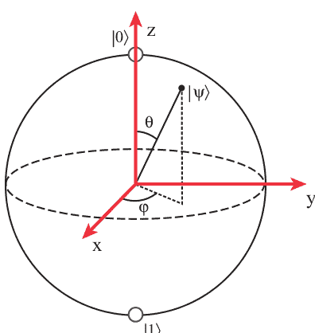

图 8.1 布洛赫球

现在我们可以更彻底地探索布洛赫球表示法。首先，我们需要讨论物理科学中使用的自由度概念。自由度是给定物理系统状态的一个独立物理参数。特定系统的所有可能状态构成该系统的相空间。从另一个角度来看，该相空间的维数就是该特定系统的自由度。

我们之前讨论过概率 \(\alpha\) 和 \(\beta\)。现在我们可以更具体地说明。概率通常被描绘为 Hopf 坐标。Hopf 坐标是 Hopf 纤维化的一部分。Hopf 纤维化（也称为 Hopf 映射）用普通球面来描述四维空间中的超球面。这是数学家 Heinz Hopf 于 1931 年发展起来的。对 Hopf 在拓扑学方面的工作进行全面讨论超出了本著作的范围；然而，为了我们的目的，只需知道在使用复数时，这对于描述球面上的位置（例如我们的布洛赫球）很有用即可。

Hopf 纤维化（也称为 Hopf 映射）描述超球面（即四维空间中的球面）。该描述由圆和一个普通三维球面组成。Hopf 发现从超球面到普通球面的一个多对一连续函数，使得普通球面上的每个不同点都从超球面上的一个不同圆映射而来。

Hopf 的工作在拓扑学和旋量理论中很重要。在对 Hopf 坐标进行如此简要的描述之后，使用它们来描述 \(\alpha\) 和 \(\beta\) 如下所示：

\(\alpha = e^{i\psi} \cos \frac{\theta}{2}\)

\(\beta = e^{i(\psi+\phi)} \sin \frac{\theta}{2}\)

值 \(e^{i\psi}\) 是量子比特的相位状态。有时 \(\alpha\) 被选为实数，只留下两个自由度，从而得出这个公式：

\(\alpha = \cos \frac{\theta}{2}\)

\(\beta = e^{i\phi} \sin \frac{\theta}{2}\)

这些概率需要多加解释。首先，e 值是欧拉数，第 2 章讨论过的一个超越数。符号 \(\phi\) 和 \(\theta\) 是角度。

可以对量子比特执行两种主要操作。第一种是测量。这通常更正式地称为标准基测量。该操作将基于前述概率 \(|\alpha|^2\) 和 \(|\beta|^2\) 得到一个结果，要么是 |0>，要么是 |1>。关键是要认识到，对于量子比特，测量是一个不可逆操作，这与经典比特不同。请记住，在测量之前，量子比特处于叠加状态。测量之后，叠加态坍缩为两个基态之一。

可以对量子比特执行的另一种操作是应用量子逻辑门。我们在第 4 章“量子计算的基础计算机科学”中讨论了经典逻辑门。本章的大部分内容将用于探索量子门，并确保你对其有工作性的理解。

与本书中讨论的许多项目一样，你需要掌握的理解水平因你的目标而异。如果你只是想要对量子操作有一个概括性的理解，那么你必须理解，给定的量子比特在测量时会以特定概率产生 1 或 0。此外，你必须记住，在测量之前，量子比特处于这些状态的叠加之中。

如果你的目标是深入研究量子计算，那么你应该对本节所呈现的所有内容非常熟悉。一些读者可能需要回到第 1 章和第 2 章复习线性代数和复数。

## 8.2 量子门

第 4 章总结了计算机科学的要点，包括逻辑门。逻辑门是计算的一个基本方面。这对量子计算来说依然成立，量子计算需要量子逻辑门。

在量子计算的电路模型中，基本电路是量子门（有时称为量子逻辑门）。这些量子门在量子计算中的作用与经典逻辑门在数字计算中的作用相同。第 4 章简要讨论了量子计算中使用的一些门，但这里将提供更多细节。

经典计算中使用的许多门是不可逆的。逻辑与门是非可逆经典门的一个示例。非门是一个可逆的经典门。一般来说，如果可以从输出向量中唯一地恢复输入向量，并且其输入和输出赋值之间存在一一对应关系，则该门被认为是可逆的。这意味着不仅可以从输入中唯一地确定输出，还可以从输出中恢复输入。

可逆门对于高效计算是必要的。这对经典计算机和量子计算机都适用。经典可逆门的更严谨的数学描述如下：n 位可逆门是从 n 位数据集合 {0,1}n 到其自身的双射映射 f。对一些读者来说，双射一词可能是新的。实际上，有三个相关术语需要定义。这些术语是单射、满射和双射。理解这些术语的一个简单方法是考虑两个点集，我们将称它们为 A 和 B，如图 8.2 所示。

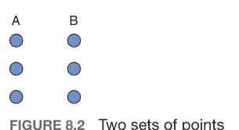

最简单地说，单射意味着 A 中的所有内容都可以映射到 B 中的某些内容，但 B 中可能有与 A 中没有匹配项的内容。满射意味着每个 B 至少有一个匹配的 A，但可能实际上在 A 中有不止一个匹配项。双射意味着每个 A 都有一个 B，反之亦然。更正式地说，它既是单射也是满射。图 8.3 可能有助于你更好地理解这三个术语。

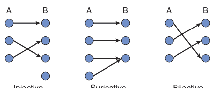

图 8.3 单射、满射和双射

你可能在想这与量子架构有什么关系。双射函数是可逆的。当我们讨论可逆门和电路时，这将很重要。酉矩阵表示量子逻辑门。你会回忆起第 1 章中的矩阵（自那时以来我们多次看到它们）。酉矩阵首先是一个方阵，并且具有复数元素。此外，其共轭转置也是其逆矩阵。回忆第 2 章，共轭转置只是将 a+ib 改为 a–ib，或者反之亦然。你可以在方程 8.1 中看到一个酉矩阵。

| 1/√2 | 1/√2 |
|---|---|
| (1/√2)i | -(1/√2)i |

方程 8.1 酉矩阵

共轭转置如方程 8.2 所示。

| 1/√2 | -(1/√2)i |
|---|---|
| 1/√2 | (1/√2)i |

方程 8.2 酉矩阵共轭转置

关于酉矩阵的一个非常好的资源可以在 https://www.math.tamu.edu/~dallen/m640_03c/lectures/chapter4.pdf 上找到。

### 8.2.1 哈达马德门

也许最广泛讨论的量子门是哈达马德门。它由方程 8.3 中所示的哈达马德矩阵表示。

| 1 | 1 |
|---|---|
| 1 | -1 |

方程 8.3 哈达马德矩阵


此门在第 4 章中被简要讨论过。该矩阵是一个方阵，其元素为 +1 或 -1。它以法国数学家 Jacques Hadamard 命名。请注意，Hadamard 门将 Hadamard 矩阵乘以 \(\frac{1}{\sqrt{2}}\)。回到矩阵本身，你可能会注意到行之间是相互正交的。Hadamard 门作用于单个量子比特。它是量子傅里叶变换的单量子比特版本。当然，这要求我们讨论量子傅里叶变换（QFT）。对于那些只想对量子计算有一个一般理解的读者来说，这是你可能希望浏览，但无需过分担心深入理解的内容。

量子傅里叶变换是量子比特上的一种线性变换。它类似于经典逆离散变换。量子傅里叶变换之所以重要，有很多原因。它不仅与 Hadamard 门相关，而且实际上是几种量子算法的一部分。事实上，Shor 算法使用了量子傅里叶变换。

让我们先回顾一下经典离散傅里叶变换。经典离散傅里叶变换作用于一个向量 (x<sub>0</sub>, x<sub>1</sub>, x<sub>2</sub>, ..., x<sub>n-1</sub>)，将其映射到另一个向量 (y<sub>0</sub>, y<sub>1</sub>, y<sub>2</sub>, ..., y<sub>n-1</sub>)，且两个向量均为复空间的元素。经典离散傅里叶变换使用公式 8.4 中所示的公式。

```
y_k = \frac{1}{\sqrt{N}} \sum_{n=0}^{N-1} x_n \omega_N^{-kn}
EQUATION 8.4 The Classical Discrete Fourier Transform
```

此处 k = 0, 1, 2, ..., n-1。在公式 8.4 中，\(\omega_N = e^{2\pi i/n}\) 且 \(\omega_N^n\) 是 n 次单位根。单位根是任意在被提升为某个正整数幂 n 时结果为 1 的复数。这有时被称为 de Moivre 数，以法国数学家 de Moivre 命名。他以 de Moivre 公式而闻名，该公式将复数与三角学联系起来，同时他也在概率论方面有所建树。

量子傅里叶变换以类似的方式运作，作用于量子态。量子傅里叶变换使用与公式 8.4 中相同的公式。然而，它作用于如公式 8.5 所示的量子态。

```
|x\rangle = \sum_{i=0}^{N-1} x_i |i\rangle \rightarrow \sum_{i=0}^{N-1} y_i |i\rangle
EQUATION 8.5 The Quantum Discrete Fourier Transform Mapping
```

在公式 8.5 中，左侧状态被映射到右侧状态。使用 |x> 作为基本状态，也可以将量子傅里叶变换表达为公式 8.6 中所示的映射。

```
|x\rangle \mapsto \frac{1}{\sqrt{N}} \sum_{k=0}^{N-1} \omega_N^{xk} |k\rangle
```
公式 8.6 量子离散傅里叶变换映射，替代表示

关于量子离散傅里叶变换还可讲更多，但本简要描述足以满足我们的目的。回到 Hadamard 门，它具有 HH† = I 的性质。用文字来说，Hadamard 门与其转置相乘得到单位矩阵。

### 8.2.2 相位移门

相位移门是一组有趣的量子门。相位移门作用于单个量子比特，保持基态 |0> 不变，但将基态 |1> 映射为 e^(iφ)|1>。有趣的是，相位移门在应用后不会改变测量 |0> 或 |1> 的概率。相反，这些门修改量子态的相位，因此得名。公式 8.7 显示了一个通用相位移门。

$$
R_\phi = \begin{bmatrix} 1 & 0 \\ 0 & e^{i\phi} \end{bmatrix}
$$
公式 8.7 相位移门

相位移门在许多地方都有应用，特别是在 transmon 中。transmon 是一种超导充电量子比特，旨在降低对干扰的敏感度。以下是一些关于相位移门的有趣论文：

- https://cds.cern.ch/record/684838/files/0311103.pdf
- https://arxiv.org/pdf/1110.2998.pdf
- https://arxiv.org/pdf/quant-ph/0011013.pdf

### 8.2.3 Pauli 门

回顾我们在第 2 章中关于 Pauli 矩阵的讨论。这三个矩阵是

$$
\begin{bmatrix} 0 & 1 \\ 1 & 0 \end{bmatrix}
$$

$$
\begin{bmatrix} 0 & -i \\ i & 0 \end{bmatrix}
\]

\[\begin{bmatrix} 1 & 0 \\ 0 & -1 \end{bmatrix}\]

这些通常用 σ 符号表示，即：

\(\sigma_1 = \begin{bmatrix} 0 & 1 \\ 1 & 0 \end{bmatrix}\)

\(\sigma_2 = \begin{bmatrix} 0 & -i \\ i & 0 \end{bmatrix}\)

\(\sigma_3 = \begin{bmatrix} 1 & 0 \\ 0 & -1 \end{bmatrix}\)

存在 Pauli 门应该不会让你感到惊讶。事实上，有三种这样的门：Pauli-X、Pauli-Y 和 Pauli-Z。这些门中的每一个都作用于单个量子比特，对其进行变换。

Pauli-X 门是经典 NOT 门的量子等效门。它相当于绕 Bloch 球 x 轴旋转 π 弧度。它将 |0⟩ 变换为 |1⟩，反之亦然。而且你大概可以猜到，Pauli-X 矩阵表示它：

\(X = \begin{bmatrix} 0 & 1 \\ 1 & 0 \end{bmatrix}\)

Pauli-Y 门相当于绕 y 轴旋转 π 弧度。它将 |0⟩ 变换为 i|1⟩，将 |1⟩ 变换为 -i|0⟩。它由 Pauli-Y 矩阵表示：

\(Y = \begin{bmatrix} 0 & -i \\ i & 0 \end{bmatrix}\)

最后，我们来到 Pauli-Z 门。你大概可以猜到，它相当于绕 Bloch 球 z 轴旋转。它是相位移门的一种特例。它保持 |0⟩ 基态不变，但将基态 |1⟩ 映射为 -|1⟩。它由 Pauli-Z 矩阵表示：

\(Z = \begin{bmatrix} 1 & 0 \\ 0 & -1 \end{bmatrix}\)

### 8.2.4 Swap 门

与本节之前讨论的门不同，Swap 门作用于两个量子比特。正如名称所示，它们交换量子比特。它由图 8.4 中所示的矩阵表示。

SWAP = \begin{bmatrix} 1 & 0 & 0 & 0 \\ 0 & 0 & 1 & 0 \\ 0 & 1 & 0 & 0 \\ 0 & 0 & 0 & 1 \end{bmatrix}
图 8.4 Swap 门

Swap 门还有另一个有趣的变体——Swap 门的平方根。这个引人入胜的门本质上执行一个半交换。使其更有趣的一点是，它是一个通用门。如在第 4 章中简要讨论过，这意味着可以使用 Swap 门的平方根构造其他门。考虑一个双量子比特系统，Swap 门的平方根如图 8.4 所示。

### 8.2.5 Fredkin 门

Fredkin 门是由 Edward Fredkin 发明的一种经典计算电路。它是一个通用门。请回顾，这意味着任何逻辑或算术运算都可以完全由 Fredkin 门构造。Fredkin 门的量子版本是一个 3 比特门，执行受控交换；因此，它有时也被称为 CSWAP 门或 cS 门。

### 8.2.6 Toffoli 门

Toffoli 门以发明者 Tommaso Toffoli 的名字命名。这些门也称为 CCNOT 门，是经典计算机的通用可逆逻辑门；它们不用于量子应用。它们有三个输入和三个输出。

本质上，Toffoli 门通过检查输入来工作。如果前两个量子比特处于 |1> 状态，则它在第三个比特上应用 Pauli-X。否则，它什么都不做。这是一个受控门。

### 8.2.7 受控门

虽然存在其他形式的受控门，但使用特定操作作用于量子比特的受控门一般类被广泛使用。例如，受控 NOT 门（通常称为 cNOT 或 cX 门）作用于两个量子比特。如果第一个量子比特为 |1>，则对第二个量子比特执行 NOT 操作。如果第一个量子比特不是 |1>，则第二个量子比特保持不变。假设基态 |00>、|01>、|10> 和 |11>，cX 门可以由公式 8.8 中所示的矩阵表示。

\begin{bmatrix} 1 & 0 & 0 & 0 \\ 0 & 1 & 0 & 0 \\ 0 & 0 & 0 & 1 \\ 0 & 0 & 1 & 0 \end{bmatrix}
公式 8.8 cX 门矩阵

还有受控-U 门。该门也作用于两个量子比特，第一个量子比特是控制比特（因此得名）。受控-U 门的映射如下所示：

```
|00> -> |00>
|01> -> |01>
```

请注意，如果第一个量子比特为零，则没有任何变化。

还有更复杂的门，例如：

```
|10> -> |1> ⊗ U|0> = |1> ⊗ (u_00|0> + u_10|1>)
```

在继续之前，我们必须审视这意味着什么，因为其中一些看起来可能相当奇怪。U 代表 Pauli 矩阵之一（σ_x σ_y σ_z）。如果它是 Pauli-Z 矩阵，那么它就是一个受控 Z 门。因此，u00 意味着将 |00> 输入到特定的 Pauli 矩阵中。有了这个解释，我们就可以完成描述了。

我们现在展示在更复杂的门中使用的 Pauli 矩阵。

```
|11> -> |1> ⊗ U|1> = |1> ⊗ (u_01 |0> + u_11 |1>)
```

正如你所见，这比我们讨论过的一些其他门稍微复杂一些。然而，如果这有助于你理解，你可以将其视为一个受控 Pauli 门。

量子 CNOT（受控 NOT）门的运作方式与图 8.5 中所示类似。

| 输入 | 输出 |
|---|---|
| |00> | |00> |
| |01> | |01> |
| |10> | |11> |
| |11> | |10> |

图 8.5 量子 CNOT

### 8.2.8 Ising 门

Ising 门是非常有趣的门。实际上有三个：XX、YY 和 ZZ 门。这些门实际上通常被称为 Ising 耦合门。它们以 Ernst Ising 命名，他开发了以其名字命名的 Ising 模型。Ising 模型表示原子自旋的磁偶极矩。

Ising 门是由某些量子计算机实现的两量子比特门，特别是那些使用离子阱的量子计算机。我们将在第 9 章讨论更多特定于硬件的问题，例如离子阱。这些门比我们之前讨论过的门更复杂，在


本章。对于普通读者来说，只需理解这些是量子门即可。对于希望深入了解的读者，让我们先来看看这些门的矩阵。这些在公式 8.9 到公式 8.11 中所示。

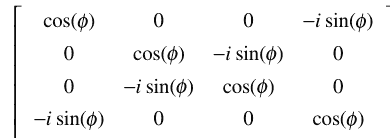

### 公式 8.9 Ising XX 耦合门

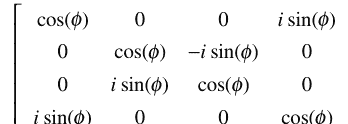

### 公式 8.10 Ising YY 耦合门

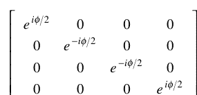

### 公式 8.11 Ising ZZ 耦合门

如您所见，这些都是 4x4 矩阵。为了让您回忆一下，e 是欧拉数，\(\phi\) 是方位角，而 i 当然是虚数单位。三角函数您想必早已熟悉。

### 8.2.9 Gottesman-Knill 定理

讨论量子门时，我们也必须讨论 Gottesman–Knill 定理。该定理由 Daniel Gottesman 和 Emanuel Knill 提出，指出仅由量子比特 Pauli 群的正规化子中的门组成的电路，可以在经典概率计算机上以多项式时间完美模拟。这要求我们定义本书此前未曾遇到的几个术语。Pauli 群可能是最容易定义的。它是一个由单位矩阵和所有 Pauli 矩阵组成的群。接下来，我们必须定义什么是正规化子，以便那些不熟悉群论的读者理解。正规化子可以是以下三个等价项中的任意一个：

- 1. 该子群为正规子群的最大中间子群。
- 2. 该群中与该子群交换的所有元素的集合。
- 3. 该群中诱导内自同构限制为该群自同构的所有元素的集合。

对于数学背景不够扎实的读者来说，第三个定义可能相当艰深。幸运的是，普通读者不需要深入理解什么是正规化子。重要的是，Pauli 群（有时称为 Clifford 群）可以仅使用 CNOT、Hadamard 和相位门生成。因此，稳定器电路可以仅使用这些门来构建。

Gottesman–Knill 定理告诉我们，满足特定条件的量子电路可以在经典计算机上以高效的方式模拟。这实际上是一些当前研究的基础，即在经典计算机上探索量子问题。这是关于 Gottesman–Knill 定理最重要的一点。

## 8.3 更多关于门的内容

现在我们已经至少大致讨论了一些更常见的量子门，让我们深入探讨量子逻辑门的概念。本节稍微技术性一些。取决于您阅读本文的目的，本小节可能对您完全掌握也可能不是至关重要的。

回顾第 4 章的内容以及本章迄今所讨论的内容，逻辑门是什么应该已经很清楚了。它本质上接收比特（或量子比特）并输出比特（或量子比特）。最终，所有计算机操作都必须归结为门操作。在经典计算世界中，这意味着最终归结为二进制逻辑操作。在量子计算世界中，这归结为对量子门的作用。输入量子比特进入门，然后产生输出量子比特。请注意，我故意没有说明量子比特被替换了。在某些操作中，输入可能保持不变。

在量子门世界中，我们需要总是可逆的门。这种特定的可逆性称为幺正映射。现在借用本书此前涵盖的所有数学知识，让我们把这一点用更严谨的形式表达出来。量子门提供了保持 Hermitian 内积的复杂内积空间的线性变换。回顾一下，内积也称为点积。两个向量的内积就是这两个向量相乘。考虑向量 X 和 Y。内积在公式 8.12 中所示。

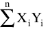

### 公式 8.12 内积

另外还要回顾第 2 章的内容，Hermitian 是指等于其自身共轭转置的方阵。共轭转置意味着先对矩阵进行转置，再取矩阵的共轭。

## 8.4 量子电路

现在我们至少大致介绍了量子门，是时候讨论量子电路了。最简单的解释是，量子电路是量子门的序列。

由于我们在上一节讨论了可逆量子门，自然要考虑可逆量子电路。考虑一种场景，您需要反转 n 个比特的门。我们将这些门称为 A 和 B。如果将它们组合在一起，使得 A 的 k 个输出映射到 B 的 k 个输入，那么您就得到了一个在 n+n–k 个比特上操作的可逆电路。这是可逆量子电路的基本结构。

现在我们可以开始讨论如何绘制此类量子电路了。我们首先需要为可能希望使用的所有各种量子门包含符号。表 8.1 显示了我们在前面部分讨论过的量子门的各种符号。

### 表 8.1 常见门符号

| 门 | 符号 |
| :--- | :--- |
| 哈达马德 | [H] |
| Pauli-X | [X] |
| Pauli-Y | [Y] |
| Pauli-Z | [Z] |
| SWAP | X |
| 相位移 | [S] |
| 托福利 | 带目标的控制线 |
| 弗雷德金 | • * * |
| 受控 | AG |
| 受控非 (CNOT, CX) | • ⊕ |
| 受控 Z | • [Z] |

表 8.1 显示了最常见的门符号。现在我们可以开始讨论量子电路了。让我们从一个非常简单的电路开始——这个电路除了对一个输入进行单次测量外实际上没什么作用，甚至没有任何门。如图 8.6 所示。

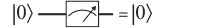

### 图 8.6 最简单的电路

图 8.6 引入了一个我们之前未曾讨论过的符号。即测量符号，如图 8.7 所示。

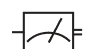

### 图 8.7 测量符号

因此，图 8.7 告诉我们，我们有一个处于 |0⟩ 态的量子比特，经过测量后保持在 |0⟩ 态。接下来，让我们稍微复杂一点。我们有一个量子比特，它经过哈达马德门，然后进行测量以产生某个值。如图 8.8 所示。

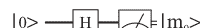

### 图 8.8 一个简单的哈达马德门电路

符号 |m₀⟩ 只是表示测量结果。它可能是 |0⟩ 或 |1⟩。

现在我们可以再扩展一下。多门电路怎么表示？无论测量发生在哪里，这都很容易绘制。目前，让我们忽略“为什么”部分，即您为何要组合特定门，而只考虑如何绘制它们。图 8.9 显示了一个简单的双门图。

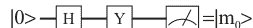

### 图 8.9 双门图

门也可以并行排列。例如，可能有一个 Pauli-X 门和一个 Pauli-Y 门并行，如图 8.10 所示。

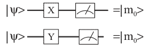

### 图 8.10 另一个双门图

在图 8.10 中，每个量子比特都经过其门，然后进行测量，产生某个值（|1> 或 |0>）。

## 8.5 D-Wave 量子架构

本节从高层次探讨 D-Wave 架构。这是因为两个原因：

- D-Wave 对量子计算的方法与其他供应商不同。
- D-Wave 在量子计算领域非常突出，其架构值得审视。

尽管本节只会从高层次探讨 D-Wave 架构，但 D-Wave 本身在其网站上提供了大量细节，包括任何人都可以阅读的众多文档。

D-Wave 的第一款处理器是一种利用通量量子比特的超导集成电路。通量量子比特是非常小的、通常是微米级的超导金属环，带有若干作为量子比特的约瑟夫森结。约瑟夫森结在两层超导材料之间使用一层非超导材料。这些器件以 Brian Josephson 命名，他因相关工作荣获 1973 年诺贝尔物理学奖。

2011 年 5 月，D-Wave 宣布推出 D-Wave One，配备 128 量子比特处理器。2012 年，一款 512 位 D-Wave 计算机发布。2019 年，D-Wave 宣布推出下一代 Pegasus 量子处理芯片。

D-Wave 系统使用的过程与基于门的量子计算机根本不同。首先，量子比特是超导芯片，而非光子等粒子的实际量子态。其次，计算方法略有不同。D-Wave 使用一种称为量子退火的过程，即在一组候选解上寻找给定函数全局最小值的过程。该过程从所有候选态的量子力学叠加态开始，然后使用时间相关方程向解演化。


您还可以参阅 D-Wave 对量子退火的自有描述，见下文摘录¹：

> "量子退火处理器自然会返回低能量解；某些应用需要真实的最小能量（优化问题），而另一些应用需要良好的低能量样本（概率采样问题）。"

> "**优化问题。** 在优化问题中，我们要在许多可能的组合中寻找最佳方案。优化问题包括调度挑战，例如‘我应该把这个包裹装在这辆卡车上还是下一辆上？’或者‘旅行推销员应该走哪条最高效的路线才能访问不同城市？’"

> "物理学可以帮助解决这类问题，因为我们可以将它们表述为能量最小化问题。物理学的一条基本规则是，万物都倾向于寻求最低能量状态。物体会沿着山丘滑下；热的东西会随着时间冷却。这种行为在量子物理世界中同样适用。量子退火简单地利用量子物理学来寻找问题的低能量状态，从而找到最优或近似最优的元素组合。"

> "**采样问题。** 从众多低能量状态中进行采样并表征能量景观的形状，对于构建现实概率模型的机器学习问题很有用。这些样本提供了关于给定参数集下模型状态的信息，然后可以用来改进模型。"

概率模型通过考虑我们知识中的缺陷和错误，明确处理不确定性。

### 8.5.1 SQUID

D-Wave 方法的核心是超导量子比特（SQUID）。它相当于经典计算机中的晶体管。SQUID 一词来源于全称 Superconducting QUantum Interference Device。SQUID 使用前述的约瑟夫森结。SQUID 有两种类型：直流（DC）和射频（RF）。

再次，参考 D-Wave 对 SQUID 的自有描述可能很有用，见此摘录：

> "量子计算机与这一 CMOS 晶体管概念既有相似之处，也有不同之处。图 1 展示了所谓的超导量子比特（也称为 SQUID）的示意图，它是量子计算机的基本构建块（如果你愿意，可以称其为量子‘晶体管’）。SQUID 名称来源于短语 Superconducting QUantum Interference Device。术语‘干涉’是指电子——它们在量子波内表现为波，干涉图样产生量子效应。支持此类结构中的量子效应（如电子波）——使其能够表现为量子比特——的原因，在于其制造材料的特性。图中的大环由一种名为铌的金属制成（与主要由硅制成的传统晶体管形成对比）。当这种金属冷却时，它就会变成所谓的超导体，并开始表现出量子力学效应。"

"普通晶体管允许你编码 2 个不同的状态（使用电压）。超导量子比特结构则将 2 个状态编码为微小的磁场，这些磁场要么向上，要么向下。我们将这些状态称为 +1 和 −1，它们对应量子比特可以在两者之间‘选择’的两个状态。利用这些结构可用的量子力学，我们可以控制这个对象，使量子比特进入这两个状态的叠加，如前文所述。因此，通过调整量子计算机上的控制旋钮，你可以将所有量子比特置于叠加态，其中它尚未决定成为哪个 +1、−1 状态。"

"要从单个量子比特发展到多量子比特处理器，量子比特必须相互连接，以便能够交换信息。这是通过使用被称为耦合器的元素来实现的。耦合器也由超导环制成。通过将许多这样的元素（量子比特和耦合器）组合在一起，我们可以开始构建可编程的量子器件结构。图 2 展示了 8 个连接量子比特的示意图。前一张图中显示的环现在已被拉伸形成一个长方形的金色矩形。在矩形交叉的点上，耦合器以蓝点示意图形式显示。"

关于 D-Wave 方法最重要的是要意识到，尽管它与其他方法截然不同，但在制造稳定的工作系统方面已取得了显著成功。

## 8.6 摘要

在本章中，我们探讨了量子架构的基础知识。我们的主要关注点是量子门和电路。然而，我们还探讨了量子退火及相关方法。本章中的材料为第 9 章和第 10 章奠定了基础。在继续下一章之前，您需要对量子比特的附加细节感到熟悉，并对量子门和电路有工作知识。

## 测试你的技能

## 复习问题

- 1. ____________ 作用于单个量子比特，保持基态 |0> 不变，但将基态 |1> 映射为 e^{i\phi} |1>。
- a. 哈达马德门
- b. 相位移门
- c. 泡利门
- d. 托福利门

- 2. 两个向量被视为标准正交所需的属性是什么？
- a. 单位长度
- b. 使用 bra-ket 记法
- c. 归一化
- d. 标准正交

- 3. ____________ 规定，在特定点找到粒子的概率密度与该点粒子波函数的模的平方成正比。
- a. Hilbert 空间
- b. Hilbert 规则
- c. Schrödinger 方程
- d. Born 规则

- 4. ____________ 规定，仅由量子比特 Pauli 群的正规化子中的门组成的电路，可以在概率经典计算机上以多项式时间完美模拟。
- a. Schrödinger 方程
- b. Gottesman–Knill 定理
- c. Born 规则
- d. 相位移

- 5. 一个 ______ 门提供复数内积空间的线性变换，保持厄米内积。
- a. Hadamard
- b. Pauli
- c. Quantum
- d. Ising

- 6. 以下符号表示什么？
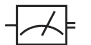
- a. Hadamard 门
- b. 测量
- c. Toffoli 门
- d. 相位移
