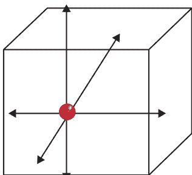
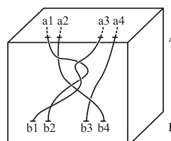

# 量子硬件

## 章节目标

阅读本章并完成复习问题后，您将能够：

- 阐述不同的量子比特存储技术
- 理解退相干
- 解释减轻退相干的方法
- 展示量子网络的工作知识

本章探讨量子计算机的物理实现。在之前的章节中，我们探讨了量子比特；在本章中，我们将探讨量子计算机的物理实现。还将涵盖退相干。理解量子比特的实现以及退相干的作用是本章最重要的主题。

除了量子计算的这些基本方面，我们还将探讨量子网络以及目前仍属于理论的主题，例如拓扑量子计算。本章应使您对量子计算的物理元素有总体了解。

## 9.1 量子比特

第 8 章“量子架构”从数学角度详细讨论了量子比特；然而，它没有涉及量子比特如何实际物理实现的问题。需要的是任何具有两个状态的量子力学系统。这两个状态将用于表示 1 或 0。本节介绍几种具体的物理实现量子比特的方法。

在探讨量子比特的具体物理实现之前，应先讨论一些关于量子比特的一般事实。正如本书前面详细介绍过的，量子比特本质上是概率性的


本性。这意味着它们在计算中容易出错。我们将在第10章“量子算法”中探讨纠错算法。除了量子比特的概率性本质之外，还有它们对环境噪声的敏感性，我们将在本章后面探讨。

我们现在必须解决的一个重要事实是，实现一个逻辑量子比特需要多少个物理量子比特。你可能会自然地认为这是一一对应的关系；然而，这一假设是不准确的。没有特定的相关公式；然而，通常需要几个物理量子比特来实现一个逻辑量子比特。例如，Shor的纠错码通过在九个物理量子比特中编码一个逻辑量子比特来工作。该系统基于以三个量子比特为一组的重复码。公式9.1说明了逻辑状态的一般定义。

```
|0_L\rangle = (|000\rangle + |111\rangle) \otimes (|000\rangle + |111\rangle) \otimes (|000\rangle + |111\rangle)
|1_L\rangle = (|000\rangle - |111\rangle) \otimes (|000\rangle - |111\rangle) \otimes (|000\rangle - |111\rangle)
```

### 公式 9.1 Shor的纠错码

本质上，该过程通过一种“多数表决”方式工作，以便发现任何意外的比特或相位翻转。同样，这不是一个可以应用于所有情况的公式。你并不总是需要九个物理量子比特来创建一个逻辑量子比特。然而，需要多个物理量子比特才能使一个逻辑量子比特工作是相当常见的。

第8章讨论了逻辑量子比特和门；然而，逻辑量子比特与物理量子比特之间没有一一对应的比较。换句话说，一个逻辑量子比特不等于一个物理量子比特。体现一个逻辑量子比特所需的物理量子比特的具体数量各不相同。例如，Shor的纠错码（也称为重复码）通过将逻辑量子比特编码为九个物理量子比特来工作。其他一些场景使用最少三个物理量子比特来实现一个逻辑量子比特。问题是纠错。物理量子比特非常容易出错。

### 9.1.1 光子

光子常用于创建物理量子比特，数据（1或0）由偏振决定。水平偏振为|0>，垂直偏振为|1>。偏振方法是使用光子作为量子比特的常用方法。这就是使用偏振来编码量子比特的本质。

光子可以被描述为具有水平或垂直偏振。一些来源将右旋或左旋圆偏振称为圆偏振。一般来说，偏振指定了横波的几何取向。横波是振动方向垂直于波传播方向的波。在这里，垂直一词与横波同义。横波的运动可以用以下公式描述：

```
s(p,t) = Au sin \left( \frac{t - (\rho - 0) \frac{d}{\nu}}{T} + \phi \right)
```

在此公式中，各值如下：

- d 是传播方向。
- o 是传播介质中的参考点。
- A 是波幅。
- v 是传播速度。
- T 是周期。
- \(\phi\) 是参考点 o 处的相位。
- p 是位置/点。
- t 是时间。

这主要是线偏振的描述。

圆偏振允许沿传播方向d存在多个独立的位移方向。虽然光在偏振讨论中常被使用，但任何电磁波都可以具有偏振。

除了圆偏振和线偏振之外，还有其他形式的偏振（例如，椭圆偏振）。任何偏振电磁波，只要其场向量的末端定义了位于固定交叉平面内且垂直于传播方向的椭圆，就是椭圆偏振。

另一种与光子一起使用的方法是使用时隙编码来编码量子比特。该过程涉及将单个光子通过马赫-泽德干涉仪进行处理。该干涉仪是一种装置，它获取由单个光源分割出的两束光，并确定它们之间的相对相位移变化。当光子进入干涉仪时，它将被引导沿两条路径中的一条行进。一条路径比另一条长，且两条路径之间的差值必须长于光子的相干长度。相干长度是相干电磁波可以保持特定相干程度的传播距离。

光子选择两条路径中的一条。较短的路径（即光子较早到达）指定状态|0>，而较长的路径指定状态|1>。

使用光子的一种变体是线性光学量子计算（LOQC）。这是一个系统，而非单个量子比特，它使用光子探测器以及镜子和波片等其他光学仪器。光子仍然是信息的载体。有兴趣的读者可以在以下来源了解更多有关LOQC的信息：

- https://arxiv.org/abs/quant-ph/0512071
- https://arxiv.org/abs/1305.3592
- https://inspirehep.net/literature/773113

2020年，哈佛大学的研究人员提出了一种使用光子作为量子比特的新方法。在他们的提议方法中，量子比特将是一个单个原子，原子的光子作为信息载体。为了在量子计算中使用光子，光子必须相互作用；然而，在正常条件下，光子不会与自身相互作用。哈佛团队提出使用镜子将原子产生的光子反射回原子，以便它们与原子相互作用。截至撰写本文时，这仍是一个理论提议，尚未在物理设备中实现。

### 9.1.2 电子

电子和光子是实现量子比特的两种最明显的方式。电子量子比特使用某些属性（如电子自旋）来指示量子比特的状态。例如，上自旋可以指定状态|0>，下自旋可以指定|1>。

使用电子存储量子比特还有其他变体。1997年，David DiVencenzo和Daniel Loss提出了一种量子计算机类型，它使用限制在量子点中的电子自旋自由度来物理实现量子比特。这现在被称为Loss-DiVincenzo量子计算机。_quantum dot_一词实际上来源于纳米技术。只在一维上处于纳米尺度的器件被称为量子阱。在两维上处于纳米尺度的器件称为量子线。在三维上都处于纳米尺度的器件被称为量子点。Loss-DiVencenzo使用限制在三维纳米器件中的电子来实现量子比特。

其他研究人员专注于特定介质中电子的量子态。例如，冲绳科学技术研究生院一直在研究在液态氦中使用电子。数据表明，液态氦中的电子自旋态将保持更长的相干时间。读取量子比特中的数据基于检测不同的里德伯态。里德伯态是遵循里德伯公式的激发态。当然，这需要理解一些额外的术语。_激发态_是任何能量高于绝对最小值（即基态）的量子态。Johannes Rydberg的工作，即里德伯公式，计算了化学元素中谱线的波长。该模型后来由Niels Bohr改进。

里德伯公式的细节对于你理解量子比特并非绝对必要，但对于感兴趣的读者，这里提供了这些细节。首先，该公式依赖于里德伯常数，氢的符号为RH。然后，这里给出了里德伯公式（再次以氢为例）：

```
\frac{1}{\lambda} = R_H \left( \frac{1}{n_1^2} - \frac{1}{n_2^2} \right)
```

在此公式中，各值如下：

- RH 是里德伯常数。
- λ 是真空中电磁辐射的波长。


- n1 是能级的主量子数。
- n2 是原子电子跃迁能级的主量子数。

用更简单的话来说，里德伯公式预测了原子中电子改变能级时产生的光的波长。你可能还记得第 3 章“量子计算的基础物理学”中提到的主量子数。

2020 年，新南威尔士大学的研究人员与魁北克省谢布鲁克大学和芬兰阿尔托大学的同事合作，宣布了一种相当新颖的量子比特方法。研究人员创建了具有正常电子壳层（有关电子壳层的回顾请参见第 3 章）但没有原子核的人工原子。由于没有原子核，因此也没有正电荷，团队使用电极来提供正电荷。量子比特被实现在直径为 10 纳米的量子点中（回顾一下，量子点是在三个维度上都处于纳米级的器件）。研究人员推测，将多个电子而非单个电子作为量子比特，将提供一个更强健的量子比特。

### 9.1.3 离子

受阻离子也可用作量子比特的物理实现。量子比特值作为每个离子的电子状态存储。这当然需要稳定的离子。幸运的是，存在若干这种稳定的离子。用于量子计算中受阻离子的一种常用方法是 Paul 离子陷阱，以 Wolfgang Paul 命名。不，对于那些敏锐的读者来说，这并非 Wolfgang Pauli 的拼写错误。这是两位不同的物理学家。Wolfgang Pauli 因保利不相容原理于 1945 年获得诺贝尔物理学奖。Wolfgang Paul 于 1989 年因开发用于研究孤立原子和亚原子粒子的方法而获得诺贝尔物理学奖，这与我们当前的兴趣直接相关。

捕获离子比人们最初想象的要困难一些。必须考虑 Samuel Earnshaw 在 1842 年证明的 Earnshaw 定理。该定理基本上指出，带电粒子不能仅靠静电力保持在稳定平衡状态。对于希望获得更严谨数学描述的读者，让我们更正式地表述一下：拉普拉斯方程在自由空间中没有具有局部极小值或极大值的解。存在鞍点，即函数图像中正交方向上的导数（即斜率）均为零但并非函数局部极值点的点。所有这些意味着，仅靠静电力，不可能存在稳定平衡。

这让我们回到 Paul 离子陷阱。该陷阱使用振荡于射频的电场。假设频率具有合适的振荡频率和场强度，带电粒子将被捕获在上述鞍点处。对于希望了解 Paul 离子陷阱和鞍点工作原理的更多细节的读者，有 Mathieu 函数。离子在鞍点处的运动由 Mathieu 函数描述。这些函数是 Mathieu 微分方程的解，最早由 Emile Mathieu 提出。微分方程是

```
$$\frac{d^2y}{dx^2} + (a - 2q \cos 2x)y = 0$$
```

其中 a 和 q 是特定于特定应用程序的参数。

这不是跟随本书学习所绝对必须掌握的内容，而是为希望深入了解的读者提供的。这也表明，如果没有更深入的数学（包括微分方程），在量子计算方面的深入研究是有限度的。有关 Mathieu 微分方程的更多详细信息，感兴趣的读者可以参考以下来源：

- http://pi.math.cornell.edu/~rand/randpdf/AMR.pdf
- https://cds.cern.ch/record/828858/files/978-3-540-26576-4_BookBackMatter.pdf

Paul 离子陷阱并非最初的离子陷阱。第一个实现由 Ignacio Cirac 和 Peter Zoller 于 1995 年提出。他们提供了一种使用受阻离子系统实现受控-NOT 门的机制。

### 9.1.4 NMRQC

核磁共振量子计算（NMRQC）是一种非常有趣的物理实现量子计算机的方法。该方法利用分子内核的自旋状态来表示量子比特。这些状态通过核磁共振来探测，因此得名。该系统本质上是核磁共振光谱学的一种变体。

这一过程有两种方法。最初，分子处于液态，这被称为液态核磁共振。然而，现在更常用的是固态分子。这被称为固态核磁共振。一个例子是金刚石晶格中的氮。晶体结构使得单个量子比特的定位变得容易得多。这种变体依赖于氮空位中心。钻石中一种点缺陷是当最近邻氮原子取代碳原子时发生，导致晶格中出现空位。

无论使用液态还是固态，利用核自旋进行量子计算的想法于 1997 年被提出。2001 年，IBM 能够在七量子比特 NMRQC 上实现 Shor 算法。

1998 年，Bruce Kane 提出了一种本质上是量子点（将在本章后面讨论）和 NMRQC 之间的混合体的量子计算机。您可以在以下来源了解更多关于 Kane 量子计算机的信息：

- https://www.nature.com/articles/30156
- https://permalink.lanl.gov/object/tr?what=info:lanl-repo/lareport/LA-UR-02-4626

### 9.1.5 Bose-Einstein 凝聚态量子计算

一种迷人的量子计算方法是使用 Bose-Einstein 凝聚态来在多个小型量子计算机之间进行通信。该概念类似于当前的多核处理器。Bose-Einstein 凝聚态（BEC）是一种物质状态，当由玻色子组成的气体冷却到非常接近绝对零度的温度时形成。玻色子可以是基本粒子或复合粒子。玻色子是携带力并具有整数自旋的粒子。标准模型中有四种携带特定力的测距玻色子：

- 光子
- 胶子（实际上存在不同类型的胶子）
- 带电弱玻色子（这种玻色子有两种类型）
- 中性弱玻色子

此外，还有您无疑听说过的希格斯玻色子。测距玻色子简单来说就是携带某种基本力的玻色子。正如您从前面的列表中可以看到，每种基本力都对应一种不同的测距玻色子。

为了澄清涉及的一些粒子物理学，这里简要概述了各种粒子。基本粒子有三种基本类型：强子、玻色子和费米子。这些可以进一步细分。例如，费米子包括所有夸克和轻子。我们在前面的章节中讨论过夸克。轻子是具有半整数自旋的基本粒子。例如电子、缪子和陶子。事实上，轻子分为两个家族，如表 9.1 所示。

| 带电 | 中性 |
|---|---|
| 电子 | 电子中微子 |
| 缪子 | 缪子中微子 |
| 陶子 | 陶子中微子 |

强子由夸克和/或反夸克组成。您无疑熟悉强子。最常见的两个例子是质子和中子。

回到玻色子，它们要么是基本的，要么是复合的。光子是基本玻色子的一个好例子。介子是复合玻色子——本质上是由夸克和/或反夸克组成的粒子。

现在我们已经介绍了关于粒子的一些基本事实，让我们回到 BEC 计算。这种量子计算方法的概念是将计算问题划分到多个小型量子计算机中。每个单独的量子计算机使用 BEC 云来传递信息。人们认为这种方法可以改善退相干问题。感兴趣的读者可以在以下来源深入了解 BEC 计算：

- https://physics.gatech.edu/news/bose-einstein-condensates-evaluated-communicating-among-quantum-computers
- https://physicsworld.com/a/citizen-scientists-excel-at-creating-bose-einstein-condensates/
- https://cds.cern.ch/record/403945/files/9910073.pdf


### 9.1.6 GaAs 量子点

砷化镓（GaAs）常用于创建量子点。量子点是一个在三个维度上都为纳米尺度的器件。GaAs 量子点中的电子自旋受到有效磁场的作用。该磁场称为 Overhauser 场。Overhauser 效应是一种核效应，当一组核的核自旋极化转移到另一组核时会发生。这是通过交叉弛豫实现的。交叉弛豫的细节超出了我们当前讨论的范围；然而，一般过程是：在均匀磁场中对某些样品施加 RF（射频）脉冲（或一系列脉冲），并将核的共振频率转移到另一组核。

通常，该场具有随机的大小和方向，测量是通过对多次实验运行进行平均来进行的。碰巧的是，核自旋的演化速度比电子自旋慢，这意味着在足够短的时间内，Overhauser 场是静态的。这使得电子自旋可以用于信息目的。已有大量利用该技术的单量子比特实验。

表 9.2 总结了我们讨论过的物理实现量子比特的不同方法。

| 方法 | 简要描述 |
| :--- | :--- |
| 光子 | 水平偏振为 |0>，垂直偏振为 |1>。偏振方法是使用光子作为量子比特的常用方法。 |
| 线性光学量子计算（LOQC） | 这是一个系统而非单个量子比特，它使用光子探测器以及镜子和波片等其他光学仪器。光子仍然是信息的载体 |
| 电子 | 电子量子比特使用某些属性（如电子自旋）来指示量子比特的状态。例如，向上自旋可指定状态 |0>，向下自旋可指定 |1>。 |
| 离子 | 量子比特值存储为每个离子的电子状态。 |
| 核磁共振量子计算 | 这种方法利用分子中核的自旋状态来表示量子比特。这些状态通过核磁共振来探测，因此得名。 |
| 玻色-爱因斯坦凝聚量子计算 | 玻色-爱因斯坦凝聚体用于多台小型量子计算机之间的通信，类似于多处理器计算机。 |
| GaAs 量子点 | 量子点是一个在三个维度上都为纳米尺度的器件。GaAs 量子点中的电子自旋受到有效磁场的作用。 |

## 9.2 需要多少个量子比特？

由于许多变量会影响答案，这个问题很难回答。但是，可以给出一些一般性指导。一般来说，人们认为破解 2048 位 RSA 需要大约 4000 个量子比特。同时认为，有效的机器学习需要 1000 个量子比特。我们将在第 11 章“当前非对称算法”中更深入地讨论 RSA 的破解。

当然，需要多少个量子比特也取决于希望以何种速度破解相关算法。Google 的研究员 Craig Gidney 和瑞典皇家理工学院的 Martin Ekera 证明，2000 万个量子比特可以在八小时内破解 2048 位 RSA。您可以在 https://cacm.acm.org/news/237303-how-quantum-computer-could-break-2048-bit-rsa-encryption-in-8-hours/fulltext 上了解他们工作的更多信息。

这实际上远好于之前的估计。之前估计破解 2048 位 RSA 密钥需要十亿个量子比特。对于破解 RSA，一切都在于因式分解。早在 2012 年，研究人员就使用四个量子比特对数字 143 进行了因式分解——要点是，对“完成 X 需要多少个量子比特”这个问题的任何答案都必然是一个非常粗略的估计。需要考虑许多参数；然而，事实仍然是，就撰写本文时而言，我们拥有的量子计算机根本不够强大。

## 9.3 应对退相干

我们在这本书中多次讨论过退相干，特别是在第 6 章“基本量子理论”中。本节深入探讨退相干，然后研究如何在量子计算中减轻它。在第 10 章中，我们将研究纠错算法，但在本章中，我们将考虑减轻退相干的物理机制。

为了更好地理解退相干，请考虑一个由 N 个粒子组成的系统，其中 xᵢ 是三维空间中的一个点。该系统可以用波函数表示：

```
ψ(x₁, x₂, x₃ ⋯ xₙ)
```

请回顾，ψ 是波函数。

第 6 章讨论了波函数，如方程 9.2 所示，并在随后的段落中再次简要描述。

```
|ψ⟩ = Σᵢ cᵢ|ϕᵢ⟩
```

### 方程 9.2 波函数

再次说明，ψ 符号表示波函数。Σ 符号是其后内容的求和。ϕᵢ 表示可能的量子状态。i 用于枚举这些可能的状态，例如 ϕ3、ϕ2、ϕ3 等。cᵢ 值（c₁、c₂、c₃ 等）是概率系数。使用字母 c 是因为这些值由复数表示。

因此，对于 N 粒子系统，每个粒子都有一个波函数。系统相空间的有效维度是自由度的数量。为了更好地理解自由度，让我们首先考虑一个非常简单的例子。考虑一个实际上是一维的系统——管中的一个球，如图 9.1 所示。当然，我们知道球和管都是三维物体，但球只能沿一个维度移动。


### 图 9.1 一维运动的球

这个球可以用两个参数完全描述：位置和速度。因此，它有两个自由度。你应该注意，有些文本只将位置作为自由度，并将位置和速度描述为相空间的维度。

如果我们继续这个类比，并允许球在三维空间中移动，如图 9.2 所示，那么现在有六个自由度。



### 图 9.2 三维运动的球

现在，如果我们用粒子替换球，那么系统中每个粒子都有六个自由度。迄今为止，我们只是将“球”视为一个点。我们知道粒子实际上是波函数。

当两个系统相互作用时，它们的状态向量不再局限于各自的相空间。还要注意，环境本身也可以是一个系统。事实上，当环境作为第二个系统时，会发生最大的干扰。当系统与外部环境相互作用时，联合状态向量（即两个系统的状态向量）的维度会显著增加。这时 Wigner 分布成为一个因素。

请回顾第 6 章，Wigner 分布用于将薛定谔方程中的波函数与相空间中的概率分布联系起来。如方程 9.3 所示。

```
W(x, p) = def 1/(πħ) ∫_{-∞}^{∞} ψ*(x + y)ψ(x - y)e^{2ipy/ħ} dy
```

### 方程 9.3 Wigner 分布

还要回顾第 6 章中对该公式的描述。W 只是表示 Wigner 分布。x 值通常是位置，p 是动量，但它们可以是任何一对值（信号的频率和时间等）。你知道 ψ 是波函数，ħ 是约化普朗克常数。你还应该记得，∫ 符号表示积分。

所有这些意味着，在某种程度上，量子系统中的退相干是不可避免的。请回顾第 3 章中讨论的双缝实验。干扰，因此退相干，很容易发生。这导致了试图减轻退相干的非常重大的问题。更具挑战性的是，2020 年发现宇宙射线可以干扰量子状态，从而导致至少在某些场景中发生退相干。

理论上，如果量子系统与外部环境完全隔离，它可以无限期地保持相干性；然而，没有任何系统能与其环境完全隔离。甚至已被证明，宇宙射线和背景环境辐射会导致量子计算机中的退相干。甚至量子计算系统与其环境之间也可能发生纠缠。

除了外部环境之外，系统本身也可能是一个问题。例如，实现量子门等所需的物理设备由具有量子性质的原子和粒子构成。一般来说，许多系统只能保持相干性几微秒到几秒钟。

控制退相干的问题与量子纠错的问题密切相关。我们将在第 10 章中探讨量子纠错；然而，退相干和纠错都会影响量子计算的可靠性。问题在于量子计算机是否能够执行长时间计算，而不让噪声（无论来自退相干还是其他来源）使输出变得无用。请记住，量子比特本质上是概率性的。

随着量子计算规模的增加，退相干问题只会加剧。系统拥有的量子比特和量子门越多，它就越容易受到退相干的影响。这是因为有更多的组件可以相互干扰。这就是为什么量子计算机的规模（例如 IBM 于 2019 年 10 月宣布的 53 量子比特系统）如此重要。然而，规模只是问题的一部分。这些量子比特能够抵御退相干的时间同样重要。显然，量子计算机必须保持相干性足够长的时间才能进行有意义的计算。


### 9.3.1 超冷

一种用于帮助对抗退相干的方法是超冷却到开尔文的一小部分。事实上，有些系统冷却到几纳开尔文。如果您不熟悉或不记得开尔文标度，0开尔文相当于-273.15摄氏度或-459.67华氏度。这不是任意的。0开尔文这个点是绝对零度，这意味着根本没有热能。因此，纳开尔文字面上是绝对零度以上一小部分的度数。为了提供一些背景，太空中的温度约为2.7开尔文。显然，靠近恒星等热源会改变这一点。冥王星表面骤降至约40开尔文。因此，量子计算依赖于比冥王星冷得多，甚至比深空更冷的温度。

需要超冷却的原因在下面的引语中表达：

> “在极低温下，原子和分子只是移动得少一些。一般来说，温度越低，分子就越稳定。移动减少意味着释放的能量更少。在分子层面，这意味着飞来飞去的能量更少，从而（由于电压和能量直接相关）电压的波动性更低。这反过来意味着，人类控制之外的某些因素导致量子比特电压骤增，进而导致量子比特从一个量子状态翻转到另一个量子状态的几率更小。因此，保持计算机冷却可以减少引入系统的能量。这将量子比特在量子状态之间错误翻转的几率降至最低。”¹

为了让您了解量子计算中实际使用的温度，请考虑现有系统的温度。截至2020年10月，IBM 50量子比特计算机的起始温度约为800毫开尔文，冷却到10毫开尔文。D-Wave的工作温度约为0.1833开尔文。正如我们所见，这些温度比深空还要冷。

2020年，澳大利亚新南威尔士大学的研究人员能够在1.5开尔文下进行量子计算。² 这被称为“热”量子比特。您可能已经推断，维持如此低温需要消耗大量电力。同样，在2020年，研究人员开发出了在1开尔文下运行的量子芯片。³

- https://www.qats.com/cms/2019/08/02/quantum-computing-cooling/
- https://www.engadget.com/2018-01-09-this-is-what-a-50-qubit-quantum-computer-looks-like.html
- https://www.newscientist.com/article/2240539-quantum-computer-chips-demonstrated-at-the-highest-temperatures-ever/

### 9.3.2 应对噪声

与退相干密切相关的是噪声概念。事实上，一些来源将噪声和退相干同义使用。您可能已经推断，这不是指实际的音频信号。在更广义的意义上，噪声是任何对计算结果产生有害影响的问题。这可以是错误、故障，或者，是的，退相干。

IBM的科学家对解决噪声问题有一种有趣的方法。他们的方法有点反直觉。他们发现，使用噪声放大技术有助于提高量子计算机的准确性。这字面上意味着，他们以不同的噪声水平重复特定的计算。这使他们能够高精度地估计，在完全没有噪声的情况下结果会是什么样子。有兴趣的读者可以在以下资源中了解更多关于此技术的信息：

- https://www.ibm.com/blogs/research/2019/03/noise-amplification-quantum-processors/
- https://venturebeat.com/2019/03/27/ibms-quantum-computation-technique-mitigates-noise-and-improves-accuracy/

### 9.3.3 过滤噪声

以色列一支研究团队提出了另一种减轻退相干的有趣方法。研究人员首先将单个光子射向原子并研究结果。当光子击中原子时，它们会被偏转。如果光子自旋与其路径没有对齐，那么光子和原子就会纠缠。但是，如果光子自旋与其路径对齐，光子就不会与原子纠缠。这个实验表明，为入射辐射（即光、宇宙射线等）创建某种过滤机制，可以大大降低这些入射粒子与量子比特纠缠并导致退相干的概率。

## 9.4 拓扑量子计算

拓扑量子计算至少目前仍是理论性的；然而，它具有巨大的潜力，因此应该进行研究。要理解拓扑量子计算机，您首先必须至少对辫论有一些一般性的了解。其细节在数学上相当高级。要对拓扑量子计算有一个一般性的了解，并非必须掌握所有细节。因此，本主题将分为两个部分。第一部分将是您需要知道的要点。第二部分将为感兴趣的读者提供更多细节。显然，第一部分将相对简短。

### 9.4.1 基础辫论

辫论通常通过考虑线条或字符串来解释。考虑两个平面，A和B，分别有点a1、a2；b1、b2；等等。然后考虑连接平面中点的字符串，如图9.3所示。



图9.3 辫子

将连接平面A中点到平面B中点的线条视为字符串。辫子是连接一个表面（在此例中为平面A）到另一个表面（在此例中为平面B）的n条字符串的交织，使得每条字符串都不会回溯到其起点。可以把字符串想象成从平面A“掉落”到平面B。辫群是等价辫子的集合。什么是等价？虽然您可以以不同的方式扭转它们，但如果字符串连接相同的起点和终点，则它们是等价的。

### 9.4.2 关于辫论的更多内容

辫论基于辫群。辫子是由n-辫子的等价类和这些群的生成元形成的群。辫群基于n-链，因此记作Bn。让我们先考虑至少两维的连通流形。我们将这个流形称为X。流形是在每个点附近类似于欧几里得空间的拓扑空间。“类似”这个词有点不精确。更准确的说法是，它是同胚的。同胚是在拓扑空间之间具有连续反函数的连续函数。更简单地说，如果两个空间是同胚的，那么在这两个空间之间存在一种保留所有拓扑性质的映射。因此，n维流形（称为n-流形）是这样的拓扑空间：每个点都有一个与n维欧几里得空间同胚的邻域。

### 9.4.3 关于拓扑计算的更多内容

现在我们对辫子是什么有了一些概括性的了解，可以回到讨论拓扑计算。这种计算使用称为任意子的准粒子。

准粒子不是电子、质子或中子。您可能从名称就猜到了。这些是当固体等系统表现得好像包含一些真空中不同弱相互作用粒子时出现的涌现现象。准粒子仅存在于具有许多相互作用粒子的系统中。任意子是仅存在于二维系统中的特定类型准粒子。

拓扑计算使用任意子的世界线来形成辫子。世界线是物体在四维时空中描绘的路径。与仅讨论轨迹不同，世界线包含时间维度，正如其名称所暗示的那样。然后这些辫子被用作逻辑门。据信，拓扑量子计算机比其他量子计算方法更稳定。目前尚未实现拓扑计算机的物理实现；目前为止，它仍是理论性的。

## 9.5 量子要点

量子计算机包含多个元素，每个元素都将在本节中探讨。这些是所有量子计算机中常见的通用组件。

### 9.5.1 量子数据平面

简单来说，量子数据平面是物理量子比特所在的位置。这还需要支持量子比特和量子门操作所需的硬件和电路。除了物理表示量子比特之外，量子数据平面还必须包含支撑结构。


### 9.5.2 测量平面

有些人会将测量平面视为量子数据平面的一部分；然而，它至少在概念上是分离的。

这是负责测量量子比特的硬件。

这有时也被称为控制和测量平面。

此测量平面负责执行量子比特操作所需的控制信号，以及接收和处理量子比特测量的输出。

### 9.5.3 控制处理器平面

此层识别并触发特定的门操作以及测量。

换句话说，控制处理器平面将执行由主机处理器提供的程序代码。

有些来源称其为控制处理器平面和主机处理器，这是由于与处理器的紧密耦合。

## 9.6 量子网络

量子网络与量子计算机密切相关。

这与经典计算机与传统计算机网络之间的关系非常相似。

量子网络背后的概念是利用量子物理学传输信息。

量子网络上的节点是一个或多个量子比特的量子处理器。

通信线路可以各不相同，但已使用光纤。

如果要与超过两个节点进行通信，则需要切换机制。

第 7 章“量子纠缠和 QKD”讨论了量子密钥交换。

类似技术也可用于量子通信。

交换的不是密钥的比特，而是消息的比特。

### 9.6.1 东京 QKD

东京 QKD 网络是一个使用与量子密钥交换类似技术的量子网络示例。

该网络采用三层架构。

量子层由生成安全密钥的点对点量子链路组成。

中间层负责密钥管理。

然后，通信层处理安全视频链路等标准通信。

本质上，该网络依赖量子层来实现安全性。

通过在东京大手町（东京的一个区）和小金井之间设置安全电视会议，已证明了这一点。

距离为 28 千米，如图 9.4 所示。


图 9.4 东京 QKD

### 9.6.2 北京-上海量子链路

2017 年，中国宣布北京和上海之间建立 2000 千米量子光纤链路连接，如图 9.5 所示。


图 9.5 北京–上海链路

在此链路的初步演示中，中国科学院院长通过量子链路进行了多次视频电话通话。

这是中国正在进行的许多类似项目之一。

### 9.6.3 墨子卫星

2016 年，中国发射了墨子卫星。

该卫星的目的是促进量子通信。

该项目始于中国科技大学物理学家潘建伟的工作。

2017 年，该卫星用于在北京和奥地利维也纳之间建立安全视频会议。

该卫星用于密钥交换，以促进安全视频会议。

距离为 7456 千米。

为了直观理解，请参考图 9.6 所示的地图。


图 9.6 北京–维也纳

### 9.6.4 分布式量子计算

分布式量子计算是量子网络的一种应用，目的略有不同。

其目标不是通信数据，而是协调计算。

本质上，量子处理器通过某种量子网络相互连接。

这允许组成处理器之间交换量子比特。

本质上，这是在创建量子集群计算。

这不仅像经典计算机集群那样易于扩展，而且可能有助于对抗退相干。

随着量子处理器变得更加复杂，退相干更难以控制。

拥有共享数据的较小量子处理器，使控制每个处理器的相干性更加容易。

## 9.7 总结

在本章中，我们深入探讨了量子计算的物理方面。

理解量子比特的物理实现是量子计算的基础。

我们还深入探讨了退相干和量子网络。

这些是量子计算的核心概念，在你继续学习量子计算的过程中应该熟悉它们。

## 测试你的技能

## 复习问题

- 1. 时间箱编码的目的是什么？

  - a. 便于在离子阱中存储量子比特

  - b. 便于在电子中存储量子比特

  - c. 便于在光子中存储量子比特

  - d. 便于在任何玻色子中存储量子比特

- 2. 使用时间箱编码时，较早到达表示什么？

  - a. 态 |0>

  - b. 态 |1>

  - c. 一个错误

  - d. 一个叠加态

- 3. 马修函数描述什么？

  - a. 波函数

  - b. 离子在鞍点处的运动

  - c. 玻色-爱因斯坦凝聚态量子计算中量子比特的行为

  - d. 波函数坍缩

- 4. 一个只能在二维中移动的粒子应该有多少个自由度？

  - a. 4

  - b. 2

  - c. 1

  - d. 6

- 5. 在哪里可以找到测量量子比特状态的电路？

  - a. 量子数据平面

  - b. 测量平面

  - c. 控制平面

  - d. 状态平面

- 6. 下列哪项最接近热量子比特的正常温度？

  - a. 高于 0 摄氏度

  - b. 室温

  - c. 高于绝对零度 1 度或更多开尔文

  - d. 高于正常室温

- 7. 核磁共振量子计算最频繁使用 __________。

  - a. 气态

  - b. 固态

  - c. 液态

  - d. 等离子态

此页故意留空
