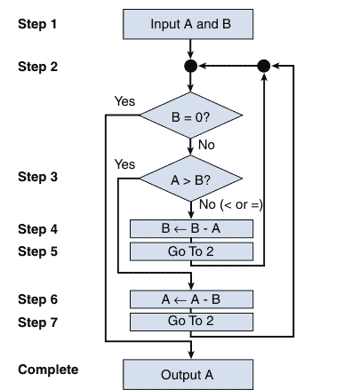
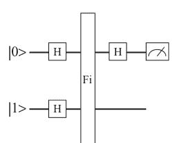
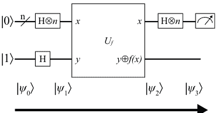
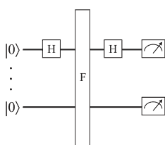

# 量子算法

## 章节目标

阅读本章并完成复习问题后，你将能够做到以下几点：

- 理解基本量子算法

- 检查算法结构

- 解释量子算法的目的和结构

量子计算的全部重点在于执行量子算法。

因此，你不应该惊讶于本章相当重要。

在第 16 章“使用 Q#”和第 17 章“使用 QASM”中，你将探索量子计算机编程，但这需要一些量子算法知识。

在本章中，我们将首先探讨什么是算法。

这将是对第 4 章“量子计算基础计算机科学”中所介绍内容的扩展。

我们还将对几个重要的量子算法进行相当详细的讨论。

这应该能让你对量子算法有相当有效的理解。

其中一些算法相当复杂。

你可能只对它们有概括性的理解就读完了本章；然而，不要让这让你担心。

在第 16 章和第 17 章中，你将实际编程其中一些算法，这应该有助于巩固你的理解。

## 10.1 什么是算法？

虽然这可能看起来是一个过于吹毛求疵的话题，但并非所有读者都有严格的计算机科学背景并熟悉算法和算法分析等主题。

第 4 章为你提供了算法的简单定义和对算法分析的基本理解。

在深入研究量子算法之前，加深对算法的理解（或者对一些读者来说，复习）很重要。

第 4 章将算法定义为本质上是一份食谱，这是一种通俗的定义。

虽然不不准确，但这实在太不正式了。

在数学中，算法是解决问题或一类问题的一组明确定义的有限指令序列。

引用我最喜欢的算法教科书之一的话：“从通俗地说，算法是任何明确定义的计算过程，它以某个值或某组值作为输入，并产生某个值或某组值作为输出。

因此，算法是将输入转换为输出的一系列计算步骤。”1

算法必须是明确的。

这意味着步骤清晰且定义明确，输出基于输入可预测。

这与第 4 章的食谱类比相符。

算法为完成某项任务提供清晰的逐步过程。

算法的具体步骤必须是一组明确定义的有限步骤序列。

既然你对什么是算法有了更清晰的理解，让我们来讨论几个关于算法的问题。

算法是否正确实际上是一个非常简单的问题。

如果对于每个输入，算法在一致地找到正确输出时停止，那么该算法就是正确的。

事实上，“一致地”一词可能有点过于苍白。

算法应该可靠且始终产生正确的输出。

“一致地”不一定意味着“每次”，算法应该每次都能正常工作。

显然，我们关注的是计算机算法，随着本节的推进，我们将研究几个算法——更具体地说，是量子算法。

但是，必须指出，算法可以以多种形式表达，包括使用你偏好的语言的词语。

上述食谱是一个算法。

完成任何任务的特定步骤集是一个算法。

欧几里得算法是一个经典算法，阐明了算法的本质。

对于数学和计算机科学专业的学生，这将非常熟悉。

欧几里得算法是一种发现两个整数最大公约数的方法。

这可能看起来是一项微不足道的任务，但随着整数变大，问题很快就会变得重大。

欧几里得算法进行一系列明确定义的步骤，使每个步骤的输出作为下一个步骤的输入。

设 n 为计算算法步骤的整数，从零开始。

因此，初始步骤对应 n = 0，下一个步骤对应 n = 1，以此类推。

第一步之后的每个步骤都从前一步的两个余数 r_{n-1} 和 r_{n-2} 开始。

你会注意到，在每个步骤中，余数都小于前一步的余数，即 r_{n-1} 小于其前驱 r_{n-2}。

这是有意为之，也是算法运作的核心。

第 n 步的目标是找到商 qn 和余数 r_n，使得方程

```
r_{n-2} = q_n r_{n-1} + r_n
```

1. Cormen, Thomas H.; Leiserson, Charles E.; Rivest, Ronald L.; Stein, Clifford. 《算法导论》第三版（第 27 页）。MIT Press, 2009.


得满足，其中 r_n < r_{n-1}。换句话说，从较大的数 r_{n-2} 中减去较小的数 r_{n-1} 的倍数，直到余数小于 r_{n-1}。

有些读者可能仍然有点不清楚，所以让我们用一个具体的例子：

令 a = 1864，b = 326。
1864 = 326 * 5 + 234（234 是余数）
326 = 234 * 1 + 92（92 是余数）
234 = 92 * 2 + 50（50 是余数）
92 = 50 * 1 + 42（42 是余数）
50 = 42 * 1 + 8（8 是余数）
42 = 8 * 5 + 2（2 是余数）
8 = 2 * 4
4 = 2 * 2
gcd(4, 2) = 2

因此，gcd(1864, 326) = 2。

该算法的具体细节及其应用对理解量子算法并不关键，但欧几里得算法提供了一个非常好的算法示例。可以看出，它是一组解决问题的有限、明确定义的步骤。如果前面的例子不够清晰，图 10.1 提供了欧几里得算法的流程图。



图 10.1 欧几里得算法流程图

您可能注意到，流程图中有一条线比其他线条粗得多。这样做是为了吸引您的注意。这表示递归。递归是算法中常见的一种技术，意味着再次调用自身。当计算机函数是递归时，它会反复调用自身。一个经典示例是计算整数阶乘的函数。这通常以递归方式实现，如下所示：

```
int fact(int n)
{
    if (n < 1) // base case
        return 1;
    else
        return n*fact(n-1);
}
```

因此，量子算法是一组用于解决问题或问题类的有限、明确定义的指令序列，在量子比特和量子门上执行。最广为人知的量子算法是 Shor 算法和 Grover 算法，我们将在本章中详细讨论。这些算法与经典计算算法非常相似，只不过它们至少有一部分依赖于使用量子计算进行的计算。最后这一部分对某些读者来说可能显得奇怪。许多量子算法实际上有相当大一部分可以以经典计算方式执行，只有少部分在量子比特上执行。

## 10.2 Deutsch 算法

Deutsch 算法是最容易理解的量子算法之一，因此它是我们起点的绝佳选择。该算法由牛津大学的 David Deutsch 教授创建。这个算法看起来似乎在解决一个有点牵强的问题，这可能是准确的。因此，不要过分关注问题的实际性可能会对您有所帮助。问题是：您有四个函数；每个函数以 1 或 0 作为输入，并输出 1 或 0，如图 10.2 所示。

- 输入 0 → F0 → 输出 0
- 输入 1 → F0 → 输出 0
- 输入 0 → F1 → 输出 0
- 输入 1 → F1 → 输出 1
- 输入 0 → F2 → 输出 1
- 输入 1 → F2 → 输出 0
- 输入 0 → F3 → 输出 1
- 输入 1 → F3 → 输出 1

图 10.2 四个函数

这些函数传统上标记为 f₀、f₁、f₂ 和 f₃。这留下了一个问题：这些函数实际上做什么；换句话说，图 10.2 向我们展示了什么？图 10.2 描绘的是，无论输入是什么，函数 f₀ 和 f₃ 都将输出设置为相同的值（即 0,0 或 1,1）。函数 f₁ 将 0 设置为 0，将 1 设置为 1。函数 f₂ 将 0 设置为 1，将 1 设置为 0。函数 f₀ 和 f₃ 被称为常数函数（即，无论输入如何，输出始终可预测）。函数 f₁ 和 f₂ 被称为平衡函数，因为它们的输出始终是 1 和 0 的平衡。

那么，需要解决的问题是什么？如果我们有一个黑盒，向其发送输入并获取输出，如何确定该特定黑盒包含常数函数（f₀ 或 f₃）还是平衡函数（f₁ 或 f₂）？

使用经典计算机来回答这个问题，我们需要进行两次求值。第一次求值涉及输入 0 并确定输出。第二次求值是输入 1 并确定输出。在这两个操作之后，我们将确切地知道黑盒包含平衡函数还是常数函数。

使用量子算法，即 Deutsch 算法，我们可以在一步之内确定黑盒中包含什么。Deutsch 设想了一个量子电路，很类似于图 10.3 中所示的电路。



图 10.3 Deutsch 电路

您可能已经注意到，我们只测量第一个输出量子比特，而不是第二个。回顾第 8 章“量子架构”中，图示的门是 Hadamard 门。F_i 表示我们有一个函数，它是之前讨论过的 F 函数之一，但我们不知道是哪一个。量子比特 |0⟩ ⊗ |1⟩ 输入到电路中，更具体地说，是经过 Hadamard 门。如果您需要复习，方程 10.1 显示了一个 Hadamard 门。

```
H = \frac{1}{\sqrt{2}} \begin{bmatrix} 1 & 1 \\ 1 & -1 \end{bmatrix}
```

方程 10.1 Hadamard 门

通过将我们的输入量子比特通过 Hadamard 门，状态变为方程 10.2 中所示。

$$\frac{1}{\sqrt{2}} (|0\rangle + |1\rangle) \otimes \frac{1}{\sqrt{2}} (|0\rangle - |1\rangle) = \frac{1}{2} (|00\rangle - |01\rangle + |10\rangle - |11\rangle)$$

方程 10.2 Hadamard 门之后的状态

接下来，我们将量子比特放入 F_i 函数中。请记住，我们不知道这实际上是哪个 F 函数。这将状态更改为方程 10.3 中所示。

$$\frac{1}{2} (|0\rangle \otimes |f_i(0)\rangle - |0\rangle \otimes |f_i(0) \oplus 1\rangle + |1\rangle \otimes |f_i(1)\rangle - |1\rangle \otimes |f_i(1) \oplus 1\rangle)$$

方程 10.3 F_i 函数之后的状态

状态要么是 |0> - |1>，要么是 |1> - |0>。经过一些代数运算，这可以重新排列为方程 10.4 中所示。

$$\frac{1}{\sqrt{2}} ((-1)^{f(0)} |0\rangle + (-1)^{f(1)} |1\rangle) \otimes \frac{1}{\sqrt{2}} (|0\rangle - |1\rangle)$$

方程 10.4 重新排列后的 F_i 函数状态

但是，请回顾图 10.3，我们还没有完成。我们还有另一个 Hadamard 门，接着是一次测量。如果我们的测量结果是 0，则 F_i 是 F_0 或 F_3，即常数函数。如果是 1，则 F_i 是 F_1 或 F_2，即平衡函数。因此，通过一次测量，我们发现了 F_i 黑盒的性质，而经典计算机需要两次测量。

如前所述，这可能看起来有点牵强的例子；然而，它相对容易跟上，因此是开始研究量子算法的好地方。在转向更复杂的算法之前，请确保您理解此算法。

## 10.3 Deutsch-Jozsa 算法

该算法在量子计算中非常有趣且重要。显然，它是对 Deutsch 算法的修改。问题实际上非常简单直接。Deutsch 算法考察的是一元函数，而 Deutsch-Jozsa 算法将其推广到 n 元函数。首先，考虑 Deutsch-Jozsa 问题。我们从一个黑盒量子计算机开始，它实现了一个函数，该函数接收 n 位二进制值，并为每个这样的值产生 0 或 1 作为输出。输出要么是平衡的（1 和 0 的数量相等），要么是常数的（全部为 1 或全部为 0）。我们希望确定该函数是常数还是平衡。这个量子黑盒也被称为 oracle。在计算理论中，oracle 是一种抽象机器，可以被可视化为产生某个结果的黑盒。

实际算法从前 n 位处于 |0> 状态开始，最后一位处于 |1> 状态。然后对每个位应用 Hadamard 变换，如方程 10.5 所示（并在第 8 章中介绍）。

```
$$H_m = \frac{1}{\sqrt{2}} \begin{pmatrix} H_{m-1} & H_{m-1} \\ H_{m-1} & -H_{m-1} \end{pmatrix}$$
```

方程 10.5 Hadamard 变换

将 Hadamard 变换应用于每个位将产生方程 10.6 中描绘的状态。

```
$$\frac{1}{\sqrt{2^{n+1}}} \sum_{x=0}^{2^n-1} |x>(|0> - |1>)$$
```

方程 10.6 Hadamard 变换后的状态

到目前为止，这似乎与标准的 Deutsch 算法没有太大不同。但是，我们现在有一个函数，我们将其称为 f(x)。该函数将状态 |x>|y> 映射到 |x>|y ⊕ f(x)>。在这种情况下，符号 ⊕ 表示模 2 加法。对于 f(x) 函数，它必须是一个不对 x 产生退相干的函数。函数 f(x) 是一个量子 oracle（如前所述）。当 x 的值通过 oracle f(x) 时，会产生 1 或 0。另外，请记住，每个 Hadamard 门都会影响量子比特的状态。Deutsch-Jozsa 算法可以如图 10.4 所示描述。



图 10.4 Deutsch-Jozsa 算法

底部的箭头表示状态从 ψ₀ 变为 ψ₁。如果 f(x) 是平衡的，输出将为 0；如果 f(x) 是常数的，输出将为 1。对于 n 位输入，如果 f(x) 是常数，最终输出将是 n 个 0。任何其他输出（0 和 1 的任何组合，或全部为 1）都表明 f(x) 是平衡的。与 Deutsch 算法一样，Deutsch-Jozsa 算法解决的问题有点牵强，可能不会吸引您。描述这两种算法的主要观点是，与我们将讨论的其他算法相比，它们相对容易理解。


## 10.4 伯恩斯坦-瓦扎拉尼算法

伯恩斯坦-瓦扎拉尼算法不如本章中介绍的某些其他算法那么广为人知。事实上，这个算法在入门级量子计算书籍中经常被忽视。然而，它并不难理解，并且与德意志-乔扎萨算法相关。它本质上是德意志-乔扎萨算法的一种变体。这可能就是为什么它在入门教材中经常不被介绍的原因。然而，我们的目标是确保你理解量子算法。因此，介绍另一个不仅本质上更容易理解，而且基于我们已介绍的另外两个算法的算法，似乎是实现该目标的绝佳方式。

与德意志算法和德意志-乔扎萨算法类似，伯恩斯坦-瓦扎拉尼算法解决的是一个相当人为构造的问题。与德意志算法不同，伯恩斯坦-瓦扎拉尼算法并不试图区分两种类型的函数；相反，它致力于学习一种字符串编码的函数。事实上，它致力于证明两个复杂度类之间的分离。对于不熟悉该算法所引用的复杂度类的读者，我们将简要介绍。

伯恩斯坦-瓦扎拉尼考虑了两个复杂度类。有界误差概率多项式时间（Bounded-error probabilistic polynomial time，BPP）是一类问题，这些问题可以在多项式时间内由概率图灵机求解，且错误概率小于 1/3。这是被称为 PP（概率多项式）的一组问题子集。这意味着它们在多项式时间内提供概率性答案。多项式时间意味着算法运行时间的上界是与算法规模相关的多项式表达式。存在只提供概率性答案的概率多项式问题，也存在确定性多项式算法。后者提供确定性答案，其运行时间的上界由与输入相关的多项式表示。

PP 是一类在多项式时间内概率可解、且错误概率小于 ½ 的问题。BQP 是有界误差量子多项式时间。这些问题是可以由量子计算机在多项式时间内求解，且错误概率小于 1/3 的问题。

既然你已经了解伯恩斯坦-瓦扎拉尼算法所解决问题的一般概念，让我们来看看实际算法。给定一个秘密字符串 s ∈ {0,1}^n（模 2）和函数 f: {0,1}^n → {0,1}，其中 f(x) 是 x 与秘密字符串 s 之间的点积，找出 s。更简单地说，伯恩斯坦-瓦扎拉尼算法接收一串比特（s），将其输入黑盒函数 f(s)，该函数返回 0 或 1。我们想要做的是找出这串比特是什么。

那么，伯恩斯坦-瓦扎拉尼算法比经典算法能做得更好在哪里呢？经典算法至少需要对函数进行 n 次查询才能找出 s 是什么。然而，伯恩斯坦-瓦扎拉尼算法可以使用量子计算机，仅用一次查询就能找到 s 的值。这无疑是重大改进。该算法的步骤并不过于复杂。首先，你从 n 量比特状态开始：

```
|0⟩^⊗n
```

你将对该状态应用哈达马德变换，如下所示：

```
\frac{1}{\sqrt{2^{n+1}}} \sum_{x=0}^{2^n-1} |x\rangle
```

回顾前面章节的内容，哈达马德门对单个量比特进行如下变换：

```
H|0\rangle = \frac{1}{\sqrt{2}}(|0\rangle + |1\rangle)
```

```
H|1\rangle = \frac{1}{\sqrt{2}}(|0\rangle - |1\rangle)
```

你可以使用求和符号来表示上述两种情况，如下所示：

```
H|a\rangle = \frac{1}{\sqrt{2}} \sum_{x \in \{0,1\}} (-1)^{a \cdot x} |x\rangle
```

现在我们有量子 oracle Uf。这个 oracle 将输入 |x> 转换为 (-1)^f(x) |x>。应用这个量子 oracle 会对叠加态进行变换，得到：

```
\frac{1}{\sqrt{2^n}} \sum_{x=0}^{2^n-1} (-1)^{f(x)} |x\rangle
```

然后再次应用哈达马德门。现在对得到的量比特进行测量。该测量结果将给出秘密字符串。这是对伯恩斯坦-瓦扎拉尼算法的简化讨论。目标是确保你对如何使用量比特和量子门有一个总体的理解——我们基本上可以在一步内完成经典算法需要多步才能完成的事情。

## 10.5 西蒙算法

与迄今讨论过的所有算法一样，西蒙算法旨在解决特定类别的问题。假设你有一个函数 f，它接收长度为 n 的二进制字符串并输出长度为 n 的二进制字符串。更简单地说，它接收一串二进制数字，对其进行某些操作，并输出经过该操作改变的相同长度的字符串。该操作是异或（XOR），有时简称为模 2 加法。鉴于二进制 XOR 操作是可逆的，这可以反过来表述：

```
x \oplus y = s
```

现在我们希望找到 s。

总结一下，如果将字符串 x 输入函数，将得到字符串 y。这是通过 x ⊕ s 完成的。我们希望找出字符串 s 是什么。使用经典计算机和经典算法，最多（即最坏情况下）需要 2^{n+1} + 1 次函数求值。

在充分评估这个问题的量子解决方案（即西蒙算法）之前，我们需要先讨论一个初步问题。如果你有两个二进制字符串，分别称为 x（x₁, x₂, ..., xₙ）和 y（y₁, y₂, ..., yₙ），则这两个字符串的点积就是 x * y，其中 * 仅表示标准乘法。因此，结果是 x₁ * y₁；x₂ * y₂，等等。这很容易理解。

西蒙算法有以下步骤：

- 第 1 步。将两个 n 量比特寄存器初始化为零态。
- 第 2 步。对第一个寄存器应用哈达马德变换。
- 第 3 步。应用查询函数。该查询函数作用于两个量子寄存器。
- 第 4 步。测量第二个寄存器。
- 第 5 步。对第一个寄存器应用哈达马德变换。

图 10.5 及其电路可能会为你澄清这一点。



### 图 10.5 西蒙算法电路

经典计算会进行一些后处理。你可能注意到，许多当前的“量子”算法都结合了一些经典操作和一些量子操作。

## 10.6 肖尔算法

这可能是我们在本章中学习的最重要的量子算法。有些资料说它也是最复杂的。这就是为什么有些教材将其放在最后讲解的原因。然而，一旦你对前三个算法有所了解，就应该能够继续学习肖尔算法，该算法由麻省理工学院应用数学教授彼得·肖尔发明。肖尔算法解决的问题是如何对某个整数 N 进行因式分解。该算法本身包含两个部分。第一部分完全是经典的；第二部分是量子的。

如果 N 是奇数，该过程效果最好，原因是我们寻找 N 的非平凡除数，而对于所有偶数 N，2 是一个平凡除数。

第一步是选择一个小于 N（你要分解的数）的伪随机数。现在你应该计算 a 和 N 的最大公约数。实现这一点的一种方法是使用本章前面介绍过的欧几里得算法。正如你所见，选择欧几里得算法来解释更广泛的算法概念是有意为之。为什么我们要计算 a 和 N 的 gcd？因为如果 gcd(a, N) = 1，则这两个整数互质。我们需要 a 互质，以便后续步骤能够成功进行。

既然我们已经计算了 a 和 N 的最大公约数，我们必须问一个问题：它是否不等于 1？换句话说，如果 gcd = 1，则继续；否则，我们就完成了。如果 gcd(a, N) != 1，则 a 是 N 的非平凡因子，此阶段完成。

如果继续往前进行，我们需要使用周期查找函数来识别函数的周期：

```
f_{a,N}(x) = a^x mod N
```

用不那么严格的数学术语来说，我们正在寻找某个 r，使得 f(x + r) = f(x)。对于不记得模运算的读者，让我们在此简要讨论一下。

模运算最简单的解释通常是计算机程序员使用的方法。使用模运算符，只需将 A 除以 N 并返回余数。

```
因此，7 mod 2 = 1
```

```
且 12 mod 5 = 2
```

这提供了使用模运算符的功能性理解，但缺乏对什么是模运算的理解。思考模运算的一种方法是想象进行你通常可能做的任何整数运算，但将答案限制在某个数字以内。一个经典的例子是时钟。它有 1 到 12 的数字，因此你进行的任何算术运算的答案都必须是 12 或更小。如果现在是 6 点，我要求你 7 小时后与我见面，简单的数学会说我要求你在 13 点与我见面。但这不可能，因为我们的时钟被限制在数字 12 以内！答案很简单：取你的答案，使用模为 12 的 mod 运算符，查看余数。

```
13 mod 12 = 1
```

我实际上要求你在 1 点与我见面（那是上午还是下午取决于原来的 6 点是什么，但这与理解模运算概念无关）。这是你每天使用模运算的一个例子。

尽管模运算的基本概念可以追溯到欧几里得（他曾在《几何原本》一书中论述过模运算），但现代模运算方法由卡尔·高斯于 1801 年发表。

模运算中的同余是一个非常重要的主题，你将在现代密码算法中频繁看到它的应用。事实上，这将在本章的肖尔算法以及第 11 章“当前非对称算法”中的 RSA 算法中使用。如果两个数 a 和 b 满足

```
(a mod n) = (b mod n) → a ≡ b(mod n)
```

则称 a 和 b “模 n 同余”。


符号 ≡ 用于表示数学中的同余。在许多编程语言中，% 符号用于执行取模运算（即，用第一个数除以第二个数，只返回余数）。

如果两个数模 n 同余，那么 a 与 b 之差将是 n 的某个倍数。为清楚起见，让我们回到本章前面使用的时钟类比：14 和 2 模 12 同余，结果发现 14 和 2 之差是 12，是 n（1 × 12）的倍数。我们还知道，14 即 24 小时制的 14:00，是 2 点。因此，当我们说 14 和 2 模 12 同余时，我们是在说，至少在模 12 的意义上，14 和 2 是相同的。让我们看另一个例子：17 和 5 模 12 同余，它们之差是 12。再次使用 24 小时制来验证我们的结论，我们发现 17:00 与下午 5 点相同。

有一些关于同余的基本性质你应该了解：

- a ≡ b (mod n) if n|(a-b)
- a ≡ b (mod n) implies b ≡ a (mod n)
- a ≡ b (mod n) and b ≡ c (mod n) imply a ≡ c (mod n)

同余类是一组对于给定模数都同余的数。同余类的另一个名称是余类。因此，让我们考虑模数为 5 的示例。哪些数模 5 同余？让我们从 7 开始。7 mod 5 = 2。现在我们来问还有哪些数 mod 5 = 2。我们会得到一个无限数列：12、17、22、27、32 等。你也应该注意，这反过来也适用（即，小于模数的整数，包括负数）。我们知道 7 mod 5 = 2，但 2 mod 5 = 2（最近的 5 的倍数是 0；0 * 5，因此 2 mod 5 = 2）。请确保完全理解为什么 2 mod 5 = 2，然后我们就可以继续研究负数了。在 0 之后，向后数的下一个 5 的倍数是 –5（5 * –1）。因此，–3 mod 5 = 2。我们现在可以将同余类的元素扩展为包括 –3、0、2、7、12、17、22、27、32 等。

现在我们已回顾了模运算，让我们考虑一个在量子计算入门教材中常见的例子。我们将考虑 N = 15 和 a = 2。这些数字经常被选用（或一些相似的整数），因为它们很小，计算也很容易。

表 10.1 显示了一些 x 和 a 的值。

| x | 0 | 1 | 2 | 3 | 4 | 5 | 6 | 7 |
|---|---|---|---|---|---|---|---|---|
| f_{a,N}(x) for a=2 | 1 | 2 | 4 | 8 | 1 | 2 | 4 | 8 |
| f_{a,N}(x) for a=4 | 1 | 4 | 1 | 4 | 1 | 4 | 1 | 4 |

为确保这一点对你来说很清楚，让我们看几个条目。考虑 x = 4 和 a = 2：

```
f_{a,N}(x) = a^x mod N
```

or

```
f_{a,N}(x) = 2^4 mod 15
```

which leads to

```
= 16 mod 15
```

```
= 1
```

让我们考虑另一个例子，其中 x = 5 和 a = 4：

```
f_{a,N}(x) = a^x mod N
```

or

```
f_{a,N}(x) = 4^5 mod 15
```

which leads to

```
= 1024 mod 15
```

```
= 4
```

这一部分需要算法的第二阶段。这是量子周期查找算法，将在下一小节中描述。

从周期函数返回后，我们继续因式分解过程。如果我们找到的 r 的值是奇数，那么我们返回步骤 1，选择一个不同的伪随机数 a。另外，如果

```
a^(r/2) == -1
```

我们返回步骤 1 并选择一个不同的 a。

但是，如果我们成功了，那么 gcd (a^(r/2) + 1, N) 我们就找到了 N 的因数。

### 10.6.1 量子周期查找函数

本节内容比较技术化。不是所有读者都必须掌握本节内容。如果你了解 Shor 算法的大致轮廓，那就足够了。你可以选择将这部分视为一个黑盒。但是，对于那些希望了解更多细节的人，这里提供了详细信息。

Shor 算法量子部分的核心在于，f(x) = a^x mod N 中的每个 N 的选择和每个 a 的选择都有自己的量子电路。给定某个 N（我们要分解的整数），首先找到 Q = 2^q，使得 N^2 < Q < 2N^2。Q 是状态的数量。这反过来意味着 Q/r > N（记住我们正在寻找周期 r）。量子问题就在这里发挥作用。量比特寄存器需要保存从 0 到 Q – 1 的值的叠加态。这反过来表明了所需的量比特数量。

此算法量子部分的第一步是初始化寄存器（注意，以下方程中的 \(\otimes\) 表示张量积）。方程 10.7 显示了寄存器的初始化。请记住，Q 是状态的数量。

用于周期函数的电路取决于 N 的选择。这意味着 Shor 算法可能会使用不同的电路。我们要找的是，给定 N 的值（我们要分解的数字），找到一个 Q = 2^q，使得以下条件成立：

\(N^2 \le Q < 2N^2\)

寄存器被初始化为方程 10.7 中所示的状态。

\(\frac{1}{\sqrt{Q}} \sum_{x=0}^{Q-1} |x>\)

### 方程 10.7 用于 Shor 算法的寄存器初始化

这里使用了求和符号（即，\(\Sigma\)），但用于组合 x = 0 到 Q – 1 的各个单独项的是张量积。初始状态是 Q 个状态的叠加态。这是通过创建 q 个独立的量比特来实现的，每个量比特都处于 0 和 1 状态的叠加态。

既然寄存器已初始化，我们构建一个量子函数 f(x)，它将产生输入和输出位的纠缠（参见方程 10.8）。

\(U_f \frac{1}{\sqrt{Q}} \sum_{x=0}^{Q-1} |x, 0^q> = \frac{1}{\sqrt{Q}} \sum_{x=0}^{Q-1} |x, f(x)>\)

### 方程 10.8 量子函数

这导致了一种情况，即 Q 个输入位和 n 个输出位发生纠缠。下一步是对输入寄存器应用逆量子傅里叶变换。同样，对于普通读者来说，这个细节不是必须的，但对于感兴趣的读者，这里提供了简要描述。

量子傅里叶变换对某个量子状态 \(|x>\) 进行操作，并使用方程 10.9 中显示的公式将其映射到量子状态 \(|y>\)。

\(y_k = \frac{1}{\sqrt{N}} \sum_{n=0}^{N-1} x_n \omega_N^{nk}\)

### 方程 10.9 量子傅里叶变换

在方程 10.9 中，n 的值将从 0 递增到 N – 1。\(\omega_N^n\) 是一个旋转，N 是向量的长度，其中 N = 2^n。逆量子傅里叶变换非常相似，如方程 10.10 所示。

```
x = \frac{1}{\sqrt{N}} \sum_{k=0}^{N-1} y_k \omega_N^{-nk}
```

### 方程 10.10 逆量子傅里叶变换

逆量子傅里叶变换使用 Q 次单位根应用于输入寄存器。对于不熟悉它的读者，单位根是指任何复数，当其被提升到某个正整数幂 n 时，结果为 1。这有时被称为 de Moivre 数，以法国数学家亚伯拉罕·德·莫弗尔命名。

现在进行一次测量，在输入寄存器中得到某个结果 y，在输出寄存器中得到某个结果 z。我们的下一步是对 y/Q 进行连分展开（经典运算），以找到满足两个条件的 d/s 的近似值：

- 1. s < N
- 2. \left| \frac{y}{Q} - \frac{d}{s} \right| < \frac{1}{2Q}

如果满足这两个条件，那么 s 很可能是周期 r，或者至少是 r 的因数。然后我们可以检查我们的 f(x) 是否按预期工作。如果是，我们就完成了；否则，我们必须为 r 获得更多候选值并重试。

在结束那个数学插曲后，我们可以回到 Shor 算法的步骤。如前所述，我们对输入寄存器应用逆量子傅里叶变换。我们可以深入探讨应用此变换时会发生什么，但就我们的目的而言，问题是它产生一个和，其中每一项代表通往相同结果的不同路径。现在我们继续并进行测量。这将导致输入寄存器中有一个值 x，输出寄存器中有一个值 y。这反过来导致经典地检查我们是否有答案（即，一个因数）。如果有，我们就完成了。如果没有，我们为 r 获得更多候选值并重复。

对于那些希望了解更多细节（特别是这些计算背后的“原因”）的读者，我们可以在这里探讨。r 的问题与整数的一个事实有关。请记住，Shor 算法的目标是分解整数。整数 x 模 M 的阶是满足 x^r = 1 mod M 的最小整数 r > 0。如果不存在这样的整数 r，则阶被认为是无限的。步骤总结如下：

- 步骤 1. 在 1 和 N 之间选取一个随机数 a（N 是你要分解的数）。
- 步骤 2. 计算 gcd (a,N)。
- 步骤 3. 如果 gcd (a,N) != 1，你就完成了。


步骤 4. 如果 gcd(a,N) = 1，您使用了量子周期子程序来找到 r。量子周期函数的子步骤如下：

- 量子步骤 1: 初始化寄存器。
- 量子步骤 2: 构造 f(x) 量子函数并将其应用于状态。
- 量子步骤 3: 对输入寄存器应用逆量子傅里叶变换。
- 量子步骤 4: 测量。
- 量子步骤 5: 执行经典连分展开以求近似值。
- 量子步骤 6: 检查是否已找到周期；如果已找到，则完成。
- 量子步骤 7: 否则，为 r 获取更多候选值。

- 步骤 5. 如果 r 为奇数，返回步骤 1。
- 步骤 6. 如果 a^(r/2) = -1 (mod N)，则返回步骤 1。
- 步骤 7. 否则，您已找到 N 的非平凡因子，并且完成了。

到这一点，您应该已经清楚，我们没有一台稳定工作的量子计算机，能够避免退相干足够长的时间来分解大整数，例如实用 RSA 算法中使用的那些整数。但是，已经用较小的整数多次演示了肖尔算法。

## 10.7 格罗弗算法

格罗弗算法本质上是一种搜索算法。它由洛夫·格罗弗于 1996 年开发。当然，本节稍后我们还会探讨其他关于它的描述，但目前，您可以将其视为一种搜索算法。为了解释算法的工作原理，请考虑一个具有 N 个条目的未排序数据存储。给定 N 个元素，经典查询的最坏情况是需要 N 次查询。平均情况是 N / 2。格罗弗算法的工作复杂度为 √N，这比经典方法有了显著改进。

现在要在我们的 N 个元素数据存储上使用格罗弗算法，我们需要进行一些初始设置。必须有一个 N 维状态空间，由 log2N 个量比特提供。我们将此状态空间称为 H。现在我们将数据存储中的每个条目从 0 编号到 N - 1，类似于编程中的任何标准数组。然后，我们必须选择一些作用于状态空间 H 的可观测量。许多来源用符号 Ω 表示该可观测量。该可观测量必须具有 N 个特征值，且均已知。Ω 的每个特征态编码数据库中的一个条目。特征态使用 bra-ket 表示法表示：

{|0>, |1>, |2>, ..., |N - 1>}

当然，特征值的表示方式也类似：

{λ0, λ1, λ2, ..., λN-1}

现在我们需要一个算子，用于根据某些标准比较数据库条目。格罗弗算法未指定该算子或其标准。这将根据特定的数据存储和搜索来选择。但是，该算子必须是一个通过态叠加来工作的量子子程序。该算子通常表示为 Uω。

当我们的算子作用于前面提到的特征态（我们将其表示为 |ω>）时，具有以下属性：

Uω|ω> = -|ω>

但是，对于所有不是 ω 的 x，我们希望有以下关系：

Uω|x> = |x>

换句话说，我们试图识别 Uω 对其作用方式与其他特征态不同的特定特征态 |ω>。或者，我们可以识别与该特征态相关的特征值。该算子 Uω 通常被称为量子预言机。它是作用于两个量比特的幺正算子。这定义了 Uω 算子。

还有一个算子，即 Us。s 是可能态的叠加（我们稍后将详细讨论）。该算子为

Us = 2|s><s| - I

现在我们已经建立了初步条件，让我们来看算法的具体步骤。第一步是将系统初始化到一个状态。该状态通常表示为以下叠加态：

|s> = 1/√N ∑^{N-1}_{x=0} |x>

不要被这个看似复杂的公式吓倒。我们只是说明状态 |s> 是所有可能态 |x> 的叠加。

现在我们执行一个称为格罗弗迭代的步骤 r，并且执行 N 次。这个步骤 r 只是应用算子 Uω 并应用算子 Us。这两个算子之前已经描述过。

现在第三步是执行可观测量 Ω 的测量。这次测量将提供一些特征值 λω。随着我们不断迭代，最终会得到正确的答案。步骤总结如下：

- 步骤 1. 将系统初始化到一个状态。
- 步骤 2. 执行迭代 r(N) 次。
- 步骤 3. 执行测量。

格罗弗算法的有效性已在数学上以多种方式证明。它是确认一旦退相干问题得到解决，量子计算机将带来的算力的算法之一。

## 10.8 摘要

本章考察了几种量子算法。本章可能是许多读者觉得难的一章。在继续之前，您可能需要阅读多次。本章中的许多算法您将在后续章节中再次遇到，实际上对它们进行编码可能会帮助您理解这些算法。您需要从本章中理解的最重要算法是多伊奇、肖尔和格罗弗算法。

## 测试你的技能

## 复习题

- 1. 以下问题描述的是哪种算法：“如果我们有一个黑盒，向其发送输入并获取输出，我们如何确定该特定黑盒包含常数函数还是平衡函数？”
  - a. 西蒙算法
  - b. 格罗弗算法
  - c. 多伊奇算法
  - d. 肖尔算法

- 2. 以下哪项是量子搜索算法？
  - a. 西蒙算法
  - b. 格罗弗算法
  - c. 多伊奇算法
  - d. 肖尔算法

- 3. 本章描述的 Deutsch-Jozsa 算法中使用了多少个哈达马德门？
  - a. 一个
  - b. 两个
  - c. 三个
  - d. 四个

- 4. Shor 算法的哪部分是量子的？
  - a. 全部
  - b. 周期查找部分
  - c. 同余部分
  - d. 模运算部分
