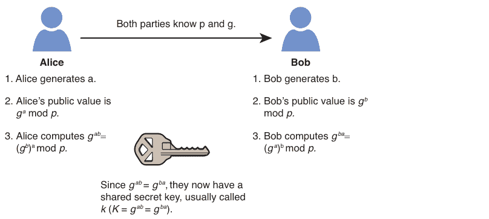
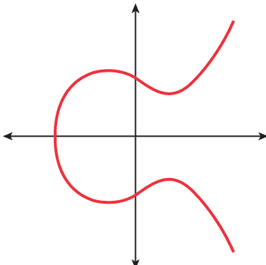
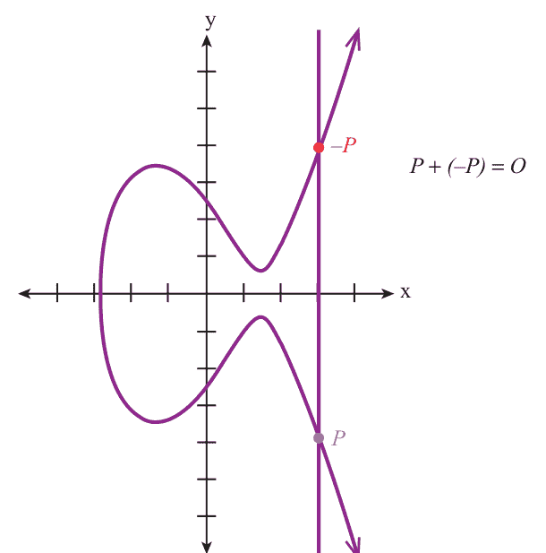
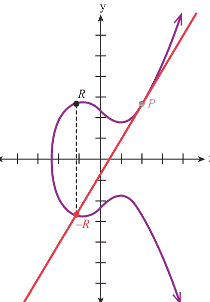

# 当前非对称算法

## 章节目标

**阅读本章并完成复习题后，您将能够：**

- 理解当前的非对称算法
- 解释为什么量子计算对这些算法构成威胁
- 认识量子计算对密码学的重要性

为了充分理解量子计算机对密码学的影响，有必要对当前的非对称算法有扎实的了解。本章探讨当前常用的非对称算法。这些算法今天广泛用于电子商务、网上银行、虚拟专用网络以及各种安全通信场景。然而，所有这些算法都易受量子计算机攻击。本章解释了这些算法以及量子计算机如何使它们过时。

当前的非对称算法全部基于某些计算上难以求解的数学问题。更准确地说，这意味着无法在多项式时间内求解的问题。然而，已经证明，许多此类问题可以由量子计算机在多项式时间内求解。这对当前的网络安全构成了重大威胁。在后续章节中，我们将探讨已被提议为抗量子标准的算法。在本章中，我们将详细探讨最当前且广泛实现的非对称算法。这将使您全面了解相关问题。

一些读者可能不完全清楚什么是多项式时间。如果完成算法所需的步骤数为 O(n^k)（其中 k 为某个非负整数），则该算法可在多项式时间内求解。n 表示输入的复杂性。回顾第 4 章《面向量子计算的基础计算机科学》中关于数组的讨论。许多处理数组的算法使用 n 作为数组大小。任何可以由多项式时间算法求解的问题都被视为可处理问题。

## 11.1 RSA

RSA 可能是当今最常用的非对称算法。它无疑也是最广为人知的算法之一。该算法最早于 1977 年由罗纳德·里维斯特、阿迪·沙米尔和伦纳德·阿德曼发表。RSA 名称取自每位数学家姓氏的首字母。该算法基于将大数分解为其质因数的困难性。使用当前经典计算机，对大整数已知最有效的分解算法是一般数域筛法。回顾第 4 章中关于计算复杂性和大 O 表示法的讨论。一般数域筛法的复杂度如下：

O{exp{C(log n)^{2/3}(log log n)^{2/3}}}

即使该表示法看起来有些令人生畏，也请牢记，它不是一种高效算法。这就是 RSA 足够安全以供当前使用的原因。现在让我们深入探讨 RSA，以更好地理解为什么整数分解是 RSA 安全性的关键。对于有兴趣了解更多一般数域筛法的读者，它是分解大整数最有效的经典算法。有关更多详细信息，您可以查阅以下资源：

https://citeseerx.ist.psu.edu/viewdoc/download?doi=10.1.1.219.2389&rep=rep1&type=pdf

https://mathworld.wolfram.com/NumberFieldSieve.html

要探讨 RSA，让我们从密钥生成开始。要创建公钥和私钥对，第一步是生成两个大小大约相等的大随机质数 p 和 q。您需要选择两个数字，使得它们相乘后的乘积为您想要的大小（例如，2048 比特、4096 比特等）。

下一步是将 p 和 q 相乘得到 n。这是一个相当简单的方程：

n = pq

第三步是分别对这两个质数（p 和 q）的欧拉函数相乘，以得到 n 的欧拉函数。

如果您不熟悉欧拉函数，它是一个相对简单的概念。如果两个数字没有公因数，则认为它们互质。考虑互质的整数 15 和 8。15 的因数是 3 和 5，8 的因数是 2 和 4。整数 15 和 8 没有公因数，因此被认为是互质的。欧拉函数询问有多少个小于 n 的数字


与 n 互质。我们称该数为欧拉函数（Euler's totient），简称 totient。碰巧的是，对于素数，这个值总是该数减 1。例如，素数 11 有 10 个小于 11 且与 11 互质的整数。

一旦你对欧拉函数有了基本了解，我们就可以继续。当我们将两个质数相乘时，显然会得到一个合数——而且没有简单的方法来确定合数的欧拉函数。欧拉发现，如果将任意两个质数相乘，那么该乘积的欧拉函数等于每个质数的欧拉函数相乘。因此，下一步是

```
m = (p-1)(q-1)
```

这就得出了 m，即 n 的欧拉函数。

第四步，我们将选择另一个数，称之为 e。我们要选取 e 使其与 m 互质。通常会为 e 选择一个质数。这样，如果 e 不能整除 m，我们就确信 e 和 m 互质，因为 e 没有其他需要考虑的因子。

此时，我们几乎完成了密钥生成。现在只需找到一个数 d，使得 d 乘以 e 后对 m 取模结果为 1：

```
Find d, such that de mod m ≡ 1
```

这就完成了密钥生成。我们将公开 e 和 n 作为公钥，并保留 d 作为私钥。以下步骤总结了密钥生成过程：

- 步骤 1. 生成两个大小相近的大随机质数 p 和 q。
- 步骤 2. 将 p 和 q 相乘得到 n。
- 步骤 3. 分别计算这两个质数（p 和 q）的欧拉函数并相乘，以得到 n 的欧拉函数。
- 步骤 4. 选择另一个数，称之为 e。我们要选取 e 使其与 m 互质。
- 步骤 5. 找到 d，使得 de mod m ≡ 1。

加密时，只需将消息的 e 次幂对 n 取模：

```
C = M^e mod n
```

解密时，将密文的 d 次幂对 n 取模：

```
P = C^d mod n
```

接下来，我们将查看两个使用非常小整数的 RSA 示例。这些整数太小，无法有效使用；但这应该能帮助你理解相关过程。

### 11.1.1 RSA 示例 1

让我们看一个可能有助于你理解该过程的示例。当然，RSA 将使用非常大的整数。为了使数学易于跟随，我们将在以下示例中使用小整数（该示例摘自 Wikipedia）：

- 1. 选择两个不同的质数，例如 p = 61 和 q = 53。
- 2. 计算 n = pq，得到 n = 61 · 53 = 3233。
- 3. 将乘积的欧拉函数计算为 φ(n) = (p − 1)(q − 1)，得到 φ(3233) = (61 − 1)(53 − 1) = 3120。
- 4. 选择任何 1 < e < 3120 且与 3120 互质的数。为 e 选择一个质数只需检查 e 不是 3120 的除数。设 e = 17。
- 5. 计算 d，即模乘逆元，得到 d = 2753。
- 6. 公钥是 (n = 3233, e = 17)。对于填充的明文消息 m，加密函数是 m^17 (mod 3233)。
- 7. 私钥是 (n = 3233, d = 2753)。对于加密的密文 c，解密函数是 c^2753 (mod 3233)。

### 11.1.2 RSA 示例 2

对于 RSA 新手或密码学新手的读者来说，再看一个数字更小的示例可能会有所帮助：

- 1. 选择质数：p = 17 和 q = 11。
- 2. 计算 n = p q = 17 × 11 = 187。
- 3. 计算 φ(n) = (p − 1)(q − 1) = 16 × 10 = 160。
- 4. 选择 e：gcd(e,160) = 1。选择 e = 7。
- 5. 确定 d：de = 1 mod 160 且 d < 160。d 的值为 23，因为 23 × 7 = 161 = 10 × 160 + 1。
- 6. 公开公钥（7 和 187）。
- 7. 保密私钥（23）。

这两个 RSA 示例相对简单。使用的质数非常小，以至于即使是低端经典计算机也能轻易破解密钥。然而，这些小质数使数学变得相当易于处理，因此你可以轻松掌握相关概念。如果这些是新信息，你可能会发现自己多练习几遍这些示例是值得的。

### 11.1.3 分解 RSA 密钥

分解是 RSA 安全性的基石。显然，至少从假设的角度来看，可以分解 n 值以获取 p 和 q，然后重新生成私钥。然而，事实证明，将非常大的数分解为其质因数是极其困难的，至少对于经典计算机而言。更技术性的描述是，它是“计算上不可行的”。没有高效算法可以做到这一点。而且我们谈论的是非常大的数：RSA 可以使用 1024 位、2048 位、4096 位、8192 位及更大的密钥。这些是极大的数。让我们看一个示例。这是一个以十进制表示的 2048 位数：

```
514832478983254789632147780069501356699875410025145630214586147855148324789325478963214778006950151483247893254789632147780069501356699875410025145630214586147855148324789325478963214778006950132566631245886314458770233565889635023235866589001452214785336547
```

在大多数现代 RSA 实现中，至少就撰写本文而言，2048 位是使用的最小 RSA 密钥。现在反思前面的数字，并思考尝试对其进行分解。我相信你会同意这是一项相当艰巨的任务，我们已经讨论过使用通用数体筛法。

有些数学技术可以增强该过程，但没有什么能使分解如此大的数字成为可行的事业，至少在经典计算机上是这样。当然，如果有人发明了一种能将大数分解为其质因数的高效算法，RSA 就会失效。确实有过有人能够分解小型 RSA 密钥的事件。2009 年，Benjamin Moody 在 73 天内分解了一个 512 位的 RSA 密钥。2010 年，研究人员能够分解一个 768 位的 RSA 密钥。由于分解方面的这些进步，现代 RSA 实现使用更大的密钥尺寸。

现在我们来谈与量子计算相关的问题。回顾第 10 章“量子算法”中关于 Shor 算法的讨论。Shor 算法由数学家 Peter Shor 于 1994 年发明。他证明，量子计算机可以在多项式时间内找到整数 N 的质因数。事实上，所需时间是 log N。这并不意味着量子计算机可以立即读取任何使用 RSA 加密的密文。分解公钥需要时间。然而，在量子计算机上使用 Shor 算法，该时间在实际时间范围内。鉴于 RSA 的普遍性，这是安全方面的一个严重问题。

## 11.2 Diffie-Hellman

虽然一些安全教材声称 RSA 是第一个非对称算法，但这并不准确。由 Whitfield Diffie 和 Martin Hellman 于 1976 年开发，Diffie-Hellman 是第一个公开描述的非对称算法。这是一种加密协议，允许两个实体通过某些不安全的介质（例如互联网）交换对称密钥。

Diffie-Hellman 协议有两个参数，称为 p 和 g。参数 p 是一个质数，参数 g（通常称为生成元）是一个小于 p 的整数，具有以下性质：对于 1 到 p–1 之间的每个数 n（包含两端），都存在 g 的幂 k，使得 n = g^k mod p。让我们继续使用密码学中的标准做法，用 Alice 和 Bob 来说明这一点。

Alice 生成一个随机私有值 a，Bob 生成一个随机私有值 b。a 和 b 都取自整数集合。

他们使用参数 p 和 g 以及私有值来推导其公开值。Alice 的公开值是 g^a mod p，Bob 的公开值是 g^b mod p。

他们交换公开值。

Alice 计算 g^ab = (g^b)^a mod p，Bob 计算 g^ba = (g^a)^b mod p。

因为 g^ab = g^ba = k，Alice 和 Bob 现在拥有一个共享密钥 k。

图 11.1 说明了此过程。



图 11.1 Diffie-Hellman

如果你仔细研究这一过程，应该注意 Diffie-Hellman 的安全性建立在解决离散对数问题的困难性之上。Shor 算法也可应用于离散对数。这意味着，给定运行 Shor 算法的量子计算机，Diffie-Hellman 可以在合理的时间内被破解。

### 11.2.1 Elgamal

Elgamal 是对 Diffie-Hellman 所做的众多改进之一。Taher Elgamal 于 1984 年首次描述了它。Elgamal 基于 Diffie-Hellman 密钥交换算法。


ElGamal 算法包含三个部分：

- 密钥生成器
- 加密算法
- 解密算法

继续以爱丽丝和鲍勃的例子为例，我们可以轻松描述 ElGamal 密钥生成过程：

- 1. Alice 生成一个阶为 q、生成元为 g 的乘法循环群 G 的高效描述。

- 2. Alice 从数字集合 {0, ..., q-1} 中选择一个随机数 x。

- 3. 然后 Alice 计算 h = g^x。请记住，g 是该群的生成元，x 是群内的一个随机数。

  此外，h、G、q 和 g 是公钥，x 是私钥。

- 4. 如果 Bob 希望加密消息 m 并将其发送给 Alice，他从 Alice 生成的公钥开始。Bob 加密消息的过程如下：

  - a. Bob 从 {0, ..., q-1} 中生成一个随机数 y。Y 通常称为临时密钥。

  - b. Bob 将计算 c1。该计算很简单：c1 = g^y。

  - c. 计算共享密钥 s = h^y。

  - d. 消息 m 转换为 G 中的 m'。

  - e. Bob 必须计算 c2。该计算相对简单：c2 = m' * s。

  - f. Bob 现在可以将 c1 和 c2 作为加密文本发送。

- 5. 要使用 Alice 生成的私钥解密消息 m，执行以下过程：

  - a. 接收方计算 s = c1^x。

  - b. 接收方计算 m' = c2 * s^-1。

  - c. 最后，将 m' 转换回明文 m。

其结构与迪菲-赫尔曼只有中等程度的相似；然而，它仍然基于与迪菲-赫尔曼相同的安全假设。这意味着，给定一台可用的量子计算机，ElGamal 也将易受可在多项式时间内成功的攻击。

### 11.2.2 MQV

与迪菲-赫尔曼类似，Menezes-Qu-Vanstone（MQV）是一种密钥协议协议，实际上基于迪菲-赫尔曼。它最初由 Menezes、Qu 和 Vanstone 于 1995 年提出，随后于 1998 年进行了修改。MQV 被纳入公钥标准 IEEE P1363。HMQV（Hash MQV）是一个改进版本。与迪菲-赫尔曼一样，MQV 的安全性基于经典计算机解决离散对数问题的困难性。正如我们所见，量子计算机没有这种困难。

MQV 使用椭圆曲线，将在下一节中详细讨论；但是，此处给出了一般步骤。在开始 MQV 步骤之前，需要一些预备项目。双方拥有一对公钥和私钥。Alice 的公钥通常标记为 A，私钥标记为 a。Bob 的密钥类似：B 是他的公钥，b 是他的私钥。这些将在以下步骤中用于爱丽丝和鲍勃交换一个新密钥以供使用。还有一个值 h，它是他们都在使用的椭圆曲线的余因子。还有一个值你需要知道，它有点更复杂。你将在步骤 4 和 5 中看到它。

- 步骤 1. 发起密钥交换的人，传统上称为 Alice，使用随机选择的值 x 生成一对密钥，然后计算 X = xP，其中 P 是椭圆曲线上的某个点。该密钥对是 (X, x)。

- 步骤 2. 另一方，通常称为 Bob，也生成一对密钥。他的密钥对是 (Y, y)，通过使用随机选择的 y 然后计算 Y = yP 生成。

- 步骤 3. Alice 现在计算一个值 Sa = X + X̄a mod n。然后她将她的 X 发送给 Bob。

- 步骤 4. Bob 计算 Sb = y + Ȳb mod n 并将 Y 发送给 Alice。

- 步骤 5. 然后 Alice 计算 K = h * Sz(Y + ȲB)，而 Bob 计算 K = h * Sb(X + X̄A)。

你可能会问，为什么他们要费这么大周折。爱丽丝和鲍勃不是已经有公钥和私钥了吗？他们不能直接使用这些密钥吗？他们可以；但是，在 MQV 中发生了两件事。首先，每一方的公钥实际上是用于验证该方，而不是用于加密数据。其次，每次运行此算法时都会使用一个新的对称密钥。因此，爱丽丝和鲍勃可能为每条消息拥有一个不同的新对称密钥。

## 11.3 椭圆曲线

椭圆曲线密码学在数学上比 RSA 复杂一些。椭圆曲线可以用于形成群，因此适合于密码学用途。有两种椭圆曲线群。最常见的两种（也是密码学中使用的两种）是基于 Fp（其中 p 是素数）的椭圆曲线群，以及基于 F2^m 的椭圆曲线群。F 是正在使用的字段，m 是某个整数值。椭圆曲线密码学是一种基于有限域上椭圆曲线的公钥密码学方法。

将椭圆曲线应用于密码学最早由 Victor Miller（IBM）和 Neil Koblitz 于 1985 年描述。椭圆曲线密码学的安全性基于这样一个事实：相对于公开已知的基点，寻找随机椭圆曲线元素的离散对数是困难到不切实际的程度。椭圆曲线是满足特定数学方程的点的集合。椭圆曲线的方程如下：

```
y^2 = x^3 + Ax + B
```

图 11.2 展示了描绘该方程图形的常见方式。



### 图 11.2 椭圆曲线图

表示椭圆曲线还有其他方式，但图 11.2 是最常见的，也许也是最容易理解的。描述椭圆曲线的另一种方式是，它仅仅是满足一个包含两个二次变量和一个三次变量的方程的点集。你应该从图 11.2 的图中首先注意到的是水平对称性。曲线上的任何点都可以关于 x 轴反射而不改变曲线的形状。

马里兰大学的 Lawrence Washington 更正式地描述了椭圆曲线：“椭圆曲线 E 是形式方程的图，其中 A 和 B 是常数。这将被称为椭圆曲线的魏尔斯特拉斯方程。我们需要指定 A、B、x 和 y 属于哪个集合。通常，它们被取为字段的元素，例如，实数 R、复数 C、有理数 Q、素数 p 的有限域 Fp（=Zp）之一，或有限域 Fq 之一，其中 q = p^k 且 k ≥ 1。”随着我们深入 ECC，这些值将变得更有意义。

与椭圆曲线一起使用的运算是加法（请回顾，群的定义需要一组元素及一个运算）。因此，椭圆曲线形成加群。

椭圆曲线字段的成员是椭圆曲线上的整数点。你可以对椭圆曲线上的点进行加法运算。在绝大多数关于椭圆曲线的文献中，我们考虑两个点 P 和 Q。点 P = (xP, yP) 的负值是它关于 x 轴的反射：点 –P 是 (xP, –yP)。请注意，对于椭圆曲线上的每个点 P，点 –P 也在曲线上。假设 P 和 Q 是椭圆曲线上的两个不同点，并假设 P 仅仅是 Q 的逆元。要相加点 P 和 Q，你穿过这两点画一条直线。这条直线将在恰好还有一个点上与椭圆曲线相交，称为 –R。点 –R 关于 x 轴反射得到点 R。椭圆曲线群中的加法法则是 P + Q = R。

穿过 P 和 –P 的直线是一条垂直线，它不与椭圆曲线在第三点相交；因此，点 P 和 –P 无法像之前那样相加。出于这个原因，椭圆曲线群包括无穷远点 O。根据定义，P + (–P) = O。因此，在椭圆曲线群中，P + O = P。O 称为椭圆曲线群的加法单位元；所有椭圆曲线都有一个加法单位元。你可以在图 11.3 中看到这一点。




要将点 P 加自身，在点 P 处画一条曲线的切线。如果 y_P 不为 0，则切线在椭圆曲线上恰好与另一点 –R 相交，并将 –R 关于 x 轴反射得到 R。此操作称为“点 P 的倍点”，如图 11.4 所示。



图 11.4 点 P 的倍点

如果 y_P = 0，则从 P 出发的切线始终是垂直的。如果点 P 满足 y_P = 0，则椭圆曲线在 P 处的切线是垂直的，且不与椭圆曲线在其他任何点相交。按定义，对于这样的点 P，有 2P = O。

回顾一下，字段 Fp 使用 0 到 p – 1 的数字，计算结束时对 p 取余（即模运算）。例如，在 F23 中，该字段由 0 到 22 的整数组成，该字段内的任何运算结果也将是 0 到 22 之间的整数。

通过在 Fp 字段内选择变量 a 和 b，可以形成底层字段为 Fp 的椭圆曲线。椭圆曲线包括所有满足模 p 下椭圆曲线方程的点 (x,y)（其中 x 和 y 是 Fp 中的数字）。例如，如果 a 和 b 在 Fp 中，则 y^2 mod p = x^3 + ax + b mod p 具有 Fp 的底层字段。

如果 x^3 + ax + b 不含重复因子，则可使用该椭圆曲线形成一个群。Fp 上的椭圆曲线群由相应椭圆曲线上的点，以及一个称为无穷远点的特殊点 O 组成。这样的椭圆曲线上有有限多个点。

每个非对称密码体制的基础都是一个在计算上不可行求解的难题。离散对数问题是许多密码体制（包括椭圆曲线密码体制）安全性的基础。更具体地说，ECC 依赖于椭圆曲线离散对数问题（ECDLP）的难度。

回顾一下，我们考察了某些椭圆曲线群上两个几何定义的运算。这两个运算分别是点加和点倍。通过在椭圆曲线群中选择一个点，可以对其进行倍点运算得到点 2P。之后，可以将点 P 与点 2P 相加得到点 3P。以这种方式确定点 nP 被称为点的标量乘法。ECDLP 基于标量乘积的不可求解性。

在乘法群 Zp* 中，离散对数问题如下：给定群的元素 r 和 q，以及一个素数 p，求一个数 k，使得 r = q^k mod p。如果使用乘法记法描述椭圆曲线群，则椭圆曲线离散对数问题如下：给定群中的点 P 和 Q，求一个数，使得 P^k = Q，其中 k 称为 Q 相对于底数 P 的离散对数。当使用加法记法描述椭圆曲线群时，椭圆曲线离散对数问题如下：给定群中的点 P 和 Q，求一个数 k，使得 kP = Q。

以下是一个常见示例，广泛用于许多教科书、论文和网页中。它使用相当小的数字，你可以轻松计算，但仍说明了椭圆曲线密码学的工作原理。

在由以下定义的椭圆曲线群中：

```
y^2 = x^3 + 9x + 17 over F23
```

Q = (4,5) 相对于底数 P = (16,5) 的离散对数 k 是多少？

求解 k 的一种方法是计算 P 的倍数，直到找到 Q。P 的前几个倍数如下所示：

- P = (16,5) 2P = (20,20) 3P = (14,14) 4P = (19,20) 5P = (13,10)
- 6P = (7,3) 7P = (8,7) 8P = (12,17) 9P = (4,5)

因为 9P = (4,5) = Q，所以 Q 相对于底数 P 的离散对数是 k = 9。

在实际应用中，k 会足够大，以至于无法以这种方式确定 k。这就是椭圆曲线密码学的本质；显然，我们使用更大的字段。有关更多信息，可以在 http://arstechnica.com/security/2013/10/a-relatively-easy-to-understand-primer-on-elliptic-curve-cryptography/ 找到一个出色的在线教程。

椭圆曲线密码体制（ECC）依赖于椭圆曲线离散对数问题（ECDLP）的难度。这是一个在经典计算机上无法在多项式时间内求解的问题。如你可能已经猜到，这意味着 ECC 易受量子计算机攻击。

从前几节可以看出，椭圆曲线形成群，这些群可以像任何其他代数群一样使用。这的实际含义是，可以将各种算法调整为椭圆曲线群。椭圆曲线密码学有许多变体，包括以下几种：

- 椭圆曲线迪菲-赫尔曼（用于密钥交换）
- 椭圆曲线数字签名算法（ECDSA）
- 椭圆曲线 MQV 密钥协商协议
- 椭圆曲线集成加密方案（ECIES）

在本节中，我们将更仔细地研究其中的两种：ECC 迪菲-赫尔曼和 ECDSA。

### 11.3.1 ECC 迪菲-赫尔曼

我们在本章前面已经考察过的迪菲-赫尔曼是最古老的密钥交换协议。它自然可以修改用于椭圆曲线。椭圆曲线迪菲-赫尔曼（ECDH）是一种用于在不安全媒介上建立共享秘密的密钥交换或密钥协商协议。该共享秘密随后要么直接使用，要么作为派生另一个密钥的基础。在 ECDH 的情况下，公私密钥对基于椭圆曲线。

- 公开：椭圆曲线及曲线上的点 (x,y)
- 秘密：Alice 的 A 和 Bob 的 B
  - Alice 计算 A(B(x,y))。
  - Bob 计算 B(A(x,y))。
  - 两者相同，因为 AB = BA。
- 公开：曲线 y² = x³ + 7x + b (mod 37) 和点 (2,5) ⇒ b = 3
- Alice 的秘密：A = 4
- Bob 的秘密：B = 7
  - Alice 向 Bob 发送 4(2,5) = (7,32)。
  - Bob 向 Alice 发送 7(2,5) = (18,35)。
  - Alice 计算 4(18,35) = (22,1)。
  - Bob 计算 7(7,32) = (22,1)。

有关更多详细信息，请参阅 NIST 特别出版物 800-56A，修订版 2，网址为 http://csrc.nist.gov/publications/nistpubs/800-56A/SP800-56A_Revision1_Mar08-2007.pdf。

### 11.3.2 ECDSA

数字签名算法是专门用于对消息进行数字签名而发明的。当然，可以使用任何非对称算法来对消息签名，但数字签名算法就是为此目的而设计的。正如你可能料到的，该算法有一个椭圆曲线变体。

为了说明其工作原理，我们将再次考虑虚构角色 Bob 和 Alice。首先，双方必须同意一些参数：曲线，记为 E，椭圆曲线的基点/生成元，记为 G，以及 G 的阶（一个整数），记为 n。现在，为对消息签名，Alice 执行以下步骤：

- **步骤 1.** 选择一个小于 n 的随机整数 k（即，0 < k < n）。
- **步骤 2.** 计算 kG = (x1,y1) 和 r = x1 mod n。如果 r = 0，则转到步骤 1。
- **步骤 3.** 计算 k^-1 mod n。
- **步骤 4.** 计算 e = SHA-1(m)。大多数数字签名算法使用哈希；在此例中，哈希通常是 SHA-1。因此，这表示 Alice 计算消息的 SHA-1 哈希。
- **步骤 5.** 计算 s = k^-1{e + d_A · r} mod n。
- **步骤 6.** 如果 s = 0，则转到步骤 1。换句话说，Alice 会不断重复该过程，直到 s != 0。这通常并不耗时，且可能在第一次尝试时就发生。
- **步骤 7.** Alice 对消息 m 的签名是 (r, s)。

为了验证 Alice 的签名 (r,s)，Bob 将执行以下步骤：

- **步骤 1.** 验证 r 和 s 是否为 [1, n-1] 中的整数。
- **步骤 2.** 计算 e = SHA-1(m)。
- **步骤 3.** 计算 w = s^-1 mod n。
- **步骤 4.** 计算 u1 = ew mod n 和 u2 = rw mod n。
- **步骤 5.** 计算 (x1, y1) = u1G + u2 Q_A。
- **步骤 6.** 计算 v = x1 mod n。
- **步骤 7.** 仅当 v = r 时接受签名。

图 11.5 总结了该过程。


Step 3: 发送消息

Alice                 Bob

Step 1: 生成她的签名 r, s      Step 4: 验证签名
Step 2: 对消息签名

### 图 11.5 ECDSA

这与传统的数字签名算法类似，只不过它使用椭圆曲线群。ECDSA 非常安全，至少能抵御经典计算机攻击；然而，它易受量子计算机攻击。

## 11.4 总结

在本章中，我们考察了当今使用的一些经典非对称算法。这些算法广泛应用于电子商务、网上银行和许多其他应用。这些算法中没有一种能抵御基于量子计算的攻击。出于这个原因，测试用于使用的更新的抗量子算法非常重要。接下来的四章将探讨量子计算和密码学的问题。理解当前算法的工作原理以及它们为何不能抵御基于量子计算的攻击非常重要。

## 测试你的技能

## 复习问题

- 1. Shor 算法可以在什么时间内因式分解整数 N？
  - a. N²
  - b. log(N)
  - c. ln(N)
  - d. N!

- 2. 以下哪个方程与椭圆曲线密码学关系最密切？
  - a. M^e % n
  - b. P = C^d % n
  - c. C^e % n
  - d. y² = x³ + Ax + B

- 3. 什么是离散对数？

- 4. 解释 Diffie-Hellman 的基本设置（包括基本数学和密钥生成）。

- 5. RSA 加密的公式是什么？

- 6. 解释 RSA 密钥生成。
