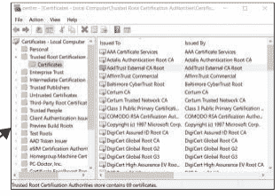

# 量子计算对密码学的影响

## 章节目标

阅读本章并完成复习问题后，你将能够做到以下几点：

- 理解量子计算将如何影响非对称密码学
- 解释量子计算之后对称密码学将如何变化
- 意识到量子计算将要求对密码学应用进行的变更

即使在开始阅读本书之前，你很可能已经意识到量子计算将对密码学和网络安全产生重大影响。事实上，这可能是你学习更多量子计算知识的动力。量子计算最明显的影响将体现在非对称密码学上。然而，这并不意味着它对密码学的其他领域没有影响。我们将在本章中探讨这种影响。

密码学的主要担忧源于当前非对称密码算法的性质。即使量子计算完全不影响对称密码或密码散列（实际并非如此），仅对非对称密码学的影响也会令人担忧。网络安全的几乎所有方面，至少在某种程度上，都依赖于非对称密码学。这包括电子商务、VPN 和许多身份验证协议。当前使用的非对称算法之所以安全，是因为它们基于难以解决的数学问题。这里所说的“难以解决”，是指它们无法使用经典（即非量子）计算机在实际时间内解决。RSA 基于将数字分解为其质因数的困难性。Diffie-Hellman 基于求解离散对数问题的困难性。椭圆曲线密码学（包括多种算法）基于求解相对于公开已知基点的随机椭圆曲线元素的离散对数问题的困难性。对网络安全而言的问题是，已经证明这些数学问题可以用量子计算机解决。

问题不再是“量子计算机会影响密码学吗？”，而是“何时会影响？”因为已经证明量子算法可以在实际可行的时间内解决构成当前非对称密码学基础的问题，量子计算最终将使现有的非对称或公钥算法过时并失效。这意味着用于 VPN 密钥交换、数字证书、所有电子商务解决方案，甚至某些网络身份验证协议的密码学将不再安全。广泛用于保护互联网流量（包括网页流量、电子邮件，甚至 IP 语音）的传输层安全协议 (TLS) 将不再安全。尽管这些对网络安全的危险并非迫在眉睫，因为量子计算尚未成为一种实用可用的现实，但任何从事网络安全工作的人都有必要了解这一问题并熟悉解决方案的进展。

有许多术语用于抗量子密码学。有时使用“后量子密码学”，有时使用“耐量子密码学”。无论使用哪个术语，概念都是一样的：基于量子计算机不易解决的数学的密码算法。除了美国国家标准与技术研究院（NIST）的抗量子密码学标准项目外，欧洲电信标准化组织（ETSI）与量子计算研究所也一直在举办关于耐量子密码学的研讨会。各种耐量子密码学方法将在第 13 章“基于格的密码学”、第 14 章“多变量密码学”和第 15 章“后量子密码学的其他方法”中详细讨论。你可以在 https://csrc.nist.gov/projects/post-quantum-cryptography 阅读有关 NIST 耐量子密码学标准的信息。

## 12.1 非对称密码学

我们研究量子计算影响的起点应放在其影响最明显的领域——非对称密码学。你无疑在阅读本书各章的过程中已经熟悉其中的一些问题。经典非对称密码学基于数论中的特定问题，例如因式分解问题或离散对数问题。

应对量子计算对非对称密码学威胁的答案是利用基于不同数学问题的非对称算法。特别是，至少到目前为止，尚未显示易受量子计算攻击的问题。存在几种这样的算法族。我们将在即将到来的章节中详细探讨它们。这些算法族包括基于格的密码学、多变量密码学、超奇异椭圆曲线同源密码学和基于哈希的密码学。

基于格的密码学简单来说就是基于格数学中某些问题的密码系统。格密码学中最常用的问题之一是最短向量问题 (SVP)。基本上，这个问题是：给定一个特定的格，如何在格中找到最短的向量？更具体地说，SVP 涉及在向量空间 V 中找到按范数 N 度量的最短非零向量。回顾第 1 章“基本线性代数导论”，范数是向量空间中为每个向量分配严格正长度或大小的函数。SVP 是后量子计算的一个很好选择。

基于格的密码学中使用的另一个问题是最近向量问题 (CVP)。这个问题概括如下：给定向量空间 V、格 L 的度量 M，以及属于向量空间 V 但不一定属于格 L 的向量 v，在格 L 中找到与向量 v 最接近的向量。第 13 章将更详细地探讨这一概念。

多变量密码学，顾名思义，基于具有多个变量的数学问题。更具体地说，这些算法通常基于有限域上的多变量多项式。存在基于多变量密码学的加密方案以及数字签名方法。

超奇异椭圆曲线同源密码学，顾名思义，是椭圆曲线密码学的一个特定变体。超奇异椭圆曲线是域上椭圆曲线的一个特定类别。第 14 章将详细探讨这些算法。

还存在基于哈希的密码算法。第一个基于哈希的数字签名是由 Ralph Merkle 在 1970 年代开发的。还应注意的是，Merkle-Damgaard 构造用于许多哈希算法。目前正在考虑用于后量子密码学的基于哈希的算法包括 Leighton-Micali 签名 (LMS) 和扩展 Merkle 签名方案 (XMSS)。第 15 章将更详细地探讨基于哈希的密码解决方案。

基于编码的密码学的方法略有不同。这些是依赖于差错纠正码的系统。这样的一个系统是 Robert McEliece 在 1978 年发表的 McEliece 密码体制。该算法在经典密码学中并未广泛使用，但一直是后量子密码学的候选算法。已经证明 McEliece 体制能抵御 Shor 算法，这使其非常有吸引力。第 15 章将更详细地探讨该算法。

### 12.1.1 需要多少个量子比特？

如在第 9 章“量子硬件”中讨论的，使用 2048 位 RSA 需要大约 4000 个量子比特的粗略估计。这一估计并非没有实验依据。问题是量子计算机因式分解一个数字的速度有多快。2014 年，物理学家使用量子计算机对数字 56,153 进行了因式分解。现在，这个数字显然比典型的 RSA 密钥小得多。为了提供一些视角，将 2048 位密钥转换为十进制数字后，长度将为 256 位数字。为了更直观地理解，以下是一个 256 位数字：

9,123,456,789,321,654,987,111,222,333,444,555,666,777,888,999, 321,785,828,499,202,001,039,
231,943,294,122,098,992,909,098,

461,654,843,513,213,651,488,351,315,654,684,643,513,513,167,
879,841,294,872,617,124,598,248,547,555,666,777,685,987,654,
123,456,828,499,202,001,039,231,943,294,122,098,992,909,098,
548,548,477,658,987,899,845,965,599,458

你会同意这是一个相当大的数字。因此，破解五位数字并未使我们达到 RSA 目前面临危险的程度。然而，已经表明，一旦量子计算机达到稳定状态（即，退相干受到控制）并且我们能够扩展可用稳定量子比特的数量，RSA 将不再安全。

## 12.2 特定算法

从网络安全角度来看，关于量子计算最重要的问题或许就是量子计算对特定密码学算法将产生什么影响。我们在本书和本章中之前至少从表面上讨论过这个话题。在本节中，我们将研究特定算法及其对量子计算攻击的脆弱程度。

### 12.2.1 RSA

第 11 章“当前非对称算法”通过示例详细介绍了 RSA。这样做是为了确保你理解为什么 Shor 算法对 RSA 有如此重大的影响。如在第 10 章“量子算法”中讨论的，Shor 算法能够在多项式时间内分解整数。这意味着它将能够在实际时间范围内从公钥推导出 RSA 私钥。

### 12.2.2 Diffie-Hellman

如你在第 11 章中所学，Diffie-Hellman 基于求解离散对数问题的困难性。Diffie-Hellman 有许多改进，例如 ElGamal 和 MQV，但这些算法的安全性也基于求解离散对数问题的困难性。

第 10 章探讨了 Shor 算法，并证明除了能够分解整数外，该算法还可用于求解离散对数问题。因此，仅 Shor 算法就使 Diffie-Hellman 算法族易受基于量子计算的攻击。

然而，Shor 算法并非对基于求解离散对数问题困难性的算法构成的唯一威胁。2016 年，Martin Ekera 引入了 Shor 算法的一个修改版本，专门用于求解所谓的短离散对数问题。该问题用于 TLS 和 IKE 协议中实现的 Diffie-Hellman，我们将在本章后面更详细地讨论。自 2016 年以来，Ekera 的工作还得到了进一步改进。

### 12.2.3 ECC

在上一节中，我们讨论了离散对数问题。如你从第 11 章中所知，椭圆曲线密码学基于椭圆曲线离散对数问题（ECDLP）。这意味着所有椭圆曲线密码学的变体都不是抗量子的。

### 12.2.4 对称密码

文献中讨论的大部分影响涉及量子算法对非对称密码学的影响。然而，对称密码学也受到影响。这种影响肯定较小，但仍然存在。举个例子，考虑 Grover 算法，我们在第 10 章中也讨论过它。它可以在大约是密钥空间一半的迭代次数内“猜出”对称密钥。因此，如果考虑 AES 128-bit，Grover 算法可以在 2^64 次迭代内猜出密钥。这可能需要多长时间？使用当前技术，这仍然是极其漫长的。然而，这确实意味着，仅仅增加对称密钥，或许仅仅是加倍密钥大小，就足以防范量子攻击。

密码学界的普遍共识是，经过轻微修改，对称密码将是抗量子的。这种轻微修改通常只是加倍密钥大小。因此，不应使用 AES 128-bit，而应使用 AES 256-bit。如果已经使用 AES 256-bit，则应考虑使用 512-bit 密钥。实际的 AES 标准仅允许 128、192 和 256 位这三种密钥大小。然而，Rijndael 算法本身没有这种限制，可以支持 512 位密钥。这种加倍密钥大小的做法适用于所有对称密码，包括 Blowfish、Serpent、CAST、IDEA 等。

这些算法不受量子计算机威胁的原因其实很简单。对称密码，正如其名称所暗示的，只有一个密钥。这反过来意味着，算法的安全性不是基于关联两个密钥。非对称密码之所以工作，仅仅是因为两个独立的密钥（公钥和私钥）通过某些底层数学相关联。该数学之所以安全，仅仅是因为求解某个特定数学问题的困难性；然而，对称密码的安全性并非建立在某个底层数学问题的安全性之上。从本质上讲，量子计算机要破解对称密码，没有一个根本的数学问题可供求解。量子计算机所能做到的最好，或许只是加速暴力攻击。

### 12.2.5 密码哈希

密码哈希，如同对称密码，并非基于求解特定数学问题的困难性。至少大多数密码哈希算法并非如此。最常用的密码哈希函数只是信息论中混淆和扩散概念的实现。Merkle-Damgaard 构造被用于许多哈希函数中。因此，SHA-2、SHA-3、Whirlpool、GOST、RIPEMD 和其他常用密码哈希函数不太可能受到量子计算的影响。有人可能出于谨慎考虑，选择实现更大的摘要大小。这意味着使用 SHA-2 512-bit 而不是 256-bit，或者使用 RIPEMD 320 而不是 160。除了这些适度的更改之外，目前没有迹象表明大多数密码哈希面临重大安全威胁。

## 12.3 特定应用

归根结底，所有计算都与应用有关。虽然计算机科学家可能仅通过解决智力问题就获得满足感，但目标是提供一些有用的应用。密码学也是如此。在本节中，你将看到对密码学常见应用的解释。还将探讨这些应用要实现抗量子所需的具体更改。

### 12.3.1 数字证书

数字证书在应用密码学中至关重要。它们是获取他人公钥的方式。数字证书对于传输层安全（TLS）等安全通信至关重要，并在许多形式的身份验证中发挥作用。X.509 是数字证书中格式和包含信息的国际标准。X.509 是世界上最常见的数字证书类型。它是一份数字文档，包含由颁发证书的受信第三方（称为证书颁发机构（CA））签名的公钥。X.509 标准首次发布于 1988 年。自那时起它经过了修订，最新版本是 X.509 v3，在 RFC 5280 中指定。该系统不仅支持获取证书持有者的信息，还支持通过受信第三方验证该信息。这对于 SSL 和 TLS 等安全协议至关重要，我们将在本章后面看到。

X.509 证书的内容如下：

- **版本**：正在使用的 X.509 版本。今天最可能是版本 3。
- **证书持有者的公钥**：这是证书持有者的公钥。基本上，这就是公钥的分发方式。
- **序列号**：这是一个唯一标识符，用于标识此证书。
- **证书持有者的区别名**：证书持有者的特殊或唯一名称——通常是网站的 URL 或电子邮件地址。
- **证书的有效期**：大多数证书签发期限为一年，但确切的有效期反映在此字段中。
- **证书颁发者的唯一名称**：这标识颁发证书的受信第三方。公共证书颁发机构包括 Thawte、Verisign、GoDaddy 等。
- **颁发者的数字签名**：你如何知道此证书确实是由它声称颁发的证书颁发机构颁发的？方法是拥有一个数字签名。

■ 签名算法标识符：为了验证签名者的数字签名，您需要签名者的公钥以及他们使用的算法。

还有其他可选字段，但刚才列出的那些是必填字段。请注意，最后三项都与验证此证书的能力有关。X.509 数字证书的一个优势是证书持有者验证系统。这对于安全通信至关重要，不仅要加密传输，还要验证相关方的身份。

现在需要解决的问题是，量子计算机对数字证书会有什么影响？幸运的是，实际证书不需要进行重大更改。用于管理证书的基础设施将需要进行重大更改，我们将在本章后面讨论这一点。X.509 证书的格式可以保持不变。区别在于证书中列出的数字签名算法以及证书中的公钥。这些都需要是抗量子算法。

### 12.3.2 SSL/TLS

断言 SSL/TLS 为当今我们所知的互联网提供了框架，这绝非夸张之词。能够进行电子商务、实现安全通信并安全地发送数据，在很大程度上依赖于 SSL/TLS。当 Web 刚刚开始时，安全并不是一个问题。超文本传输协议（HTTP）本质上相当不安全。随着 Web 越来越流行，人们很快意识到需要安全性才能使用 Web 进行敏感通信，例如财务数据。Netscape 发明了安全套接字层（SSL）协议，从版本 1.0 开始。由于存在重大安全缺陷，它从未发布；然而，版本 2.0 于 1995 年发布并开始广泛使用。不幸的是，SSL 版本 2.0 存在安全缺陷，随后于 1996 年被 SSL 版本 3.0 取代。版本 3.0 不仅仅是对过去版本的微小改进，而是一次彻底的改造。它作为 RFC 6101 发布。

TLS 1.0 于 1999 年发布。它本质上是对 SSL 3.0 的升级；然而，它与 SSL 3.0 不兼容。TLS 1.0 还添加了对 GOST 哈希算法的支持，作为消息认证和完整性的选项。以前的版本仅支持 MD5 和 SHA-1 作为哈希消息认证码。

TLS 1.0 最终被 2006 年 4 月发布的 TLS 1.1 取代。它具有许多特定的加密改进，包括改进的初始化向量以及对 AES 密码块链的支持。

2008 年 8 月，TLS 1.2 作为 RFC 5246 发布，相较于以前的版本有许多改进，包括用 SHA-256 替换 MD5 和 SHA-1。然后 TLS 1.3 于 2018 年 8 月发布，有额外的改进，并由 RFC 8446 定义。

2. “什么是 TLS/SSL？”Microsoft TechNet 文章，https://technet.microsoft.com/en-us/library/cc784450(v=ws.10).aspx.

随着量子计算机变得更加稳定和广泛使用，最终需要修改 TLS 标准以适应抗量子密码学。这可能会包括与当前使用的不同非对称算法，以及对称算法的更大密钥大小。这种新标准可能会包括用于哈希的更大摘要大小。

#### 12.3.2.1 握手步骤详解

为了充分理解 SSL/TLS，了解如何建立安全连接可能很有用。建立 SSL/TLS 连接的过程相当复杂，但一般过程总结如下：

- 1. 通信从客户端发送 Hello 消息开始。该消息包含客户端的 SSL 版本号、密码设置（即，客户端可以支持哪些算法）、会话特定数据以及服务器使用 SSL 与客户端通信所需的其他信息。
- 2. 服务器用服务器 Hello 消息进行响应。该消息包含服务器的 SSL 版本号、密码设置（即，服务器可以支持哪些算法）、会话特定数据以及客户端通过 SSL 与服务器通信所需的其他信息。服务器还将其 X.509 证书发送给客户端。客户端可以使用该证书对服务器进行身份验证，然后使用服务器的公钥。在某些可选配置中，需要客户端身份验证。在这种情况下，服务器 Hello 消息的一部分是请求客户端的证书。在电子商务中通常不使用客户端身份验证，因为这将要求每个客户端都拥有来自知名且可信证书颁发机构的 X.509 证书。我怀疑阅读本书的大多数人都没有这样的证书。如果电子商务网站确实要求此类证书，这可能会减少在线欺诈，但也会给消费者增加额外的负担和成本。消费者将不得不购买证书，平均成本为每年 19.95 美元。
- 3. 现在客户端使用服务器的 X.509 证书来验证服务器。它通过检索颁发此 X.509 证书的证书颁发机构的公钥，并使用该公钥验证 X.509 证书上的 CA 数字签名来实现这一点。假设身份验证有效，客户端现在可以放心地继续，确信服务器确实是其声称的身份。
- 4. 使用迄今握手过程中生成的所有数据，客户端为会话创建预主密钥，使用服务器的公钥（从步骤 2 中服务器的证书获取）对其进行加密，然后将预主密钥发送给服务器。
- 5. 如果服务器配置为需要客户端身份验证，那么此时服务器要求客户端将其 X.509 证书发送给服务器。服务器将使用此证书尝试对客户端进行身份验证。
- 6. 如果需要客户端身份验证且客户端无法通过身份验证，则会话结束。如果客户端可以成功通过身份验证，服务器使用其私钥解密客户端发送的预主密钥。
- 7. 客户端和服务器都使用从客户端发送到服务器的预主密钥来生成会话密钥。会话密钥是对称密钥，并使用客户端和服务器在握手过程的步骤 1 和 2 中商定的任何算法。
- 8. 一旦客户端从预主密钥完成生成对称密钥，客户端就会向服务器发送一条消息，说明客户端的未来消息将使用会话密钥加密。然后它发送一条加密消息，指示握手的客户端部分已完成。
- 9. 一旦服务器从预主密钥完成生成对称密钥，服务器就会向客户端发送一条消息，告知其服务器的未来消息将使用会话密钥加密。然后服务器发送一条加密消息，指示握手的服务器部分已完成。

握手过程本身不需要进行重大更改以适应抗量子密码学。问题在于更改使用的非对称算法以及密钥/摘要大小。但是，为这些更改做好准备很重要。

- 步骤 3：客户端验证服务器证书
- 步骤 1：客户端 Hello（密码设置、SSL 版本等）
- 步骤 2：服务器 Hello（密码设置、SSL 版本、X.509 证书等）
- 步骤 4：客户端发送预主密钥
- 步骤 5：客户端拥有会话密钥并完成握手
- 步骤 6：服务器拥有会话密钥并完成握手

客户端机器

服务器

图 12.1 SSL/TLS 握手摘要

### 12.3.4 公钥基础设施 (PKI)

数字证书需要进行小的更改以适应抗量子密码学；然而，用于生成、分发和验证证书的公钥基础设施将需要更实质性的改进。

首先了解公钥基础设施（PKI）是有益的，然后才能讨论解决量子计算的具体更改。PKI 本质上是创建、分发和管理数字证书所需的基础设施。由于数字证书是传播非对称算法公钥的手段，PKI 是任何非对称密码学实现的关键部分。

PKI 的一个作用是通过证书颁发机构将公钥与某个用户的身份绑定。换句话说，仅仅让公钥广泛可用是不够的。需要某种机制来验证特定公钥是否与特定用户关联。使用 PKI，这是通过验证用户身份的 CA 来完成的。

PKI 有几个部分。每个证书颁发者必须受到其他证书颁发者的信任，以便证书可以互换。考虑访问网上银行网站的过程。该网站拥有由某个证书颁发机构颁发的数字证书。该证书颁发机构需要是您和银行都信任的机构。然后，也许您会访问一个电子商务网站。该网站可能使用完全不同的证书颁发机构，但它也必须是您信任的机构。

证书颁发机构负责颁发和管理证书。³ 这包括吊销证书。吊销证书有两种方式之一：

- 证书吊销列表（CRL）：这只是已被吊销的证书列表。如前所述，证书可能因多种原因被吊销。这些列表的分发有两种方式：
- 推送模型：CA 会定期自动发送 CRL。
- 拉取模型：想要查看 CRL 以验证证书的人会从 CA 下载 CRL。

两种模型都不提供即时的实时更新。

- 状态检查：鉴于 CRL 不是实时的，在线证书状态检查协议（OCSP）应运而生。OCSP 是一种实时协议，可用于验证证书是否仍然有效。OCSP 在 RFC 6960 中有描述。OCSP 使用 HTTP 进行消息通信。它在 Internet Explorer 7（及更高版本）、Microsoft Edge、Safari 和 Mozilla Firefox 3（及更高版本）中受到支持。

证书颁发机构（CA）通常由注册机构（RA）协助。RA负责验证请求数字证书的个人/实体。一旦该身份得到验证，RA会通知CA可以使用证书。

公钥基础设施 X.509（PKIX）是由互联网工程任务组（IETF）成立的工作组，用于为公钥基础设施制定标准和模型。除此之外，该工作组还负责更新 X.509 标准。

公钥加密标准（PKCS）是由 RSA 与微软、苹果等其他多家公司共同制定的一组自愿性标准。在印刷时，已发布 15 个 PKCS 标准：

- PKCS #1: RSA 密码学标准
- PKCS #2: 已并入 PKCS #1
- PKCS #3: Diffie-Hellman 密钥协商标准
- PKCS #4: 已并入 PKCS #1
- PKCS #5: 基于密码的密码学标准
- PKCS #6: 扩展证书语法标准
- PKCS #7: 加密消息语法标准
- PKCS #8: 私钥信息语法标准
- PKCS #9: 选定的属性类型
- PKCS #10: 证书请求语法标准
- PKCS #11: 加密令牌接口标准
- PKCS #12: 个人信息交换语法标准
- PKCS #13: 椭圆曲线密码学标准
- PKCS #14: 伪随机数生成器
- PKCS #15: 加密令牌信息格式标准

这些标准由该工作组制定，工作组汇集了来自世界各地的专家，每位专家都为标准做出了贡献。

现在您已了解 PKI 的工作原理，可以解决与量子计算相关的问题。注册机构几乎不需要或无需进行任何更改。其角色不会改变；但是，证书密钥生成将需要进行重大更改。为 NTRU 或 GGH（参见第 13 章）生成密钥的过程与为 RSA 生成密钥完全不同。数字签名算法也需要更改。这些更改将要求重新配置 PKI 中使用的各种服务器。因此，PKI 的更改可能是最重大的。

### 12.3.5 VPN

虚拟专用网络（VPN）与 SSL/TLS 一样，同时依赖于对称和非对称加密算法。这意味着需要进行更改以适应量子计算机。在深入探讨那些细节之前，简要总结一下 VPN 技术是有价值的。

VPN 的概念是模拟实际的物理网络连接。这要求 VPN 提供与传统物理网络连接相同的访问级别和安全级别。为了模拟专用点到点链路，数据会封装（或打包）一个提供路由信息的头部，从而可以通过互联网传输到达目的地。这在两点之间创建了一个虚拟网络连接，但该连接仅提供虚拟网络。接下来，数据还会被加密，从而使该虚拟网络变为私有。

这自然引出了 VPN 中涉及的身份验证和加密技术。有几种技术可以促进建立 VPN，每种技术的工作方式略有不同。我们将在本章中逐一研究这些技术。尽管协议存在差异，最终目标相同：首先验证用户，确认该用户就是其声称的那个人，然后交换加密信息，例如要使用哪些算法。

互联网协议安全性（IPsec）广泛用于创建 VPN。根据一些来源，它是最广泛使用的 VPN 协议；因此，值得进一步研究。IPsec 是在 IP 协议基础上使用的，用于为 TCP/IP 通信增加安全性和隐私性。IPsec 已集成到 Microsoft 操作系统以及许多其他操作系统中。例如，随 Windows 10 提供的 Internet 连接防火墙中的安全设置允许用户为传输启用 IPsec。IPsec 是由 IETF（互联网工程任务组，www.ietf.org）开发的一组协议，用于支持安全的数据包交换。IPsec 已被广泛部署以实现 VPN。

IPsec 有两种加密模式：传输模式和隧道模式。传输模式通过加密每个数据包中的数据来工作，但保留头部未加密。这意味着源地址和目标地址以及其他头部信息均未加密。隧道模式同时加密头部和数据。这比传输模式更安全，但运行速度可能更慢。在接收端，符合 IPsec 标准的设备会解密每个数据包。为了使 IPsec 工作，发送和接收设备必须共享一个密钥，这表明 IPsec 是一种单密钥加密技术。IPsec 还提供上述两种模式之外的另外两种协议。这些协议是 AH（认证头部）和 ESP（封装安全有效载荷）。

IPsec 将需要进行重大更改以适应量子计算机。IPsec 中使用的整套加密算法都需要更改。此外，密钥交换协议也需要修改。有可能会使用完全新的抗量子 VPN 来替代。对于广泛使用，升级现有 VPN 技术（如 IPsec）以更好地适应抗量子密码学更为实际。

### 12.3.6 SSH

安全地远程访问服务器是常见的需求，特别是对于经常需要远程连接到其管理的服务器的网络管理员而言。安全外壳（SSH）是安全远程连接到服务器最常见的方式。与其他密码学应用一样，量子计算将要求对该协议进行一些更改。

Unix 及类 Unix 系统（例如 Linux）使用 SSH 连接到目标服务器。SSH 标准使用非对称加密来验证远程计算机，并在需要相互身份验证时验证客户端。SSH 最初于 1995 年发布，由赫尔辛基理工大学的 Tatu Ylonen 开发。他的目标是替代 Telnet、rsh 和 rlogin 等不安全协议。SSH 版本 1 作为免费软件发布。到 1999 年，OpenSSH 已发布，并且仍然是非常流行的 SSH 版本。

SSH 版本 2 具有内部架构，特定层负责特定功能：

- 传输层处理服务器的密钥交换和身份验证。通常在经过一小时或传输了 1 GB 数据后重新交换密钥。这种密钥重新协商是 SSH 的一大优势。
- 用户身份验证层负责验证客户端。有几种方法可以实现这一点——最常见的两种是密码和公钥。密码方法只需检查用户的密码。公钥方法使用 DSA 或 RSA 密钥对来验证客户端的身份，并且还可以支持 X.509 证书。
- 通用安全服务应用程序接口（GSSAPI）身份验证是 SSH 身份验证的一种变体，用于允许使用 Kerberos 或 NTLM 进行身份验证。虽然并非所有 SSH 版本都支持 GSSAPI，但 OpenSSH 支持。

SSH 可用于通过安全复制（SCP）、SSH 文件传输协议（SFTP）和通过 SSH 传输的文件（FISH）等技术提供安全文件传输。

SSH 可以配置为使用多种不同的对称算法，包括 AES、Blowfish、3DES、CAST-128 和 RC4。特定算法针对每个 SSH 实现进行配置。量子计算将改变的第一个问题是特定对称算法的使用。我预计 3DES 和 CAST-128 将不再受支持。Blowfish 和 AES 应该仍受支持，但需要使用更大的密钥大小。当然，密钥交换和身份验证中使用的非对称算法也需要更改。鉴于 SSH 随大多数 Linux 发行版分发，大多数厂商（如 Red Hat、Mint、Ubuntu 等）都需要对 Linux 进行修改。

## 摘要

本章讨论了量子计算对密码学实现的实际影响。探讨了特定算法，包括量子计算对这些算法使用的影响。也许最重要的是，探讨了密码学的常见应用，并讨论了为容纳量子安全密码学所需的必要更改。

## 测试你的技能

## 复习问题

- 1. 假设存在实用的、可工作的量子计算机，AES 需要做出什么改变？
- a. 无。它不会受到影响。
- b. 它需要被替换。
- c. 它需要更大的密钥大小。
- d. 它将不得不与哈希算法结合。

- 2. 假设存在实用的、可工作的量子计算机，CAST-128 需要做出什么改变？
- a. 无。它不会受到影响。
- b. 它需要被替换。
- c. 它需要更大的密钥大小。
- d. 它将不得不与哈希算法结合。

- 3. 能够求解离散对数问题会影响哪些算法？
- a. RSA
- b. DH
- c. ECC
- d. AES

- 4. 一旦量子计算机成为现实，X.509 标准需要做多大程度的改变？
- a. 无
- b. 最小
- c. 大规模改造
- d. 它将需要被替换。

- 5. 为什么对称算法比非对称算法受量子计算影响较小？
- a. 它们的长密钥尺寸使其具有量子安全性。
- b. 它们使用混淆和扩散使其具有量子安全性。
- c. 它们受到的影响与非对称算法一样大或更大。
- d. 它们不基于量子计算机可以求解的特定数学问题。

This page intentionally left blank

此页故意留空
