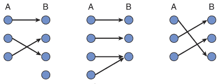
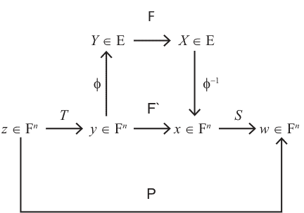

# 多变量密码学

## 章节目标

**阅读本章并完成复习问题后，您将能够：**

- 理解多变量密码学的基础
- 掌握特定算法的工作知识
- 理解这些算法的工作原理

术语 _多变量密码学_ 是指基于有限域 F 上多变量多项式的密码学原语。这些算法已被提出为抗量子算法。其中一些算法是 NIST 寻求抗量子标准项目的一部分。您可以访问该网站 https://csrc.nist.gov/projects/post-quantum-cryptography。

## 14.1 数学

本章中的算法要求您使用之前章节中介绍过的一些数学知识，以及对某些读者来说可能是新的内容。因此，我们有这份简要的章节来向您介绍所需的数学概念。我们还在介绍特定算法的章节中简要回顾了与特定算法相关的关键数学知识。

回顾第 1 章“必要线性代数简介”，一个域是一个代数系统，由一个集合、每个运算的单位元、两个运算及其各自的逆运算组成。您可以将域视为具有两个运算（而不是一个）的群，并且对这两个运算都有逆运算。有限域就是有限或有穷的域。第 11 章“当前非对称算法”在椭圆曲线密码学的背景下讨论了有限域。

我们需要探索的一个新概念是扩展域。如果我们有一个域 F，那么我们有一个域 E ⊆ F，使得 E 的运算就是 F 的运算，我们可以说 E 是 F 的子域，而 F 是 E 的扩展域。

多项式是由变量和系数组成的表达式，如方程 14.1 所示。

```
x² + 3x – 12
```

方程 14.1 一个多项式

方程 14.1 所示的多项式是一元多项式，因为它只有一个变量（也称为不定式）。多元多项式有多个变量，如方程 14.2 所示。

```
x² + 3y – 12z
```

方程 14.2 含多个变量的多项式

方程 14.2 是一个多元多项式。更精确地说，它是三元多项式，因为它有三个变量。多变量密码学是基于多元多项式的密码学算法的总称。

多元二次方程组问题（MQ）的本质是求解一个方程组 p1(x) = p2(x) = ... pm(x) = 0，其中每个 pi 都是关于 (x1, ..., xn) 的二次多项式，所有系数和变量都在具有 q 个元素的域 F_q 中。

多变量密码学使用陷门单向函数，其形式为多元二次多项式。公钥由一组公开的二次多项式给出，如下所示：

```
P = (p1(w1, ..., wn), ... pm(w1, ..., wn))
```

每个 pi 都是关于 w = (w1, ..., wn) 的非线性多项式。

陷门函数是一个在一个方向上相对容易计算，但在另一个方向上计算在计算上不可行的函数。基本上，如果不了解算法输入的具体细节，解决该问题将需要花费如此多的时间和计算资源，以至于不切实际。陷门函数是许多密码学算法的关键。我们在第 11 章中看到的离散对数和整数分解就是例子。考虑整数分解。将两个质数相乘得到一个整数是相当容易的。将该整数分解为其质因数则要困难得多。

除了多项式一词外，您还会频繁看到不可约多项式一词。这实际上正好意味着其名称所暗示的意思。这是一种不能分解为两个其他多项式乘积的多项式。换句话说，它不能再被约简。

回顾第 8 章“量子架构”，我们讨论了以下三个术语：单射、满射和双射。用最简单的话来说，*单射*意味着 A 中的所有内容都可以映射到 B 中的某个内容，但 B 中可能有与 A 中任何内容都不匹配的项。*满射*意味着每个 B 至少有一个匹配的 A，但 A 中可能实际上有多个匹配。*双射*意味着每个 A 都有一个 B，反之亦然。图 14.1（来自第 8 章）应能使您恢复记忆。



图 14.1 单射、满射和双射

某些这些算法使用仿射变换。一般来说，仿射变换是仿射空间的自同构。对于某些读者来说，这个定义可能不会带来任何清晰度。考虑几何的情况可能会有所帮助。在欧几里得几何中，仿射变换是一种几何变换，它将保留直线和平行性，但不一定保留角度和距离。从定义可以看出，这个术语起源于几何。

术语 *同构* 在多变量密码学中经常出现，如前几章简要讨论过。同构是在两个结构之间保持结构且可以反向的映射。故意使用 *结构* 一词，因为它相当模糊。同构可以应用于图论中的图、拓扑结构、代数结构等。

## 14.2 Matsumoto-Imai

Matsumoto-Imai 密码算法由 Tsutomu Matsumoto 和 Hideki Imai 于 1988 年发表，是最早公开的多变量系统之一，因此值得研究。该密码系统后来被破解，因此目前不再使用；然而，它在多变量密码学史上的重要性有必要进行简要考察。

该系统以一个我们称之为 F 的有限域开始，包含 q 个元素。然后我们有 g(X)，它是域 F 上的一个 n 次不可约多项式。然后我们有一个第二个域，我们称之为 E。E 是 F 的 n 次扩展。换句话说：

```
E = F[x]/g(x).
```

接下来，我们确定向量空 Fⁿ 和扩展域 E 之间的同构。我们将此同构表示为 ϕ。方程 14.3 描述了这个同构。


$$
\phi (x_1, x_2, ..., x_n) = \sum_{i=1}^n x_i^{q^{i-1}}
$$

### 方程 14.3 Matsumoto-Imai 同构

在扩展域 E 上存在一个从 F: E → E 的双射映射，如方程 14.4 所定义。

```
F(Y) = Y^{q^\theta + 1}
```

### 方程 14.4 Matsumoto-Imai 双射映射

方程 14.4 中 \theta 的值满足 0 < \theta < n，且 gcd (q^n - 1, q^\theta + 1) = 1。

为了能够反转映射 F，使用扩展欧几里得算法计算一个整数 h，使得 h(q^\theta + 1) = 1 mod (q^n - 1)。使用欧几里得算法（第 10 章中讨论过）来反转 F（得到 F^-1），我们得到如方程 14.5 所示的内容。

```
F^{-1}(x) = x^h = y^{h(q^\theta + 1) - k(q^n - 1)} = y
```

### 方程 14.5 Matsumoto-Imai 反转字段

公钥是方程 14.5 中显示的复合映射。

P = S F T，包含两个可逆线性映射：

S: F^n → F^n

T: F^n → F^n

私钥是 S、h 和 T。

要加密消息 M（表示为向量 z = (z_1, z_2, ..., z_n)），请使用方程 14.6。

```
w = P(z) ∈ F^n
```

### 方程 14.6 Matsumoto-Imai 加密

解密过程稍微复杂一些。需要采取一些步骤，从密文 w 开始：

- 1. x = S^{-1}(w) ∈ F^n
- 2. X = \phi (x)
- 3. Y = F^{-1} (X)
- 4. y = \phi^{-1} (Y)
- 5. z = T (y)

图 14.2 显示了系统中元素的一般关系。



图 14.2 Matsumoto-Imai 密码系统

虽然已证明 Matsumoto-Imai 密码系统存在安全缺陷，但它确实为其他多变量算法铺平了道路。如您在本章后面将看到，其中许多算法都是健壮的，并可能成为抗量子算法。还值得注意的是，已创建了许多作为 Matsumoto-Imai 变体的算法。

## 14.3 隐藏字段方程

隐藏字段方程 (HFE) 是一种公钥密码系统，由 Jacques Patarin 发明，并于 1996 年在 Eurocrypt 上首次公开。其加密安全性基于求解多元二次方程组的困难性，有时称为 MQ 问题。该算法作为 Matsumoto-Imai 系统的改进而创建。

该特定密码算法的数学基础并不过于复杂，但需要介绍一些新概念。我们从一个称为 F_q 的基字段开始。然后在此基字段上有两个扩展字段。我们的扩展字段是 F_q^n 和 F_q^m。让我们简要回顾一下扩展字段。首先，请记住第 1 章中讨论并在本章引言中复习过的字段定义。如果我们有一个字段 F，那么我们有一个字段 E ⊆ F，使得 E 的运算与 F 相同，我们可以说 E 是 F 的子字段，而 F 是 E 的扩展字段。

让我们用略有不同的术语来考察这一点。考虑我们之前的字段 E。我们还有一个字段 F，它包含 E 的所有元素以及其他额外元素。然而，E 和 F 中的运算是相同的。这将使字段 F 成为字段 E 的扩展。

首先，考虑一个有限字段 F_q，其中 q 是 2 的幂，以及某个扩展字段 G。G 的基是 B_1, B_2, ..., B_n。

接下来，考虑某个值 h，使得对于某个 \theta 值，h = q^\theta + 1 且 0 < h < q^n。以及与 h = q^\theta + 1 一起，考虑最大公约数 gcd (h, q^n - 1) = 1。换句话说，h 和 q^n - 1 除了 1 之外没有其他公因数，因此是互质的。这一切在 G 上导致了一对一的映射 u → u^h。逆映射是 u → u^{h'}，其中 h' 是 h 模 q^n - 1 的乘法逆元。

HFE 密码系统的概念是构建密钥，从在某个有限字段 F_q^n 上关于单个未知数 x 的多项式 P 开始。应当指出，在实际应用中，通常使用 q = 2，尽管 n 可以是任何数字（最好相当大）。现在我们有了这个字段 F_q^n 和多项式 P，可以求解方程 P(x) = y 的解（如果存在这样的解）。多项式 (p_1, p_2, ..., p_n) 被变换，使得公开信息隐藏结构并阻止反转。这是通过将有限字段 F_q^n 用作 F_q 上的向量空间并选择两个线性仿射变换来实现的。

S、P 和 T 的值构成私钥。作为回顾，我们的多项式 P 以及两个仿射变换 S 和 T 是私钥。公钥是有限字段 F_q 的 (p_1, ..., p_n)。

要加密消息 M，需要将其从字段 F_q^n 转移到 F_q'^n。消息 M 然后是向量 (x_1, x_2, ..., x_n) \in F_q'^n。密文通过在每个向量元素上求值每个多项式 p_i 生成。如方程 14.7 所示。

c = p_1(x_1, x_2, ..., x_n), p_2(x_1, x_2, ..., x_n), ..., p_n(x_1, x_2, ..., x_n) \in F_q^n

### 方程 14.7 HFE 加密

可以更紧凑地描述，如方程 14.8 所示。

c = P(z) \in F_q^n

### 方程 14.8 HFE 加密紧凑表达式

解密稍微复杂一些，与 Matsumoto-Imai 系统类似。回顾我们有 S、P 和 T 作为私钥。我们从反转仿射映射 S 开始，如方程 14.9 所示。

x = S^{-1} (c) \in F_q^n

### 方程 14.9 HFE 解密，步骤 1

也可以如方程 14.10 所示表达。

X = \phi (x)

### 方程 14.10 HFE 解密，步骤 1（替代表达式）

下一步是求解 F(Y) = X 的解 Y_1, ..., Y_k。如方程 14.11 所示。

y = { Y \in E : F(Y) = X }

### 方程 14.11 HFE 解密，步骤 2

第三步涉及方程 14.12。

```
y_i = \phi^{-1}(Y_i)
```

### 方程 14.12 HFE 解密，步骤 3

然后通过方程 14.13 生成明文。

```
z_i = T^{-1}(y_i)
```

### 方程 14.13 HFE 解密，最终步骤

HFE 有几种变体，每种都有其自身的优缺点；然而，这些变体的存在进一步说明了 HFE 的价值。

## 14.4 多元二次数字签名方案 (MQDSS)

顾名思义，该算法明确用于数字签名。它完全基于 MQ 问题。多元二次 (MQ) 多项式问题在本章前面已简要提及。了解 MQ 问题求解有多困难比其细节更重要。求解 MQ 问题的难度取决于多个参数，例如变量数量、方程数量、基字段大小等。对于希望探索此问题数学细节的读者，密码学研究国际协会 (IACR) 有一篇优秀的论文，标题为“MQ 挑战：求解多元二次问题难度评估”（https://eprint.iacr.org/2015/275.pdf）。

MQDSS 基于一个多元二次系统，如方程 14.14 所示。

```
P : F^n -> F^m
```

### 方程 14.14 MQDSS 系统

系数是随机选择的。然后，对于使用此特定 MQDSS 实现的用户，这些系数被固定。接着，每个用户从 F^n 中选择一个随机向量 s 作为其私钥。更明确地说，用户选择一个 s，使得

```
s \in F^n
```

公钥计算如下：

```
k = P(s) \in F^m
```

要进行验证，系统用户需要证明他知道二次系统 P(x) = v 的解，而不透露其私钥 s 的任何信息。如何证明这一点的具体细节对于我们当前的目的来说并不真正需要。需要理解的问题是，该系统是可证明安全的。

## 14.5 SFLASH

SFLASH 算法是为“新欧洲签名、完整性和加密方案”(NESSIE) 项目而创建的。NESSIE 是一个从 2000 年到 2003 年的欧洲项目，旨在识别安全的密码算法。该项目审查了对称、非对称和哈希算法。

SFLASH 设计为一种数字签名算法。关于该算法首先值得注意的是，它比 RSA 快得多。重要的是要记住，安全性只是成功算法的一个方面。为了实用，该算法还必须高效。为了更好地理解这一点，想象存在一种非对称算法，其安全性可衡量地高于 RSA、椭圆曲线密码学、NTRU 和 GGH；然而，该算法需要 30 分钟来加密一条消息。这样的算法如何用于电子商务等应用？消费者不太可能接受一个结账需要 30 分钟的电子商务网站。

SFLASH 是 Matsumoto-Imai 的一个变体。因此，理解该算法的数学将有助于您理解 SFLASH 算法。其思路是从公钥中移除少量方程。与 Matsumoto-Imai 一样，我们从具有 q 个元素的有限字段 F 开始。我们还有一个 n 次的扩展字段 E。然后我们定义一个同构 \phi F^n → E。密钥生成与 Matsumoto-Imai 的密钥生成非常相似。存在一个参数 \theta，使得 (q^n − 1, q^\theta + 1) = 1。

下一步是定义如方程 14.15 所示的一元映射。

```
F: E → E, F(Y) = Y^{q^\theta+1}
```

### 方程 14.15 SFLASH 一元映射

使用扩展欧几里得算法计算签名指数 h，如方程 14.16 所示。

```
h(1 + q^\theta) = 1 mod q^n - 1
```

### 方程 14.16 SFLASH 指数 h

与 Matsumoto-Imai 一样，存在一个仿射变换 T: F^n → F^n，并且在向量空间 F^n 上选择一个随机选取的可逆仿射变换：S: F^n → F^{n-a}。

私钥由两个映射 S 和 T 以及签名指数 h 组成。公钥 P 是如方程 14.17 所示的复合映射。

```
S \circ \phi^{-1}
```

### 方程 14.17 SFLASH 公钥


从本章开头所述可知，许多算法都是对 Matsumoto-Imai 的变体或改进。正如你所见，该算法与 Matsumoto-Imai 有些相似。

表 14.1 汇总了本章探讨的算法。

| Algorithm | Mathematical Basics |
| :--- | :--- |
| Matsumoto-Imai | 拥有 q 个元素的有限域 F。<br>g(X) 是在域 F 上的 n 次不可约多项式。<br>向量空间 F^n 与扩展域 E 之间的同构。<br>扩展域 E 上的双射 F: E → E。 |
| Hidden Field Equations (HFE) | 我们将称之为 F_q 的基域。<br>两个扩展域，F_q^n 和 F_q^m。<br>在某个有限域 F_q^n 上的单变量多项式 P。<br>S、P 和 T 构成私钥。 |
| Multivariate Quadratic Digital Signature (MQDSS) | P : F^n → F^m。<br>用户选择一个 s，使得 s ∈ F^n。<br>k = P(s) ∈ F^m。 |
| SFLASH | 一个同构，ϕ: F^n → E。<br>一元映射 F: E → E，F(Y) = Y^{θ+1}。 |

## 14.6 总结

本章重点介绍了多变量密码学。其中的部分数学内容对某些读者来说可能是新的。本章中的所有算法都是抗量子密码学的可行候选方案，因此值得研究。将本章与第 13 章“格密码学”和第 15 章“后量子密码学的其他方法”相结合，将使你对抗量子计算密码学算法有扎实的整体理解。

## 测试你的技能

## 复习题

- 1. 以下哪项是对域最准确的描述？
  - a. 一个集合、一个运算的恒等元、一个运算及其逆运算
  - b. 一个集合、每个运算的恒等元、两个运算以及其中一个运算的逆运算
  - c. 一个集合、一个运算的恒等元、两个运算及其各自的逆运算
  - d. 一个集合、每个运算的恒等元、两个运算及其各自的逆运算

- 2. 扩展域 E 上的双射 F: E → E 与以下哪种算法最密切相关？
  - a. Matsumoto-Imai
  - b. Hidden Field Equations
  - c. SFLASH
  - d. MQDSS

- 3. gcd (h, q^n – 1) = 1 与以下哪种算法最密切相关？
  - a. Matsumoto-Imai
  - b. Hidden Field Equations
  - c. SFLASH
  - d. MQDSS

- 4. 哪种算法具有公钥 k = P(s) ∈ F^m？
  - a. Matsumoto-Imai
  - b. Hidden Field Equations
  - c. SFLASH
  - d. MQDSS

- 5. ______ 签名算法比 RSA 快得多。
  - a. Matsumoto-Imai
  - b. Hidden Field Equations
  - c. SFLASH
  - d. MQDSS

本页故意留空
