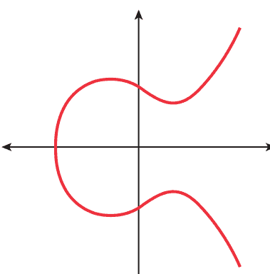
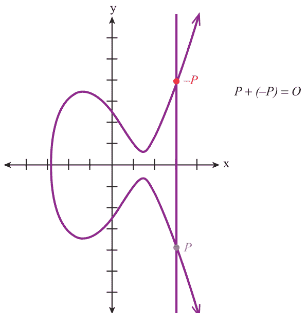
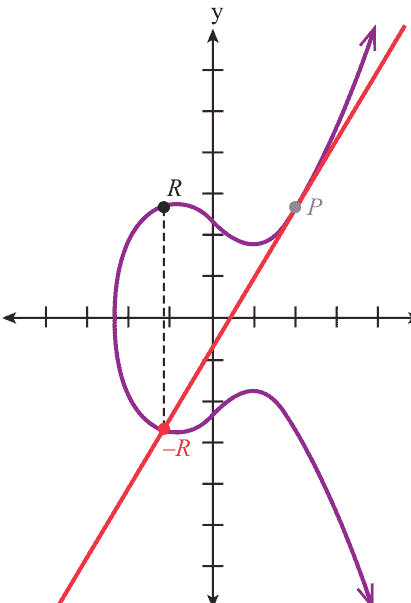
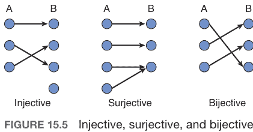

# 后量子密码学的其他方法

## 本章目标

阅读本章并完成复习题后，你将能够：

- 理解基于哈希的密码算法的基础
- 掌握基于代码的密码学的工作知识
- 解释超奇异同源密钥交换的概念
- 理解几个示例算法的细节

第 13 章“格密码学”和第 14 章“多变量密码学”向你介绍了各种被认为是抗量子的密码算法。本章将向你介绍一组不容易归入上述两类之一的密码算法。

## 15.1 哈希函数

在探讨哈希算法如何用于抗量子密码学之前，深入理解密码哈希非常重要。要成为密码哈希函数，算法需要具备三个特性。

- **该函数是单向的。** 这意味着该函数不能被“解哈希”。换句话说，它是不可逆的。这与加密算法相反，加密算法必须可逆才能解密。
- **变长输入产生定长输出。** 这意味着无论输入是 1 位还是 1 TB，算法都会输出相同大小的哈希值（也称为消息摘要）。每个特定的密码哈希算法都有特定的输出大小。例如，SHA-1 生成 160 位哈希值。
- **算法必须具有抗碰撞性。** 碰撞被定义为两个不同的输入产生相同的输出。如果你使用 SHA-1，那么你有一个 160 位的输出。因此，有 2^160 个可能的输出。显然，你可能有万亿个不同的输入却从未看到碰撞。应当注意的是，输出大小（也称为摘要或消息摘要）只是抗碰撞性的一个因素。算法本身的性质也会影响抗碰撞性。

密码哈希已被用于消息和文件完整性、取证图像完整性和密码存储；然而，也有方法可以将哈希作为加密/解密算法的基础。本章将探讨这类算法。

### 15.1.1 Merkle-Damgaard

许多密码哈希算法的核心都是 Merkle-Damgaard 构造。Merkle-Damgaard 函数（也称为 Merkle-Damgaard 构造）首次描述于 Ralph Merkle 于 1979 年发表的博士论文中，它是构建哈希函数的一种方法。Merkle-Damgaard 函数是 MD5、SHA-1、SHA-2 和其他哈希算法的基础。

Merkle-Damgaard 首先应用填充函数来创建某个特定大小（256 位、512 位、1024 位等）的输出。具体大小在不同算法之间会有所不同，但 512 位是许多算法使用的常见大小。然后，该函数一次处理一个块，将新的输入块与前一轮块合并。例如，考虑一个 1024 位的消息，将其分成四个单独的 256 位块。块 1 会被处理，然后其输出与块 2 合并，再处理块 2。然后该输出与块 3 合并，再处理块 3。最后，该输出与块 4 合并，再处理块 4。因此，Merkle-Damgaard 通常被称为压缩函数，因为它将整个消息压缩到一个输出块中。算法将以某个特定于实现的初始值或初始化向量开始。最后一个消息块始终填充到适当的大小（256 位、512 位等），并包含一个 64 位整数，用于指示原始消息的大小。

### 15.1.2 SWIFFT

滑动窗口无限快速傅里叶变换（SWIFFT）实际上并不是一个单一算法，而是一组函数。这些是可证明安全的哈希函数。SWIFFT 函数均基于快速傅里叶变换（FFT）。因此，从对 FFT 进行简要探讨开始对我们来说是一个合理的起点。

FFT 是一种计算序列离散傅里叶变换到频域表示的算法。它被称为“快”是因为它将 N 个点所需的计算次数从 N^2 减少到 N log_2 N。

现在让我们逐步了解这个算法。

第一步是选择一个多项式变量。这通常用符号 $\alpha` 表示。

现在你将输入要加密的消息。该消息通常用大写 M 表示，长度为 mn。mn 的值由 M 的长度定义，如下一步所述。

下一步是将消息 M 转换为 m 个多项式的集合。这些多项式由 $p_i` 表示，并且是在某个多项式环 R 中的多项式。回顾第 13 章中多项式环的定义：多项式环是由一组在另一个环上具有系数的一个或多个不定式的多项式组成的环。回顾我们在第 1 章“线性代数简介”中讨论过环。环是一个具有两个运算、一个恒等元和第一个运算逆运算的集合。多项式是由变量和系数组成的表达式。变量的另一个术语是不定式，就像在多项式环的定义中一样。

下一步是计算每个 $p_i` 的傅里叶系数。这些傅里叶系数定义为 $a_i`，是固定的。

接下来，你对每个 i 执行傅里叶系数 $p_i` 与傅里叶系数 $a_i` 的逐点乘法。随后使用逆快速傅里叶变换得到 m 个多项式 $f_n`，每个的次数小于 2n。

接下来，你将计算以下公式：

```
$f = \sum_{i=1}^m(f_i) mod p \text{ and } \alpha^n + 1$
```

最后，你将 f 转换为 n log(p) 位并输出这些位。

步骤总结如下：

- STEP 1. 选择一个多项式变量。
- STEP 2. 输入要加密的消息。
- STEP 3. 将消息转换为 m 个多项式的集合。
- STEP 4. 计算傅里叶系数。
- STEP 5. 对傅里叶系数 $p_i` 与傅里叶系数 $a_i` 执行逐点乘法。
- STEP 6. 计算公式 $f = \sum_{i=1}^m (f_i) mod p \text{ and } \alpha^n + 1`。

与许多其他可证明安全的算法不同，SWIFFT 被认为是快速的。SWIFFT 上存在一些已知攻击。其中包括广义生日攻击和反演攻击。广义生日攻击需要 $2^{106}` 次运算才能成功。反演攻击需要 $2^{445}` 次运算。这意味着破解 SWIFFT 是不切实际的。

对于希望深入了解 SWIFFT 的读者，以下链接可能有帮助：https://www.alnrosen.net/PAPERS/lattices/swifft.pdf。


生日攻击在密码学中非常重要，有一个数学谜题可以帮助不熟悉这些攻击的读者。它被称为生日悖论（有时也称为生日问题）。问题在于：你需要在一个房间里有多少人，才能有很大可能性让两个人有相同的生日（即，月份和日期，而不是年份）。显然，如果你把 367 个人放在一个房间里，那么至少有两个人必须有相同的生日，因为一年只有 365 天（闰年还有 2 月 29 日）。然而，我们并不是在问需要多少人才能*保证*匹配，只是需要多少人才能有很高的概率。有趣的是，即使房间里只有 23 个人，你也有 50% 的几率让两个人有相同的生日。

这是怎么可能的？如此低的数字怎么可能奏效？基本概率告诉我们，当事件相互独立时，所有事件发生的概率等于各事件概率的乘积。因此，第一个人不与任何先前的人共享生日的概率是 100%，因为集合中没有先前的人。这可以写成 365/365。现在，对于第二个人，只有一个先前的人，第二个人与第一个人生日不同的概率是 364/365。对于第三个人，有两个先前的人他或她可能与之共享生日，因此与两个先前的人任何一个生日都不同的概率是 363/365。因为每个事件都是独立的，我们可以按如下方式计算概率：

365/365 * 364/365 * 363/365 * 362/365 ... * 342/365（342 是第 23 个人与先前的人共享生日的概率。）

让我们将这些转换为小数值，结果为（截断至第三位小数）：

0.997 * .994 * .991 * .989 * .986 * ... * .936 = .49，即 49%。

这个 49% 是他们没有共同生日的概率，因此 23 个人中有两个人生日相同的概率为 51%（优于均等机会）。

仅供参考，如果房间里有 30 个人，两个人有相同生日的概率是 70.6%。如果有 50 个人，概率上升到 97%，这非常高。这不仅仅适用于生日。同样的概念可以应用于任何一组数据。它经常用于密码学和密码分析。生日悖论代表了在哈希算法中获得冲突的一个准则。

在密码学哈希函数方面，目标是找到两个产生相同输出的不同输入。当两个输入从密码学哈希中产生相同输出时，这被称为冲突。有趣的是，从任何 n 元素的集合中获得匹配或冲突所需的样本数为 1.174 √n。回到前面的生日问题，1.174 √365 = 22.49。

### 15.1.3 Lamport 签名

Lamport 签名算法由莱斯利·兰波特于 1979 年发表，已经存在很长时间了。可以使用任何密码学安全的单向函数来创建 Lamport 签名。基于前面的哈希函数讨论，应该清楚，密码学哈希函数常用于此目的。

该算法从生成密钥对开始。一方使用伪随机数生成器创建 256 对随机数。生成的每个数字大小也为 256 位。因此，总共生成了大约 128 KB 的数字——即，（2 * 256 * 256） / 1024。这个 128 KB 的数字作为私钥保存。

为了生成公钥，这些 512 个随机数（2 * 256）中的每一个都被哈希。这导致总共 512 个哈希，每个大小为 256 千字节。这是与任何可能需要它的人共享的公钥。

顾名思义，此算法用于数字签名。数字签名的目的不是保持消息机密性，而是确保消息完整性。例如，当一封电子邮件被签名时，这并不能阻止非预期收件人以外的人阅读它。然而，它确实允许收件人验证是谁发送的。

生成密钥的发送者现在希望签署一条消息。第一步是对消息进行哈希，以产生 256 位哈希或摘要。然后，对哈希中的每一位，从构成私钥的对中选择一个数字。这通常意味着如果位为 0，则使用第一个数字；如果为 1，则使用第二个数字。这将产生一组 256 个数字，每个 256 位长。因此，签名为 64 KB。与其他一些签名算法不同的是，签名只能使用一次。发送者随后将销毁使用的私钥。

为了验证签名，收件人也会对消息进行哈希以获取 256 位哈希/摘要。然后，收件人使用该哈希/摘要中的位从发送者的公钥中选出 256 个哈希。他使用与发送者相同的选择方法（即，如果为 0，使用第一个哈希；如果为 1，使用第二个）。现在，收件人将对发送者签名中的每个 256 个随机数进行哈希。如果所有这些都与从发送者公钥中选出的 256 个哈希完全匹配，则签名已验证。如果有任何不匹配，则拒绝签名。这些步骤在图 15.1 中总结。


- 1. 生成 128 KB 私钥
- 2. 哈希消息 = 256 位
- 3. 哈希中的每一位 = 私钥中的 1 个数字
- 4. 这会生成 256 个数字，大小为 64 KB
- 5. 选择发送者公钥的 256 个哈希
- 6. 对发送者签名中的每个数字进行哈希
- 7. 匹配哈希

图 15.1 Lamport 签名

## 15.2 基于代码的密码学

术语 *基于代码的密码学* 是指以纠错码为基础的密码系统。其中一些算法已经存在很长时间，甚至数十年。随着量子计算的进步，这些算法重新引起了兴趣。人们对抗量子密码学有着明确的兴趣。

### 15.2.1 McEliece

McEliece 密码系统以其发明者罗伯特·麦克艾利斯的名字命名。该算法发表于 1978 年。这使得它或许是被提议为抗量子的最古老的算法。尽管年代久远，但该算法已被证明对 Shor 算法免疫。

McEliece 的安全性基于解码一般线性码的难度。对于不熟悉该主题的读者，这里简要介绍一下一般线性码。线性码用于纠错。存在代码的线性组合。线性码经常用于前向纠错。Hamming 码是线性码的一个经典示例。Hamming 码可以检测错误并纠正错误。

该算法有一些部分可能看起来模糊。这是因为可以选择的线性码具有一定的灵活性。因此，线性码的具体细节在算法中未详述。我们将从密钥生成开始，这通常是非对称算法中最复杂的部分：

- 1. 生成密钥的人必须选择一个线性码，我们将称其为 C。线性码通常具有生成矩阵的函数；我们称这些函数为生成器。因此，线性码 C 将有一个生成器 G。所选的 C 还应产生一个我们将称之为 A 的解码算法。该代码能够纠正 t 个错误。
- 2. 生成密钥的人必须选择一个随机的 k × k 二进制非奇异矩阵，我们将称其为 S。请记住，非奇异矩阵是可逆的方阵。
- 3. 生成密钥的人选择一个随机的 n × n 排列矩阵，我们将称其为 P。排列矩阵是一个方形二进制矩阵，每一行和每一列恰好有一个 1，其余为 0。
- 4. 生成密钥的人需要计算一个 k × n 矩阵，我们将称其为 H。这是通过 SGP 计算的（即，非奇异矩阵乘以生成器，然后该乘积乘以排列矩阵）。

公钥是 (H, t)，私钥是 (SPA)。

现在加密相对简单。发送者获取一条长度为 k 位的二进制消息 m。然后发送者计算这个简单的公式：

```
c' = mH
```

接下来，发送者生成一个随机的 n 位向量，我们将称其为 z，该向量恰好包含 t 个 1。密文 c = c' + z。


接收方将按照以下步骤进行解密：

- 1. 计算 P 的逆。我们将其称为 P⁻¹。
- 2. 计算 d = cP⁻¹。
- 3. 使用解码算法 A 将 d 解码为 m′。

然后使用这个相当简单的公式对原始消息 m 进行解密：

m = m′S⁻¹

正如你所见，一般过程并不像我们在本章以及第 13 章和第 14 章中考察的一些算法那样复杂。但是，有一些我们未定义的问题。这是因为 McEliece 密码体制未定义必须选择的代码 C，而该选择又将决定生成矩阵 G 和解码算法 A。因此，在描述 McEliece 时，这些方面并未明确定义。

对这些代码有深入理解并不关键，但对于感兴趣的读者，让我们来探讨一种常用于 McEliece 密码体制应用的代码类型。这些是二进制 Goppa 码。二进制 Goppa 码是以瓦列里·戈帕命名的 Goppa 码类的一个子集。

二进制 Goppa 码由某有限域上次数为 t 的多项式 g(x) 以及来自 GF(2ᵐ) 的 n 个不同元素的序列定义，该有限域通常表示为 GF(2ᵐ)，且这些元素不是该多项式的根。

McEliece 密码体制最初使用的参数为 n = 1024、k = 524 和 t = 50。近期的密码分析建议使用更大的参数，例如 n = 2048、k = 1751、t = 27，甚至更大。为了真正抵抗量子计算机，建议使用 n = 6960、k = 5413 和 t = 119 或更大的参数。这会产生一个相当大的公钥，为 8,373,911 位。关于 McEliece 最需要记住的是，如同在第 13 章中描述的 NTRU 一样，该算法已进入 NIST 量子计算标准选拔过程的第三轮。

### 15.2.2 Niederreiter 密码体制

该 Niederreiter 密码体制由哈拉尔德·尼德赖特于 1986 年开发，是 McEliece 密码体制的一个变体。在继续本节之前，最好确保你已十分熟悉 McEliece。

Niederreiter 密码体制的安全性与 McEliece 相对相同；然而，其加密过程比 McEliece 更快，这使其在密码学中颇具趣味。它也通常使用二进制 Goppa 码，如前面讨论过的那样。密钥生成与 McEliece 相当相似：

- 1. 选择一个二进制 (n, k)-线性 Goppa 码 G，该码能够纠正 t 个错误。该码具有一个解码算法 A。
- 2. 为代码 G 生成一个 (n – k) × n 奇偶校验矩阵 H。
- 3. 选择一个随机的 (n – k) × (n – k) 二进制非奇异矩阵 S。
- 4. 选择一个随机的 n × n 置换矩阵；我们将再次将其称为 P。
- 5. 计算 (n – k) × n 矩阵 H P = S H P。

公钥为 (H P, t)，私钥为 (S, H, P)。

要将消息 m 作为二进制字符串 e^m（即长度为 t 的字符串）进行加密，密文按以下公式生成：

c = H P e^t

与 McEliece 体制相比，加密稍微简单一些，但解密与 McEliece 解密颇为相似：

- 1. 从 HPm′ 计算 S⁻¹c（即，S⁻¹c = HPm′）。
- 2. 使用 G 的解码算法恢复 Pm′。
- 3. 消息 m = P⁻¹Pm′ᵀ。

Niederreiter 密码体制的另一个用途是数字签名，这实际上是 Niederreiter 的一个常见应用。

## 15.3 超奇异同源密钥交换

该特定算法的名称可能听起来相当令人生畏，但其全称可能会让你松一口气：超奇异同源 Diffie-Hellman 密钥交换。如果你记得第 11 章“当前非对称算法”中对 Diffie-Hellman 的描述，并牢记该算法的目的是密钥交换，那么你可能会觉得它稍微容易理解一些。

这是一个较新的算法，发表于 2011 年。它从椭圆曲线运算开始，你在第 11 章中简要了解过。在本章中，我们将首先扩展关于椭圆曲线的知识，然后描述此算法。

### 15.3.1 椭圆曲线

椭圆曲线可用于形成群，因此适用于密码学目的。椭圆曲线群有两种类型。最常见的两种（也是密码学中使用的两种）是基于 Fᵖ（其中 p 为素数）的椭圆曲线群和基于 F²ᵐ的椭圆曲线群。F，如你在本章中将看到的，是所使用的域。使用 F 是因为我们在描述一个域。椭圆曲线密码学是一种基于有限域上的椭圆曲线的公钥密码学方法。

请记住，域是一个代数系统，由一个集合、每个运算的单位元、两个运算及其各自的逆运算组成。有限域（也称为加罗瓦域）是具有有限个元素的域。该数字称为域的阶。用于密码学目的的椭圆曲线最早由维克多·米勒和尼尔·柯布利茨在 1985 年描述。椭圆曲线密码学的安全性基于这样一个事实：相对于公开已知的基点，查找随机椭圆曲线元素的离散对数在难以实践的程度上很难。

椭圆曲线是满足特定数学方程的点集。椭圆曲线的方程大致如下：

```
y² = x³ + Ax + B
```

你可以在图 15.2 中看到该方程的图像。



**FIGURE 15.2** 椭圆曲线的图像

椭圆曲线使用的运算是加法（请记住群的定义要求一个集合及一个运算）。因此，椭圆曲线形成加法群。

请回顾本书前面提到的，群是一个代数系统，由一个集合、一个单位元、一个运算及其逆运算组成。阿贝尔群或交换群有一个额外公理：如果运算是加法，则 a + b = b + a；如果运算是乘法，则 ab = ba。循环群是其所有元素都是其某个元素的幂的群。

椭圆曲线域的成员是椭圆曲线上的整数点。你可以对椭圆曲线上的点进行加法运算。在本章以及大部分椭圆曲线文献中，我们考虑两个点：P 和 Q。点 P = (xP, yP) 的负点是其关于 x 轴的反射点：点 −P 为 (xP, −yP)。请注意，椭圆曲线上的每个点 P，其点 −P 也在曲线上。假设 P 和 Q 是椭圆曲线上的两个不同点，且假设 P 仅仅是 Q 的逆元。要加法点 P 和 Q，需过这两点作一条直线。这条直线将在椭圆曲线上恰好再交于一个点，称为 –R。点 –R 关于 x 轴反射得到点 R。椭圆曲线群中的加法法则为 P + Q = R（Bos 等，2004年）。

过 P 和 –P 的直线是一条垂直线，不与椭圆曲线在第三点相交；因此，点 P 和 –P 不能像以前那样相加。正是出于这个原因，椭圆曲线群包含无穷远点 O。根据定义，P + (–P) = O。作为该方程的结果，在椭圆曲线群中 P + O = P。O 称为椭圆曲线群的加法单位元；所有椭圆曲线都有一个加法单位元（参见图 15.3）。



FIGURE 15.3 P + (–P)

要将点 P 加到自身上，需在点 P 处作曲线的切线。如果 yP 不为 0，则切线将与椭圆曲线恰好再交于一个点 –R，该点关于 x 轴反射得到 R。此运算称为点 P 的倍点运算，如图 15.4 所示。



FIGURE 15.4 点 P 的倍点

如果 yP = 0，则来自 P 的切线总是垂直的。

如果点 P 满足 yP = 0，则椭圆曲线在 P 处的切线是垂直的，且不与椭圆曲线在任何其他点相交。根据定义，对于这样的点 P，2P = O。

请回顾，域 Fᵖ 使用 0 到 p – 1 的数字，计算结束时对 p 取余（即模运算）。例如，在 F₂₃ 中，该域由 0 到 22 的整数组成，该域内的任何运算结果也将在 0 到 22 之间的整数。

通过在 Fᵖ 域内选择变量 a 和 b，可以形成底层域为 Fᵖ 的椭圆曲线。该椭圆曲线包括所有满足模 p 下椭圆曲线方程的点 (x, y)（其中 x 和 y 是 Fᵖ 中的数字）。

例如，如果 a 和 b 在 Fᵖ 中，则 y² mod p = x³ + ax + b mod p 的底层域为 Fᵖ。

如果 x³ + ax + b 不含重复因式，则该椭圆曲线可用于形成群。Fᵖ 上的椭圆曲线群由相应椭圆曲线上的点以及一个称为无穷远点的特殊点 O 组成。这样的椭圆曲线上有有限多个点。


### 15.3.2 SIDH

现在您已经回顾了椭圆曲线的基础知识，我们可以继续讨论超奇异同源 Diffie-Hellman（SIDH）。我们需要添加一些额外的概念。首先，考虑椭圆曲线的方程：

```
y² = x³ + ax + b
```

现在我们加入一个新概念：椭圆曲线的 j-不变量。我们将以一些文本略有不同的方式来处理这个问题。我们将从解释开始，然后再进行数学推导。考虑椭圆曲线 E ⊂ P² 的一个模型。P 是 E 的一个元素（即，P ∈ E）。回顾我们之前关于椭圆曲线的讨论，可以穿过曲线画直线。有些直线穿过 P 且与 E 相切。这些直线是不变的。

由函数 y² = x³ + ax + b 描述的椭圆曲线的 j-不变量由以下公式给出：

```
j(E)=1728 \frac{4a^3}{4a^3+27b}
```

当曲线是等距的时，它们在闭域上将具有相同的 j-不变量。在此情况下，术语 *等距的* 是指两组之间存在一个函数，该函数在组的元素之间建立一一对应关系。此外，该函数尊重给定的组运算。在第 11 章中，当我们讨论椭圆曲线密码学时，我们指出椭圆曲线是代数群。因此，此处讨论的事实是，如果两条曲线是等距的，它们将具有相同的 j-不变量（在闭域上）。

这仍然留下了术语 *同源* 未被探讨。在此语境下，同源是代数群的一个满态态射，并且具有有限核。核是我们尚未探讨的代数学方面。就目前的目的而言，您只需知道，当您有一个同态（同构是一种同态）时，核就是 0 的原像。这需要稍微解释一下什么是原像。考虑某个从 X 到 Y 的函数 f（函数的具体细节对我们的讨论无关紧要）。现在考虑一个集合 S ⊆ Y。S 的原像是子集 T，定义如下：

```
f^{-1}[S] = \{x \in X | f(x) \in S\}
```

回顾第 8 章“量子架构”中，*满射的* 是指对于 Y 中的每个元素，在 X 中至少有一个元素，且该元素不必是唯一的。图 15.5 最初出现在第 8 章中（也在第 14 章中使用），应该能让您恢复记忆。



超奇异同源 Diffie-Hellman 确实涉及一些超出本入门书范围的数学。然而，重要的是您要对更基础的数学方面有一个大致的了解，并且理解 SIDH 是一种密钥交换算法。然而，对于那些具有更严谨数学背景的读者，这里将呈现数学内容。

您可能还记得第 11 章中的虚构人物 Alice 和 Bob，他们自 1977 年 RSA 原始论文发表以来一直被用于演示非对称密码学。Alice 和 Bob 将各自拥有一种特定形式的素数。这些形式如下所示：

```
$E[L^a A^a]$ and $E[L^b B^b]$
```

大写字母 A 代表 Alice 的值，大写字母 B 代表 Bob 的值，这应该相对清晰。Alice 和 Bob 将各自从各自的扭率子群中选择一个随机循环子群（这将是保密的），并计算相应的同源。

该步骤可能包含几个您不熟悉的项目。您应该回顾第 1 章中关于群和阿贝尔群的讨论。回顾，群是由一个集合、一个恒等元、一个运算及其逆运算组成的代数系统。阿贝尔群在此基础上增加了交换律的要求。扭率子群是阿贝尔群的一个子群，由阿贝尔群中所有具有有限阶的元素组成。在这里，阶是群论中的一个术语，指基数（即元素的数量）。如果阿贝尔群中的所有元素都具有有限阶（即元素的数量），则该群被称为扭率群。最后，回顾，循环群是由一个元素的所有幂组成的群。因此，例如，如果您从元素 x 开始，则循环群的成员将如下所示：

```
x^-2, x^-1, x^0, x^1, x^2, x^3, ...
```

回到我们关于 Bob 和 Alice 所做事情的讨论：他们现在将发布其同源的目标曲线的方程。这允许双方私下（更重要的是，秘密地）从 E 计算新的同源，因此他们将拥有相同的共享密钥。为什么他们会得到相同的共享密钥？因为曲线具有共同的 j-不变量，因此是同构的。

让我们总结一下步骤。首先，我们有 Alice 和 Bob 都要完成的设置过程：

- 1. 形式为 \(E[L^c A^a] * E[L^{cb}] * f \pm 1\) 的素数。
- 2. 在 \(fp^2\) 上的超奇异椭圆曲线 E（一个有限域）。
- 3. 曲线 E 上的固定椭圆点，这些点为 \(P_A, Q_A, P_B, Q_B\)（请记住 P 和 Q 是椭圆曲线上的点）。
- 4. \(P_A\) 和 \(Q_A\) 的阶为 \((lA)^{eA}\)。\(P_B\) 和 \(Q_B\) 的阶为 \((lB)^{eB}\)。

这将使 Alice 和 Bob 都拥有密钥交换所需的材料。接下来，我们有一系列密钥交换步骤。有些由 Alice 执行，有些由 Bob 执行。

Alice 生成两个随机整数：\(m_A, n_A < (lA)^{eA}\)。Alice 生成 \(R_A := m_A * (P_A) + n_A (Q_A)\)。回顾第 2 章“复数”中，符号 := 表示“定义为”。Alice 使用前一步中创建的点 \(R_A\)，来创建一个同源映射 \(E \rightarrow E_A\)，我们将其称为 \(\phi_A\)，以及与曲线 E 同源的曲线 \(E_A\)。Alice 现在将刚刚创建的映射 \(\phi_A\) 应用于 \(P_B\) 和 \(Q_B\)（请记住 Bob 创建了这些点），以在曲线 \(E_A\) 上形成两个点。这些点是 \(\phi_A P_B\) 和 \(\phi_A Q_B\)。Alice 向 Bob 发送三项内容：\(E_A, \phi_A P_B, \text{和 } \phi_A Q_B\)。现在是 Bob 执行其步骤的时候了，以便双方拥有共享密钥。Bob 将基本上做 Alice 做的相同事情；仅下标与 Alice 使用的相反：

- 1. Bob 生成两个随机整数：\(m_B, n_B < (lB)^{eB}\)。
- 2. Bob 生成 \(R_B := m_B * (P_B) + n_B (Q_B)\)。
- 3. Bob 使用前一步中创建的点 \(R_B\)，来创建一个同源映射 \(E \rightarrow E_B\)，我们将其称为 \(\phi_B\)，以及与曲线 E 同源的曲线 \(E_B\)。
- 4. Bob 现在将刚刚创建的映射 \(\phi_B\) 应用于 \(P_A\) 和 \(Q_A\)（请记住 Alice 创建了这些点），以在曲线 \(E_B\) 上形成两个点。这些点是 \(\phi_B P_A\) 和 \(\phi_B Q_A\)。
- 5. Bob 现在向 Alice 发送三项内容：\(E_B, \phi_B P_A, \text{和 } \phi_B Q_A\)。

现在 Alice 和 Bob 已经交换了材料，因此他们可以创建一个共享密钥。

Alice 可以使用她从 Bob 那里收到的部分以及她生成的项目，如下所示：

- 1. \(m_A (\phi_B (P_A)) + n_A (\phi_B (Q_A)) = S_{BA}\)。
- 2. Alice 使用 \(S_{BA}\) 创建一个同源映射，我们将其称为 \(\psi_{BA}\)。
- 3. Alice 使用 \(\psi_{BA}\) 创建一个椭圆曲线 \(E_{BA}\)，它与 E 同源。
- 4. Alice 计算曲线 \(E_{BA}\) 的 j-不变量。我们可以将此 j-不变量称为 K（您稍后就会明白为什么）。

Bob 将做几乎相同的事情：

- 1. \(m_B(\phi_A(P_B)) + n_B(\phi_A(Q_B)) = S_{AB}\)。
- 2. Bob 使用 \(S_{AB}\) 创建一个我们将称之为 \(\psi_{AB}\) 的同源映射。
- 3. Bob 使用 \(\psi_{AB}\) 创建一个椭圆曲线 \(E_{AB}\)，它与 E 同源。
- 4. Bob 计算曲线 \(E_{AB}\) 的 j-不变量。我们可以将此 j-不变量称为 K。我们称之为 K，因为如果曲线是同源的，它们会生成相同的 j-不变量，现在我们有了一个供 Alice 和 Bob 使用的共同密钥。

是的，这是一个相当长的过程，包含许多步骤。它也可能会超出一些读者的数学范围。然而，它是抗量子计算机密钥交换算法的竞争者之一。因此，如果有必要，值得多次阅读本节，以确保您至少对算法的轮廓感到大致自如。

对于那些希望深入了解该算法的读者，国际密码学研究协会（IACR）有一篇优秀的论文将深入探讨：https://eprint.iacr.org/2019/1321.pdf。学习新事物时，尤其是相对有挑战性的事物，阅读两个或更多不同的解释通常很有帮助。


## 15.4 摘要

在本章中，我们考察了为抗量子方案提出的不同类型的算法。我们考察了哈希函数、基于编码的密码学和超奇异同源密钥交换。本章中的一些数学对某些读者来说可能有点严谨。请记住，除非你打算在抗量子密码学领域工作，否则你不必把每个算法的每个细节都清清楚楚地记在脑子里。只要你有大致的了解，就足够了。

## 测试你的技能

## 复习问题

- 1. 许多加密哈希函数的核心是一个(n) ________。
- a. Merkle-Damgaard 构造
- b. 伪随机数生成器
- c. 同源
- d. 错误纠正码

- 2. 以下哪种算法的私钥是 (SPA)？
- a. SWIFFT
- b. SIDH
- c. Lamport
- d. McEliece

- 3. ________ 密码系统最初使用的参数是 n = 1024，k = 524，t = 50。
- a. SWIFFT
- b. SIDH
- c. Lamport
- d. McEliece

- 4. ________ 密码系统通常使用二进制 Goppa 码。
- a. Niederreiter
- b. McEliece
- c. Lamport
- d. SWIFFT

- 5. 有限域，也称为 ______，是具有有限数量元素的域。
- a. 扭转群
- b. Galois 域
- c. 阿贝尔群
- d. 扭转场

- 6. 当曲线是 _____ 时，它们在闭域上将具有相同的 j-不变量。
- a. 同构的
- b. 等度的
- c. 满射的
- d. 双射的

此页故意留空
