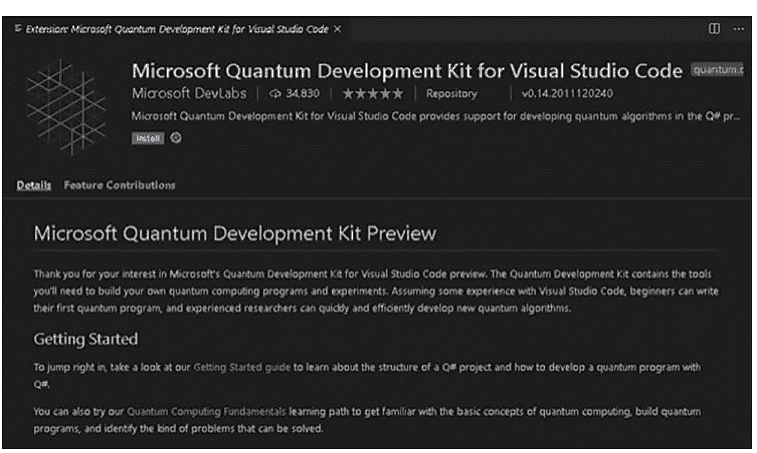
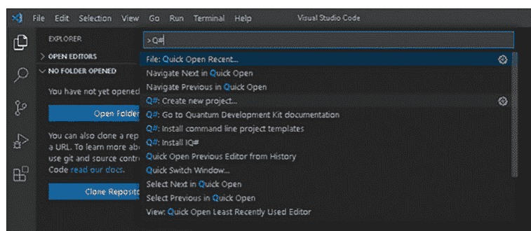
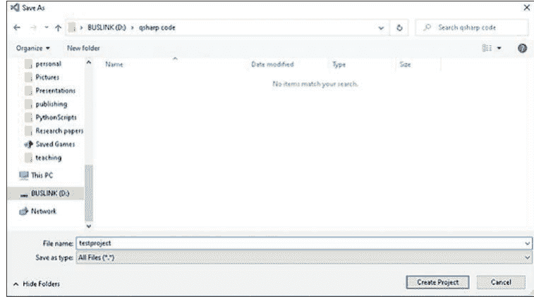
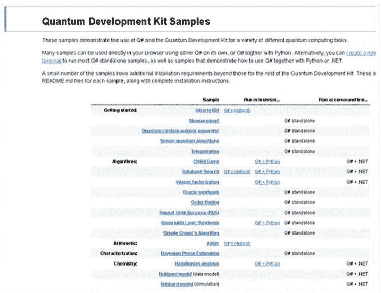
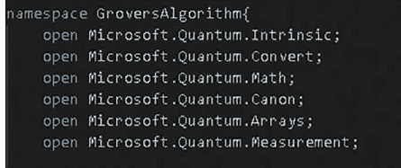
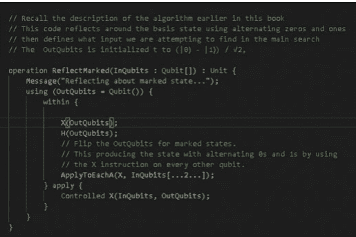
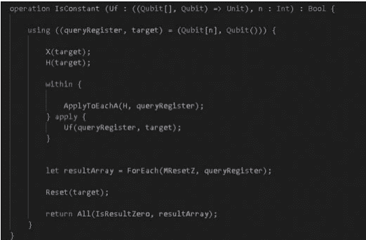
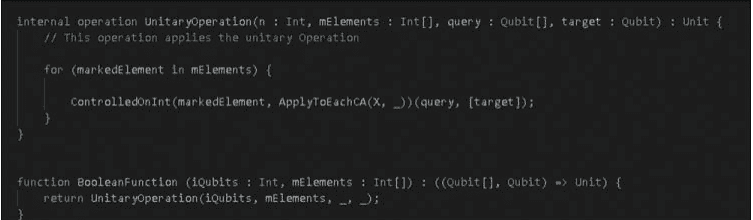
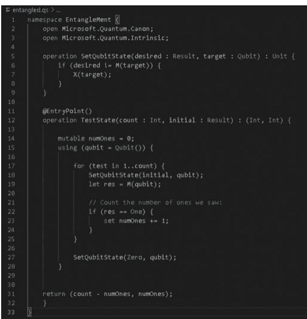

# 使用 Q#

## 章节目标

阅读本章并完成复习问题后，你将能够做到以下几点：

- 了解 Q# 的基础知识
- 编写 Q# 程序
- 使用 Q# 创建量子模拟

Microsoft 开发 Q# 作为一种相对易于使用的量子编程语言。Microsoft 于 2018 年 9 月首次宣布 Q#，并于 2018 年 12 月发布。Q# 在语法结构上基于 C#，但包括创建量子逻辑门以及模拟纠缠的能力。

如果你没有编程经验，也不必过于担心。在“入门 Q#”一节中，我们将假设你完全没有编程经验来介绍一个基本的 Q# 程序。还有一个名为“基本编程概念”的部分，我们将从这里开始。

## 16.1 基本编程概念

本节适用于编程经验非常有限的读者。如果你有编程经验，尤其是 C# 经验，那么你可能希望浏览本节，以便至少了解一些 Q# 特有的内容。

### 16.1.1 变量和语句

一般而言，所有程序都会处理某种数据。无论程序的目的是什么，都必须处理数据。数据必须在程序中临时存储。这是通过变量来实现的。变量只是内存中留出的一个位置，用于保存特定类型的数据。之所以称为变量，是因为它的值或内容可以改变或变化。当你创建一个变量时，你实际上是为存储目的留出一小块内存。你给变量起的名称实际上是内存中该地址的标签。例如，你按以下方式声明一个变量：

```
int j;
```

在这种情况下，你刚刚分配了 4 字节的内存（整数使用的大小），并且你使用变量 j 来引用这 4 字节的内存。现在，每当你在代码中引用 j 时，你实际上是在引用内存中的一个特定地址。表 16.1 列出并描述了 Q# 中可用的基本数据类型。

### 表 16.1 Q# 数据类型

| 数据类型 | 描述 |
| :--- | :--- |
| Unit | 表示一个单例类型，其唯一值为 ( )。 |
| Int | 表示一个 64 位（4 字节）有符号整数。值范围从 –9,223,372,036,854,775,808 到 9,223,372,036,854,775,807。 |
| BigInt | 表示任意大小的有符号整数值。 |
| Double | 表示双精度 64 位浮点数。值范围从 –1.79769313486232e308 到 1.79769313486232e308。 |
| Bool | 表示布尔值（true/false）。 |
| String | 表示由 UTF-16（2 字节）代码单元序列组成的文本值。 |
| Qubit | 表示一个量子比特。Qubit 类型的值通过分配来实例化。 |
| Result | 表示对具有特征值 ±1 的量子算子特征空间进行投影测量的结果。可能的值为 0 和 1。 |
| Pauli | 表示单量子比特 Pauli 矩阵。可能的值为 PauliI、PauliX、PauliY 和 PauliZ。 |
| Range | 表示一个等间距的 Int 值有序序列，按升序或降序排列。 |
| Array | 表示每个值都包含同一类型值序列的值。 |
| Tuple | 表示每个值都包含固定数量不同类型项目的值。包含单个元素的元组等同于其包含的元素。 |

有了变量后，下一个构建块是语句。语句只是执行某个操作的单行代码。该操作可能是声明变量、相加两个数字、比较两个值，或几乎任何其他操作。所有语句/表达式都以分号结尾。这在许多编程语言中都成立，包括 Java、C 和 C#。几个示例语句将帮助你澄清这一点：

```
int acctnum;
acctnum = 55555;
acctnum = acctnum + 5;
```

每条语句执行不同的操作，但它确实执行了某个操作，并且以分号结尾。在许多编程语言中，_语句_ 和 _表达式_ 这两个术语被混用。在 Q# 中，表达式是一种特殊的语句。Q# 有一些非常特定的语句。表 16.2 显示了可能的语句类型。

### 表 16.2 Q# 语句类型

| 语句类型 | 描述 |
|---|---|
| 变量声明 | 定义一个或多个局部变量，这些变量在当前作用域的其余部分保持有效，并将其绑定到指定的值。还有变量重新赋值语句，用于更改变量的值。 |
| 表达式语句 | 表达式语句由返回 Unit 的操作或函数调用组成。被调用的可调用对象需要满足当前上下文施加的要求。 |
| 返回语句 | 返回语句终止当前可调用上下文中的执行，并将控制权返回给调用者。 |
| 失败语句 | 失败语句中止整个程序的执行，在终止并出错之前收集当前程序状态的信息。 |
| 迭代 | 迭代是一种类似循环的语句，在每次迭代期间，它将声明的循环变量分配给序列（Array 或 Range 类型的值）中的下一项，并执行指定的语句块。 |
| 重复语句 | 基于条件中断的量子特定循环。该语句由一个初始语句块组成，该语句块在评估指定条件之前执行。如果条件评估为 false，则在进入循环的下一次迭代之前，会执行可选的后续修复块。 |
| 共轭 | 共轭是一种特殊的量子特定语句，其中执行将单变换应用于量子状态的一组语句，然后执行另一组语句，然后再恢复第一组语句应用的变换。在数学符号中，共轭描述了对量子状态的 U†VU 形式的变换。 |
| 量子比特分配 | 实例化并初始化量子比特和/或量子比特数组，然后将其绑定到声明的变量。执行一组语句。实例化的量子比特在块期间可用，并在语句终止时自动释放。 |

Q# 中还有一种特殊类型，称为 _不可变_。顾名思义，它不能更改。它就像其他编程语言中的常量。如果你使用 `let` 语句，那么你就是将类型设为不可变。因此，如果你说

```
let myvar = 3
```

则 `myvar` 的值为 3 且不能更改。

现在你已经了解了变量声明和语句，是时候检查 Q# 程序的基本结构了。所有程序，无论使用哪种编程语言，都有组件。在 Q# 中，如


与许多编程语言一样，组件由括号 {} 定义。以下是使用 Q# 编写的“Hello World”应用程序：

```
@EntryPoint()
operation Hello() : Unit {
    Message("Hello quantum world!");
}
```

请注意，我们有一个名为 Hello 的操作。这个特定的程序只有一个名为 Hello 的函数/操作。请注意，括号中没有内容。在括号内是为函数放置参数（也称为形参）的地方。参数是你传递给函数以使其工作的内容。例如，要对一个数求平方，我们必须提供该数。学生经常问我，我需要放什么作为参数？这个函数到底需要参数吗？我会告诉他们一样的话。问问自己这个问题：如果我想让别人替我完成这项任务，我需要给他们什么吗？如果是，那是什么？如果你想让别人替你对一个数求平方，你就必须给他们那个数；不过，如果你只想让他们说“嗨”，就不需要给他们任何东西。因此，对数求平方的函数应该接受一个参数，而在屏幕上显示“嗨”的函数可能根本不需要参数。

这个操作中只有一条语句。它只是显示消息“Hello quantum world！”请注意，与所有语句一样，它以分号结尾。另外请注意，操作的开头和结尾都有括号。任何连贯的代码块——包括函数、if 语句和循环——都以括号 {} 开头和结尾。

### 16.1.2 控制结构

最常见的决策结构类型是 if 语句。这些语句存在于所有编程语言中，但实现方式略有不同。if 语句字面意思就是：“如果存在某个条件，则执行这段特定代码。”让我们看看如何在 Q# 中做到这一点。以下是一个基本示例，我们可以对其进行解剖，以帮助你了解 if 语句：

```
if ( age == 65)
{
    Message ("You can retire!");
}
```

请注意，我们使用 ==，而不是 =。单个 = 赋值，而 == 用于求值某事是否为真。

for 循环可能是所有编程中最常遇到的循环。当你需要重复执行某段代码特定次数时，它非常有用。概念很简单。你告诉循环从哪里开始、何时停止，以及每次循环计数器增加多少。以下是基本格式：

```
for (qubit in qubits)
{
    H(qubit);
}
```

你还可以从 1 迭代到某个值，如下所示：

```
for (index in 1 .. length(qubits)) {
    set results += ([index-1, M(qubits[index])]);
}
```

这两个示例都将在括号内的代码上有限次迭代。区别仅在于这些迭代的计数方式不同。

另外，using 语句在 Q# 中也很常见。关于 using 语句，Microsoft 如下说明：

> "它用于为代码块分配 qubit。在 Q# 中，所有 qubit 都是动态分配和释放的，而不是作为整个复杂算法生命周期中固定存在的资源。using 语句在开始时分配一组 qubit，并在块末尾释放这些 qubit。"

许多编程语言都有 using 语句。using 语句基本上表示，在指定部分中，我们正在“使用”我们命名的项目。以下是一个 using 语句示例，其中我们正在使用 qubit：

```
using (qubit = Qubit()) {
    for (test in 1..count) {
        SetQubitState(initial, qubit);
        let res = M(qubit);

        // Count the number of ones we saw:
        if (res == One) {
            set numOnes += 1;
        }
    }
    SetQubitState(Zero, qubit);
}
```

- 1. https://docs.microsoft.com/en-us/quantum/tutorials/explore-entanglement

### 16.1.3 面向对象编程

Q# 中有很多内容是面向对象的。因此，你应该至少对面向对象编程概念有基本的了解。对象是一种编程抽象，将数据与操作该数据的代码分组在一起。所有程序都包含不同类型的数据。对象只是将所有这些封装在一个地方，称为对象。

在面向对象编程中，四个概念是整个面向对象编程过程不可或缺的：

- **抽象** 基本上是指以抽象的方式思考概念的能力。你可以为员工创建一个类，而无需考虑特定员工。它是抽象的，可以适用于任何员工。
- **封装** 确实是面向对象编程的核心。这只是将数据和操作该数据的函数放在一起，放入单个类中的行为。考虑任何编程语言中字符串的使用。它们通常由 string 类表示。string 类包含你需要处理的数据（即，特定的字符串）以及你可能对该数据使用的各种函数，全部封装在一个类中。
- **继承** 是一种过程，其中一个类继承或获取另一个类的公共属性和方法。经典示例是创建一个名为 animal 的类。该类具有 weight 等属性，以及 move 和 eat 等方法。所有动物都将共享这些相同的属性和方法。当你希望为（比如说）monkey 创建类时，你可以让类 monkey 继承自类 animal，它将具有 animal 相同的方法和属性。这是面向对象编程支持代码重用的一种方式。
- **多态** 字面意思是“多种形式”。当你继承一个类的属性和方法时，不必保持原样。你可以在自己的类中更改它们。这将允许你改变这些方法和属性的形式。

类 是面向对象编程中经常看到的术语。它是实例化对象的模板。你可以把它看作是你需要的对象的蓝图。它定义了该对象的属性和方法。Q# 内置了多个对象，例如 qubit 对象。

在本节中，你已简要了解编程、Q# 和面向对象概念。这些基本编程概念应能让你对编程和 Q# 有总体了解。其他概念将在本章余下部分中引入时进行说明。

## 16.2 Q# 入门

你可以将 Q# 作为 Visual Studio Code 的一部分在本地使用，也可以使用在线版本。首先，将探索本地安装。第一步是下载并安装 VS Code。你可以从 https://code.visualstudio.com/download# 下载安装文件。

下一步是安装适用于 Visual Studio Code 的 Microsoft Quantum Development Kit。你可以从 https://marketplace.visualstudio.com/items?itemName=quantum.quantum-devkit-vscode 获取它。你必须已安装 VS Code，但处于关闭状态。Quantum Development Kit 的安装将打开 VS Code，如图 16.1 所示。



### 图 16.1 适用于 Visual Studio Code 的 Microsoft QDK

单击“视图” > “命令面板”，并从图 16.2 所示屏幕中选择“Q#：创建新项目”。

请注意，首次运行此操作时，Visual Studio Code 将需要下载一些项目。你可能还会被提示允许 Visual Studio Code 通过防火墙进行通信。

单击“独立控制台应用程序”。

导航到保存项目的位置。输入项目名称并单击“创建项目”。项目成功创建后，单击右下角的“打开新项目...”。



### 图 16.2 Visual Studio Code 中的新 Q# 程序

系统将提示你为项目指定新位置，如图 16.3 所示。



### 图 16.3 在 Visual Studio Code 中保存程序

如果你有 Visual Studio 2017 或 2019，可以从 https://marketplace.visualstudio.com/items?itemName=quantum.quantum-devkit-vscode 安装适用于 Visual Studio 的 Microsoft Quantum Development Kit。


你还可以免费在线使用量子开发工具包，网址为 https://www.microsoft.com/en-us/quantum/development-kit。Binder 选项是免费版本。启动后，你将立即看到示例，如图 16.4 所示。这是入门的好方法。



**图 16.4 QDK 示例**

让我们先来看看在 Visual Studio Code 中完成的随机数生成器。随机数生成器是 Q# 的常见教程代码示例。你可以在图 16.5 中看到完整代码。随后我们将通过讲解将其拆解。

我们将假设你没有编程背景并解释所有内容。第一行声明命名空间，然后是项目名称（即你创建项目时选择的名称）。命名空间允许你将相关类分组在一起。

接下来，你会看到几条 open 语句，如图 16.6 所示。

```qsharp
namespace testproject {
    open Microsoft.Quantum.Canon;
    open Microsoft.Quantum.Intrinsic;
    open Microsoft.Quantum.Convert;
    open Microsoft.Quantum.Math;
    open Microsoft.Quantum.Measurement;

    operation QuantumPseudoRandomNumberGenerator() : Result {
        using (q = Qubit()) { // Allocate a qubit.
            H(q); // Put the qubit to superposition. It now has a 50% chance of being 0 or 1.
            return MResetZ(q); // Measure the qubit value.
        }
    }

    operation RandomNumberInRange(max : Int) : Int {
        mutable bits = new Result[0];
        for (idxbit in 1..BitsToSize(max)) {
            set bits += [QuantumPseudoRandomNumberGenerator()];
        }
        let sample = ResultArrayAsInt(bits);
        return sample > max
            ? RandomNumberInRange(max)
            : sample;
    }

    @EntryPoint()
    operation SampleRandomNumber() : Int {
        let max = 50;
        Message($"Sampling a random number between 0 and {max}:");
        return RandomNumberInRange(max);
    }
}
```

**图 16.5 Q# 随机数生成器**

```qsharp
open Microsoft.Quantum.Canon;
open Microsoft.Quantum.Intrinsic;
open Microsoft.Quantum.Convert;
open Microsoft.Quantum.Math;
open Microsoft.Quantum.Measurement;
```

**图 16.6 Q# open 语句**

此处简要介绍了这些命名空间：

- Microsoft.Quantum.Canon 包含量子编程所需的基本项目。
- Microsoft.Quantum.Convert 包含用于在一种 Q# 数据类型与另一种之间转换的函数。
- Microsoft.Quantum.Math 包含数学数据类型和函数。
- Microsoft.Quantum.Measurement 包含测量量子位所需的对象/函数。

这实际上是打开 Microsoft 量子开发工具包的一部分命名空间。这些命名空间包含你可以使用的类/对象。

注释之后，你会看到第一个操作，如图 16.7 所示。

```qsharp
operation QuantumPseudoRandomNumberGenerator() : Result {
    using (q = Qubit()) { // Allocate a qubit.
        H(q); // Put the qubit to superposition. It now has a 50% chance of being 0 or 1.
        return MResetZ(q); // Measure the qubit value.
    }
}
```

**图 16.7 操作 QuantumPseudoRandomNumberGenerator**

首先要注意的是，此操作不接受任何参数。它确实实现了一个 using 语句，我们在本章前面讨论过。它使用一个我们简单称为 q 的 Qubit 类实例。

接下来你会看到一些以 // 开头的文本，在 Visual Studio 或 Visual Studio Code 中显示为绿色。这称为注释。注释是会被 Visual Studio 忽略的文本，但旨在为阅读它们的人提供信息。在代码中加入注释以表明你想要完成的目的是个好主意。此外，当你刚接触编程，或刚接触 Q# 等特定语言时，一个很好的学习技巧是获取示例代码并大量添加注释。通读所有示例代码，每行都加上注释。这可以帮助你理解每一行。如果你不理解代码的某一部分，请添加注释说明。然后务必回去查找你尚不理解的所有代码的答案。

函数 QuantumPseudoRandomNumberGenerator 实际上是由函数 RandomNumberInRange 调用的。因此，我们接下来应该研究该操作（注意，我们混用 function 和 operation 这两个术语）。你可以在图 16.8 中看到此函数。

```qsharp
operation RandomNumberInRange(max : Int) : Int {
    mutable bits = new Result[0];
    for (idxBit in 1..BitsToSize(max)) {
        set bits += [QuantumPseudoRandomNumberGenerator()];
    }
    let sample = ResultArrayAsInt(bits);
    return sample > max ?
        RandomNumberInRange(max)
        : sample;
}
```

**图 16.8 操作 RandomNumberInRange**

此操作确实有一个参数。它是一个我们命名为 max 的整数。那是最大范围。然后我们创建一个我们称为 bits 的 Result 类型数组。请注意，它前面有关键字 mutable，表明它确实是可变的/可更改的。

接下来我们有一个 for 循环（本章前面也讨论过）。这个 for 循环会将从 QuantumPseudoRandomNumberGenerator 检索到的值添加到结果数组 bits 中。现在我们可以更清楚地看到算法的目的。它是返回一个比特。然后将该比特放入数组以创建一组随机比特。

然后我们来看函数 `SampleRandomNumber`，如图 16.9 所示。

```qsharp
@EntryPoint()
operation SampleRandomNumber() : Int {
    let max = 50;
    Message($"Sampling a random number between 0 and {max}: ");
    return RandomNumberInRange(max);
}
```

**图 16.9 操作 SampleRandomNumber**

此操作前面有 `@EntryPoint()` 指令，它告诉我们这是程序的起点。它只做两件事。第一是设置 `max`（在此情况下为 50）。下一步是调用函数 `RandomNumberInRange`，并向其传递值 `max`。

建议你亲自编写此程序并执行它。无论你使用什么工具（Visual Studio 2017/2019、Visual Studio Code 或在线量子开发工具包），遇到一些配置问题都是常见的。最好在进入更复杂的程序之前先解决这些问题。此外，一旦你让此程序按原样运行起来，尝试修改单行代码（也许先从 `max` 值开始）来看看会发生什么。你应该花时间熟悉这个简单程序，然后再进入更复杂的示例。

## 16.3 格罗弗算法

你可能希望回顾第 10 章“量子算法”中关于格罗弗算法的介绍。不过，在深入代码之前，这里先做一个简要回顾。

### 16.3.1 格罗弗算法回顾

回顾，格罗弗算法是一种搜索算法。必须存在一个 N 维状态空间，我们将其称为 H，由 log2N 个量子位提供。然后，数据存储中的条目从 0 编号到 N-1。然后存在一个可观测量 Ω，它作用于状态空间 H。Ω 必须有特征值，且所有特征值均已知。Ω 的每个特征态都编码数据库中的一个条目。特征态使用 bra-ket 表示法表示：

{ |0>, |1>, |2>, ..., |N-1> }

当然，特征值的表示方式也类似：

{ λ0, λ1, λ2, ..., λN-1 }。

下一步是确定某种算子，用于根据某些标准比较数据库条目。格罗弗算法没有指定算子或其标准。这将根据特定的数据存储和搜索来选择；不过，该算子必须是一种通过态叠加工作的量子子程序。该算子通常表示为 Uω。

我们的算子在作用于前面提到的特征态（我们将其表示为 |ω>）时具有以下性质：

Uω|ω> = -|ω>

然而，对于所有不是 ω 的 x，我们希望出现以下情况：

Uω|x> = |x>

换句话说，我们试图识别 Uω 作用方式与其他特征态不同的特定特征态 |ω>。这个算子 Uω 通常被称为量子 oracle。它是一种作用于两个量子位的酉算子。这定义了 Uω 算子。还有一个称为 Us 的第二个算子。s 是可能态的叠加。该算子如下：

Us = 1 |s><s| - I

第一步是将系统初始化到某个状态。该状态将是态的叠加，通常表示如下：

|s> = 1/√N Σ|x>

我们只是陈述状态 |s> 是所有可能态 |x> 的叠加。

下一步称为格罗弗迭代 r，并执行 N 次。步骤 r 简单来说就是应用算子 Uω 并应用算子 Us。

第三步是对可观测量 Ω 进行测量。该测量将提供某个特征值 λω。随着我们迭代该过程，最终会得到正确答案。

这个回顾应该有助于你回忆起格罗弗算法。在下一节中，我们将查看实现格罗弗算法简单版本的代码。

### 16.3.2 格罗弗算法的代码

代码将分节介绍，每节都结合格罗弗算法的回顾进行描述。其中一些取决于量子开发工具包的一部分对象。因此，首先要检查的是 open 语句，如图 16.10 所示。



**图 16.10 格罗弗算法代码中的 open 语句**


你可能会注意到这里比本章前面讨论的随机数生成器中的更多。具体来说，有两个之前的代码中没有：

```
open Microsoft.Quantum.Intrinsic;
open Microsoft.Quantum.Arrays;
```

这些被包含进来是因为它们包含了我们在实现格罗弗算法时会用到的特定类。代码的下一部分是函数 ReflectMarked。如图 16.11 所示，它前面带有注释，这些注释旨在帮助解释函数的作用。



### 图 16.11 ReflectMarked

该函数接受一个我们命名为 InQubits 的 Qubit 数组。消息部分并非严格必要，但告知用户正在发生什么是个好主意。请注意我们有 X 和 H。它们是 Q# 量子开发工具包的一部分的量子门。这就是量子开发工具包如此有用的原因之一。你需要的各种门已经内置好了。

H 是 Hadamard 门，属于 Microsoft.Quantum.Intrinsic 命名空间。该命名空间中还包含其他门。你经常会看到的一些门如表 16.3 所示。

### 表 16.3 Microsoft.Quantum.Intrinsic 中的操作

| X, Y 和 Z | Pauli-X、-Y 和 -Z 门。 |
|---|---|
| T | T 门。 |
| Rx, Ry 和 Rz | 这些是绕 x、y 和 z 轴的旋转。 |
| R | 这会绕给定的 Pauli 轴应用旋转。 |
| M | 这会在 Pauli-Z 基上对单个量子比特进行测量。 |
| Measure | 在指定的 Pauli 基上对一个或多个量子比特执行联合测量。 |
| CNOT | 这会应用一个受控（非）门。 |

我们还看到一个新内容——ApplyToEach 操作。它是 Microsoft.Quantum.Canon 命名空间的一部分。它将单个量子比特操作应用于给定寄存器中的每个元素。

然后我们继续看代码中的下一个函数 ReflectUniform，如图 16.12 所示。

```
// Reflects about the superposition state.
operation ReflectUniform(InQubits : Qubit[]) : Unit {
    within {
        // Transform the uniform superposition to all-zero.
        Adjoint PermuteUniformZeros(InQubits);
        // Transform the all-zero state to all-ones
        SetAllOnes(InQubits);
    } apply {
        // Now that we've transformed the uniform superposition to the
        // all-ones state, reflect about the all-ones state, then leave
        // the within/apply block transform us back.
        ReflectAboutAllOnes(InQubits);
    }
}
```

### 图 16.12 ReflectUniform

你可以看到这调用了两个函数：SetAllOnes 和 ReflectAboutAllOnes。这两个函数都传入了一个数组 InQubits。我们还看到了一个名为 Adjoint 的东西。这是一个函子。函子（而非函数）是 Q# 特有的。引用 Microsoft 的话：

> “函子是允许访问可调用对象特定特化实现的工厂。Q# 目前支持两种函子：Adjoint 和 Controlled 函子，它们都可以应用于提供必要特化的操作。”²

Adjoint 函子定义了量子态的酉变换。这通常表示为 U（酉变换）。

在搜索数据的准备过程中还有三个函数，我们在之前的代码片段中见过它们的调用。这些函数如图 16.13 所示。

```
// Reflects about the all-ones state.
operation ReflectAboutAllOnes(InQubits : Qubit[]) : Unit {
    Controlled Z(Most(InQubits), Tail(InQubits));
}

operation PermuteUniformZeros(InQubits : Qubit[]) : Unit is Adj + Ctl {
    ApplyToEachCA(H, InQubits);
}

operation SetAllOnes(InQubits : Qubit[]) : Unit is Adj + Ctl {
    ApplyToEachCA(X, InQubits);
}
```

### 图 16.13 格罗弗算法的其他函数

请注意，ReflectAboutAllOnes 只是使用受控 Z 门。PrepareUniformZeros 和 SetAllOnes 都使用函数 ApplyToEach。请回顾，此函数将单个量子比特操作应用于给定寄存器中的每个元素。

现在我们有了实际搜索输入的函数。如图 16.14 所示。

```
@EntryPoint()
operation SearchForMarkedInput(nQubits : Int) : Result[] {
    using (qubits = Qubit[nQubits]) {
        // Initialize a uniform superposition over all possible inputs.
        PrepareUniformSuperposition(qubits);
        // The search itself consists of repeatedly reflecting about the
        // marked state and our start state, which we can write out in Q#
        // as a for loop.
        for (idxIteration in 0..NumberOfIterations(nQubits) - 1) {
            ReflectMarked(qubits);
            ReflectUniform(qubits);
        }

        // Measure and return the answer.
        return ForEach(MResetZ, qubits);
    }
}
```

### 图 16.14 格罗弗算法的入口点

请注意这是程序的入口点，它应该帮助你演示其他函数的用法。首先，我们初始化一个均匀叠加态，然后通过反射操作进行搜索。最后，我们测量每个量子比特。

还有一个函数会简单地告诉你找到单个标记项需要多少次迭代。此函数在 NumberOfIterations 中被调用，如图 16.15 所示。

```
function NumberOfIterations(nQubits : Int) : Int {
    let items = 1 <<< nQubits; // 2^numQubits
    // compute number of iterations:
    let angle = ArcSin(1. / Sqrt(IntAsDouble(items)));
    let iterations = Round(0.25 * PI() / angle - 0.5);
    return iterations;
}
```

### 图 16.15 NumberOfIterations 函数

与随机数生成器一样，建议你实际编写此代码并使其运行。运行后，尝试不同的变体。修改少量代码并观察结果。这将帮助你更好地理解代码。

## 16.4 Deutsch-Jozsa 算法

这是第 10 章中的另一个算法。我们将在此简要回顾它，然后讲解实现该算法的代码。

### 16.4.1 回顾 Deutsch-Jozsa 算法

回顾第 10 章，这是 Deutsch 算法的一个修改。问题其实相当直接。Deutsch 算法研究一元函数。Deutsch-Jozsa 算法将其推广到 n 元函数。回顾此问题涉及一个黑箱量子计算机，它实现某个函数，该函数接受 n 位二进制值，并为每个这样的值输出 0 或 1。输出要么是平衡的（1 和 0 的数量相等），要么是常数的（全 1 或全 0）。算法的目标是确定函数是常数还是平衡。

实际算法从前 n 位处于 |0> 态开始，最后一位处于 |1> 态。然后对每一位应用 Hadamard 变换。现在我们有一个将称作 f(x) 的函数。该函数将态 |x>|y> 映射到 |x>|y ⊕ f(x)>。在这里，符号 ⊕ 表示模 2 加法。当 x 的值通过神谕 f(x) 处理时，会产生 1 或 0。如果 f(x) 是平衡的，输出为 0；如果 f(x) 是常数的，输出为 1。对于 n 位输入，如果 f(x) 是常数，最终输出将是 n 个 0。任何其他输出（0 和 1 的任何组合，或全 1）都表示 f(x) 是平衡的。

### 16.4.2 Deutsch-Jozsa 算法的代码

我们从命名空间的打开以及其他命名空间的 open 语句开始。如图 16.16 所示。

```
namespace DeutschJozsa {
    open Microsoft.Quantum.Intrinsic;
    open Microsoft.Quantum.Canon;
    open Microsoft.Quantum.Arrays;
    open Microsoft.Quantum.Convert;
    open Microsoft.Quantum.Measurement;
}
```

### 图 16.16 Deutsch-Jozsa 的开头

让我们从入口点开始，如图 16.17 所示。

```
[@EntryPoint()]
operation RunDeutschJozsa(nQubits : Int, mElements : Int[]) : Bool {
    return IsConstant(
        BooleanFunction(nQubits, mElements), nQubits
    );
}
```

### 图 16.17 Deutsch-Jozsa 入口点


此函数仅调用函数 IsConstant，向其传递另一个函数 BooleanFunction，以及传递给 BooleanFunction 的参数（iQubits, mElements）和传递给 IsConstant 的剩余参数。

接下来，让我们看看函数 IsConstant。它将返回该值是否为常数（即，不平衡）。该函数如图 16.18 所示。



图 16.18 IsConstant 函数

本章前面您已经看到过其中的大部分内容。我们有两个门，X 和 H。我们还在使用 ApplyToEach 操作。请注意，此函数接受另一个函数 Uf 作为输入。在此示例中，该函数是我们命名为 BooleanFunction 的函数。它需要 BooleanFunction 的两个参数，如图所示。

我们的代码中还有另外两个函数：BooleanFunction 和名为 UnitaryOperation 的函数。它们都如图 16.19 所示。



图 16.19 Deutsch-Jozsa 的其余函数

如您所见，`BooleanFunction` 随后会调用 `UnitaryOperation` 函数。如果您仔细研究了之前的代码示例并回顾了 Deutsch-Jozsa 算法，此代码示例应能帮助您更好地理解该算法和 Q# 编程。

## 16.5 位翻转

让我们再尝试一个示例。此代码仅演示位翻转。此示例与 Microsoft 网站上的 https://docs.microsoft.com/en-us/quantum/tutorials/explore-entanglement 示例非常相似。Microsoft 网站上的代码更进一步，模拟了纠缠。您也可以考虑学习该示例。

首先，让我们看看代码。在此示例中，所有代码如图 16.20 所示。



图 16.20 纠缠

首先要注意，此代码在很大程度上依赖于门和测量。您会看到本章前面讨论过的 X 操作和 M 操作。请记住，X 翻转状态，M 测量状态。入口点是操作 `TestState`，用于测试某个量子比特的状态。

该函数只需输入要遍历的迭代次数和一个初始值。然后它将遍历位翻转并输出结果。这是一个相当简单的程序，但它将帮助您更熟悉 Q#。

## 16.6 总结

在本章中，您终于将所学知识应用到了实际编程任务中。如果您完成了本章的项目，现在应该对 Q# 有了基本的工作知识。此外，实际编程其中一些算法应能帮助您更好地理解这些算法。您还可以查阅 Internet 上的众多资源：

- Microsoft 的量子计算基础：https://docs.microsoft.com/en-us/learn/paths/quantum-computing-fundamentals/
- Microsoft Quantum Katas：https://docs.microsoft.com/en-us/quantum/tutorials/intro-to-katas
- Microsoft Q# 用户指南：https://docs.microsoft.com/en-us/quantum/user-guide/

## 测试你的技能

## 复习问题

- 1. 在 Q# 中，哪种数据类型表示对具有特征值 ±1 的量子算子的特征空间进行投影测量的结果？
  - a. EigenReturn
  - b. Return
  - c. Result
  - d. EigenResult

- 2. 一个(n) ______ 是一种类似循环的语句，在每次迭代期间将声明的循环变量分配给序列中的下一项（Array 或 Range 类型的值）并执行指定的语句块。
  - a. iteration
  - b. repeat
  - c. for-next
  - d. while

- 3. ______ 是将数据以及操作该数据的函数封装在单个类中的行为。
  - a. Abstraction
  - b. Encapsulation
  - c. Inheritance
  - d. Polymorphism

- 4. Pauli 门位于哪个命名空间中？
  - a. Microsoft.Quantum.Intrinsic
  - b. Microsoft.Quantum.Canon
  - c. Microsoft.Quantum.Gates
  - d. Microsoft.Quantum.Measurement

- 5. 量子开发工具包的 R 操作有什么作用？
  - a. 绕 x-、y- 或 z-轴旋转。
  - b. 重置给定的量子比特。
  - c. 重置给定的门。
  - d. 绕给定的 Pauli 轴旋转。

本页故意留空
