# 使用 QASM

## 本章目标

阅读本章并完成复习问题后，您将能够：

- 了解 QASM 的基础知识
- 编写 QASM 程序
- 使用 QASM 创建量子模拟

量子汇编语言 (QASM) 是专门用于量子程序的编程语言。它用于模拟量子门和量子算法。您使用在线编辑器（https://www.quantum-inspire.com/projects/6923062）来编写 QASM 代码。该编辑器如图 17.1 所示。

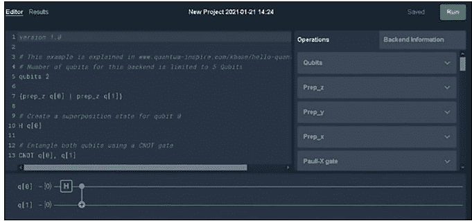

图 17.1 Quantum Inspire 编辑器

这种编程语言旨在让您尝试各种量子门和电路。它是将量子计算的理论知识转化为实践的理想工具。事实上，在 QASM 中设置量子模拟可能比在 Q# 中更容易（参见第 16 章，“使用 Q#”）。

如果您没有编程经验，请不要过于担心。我们将假设您完全没有编程经验，来介绍一个基本的 QASM 程序。还有一个名为“基本编程概念”的部分，我们将从这里开始。

## 17.1 基本编程概念

QASM 没有其他编程语言中常见的许多结构。本节介绍与 QASM 相关的编程概念。

### 17.1.1 指令

QASM 基于指令，各种指令专门与量子操作和结构相关。量子计算所需的大部分内容都内置在 QASM 语言中，这一事实使其成为学习量子计算的绝佳选择。例如，命令 `qubits n` 初始化大小为 n 的量子比特寄存器。默认情况下，所有量子比特都初始化在 |0⟩ 状态。

有三条 `prep` 语句。使用 `prep` 指令，量子比特将显式初始化在特定基的 |0⟩ 状态中：

- `prep_z`
- `prep_y`
- `prep_x`

QASM 还为您预安排了 Pauli 门。共有三个：

- Pauli-X
- Pauli-Y
- Pauli-Z

还有其他几种门和测量可供您使用。表 17.1 汇总了其中最重要的内容。

表 17.1 QASM 指令

| 指令 | 含义 |
| --- | --- |
| Pauli-X | 在第一个量子比特上使用 Pauli-X 门，请使用此语法：
`X q[0]` |
| Pauli-Y | Y 门类似：
`Y q[0]` |
| Pauli-Z | 这是 Z 门：
`Z q[0]` |
| Hadamard | 在第一个量子比特上执行 Hadamard 门与 Pauli 门非常类似：
`H q[0]`
以下是如何在前两个量子比特上执行 Hadamard（或任何其他门）：
`H q[0, 1]` |
| Identity | `I` 是单位矩阵/门。 |
| Rx | 这是旋转算子；在此例中，绕 x 轴旋转。然后在第一个量子比特上使用它：
`Rx q[0]` |
| Ry | 这是旋转算子；在此例中，绕 y 轴旋转。然后在第一个量子比特上使用它：
`Ry q[0]` |
| Rz | 这是旋转算子；在此例中，绕 z 轴旋转。然后在第一个量子比特上使用它：
`Rz q[0]` |
| T gate | 以下是如何在第一个量子比特上执行 T 门：
`T q[0]` |
| CNOT gate | CNOT 门是一个双量子比特操作，其中第一个量子比特通常称为控制量子比特，第二个量子比特称为目标量子比特。这可以用于纠缠两个量子比特，如下所示：
`CNOT q[0], q[1]` |
| SWAP gate | SWAP 门是一个双量子比特操作。用基态表示，SWAP 门交换操作中涉及的两个量子比特的状态：
`SWAP q[0], q[1]` |
| Toffoli gate | 请记住，此门有时称为受控-受控非门。以下是一个示例：
`Toffoli q[1], q[2], q[3]` |
| measure_x | 所有测量都在某个基中进行。`measure_x` 命令将在 x 基中测量量子比特。 |
| measure_y | 所有测量都在某个基中进行。`measure_y` 命令将在 y 基中测量量子比特。 |
| measure_z | 所有测量都在某个基中进行。`measure_z` 命令将在 z 基中测量量子比特。 |
| measure_all | 此命令将使用 z 基并行测量所有量子比特。 |


如果启动编辑器并定义两个量子比特，你会看到图 17.2 所示的屏幕。

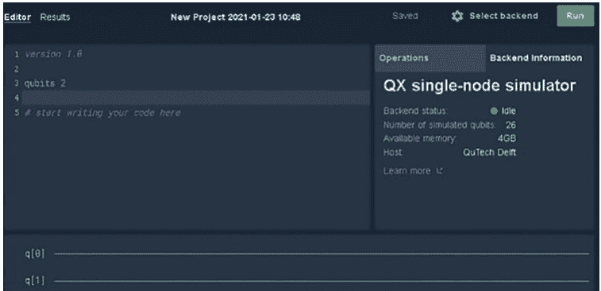

### 图 17.2 两个量子比特

注意屏幕底部，你可以在那里看到 q[0] 和 q[1]，即这两个量子比特。如果添加任何门，你会看到它们被添加到底部。添加 CNOT 门会产生如图 17.3 所示的变化。

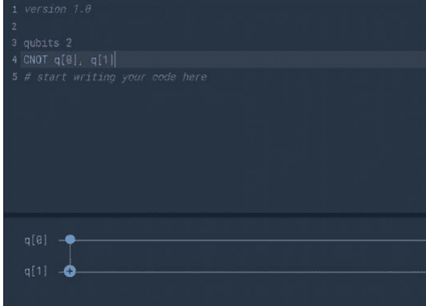

### 图 17.3 CNOT 门

如果不是使用 CNOT 门，而是在第一个量子比特上使用 Hadamard 门，在第二个量子比特上使用 Pauli-X 门，你会得到如图 17.4 所示的结果。

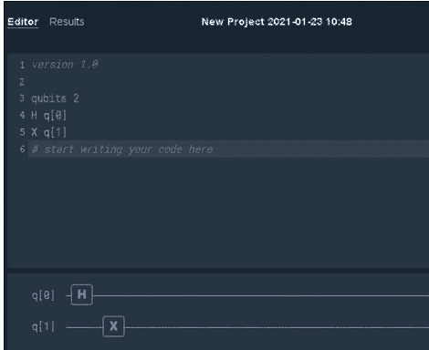

### 图 17.4 Hadamard 门

你也可以在单个量子比特上执行多个门。在图 17.5 中，你可以看到每个量子比特上有多个门，然后是作用于两个量子比特的门。这些操作并非为了实现任何特定算法，只是为了展示你可以用 QASM 做什么。

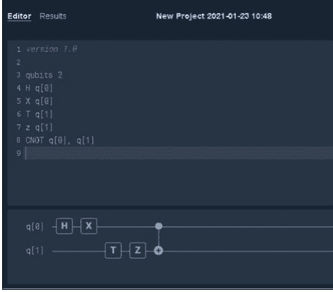

### 图 17.5 多个门

这是使用 QASM 最强大的方面之一。你可以以图形方式看到你正在构建的电路。这使得可视化你正在构建的内容变得相当容易。此外，正如你所看到的，编写代码非常直接。你可能会发现本章中的算法实现比第 16 章中的更容易遵循。

### 17.1.2 命令

QASM 确实有许多用于不同任务的命令。在本节中，我们将介绍一些你需要使用的更常见的命令。表 17.2 描述了你需要知道的命令。

| 命令 | 定义 |
| :--- | :--- |
| display | display 输出当前量子比特寄存器的状态。 |
| error_model depolarizing_channel, 0.001 | 去极化通道错误模型会在每个量子比特操作之间产生随机错误。 |
| display_binary | display_binary 获取二进制寄存器的内容。 |
| number of shots | 算法可以是确定性的或非确定性的。如果是确定性的，则为单次执行（number of shots (N=1)）或多次执行（number of shots (N>1)）。 |

有了这些指令和命令，你将能够跟进本章中展示的代码。事实上，其中大部分对你来说可能几乎是显而易见的。这就是 QASM 的强大之处。

## 17.2 QASM 入门

一旦你在 https://www.quantum-inspire.com 上设置好免费的 Quantum Inspire 账户，就可以开始新项目了。图 17.6 显示了第一步。

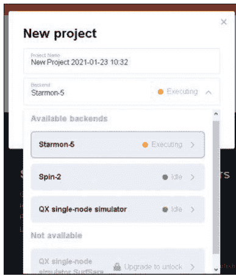

### 图 17.6 启动新项目

这将随即打开带有你新项目的编辑器，如图 17.7 所示。

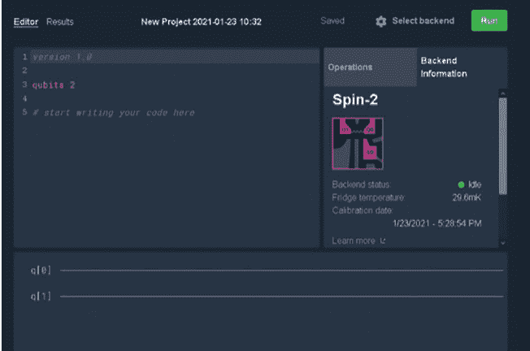

### 图 17.7 新项目编辑器

选择后端将决定你能做的大部分事情。免费版本中只有部分后端可用。除了模拟器，Quantum Inspire 还有两个量子处理器。在实际处理器上你能做的事情有一些限制。有关更多详细信息，最好参考 https://www.quantum-inspire.com/kbase/hardware-backends/ 上提供的文档。

## 17.3 量子纠错

在量子算法中具有一定程度的纠错显然很重要。事实上，量子纠错是一个丰富的研究领域。这里展示的示例是一个非常简单的纠错算法。它并不十分高效，但确实展示了基本概念。在此情况下，我们使用三个物理量子比特来编码一个逻辑量子比特。

这个概念很简单。假设你有一个单个量子比特，并执行方程 17.1 中所示的操作。

| ψ> = α| 0> + β| 1>

### 方程 17.1 量子错误基本方程

你将如何检测错误？这确实是一个严重的问题。我们目前的解决方案有效，但不优雅。我们将简单地使用两个额外的比特；这样一来，我们就可以轻松检测是否发生了比特翻转错误。因此，我们现在使用方程 17.2 中所示的方程。

| \psi \rangle = \alpha | 000 \rangle + \beta | 111 \rangle

### 方程 17.2 纠错方程

代码如下所示：

```
version 1.0
qubits 5

.Encoding
cnot q[0],q[1]
cnot q[0],q[2]

.Introduce_Error
x q[1]

.Error_Detection
cnot q[0],q[3]
cnot q[1],q[3]
cnot q[0],q[4]
cnot q[2],q[4]
measure q[3,4]

.Error_Correction
# Both b[3]=b[4]=0
#do nothing

# b[3]=b[4]=1
c-x b[3,4] , q[0]

# b[3]=1,b[4]=0
not b[4]
c-x b[3,4],q[1]
not b[4]

# b[3]=0,b[4]=1
not b[3]
c-x b[3,4],q[2]
not b[3]

.Measurement
measure q[0:2]
```

在编辑器中，这段代码看起来就像图 17.8 所示。

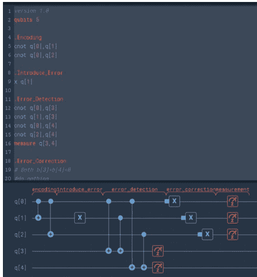

### 图 17.8 纠错

这个概念再次很简单，但效率低下。通过使用三个量子比特，如果没有错误，所有三个应该给出相同的结果。如果其中一个出错，那么就会有一个量子比特不匹配。由于这种方法明显效率低下，不建议用于实际量子计算；然而，这对你熟悉该概念来说是一个绝佳的方法。它还让你有机会练习使用 QASM。

## 17.4 Grover 算法

你可能希望回顾第 10 章“量子算法”中关于 Grover 算法的介绍。不过，在深入代码之前，这里先做一个简要回顾。

### 17.4.1 Grover 算法回顾

请回顾，Grover 算法是一种搜索算法。必须有一个由 log2N 个量子比特提供的 N 维状态空间，我们将其称为 H。然后，数据存储中的条目从 0 编号到 N–1。然后有一个作用于状态空间 H 的可观测量 Ω。Ω 必须具有所有已知的特征值。Ω 的每个特征态编码数据库中的一个条目。特征态使用 bra-ket 符号表示：

```
{ |0>, |1>, |2>, ..., |N-1> }
```

当然，特征值的表示方式大致相同：

```
{ λ0, λ1, λ2, ..., λN-1 }
```

下一步是确定某个算子，该算子用于根据某些标准比较数据库条目。Grover 算法并未指定该算子或其标准。这将根据特定的数据存储和搜索来选择；然而，该算子必须是一个通过态叠加来工作的量子子程序。该算子通常被指定为 UΩ。

我们的算子在作用于前面提到的特征态（我们将其表示为 |ω⟩）时，具有以下性质：

```
Uω |ω> = −|ω>
```

然而，对于所有不是 ω 的 x，我们希望以下内容成立：

```
Uω |x> = |x>
```

换句话说，我们试图识别 Uω 以不同于其他特征态的方式作用的特定特征态 |ω⟩。该算子 Uω 通常被称为量子预言机。它是某种作用于两个量子比特的酉算子。这定义了 Uω 算子，但还有一个第二个算子 Us，其中 s 是可能状态的叠加。该算子如下：

```
Us = 2 |s><s| −I
```

第一步是将系统初始化到某个状态。该状态将是态的叠加，通常表示如下：

```
|s> = 1/√N Σ|x>
```

我们只是在陈述状态 |s⟩ 是所有可能状态 |x⟩ 的叠加。下一步称为 Grover 迭代 r，并执行 N 次。步骤 r 只是应用算子 Uω 并应用算子 Us。第三步是执行可观测量 Ω 的测量。该测量将提供某个特征值 λω。随着我们不断迭代该过程，我们最终会得到正确答案。这次回顾应该有助于你重温 Grover 算法。在下一节中，我们将介绍实现 Grover 算法简单版本的代码。

### 17.4.2 Grover 算法的代码

以下是 QASM 中 Grover 算法的完整代码：

```
version 1.0
qubits 3
# Grover's algorithm for
# searching the decimal number
# 6 in a database of size 2^3

.init
H q[0:2]

.grover(2)
# This is the quantum oracle discussed
{X q[0] | H q[2] }
Toffoli q[0], q[1], q[2]
{H q[2] | X q[0]}

# diffusion
{H q[0] | H q[1] | H q[2]}
{X q[1] | X q[0] | X q[2] }
H q[2]
Toffoli q[0], q[1], q[2]
H q[2]
{X q[1] | X q[0] | X q[2] }
{H q[0] | H q[1] | H q[2]}
```

如果你考虑前面的代码，它乍看之下可能不像最初看起来那么令人生畏。请看你看到的第一段代码：

```
H q[0:2]
```

这初始化了一个 Hadamard 门。接下来的部分只是使用不同的门：Hadamard 门、Pauli-X 门和 Toffoli 门。

在编辑器中显示时，它看起来就像图 17.9 所示。


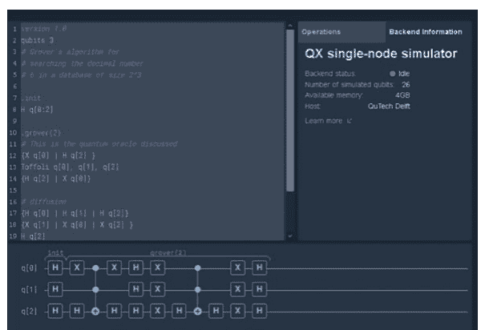

图 17.9 格罗弗算法

结果如图 17.10 所示。

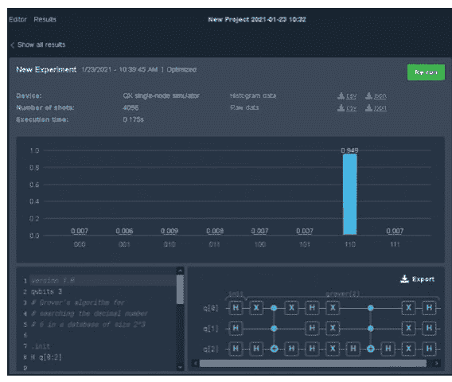

图 17.10 格罗弗算法结果

此屏幕允许你可视化输出的直方图。还要注意，在顶部你可以看到执行次数、执行时间和其他数据。你也可以导出结果。QASM 的在线编辑器非常易于使用且方便。

## 17.5 德意志-乔扎萨算法

这是第 10 章中的另一个算法。我们将在此简要回顾它，然后通过实现该算法的代码进行讲解。

### 17.5.1 德意志-乔扎萨算法回顾

回顾第 10 章的内容，德意志-乔扎萨算法是德意志算法的一种修改。这个问题其实相当直接。德意志算法考察的是单变量函数。德意志-乔扎萨算法将其推广到 n 变量函数。回顾该问题涉及一个黑盒量子计算机，它实现某个函数，该函数输入 n 位二进制值，并为每个这样的值输出 0 或 1。输出要么是平衡的（1 和 0 的数量相等），要么是常数的（全 1 或全 0）。该算法的目标是确定函数是常数还是平衡。

实际算法从前 n 位处于 |0> 态开始，最后一位处于 |1> 态。然后对每一位应用 Hadamard 变换。现在我们有一个函数，称为 f(x)，它将态 |x>|y> 映射到 |x>|y ⊕ f(x)>. 在这里，符号 ⊕ 表示模 2 加法。当 x 的值通过神谕函数 f(x) 时，会产生 1 或 0。如果 f(x) 是平衡的，输出为 0；如果 f(x) 是常数，输出为 1。对于 n 位输入，如果 f(x) 是常数，最终输出将是 n 个 0。任何其他输出（0 和 1 的任何组合，或全 1）都表明 f(x) 是平衡的。

### 17.5.2 德意志-乔扎萨算法的代码

我们从命名空间的打开和其他命名空间的使用语句开始，如下所示：

```
version 1.0

qubits 2
# The Deutsch-Jozsa algorithm an oracle is used to
# determine if a given binary function f(x) is constant or
# balanced.
# Constant f(x)=fc1=0 OR f(x)=fc2=1
# Balanced f(x)=fb3=x OR f(x)=fb4=NOT(x)
# The algorithm requires only a single query of that
# function f(x).

# Initialize qubits in |+> and |-> states
.initialize
prep_z q[0:1]
X q[1]
{H q[0]|H q[1]}

.oracle_fc1
# do nothing or I q[0:1]

#.oracle_fc2
# X q[1]

#.oracle_fb3
# CNOT q[0],q[1]

#.oracle_fb4
# CNOT q[0],q[1]
# X q[1]

.measurement
H q[0]
measure q[0]
```

图 17.11 显示了这在编辑器中的样子。

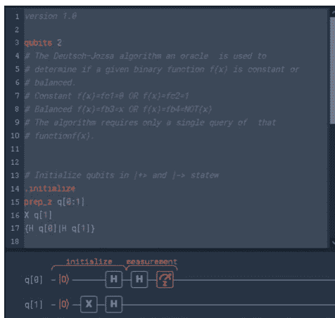

图 17.11 德意志-乔扎萨算法

与本章前面看到的代码一样，这主要只是一组作用于量子比特的门——这也是大部分量子编程的内容。

德意志-乔扎萨算法在 QASM 中相对容易实现。编辑器底部显示的门和操作的可视化对于理解量子算法非常有帮助。

## 17.6 总结

本章向你介绍了 QASM。使用 https://www.quantum-inspire.com 的在线工具，你可以同时访问模拟器和实际量子处理器。这使得 QASM 成为学习量子编程的一个非常有价值的工具。最好是通读本章中介绍的至少一些算法。对于更高级的读者，你可以尝试实现本章中未实际编码的算法。结合第 16 章和本章的信息，你应该对量子编程有较为扎实的工作知识。

## 测试你的技能

## 复习问题

- 1. 语法 T q[0] 会做什么？
  - a. 在第一个量子比特上执行 Toffoli 门
  - b. 对所有量子比特执行 Toffoli 门
  - c. 在第一个量子比特上执行 T 门
  - d. 对所有量子比特执行 T 门

- 2. 在 QASM 中，命令 measure_all 起什么作用？
  - a. 在 x、y 和 z 基下测量量子比特。
  - b. 在 z 基下测量所有量子比特。
  - c. 在 x、y 和 z 基下测量所有量子比特。
  - d. 没有任何作用。这是一个错误。

- 3. 下列符号在 QASM 显示中代表什么？

  

  - a. CNOT 门
  - b. 哈达马德门
  - c. 测量
  - d. 错误校正

- 4. error_model depolarizing_channel 的目的是什么？
  - a. 捕获去极化错误
  - b. 捕获任何量子错误
  - c. 在量子比特上的每个操作之间引入随机错误
  - d. 设置错误捕获

# 测试你的技能问题的答案

## 第 1 章

- 1. c. 环
- 2. a.
  | 6 |
  | 3 |
  | 9 |
- 3. b. 10
- 4. d. 5
- 5. a. 11
- 6. b. 17
- 7. a. 4.12
- 8. d.
  | 15 | 25 |
  | 15 | 30 |
- 9. a. 是
  | 1 | 0 | 0 |
  | 0 | 1 | 0 |
  | 0 | 0 | 1 |
- 10.
  | 1 | 0 | 0 |
  | 0 | 1 | 0 |
  | 0 | 0 | 1 |

## 第 2 章

- 1. 5 + 5i
- 2. 4 + 12i
- 3. –10 + 2i
- 4. 5/2 – i/2, 或用小数形式表示 2.5 – 0.5i
- 5. = √5, 或用小数形式表示 2.2361
- 6. a
- 7. –1. 所有 Pauli 矩阵的行列式均为 –1。
- 8. 没有区别。
- 9. c
- 10. 所有 Pauli 矩阵的特征值均为 +1 和 –1。

## 第 3 章

- 1. d. 它既是粒子也是波。
- 2. a. 粒子具有特定的能级，而不是连续的能级。
- 3. b. 在同一时间，不能有两个费米子占据量子系统中的同一状态。
- 4. d. 最多可有六个电子，成对存在，且每对的自旋方向相反。
- 5. a. 收敛到向量空间中某个元素的序列
- 6. c. 傅里叶变换
- 7. d. 它是与某个操作对应的特征向量。
- 8. a. 表示法中的 ket 侧
- 9. a. Planck 的黑体辐射

## 第 4 章

- 1. c. 任意位置
- 2. a. 按顺序
- 3. a. Omega
- 4. c. Theta
- 5. a. 冒泡排序
- 6. a. NAND
- 7. b. OR
- 8. d. NAND
- 9. c. 它们可以用来创建任何布尔函数。
- 10. d. 指令集架构

## 第 5 章

- 1. b. .1
- 2. a. .55
- 3. c. .475
- 4. b. 4 ∈ A
- 5. b. A 和 B 的交集
- 6. b. 发送计算机
- 7. c. 噪声信道定理
- 8. a. 将两个熵相加
- 9. a. 联合熵
- 10. d. 密度矩阵

## 第 6 章

- 1. b. 2 π 是弧度制中的 360 度。
- 2. c. 波函数
- 3. a. Born 定则
- 4. d. 可能的特征态的叠加态会基于与环境的相互作用坍缩为单一特征态。
- 5. b. 1
- 6. c. 波函数
- 7. c. Wigner 函数
- 8. d. Klein-Gordon
- 9. a. 一个带有复数分量的 4 x 4 矩阵

## 第 7 章

- 1. b. 它证明了隐变量不是引起纠缠的原因。
- 2. 计算这两个向量的张量积：
- 3. a. 4
- 4. c. E91
- 5. b. 历史脱相解释
- 6. d. John Bell
- 7. d. 哥本哈根解释

## 第 8 章

- 1. b. 相位移门
- 2. a. 单位长度和 d. 标准正交
- 3. d. Born 定则
- 4. b. Gottesman–Knill 定理
- 5. c. 量子
- 6. b. 测量

## 第 9 章

- 1. c. 为了便于在光子中存储量子比特
- 2. a. 态 |0>
- 3. b. 离子在鞍点处的运动
- 4. a. 4
- 5. b. 测量计划
- 6. c. 高于绝对零度 1 开尔文或更多
- 7. b. 固态

## 第 10 章

- 1. c. 德意志算法
- 2. b. 格罗弗算法
- 3. c. 三
- 4. b. 周期寻找部分

## 第 11 章

- 1. b. log(N)
- 2. d. y2 = x3 + Ax + B
- 3. 离散对数是某个整数 k，它求解方程 xk=y，其中 x 和 y 都是有限群的元素。
- 4. 该系统有两个参数，称为 p 和 g。参数 p 是素数，参数 g（通常称为生成元）是小于 p 的整数，并具有以下性质：对于 1 到 p-1 之间的每个数 n（包含 1 和 p-1），存在 g 的幂 k 使得 n = g^k mod p。一个公钥是 g^a，另一个是 g^b。
- 5. C = M^e % n
- 6. 设 n = pq，m = (p-1)(q-1)。选择一个与 m 互质的小数 e（注意：如果两个数没有公因数，则称它们互质）。找到 d，使得 de % m = 1。发布 e 和 n 作为公钥，并保留 d 和 n 作为密钥。

## 第 12 章

- 1. c. 它将需要更大的密钥尺寸。
- 2. b. 它将需要被替换。
- 3. a、b 和 c
- 4. b. 最小
- 5. d. 它们不以量子计算机可以解决的特定数学问题为基础。


## Chapter 13

- 1. a. 如果 G 在某个运算下是一个群，且 H 是 G 的子集，并且在该运算下也形成一个群，那么 H 是 G 的子群。
- 2. a 和 b
- 3. d. 循环，移位
- 4. c. 最短整数问题
- 5. b. NTRU
- 6. a. 阿赞泰
- 7. a. 阿赞泰

## Chapter 14

- 1. d. 一个集合，每个运算的单位元，两个运算，以及它们各自的逆运算
- 2. a. 松本-今井
- 3. b. 隐域方程
- 4. d. MQDSS
- 5. b. 隐域方程

## Chapter 15

- 1. a. 默克尔-达姆高德构造
- 2. d. 麦克艾利斯
- 3. d. 麦克艾利斯
- 4. a. 尼德赖特
- 5. a. 扭转群
- 6. b. 等距的

## Chapter 16

- 1. c. 结果
- 2. a. 迭代
- 3. b. 封装
- 4. a. Microsoft.Quantum.Intrinsic
- 5. d. 围绕给定的泡利轴旋转。

## Chapter 17

- 1. c. 在第一个量子比特上执行 T 门
- 2. b. 在 z 基底下测量所有量子比特。
- 3. a. CNOT 门
- 4. c. 在对量子比特的每个操作之间引入随机错误
