# 2 Simple linear regression in action

## This chapter covers

- Recognizing a linear relationship
- Fitting a line to data
- Understanding the theory behind simple linear regression
- Using, assessing, and interpreting a simple linear regression model

回归分析始于 19 世纪下半叶，当时维多利亚人痴迷于量化事物并将科学方法应用于眼前的每一件事；由于人们很容易找到并测量，推动回归发展的大量数据由身体测量组成。父母及其子女的身高在早期回归分析中发挥了特别突出的作用，因此使用这样的数据集作为我们在第 1 节中的第一个示例似乎很合适。 Pun intended！相信我，这很有趣。）我们将看到数据中的线性关系有时可以直接找到和分析，而无需依赖模型。在其他情况下，我们需要构建统计模型来尽可能多地从数据中学习。考虑到这一点，本章的主要目标是解释如何构建和使用简单线性回归模型来理解定量变量之间的关系。

在阅读本章时，为每个示例打开一个新的 Jupyter notebook。在第一个单元格中，导入我们将使用的库：

Listing 2.1. Import the libraries used in this chapter

```
>>> import numpy as np
>>> import pandas as pd
>>> import matplotlib.pyplot as plt
>>> import seaborn as sns
>>> import statsmodels.formula.api as smf
```

为了排版，我使用传统的 Python 命令行提示符 >>> 来表示你将在单元格中输入的内容；当有


对应的输出将被缩进并显示在输入下方。要使你的图形与此处所示相匹配，请在笔记本中使用默认的 seaborn 主题并重置图形大小：

### Listing 2.2. The seaborn theme and larger plots are nice

```
>>> sns.set_theme()
>>> plt.rcParams['figure.figsize'] = [8,8]
```

在编写时输入代码以逐步构建你的每个笔记本；它们可在 GitHub 仓库 [2] 中获得，但如果你自己输入代码并思考每一行在做什么，你将学到更多！

## 2.1 The line of averages

我们将从探索 1,078 名父亲及其儿子的身高开始，该数据由英国统计学家 Karl Pearson 及其助手在 1890 年代收集。这将给我们一个机会回顾汇总统计、常态分布，以及在我们了解一些统计模型时 Python 的数据科学工具。为了开始，以下代码加载身高数据，显示其头部和尾部，然后创建每列的直方图：

### Listing 2.3. Load and view the Pearson height data

```
>>> heights = pd.read_csv("heights.csv")
>>> heights

       Father    Son
0   65.04851 59.77827
1   63.25094 63.21404
2   64.95532 63.34242
3   65.75250 62.79238
4   61.13723 64.28113
...   ...     ...
1073 66.99681 70.75232
1074 71.33181 68.26774
1075 71.78314 69.30589
1076 70.73837 69.30199
1077 70.30609 67.01500
```

1078 rows x 2 columns

```
>>> g = sns.displot(data=heights.melt(value_name="Height"),x="Height")
>>> g.set_titles(col_template='{col_name}')
```

### Figure 2.1. Distributions of heights of fathers and sons

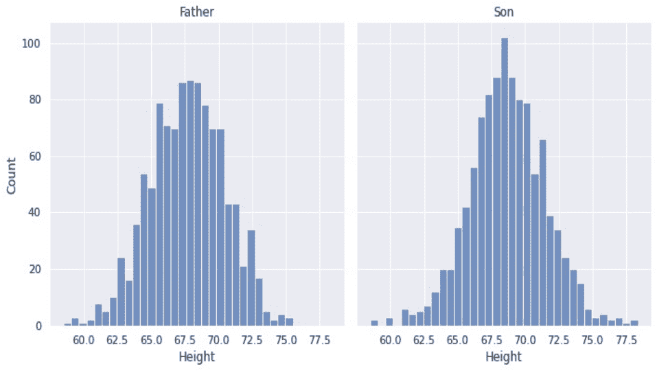

我们可以看到，这两个定量变量都具有近似对称且钟形分布——事实上，每一个都大致 *正态分布*。正态分布的变量在统计中随处可见，在真实数据和理论工作中都很常见，因此了解它们非常重要。正态分布完全由两个值决定，即其 *平均值* 和其 *标准差*；平均值是分布的中心，标准差决定了分布在平均值两侧的宽度。我们稍后会对标准差有更多的话要说，但现在让我们继续使用 R 的 mean 和 sd 函数来计算身高数据集列的这两个汇总统计量：

### Listing 2.4. Compute the averages and standard deviations of the height variables

```
>>> heights.Father.agg(['mean','std'])
```

```
mean      67.687097
std        2.744868
Name: Father, dtype: float64

>>> heights.Son.agg(['mean','std'])

mean      68.684070
std        2.814702
Name: Son, dtype: float64
```

我们现在可以用一些简洁的记号简洁地描述这两列：父亲的身高遵循 N(67.687, 2.745)，即平均值为 67.687 英寸、标准差为 2.745 英寸的正态分布，而儿子的身高遵循 N(68.684, 2.815)，即平均值为 68.684 英寸、标准差为 2.815 英寸的正态分布。观察上面任一直方图可知，大多数身高在平均值的 2 个标准差范围内，几乎全部在平均值的 3 个标准差范围内。只要我们处理的是大致正态的分布，标准差就告诉我们大多数观测值相对于平均值的位置——它衡量的是与平均值的平均偏差。

维多利亚时代的人们在研究他们收集的数据时对这一现象感到欣喜——许多生物学测量值，如这些身高，往往大致呈正态分布。我们可以利用这一点来创建一个简单的统计模型：要预测一个人的身高，我们只需猜测 68.684 英寸，即儿子的平均身高，我们很可能在 2 个标准差、约 5.6 英寸的范围内正确。这是一个空模型，也称为基线模型，问题是：我们能否做得更好？当然可以，这就是我们在这里的原因！

该空模型忽略了父亲身高的数据，因此我们通过纳入这些额外信息应该能够创建更好的预测模型。毕竟，身材高大的男性往往有身材高大的儿子，身材矮小的男性往往有身材矮小的儿子，对吧？我们可以通过绘制儿子的身高与父亲的身高来轻松检查这一点。

### Listing 2.5. Create a scatterplot of the heights

```
>>> sns.scatterplot(data=heights, x="Father", y="Son")
```

### Figure 2.2. Heights of fathers and sons

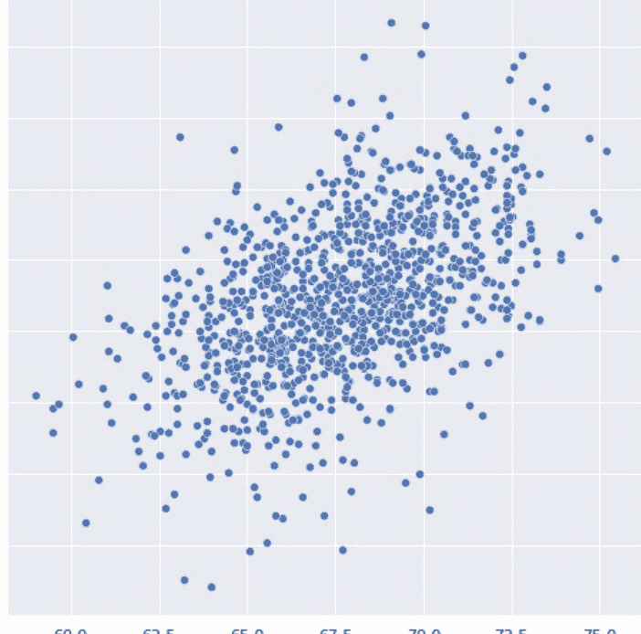

此 *散点图* 中的每个点对应一位父亲及其儿子；点的水平位置是父亲的身高（以英寸为单位），点的垂直位置是儿子的身高（以英寸为单位），坐标轴相应标记。散点图对于呈现此类定量数据至关重要，因此我们将广泛使用它们。此特定散点图证实了我们预期看到的情况：父亲身材较矮的儿子往往较矮，而父亲身材较高的儿子往往较高。当 *响应变量*——纵轴上的变量——随着 *预测变量*——横轴上的变量——增加时，我们说这些变量是 *正相关* 或 *正* 相关；如果响应随着预测变量的增加而减少，则它们是负相关或负相关。我们将在下一节中对相关性有更多的话要说。

虽然此散点图中明显的正趋势告诉我们一些信息，但定性洞察力没有计算能力。我们需要量化所显示的关系，以便能够做诸如预测一个人的儿子身高或数值描述身高代际变化等事情。怀着这样的目标，让我们深入数据！首先，我们将通过将父亲的身高四舍五入到最接近的英寸来将数据组织成组，然后我们将计算每组中儿子身高的数量、平均值和标准差：

### Listing 2.6. Organize the data and compute group-wise summary statistics for the sons

```
>>> heights['Group'] = heights.Father.round().astype(int)
>>> heights
```

|   | Father   | Son     | Group |
|---|----------|---------|-------|
| 0 | 65.04851 | 59.77827| 65    |
| 1 | 63.25094 | 63.21404| 63    |
| 2 | 64.95532 | 63.34242| 65    |
| 3 | 65.75250 | 62.79238| 66    |
| 4 | 61.13723 | 64.28113| 61    |
| ... | ... | ... | ... |
| 1073 | 66.99681 | 70.75232| 67    |
| 1074 | 71.33181 | 68.26774| 71    |
| 1075 | 71.78314 | 69.30589| 72    |
| 1076 | 70.73837 | 69.30199| 71    |
| 1077 | 70.30609 | 67.01500| 70    |

1078 rows × 3 columns

```
>>> son_stats = heights.groupby("Group").agg({"Son":["size","mean","std"]})
>>> son_stats
```

| Group | Son size | Son mean | Son std |
|-------|----------|----------|---------|
| 59 | 3 | 64.669410 | 0.661594 |
| 60 | 4 | 64.673850 | 2.776654 |
| 61 | 8 | 65.930072 | 2.158895 |
| 62 | 15 | 65.593267 | 1.775472 |
| 63 | 36 | 66.514124 | 2.909974 |
| 64 | 60 | 66.701389 | 2.307661 |
| 65 | 101 | 67.223182 | 2.534444 |
| 66 | 139 | 67.656250 | 2.350964 |
| 67 | 134 | 68.139773 | 2.237706 |
| 68 | 157 | 69.092820 | 2.760430 |
| 69 | 142 | 69.443967 | 2.299950 |
| 70 | 115 | 69.768448 | 2.489530 |
| 71 | 77 | 70.540819 | 2.305104 |
| 72 | 50 | 70.677187 | 2.329985 |
| 73 | 28 | 72.049796 | 2.756266 |
| 74 | 3 | 70.364610 | 0.445680 |
| 75 | 6 | 71.720700 | 2.053495 |

为了可视化表中的信息，让我们看一下突出显示某些组的几个散点图：身高四舍五入到最接近英寸为 64 英寸的父亲，然后是身高四舍五入到最接近英寸为 70 英寸的父亲。在每个图中，我们都添加了一个黑色点，表示该组儿子身高的平均值；请注意，这个黑色点不属于原始数据集。

```
>>> sns.scatterplot( data=heights.query("Group!=64"), x="Father", y="Son")
>>> sns.scatterplot( data=heights.query("Group==64"), x="Father", y="Son")
>>> plt.plot( son_stats.query("Group==64").Son["mean"], 'ok' )
```

### Figure 2.3. Fathers who are 64 inches tall


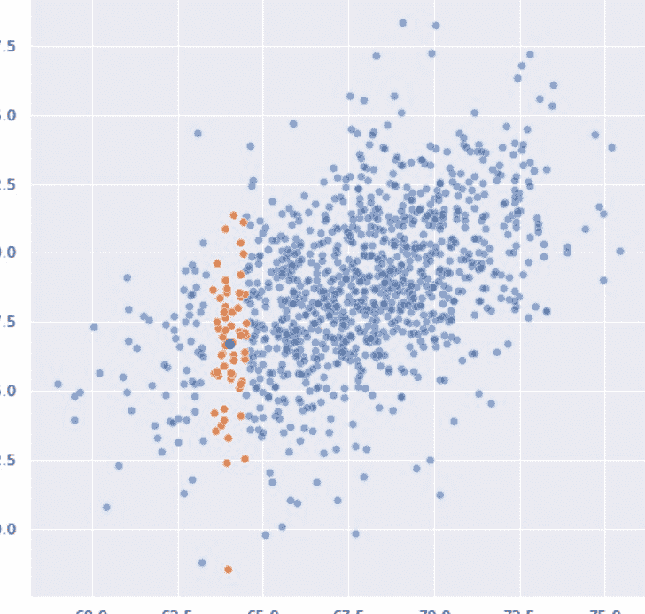

```
>>> sns.scatterplot( data=heights.query("Group!=70"), x="Father",
>>> sns.scatterplot( data=heights.query("Group==70"), x="Father",
>>> plt.plot( son_stats.query("Group==70").Son["mean"], 'ok' )
```

图 2.4. 身高为 70 英寸的父亲

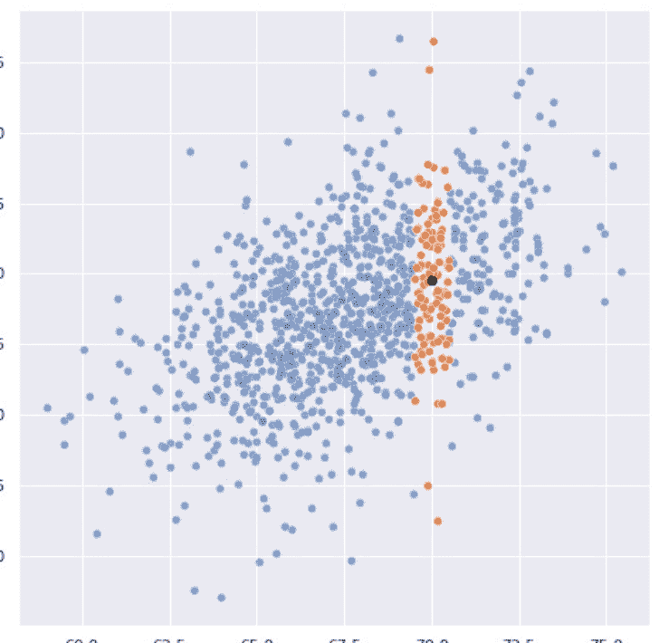

正如你在上文 son_stats DataFrame 中看到的，这两个组中第一组有 60 对父子，第二组有 115 对父子。对于这两个组，儿子的身高仍然大致呈正态分布：

```
>>> g = sns.displot(data=heights.query("Group==64 or Group==70"),
>>> g.set_titles(col_template="Father's height: {col_name} inches
```

图 2.5. 子集儿子的身高也大致呈正态分布

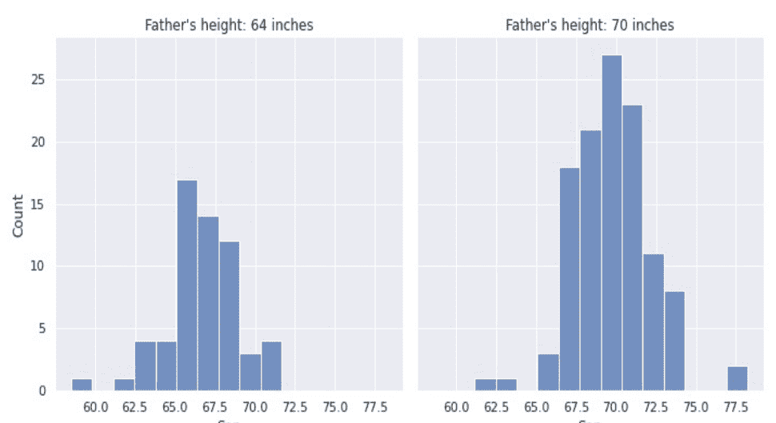

在这两个直方图中我们看到的是：

### 表 2.1. 父子组

| 父亲的四舍五入身高 | 儿子的身高范围 | 儿子的身高分布 |
|---|---|---|
| 64 英寸 | 58.5 英寸到 71.4 英寸 | N(66.7, 2.31) |
| 70 英寸 | 61.2 英寸到 78.2 英寸 | N(69.77, 2.49) |

正如我们在上面的空模型中所做的那样，我们可以用这些正态分布来进行预测——事实上预测更好，因为它们信息更充分。如果一个男人的父亲身高四舍五入为 64 英寸，我们预测他的身高为 66.7 英寸；这个预测不太可能偏差超过约 4.6 英寸。另一方面，如果一个男人的父亲身高四舍五入为 70 英寸，我们预测他的身高为 69.77 英寸；这个预测不太可能偏差超过约 4.98 英寸。这些预测比空模型好在两个重要方面：

- *点估计*——对儿子身高的最佳单一猜测——对每个组都更准确，以及
- *误差范围*现在每个预测都更小，因为各组的标准差比所有儿子整体的标准差更小。

获得改进的预测是很好的，但这样做非常繁琐。幸运的是，我们距离一种更简化的预测方法已经很近了，可以对任何父亲的身高进行更好的预测，所以让我们继续，在每个父亲组中添加儿子平均身高的黑色点。这样做揭示了一些绝对惊人的现象：大多数黑色点非常接近于在同一条直线上！这就是*平均线*，如下图所示为黑色。

```
>>> sns.regplot( data=heights, x="Father", y="Son",
    ci=None, line_kws={"color": "black"})
>>> plt.plot(son_stats.Son["mean"], 'ok')
```

图 2.6. 儿子的平均身高几乎共线

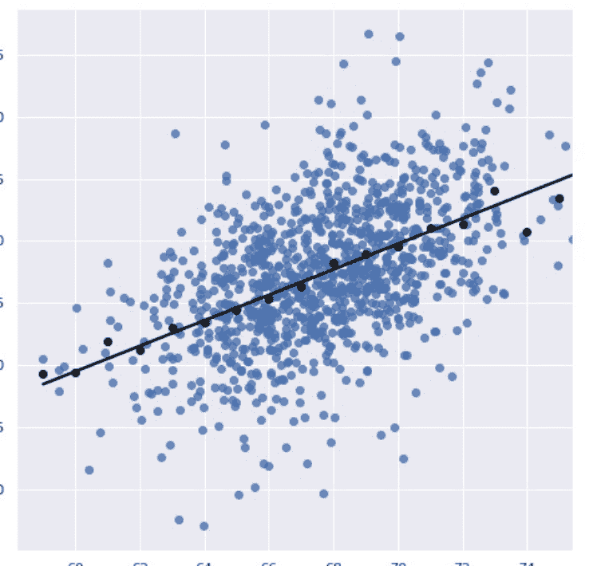

我们现在看到，使用真实人群的身高，响应变量的平均值如何可以线性地依赖于预测变量；当这种情况发生时，我们说变量之间存在线性关系或线性关联。事实证明，正如你在下一节中将学会验证的那样，这条特定平均线的方程是

儿子平均身高 = 33.8866+0.5141*父亲身高。

我们可以直接使用这个方程来估计一组儿子的平均身高，给定父亲的身高，并利用这些估计来进行预测。例如，如果我们遇到一个身高为 64 英寸的男人并想预测他儿子的身高，我们只需计算：

儿子预测身高 = 33.8866+0.5141*64 = 66.789 英寸。

因此我们对他儿子身高的最佳猜测就是基于现有观测的、父亲身高为 64 英寸的所有儿子的身高的平均值。由于平均线综合了所有数据，这个预测身高与上表中给出的观测平均值 66.7 略有不同。我们不再局限于表中的四舍五入父亲身高；例如，如果父亲身高为 70.5 英寸，我们预测他儿子的身高为

儿子预测身高 = 33.8866+0.5141*70.5 = 70.131 英寸。

现在我们开始有所进展了！平均线是估计和预测的高效机制，其斜率简洁地量化了父亲和儿子身高之间的关系。斜率 0.5141 告诉我们，例如，

- 身高相差 1 英寸的两个父亲，他们的儿子身高平均相差 0.5141 英寸，
- 身高相差 10 英寸的两个父亲，他们的儿子身高平均相差 5.141 英寸，
- 身高比平均高 1 英寸的父亲，其儿子很可能比平均高约半英寸，以及
- 身高比平均低 1 英寸的父亲，其儿子很可能比平均低约半英寸。

更一般地说，方程表明，身高高于平均值的父亲通常有身高也高于平均值的儿子，但幅度不大；身高低于平均值的父亲通常有身高也低于平均值的儿子，但幅度也不大。当弗朗西斯·高尔顿，卡尔·皮尔逊的前任和导师，在更早的一组身高数据中观察到同样的现象时，他称之为“回归平庸”，从而引入了“回归”作为统计学术语；我们现在更礼貌地将这种回归效应概括为“回归均值”。

平均线的方程显然比一次计算一组儿子的平均值更容易使用，但我们之前做的计算在一点上似乎更优越：每个组的身高的标准差量化了其变异性并为预测提供了误差范围。因此，我们迄今为止所做的工作提出了一些重要问题：

- 我们如何确定两个定量变量之间是否存在线性关系？
- 如果存在线性关联，我们如何得到平均线的方程？
- 当我们用平均线计算时，如何量化由此产生的估计和预测的不确定性？

接下来的部分将回答所有这些问题以及更多内容，所以让我们继续吧！

[2] https://github.com/mbrudd/regression

## 2.2 拟合数据线

我们刚刚检查的身高数据集的优点之一就是其庞大的规模——观测值足够多，可以对数据分组、计算各组的平均值，并亲眼见证父亲身高与其儿子身高之间的线性关联。这一点至关重要！身高示例证明线性关系确实存在于真实数据中，因此在其他地方寻找它们是合理的；当我们找到此类关系时，我们可以利用它们来估计平均值并进行预测。线性回归方法提供了识别和利用数据中线性关联的工具，而无需诉诸繁琐的分组和平均——这很幸运，因为通常数据太少而无法采用暴力方法。

身高数据集的一个潜在问题是正态性在儿子身高和父亲身高方面都起着突出作用。这简化了数据的分析和解释，使其成为一个极好的入门示例，但它可能暗示正态性是线性回归所必需的。并非如此！响应变量的正态性当然是一个很好的属性，正如我们稍后会看到的那样，但绝对不是必需的。在我们进行示例时请记住这一点。

为了解释*简单线性回归*，即对定量响应变量与单一预测变量之间关系进行建模的框架，我们将分析来自联合国儿童基金会（UNICEF）[3] 的关于婴儿死亡率和年轻女性识字率的数据。让我们加载数据，查看前几行，然后绘制全部数据：

```
>>> africa = pd.read_csv("africa.csv")
>>> n_countries = len( africa )
>>> n_countries

    47

>>> africa.head()
```

|   | Country      | Literacy | IMR |
|---|--------------|----------|-----|
| 0 | Algeria      | 89       | 26  |
| 1 | Angola       | 66       | 96  |
| 2 | Benin        | 45       | 68  |
| 3 | Botswana     | 97       | 20  |
| 4 | Burkina Faso | 33       | 82  |

```
>>> sns.scatterplot(data=africa, x="Literacy", y="IMR")
>>> plt.title("Infant mortality rates (IMR) versus Literacy for y
```

**图 2.7. 婴儿死亡率随识字率增加而下降**


### 婴儿死亡率（IMR）与非洲年轻女性识字率的对比

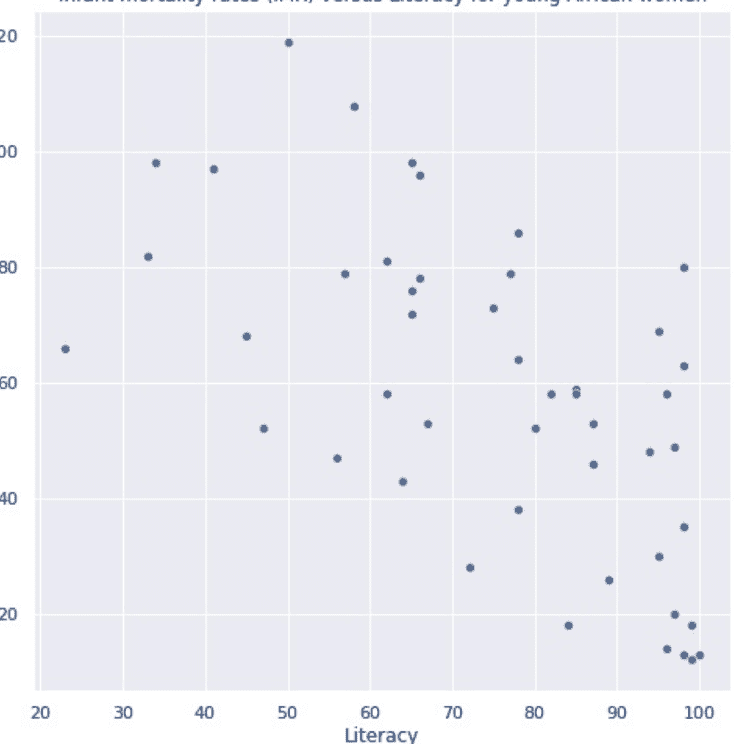

该散点图中有 47 个点，每个点代表非洲的一个国家。点的横坐标为该国 15 至 24 岁年轻女性的识字百分比，点的纵坐标为该国的婴儿死亡率（IMR），记录为每 1000 例活产婴儿中的婴儿死亡数。可以看出存在负线性趋势：随着年轻女性识字百分比的增加，婴儿死亡率下降。看到这一点后，我们希望量化这两个变量之间线性关联的强度。这就是相关系数的工作，也简称为相关。由于理解这一汇总统计量对于理解线性回归至关重要，我们在对 UNICEF 数据拟合直线之前，将花一些时间来研究它。

## 2.2.1 相关系数

为了解释如何计算和解释相关系数，我们将使用两个变量的平均值将 UNICEF 数据分为象限。以下是相关统计量和修改后的散点图：

```
>>> x_bar = africa.Literacy.mean()
>>> x_bar

    74.95744680851064

>>> y_bar = africa.IMR.mean()
>>> y_bar

    58.1063829787234

>>> sns.scatterplot(data=africa, x="Literacy", y="IMR")
>>> plt.axvline( x_bar, linestyle='--')
>>> plt.axhline( y_bar, linestyle='--')
>>> plt.title("IMR vs Literacy: quadrants determined by averages"
```

图 2.8. 按平均值将 UNICEF 数据分为象限

### IMR vs Literacy: quadrants determined by averages

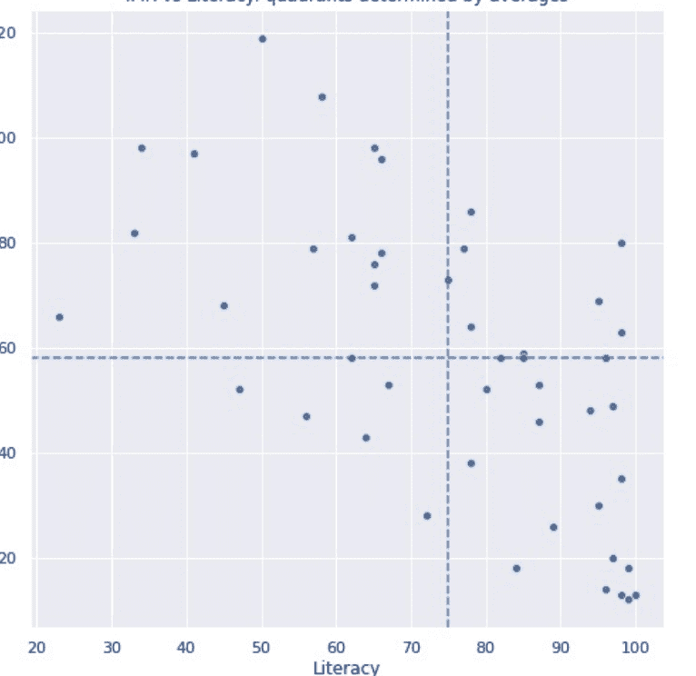

如果我们将每个点的坐标与相应的平均值进行比较，具体查看偏离平均值的符号，则按象限的分解如下：

#### 表 2.2. 按象限检查偏差

| 象限 | Literacy 坐标 | Literacy 偏差 | IMR 坐标 | IMR 偏差 | 偏差的乘积 |
|---|---|---|---|---|---|
| 右上 | 高于平均 | 正 | 高于平均 | 正 | 正 |
| 左上 | 低于平均 | 负 | 高于平均 | 正 | 负 |
| 左下 | 低于平均 | 负 | 低于平均 | 负 | 正 |
| 右下 | 高于平均 | 正 | 低于平均 | 负 | 负 |

我们恰好在 UNICEF 数据中看到负关联，正是因为大部分点——约 3/4——位于左上和右下象限；因此它们坐标偏离各自平均值的乘积大多为 *负*。这些乘积的符号编码了坐标如何共同变化——当它们一起增加时乘积为正，当它们以相反方式变化时乘积为负。相关系数是这些乘积的平均值，按下文所示进行标准化，因此 Literacy 与 IMR 之间的相关性为负。要确定其精确值，我们可以使用 pandas corr() 函数：

```
>>> africa_corr = africa.Literacy.corr( africa.IMR )
>>> africa_corr

    -0.616221949960677
```

Literacy 与 IMR 之间的相关性约为 -0.62，是相当强的线性关系的指标；相比之下，父亲身高与儿子身高的相关性约为 0.5。在深入解释这些值之前，让我们使用由平均值确定的象限作为参考，总结两个定量变量相关性的总体属性：

- 如果散点图中大部分点位于右上和左下象限，相关系数将为正。
- 如果散点图中大部分点位于左上和右下象限，相关系数将为负。
- 如果散点图中的点到处都是，相关性将接近零。

因此，相关的符号对应于数据散点图中显示的线性趋势——正、负或无。至于其数值，这里是需要了解的主要内容：

- 相关系数是 *无量纲* 的；与平均值和标准差等汇总统计量不同，它没有单位。
- 相关系数 *不是* 百分比——不要将其作为百分比报告！
- 相关系数介于 -1 和 +1 之间。
- 两个定量变量之间的正线性关系越强，相关系数越接近 +1。
- 两个定量变量之间的负线性关系越强，相关系数越接近 -1。
- 两个定量变量之间的线性关系越弱，相关系数越接近 0。

真实数据中的真正线性关系通常会产生绝对值在 .3 到 .7 之间的相关性，因此不要期望看到相关性非常接近 +1 或 -1 的极值。相关性为 +1 仅在所有数据都位于正斜率直线上时才会发生；相关性为 -1 仅在所有数据都位于负斜率直线上时才会发生。我们将在下面通过一个真实示例，其中相关性非常接近 +1，但这种情况非常罕见！解释相关性随着经验的积累会变得更容易，但请始终记住相关系数衡量的是线性关系的强度——将其用于其他任何用途都是错误的。

#### 计算相关系数

首先，不要手工计算相关系数，即使你也不应有这种诱惑！了解并理解公式是好的，但让你喜欢的实现来处理计算即可。在此免责声明之后，这里是 *r* 相关系数的显式公式：

r~ = ~ 1/(n-1) Σ_{x,y} ((x - x̄)/s_x)((y - ȳ)/s_y).

在此公式中，求和包括所有数据点 (x, y)，

- x̄ 是预测变量的平均值，
- ȳ 是响应变量的平均值，
- s_x 是预测变量的标准差，以及
- s_y 是响应变量的标准差。

请注意，相关系数是对所有数据点坐标的 z 分数的乘积取平均值——这可以作为记忆和思考此公式的便捷方式。

## 2.2.2 空模型

我们已经完成了对 UNICEF 数据分析的前两个步骤：我们在散点图中观察到负线性关联，并且发现 Literacy 与 IMR 之间的相关性约为 -0.62，进一步证明了这两个变量之间存在线性关系。由于这些国家的婴儿死亡率似乎大致线性地依赖于识字年轻女性的比例，因此线性回归模型是合适的。然而，我们不能像身高数据那样获得平均值直线，因为没有足够的观测值来将国家分组，然后计算各组的平均婴儿死亡率。相反，我们必须拟合一条直线，以便基于它进行的估计和预测尽可能准确。

预测这些国家之一的婴儿死亡率的最简单方法是直接猜测所有观察到的 IMR 值的平均值，完全忽略 Literacy。这种恒定预测是空模型，一条水平线，为判断其他预测模型提供基线：

```
>>> sns.scatterplot(data=africa, x="Literacy", y="IMR")
>>> plt.axhline( y_bar, color="black")
>>> plt.title("IMR vs Literacy: Null model")
```

图 2.9. 可视化婴儿死亡率预测的空模型

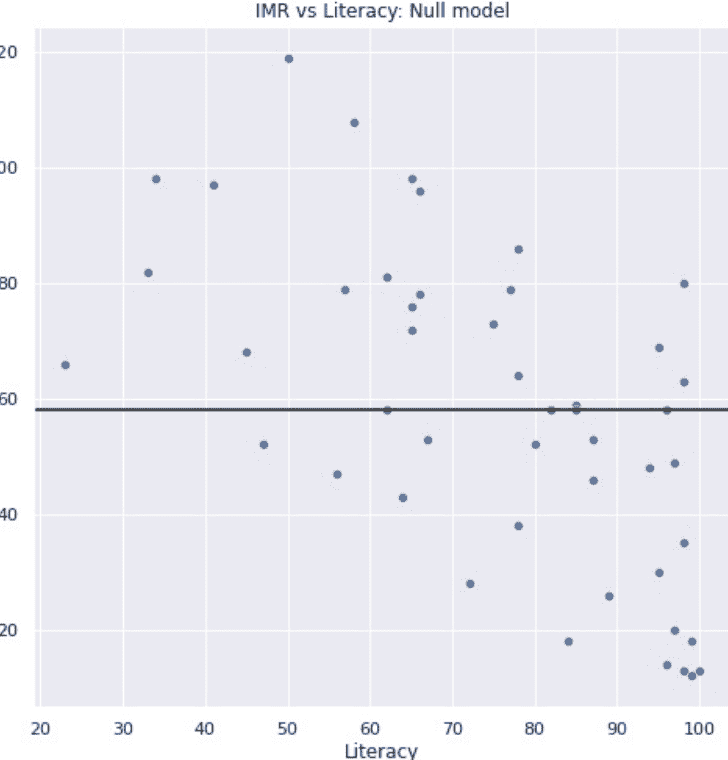

使用我们之前的计算之一，该空模型的方程为
ȳ = 58.1064 inches.

如相关系数旁栏所述，ȳ 是响应变量平均值的标准记号；x̄ 表示预测变量的平均值。这些对应于数据集中值的记号：y 表示响应变量的观测值，x 表示预测变量的观测值。如果我们需要跟踪个别观测值，则使用下标：xᵢ 和 yᵢ 分别表示数据集中第 i 行的预测变量和响应变量的值。这种记号可以有很大帮助，因为我们可以用它来写下


简洁高效，但不要让记号阻碍主要思想。

为了量化空模型对该数据的拟合程度，让我们将其恒定预测值——即每个国家的 58.1064——与观察到的婴儿死亡率进行比较。观察值与预测值之间的差异称为误差或残差，我们很快就会看到回归就是关于分析残差的。以下是随机选取的四个国家的若干残差，以及相应的观察值和空模型预测值：

### 表 2.3. 空模型预测值和残差

| 行号 | 国家 | 婴儿死亡率 | 空模型预测值 | 残差 |
|---|---|---|---|---|
| i = 16 | Ethiopia | y₁₆ = 52 | ȳ = 58.1064 | y₁₆ − ȳ = −6.1064 |
| i = 0 | Algeria | y₀ = 26 | ȳ = 58.1064 | y₀ − ȳ = −32.1064 |
| i = 12 | Côte d’Ivoire | y₁₂ = 81 | ȳ = 58.1064 | y₁₂ − ȳ = 22.8936 |
| i = 27 | Malawi | y₂₇ = 53 | ȳ = 58.1064 | y₂₇ − ȳ = −5.1064 |

计算平均残差似乎很有用，但空模型的残差之和为零——这源于 ȳ 的定义本身。为了消除所有这种抵消并获得更好的拟合度量，我们采用标准的统计技巧，在求和前先对偏差进行平方；这就得到了总平方和 TSS，

```
TSS = Σᵢ (yᵢ − ȳ)².
```

对于婴儿死亡率，TSS 为

```
>>> africa_tss = ((africa.IMR - y_bar)**2).sum()
>>> africa_tss

    34308.46808510638
```

这些平方残差的平均值是观察响应值的 *方差*，记为 Var(y)：

Var(y) ≈ ~ 1/(n−1) Σ_i (y_i − ȳ)^2

其中 n 是观测次数。乍一看，用 n − 1 而不是 n 来除以计算平均平方偏差似乎很奇怪，让我们在继续之前先弄明白这一点。有 n 个观测值，就有 n 个相对于其平均值 ȳ 的偏差；由于这些偏差之和为零，只有 n − 1 个偏差实际上需要计算——剩下的一个只是使总和为零所需的量。这就像为 12 名球员的垒球队写出击球顺序：一旦写下前 11 个名字，你也就确定了最后击球的人。我们说偏差之间有 n − 1 个自由度，我们除以自由度的数量来计算适当的平均值。随着我们的进展，我们将在其他几个上下文中学习如何处理自由度。

要计算婴儿死亡率的方差，使用 pandas var 函数：

```
>>> africa.IMR.var()

    745.836262719704

>>> (n_countries - 1)*africa.IMR.var()

    34308.46808510638
```

第二次计算只是说明了上面的公式：婴儿死亡率的方差乘以 n − 1 = 46 就是我们刚刚计算的 TSS。

方差是常见且有用的变异度量，但它没有与原始观测值相同的单位，这使得解释变得复杂。对方差取平方根可以轻松解决这个问题，并定义响应变量的 *标准差*，$s_y$：

```
$s_y = \sqrt{\frac{1}{n-1}\sum_{i}(y_i - \bar{y})^2}$.
```

预测变量的标准差 $s_x$ 与空模型无关，但在下一节中会用到，其计算方式类似：

```
$s_x = \sqrt{\frac{1}{n-1}\sum_{i}(x_i - \bar{x})^2}$.
```

要计算这些标准差，只需使用 pandas std 函数 [4]：

```
>>> s_x = africa.Literacy.std()
>>> s_x

    20.512941245879194

>>> s_y = africa.IMR.std()
>>> s_y

    27.31000297912294
```

你可以自行检查这些值是否与这些变量方差的平方根一致。如前所述，当我们介绍身高数据集时提到过，标准差是 *相对于平均值的平均偏差* 的度量。例如，如果我们随机选择一个非洲国家，其婴儿死亡率很可能在平均值的一个标准差范围内，即介于

```
$\bar{y} - s_y = 58.1064 - 27.31 = 30.7964$  and  $\bar{y} + s_y = 58.1064 + 27.31 = 85.4164$.
```

在不知道婴儿死亡率的具体分布的情况下，例如正态或其他分布，我们不知道随机选择的国家婴儿死亡率落在此范围内的精确概率。另一方面，一个有趣的结果 *切比雪夫不等式*，在下一章中精确表述，保证了它落在平均值两个标准差范围内的概率至少为 75%，介于

ȳ − 2*s_y = 58.1064 − (2*27.31) = 3.4864   and   ȳ + 2*s_y = 58.1064 + (2*27.31) = 112.7264.

这个范围 admittedly 比之前的区间有用性差一些，但这些不等式表明响应变量的标准差量化了空模型的预测误差。我们应该期望通过纳入预测变量的信息来做得更好，让我们看看会发生什么。

## 2.2.3 拟合和评估回归线

如果我们试图通过仅凭散点图 *猜测* 一条比空模型更适合 UNICEF IMR 数据的直线方程，我们可能会得到类似这样的结果：

```
>>> m_sd = -s_y / s_x
>>> m_sd

    -1.3313548092285008

>>> b_sd = y_bar - m_sd*x_bar
>>> b_sd

    157.90134027472357

>>> sns.scatterplot(data=africa, x="Literacy", y="IMR")
>>> plt.axline( (x_bar, y_bar), slope = m_sd, linestyle='--', col
>>> plt.title("IMR vs Literacy: SD line")
```

图 2.10. UNICEF 数据的 SD 线

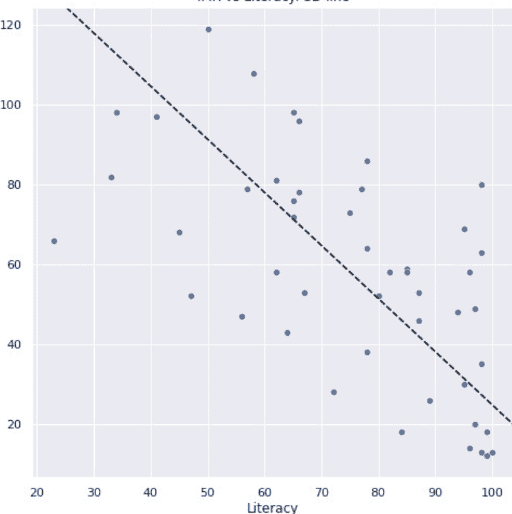

首先，我们尝试的直线为

Predicted IMR = 157.9013−1.3314 * Literacy ,

它看起来非常适合散点图。这条直线通过平均点 (x̄, ȳ) = (74.9574, 58.1064)，其斜率的绝对值是 IMR 和 Literacy 标准差的比值。作为对 Freedman et al. [5] 的致敬，我们采用他们的术语称之为 SD 线。虽然它看起来拟合数据，但我们需要——正如总是那样！——量化事物并客观地衡量拟合程度。正如我们对空模型所做的那样，我们将基于该线的预测与实际观测值进行比较。例如，对于上面的四个国家，

我们得到 SD 线的以下预测值和残差：

| 国家 | Literacy 率 | SD 线预测值 | 婴儿死亡率 | SD 线残差 |
|---|---|---|---|---|
| Ethiopia | x₁₆ = 47 | 95.3277 | y₁₆ = 52 | -43.3277 |
| Algeria | x₀ = 89 | 39.4108 | y₀ = 26 | -13.4108 |
| Côte d’Ivoire | x₁₂ = 62 | 75.3573 | y₁₂ = 81 | 5.6427 |
| Malawi | x₂₇ = 87 | 42.0735 | y₂₇ = 53 | 10.9265 |

如果我们使用该方程计算所有国家的残差，我们会得到正负残差的相当均匀的混合——该模型对某些国家的婴儿死亡率高估，对其他国家低估。为了使模型尽可能准确地预测婴儿死亡率，我们需要这些残差尽可能小，并且我们应该系统地进行，而不是靠试错。数学来帮忙！在设置一些我们将从现在开始使用的记号之后，我们将应用著名的最小二乘法来解决这个优化问题并获得更好的预测模型。

要找到使残差最小化的直线，我们必须找到最优的截距和斜率——我们需要使用可用数据计算两个数字。令 a 和 b 分别表示待确定的截距和斜率，我们将使用方程

```
ŷ = a + b x
```

抽象地处理预测并分析残差。x 表示 Births 的观测值，如前所述，ŷ（“y 帽”）表示 IMR 的相应预测值；统计学家使用这种奇怪的帽子记号来表示从观测值计算得出的量。该预测的残差为

```
y - ŷ = y - a - b x,
```

其中 y 是与当前情况的 x 值对应的 IMR 的观测值。正如我们在分析空模型拟合时所指出的那样，我们不能直接对这些残差取平均值；正负残差之间的抵消会给我们一个整体误差很小的错误印象。为了解决这个问题，我们再次采用之前的技巧，在求和前先对偏差进行平方——这就得到了残差平方和 SSR，

```
SSR = Σ_{x, y} (y - ŷ)^2 = Σ_{x, y} (y - a - b x)^2,
```

其中求和包括所有观测数据点。SSR 是模型拟合的基本总体度量，也是我们要最小化的量。重要的是要认识到，这里只有两个未知数 a 和 b；x 和 y 值都是已知的数字。例如，在 UNICEF 数据中，有 47 个 (x, y) 对可用于计算给定 a 和 b 值的 SSR。此外，SSR 是这两个未知数的二次函数，且平方项的系数为正。如果你以前处理过二次函数，你就知道这意味着存在 a 和 b 的唯一组合，使得 SSR 达到最小值。事实上，这些系数有很好的显式公式！

### 简单线性回归的系数

确定使 SSR 最小的 a 和 b 的值是一个直接的微积分练习：对 a 和 b 求偏导数，设其等于 0，然后求解由此产生的线性方程。结果如下：

```
∂/∂a (SSR) = -2 Σ_{x, y} (y - a - b x) = 0  ⟹  a = ȳ - b x̄
```

在除以 n 并求解 a 之后。除了提供我们稍后会使用的 a 的公式外，这一计算还表明


*残差之和为零，*

```
∑_{x, y} (y − a − b x) = − ∑_{x, y} (y − ŷ) = − 0.
```

记住这个重要事实！现在确定 b：

```
∂/∂b (SSR) = −2 ∑_{x, y} x(y − a − b x) = −0  ⟹  b = − ∑_{x, y} (x − x̄)(y − ȳ) / ∑_{x, y} (x − x̄)² = − r (s_y / s_x).
```

练习 5.2.1 将引导你完成此处所需的代数运算。前述等式保证了*残差的加权和为零，*

```
∑_{x, y} x(y − a − b x) = − ∑_{x, y} x(y − ŷ) = −0,
```

另一个需要留待以后使用的重要的事实。最后，由于 ∂²/∂a² (SSR) 和 ∂²/∂b² (SSR) 均为正，我们知道 SSR 在 a 和 b 的这些临界值处取得最小值。

将这些最优斜率和截距的公式应用于 UNICEF IMR 数据，我们发现

```
>>> m = africa_corr*(s_y/s_x)
>>> m

    -0.8204100566323119

>>> b = y_bar - m*x_bar
>>> b

    119.60222615990713
```

因此，最佳拟合线的方程为

预测 IMR = 119.6022 - .8204 * Literacy.

这是*回归线*，也称为*最小二乘线*。为了直观地检查拟合效果，这里是 UNICEF 数据和回归线一起显示：

```
>>> sns.scatterplot(data=africa, x="Literacy", y="IMR")
>>> plt.axline( (x_bar,y_bar), slope = m, color="black")
>> plt.title("IMR vs Literacy: Line of best fit")
```

图 2.11. 文盲率和婴儿死亡率，带回归线

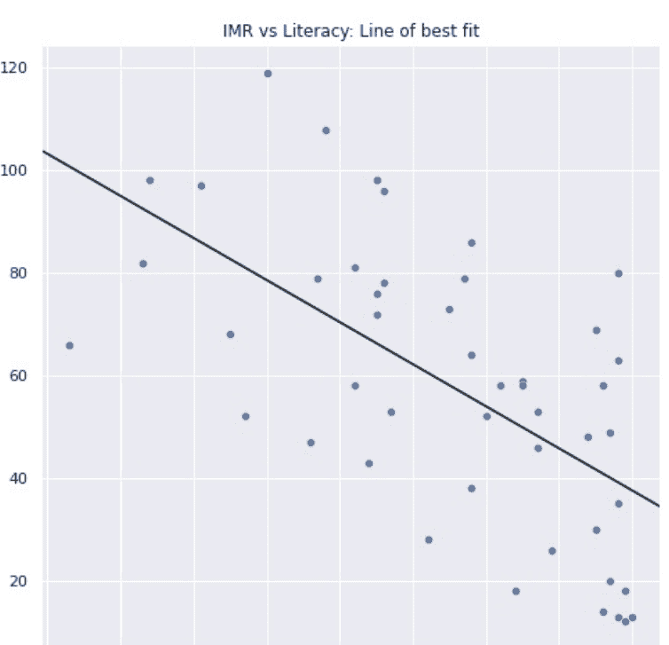

为了对比，这里是数据、回归线和 SD 线在一个散点图中，平均值点处的交点已明确标记：

```
sns.scatterplot(data=africa, x="Literacy", y="IMR")
plt.axline( (x_bar,y_bar), slope = m, color="black")
plt.axline( (x_bar, y_bar), slope = m_sd, linestyle='--', color="
plt.title("IMR vs Literacy: Regression line (solid) and SD line (
```

```
plt.plot(x_bar,y_bar,'ok')
```

### 图 2.12. 文盲率和婴儿死亡率，带回归线和 SD 线

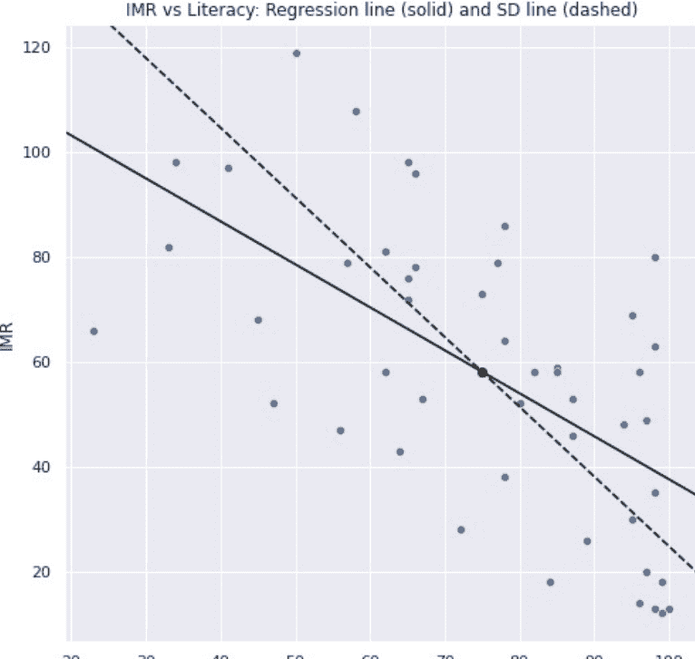

仅凭观察很难确定回归线比 SD 线更符合数据，但现在我们知道 SD 线太陡，因此误差过大。通过最小化残差平方和，回归线具有最小的可能总体误差（在最小二乘意义上），因此在平均情况下比任何其他线提供更准确的预测。SSR 的实际值很重要，因为它衡量了这些预测的不确定性，并提供了关键的模型诊断，即残差标准误差（见下文）。为了在不做大量不必要的计算的情况下探索这一点，是时候开始使用 statsmodels 库来构建线性回归模型了——虽然上面系数公式很有趣且具有启发性，但在现实生活中几乎没人使用它们！为了尽可能简化，我们将使用 statsmodels.formula.api 接口，以上已导入为 smf。以下是准备模型、拟合它并初步查看结果的方法：

```
>>> africa_model = smf.ols('IMR ~ Literacy', data = africa)
>>> africa_fit = africa_model.fit()
>>> africa_fit.params
```

```
Intercept      119.602226
Literacy       -0.820410
dtype: float64
```

这里的语法对应于我们想要的内容：smf.ols('IMR ~ Literacy', data = africa) 意味着我们想要使用普通最小二乘法(ols)对 africa 数据拟合一个简单的线性模型，以 IMR 作为响应，Literacy 作为预测变量。我们看到截距 119.6022 和斜率 -0.8204，正是我们刚才从公式中计算出的，但以这种方式拟合模型有许多好处：

- 这更快、更容易、出错更少，
- smf.ols 可用于构建具有多个预测变量的回归模型，我们稍后会看到，以及
- 结果存储在 africa_fit 中，包含的信息远不止系数！

在进一步展开这一点之前，让我们稍微退一步，再次审视空模型。它的常数预测很容易通过对观测响应取平均来计算，但我们也可以使用 smf.ols 来获取它。毕竟，空模型是一条线——斜率为 0 的线——而 smf.ols 将线拟合到数据。我们只需要指定斜率为 0 并拟合最佳常数，即最佳水平线：

```
>>> africa_null = smf.ols('IMR ~ 1', data = africa)
>>> africa_null = africa_null.fit()
>>> africa_null.params
```

Intercept      58.106383
dtype: float64

这就是空模型！你可以决定你更喜欢哪种方法来获取它。

现在让我们看看 africa_fit 中还包含什么。残差很容易访问和分析；例如，我们可以直接从残差计算 SSR：

```
>>> africa_ssr = (africa_fit.resid**2).sum()
>>> africa_ssr
```

21280.530941116467

正如你可能预期的那样，你不必以这种方式计算 SSR，因为它已在结果中提供：

```
>>> africa_fit.ssr
```

21280.530941116467

如前所述，在相加之前对残差进行平方消除了抵消，这很好，但也将响应变量的测量单位进行了平方，使得 SSR 更难解释。为了获得具有与原始观测相同单位的更有用误差度量，我们对残差平方取平均并开平方根，得到残差标准误差(RSE)：

RSE = sqrt(1/(n - 2) SSR) = sqrt(1/(n - 2) sum_y (y - ŷ)^2).

我们在这里除以 ( n - 2)，因为计算模型中的 2 个系数牺牲了 2 个自由度。一般来说，当我们用 n 个数据点计算回归模型中的 p 个系数时，有 ( n - p) 个自由度——方差和标准差也会发生同样的情况，因为我们通过计算平均值使用了 1 个自由度，剩下 (n - 1) 个自由度用于这些计算。

对于 UNICEF IMR 数据，RSE 为

```
>>> np.sqrt( africa_ssr / (n_countries - 2) )

    21.746279856112537
```

RSE 约为 21.75，而响应变量的标准差——空模型的类似量——约为 27.31，如上所述。这是一种比较这两种模型的方法：基于回归线的婴儿死亡率预测通常会偏差约 21.75 个死亡左右，但空模型的预测会偏差约 27.31 个死亡。这绝对是一个改进！

由于 RSE 是衡量模型拟合如此有用的指标，因此毫不奇怪 smf.ols 将我们获取 RSE 所需的内容与 africa_fit 中的其他信息捆绑在一起。可能令人惊讶的是，smf.ols 将量 SSR / (n − 2) 称为模型的尺度参数[6]，因此我们通过取其平方根得到 RSE：

```
>>> np.sqrt( africa_fit.scale )

    21.746279856112537
```

请注意，其他人和书籍可能会用另一个名称指代 RSE，例如回归的标准误差；更重要的是术语的选择，而是理解 RSE 的作用——它量化了响应相对于回归线的变异性。

另一个基本——而且被广泛误解！——回归诊断是决定系数，以 R² 表示，并按你预期的方式访问：

```
>>> africa_fit.rsquared

    0.379729491613339
```

这个数字做什么？它的全部工作就是比较简单线性回归模型和空模型。为了解释其工作原理，我们必须经历一些计算——这可能看起来很乏味，但这是正确理解决定系数的唯一方法。所以拿一杯浓缩咖啡、一支铅笔和一些纸，考虑以下分解：

y - \bar{y} = (y - \hat{y}) + (\hat{y} - \bar{y}).

这表明观测值 Y 与平均响应 \bar{y} 之间的偏差由两部分组成，我们一直在分析的残差和两个竞争模型的预测之间的差异。决定系数量化了这两个项的相对大小。具体来说，我们进行通常的操作并操作平方和：

\sum (y - \bar{y})^2 = \sum \{ (y - \hat{y}) + (\hat{y} - \bar{y}) \}^2 = \sum (y - \hat{y})^2 - 2 \sum (y - \hat{y})(\hat{y} - \bar{y}) + \sum (\hat{y} - \bar{y})^2.

看起来我们使事情变得更混乱和复杂，但数学的善良力量站在我们这边——右边中间项消失了：

\sum (y - \hat{y})(\hat{y} - \bar{y}) = \sum \hat{y}(y - \hat{y}) - \bar{y} \sum (y - \hat{y}) = 0.

当我们通过回归系数的推导时，我们指出这些涉及残差的和都为 0，最小二乘法的两个奇妙结果。现在的回报是

\sum (y - \bar{y})^2 = \sum (y - \hat{y})^2 + \sum (\hat{y} - \bar{y})^2, \quad so that \sum (\hat{y} - \bar{y})^2 = \sum (y - \bar{y})^2 - \sum (y - \hat{y})^2 = TSS - SSR.

这个最后一个恒等式保证了将预测变量纳入我们的模型会降低变异性，绝对减少量等于 TSS - SSR；这个量不能为负，因为它等于平方和之和。为了使这个统计量更容易解释，决定系数将变异性的减少表示为相对比例，即：

R^2 = \frac{\sum (y - \bar{y})^2 - \sum (y - \hat{y})^2}{\sum (y - \bar{y})^2} = 1 - \frac{\sum (y - \hat{y})^2}{\sum (y - \bar{y})^2} = 1 - \frac{SSR}{TSS}.

在计算了 UNICEF 数据的相关成分后，我们可以检查该公式是否与 africa_fit 模型的 rsquared 值一致：

#### 列表 2.7. 直接计算决定系数

```
>>> 1 - (africa_ssr / africa_tss)
```


我们通常将决定系数表示为百分比；在这种情况下，我们发现使用识字率而不是忽略它们，可以将预测婴儿死亡率的可变性降低 38%。在下一章中，我们将剖析所有这些计算背后的抽象模型，我们将介绍 africa_fit 中包含的其他诊断信息。

## 2.2.4 使用和解释回归线

我们使用线性回归方程做三件事：

- 估计给定预测变量值的 *平均响应*，
- 预测给定预测变量值的 *个体响应*，以及
- 描述预测变量与响应变量之间的关系。

到目前为止，这前两种应用看起来是相同的：只需将预测变量的值代入回归方程并计算结果即可。例如，如果联合国收集了非洲年轻女性识字率的新数据，我们就可以用它们来预测相应的婴儿死亡率。具体来说，假设 UNICEF 发现马拉维当前的识字率为 79，低于其先前记录的 87；使用我们刚刚找到的回归线，我们会预测纳米比亚当前的婴儿死亡率为

```
Predicted IMR = 119.6022 - .8204 * 79 = 54.7906
```

这将是我们基于用于拟合模型的数据的，对当前 IMR 值的最佳预测。正如下一章中完整解释的那样，这也将是我们对所有年轻女性识字率为 79% 的非洲国家的平均婴儿死亡率的最佳估计。然而，第二种解释比第一种解释更有意义，尽管非洲国家的数量很少且固定。另一方面，对于身高数据来说，将一个人的身高与其父亲的身高联系起来，预测一个人的身高是完全合理的，因为父亲和儿子的数量很多！这说明了常识在统计建模中的基本作用：*人们* 需要在解释和使用模型时考虑和尊重所分析数据的背景。结果通常可以以不同的方式解释，其中一些比其他更有意义。

对于回归的这前两种应用，*点估计* 的计算——作为我们单一最佳预测或估计的数字——确实是相同的。然而，这两个点估计所伴随的误差幅度是不同的，因为预测个体响应本质上比估计一个群体的平均值不确定。下一章中我们还将进一步研究这个问题，在那里我们将看到如何获得相关的 *区间估计*，即 *置信区间* 和 *预测区间*。

尽管我们在分析 UNICEF 数据时谈了很多关于预测，但在这个例子中，回归线的最有用应用是理解识字率与婴儿死亡率之间的关系。回归线的斜率是关键，因为它告诉我们响应变量平均随预测变量如何变化。由于回归线的方程为

```
Predicted IMR = 119.6022 - .8204 * Literacy ,
```

斜率为 -0.8204。首先要注意的是，斜率为负，因此年轻女性的识字率越高，婴儿死亡率越低。更精确地说，由于该系数单位为 IMR 每 Literacy，其值告诉我们平均而言，识字率每提高 10%，婴儿死亡率会减少 8.2。我们*不能* 从中得出任何因果关系！该回归模型量化了这些变量之间的关系，但对它们为何以这种方式相关却完全没有说明。这一警告适用于所有回归模型。

[3] http://data.un.org/Explorer.aspx

[4] 默认的 numpy std 函数不会给出相同的答案——你必须告诉它正确的自由度数！

[5] *Statistics*, 4th edition, by Freedman, Pisani, and Purves

[6] 从广义线性模型的角度来看，它就是如此…

## 2.3 Examples

### 2.3.1 Understanding the compressive strength of concrete

混凝土是一种人造建筑材料，主导着建筑行业。它坚固耐用，能抵抗火灾和潮湿的损害，湿润时易于成型，使其成为地基、墙壁、水坝、道路、桥梁和其他结构物的理想材料。得益于其有用的特性和相对较低的成本——尽管其碳足迹非常高——混凝土在全球范围内使用的量比任何其他材料都多。其成分相当简单：粗骨料（通常是碎石或碎石），细骨料（沙子），干水泥和水。混合这些成分后，会发生一种称为 *水化* 的化学固化过程，之后混凝土即可使用。通常，混凝土在大约一个月后基本固化完成。

制作坚固的混凝土并不像听起来那么容易。人们很容易使用过多的水，使混凝土易于浇注，但这会使混凝土变弱；水太少，混凝土就无法浇注且难以操作。诀窍在于以适当的比例混合成分，使水化完全发生。为了调查这一点，我们将分析来自 UCI 机器学习库的数据集：

```
>>> concrete = pd.read_csv("concrete.csv")
>>> concrete.columns
```

```
Index(['Cement', 'Slag', 'FlyAsh', 'Water', 'Superplasticizer',
       'CoarseAggregate', 'FineAggregate', 'Age', 'Strength'],
      dtype='object')
```

正如列名所示，这些混凝土批次是用一些额外的成分制成的，以增强性能并降低成本：矿渣（冶炼金属的副产品）、粉煤灰（燃烧煤炭的副产品）和超塑化剂。我们现在将忽略这些额外成分，专注于混凝土 28 天强度如何取决于用于制作它的水和水泥的用量。这些成分的比例，而不是原始用量，是合适的预测变量，因此我们需要相应地过滤和修改数据集：

```
>>> concrete = concrete.query("Age == 28").filter(["Cement","Water"])
>>> concrete = concrete.assign(Ratio = concrete.Water / concrete.Cement)
>>> concrete.head()
```

|   | Cement | Water | Strength | Ratio |
|---|--------|-------|----------|-------|
| 0 | 540.0  | 162.0 | 79.986111 | 0.300000 |
| 1 | 540.0  | 162.0 | 61.887366 | 0.300000 |
| 7 | 380.0  | 228.0 | 36.447770 | 0.600000 |
| 8 | 266.0  | 228.0 | 45.854291 | 0.857143 |
| 9 | 475.0  | 228.0 | 39.289790 | 0.480000 |

我们将这些步骤分开是有原因的，很快就会清楚。有了这个更新后的数据集，下一步是绘制 Strength 与 Ratio 的散点图并拟合回归线：

```
>>> sns.regplot(data=concrete, x="Ratio", y="Strength",
    ci=None, line_kws={"color":"black"})
>>> plt.title("Compressive strength versus water:cement ratio")
```

Figure 2.13. Strength depends nonlinearly on Ratio!

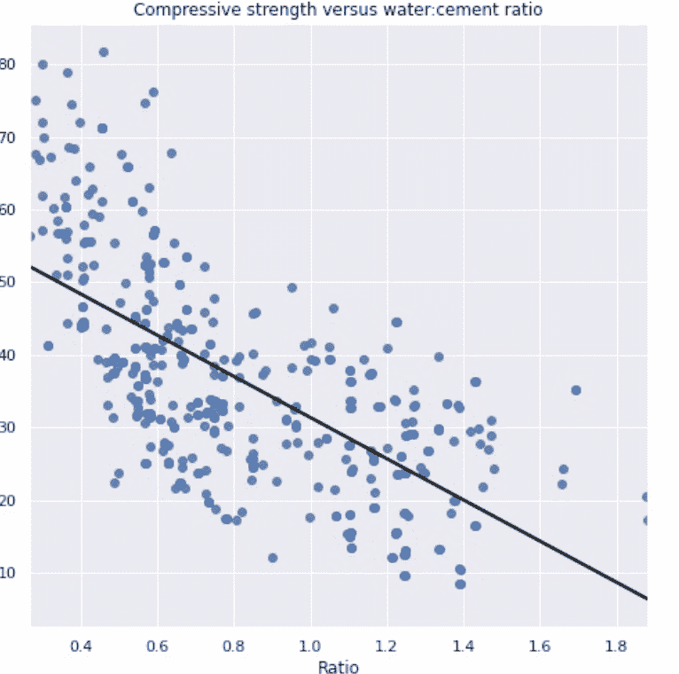

嗯。Strength 与 Ratio 之间的关系明显看起来 *非线性*，因此对该数据拟合回归线似乎不是正确的做法。我们稍后会解决这个问题，但为了说明目的，让我们看看如果我们继续进行线性回归会发生什么。用 smf.ols 拟合模型，然后查看一些基本诊断：

```
>>> concrete_model = smf.ols("Strength ~ Ratio", data=concrete)
>>> concrete_fit = concrete_model.fit()
>>> concrete.Strength.corr( concrete.Ratio )
```

-0.6551873840990604

```
>>> concrete_fit.rsquared
```

0.4292705082825695

如果我们只看相关性和决定系数，回归模型看起来不错；决定系数告诉我们，将 Ratio 作为预测变量可以使空模型的变异性减少约 43%。然而，上面的散点图讲述了一个完全不同的故事：Strength 不依赖于 Ratio 的线性关系，因此线性回归模型不合适！

那么我们现在该怎么办？一般来说，如果有理由认为线性模型应该是相关的，下一步就是尝试转换变量以获得线性关系；通常，人们尝试取对数，如下一个示例所示，或取变量的平方根来实现这一点。对于这个特定数据集，我们将以不同的方式定义 Ratio：我们将用水泥除以水，而不是反过来，从而取我们第一次尝试的预测变量的倒数。我们得到的结果如下：

```
>>> concrete = concrete.assign(Ratio = concrete.Cement / concrete.Water)
>>> concrete.head()
```

|   | Cement | Water | Strength | Ratio |
|---|--------|-------|----------|-------|
| 0 | 540.0  | 162.0 | 79.986111 | 3.333333 |
| 1 | 540.0  | 162.0 | 61.887366 | 3.333333 |
| 7 | 380.0  | 228.0 | 36.447770 | 1.666667 |
| 8 | 266.0  | 228.0 | 45.854291 | 1.166667 |
| 9 | 475.0  | 228.0 | 39.289790 | 2.083333 |

```
>>> sns.regplot(data=concrete, x="Ratio", y="Strength",
    ci=None, line_kws={"color":"black"})
>>> plt.title("Compressive strength versus cement:water ratio")
```

Figure 2.14. Transforming the predictor yields the desired linear relationship


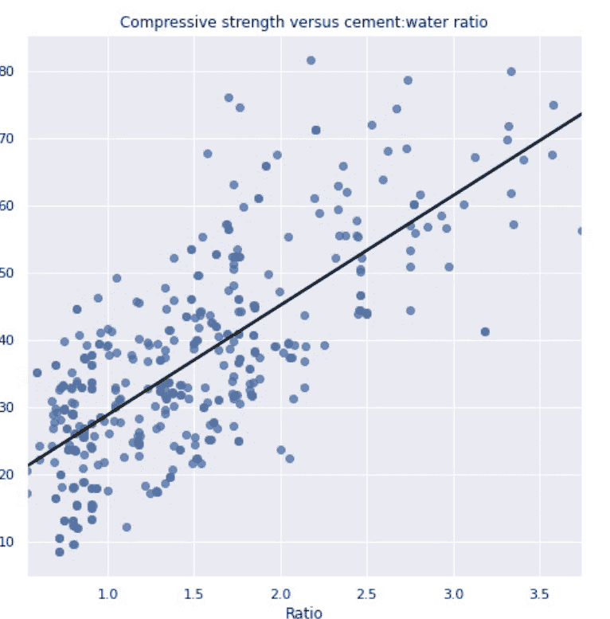

看起来更像是一个线性关系！因此相关系数现在是有意义的，对此数据拟合回归模型是有意义的：

```
>>> concrete.Strength.corr( concrete.Ratio )

    0.7251376169406446

>>> concrete_model = smf.ols("Strength ~ Ratio", data=concrete)
>>> concrete_fit = concrete_model.fit()
>>> concrete_fit.params

    Intercept    12.59679
```

```
Ratio        16.31580
dtype: float64

>>> concrete_fit.rsquared

0.5258245635023568
```

显式拟合模型因此为

Predicted Strength~ = ~12.59679+16.31580* Ratio.

正斜率量化了随着水泥与水比例增加抗压强度如何增加，0.725 的相关性反映了散点图中显示的强线性关系，而决定系数显示相对于空模型预测变异性减少了 53%。我们将在下一章再次回到这个例子以进一步检验该模型，但实际的收获已经很清楚：使用更少的水会使混凝土更强！

### 2.3.2 估算鱼的体重

到目前为止，我们一直避免数据分析中一个相当常见的问题：缺失或损坏的值。出于各种原因，数据集通常是不完整的；有人可能没有在调查问卷上回答某个问题，某个值可能记录错误或根本未记录，或者信息可能根本不可用。替换缺失数据称为数据插补，这可能是一个棘手的问题。插补的一个简单方法是，用该变量可用观测值的平均值填充每个缺失条目——这正是空模型预测定量响应的方式。正如我们所见，简单的线性回归模型有时可以比空模型做出更好的预测，下一个例子展示了这如何提供一种有效的数据插补手段。具体来说，我们将使用鱼长度和重量的对数之间的线性关系，根据已知的长度预测鱼的体重。我们需要由此得到的体重用于第 4 章的一个例子，在那里我们将探讨不同大小软骨鱼的灭绝风险。

我们将使用 FishBase [7] 的数据，这是一个流行的鱼类物种信息全球数据库。幸运的是，rOpenSci[8] 的人们使数据易于访问，因此我们可以直接从 CSV 读取物种数据：

#### Listing 2.8. 加载 FishBase 物种数据

```
>>> fish = pd.read_csv("fish.csv")
>>> fish.shape

(34299, 101)
```

我们看到这个数据集有 101 列关于 34,299 种鱼的信息。在许多可用变量中，我们在这个例子中只关心其中两个：Length，即鱼种的特征长度，单位为厘米；Weight，即鱼种的特征重量，单位为克。我们还需要跟踪每种物种的科学名称，因此让我们相应地精简：

#### Listing 2.9. 选择 Species、Length 和 Weight 列

```
>>> fish = fish.filter(["Species","Length","Weight"])
>>> fish
```

|   | Species | Length | Weight |
|---|---------|--------|--------|
| 0 | Aapticheilichthys websteri | 3.08 | NaN |
| 1 | Aaptosyax grypus | 130.00 | 30000.0 |
| 2 | Abactochromis labrosus | 11.50 | NaN |
| 3 | Abalistes filamentosus | 32.50 | 1375.0 |
| 4 | Abalistes stellaris | 60.00 | NaN |
| ... | ... | ... | ... |
| 34294 | Zu cristatus | 118.00 | NaN |
| 34295 | Zu elongatus | 120.00 | NaN |
| 34296 | Zungaro jahu | 140.00 | NaN |
| 34297 | Zungaro zungaro | 140.00 | NaN |
| 34298 | Zungaropsis multimaculatus | NaN | NaN |

34299 rows × 3 columns

这 10 行表明可能存在相当多的缺失值，因为其中 8 行的体重缺失。事实上，删除所有缺失值的行揭示了缺失数据的程度：

#### Listing 2.10. 删除所有缺失值

```
>>> train = fish.dropna(axis='index')
>>> train
```

|  | Species | Length | Weight |
|---|---|---|---|
| 1 | Aaptosyax grypus | 130.0 | 30000.0 |
| 3 | Abalistes filamentosus | 32.5 | 1375.0 |
| 9 | Abbottina obtusirostris | 10.9 | 13.5 |
| 14 | Ablennes hians | 140.0 | 4800.0 |
| 24 | Abramis brama | 82.0 | 6010.0 |
| ... | ... | ... | ... |
| 34265 | Zeus faber | 90.0 | 8000.0 |
| 34266 | Zingel asper | 22.0 | 100.0 |
| 34270 | Zoarces americanus | 110.0 | 5436.0 |
| 34273 | Zoarces fedorovi | 23.0 | 92.0 |
| 34275 | Zoarces viviparus | 52.0 | 510.0 |

2172 rows × 3 columns

超过 32,000 种鱼缺少数据！有 2,172 个完整案例——至少就长度和重量而言是完整的。为了探索这些案例，让我们查看体重与长度的散点图：

```
>>> sns.scatterplot(data=train, x="Length", y="Weight")
>>> plt.title("Fish weights versus fish lengths")
```

Figure 2.15. Fish weights versus lengths

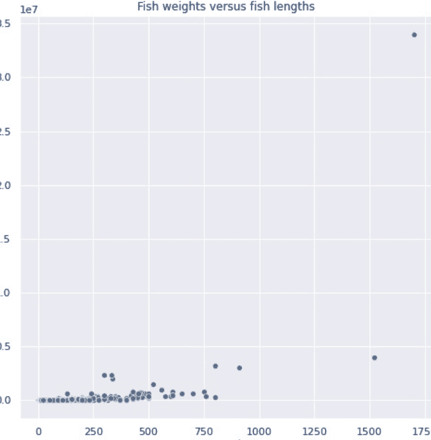

### Fish weights versus fish lengths

这看起来有点混乱——大多数点堆积在水平轴上，有几个离群点试图逃离，而且重量的刻度比长度的刻度大几个数量级。在处理不同物种动物的身体测量时这是典型的，标准解决方法是使用测量的对数而不是其自然单位。如果我们绘制重量的自然对数与长度的自然对数，我们会得到一个更漂亮的关系：

```
>>> train = train.assign(LogLength = np.log(train.Length), LogWei
>>> sns.scatterplot(data=train, x="LogLength", y="LogWeight")
>>> plt.title("Log(Weight) versus Log(Length)")
```

#### Figure 2.16. Log(Weight) versus Log(Length) for all fish

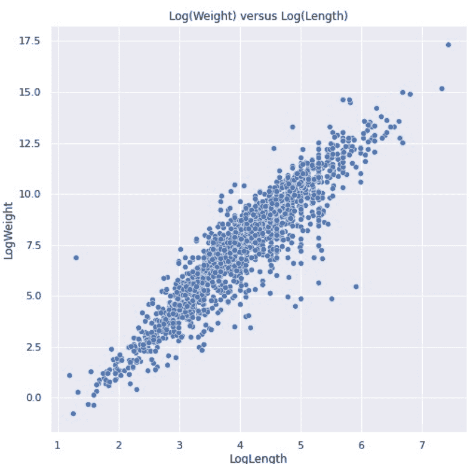

啊！这种线性关联正是我们在本章学习处理的内容。我们知道下一步该做什么：计算相关系数以量化线性关系的强度，然后拟合一条回归线，以便我们可以预测所需的体重。

```
>>> train.LogLength.corr( train.LogWeight )
```

0.9230692454775014

```
>>> train_model = smf.ols( "LogWeight ~ LogLength", data=train)
>>> train_fit = train_model.fit()
```

```
>>> train_fit.params

    Intercept    -3.322617
    LogLength    2.681095
    dtype: float64
```

```
>>> train_fit.rsquare

    0.852056831946404
```

强正相关，$r = 0.923$，对应于散点图中看到的情况，并产生决定系数 $R^2 = 0.8521$；使用 log(Length) 估计 log(Weight) 相对于空模型将预测变异性减少了 85.21%。拟合的回归方程为

```
log(Weight) ~ = ~ -3.322617 + 2.681095 * log(Length),
```

我们可以有信心这两个变量之间确实存在正线性关系。下一章会有更多内容！

为了将模型表达为更适合根据体长预测鱼体重的形式，对其取指数以消除对数，然后做一点简化：

```
Weight ~ = ~ e^{-3.322617 + 2.681095 * log(Length)} ~ = ~ e^{-3.322617} * e^{log(Length^{2.681095})} ~ = ~ .036 * Length^{2.681095}.
```

鱼长度和重量的数据因此揭示了 *幂律关系*

```
Weight ~ = ~ .036 * Length^{2.68109},
```

这在直觉上是有意义的：如果我们粗略简化这个结果，它说鱼的重量，对应于其体积，大致与长度的立方成正比。当然，由于这个丰富的数据集，我们得到了一个更精确的模型，可以提供更准确的估计。

由于我们只需要下一章灭绝风险示例中软骨鱼的体重，因此不需要插补 *所有* 缺失的鱼体重。相反，我们将使用软骨鱼的名称——即属于纲 Chondrichthyes 的鱼——从 fish DataFrame 中获取我们需要的内容。chondrichthyes.csv 数据集在其 Species 列中包含这些科学名称，其 Category 列列出了


每个物种的灭绝风险等级由国际自然保护联盟（IUCN）确定并记录在其红色名录中 [9]。为了将鲨鱼数据集准备好供以后使用，我们剔除了灭绝风险未知以及体长未知的物种——注意，名称“鲨鱼”只是方便之举，因为软骨鱼还包括鳐鱼、魟鱼和锯鱼。最后，我们将使用回归模型中的幂律来填补缺失的体重。当我们绘制结果时，很容易就能发现插补值，因为它们正好落在回归线上：

```
>>> sharks = pd.read_csv("chondrichthyes.csv")
>>> sharks = sharks.join( fish.set_index("Species"), on="Species")
>>> sharks = sharks[ sharks.Length.notna() ]
>>> sharks = sharks[ sharks.Category != "Data Deficient" ]
>>> sharks.head()
```

|   | Species | Category | Length | Weight |
|---|---------|----------|--------|--------|
| 0 | Hexanchus griseus | Near Threatened | 482.0 | 590000.0 |
| 1 | Lamna nasus | Vulnerable | 350.0 | 230000.0 |
| 2 | Leucoraja lentiginosa | Least Concern | 43.0 | NaN |
| 3 | Dactylobatus clarkii | Least Concern | 59.0 | NaN |
| 4 | Pseudobatos percellens | Endangered | 100.0 | 955.1 |

```
>>> imp = np.exp( train_fit.params.Intercept )*np.power( sharks.Length, train_fit.params.Slope )
>>> sharks.Weight = sharks.Weight.where( sharks.Weight.notna(), imp )
>>> sharks
```

|   | Species | Category | Length | Weight |
|---|---------|----------|--------|--------|
| 0 | Hexanchus griseus | Near Threatened | 482.0 | 590000.00 |
| 1 | Lamna nasus | Vulnerable | 350.0 | 230000.00 |
| 2 | Leucoraja lentiginosa | Least Concern | 43.0 | 863.95074 |
| 3 | Dactylobatus clarkii | Least Concern | 59.0 | 2017.5638 |
| 4 | Pseudobatos percellens | Endangered | 100.0 | 955.10000 |
| ... | ... | ... | ... | ... |
| 1179 | Pateobatis jenkinsii | Vulnerable | 130.0 | 16775.968 |
| 1180 | Pristiophorus cirratus | Least Concern | 137.0 | 19308.807 |
| 1181 | Squatina californica | Near Threatened | 152.0 | 25511.414 |
| 1182 | Urogymnus granulatus | Vulnerable | 141.0 | 20857.643 |
| 1185 | Callorhinchus capensis | Least Concern | 122.0 | 5250.0000 |

809 rows × 4 columns

```
>>> sharks = sharks.assign(LogLength = np.log(sharks.Length),
    LogWeight = np.log(sharks.Weight))
>>> sns.scatterplot( data=sharks, x="LogLength", y="LogWeight")
```

```
>>> plt.title("Log(Weight) versus Log(Length) for sharks")
```

图 2.17. 软骨鱼的 log(Weight) 与 log(Length) 散点图

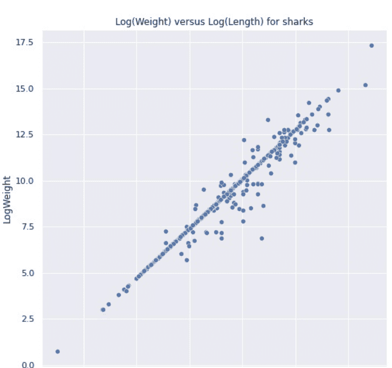

经过所有这些工作来准备鲨鱼数据集，让我们将其保存以供以后使用：

```
>>> sharks.to_csv("sharks.csv",index=False)
```

该数据集在我们第 3 章再次使用它时将准备就绪。
不过，在进入下一个示例之前，我们需要解决鲨鱼散点图的一个方面。我们可以看到，物种数据集中短软骨鱼的体重是缺失的，因为散点图左下角的点位于回归线上。乍一看，这似乎是外推的例子——使用训练集之外解释变量的值来进行预测——但事实并非如此，因为训练数据包含了来自其他类别的短鱼。虽然这里外推不是问题，但在下一个示例中我们将看到一个真正的外推例子。

## 2.3.3 预测大学入学人数

美国的本科入学人数在 1980 年代增长，在 1990 年代基本持平，然后稳步攀升至约 2011 年左右，随后开始下降：

```
>>> enroll = pd.read_csv("enrollment.csv")
>>> enroll.head()
>>> enroll.Births = enroll.Births / 1000000
>>> enroll.Enrollment = enroll.Enrollment / 1000000
>>> enroll.head()
```

|   | BirthYear | Births   | EnrollmentYear | Enrollment |
|---|-----------|----------|----------------|------------|
| 0 | 1950      | 3.632000 | 1970           | 7.368644   |
| 1 | 1955      | 4.097000 | 1975           | 9.679455   |
| 2 | 1960      | 4.257850 | 1980           | 10.475055  |
| 3 | 1965      | 3.760358 | 1985           | 10.596674  |
| 4 | 1966      | 3.606274 | 1986           | 10.797975  |

```
>>> trend = enroll.query("EnrollmentYear > 1980 & EnrollmentYear < 2020")
>>> sns.lineplot( data=trend, x="EnrollmentYear", y="Enrollment")
>>> sns.scatterplot( data=trend, x="EnrollmentYear", y="Enrollment")
>>> plt.title("Undergraduate enrollments, 1985 to 2018")
>>> plt.xlabel("Enrollment year")
>>> plt.ylabel("Enrollment (millions)")
```

图 2.18. 自 1985 年以来的本科入学人数

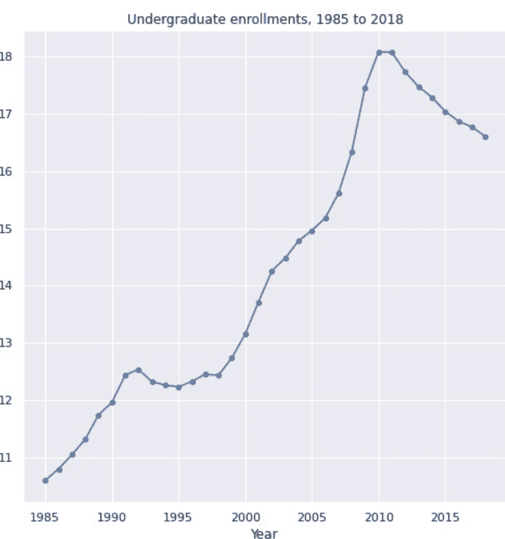

这些是自 1985 年以来美国所有高等教育机构的全日制秋季本科入学人数，数据由国家教育统计中心（NCES）收集并提供 [10]。最近的趋势对许多大学来说令人担忧，特别是那些因资本改善和其他旨在吸引这些数百万学生——以及他们的学费、费用和支出——到其校园和社区的努力而积累了大量债务的学校。一些学校对这些发展措手不及，现在正为糟糕的规划和预算的严重后果而苦恼。

大学如何预测入学人数并更好地为未来规划？一个合理的策略是定期调查高中生关于其高等教育计划的情况，尝试确定哪些学校和项目吸引哪些学生，然后对学生作为高年级学生可能做出的选择进行建模。这可能有效，但也会非常昂贵且难以管理。另一个可能性要简单得多，几乎不需要成本，那就是利用每年出生儿童的 readily available 数据来估计以后会有多少本科生，因为其中一些婴儿大约 20 年后就是入学大学的学生。

为了看看这种方法是否可行，让我们看一下国家教育统计中心（NCES）关于本科入学人数与国家健康统计中心（NCHS）[11] 出生数据的散点图：

```
>>> train = enroll.query("BirthYear < 1999")
>>> sns.scatterplot(data=train, x="Births", y="Enrollment")
>>> plt.title("Enrollments versus Births 20 years earlier")
>>> plt.xlabel("Births (millions)")
>>> plt.ylabel("Enrollment (millions)")
```

图 2.19. 与 20 年前出生人数相比的本科入学人数

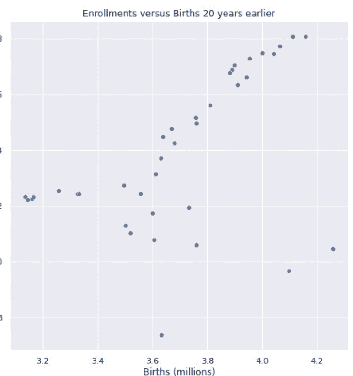

这些点中的每一个的水平坐标都是某一年出生的婴儿数量，而该点的垂直坐标是 20 年后的全日制本科入学人数；出生和入学人数均以百万人为单位。该图明显的问题是这两个变量似乎不是线性相关的——这看起来不像是线性回归的好候选。添加出生年份信息会澄清一些问题：

```
>>> train = train.assign( BirthDecade = train.BirthYear - (train.BirthYear % 10) )
>>> train.BirthDecade = train.BirthDecade.astype("category")
>>> sns.scatterplot(data=train, x="Births", y="Enrollment", hue="BirthDecade")
>>> plt.xlabel("Births (millions)")
```

```
>>> plt.ylabel("Enrollment (millions)")
```

图 2.20. 按出生年代划分的本科入学人数与出生人数

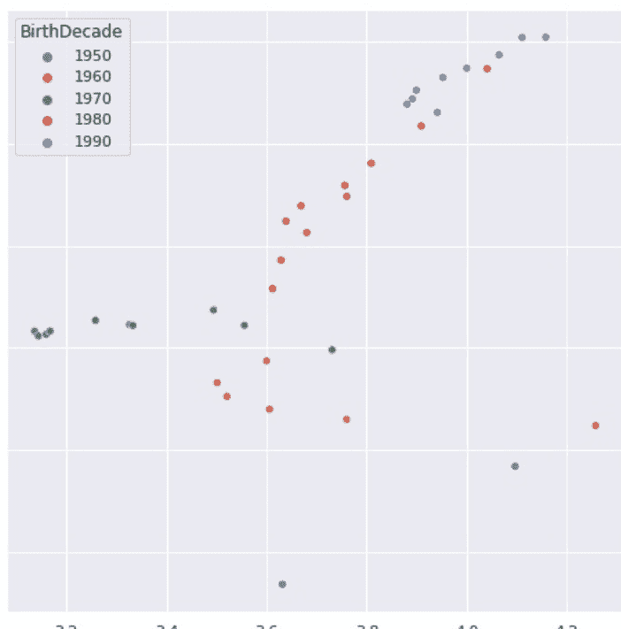

我们现在可以看到散点图具有对应于不同出生年代的明显分量：两个底部点对应于 1950 年和 1955 年出生的人，有对应于 1960 年代和 1970 年代出生的水平层，并且对于剩余的点，即对应于 1980 年代和 1990 年代出生的点，存在强烈的正线性关联。我们将重点关注这一子集：

```
>>> train = train.query("BirthYear > 1978")
```

```
>>> train.BirthDecade = train.BirthDecade.cat.remove_unused_categories()
>>> sns.scatterplot(data=train, x="Births", y="Enrollment", hue="BirthDecade")
>>> plt.xlabel("Births (millions)")
>>> plt.ylabel("Enrollment (millions)")
```

图 2.21. 自 1979 年以来本科入学人数与出生人数

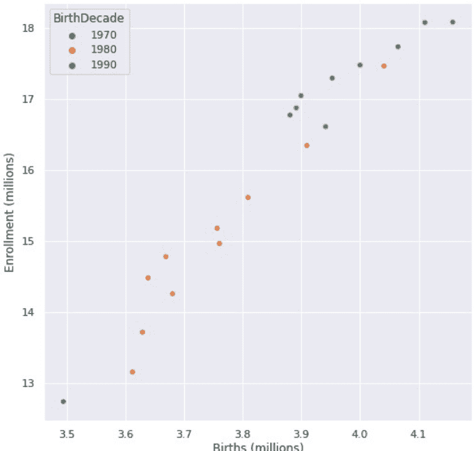

该散点图中的出生年份范围从左下角的点 1979 年到 1998 年；我们停止在 1998 年，因为 NCES 最新的入学数据是 2018 年。为了评估该图中明显的线性关系，让我们检查相关性：


>>> train.Births.corr( train.Enrollment )

    0.9741680367357998

Now *that* is a strong correlation! Combining this quantitative measure with what we see in the scatterplot, we know that fitting a linear regression model to this data is the right thing to do. Here’s the result:

```
>>> train_model = smf.ols("Enrollment ~ Births", data=train)
>>> train_fit = train_model.fit()
>>> train_fit.params

    Intercept    -17.912152
    Births        8.802197
    dtype: float64
```

```
>>> train_fit.rsquared

    0.9490033637976821
```

```
>>> np.sqrt( train_fit.scale )

    0.388207377323538
```

The regression equation is therefore

```
Predicted enrollment = -17.912152 + 8.802197 * Births,
```

where the enrollment year is 20 years after the birth year. The slope tells us to expect enrollments to change by about 8.8 million students for every 1 million additional or fewer births from year to year— enrollments will likely increase in 20 years when there are more births and will likely decrease in 20 years when there are fewer births. The RSE, 0.388 and change, tells us how enrollments are likely to vary relative to this line— individual enrollments are unlikely to stray more than 2 * RSE ≈ .78 million students or so from the value predicted by the regression model. To get this model’s predictions for 2019 and beyond, we can feed the NCES birth data since 1999 to the model’s predict method:

```
>>> predictions = enroll.query("BirthYear > 1998").filter(["Birth
>>> predictions = predictions.assign( Enrollment = train_fit.pred
>>> sns.regplot(data=train, x="Births", y="Enrollment",
        ci=None, line_kws={"color":"black"})
```

```
>>> sns.scatterplot(data=predictions, x="Births", y="Enrollment")
>>> plt.xlim(3.4,4.4)
>>> plt.xlabel("Births (millions)")
>>> plt.ylabel("Enrollment (millions)")
>>> plt.title("Observed and predicted enrollments versus births")
```

### Figure 2.22. Predicted enrollments for 2019 and beyond

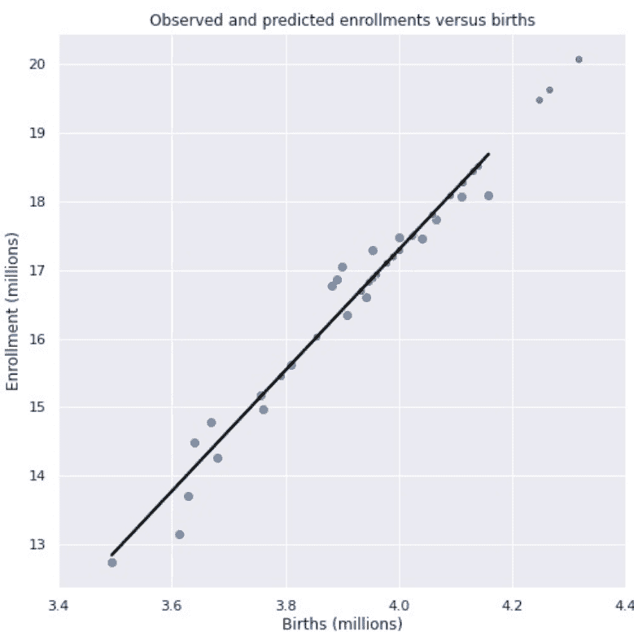

As the code shows, the vertical coordinates of the orange points are the predicted enrollments. We have to be careful, though— see how the regression line (shown in black) terminates before reaching the 3 red points in the upper right corner? These 3 points are an example of extrapolation, the

crime of making predictions using values of the explanatory variable that are outside the range of values used to build the regression model. In this case, the values of Births used to construct train_fit range from 3.49 million to 4.16 million, but there were more than 4.16 million births in 2006, 2007, and 2008:

```
>>> predictions.query("Enrollment > 19")
```

|   | BirthYear | Births   | EnrollmentYear | Enrollment |
|---|-----------|----------|----------------|------------|
| 44 | 2006      | 4.265555 | 2026           | 19.634103  |
| 45 | 2007      | 4.316233 | 2027           | 20.080181  |
| 46 | 2008      | 4.247694 | 2028           | 19.476887  |

Consequently, the predicted enrollments for 2026, 2027, and 2028 are not as reliable as the others. With this caveat in mind, let’s see what we get when we combine the model’s predictions with the known enrollments with which we started this section:

```
>>> sns.lineplot( data=trend, x="EnrollmentYear", y="Enrollment")
>>> sns.scatterplot( data=trend, x="EnrollmentYear", y="Enrollmen
>>> sns.lineplot( data=predictions, x="EnrollmentYear", y="Enroll
>>> sns.scatterplot( data=predictions, x="EnrollmentYear", y="Enr
>>> plt.axhline( 19, linestyle=":", color="black")
>>> plt.title("Observed and predicted enrollments, 1985 to 2038")
>>> plt.xlabel("Year")
>>> plt.ylabel("Enrollment (millions)")
```

Figure 2.23. Observed and predicted enrollments

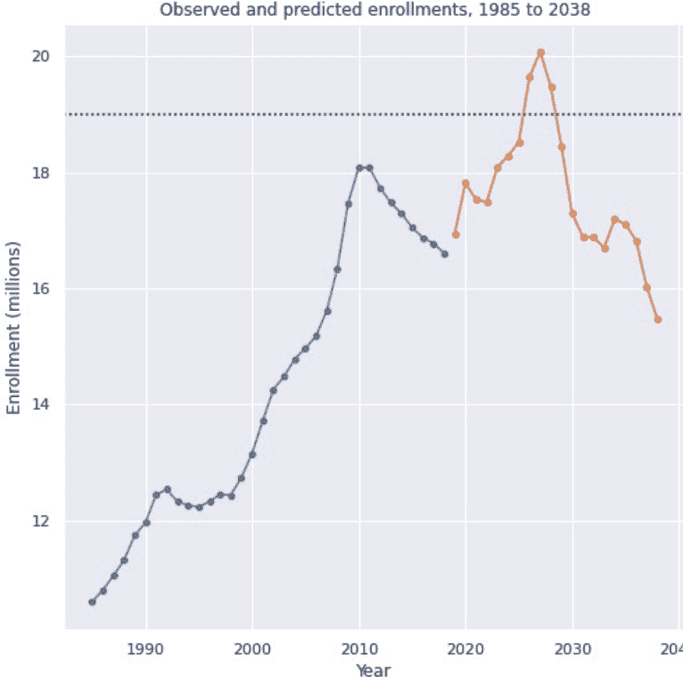

The dotted line is a reminder that the 3 predictions above it are extrapolations from the model. Even so, it seems like colleges and universities are justifiably concerned about the future— enrollments might start climbing again for a few years, but our best guess, based on this data and this simple model, is that enrollments will nosedive in the late 2020s. Ouch!

The simplicity of this model is a great advantage, making its predictions easy to interpret, but enrollments clearly depend on variables other than just births. We’ll explore this later as a multiple regression problem.

[7] http://www.fishbase.org/

[8] https://ropensci.org

[9] https://www.iucnredlist.org

[10] Digest of Education Statistics:
https://nces.ed.gov/programs/digest/current_tables.asp

[11] https://www.cdc.gov/nchs/data-visualization/natality-trends/

## 2.4 Exercises

+   1. Apply smf.ols to the heights dataset to verify the simple regression model reported earlier. Compute the correlation, the coefficient of determination, and the residual standard error.
+   2. Explore some public data repositories and practice building simple regression models with their data. Some good sources are the UCI Machine Learning repository, the Bureau of Labor Statistics, NHANES, and Kaggle, but there are many other sites with interesting data! Once you find some data, do the following:
+      1. If there’s enough data, organize it into groups and compute averages to get the line of averages directly.
+      2. Compare the model diagnostics (correlation, coefficient of determination, residual standard error) with scatterplots of the data and residuals.
+      3. How many observed responses are within 1 RSE of the regression line? 2 RSEs? 3 RSEs?

## 2.5 Summary

+   - Use a scatterplot to inspect your data!
+   - If a linear relationship is evident in the scatterplot,
+     - quantify its strength with the correlation coefficient, and
+     - fit the linear regression model with smf.ols.

+   - The regression line $\hat{y} = a + b\,x$ minimizes the squared sum of residuals and fits the data better than any other line, in the least squares sense.
+     - The slope, $b$, quantifies how the response depends on the predictor.
+     - The coefficient of determination, $R^2$, measures the reduction in variability gained by including the predictor instead of excluding it.
