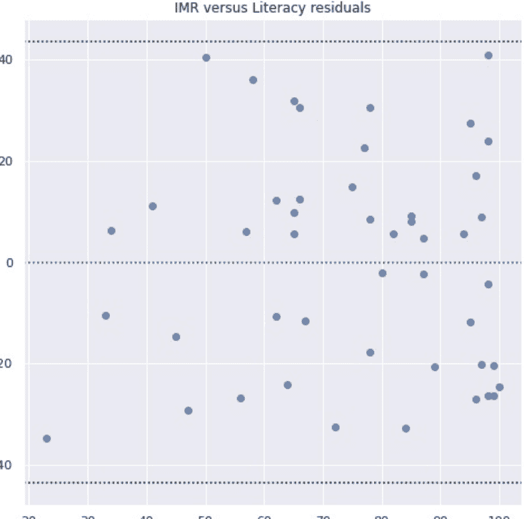
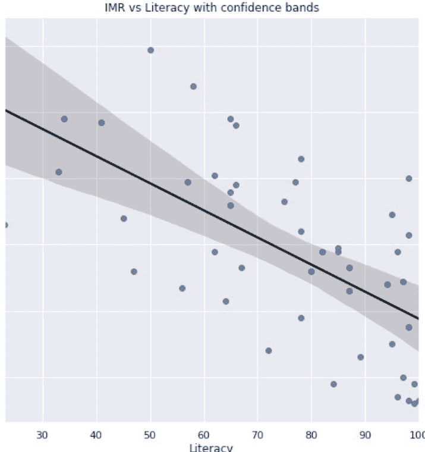
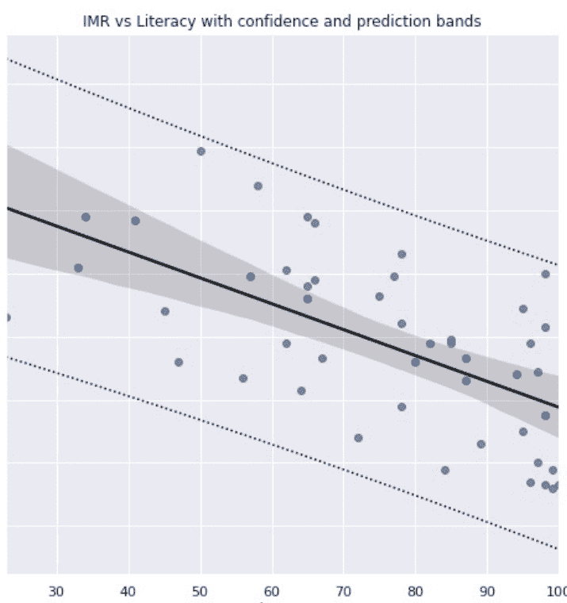
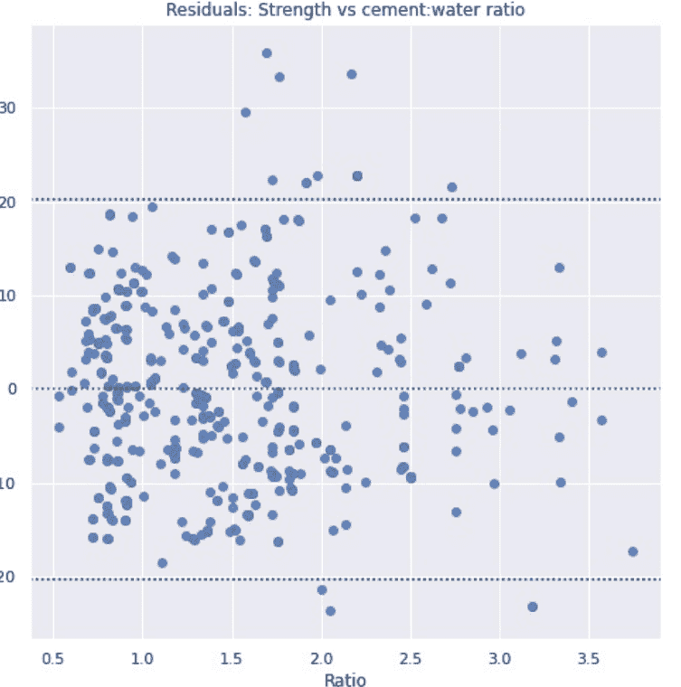
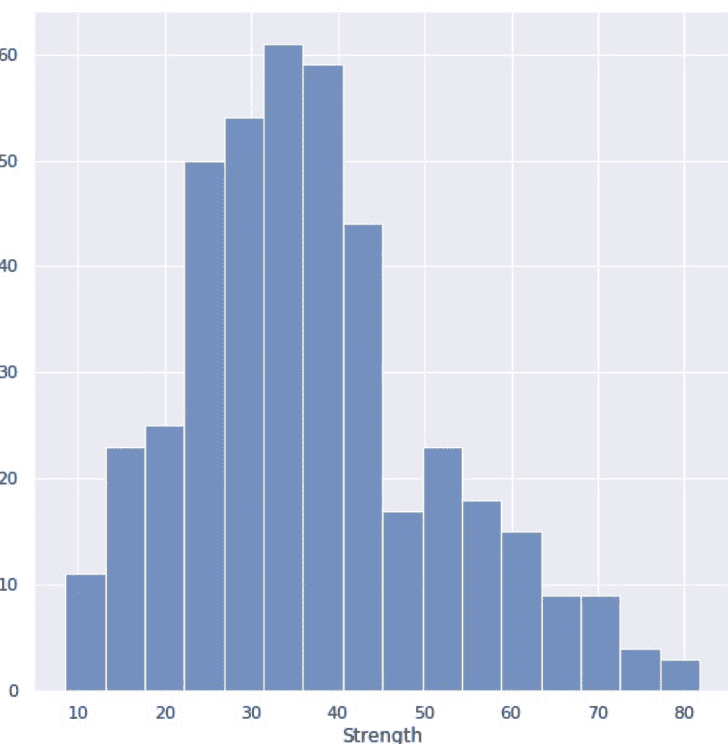
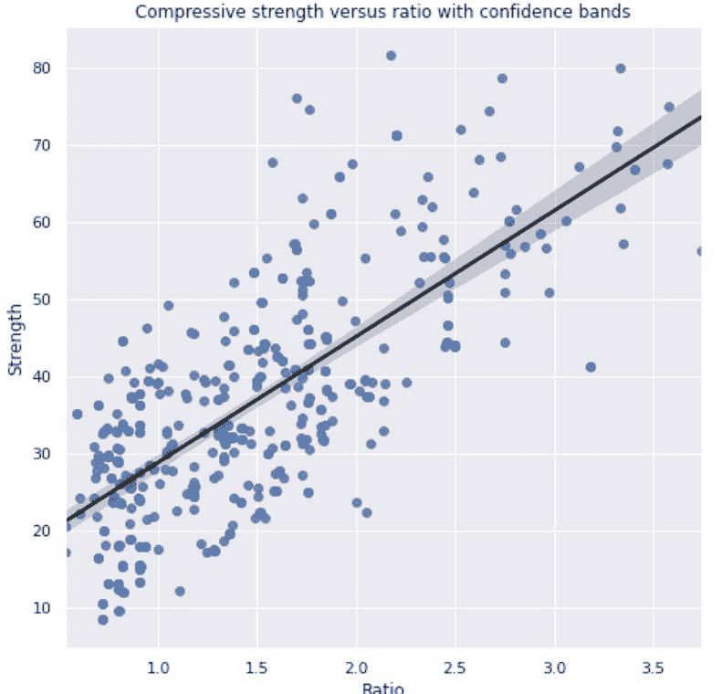

# 3 The simple linear regression model

## This chapter covers

+   - Understanding the theory behind simple linear regression
+   - Leveraging the theory to assess and interpret fitted regression models
+   - Analyzing the residuals to check assumptions

Now that we’ve fitted regression lines to several different datasets, we have to deal with a few things. The first is glaringly obvious in most of the examples: few of the observed data points are on the regression lines, and some of them seem pretty far away! Of course, this makes sense— while we can make an informed guess about, say, the infant mortality rate corresponding to a given literacy rate, we know that our guess is probably going to be wrong, by an amount that we cannot predict precisely. The second concern is that the equation of the line would almost certainly change if we used different data. For the UNICEF data, for example, the infant mortality rates were collected in 2011 and the literacy rates were collected between 2006 and 2010; if we used older or newer data, the slope and the intercept of the regression line would probably differ from what we found before. Third, the quality of the data matters— since there are always some imperfections in recorded observations, the models built from them can’t be perfect, either.

In short, models built from data are, at best, only approximate descriptions of reality. It’s therefore essential to assess the uncertainties inherent in any modeling approach. To address and clarify these issues, it’s time to dig into the abstract model underlying what we’ve been doing. While this chapter is far more technical than the previous one, it is absolutely necessary to understand the theoretical linear regression model if you want to master this particular tool. Inferences about parameters, estimates, and predictions all depend on applying the theory correctly, and the topics we’ll discuss— standard errors, interval estimates, test statistics, and significance tests— are


对所有类型的回归分析都是基础的，不仅仅是线性回归。详细的公式本身很重要，但理解与推断相关的核心思想才是主要目标。我们将在后面的章节中反复回顾并依赖这些思想。

## 3.1 随机变量与理论模型

当我们对散点图拟合一条直线时，我们实际上是在基于这样的信念：响应变量 Y 和预测变量 x 满足理论模型

y = α + β x + ε ,

其中截距 α 和斜率 β 的确切值永远无法得知，而不可预测的项 ε 则表现为预测的不确定性。对于给定的 x 值，我们观察到的 Y 的值是确定性项 α + β x 与随机误差项 ε 的总和，使得响应成为一个随机变量。为了强调这一事实，从现在起我们用 y 表示实际已观测到的响应，而用 Y 表示尚未观测到的响应所对应的随机变量。理论模型因此应更准确地表述为

Y = α + β x + ε .

从现在开始，我们通常用大写字母表示随机变量；其小写对应字母将表示观测值或从数据计算得出的量。采用这种记法的理由在我们继续进行时会变得清晰。

由于误差 ε 是随机的，我们无法预测它对单个观测值的贡献有多大。不过我们还是需要说些什么，因此我们将对该项做出一些统计假设。为了说明第一个假设，固定预测变量的一个值 x，并利用理论模型计算所有可能对应的响应变量值的平均值——这一计算本身是纯理论的，因为我们无法实际观测到给定预测值的所有可能响应。我们得到的是随机变量 Y 在给定 x 值下的期望值或均值响应，记为 E(Y|x) 并读作“在给定 x 的条件下 Y 的期望值”。类似地，误差 ε 的所有这些可能响应的平均值记为 E(ε|x)。这些期望值之间存在关系

E(Y|x) = α + β x + E(ε|x),

因为平均是一个线性过程——只需将该 x 值下的所有响应和误差加起来再除以数量即可。为了处理误差的期望值，我们援引基本的常识：随机误差是不可预测的，不太可能为正也不太可能为负，因此其平均值应为零，与预测变量的值无关。我们因此假设 E(ε|x) = 0 对所有 x 成立，由此可得

E(Y|x) = α + β x.

对给定 x 值的均值响应 E(Y|x) 因此是 x 的线性函数，是理论模型的确定性成分。这正是我们在身高数据中观察到的，也是我们声称 UNICEF 数据的回归线估计了在年轻女性识字率给定的情况下所有非洲国家的平均婴儿死亡率的原因。这是线性回归模型的基本、定义性特征。

关于 ε 的其他基本假设涉及其在不同 x 值下的行为。特别是，我们假设不同观测值的误差是不相关的，即 ε 对一个观测值的随机贡献完全不会影响其对其他观测值的贡献。我们还假设 ε 具有恒定的方差 σ²，因此其变异性不依赖于预测变量的值。 （这个花哨的词叫做同方差性；当 ε 的方差不恒定时则为异方差性。）这三个假设使得我们能够初步评估对理论模型的近似，但请仔细注意，我们并没有对 ε 的分布做出任何假设。下一节会详细介绍！

仅凭这三个假设，我们无法对理论模型的随机部分说得更多。我们能做的是通过拟合形式为

ŷ = a + b x

的回归线来近似其确定性部分——截距 $a$ 是我们对理论截距 $\alpha$ 的最佳估计，斜率 $b$ 是我们对理论斜率 $\beta$ 的最佳估计。我们正在估计的理论值是 *参数*，因此简单线性回归需要估计两个 *模型参数*。我们之前看到过，这些参数的最小二乘估计恰好有显式公式：

```
$b = r\left(\frac{s_y}{s_x}\right)\quad\text{and}\quad a = \bar{y} - b\,\bar{x}.$
```

除了产生这些系数外，将回归线拟合到数据还会得到误差 $\varepsilon$ 的方差 $\sigma^2$ 的最佳可用估计，即

```
$\sigma^2 \approx \frac{SSR}{n-2} \approx (RSE)^2.$
```

这正是我们之前使用 RSE 的方式，作为响应相对于回归线的变异性的度量。切比雪夫不等式在这里很有用，因为它量化了 RSE 在评估预测准确性中的作用，而不需要 $\varepsilon$ 具有任何特定分布。

### 切比雪夫不等式

这是一个关于随机变量的基本结果——通常假设具有某些统计特性的不可预测量。该不等式不做分布假设，只要求所讨论的随机变量具有有限的平均值和有限的标准差。如果 $Y$ 是这样的随机变量，则 *切比雪夫不等式* 保证 $Y$ 落在其平均值 $k$ 个标准差范围内的概率至少为 $1 - \frac{1}{k^2}$：

```
$P(|Y - \mu| \le k\,\sigma) \ge 1 - \frac{1}{k^2}, $
```

其中 $\mu$ 和 $\sigma$ 分别是 $Y$ 的平均值和标准差，$P(\cdot)$ 表示括号内结果的概率。

将其转化为线性回归的背景下，设 $Y$ 为响应变量；其标准差为 $\sigma$，且 $\mu = E(Y|X) = \alpha + \beta\,x$ 当预测变量等于 x 时。取 k = 2，切比雪夫不等式说明至少有 75% 的机会

α + β x − 2σ ≤ Y ≤ α + β x + 2σ .

当然，我们不知道 α、β 或 σ！将基于可用数据的估计与切比雪夫不等式结合，我们可以确信大多数响应值将落在回归线 2 个 RSE 范围内。这就是切比雪夫不等式最实用的用途——令 k = 1 只是说概率是非负的，这没有帮助！

关于 ε 的三个假设的一个重要推论是，模型参数的最小二乘估计在两种意义上都是最优的：

- a 和 b 是 α 和 β 的无偏估计，且
- 这种参数估计方法具有最小方差。

我们将在下一节定义无偏这一术语；请参阅附录中的高斯-马尔可夫定理以获得这些事实的精确表述和证明。实际的结论是，只要模型的假设成立，我们就能得到最优结果。为了确定它们是否成立，我们分析残差，因为它们提供了 ε 对观测值贡献的估计。例如，对于 UNICEF IMR 数据，绘制残差与识字率的图得到如下结果：

```
>>> africa_rse = np.sqrt( africa_fit.scale )
>>> sns.residplot(data=africa, x="Literacy", y="IMR", line_kws={"
>>> plt.axhline( 2*africa_rse, linestyle=":", color="black")
>>> plt.axhline( -2*africa_rse, linestyle=":", color="black")
>>> plt.title("IMR versus Literacy residuals")
```

图 3.1. 残差似乎随机分布在 0 附近（这很好！）



残差没有表现出任何明显的趋势——它们看起来大致随机地分布在 0 的上方和下方，中间的虚线水平线。它们也都在 0 的 2 个 RSE 范围内，如其他虚线水平线所示。快速检查残差是构建线性回归模型后要做的第一件事之一；对于本例，它表明关于随机误差的三个假设都是有效的。如果在分析残差时出现问题，请停止并重新评估！

## 3.2 正态线性回归模型与推断


由于回归线近似理论模型中的确定性成分，其预测值 $\hat{Y}$ 近似于给定预测变量值 $x$ 时的均值响应 $E(Y|x)$：

```
$\hat{y} = a + b\,x \approx E(Y|x) = \alpha + \beta\,x.$
```

显然，估计值 $a$ 和 $b$ 分别越接近参数 $\alpha$ 和 $\beta$，模型越好——但参数是未知的，那么我们怎么可能知道这些估计值有多好呢？这是 *推断统计* 的基本问题：收集了一些数据后，样本统计量——本例中为回归线的系数——告诉我们关于未知参数的什么信息，以及准确度如何？

## 3.2.1 回归系数的抽样分布

要回答这些问题，我们有两个选择。一个是应用自助法，这是一种多用途的现代工具，我们将在后面的章节中解释并使用。传统的选择，我们在本节中展开，是对理论模型中的误差项 $\varepsilon$ 作出额外的假设，即其服从正态分布。既然我们已经假设 $\varepsilon$ 的均值为 0 且方差恒定为 $\sigma^2$，这就意味着

```
$\varepsilon \sim N(0, \sigma^2).$
```

将此分布假设与理论模型结合意味着，对于每个给定的预测变量值，响应变量也服从正态分布。特别地，如果我们使用 $n$ 个固定的预测变量值 $\{x_1, ..., x_n\}$，并且 $Y_i$ 是对 $x_i$ 的响应，则 $Y_i \sim N(\alpha + \beta x_i, \sigma^2)$。我们的数据集包含这些随机变量的 $n$ 个 *实现*——观测到的响应 $Y_1, ..., Y_n$——但我们必须记住，观测值包含随机误差，可能出现不同结果。

拥有许多服从正态分布的随机变量总是件好事，因为它们的线性组合仍服从正态分布，而正态分布是 well understood 的。我们可以立即利用这一点，因为模型参数的最小二乘估计 $A$ 和 $B$——基于数据，其实现为回归系数 $a$ 和 $b$——是响应 $Y_1, ..., Y_n$ 的线性组合。这一点从前面给出的公式中并不明显，因此练习之一展示了如何对这些公式的推导进行调整以验证

$$B \sim \sum_{i=1}^{n} c_i Y_i, \quad \text{where} \quad c_i = \frac{x_i - \bar{x}}{(n-1)s_x^2}.$$

对于 $A$ 也有类似的公式，因为 $A = \bar{Y} - b \bar{x}$。这就是为什么我们必须把 $n$ 个值 $\{x_1, ..., x_n\}$ 视为固定值，以便系数 $c_i$ 是常数，而不是随机变量。由此可知，最小二乘估计 $A$ 和 $B$ 服从正态分布：

$$B \sim N\left(\beta, \frac{\sigma^2}{(n-1)s_x^2}\right) \quad \text{and} \quad A \sim N\left(\alpha, \sigma^2\left(\frac{1}{n} + \frac{\bar{x}^2}{(n-1)s_x^2}\right)\right).$$

计算这些是本章末尾的另一个练习——这些是那种要么被当作信条接受，要么自己推导出来的计算，而后者要好得多！无论如何，我们这里得到的公式是最小二乘估计的 *抽样分布*：如果我们对预测变量的固定值观察所有可能的集合 $\{y_1, ..., y_n\}$，那么每个集合都会产生其自己的 $b$ 和 $a$；所有这些估计的平均值将分别为 $\beta$ 和 $\alpha$，这正是这些估计是 *无偏* 的含义。换句话说，随机变量 $A$ 和 $B$ 是模型参数的无偏估计，因为 $E(A)=\alpha$ 且 $E(B)=\beta$。标准差描述了这些估计的实现在一组观测到另一组观测时会如何变化；例如，有 95% 的机会，观测到的回归系数 $b$ 和 $a$ 将满足

$$\beta - 2\left(\frac{\sigma}{s_x \sqrt{n-1}}\right) \le b \le \beta + 2\left(\frac{\sigma}{s_x \sqrt{n-1}}\right)$$

和

$$\alpha - 2\left(\sigma \sqrt{\frac{1}{n} + \frac{\bar{x}^2}{(n-1)s_x^2}}\right) \le a \le \alpha + 2\left(\sigma \sqrt{\frac{1}{n} + \frac{\bar{x}^2}{(n-1)s_x^2}}\right).$$

## 3.2.2 标准误差和参数估计

知道抽样分布很好，但存在一些严重实际问题：我们只观察到一组对预测变量值的响应，我们不知道参数 β 和 α，也不知道 σ！我们该怎么办？我们用这一组观测来近似 σ，然后重新整理上述不等式以获得 β 和 α 的估计。具体而言，RSE 是我们目前能获得的 σ 的最佳估计，将公式中的 σ 用 RSE 替换就给出了回归系数的标准误差：

```
SE(b) ≈ RSE / (s_x √(n-1))   and   SE(a) ≈ RSE √[1/n + x̄² / ((n - 1)s_x²)] .
```

根据定义，标准误差是利用现有数据对相关样本统计量的抽样分布标准差的最佳估计。（试着大声反复说这句话！）记号 SE(b) 和 SE(a) 反映了这些近似值与 RSE 一样，是从可用数据计算得出的；它们不是随机变量。我们可以通过手工使用这些公式，但其实没有必要——我们（并且应该！）从回归输出中获取标准误差。例如，这里是 africa_fit 回归模型的摘要：

```
>>> print( africa_fit.summary() )
```

### OLS Regression Results

Dep. Variable: IMR R-squared:
Model: OLS Adj. R-squared:
Method: Least Squares F-statistic:
Date: Sun, 27 Jun 2021 Prob (F-statistic):
Time: 11:44:01 Log-Likelihood:
No. Observations: 47 AIC:
Df Residuals: 45 BIC:
Df Model: 1
Covariance Type: nonrobust
coef std err t P>|t| [0.025 0.975]
Intercept 119.6022 12.138 9.853 0.000 95.
Literacy -0.8204 0.156 -5.249 0.000 -1.
Omnibus: 5.446 Durbin-Watson:
Prob(Omnibus): 0.066 Jarque-Bera (JB):
Skew: 0.119 Prob(JB):
Kurtosis: 1.978 Cond. No.
==============================================

Notes:
[1] Standard Errors assume that the covariance matrix of the errors is nonrobust

中间的 std err 列提供了回归系数的标准误差，所显示的数字正是公式给出的结果，你可以自行检验。要使用这些标准误差，我们还必须处理一件事：我们用 RSE 作为 σ 的估计所付出的代价是，我们需要使用的分布不再是正态分布——我们必须改用自由度为 (n − 2) 的 t 分布。如果我们知道 β 的值，例如，并且拥有对我们固定的预测变量值的所有可能的响应集合，我们可以对每个响应集合计算量

t = (b − β) / SE(b)

；由此得到的 t 分数将服从分布 t(n − 2)。

我们终于可以着手估计 β 和 α，通过对上述不等式进行操作和修改。它们中出现的乘数 2 来自标准正态分布：95% 的 z 分数落在均值 2 个标准差之内。事实上，乘数实际上更接近 1.96，我们可以使用 scipy.stats 库中的 norm.ppf 函数来检验：

```
>>> import scipy.stats as st
>>> st.norm.ppf(.975 )

    1.959963984540054
```

norm.ppf 接受一个百分位，这里是 97.5%，并返回具有该百分位等级的 z 分数；由于我们想要 z 分数的中间 95%，我们加上左尾的 2.5% 来得到正确的百分位。现在我们必须用 t 分布 t(n − 2) 的类似量替换这个乘数——我们必须确定自由度为 (n − 2) 时 t 分数的中间 95%，我们可以用 t.ppf 函数来完成。对于 UNICEF 数据

例如，n = 47，因此自由度为 45，适当的乘数为约 2.014：

```
>>> st.t.ppf(.975, df=45)

    2.0141033848332923
```

这里的 95% 并没有什么特别之处；如果我们想要这些 t 分数的中间 99%，我们只需计算

```
>>> st.t.ppf(.995, df=45)

    2.6895850193746385
```

然后继续下去。所使用的百分比是置信水平，记为 C，对应的乘数记为 t*——我们刚刚发现，在自由度为 45 时，

C = 95% ⟹ t* = 2.014   和   C = 99% ⟹ t* = 2.6896.

一旦我们选择了 C 并确定了 t*，我们就知道，例如，C 百分比的 β 的最小二乘估计将满足

β − t* SE(b) ≲ b ≲ β + t* SE(b),

对 α 的估计也有类似结果。回顾让我们走到这里的实际问题，我们只有一个数据集和一对回归系数，所以我们重新排列这个不等式来估计 β ：

b − t* SE(b) ≲ β ≲ b + t* SE(b).

我们并不知道参数 β 满足这个不等式。我们真正知道的是，如果我们多次抽样并对每个样本计算相应的估计 b，β 将以 C 的比例满足这个不等式。为了承认所有这些，我们将 β 的这个区间估计称为置信水平为 C 的置信区间。例如，利用 UNICEF IMR 数据回归模型的摘要中的信息，我们有 95% 的把握其模型参数满足

−.8204 − (2.014 * .156) ≤ β ≤ −.8204 + (2.014 * .156)  ⟺  −1.135 ≤ β ≤ −.506


and

119.6022 − (2.014 * 12.138) ≤ α ≤ 119.6022 + (2.014 * 12.138) ≡ 95.15 ≤ α ≤ 144.05.

对这些计算中的数字进行舍入会引入一些额外的误差；要获得更精确的置信区间——并且避免手工进行这些计算——请使用模型的 conf_int 方法：

```
>>> africa_fit.conf_int()
```

|  | 0 | 1 |
|---|---|---|
| Intercept | 95.154717 | 144.049736 |
| Literacy | -1.135228 | -0.505592 |

这些对模型参数的定量估计正是我们一直在寻找的，而 β 的不等式提供了最重要的定性洞见：我们有信心，UNICEF 数据理论模型中的斜率是负的，因此我们有信心，非洲国家的婴儿死亡率确实会随着年轻女性识字率的提高而下降。对于其他数据集，β 的置信区间可能包含 0，这意味着就我们所知，理论斜率可能是正的、负的或 0——当这种情况发生时，我们无法确信响应变量真的依赖于预测变量！

## 3.2.3 系数的显著性检验

与其计算 β 的置信区间来查看变量之间是否存在线性关系的证据，我们可以直接检验 β = 0 是否合理。为此，假定这是真的，并计算样本统计量 b 的相应 t 分数：

t = (b − 0) / SE(b) = b / SE(b).

t 分数离 0 越远，理论斜率可能为零的可能性就越小——为了使这一点精确化，计算得到该量级或更大的 t 分数的概率，然后得出适当的结论。使用 UNICEF 示例再次说明，检验理论斜率是否可能为 0 的 t 分数为

t = -.8204 / .156 = -5.26,

并且在自由度为 45 时得到 |t| > 5.26 的 t 分数的概率非常小：

```
>>> 2*st.t.cdf(-5.26, df=45)
```

```
3.852717659625731e-06
```

t.cdf 函数返回 t 分布在给定 t 分数相对的面积；在这种情况下，我们将 t = -5.26 左侧的面积加倍，以得到 |t| > 5.26 的 t 分数的百分比。该概率是原假设 β = 0 的 p 值，通常表述为

H₀: β = 0.

竞争的可能性是备择假设，

Hₐ: β ≠ 0.

这是一个双侧备择假设，但 UNICEF 数据的单侧 p 值很小（非常小的双侧 p 值的一半）提供了强有力的证据表明 β < 0，而不仅仅是 β ≠ 0。这一整套方法称为原假设显著性检验，是回归分析的标准组成部分——只要记住 p 值只能帮助我们衡量证据；它们不会为我们做出决策！特别是，我们必须始终意识到样本大小如何影响检验统计量和 p 值。由于 RSE 近似常数 σ，SE(b) 和 SE(a) 的公式表明标准误差通常会随着样本量 n 的增加而减小，使得相应的检验统计量增大而 p 值减小。回归系数的显著性可能仅仅是使用大样本工作的产物，因此请始终查看数据并将常识与这些其他工具结合起来！

与我们一直在解释的其他公式和程序一样，您不必每次都以这种繁琐的逐步方式进行假设检验——所有这些都由 smf.ols 构建的回归模型摘要提供，如 UNICEF 数据所示。t 列给出假设检验的 t 分数，P>|t| 列给出 p 值；与置信区间一样，表中的数值比使用舍入值计算的结果更准确。摘要表告诉我们，例如，原假设 α = 0 的 t 分数为 9.853，p 值实际上为 0。因此，理论截距为 0 的可能性极其渺茫；事实上，我们有信心理论截距为正。大多数时候，截距发生的情况远不如斜率发生的情况重要有趣，但现在您知道模型摘要中中间几行的含义。我们将在多元回归时解释其他重要数字，例如 F 统计量和 Adj. R-squared。

## 3.2.4 预测平均和个体响应

如第 2.4 节所述，回归模型的两大主要应用是

- 估计给定预测变量值的平均响应，以及
- 预测给定预测变量值的个体响应。

我们当时解释说，这两种应用都始于相同的点估计：如果 x 是预测变量给定的值，在本节其余部分保持固定，则 ŷ = a + b x 是 y 的最佳估计，即 x 的个体响应，以及 E(Y|x)，即对 x 的所有可能响应的平均值。在每种情况下，我们都知道这个估计可能有误，因此我们想知道误差可能有多大——我们需要相关的抽样分布和标准误差，以便计算区间估计。由于抽样分布是描述所有可能响应的理论装置，我们必须像上一节那样使用相关的随机变量。假设 ε ~ N(0, σ)，我们有

Y ~ N(α + β x, σ)   and   Ŷ ~ ~A + B x.

由于 B 和 A 是正态分布随机变量 {Y₁, ..., Yₙ} 的线性组合，Ŷ 也是如此。如练习之一所述，我们可以利用这一点来确定 Ŷ 的抽样分布：

$\hat{Y} \sim N\left(E(Y|x), \sigma\sqrt{\frac{1}{n} + \frac{(x - \bar{x})^2}{(n - 1)s_x^2}}\right).$

因此，我们可能获得的所有 $\hat{y}$ 的平均值正是平均响应 $E(Y|x)$，正如预期的那样。一旦获得数据，我们像往常一样用 RSE 近似 σ 并得到所需的标准误差，

$SE(\hat{y}) \approx RSE\sqrt{\frac{1}{n} + \frac{(x - \bar{x})^2}{(n - 1)s_x^2}}.$

使用此 SE 需要使用 $t(n-2)$ 分布，因为

$\frac{\hat{y} - E(Y|x)}{SE(\hat{y})} \sim t(n-2).$

在选择置信水平 $C$ 并计算临界值 $t^*$ 后，我们然后像之前一样获得平均响应 $E(Y|x)$ 的置信区间：

$\hat{y} - t^* SE(\hat{y}) \le E(Y|x) \le \hat{y} + t^* SE(\hat{y}).$

该区间估计补充了点估计 $\hat{y}$，并告诉我们 x 的平均响应的可能取值。我们必须仔细考虑这个取值范围来预测 x 的 *个体* 响应：理论模型说

$Y = E(Y|x) + \varepsilon$

并揭示了在进行预测时不确定性的两个来源——我们不知道 $E(Y|x)$，也不知道 $\varepsilon$ 会对响应贡献多少。个体响应的不确定性因此是这两个量变异性的组合，我们发现

$SD(Y) = \sqrt{\sigma^2 + (SD(\hat{Y}))^2} \implies SE(y) = RSE\sqrt{1 + \frac{1}{n} + \frac{(x - \bar{x})^2}{(n - 1)s_x^2}}.$

个体响应 y 的 resulting 区间估计为

$\hat{y} - t^* SE(y) \le y \le \hat{y} + t^* SE(y),$

它被称为 *预测区间*，以区别于 $E(Y|x)$ 的置信区间。需要注意的重要一点是，预测区间 *总是* 比置信区间更宽，因为它们结合了两个变异来源。

我们已经详细介绍了这些区间估计背后的一些细节，以便您理解它们的含义以及如何解释它们，但当然没有人使用这些公式处理真实数据——我们使用模型 predict 方法提供的实现。回到 UNICEF 数据示例，假设我们想了解识字率为 50% 和 80% 时可能的婴儿死亡率。我们创建一个包含这些新预测变量值的 DataFrame，然后将该数据集传递给 predict 函数：

```
>>> new = pd.DataFrame(data = {"Literacy":[50,80]})
>>> africa_fit.predict( new )

    0    78.581723
    1    53.969422
dtype: float64
```

这些是点估计——对应于 $x = 50$ 和 $x = 80$ 的 $\hat{y}$ 值。要获得区间估计，请使用 get_prediction 方法并查看其 summary_frame：

```
>>> africa_fit.get_prediction( new ).summary_frame()
```

|   | mean | mean_se | mean_ci_lower | mean_ci_upper | obs_ |
|---|------|---------|---------------|---------------|------|
| 0 | 78.581723 | 5.027890 | 68.455032 | 88.708414 | 33.6 |
| 1 | 53.969422 | 3.268479 | 47.386367 | 60.552476 | 9.67 |

这个表包含了我们刚刚讨论的所有内容！具体来说：

- mean 列提供了我们刚刚从 predict 获得的点估计，
- mean_se 列提供了每个 $SE(\hat{y})$， 
- mean_ci 列提供了估计平均响应的置信区间的端点，以及
- obs_ci 列提供了估计个体响应的预测区间的端点。


作为练习，你应该使用上面的公式来检查这些结果！为了可视化，可以很容易地使用 regplot 添加置信带——用于构建模型的预测变量值的整个范围的置信区间：

```
>>> sns.regplot(data=africa, x="Literacy", y="IMR", line_kws={"co
>>> plt.title("IMR vs Literacy with confidence bands")
```

图 3.2. 带有置信带的回归线



有趣的是，SE(ŷ) 的公式解释了为什么置信带在两端比中间更宽：该公式第二项的分子是 (x - x̄)²，因此标准误差 SE(ŷ) 随着预测变量值 x 远离 x̄ 而增加，使得置信区间更宽。最后，我们可以将这一切结合起来，同时绘制回归线、置信带和预测带：

```
>>> x = africa.Literacy.sort_values(ignore_index=True)
>>> endpts = africa_fit.get_prediction(x).summary_frame()
>>> sns.regplot(data=africa, x="Literacy", y="IMR", line_kws={"co
>>> plt.plot(x, endpts.obs_ci_upper, ':', color="black")
>>> plt.plot(x, endpts.obs_ci_lower, ':', color="black")
>>> plt.title("IMR vs Literacy with confidence and prediction ban
```

图 3.3. IMR 与识字率的回归线、置信带和预测带



## 3.3 示例

### 3.3.1 分析混凝土的抗压强度

让我们将刚刚学到的知识应用到我们之前构建的回归模型，以了解混凝土的抗压强度。首先，我们应该查看残差，看看是否存在与假设明显冲突的情况：

```
>>> concrete_rse = np.sqrt( concrete_fit.scale )
>>> concrete_rse

    10.142165416378145
```

```
>>> sns.residplot(data=concrete, x="Ratio", y="Strength", line_kw
>>> plt.axhline( 2*concrete_rse, color="black", linestyle=":")
>>> plt.axhline( -2*concrete_rse, color="black", linestyle=":")
>>> plt.title("Residuals: Strength vs cement:water ratio")
```

图 3.4. 绘制残差以检查误差的假设



该图顶部有 4 个点令人困扰，因为它们表明有一点异方差，但大多数残差肯定在 0 的 2 个 RSE 之内。此外，残差似乎随机分布，并且没有表现出任何明显的非线性趋势。总的来说，关于 ε 的假设似乎合理，所以让我们进一步探索模型。为了补充我们对残差的检查，让我们检查 Strength 的直方图，看看响应变量是否大致呈正态分布：

```
>>> sns.histplot( data=concrete, x="Strength")
```

图 3.5. 强度值大致呈正态分布



该分布有点向右偏，但不足以引起担忧。（预测变量 Ratio 的直方图显示它不是大致呈正态分布，但这无关紧要。）到目前为止，一切顺利！由于我们在上一章中拟合了模型，很容易获得结果摘要：

```
>>> print(concrete_fit.summary() )
```

### OLS Regression Results

===============================================
Dep. Variable:              Strength   R-squared:
Model:                     OLS        Adj. R-squared:
Method:                 Least Squares   F-statistic:
Date:                Sun, 27 Jun 2021   Prob (F-statistic):

Time: 17:37:05 Log-Likelihood:
No. Observations: 425 AIC:
Df Residuals: 423 BIC:
Df Model: 1
Covariance Type: nonrobust

|  | coef | std err | t | P>|t| | [0. |
|---|---|---|---|---|---|
| Intercept | 12.5968 | 1.219 | 10.335 | 0.000 | 10. |
| Ratio | 16.3158 | 0.753 | 21.658 | 0.000 | 14. |

Omnibus: 13.576 Durbin-Watson:
Prob(Omnibus): 0.001 Jarque-Bera (JB):
Skew: 0.440 Prob(JB):
Kurtosis: 3.141 Cond. No.

Notes:
[1] Standard Errors assume that the covariance matrix of the er

表中的 p 值表明两个系数都高度显著，意味着我们有强有力的证据表明它们都是正的——由于关于 ε 的正态性假设似乎成立，因此从这些 p 值得出结论也是合理的。拟合的回归方程为

Strength ~ = ~12.5968 + 16.3158 * Ratio,

因此我们预计，平均而言，将水泥与水比例增加 1 会使混凝土 28 天强度增加约 16.3 兆帕。这可能不是理论斜率的精确值，但我们可以使用 conf_int 来获得两个模型参数的区间估计：

```
>>> concrete_fit.conf_int()
```

|  | 0 | 1 |
|---|---|---|
| Intercept | 10.201068 | 14.992512 |
| Ratio | 14.835056 | 17.796543 |

请注意，这些区间也在上面的摘要表中给出，在 Intercept 和 Ratio 行末尾的 .025（左端点）和 .975（右端点）下。选择很多！无论如何，我们可以有信心，混凝土 28 天强度的平均增加量在水泥与水比例每增加一个单位时将在 14.8 到 17.8 兆帕之间，

进一步量化了我们之前的见解，即使用更少的水会导致混凝土更强。并且，和往常一样，将这些数字与总结一切的可视化配对是很好的：

```
>>> sns.regplot( data=concrete, x="Ratio", y="Strength", line_kws
>>> plt.title("Compressive strength versus ratio with confidence
```

图 3.6. 带有置信带的抗压强度与比例



## 3.4 练习

这些练习将逐步指导你完成：

- 1. 如何将回归系数表示为观测响应的线性组合
- 2. 如何推导回归系数的抽样分布参数
- 3. 如何推导 $\hat{Y}$ 的抽样分布和单个预测的 SE

## 3.5 总结

- 回归线 $\hat{y}=a+b\,x$ 是使用可用数据对理论模型 $Y=\alpha+\beta\,x+\varepsilon$ 的确定性成分的最佳近似。
- 误差项 $\varepsilon$ 总是假设均值为 0 且方差恒定。
- 线性回归不需要正态性！
- 检查残差以评估误差的正态性。如果 $\varepsilon \sim N(0,\sigma)$，推断很直接：
  - 拟合的模型包括系数的标准误差。
  - 可以为系数和平均响应计算置信区间。
  - 可以为单个响应计算预测区间 s。
