# 4 简单逻辑回归的应用

## 本章涵盖

- 用概率和几率描述二元结果
- 构建和评估二元分类器
- 将逻辑曲线拟合到二元数据
- 评估简单逻辑模型

正如我们从上一章知道的那样，简单线性回归将定量响应的期望值与预测变量的值联系起来。虽然当响应具有连续的可能值范围时，例如测量值时，这可能是理想的工具，但当响应是分类的时它就不会起作用。为了了解如何处理这种数据，我们将从最简单的分类响应开始，即只有两个可能值的二元变量。这些值对应于两个不相交的类别——是或否、同意或不同意、真或假——通常以 0 或 1 编码为数字，0 通常解释为失败，1 解释为成功。这些术语不应字面理解；在某些医学研究中，例如，响应值 1 表示死亡或疾病的存在，从患者的角度来看，这 hardly 是一次成功！

二元变量在医学数据中无处不在也就不足为奇了——患者要么患有疾病，要么没有，存活或死亡，复发或不复发，等等。虽然出于明显的原因，大多数医学数据是私有的，但有一些优秀的公开医学数据集，例如国家健康和营养检查研究（NHANES）和国家门诊医疗护理调查（NAMCS）。NAMCS 要求医生提供患者的人口统计数据、寻求医疗护理的原因以及诊断、治疗和药物；特别是 2009 年的 NAMCS，从超过 1,000 名医生的办公室收集了约 30,000 次患者就诊的数据。由于数据的丰富，我们可以直接探索 NAMCS 变量之间的关系，而无需构建统计模型。我们将在第 1 节和第 2 节中演示这一点，在那里我们研究慢性病发病率如何取决于年龄。在第 3 节中，我们将改编


将这些想法应用到一个更小、非医疗的数据集上，这是一个数据不足以进行直接分析得出太多见解的例子。这正是统计模型的作用：我们利用现有数据构建一个模型，从某种意义上说，它可以替代拥有一个更大数据集的情况。基于前三个部分的内容，第 4 节中的具体示例继续探讨构建、解释和评估简单逻辑模型时的实际方面。

开始之前，打开一个新的 Jupyter notebook 并导入我们需要的东西：

### Listing 4.1. Import the libraries used in this chapter

```
import numpy as np
import pandas as pd
import matplotlib.pyplot as plt
import seaborn as sns
import statsmodels.api as sm
import statsmodels.formula.api as smf
from scipy.stats import chi2
from sklearn import metrics
```

## 4.1 The curve of chance

## 4.1.1 The incidence of chronic conditions

在 2009 年 NAMCS 数据集中可用的数十个变量中，我们将重点关注 Age，一个提供患者年龄（年）的定量变量（惊喜！），以及 Condition，一个二元变量，表示患者是否患有以下慢性病中的至少一种：关节炎、哮喘、COPD、癌症、抑郁症、糖尿病、高脂血症、高血压、肥胖症、骨质疏松症、脑血管疾病、慢性肾功能衰竭、充血性心力衰竭或缺血性心脏病。这是一个相当长的列表！为了研究合并发病率如何随年龄变化，让我们加载数据看看里面有什么：

```
chronic = pd.read_csv("chronic.csv")
chronic
```

| Age | Condition |
|-----|-----------|
| 0   | 36   | 0 |
| 1   | 55   | 1 |
| 2   | 72   | 1 |
| 3   | 46   | 0 |
| 4   | 66   | 1 |
| ... | ... | ... |
| 31428 | 49   | 1 |
| 31429 | 56   | 1 |
| 31430 | 6    | 0 |
| 31431 | 1    | 0 |
| 31432 | 59   | 1 |

31433 rows × 2 columns

每一行都是在医生办公室记录此信息时年龄为 Age 岁的个体患者；Condition==1 表示患者患有上述列出的慢性病中的至少一种，而 Condition==0 表示患者当时没有这些疾病。对数据的这一初步观察表明，年长的人可能比年轻人更有可能患有慢性病，因为在这 10 行中没有慢性病的 4 个个体是显示的 4 个最年轻的患者。然而，输出显示该数据集中有 31,433 名患者，因此我们不能期望 10 行能揭示太多信息。绘制原始数据甚至更没有信息：

```
sns.scatterplot(data=chronic, x="Age", y="Condition")
```

Figure 4.1. Plotting binary responses for a large dataset can be pointless!

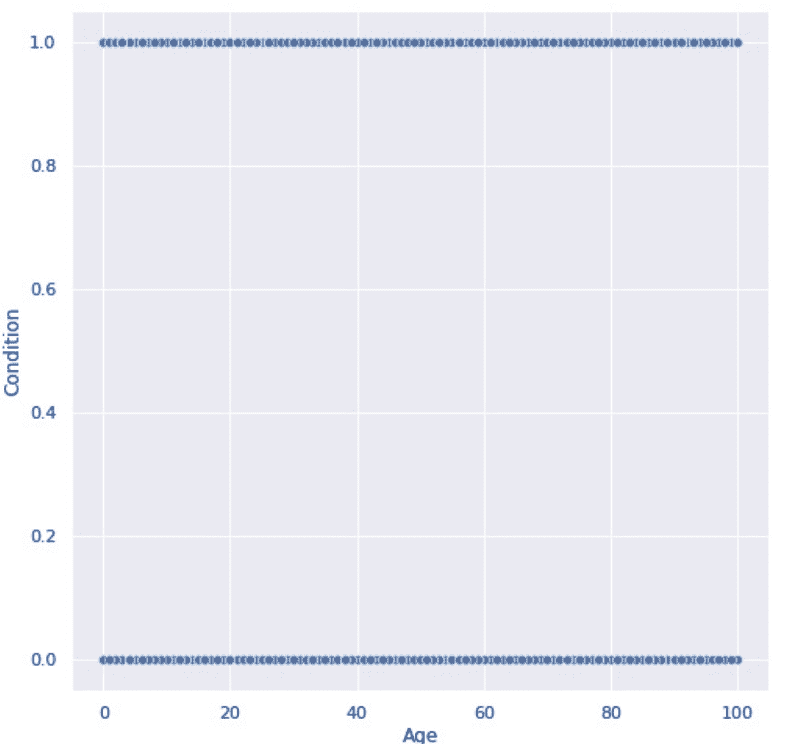

这只是表明一些人患有慢性病，一些人没有——没什么帮助！数据的表格汇总提供了这些慢性病有多常见的更好认识：

```
prop = chronic.Condition.mean()
( chronic.groupby("Condition")
.agg(Number = ("Condition","size"))
.assign(Proportion = [ 1-prop, prop ] ) )
```

| Number | Proportion |
|--------|------------|
| Condition |  |
| 0 | 13303 | 0.423218 |
| 1 | 18130 | 0.576782 |

这给出了当前背景下 *null model* 的最简单版本：基于此数据，从相关人群中随机选择一个个体患有上述 14 种慢性病中至少一种的几率为 57.7%。为了从此数据以及基于它的模型中得出合理的结论，仔细指定该人群非常重要——它由 2009 年在美国寻求并接受医生护理的人组成，因为 NAMCS 收集的是美国医生关于他们就诊患者的资料。那一年由于选择或缺乏获取途径而未参与美国医疗系统的人没有被代表；这些人中慢性病的发生率可能相同也可能不同，但数据只告诉我们 2009 年在美国看过医生的美国人情况。这个 *sample proportion* 为 57.7%，很可能非常接近永远无法精确得知的实际 *population proportion*；由于样本量为 31,433 人，我们可以确信总体比例在 57.1% 到 58.3% 之间（标准误差约为 0.3%）。

## 4.1.2 Chronic conditions and age

样本比例是 Condition 所有值的总和除以数据集中患者的总数——换句话说，57.7% 只是该变量的平均值。就像简单线性回归一样，零模型使用观察到的响应的平均值来预测所有未来响应；这里预测的响应是随机选择的人至少患有一种慢性病的几率。这忽略了可能可用的任何预测变量，因此包含其他信息如 Age 应该能产生更好的预测。为了证实这一怀疑，让我们绘制每个年龄患者的慢性病百分比：

```
cohorts = (chronic.groupby("Age", as_index=False)
    .agg(Number = ("Condition","size"),
          Rate = ("Condition","mean")))
cohorts
```

| Age | Number | Rate |
|-----|--------|------|
| 0 | 0 | 796 | 0.026382 |
| 1 | 1 | 505 | 0.063366 |
| 2 | 2 | 320 | 0.090625 |
| 3 | 3 | 258 | 0.143411 |
| 4 | 4 | 299 | 0.100334 |
| ... | ... | ... | ... |
| 96 | 96 | 13 | 0.923077 |
| 97 | 97 | 11 | 0.909091 |
| 98 | 98 | 6 | 0.833333 |
| 99 | 99 | 2 | 0.500000 |
| 100 | 100 | 6 | 0.833333 |

101 rows × 3 columns

```
sns.scatterplot(data=cohorts, x="Age", y="Rate")
```

Figure 4.2. Plotting the chronic condition rates by age shows the overall trend clearly

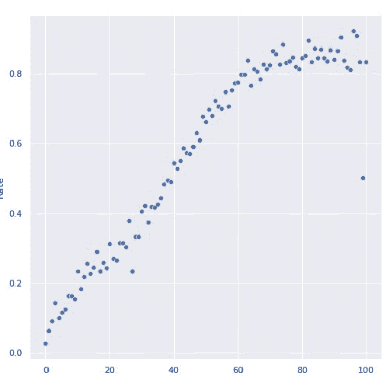

我们在数据集的前 10 行中观察到的情况最终被证明是正确的，正如我们根据自己的经验和常识所猜测的那样：慢性病确实随着人们年龄增长而更有可能发生。然而，该图有点嘈杂，而且这个表中的行太多了，无法一目了然地消化——年龄范围从 0 到 100，因此 cohorts 有 101 行。为了获得更平滑的图和简洁的表格汇总，让我们按十年组织患者并计算每个年龄组患有慢性病的百分比：

```
chronic["Decade"] = 10*round(chronic.Age / 10)
decades = chronic.groupby("Decade", as_index=False).agg(
    Total=("Condition","size"),
    Afflicted=("Condition","sum"),
    Rate=("Condition","mean"))
decades
```

| Decade | Total | Afflicted | Rate |
|--------|-------|-----------|------|
| 0 | 0.0 | 2440 | 179 | 0.073361 |
| 1 | 10.0 | 1946 | 368 | 0.189106 |
| 2 | 20.0 | 2622 | 729 | 0.278032 |
| 3 | 30.0 | 2673 | 990 | 0.370370 |
| 4 | 40.0 | 3962 | 2070 | 0.522463 |
| 5 | 50.0 | 4426 | 2953 | 0.667194 |
| 6 | 60.0 | 5356 | 4127 | 0.770538 |
| 7 | 70.0 | 3748 | 3111 | 0.830043 |
| 8 | 80.0 | 3357 | 2831 | 0.843312 |
| 9 | 90.0 | 849 | 726 | 0.855124 |
| 10 | 100.0 | 54 | 46 | 0.851852 |

以这种方式汇总，发病率基本上从一个年龄组单调递增到下一个更老的年龄组。这些队列依赖的百分比只是每个组的 Condition 的平均值，它们是经验概率，并且清楚地显示了该数据中零模型的糟糕程度。30 岁以下的人患慢性病的几率不到 30%，而 60 岁以上的人患慢性病的几率超过 75%，但零模型预测这些人的几率均为 57.7%。知道并使用患者的年龄比忽略它要好得多！与绘制原始的 0 和 1 相比，绘制这些年龄组百分比非常有用：

```
sns.scatterplot(data=decades, x="Decade", y="Rate")
```

Figure 4.3. Plotting age group percentages summarizes the trend concisely

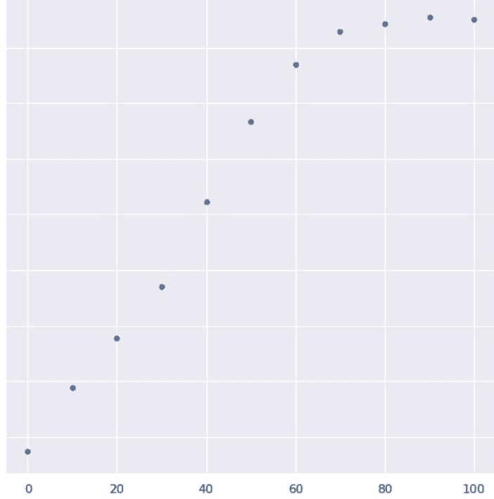

图 4.3 中的图有几件事值得注意。首先，似乎不合理尝试像简单线性回归那样拟合一条直线到这些点；我们一会儿会看到，其中大部分点落在一条特殊的非线性曲线上，即逻辑曲线，逻辑回归因此得名。其次，似乎在 40 岁左右存在一个重要的转变：40 岁以上的人更有可能患有慢性病，而 40 岁以下的人更不可能患有慢性病。这只是该转变年龄的初步估计，因为将数据分组为年龄队列会平滑掉一些变化


在观察中也是如此。这也使得预测特定年龄个体患慢性病的几率变得复杂。无论我们如何实现这一点，预测的几率都小于 0（0%）或大于 1（100%）是没有意义的，因此我们构建的任何预测模型都存在一些自然限制。在其他方面，这排除了线性回归作为候选模型，因为线性方程的输出很容易为负或大于 1。

## 4.1.3 引入逻辑曲线

为了解决这些问题，让我们先看看拟合 NAMCS 数据的曲线，然后再谈谈如何使用它；我们将在第 3 节详细解释拟合过程的工作原理。现在，我们可以使用 seaborn regplot 函数绘制不同年龄和年龄组的慢性病发生率，以及拟合它们的曲线：

```
(sns.regplot(data=chronic,
    x="Age", y="Condition",
    logistic=True, scatter=False,
    ci=None, line_kws={"lw":"4"}))
plt.xlim(-5,105)
plt.ylabel("Rate")
plt.plot( cohorts["Age"], cohorts["Rate"],'.k')
plt.plot( decades["Decade"], decades["Rate"],'or',ms=6)
```

图 4.4. 慢性病发生率很好地遵循逻辑曲线（蓝色）

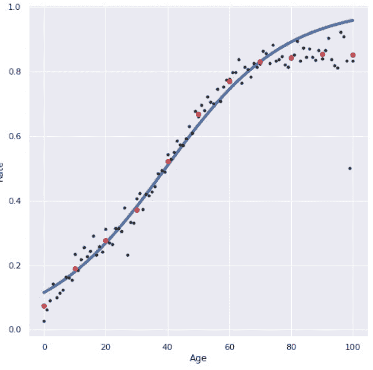

趋势显然不是线性的，但这条曲线到底是什么，我们又该如何使用它？非常好的问题！蓝色的 S 形曲线是逻辑函数，而逻辑回归就是将此曲线拟合到二元响应数据上。在本例中，曲线在特定年龄处的高度估计了基于此数据的概率，即随机选择该年龄的人患有至少一种给定慢性病的概率。必须理解，这种概率实际上描述的是一群人，而不是单个个体——它是特定年龄人群中患有慢性病的人的百分比。

在许多具有二元数据的不同问题中，响应等于 1 的概率遵循逻辑曲线——或像本第一个例子中那样遵循其一部分——令人惊讶地很好。这里是获得该特定曲线显式公式的最简单方法，我们稍后会用它来进行一些计算：

```
chronic_model = smf.logit("Condition ~ Age", data=chronic)
chronic_fit = chronic_model.fit()
chronic_fit.params
```

```
Optimization terminated successfully.
    Current function value: 0.538249
    Iterations 6
Intercept    -2.039383
Age          0.051815
dtype: float64
```

将其翻译成我们首先要使用的形式，这意味着

慢性病概率 = 1 / (1 + e^(2.039383 - .051815 * Age))。

这是拟合 NAMCS 数据的简单逻辑模型。虽然这个公式显然比上一章中使用的线性方程更复杂，但稍加整理就会发现这两种建模方法之间的联系。不过，在深入探讨之前，让我们先看看这个逻辑模型对几个代表性年龄的预测：

| Age | Probability of chronic condition |
|---|---|
| 25 years | 32.2% |
| 39.36 years | 50% |
| 63 years | 77.3% |

根据此模型，39.36 岁是患慢性病从不太可能变为更可能的年龄——我们凭眼估计的 40 岁过渡年龄并不算太远！很容易使用拟合的逻辑模型 chronic_fit 一次性估计所有年龄的概率——我们将使用模型 `predict` 方法计算它们并将其存储在 chronic DataFrame 中以供以后使用：

```
chronic["Probability"] = chronic_fit.predict( chronic.Age )
chronic
```

Age  Condition  Decade  Probability
0    36         0       40.0        0.456601
1    55         1       60.0        0.692206
2    72         1       70.0        0.844397
3    46         0       50.0        0.585190
4    66         1       70.0        0.799059
...  ...        ...     ...         ...
31428 49        1       50.0        0.622357
31429 56        1       60.0        0.703135
31430 6         0       10.0        0.150781
31431 1         0       0.0         0.120514
31432 59        1       60.0        0.734527

31433 rows × 4 columns

### 逻辑函数

如果你以前没有使用过逻辑函数，在看到这个 NAMCS 例子后，一个自然的问题是：谁首先想到了它？我们在学校学习直线方程，所以第一次看到时线性回归似乎并不奇怪。另一方面，这个涉及指数函数的奇怪分数并不是人们会自发想到使用的东西。而且也不是有人随意编造的——逻辑函数是 1844 年比利时数学家 Pierre Verhulst 为建模人口增长而引入的微分方程的解。他就是将其命名为逻辑函数，原因只有他自己知道。

由于逻辑函数也被称为 sigmoid 函数，尤其是在神经网络的背景下，它通常表示为 σ(z)。其通用公式是

当 z 从负值变化到正值时，其绘图如下：

### 图 4.5. 通用逻辑函数，σ(z)

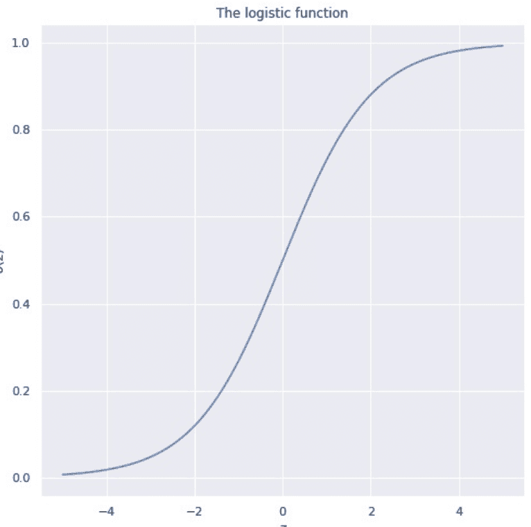

σ(z)

逻辑回归始于 1940 年代，当时 Joseph Berkson 等人开始在统计建模中使用逻辑函数；他们实际上使用了逻辑函数的逆函数，Berkson 将其命名为 logit 函数。求解方程 y = σ(z) 得到 z = f(y) 的公式为：

```
(y) = log( y / (1 - y) ),
```

其中 log 表示自然对数，是指数函数的逆。虽然我们不会过多使用这种记法——没有它也有足够多的记法需要跟踪！——许多人用 logit 来表达逻辑回归模型，所以你需要知道它是什么。在这些模型中，logit 将概率与预测变量联系起来，因此也被称为链接函数。

用逻辑函数 σ(z) 表示，我们可以写出 NAMCS 模型为

```
Probability of chronic condition = σ(-2.039383 + .051815 * Age),
```

揭示了上面提到的逻辑回归与线性回归之间的联系：每个模型都涉及解释变量的线性函数，只是方式不同。事实上，逻辑回归模型通常以突出这种线性函数的形式呈现，而不像上面的表达式那样更适合计算概率。为了解释模型的另一种形式，我们需要知道如何计算某事发生的几率：

```
Odds of event = Probability of event / (1 - Probability of event).
```

这个定义唯一的问题是，当概率为 1 时，事件的几率未定义，因为这会使分母为 0。我们稍后再回来讨论这个问题。

几率通常用冒号而不是分数来写。例如，一个发生概率为 50-50，即概率为 1/2 的事件具有均等几率，即几率为 1:1。如果另一个事件的概率为 2/3，则其几率为 2:1，发生可能性是不发生的两倍。如果给出了事件的几率，可以通过在上面的定义中求解它来找到概率：

Probability of event = Odds / (1 + Odds).

尽管几率和概率直接相关，但请记住它们并不相同！在这些定义就位后，我们现在可以将上面慢性病概率的表达式转换为其另一种常见形式：

log(Odds of chronic condition) = −2.039383 + .051815 * Age.

使用逻辑回归，有关事件的概率——在本例中为患慢性病——因此线性依赖于预测变量，尽管是通过几率的自然对数间接依赖的。我们经常以概率的形式明确写出几率；选择其中一种主要是个人偏好和方便的问题。不过，在两种边缘情况下我们无法使用这种对数几率公式：概率为 1 时，几率未定义；概率为 0 时，几率也为 0，对数未定义。

还有另一种有用的逻辑模型表述方式。这是第三种也是最后一种版本，在在这两种形式之间转换时的中间步骤——如果我们对前面的对数几率公式取指数并处理指数，我们会发现

Odds of having a chronic condition = e^(-2.039383) * e^(0.051815 * Age).

我们可以使用这种公式来计算年龄变化对几率的乘法效应。例如，

50 岁人群的几率 = e^(-2.039383) e^(0.051815 * 50) = 1.736

和

60 岁人群的几率 = e^(-2.039383) e^(0.051815 * 50) e^(0.051815 * 10) = 1.736 * 1.679 = 2.914.

这里的 50 岁和 60 岁没有什么特别之处；对任何年龄值增加 10 岁都会使患慢性病的几率乘以 e^(0.51815) = 1.679，


a 67.9% increase. A similar calculation shows that increasing Age by 1 year multiplies the odds of having a chronic condition by $e^{.051815}=1.05$, a 5% increase; we can use this to compute the 10-year multiplier easily:

$(e^{.051815})^{10} = e^{.051815 * 10} = e^{.51815} = 1.679.$

The multiplier $e^{.051815}$ therefore compounds over time, just as in interest calculations. This number is known as the *odds ratio* and can be an enormously useful summary statistic for some logistic models. In this case, the odds ratio quantifies the impact of aging on the incidence of chronic conditions, just as the slope of a regression line quantifies the change in the response when the explanatory variable changes by 1. When using and interpreting the odds ratio, we just have to remember that we’re working with odds, not probabilities! Since the odds ratio here is larger than 1— because the coefficient of Age is positive— the main takeaway is that the odds of having a chronic condition increase with increasing age, making the corresponding probability increase as well.

## 4.2 Binary classifiers and the ROC curve

According to the logistic model that fits the 2009 NAMCS data, more than half of patients over 39.36 years of age have a chronic condition, and fewer than half of those under this age have one. Physicians could use this result as a rough diagnostic guide when meeting with patients and discussing their health concerns— an underlying chronic condition might well explain older patients' complaints but is not the most likely cause of younger patients' symptoms. Taking this a step further, we can create a cold-hearted *binary classifier* that predicts the value of Condition based purely on the probabilities computed by the logistic model. To construct this predictive model, we’ll create a new binary variable called class; all of the cases with estimated probabilities greater than 50% will be assigned the value class=1, and all of the remaining cases will be assigned the value class=0. (While we’re calling these *classes*, be aware that class designations are also commonly called *labels*.) How well does this classifier perform when applied to the NAMCS data? Let’s see:

```
chronic["Class"] = (chronic.Probability > 0.5).astype(int)
chronic
```

Age  Condition  Decade  Probability  Class
0    36         0       40.0         0.456601    0
1    55         1       60.0         0.692206    1
2    72         1       70.0         0.844397    1
3    46         0       50.0         0.585190    1
4    66         1       70.0         0.799059    1
...  ...        ...     ...          ...         ...
31428 49       1       50.0         0.622357    1
31429 56       1       60.0         0.703135    1
31430 6        0       10.0         0.150781    0
31431 1        0       0.0          0.120514    0
31432 59       1       60.0         0.734527    1

31433 rows × 5 columns

For 9 of the 10 patients shown here, the predicted class label matches the observed Condition status. There’s no reason to think that this is the true overall accuracy rate, though! What we need is a cross-tabulation of all of the observations and predictions, which is just what the pandas crosstab function provides:

```
pd.crosstab(chronic.Condition, chronic.Class)
```

Class    0    1
Condition
0        8294 5009
1        3043 15087
All      11337 20096

In the context of classification, this tabular summary is often called a confusion matrix. Whatever we call it, we see that this classifier labels 8294 + 15087 = 23381 patients correctly, for an overall accuracy rate of 74.38%; it mislabels the other 5009 + 3043 = 8052 patients, for an error rate of 25.62%. There’s no reason to calculate these rates by hand— we can compute them easily by comparing the Condition and Class columns in the chronic DataFrame:

```
np.mean( chronic.Condition == chronic.Class )
```

```
0.7438360958228614
```

```
np.mean( chronic.Condition != chronic.Class )
```

0.2561639041771387

This classifier predicts that 20,096 patients in this dataset would have had at least one chronic condition, but only 15,087 did; the 15,087 *true positives* and the 5,009 *false positives* occupy the Class == 1 column. The other 11,337 patients are not predicted to have had a condition, but 3,043 did; the 8,294 *true negatives* and the 3,043 *false negatives* make up the Class == 0 column. In these terms, the overall accuracy and error rates are

accuracy rate = (true positives + true negatives) / sample size = (15087 + 8294) / 31433 = 74.38%, and error rate = (false positives + false negatives) / sample size = (5009 + 3043) / 31433 = 25.62%.

The new rates we’ll define next describe how well the classifier identifies the actual observations in the two categories. 18,130 patients— the total number in the Condition == 1 row— had at least one chronic condition, and the classifier labels 15,087 of them correctly; the *true positive rate* is therefore

true positive rate = true positives / (true positives + false negatives) = 15087 / 18130 = 83.22%.

The true positive rate is known (inscrutably, if you ask me) as the binary classifier’s *sensitivity*. Moving to the other row, 13,303 patients did not have a chronic condition, and the classifier labels 8,294 of them correctly; the *true negative rate* is

true negative rate = true negatives / (true negatives + false positives) = 8294 / 13303 = 62.35%.

The true negative rate is known (just as inscrutably) as the classifier’s *specificity*, and the *false positive rate* is then

false positive rate = 1 - specificity = false positives / (true negatives + false positives) = 37.65%.

These definitions of *sensitivity* and *specificity* seem arbitrary, but now we’re all stuck with them as standard classifier terminology. To complicate matters further, people also talk about the *recall* of a classifier (a synonym for sensitivity) and the *precision* of a classifier (the percentage of predicted positives that were labeled correctly, 75.07% in this example).

Constructing such binary classifiers is a common application of logistic models and is a standard way to gauge a model’s effectiveness. For this first example, we built a classifier that essentially compares a patient’s age to 39.36, the age at which the logistic model says there’s a 50% chance of having a chronic condition. We provided no rationale for using this particular cutoff— it just seemed like a natural thing to do, which doesn’t really justify the choice. Using a different threshold might yield a classifier that is more accurate, more reasonable, or both. To elaborate on this last point, pretend that you’re a patient, and consider your four possible situations when a binary classifier based on the NAMCS data determines your status:

|  | Condition not predicted | Condition predicted |
|---|---|---|
| You don’t have a condition | True negative: the classifier says you’re healthy, and you are | False positive: the classifier says you’re sick, but you’re not |
| You have a condition | False negative: the classifier says you’re healthy, but you’re not | True positive: the classifier says you’re sick, and you are |

Being a true negative is the preferred outcome, of course. Of the other three outcomes, being a false negative is far and away the least desirable— if you’re sick, you want to know so you can get treatment— and being a false positive is the most desirable, although you wouldn’t know the truth and this might lead to unnecessary treatment or medication. While it’s important for the classifier to have a high specificity (i.e., a low false positive rate), it’s probably much more important from a clinical perspective for the classifier to

have a high sensitivity, so that there aren’t many false negatives. To explore whether these goals can be achieved simultaneously, let’s see what happens when we vary the threshold.

First, we’ll raise the cutoff to a conservative 80%: the resulting classifier will predict that an individual has a chronic condition if the model says that more than 80% of people of that person’s age have a condition; it will predict that the individual does not have a condition otherwise. Here are the code and the results:

```
chronic["Class"] = (chronic.Probability > 0.80).astype(int)
pd.crosstab(chronic.Condition, chronic.Class)
```

```
Class      0     1
Condition
0      12102 1201
1      11803 6327
```

```
pd.crosstab(chronic.Condition, chronic.Class, normalize='index')
```

```
Class      0     1
Condition
0      0.90972 0.09028
1      0.65102 0.34898
```

```
np.mean( chronic.Condition == chronic.Class )

0.5862946584799414
```

```
np.mean( chronic.Condition != chronic.Class )

0.41370534152005856
```

By increasing the threshold so much, we only predict that someone has a chronic condition if we’re quite confident of that outcome. Consequently, there are relatively few false positives and the specificity is high— adding the argument normalize='index' to crosstab computes the row proportions and shows that this classifier’s specificity is just shy of 91%. The downside of such a high threshold is that there are lots of false negatives, which we want to avoid! In fact, the sensitivity is only 35%, making the false negative rate a high 65%. Note that the overall error rate of 41.4%, which is a weighted average of the false negative rate and the false positive rate of 9%, doesn’t tell us what happens with the two kinds of incorrect predictions;


是否重要取决于假阴性与假阳性的相对重要性。

如果我们采用另一个极端，使用一个宽松的阈值，我们应该预期假阴性率会大幅下降，而假阳性率会相应增加。以下是使用 20% 截止值得到的结果：

```
chronic["Class"] = (chronic.Probability > 0.20).astype(int)
pd.crosstab(chronic.Condition, chronic.Class)
```

Class    0    1
Condition
0   3523  9780
1   447  17683

```
pd.crosstab(chronic.Condition, chronic.Class, normalize='index')
```

Class    0    1
Condition
0   0.264827  0.735173
1   0.024655  0.975345

```
np.mean( chronic.Condition == chronic.Class )
```

0.6746413005440143

```
np.mean( chronic.Condition != chronic.Class )
```

0.3253586994559857

正如预期的那样，假阴性并不多；通过降低阈值，该分类器只将患病几率非常低的患者分配到 Condition=0 类，因此这些预测大多是正确的。另一方面，很多很可能健康的患者被预测为患病，使得假阳性率高达 73.5%。比较这三种不同阈值的结果（20%、50% 和 80%），我们可以看到我们不能期望同时具有高敏感性和高特异性；提高一个会降低另一个，因此我们必须了解它们的相对优劣。这就是领域专家输入至关重要的地方——在这种例子中，我们需要受过训练的医生根据经验和定量指标的结合来为我们提供选择阈值的建议。

评估一组分类器的最常用工具是随着阈值变化的 *假阳性率* 与 *真阳性率* 的图；出于历史原因，该图被称为 *ROC 曲线*，其中 *ROC* 代表 *Receiver Operating Characteristic*。要为基于我们 NAMCS 逻辑模型创建 ROC 曲线，我们可以继续创建混淆矩阵，然后绘制由此产生的比率，将假阳性率（即 1 - 特异性）放在水平轴上，将真阳性率（敏感性）放在垂直轴上。总结我们迄今为止所做的工作，我们知道 ROC 曲线上的三个点：

| Threshold | False positive rate | True positive rate |
|---|---|---|
| 20% | 0.735 | 0.975 |
| 50% | 0.377 | 0.832 |
| 80% | 0.09 | 0.349 |

虽然我们可以编写一个简单的脚本来确定 ROC 曲线的其余部分，但使用 sklearn metrics 模块中的 roc_curve 函数要容易得多。此外，我们可以使用该模块的 auc 函数来计算 *曲线下面积 (AUC)*，这是整体性能的重要指标。以下是详细信息：

```
fpr, tpr, thresholds = metrics.roc_curve(chronic.Condition, chron
chronic_auc = metrics.auc(fpr, tpr)
chronic_auc

0.7938824622209679

plt.figure()
plt.plot(fpr, tpr, label='ROC curve      AUC: %0.2f' % chronic_auc)
plt.plot([0,1], [0,1], 'r--', label='Random classification')
plt.plot([0.735,0.377,0.09], [0.975,0.832,0.349], 'ok')
plt.xlim([0, 1])
plt.ylim([0, 1.05])
plt.xlabel('False Positive Rate (1-Specificity)')
plt.ylabel('True Positive Rate (Sensitivity)')
```

```
plt.title('ROC curve for chronic condition classifier')
plt.legend(loc="lower right")
```

### Figure 4.6. The Receiver Operating Characteristic (ROC) curve summarizes classifier performance

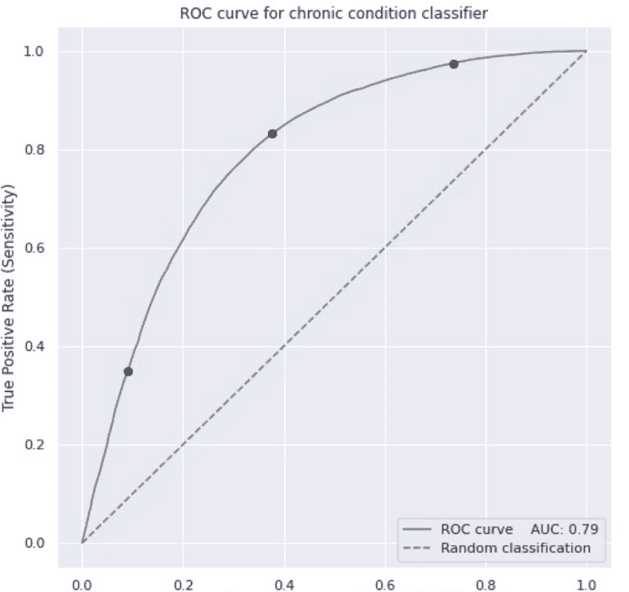

上表中三个点在此曲线上被突出显示，这清楚地显示了随着阈值变化，真阳性率和假阳性率如何变化：ROC 曲线从 (0,0) 开始，对应于 100% 的极端阈值，并以 (1,1) 结束，对应于 0% 的相反极端阈值。该图的左上角，即点 (0,1)，代表完美的分类器（0% 假阳性率，100% 真阳性率），因此 ROC 曲线越接近 (0,1)，分类器族就越好。这是对 AUC 的一种解释：AUC 越接近 1，ROC 曲线一般来说就越接近左上角。产生 ROC 曲线上最接近 (0,1) 的点的阈值是使用最佳阈值的良好候选，但这取决于数据的上下文以及错误标记案例的相对利弊。

## 4.3 Fitting probability models to data

如 NAMCS 慢性病数据所示，逻辑回归是医学统计建模中的基本工具——任何对流行病学、生物统计学、生存分析等感兴趣的人都必须学习如何构建和解释逻辑回归模型。然而，这种模型的适用性绝不限于医学数据，下一个例子就说明了这一点。利用俄亥俄大学生物学家收集的数据 [12]，我们将探讨环境条件如何影响一种特定紫罗兰物种 Viola pubescens，即常被称为绒毛黄紫罗兰的芽形成情况。在进行过程中，我们将讨论逻辑回归背后的一些数学，建立更多符号，并解释如何将逻辑曲线拟合到数据中。为了开始，让我们加载数据并看看里面有什么：

```
violets = pd.read_csv("violets.csv")
violets.columns
```

```
Index(['Year', 'Plot', 'Day', 'Light quantity', 'Soil moisture',
      'Bud type', 'Bud counts', 'Min temp', 'Mean temp', 'Max te
      'SD temp'],
      dtype='object')
```

我们不需要这 12 列中的全部，因此我们将去掉其中几列，然后解释剩下的内容：

```
violets = violets[['Year','Plot','Day','Photoperiod','Bud type','
violets
```

Year  Plot  Day  Photoperiod  Bud type  Bud counts
0  2016  1  96  12.833333  Cleistogamous  0
1  2016  1  96  12.833333  Chasmogamous  1
2  2016  1  104  13.166667  Cleistogamous  0
3  2016  1  104  13.166667  Chasmogamous  1
4  2016  1  109  13.366667  Chasmogamous  0

.... .... .... .... .... .... ....
315 2017 10 116 13.666667 Cleistogamous 0
316 2017 10 128 14.100000 Chasmogamous 0
317 2017 10 128 14.100000 Cleistogamous 18
318 2017 10 143 14.550000 Chasmogamous 0
319 2017 10 143 14.550000 Cleistogamous 9

320 rows × 6 columns

显示的行展示了本次实验中第一个和第十个地块的数据，研究人员在当地公共公园研究了一个本地绒毛黄紫罗兰种群。为了了解环境线索对开花的影响，他们随机选择并监测了 10 个面积相等的小块，测量环境条件并统计每个小块紫罗兰出现的芽数。这种特定的紫罗兰物种受益于由 2 种不同芽类型组成的混合繁殖系统：*裂葶芽* 成熟为通常由传粉者如蜜蜂授粉的花朵，以及 *闭葶芽* 成为自花授粉的花朵。这些芽类型出现在不同时间，裂葶芽出现在春季，而闭葶芽出现在夏季和初秋。以上数据证实了这一点，因为在测量开始的前 5 天，第 1 小块出现了 2 个裂葶芽和 0 个闭葶芽。

现在，我们将研究 *光周期*，即紫罗兰小块每天接受阳光照射的小时数，对裂葶芽形成的影响。虽然从数据集的前五行看不出，但我们能从最后三行看出 Bud counts 记录的是在一个小块中观察到的芽的总数，而不是二元的。因此我们需要过滤数据并将 Bud counts 转换为二元响应变量——我们将定义新变量 Bud，如果 Bud count 为正则等于 1，否则等于 0。一旦 Bud 准备就绪，我们就可以绘制其对 Photoperiod 的依赖关系：

```
chasm = violets[ violets['Bud type']=="Chasmogamous" ]
chasm["Bud"] = (violets['Bud counts'] > 0).astype('int')
chasm = chasm[["Photoperiod", "Bud"]]
chasm
```

Photoperiod Bud
1 12.833333 1


3  13.166667  1
4  13.366667  0
7  13.716667  0
9  13.966667  0
...  ...  ...
311  13.116667  1
312  13.350000  0
314  13.666667  0
316  14.100000  0
318  14.550000  0

160 rows × 2 columns

```
sns.scatterplot(data=chasm, x="Photoperiod", y="Bud")
```

Figure 4.7. The chance of bud development clearly depends on photoperiod length

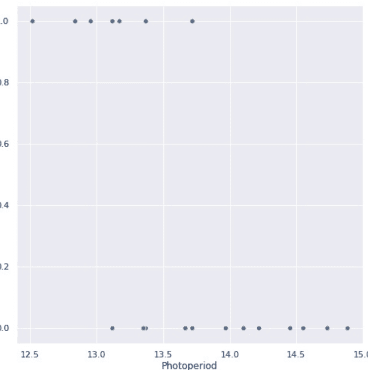

Unlike the NAMCS data, plotting the raw data is the right place to start with this example. We can see that bud formation is more likely with shorter photoperiods and less likely with longer photoperiods, but it’s not clear how to distinguish precisely between "long" and "short" photoperiods. For some of the photoperiod lengths, some violets developed buds and some didn’t, so knowing the photoperiod does not guarantee what will happen. Instead of trying to predict whether the response will equal 0 or 1, we need to predict the probabilities of each outcome. There’s not enough data here to mimic what we did with the NAMCS data, though— there’s no good way to subdivide the photoperiods into discrete intervals so that the bud growth probabilities for the groups follow the expected S-shaped curve. (You should

play around with this for yourself to see what I mean!) What we need is a statistical model that we can use to predict the probability that at least one violet in a plot will develop a chasmogamous bud.

## 4.3.1 The null model

Chasmogamous buds were observed in 67 of the 160 cases in the chasm dataset— if we define the appearance of a bud to be a "success", then the overall success rate was 41.875% :

```
chasm.agg( N=('Bud','size'),
            Successes=('Bud','sum'),
            Percentage=('Bud','mean'))
```

Bud
        N      160.00000
    Successes   67.00000
    Percentage  0.41875

Knowing nothing else, we would therefore predict a 41.875% chance of observing a chasmogamous bud in any plot on any given day. This *sample proportion* is our null model, which can be written concisely in the form

π̂ = 0.41875.

We’ll follow a common statistical practice and use π to denote a proportion; the hat on top of this one signifies that it’s computed from data— in this case, it’s the average of the observed values of the binary response variable Bud. The sample proportion π̂ is also an empirical probability, so the null model does *not* predict the value of the response variable, which is either 0 or 1; the null model estimates the probability that the response will equal 1. This is the simplest statistical model that we can construct from this data, and the previous plot suggests that a model that includes photoperiod information will perform much better. But how will we know?

To assess any statistical model, we have to compare its predictions with observations. For a simple linear regression model, this means working with residuals, since a residual is precisely the difference between an observed value and a predicted value. That won’t work so easily for a binary response

variable, though, since the predictions are probabilities and the observations are 0’s and 1’s. Instead, we use the model being evaluated to compute the combined probability of the observed responses. To see how this works for this particular null model, let’s start by looking at the probabilities that it assigns to the individual observations in the dataset:

```
pi_hat = chasm["Bud"].mean()
pi_hat
```

0.41875

```
chasm["Null_prob"] = (pi_hat**chasm.Bud)*((1-pi_hat)**(1-chasm.Bu
chasm
```

Photoperiod  Bud  Null_prob
1  12.833333  1  0.41875
3  13.166667  1  0.41875
4  13.366667  0  0.58125
7  13.716667  0  0.58125
9  13.966667  0  0.58125
...  ...  ...  ...
311  13.116667  1  0.41875
312  13.350000  0  0.58125
314  13.666667  0  0.58125
316  14.100000  0  0.58125
318  14.550000  0  0.58125

160 rows × 3 columns

As shown, the null model says that each 1 occurs with probability 41.875%, and each 0 occurs with probability 58.1%. Note carefully how the Null_prob values were computed: instead of just checking whether Bud equals 0 or 1, which would be easy to do, we used the calculation

π̂^Bud * (1 − π̂)^(1 − Bud)

This might seem like a weird way to do this, but we have a good reason (of course!)— this formula and its variants are fundamental when working with categorical data. It’s therefore important to understand it thoroughly, so let’s break it down:

| Bud | π̂^Bud | (1 − π̂)^(1 − Bud) | π̂^Bud * (1 − π̂)^(1 − Bud) |
| 0 (No) | 1 |  |  | |
|---|---|---|---|---|
| 1 (Yes) |  | 1 |  | |

Everything checks out: when Bud equals 0, we recover the sample proportion, \hat{p} = .41875, and when Bud equals 1, we recover the complementary proportion, (1 - \hat{p}) = .58125. We’ll soon see why we need this somewhat complicated way of expressing the null model probabilities. To proceed, we also need to assume that the individual outcomes recorded in the Bud column are independent, so that no observation influences any other observation. More precisely, independence means that the probability of several events happening is the product of their respective probabilities. According to the null model, the total probability of observing these 160 values of Bud is therefore the product of all of the entries in the Null_prob column:

```
null_likelihood = chasm["Null_prob"].product()
null_likelihood

5.711218444597525e-48
```

This number is called the likelihood, hence the name null_likelihood; it’s no surprise that the likelihood is so close to 0, since it’s the product of a bunch of positive numbers less than 1. This likelihood is not really useful by itself— likelihoods only become meaningful when we compare them for different probability models. To make things more tractable, we don’t usually work directly with likelihoods, either. Instead, we take the natural logarithm of the likelihood and then multiply by -2, obtaining a descriptive statistic known as the deviance:

```
null_deviance = -2*np.log( null_likelihood )
null_deviance

217.56330414992954
```

Since this is the deviance for the null model, we naturally call it the null deviance. Of course, there is a much easier, more direct way to obtain it: we can use the statsmodels glm function to construct the null model. glm is a general-purpose function for building generalized linear models (hence the

name), including logistic regression models; we tell it which kind of model we want by specifying the relevant family of distributions. Here’s how to use glm to get the null model in this case:

```
null_model = smf.glm("Bud ~ 1", data=chasm, family=sm.families.Bi
null_fit = null_model.fit()
null_fit.params
```

Intercept  -0.327907
dtype: float64

```
null_fit.deviance
```

217.5633041499296

The reported null deviance of 217.6 agrees with our brute force calculation, but the connection between our other calculations and the reported intercept, -0.3279, is not readily apparent. This number is just a different expression of the null model, namely in the form

log(Odds of chasmogamous bud) = − 0.327907.

Exponentiating and then recovering the probability from the odds, we find that

Odds of chasmogamous bud = e⁻⁰·³²⁷⁹⁰⁷ = 0.72043,

from which it follows that

Probability = 0.72043 / 1.72043 = .41875,

precisely the same as our sample proportion ˆp. It’s important to be comfortable with the different forms of these models!

## 4.3.2 Fitting the logistic curve

To try to improve on the null model, we’re going to incorporate the photoperiod data into our probability calculations. Guided by the NAMCS

example above, we’ll do this by supposing that a plot’s photoperiod length x and the corresponding estimated probability \(\hat{\Pi}_x\) of observing a chasmogamous bud are directly related by the equation

```
\(\log\left(\frac{\hat{\Pi}_X}{1 - \hat{\Pi}_X}\right) = a + b\,x,\)
```

with coefficients a and b that have to be computed from the data. To work with the probability of bud formation instead of the log of its odds, we can solve for \(\hat{\Pi}_x\) to get the other main form of this equation,

```
\(\hat{\Pi}_X = \frac{1}{1 + e^{(-a - b\,x)}} = \sigma(a + b\,x), \)
```

where σ is the logistic function defined earlier. To build a model that makes the best use of the photoperiod information, we therefore have to fit the logistic curve to our dataset. How do we do that? We use this formula for \(\hat{\Pi}_x\) to compute the combined likelihood, according to this model, of the observed responses, and then we determine the values of a and b that make the observed data most likely. This is the method of *maximum likelihood estimation.*

To implement this strategy, we first need a formula for the likelihood. For that, we need a little more notation: let x_i denote the photoperiod in row i of the chasm dataset, let y_i denote the value of Bud in row i, and let \(\hat{\Pi}_i\) denote that plot’s probability of having a chasmogamous bud on that day. Assuming that individual buds develop independently, the likelihood of the data— the collective probability of the observations— is

```
\(L(a, b) = \prod_i \hat{\Pi}_i^{\,y_i} (1 - \hat{\Pi}_i)^{1 - y_i}, \)
```

where Π stands for the product of all of these terms, from i = 1 to i = 160. This is the formula we discussed above, and using it is about to pay off. According to the logistic equation,


```
hat{π}_i = 1 / (1 + e^{(-a - b x_i)})
```

因此似然 L(a, b) 实际上只是 a 和 b 的函数——x_i 和 y_i 都是已知的。虽然 L(a, b) 中所有这些乘积和指数都很麻烦，但我们做了自然的事情（哈哈！）并取似然的对数：

```
log L(a, b) = log(∏_i hat{π}_i^{y_i} (1 - hat{π}_i)^{1 - y_i}) = ∑_i log(hat{π}_i^{y_i} (1 - hat{π}_i)^{1 - y_i}) = ∑_i [y_i log hat{π}_i + (1 - y_i) log(1 - hat{π}_i)]
```

我们在这里反复使用了对数的性质，最终结果至关重要——对数似然为

```
log L(a, b) = ∑_i [y_i log hat{π}_i + (1 - y_i) log(1 - hat{π}_i)]
```

这是我们将要最大化以获得系数的函数。之所以等价于最大化似然，是因为对数是严格递增函数，但使用对数似然简化了记账——求和比乘积更方便——以及优化。这并不意味着最大化对数似然很容易，因为它并不容易！

### 简单 logistic 回归的系数

最优系数 a 和 b 使我们刚刚推导出的对数似然函数最大化。这至少引发了两个问题：

- 为什么 log L(a, b) 甚至会有最大值？
- 对于 a 和 b 的哪些取值，log L(a, b) 达到其最大值？

不幸的是，这两个问题都没有漂亮的简单答案。为了确认对数似然存在最大值，我们必须应用适当的二阶导数检验版本——在这种情况下，这意味着检查二阶导数的 2 × 2 矩阵，即所谓的 Hessian 矩阵，是否负定，即函数有两个未知数时凹向下的类比。如果你有足够的微积分知识来理解这条评论，你可以计算 Hessian 并自行检查；否则，尝试绘制对数似然图看看会发生什么，或者就相信对数似然确实存在最大值。

至于第二个问题，对数似然及其导数是 $a$ 和 $b$ 的 *非线性* 函数，因此不存在最优系数的公式；必须使用迭代数值方法来找到它们。幸运的是，像 R 和 Python 这样的语言提供了计算 logistic 回归系数的算法的可靠实现，因此我们不必自己编写——这很幸运，因为我们大多数人都没有机会编写比我们喜欢的语言提供的更好的版本。虽然我们不会详细介绍系数的计算方法，但了解更多关于这些方法的信息将是时间 well spent！

如前所述，statsmodels 提供了我们需要的功能来最大化对数似然并从而将 logistic 曲线拟合到我们的数据：我们只需要再次使用其 glm 函数。开始吧：

```
chasm_model = smf.glm("Bud ~ Photoperiod", data=chasm, family=sm.
chasm_fit = chasm_model.fit()
chasm_fit.params
```

Intercept      74.583697
Photoperiod    -5.524989
dtype: float64

我们现在有了 logistic 模型，可以用各种方式表述——抽象地用变量 $x_i$ 和 $\pi_i$ 表示，

$\log\left(\frac{\hat{\Pi}_i}{1-\hat{\Pi}_i}\right)=74.584-5.525x_i,$

或用通俗语言强调数据的背景：

$\log(\text{Odds of bud formation}) = 74.584 - 5.525 * \text{Photoperiod}.$

正如我们在 NAMCS 模型中所见，模型的其它版本给出了概率或芽形成几率的显式公式。前者

的优点是直接给出概率，更容易解释，但缺点是难以处理；后者将几率表示为乘积并强调几率比，在本例中似乎并不太有用。（几率比为 e^-5.525 = .004，因此随着光周期增加一小时，芽形成的几率急剧下降，这我们从绘制数据时已经知道。）这里更重要的是区分芽发育从可能到不可能的光周期长度，该值最好从上述公式确定。熟悉这些版本的所有形式是很好的，具体取决于你的受众和你正在做的事情。最好再用可视化结果来补充这些公式，因此让我们绘制原始数据（橙色）和拟合的 logistic 曲线（蓝色）：

```
chasm["Fit_prob"] = chasm_fit.fittedvalues
chasm
```

```
Photoperiod  Bud  Null_prob  Fit_prob
1  12.833333  1  0.41875  0.975390
3  13.166667  1  0.41875  0.862713
4  13.366667  0  0.58125  0.675466
7  13.716667  0  0.58125  0.231345
9  13.966667  0  0.58125  0.070307
...  ...  ...  ...  ...
311  13.116667  1  0.41875  0.892282
312  13.350000  0  0.58125  0.695317
314  13.666667  0  0.58125  0.284045
316  14.100000  0  0.58125  0.034937
318  14.550000  0  0.58125  0.003004

160 rows × 4 columns
```

```
sns.scatterplot( data=chasm, x="Photoperiod", y="Fit_prob")
sns.lineplot( data=chasm, x="Photoperiod", y="Fit_prob")
sns.scatterplot( data=chasm, x="Photoperiod", y="Bud" )
plt.ylabel("Bud")
plt.title("Bud observations and fitted probabilities")
```

图 4.8. 将 logistic 曲线拟合到紫罗兰数据总结了 Bud 与 Photoperiod 之间的关系

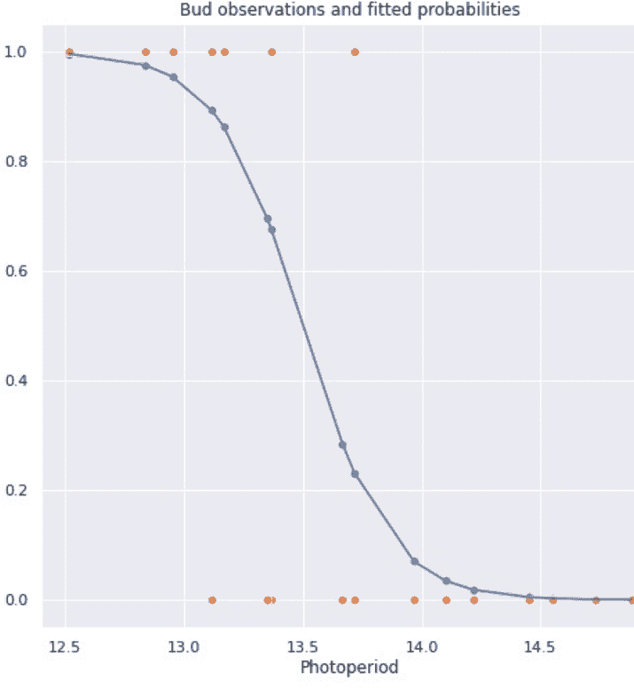

Logistic 曲线很好地拟合了紫罗兰数据，清楚地表明，随着光周期变长，观察到裂隙芽的概率下降；这对应于 Photoperiod 系数为 -5.525 为负这一事实。特别是，我们看到芽形成的几率从大于 1（概率大于 50%）变为小于 1（概率小于 50%）时，光周期约为 13.5 小时。我们可以用模型来确认这一点：当芽发育的几率等于 1（即 50-50 的机会）时，几率的对数等于零且 0 = 74.584 −5.25 * Photoperiod ⟹ Photoperiod = 74.584 / 5.525 = 13.5，

正如图中所示。练习 7.1.3 要求你利用这一结果构造一个简单的二元分类器：如果光周期小于 13.5，则预测会观察到芽；如果光周期大于 13.5，则预测不会有芽。按照我们在第 2 节对 NAMCS 数据所做的方法，你应该通过计算成功率、错误率和 ROC 曲线下面积来评估该二元分类器在实际观测上的表现。

## 4.3.3 比较空模型和 logistic 模型

对于紫罗兰数据和 NAMCS 数据，很明显 logistic 模型优于忽略相关预测变量的空模型。我们现在需要的是一个客观的方法来量化这两个竞争模型之间的预测能力差异。虽然构造二元分类器可以粗略评估 logistic 模型的有效性，但这并不能告诉我们它相对于空模型的表现。在本节中，我们将讨论比较这些模型的两种方法：似然比检验和 logistic 回归版本的决定系数。

### 偏差和似然比检验

由于我们通过最大化似然来拟合 logistic 模型，因此比较模型的一种自然方法是简单地比较它们的似然。对于紫罗兰数据，拟合模型的似然为

```
chasm["Likelihood"] = (chasm.Fit_prob**chasm.Bud)*((1-chasm.Fit_p
chasm
```

| Photoperiod | Bud | Null_prob | Fit_prob | Likelihood |
|---|---|---|---|---|
| 1 | 12.833333 | 1 | 0.41875 | 0.975390 | 0.975390 |
| 3 | 13.166667 | 1 | 0.41875 | 0.862713 | 0.862713 |
| 4 | 13.366667 | 0 | 0.58125 | 0.675466 | 0.324534 |
| 7 | 13.716667 | 0 | 0.58125 | 0.231345 | 0.768655 |
| 9 | 13.966667 | 0 | 0.58125 | 0.070307 | 0.929693 |
| 311 | 13.116667 | 1 | 0.41875 | 0.892282 | 0.892282 |
| 312 | 13.350000 | 0 | 0.58125 | 0.695317 | 0.304683 |
| 314 | 13.666667 | 0 | 0.58125 | 0.284045 | 0.715955 |
| 316 | 14.100000 | 0 | 0.58125 | 0.034937 | 0.965063 |
| 318 | 14.550000 | 0 | 0.58125 | 0.003004 | 0.996996 |

160 rows × 5 columns

```
max_likelihood = chasm["Likelihood"].product()
max_likelihood
```

3.532480672759031e-18

这比空模型的似然大

```
max_likelihood / null_likelihood
```

6.185161199884674e+29

倍

因此观测在 logistic 模型下的可能性远大于空模型，但这个数字太大而无法处理，就像似然太小而无法合理解释一样。我们如何处理如此天文数字般的小数和大数？取它们的对数！max_likelihood 的对数正是拟合模型的对数似然：

```
np.log(max_likelihood)
```

-40.1845313095955

这个数字令人讨厌的一点是它是负的——出于各种原因，我们通常喜欢用正数来量化事物。在处理对数似然时，我们通过乘以 -2 来修复这个问题，就像我们之前计算空偏差时所做的那样；当应用于 logistic 模型的对数似然时，我们得到残差偏差（也称为模型偏差）：

```
residual_deviance = -2*np.log(max_likelihood)
residual_deviance
```

80.369062619191

不出所料，chasm_fit 包含了此信息——我们只需要打印其摘要：

```
print( chasm_fit.summary() )
```

Generalized Linear Model Regression Results


Dep. Variable: Bud No. Observations:
Model: GLM Df Residuals:
Model Family: Binomial Df Model:
Link Function: logit Scale:
Method: IRLS Log-Likelihood:
Date: Sun, 01 Aug 2021 Deviance:
Time: 21:38:37 Pearson chi2:
No. Iterations: 7
Covariance Type: nonrobust
coef std err z P>|z| [0.
Intercept 74.5837 12.132 6.148 0.000 50.
Photoperiod -5.5250 0.900 -6.136 0.000 -7.

可以观察到最大化对数似然等价于最小化残差偏差——残差偏差类似于线性回归中的残差平方和，我们将在下面利用这一类比。事实上，如果假设正态性，线性回归模型也可以基于最大似然估计；在这种方法中，得到的残差偏差与最小二乘法所依赖的残差平方和完全相同。

偏差之间的差值记为 G²，是判断添加预测变量是否改善逻辑模型的标准度量；对于本例，G² = 217.6−80.37 = 137.2，这显然是一个很大的降幅。在讨论如何评估这个数值之前，我们需要做一些计算并定义一个额外的术语。利用对数的性质和偏差的定义，我们可以按如下方式重写 G²：

G² = -2*log(null likelihood) - (-2*log(likelihood of logistic model)) = -2*log( null likelihood / likelihood of logistic model ).

G² 的最终公式解释了其名称：G² 是似然比统计量。我们可以直接从该定义计算，

```
G2 = -2*np.log( null_likelihood / max_likelihood)
G2
```

137.19424153073854

或者我们也可以取上面计算的似然比的两倍对数，即 6.185161e+29，这正是引发我们讨论对数的数值。当然，既然我们已经构建了模型 chasm_fit，我们就可以直接用它来计算 $G^2$：

```
chasm_fit.null_deviance - chasm_fit.deviance
```

137.1942415307386

一旦我们得到了似然比统计量，该如何使用它呢？
不幸的是，它没有直接的解释——它既不是像决定系数 $R^2$ 那样的变异性百分比减少，也不是像 RSE 那样估计标准差。我们唯一能做的就是利用似然比是自由度为 1 的 $\chi^2$ 统计量这一事实来衡量其大小。对这一结果的证明 [13] 超出了本书的范围，但在第 5 章我们将使用自助法来说明其有效性。
暂时接受这一点，我们可以使用 scipy.stats chi2 函数，df=1 来进行似然比检验，判断 $G^2$ 是大还是小：

```
1 - chi2.cdf(G2, df=1)
```

0.0

这是一个 $p$ 值，我们将在下一节讨论相关的假设检验。我们现在就可以解释它：这个非常小的 $p$ 值意味着包含 Photoperiod 的逻辑模型明显优于排除它的零模型。如果似然比检验的 $p$ 值较大——通常，但不一定，大于 5%——那么我们就会得出添加预测变量并未改善模型的结论。似然比检验是逻辑回归分析的基础部分，当我们考虑并比较具有多个预测变量的模型时，我们将有更多的话要说。

### 决定系数的类比

由于偏差和似然比难以直观解释，最好能用类似于线性回归决定系数 $R^2$ 的诊断指标来补充。多年来，人们提出了几种候选指标，并附带了各种使用它们的论据；目前仍没有关于逻辑回归模型 $R^2$ 最佳替代品的共识。在此前提下，我们将讨论三种选择：一个有前景的最新提议，以及两种基于上一章第 2.3 节研究的 $R^2$ 公式而建立的既定方法。花点时间重温一下该推导，然后再回来看看我们如何修改它——我会在你回来时等着！

正如你刚刚回顾的，线性回归模型的决定系数定义为

$R^2 = \frac{\text{TSS} - \text{RSS}}{\text{TSS}} = 1 - \frac{\text{RSS}}{\text{TSS}},$

其中 TSS 是零模型的总平方偏差，RSS 是平方残差之和。在逻辑模型背景下解释这些成分的一种常见方法是：在 $R^2$ 的最右边表达式中，用零偏差替换 TSS，用残差偏差替换 RSS。这种计算利用了上面提到的偏差与平方和之间的类比；结果被称为 McFadden 的伪-$R^2$，我们用 $R_M^2$ 表示：

$R_M^2 = 1 - \frac{\text{residual deviance}}{\text{null deviance}}.$

请注意，这个统计量没有标准记号，所以在阅读其他资料时要小心。这个描述性统计量衡量的是偏差的比例减少，具有两个必要的性质：

- $R_M^2$ 对于完全无信息的模型，即与零模型无差别的模型，为 0，且
- $R_M^2$ 对于完美模型，即对每个 $i$ 都有 $\hat{\pi}_i = y_i$ 的模型，为 1。请注意，对于只有两个参数的简单逻辑模型来说，完美是不可能的。

虽然 $R_M^2$ 的理论上限为 1，但一个常规经验法则是，$R_M^2$ 值在 0.2 到 0.4 之间的逻辑模型比其零模型对应物具有显著更好的解释力。对于紫罗兰

数据，我们做得更好：

```
R2_M = 1 - (chasm_fit.deviance / chasm_fit.null_deviance)
R2_M

0.6305945851796487
```

这表明将 Photoperiod 作为预测变量可带来偏差的显著相对减少！

与其用偏差替换 $R^2$ 定义中的 TSS 和 RSS，不如直接使用逻辑模型的原生平方和。为此，我们必须选择 $R^2$ 的公式之一；$R^2$ 的不同表达式在线性回归中都相同，但在转换为当前背景时并不相同。在我们最初推导 $R^2$ 时，请回想我们从竞争模型预测值之间的平方偏差之和开始，这个值恰好等于 TSS – RSS，这是普通最小二乘法的神奇之处。用模型预测值的比较替换这个差值，然后除以零模型的平方偏差之和，就是我们决定系数的第二个版本。具体来说，用 R²_S 定义

R²_S = Σ( π̂_i − π̂ )² / Σ( y_i − π̂ )² .

与 McFadden 的伪-R² 一样，R²_S 介于 0 和 1 之间；对于无信息模型等于 0，对于完美模型等于 1。如果我们用另一个自然选择 Σ(y_i − π̂)² − Σ(y_i − π̂_i)² 替换 TSS – RSS，我们会得到一个通常接近 R²_S 的替代统计量；如果对人为退化数据进行评估，该替代统计量可能为负，这也是我们更倾向于 R²_S 的原因。我们将对紫罗兰数据同时计算两者：

```
chasm["Null_residual"] = chasm["Bud"] - pi_hat
chasm["Residual"] = chasm["Bud"] - chasm["Fit_prob"]
chasm["Difference"] = chasm["Fit_prob"] - pi_hat
R2_S = np.sum(chasm["Difference"]**2) / np.sum(chasm["Null_residu
R2_S

0.6851756536416984
```

```
1 - ( np.sum( chasm["Residual"]**2 ) / np.sum(chasm["Null_residua
```

0.6508175736130928

这两个值都接近 $R^2_M$，进一步证明逻辑模型优于零模型。

我们将考虑的第三个 $R^2$ 版本称为 *区分系数*，我们用 $R^2_D$ 表示。Tjur 在 2009 年提出了该统计量，其出发点是敏锐的观察：表现良好的逻辑模型应平均为观测到的成功分配较大的概率，平均为观测到的失败分配较小的概率。为了直观地研究这一点，我们只需查看这两个组的拟合概率直方图。下面是紫罗兰模型的结果：

```
sns.displot( data=chasm, x="Fit_prob", col="Bud", binwidth=0.2)
```

Figure 4.9. Comparing the predicted probabilities for observed failures (left) and observed successes (right)

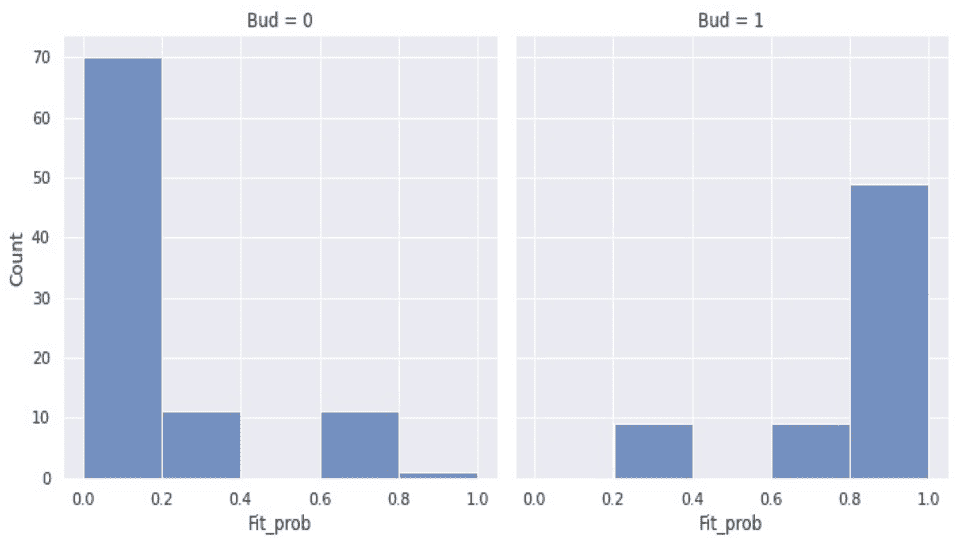

如预期，观察到芽的图（右边的直方图）大部分拟合概率大于 50%，而大部分那些


没有芽（左边的直方图）的拟合概率小于 50%。区分系数用一个数字概括了我们所看到的内容——如果我们令 π̄_S 和 π̄_F 分别表示成功和失败的拟合概率的平均值，则

```
R_D^2 = π̄_S - π̄_F.
```

对于紫色数据，区分系数与 R_M^2 和 R_S^2 非常吻合：

```
fit_avgs = chasm.groupby("Bud").agg(Fit_average=('Fit_prob', 'mean'))
fit_avgs

Fit_average
Bud
    0    0.139026
    1    0.807023

R2_D = fit_avgs["Fit_average"][1] - fit_avgs["Fit_average"][0]
R2_D

0.6679966136273958
```

正如名称所示，区分系数衡量了 logistic 模型区分成功和失败的能力；这让人想起基于 Photoperiod 的二元分类器。与其只选择其中一种诊断统计量，不如尝试全部三种——它们应该表现相似，并证实似然比检验的结果。

## 4.4 Examples

## 4.4.1 Intubation and throat pain

在《生物统计学百科全书》的一篇文章中，David Collett 提供了 35 名患者术后咽喉疼痛的以下数据：

```
throat = pd.read_csv("throat.csv")
throat

Age  Sex  Lubricant  Duration  Device  SoreThroat
0   48    1         0        45       0          0
```

|  | Age | Sex | Lubricant | Duration | Device | SoreThroat |
|---|---|---|---|---|---|---|
| 1 | 48 | 1 | 0 | 15 | 0 | 0 |
| 2 | 39 | 0 | 1 | 40 | 0 | 1 |
| 3 | 59 | 1 | 0 | 83 | 1 | 1 |
| 4 | 24 | 1 | 1 | 90 | 1 | 1 |
| 5 | 55 | 1 | 1 | 25 | 1 | 1 |
| 6 | 35 | 0 | 1 | 35 | 0 | 1 |
| 7 | 23 | 1 | 1 | 65 | 0 | 1 |
| 8 | 57 | 0 | 1 | 95 | 0 | 1 |
| 9 | 34 | 1 | 1 | 35 | 0 | 1 |
| 10 | 56 | 0 | 1 | 75 | 0 | 1 |
| 11 | 35 | 0 | 0 | 45 | 1 | 1 |
| 12 | 37 | 0 | 1 | 50 | 1 | 0 |
| 13 | 30 | 1 | 1 | 75 | 1 | 1 |
| 14 | 45 | 1 | 1 | 30 | 0 | 0 |
| 15 | 60 | 1 | 0 | 25 | 0 | 1 |
| 16 | 35 | 1 | 1 | 20 | 1 | 0 |
| 17 | 41 | 1 | 0 | 60 | 1 | 1 |
| 18 | 67 | 0 | 1 | 70 | 1 | 1 |
| 19 | 25 | 0 | 0 | 30 | 0 | 1 |
| 20 | 63 | 0 | 1 | 60 | 0 | 1 |
| 21 | 26 | 0 | 1 | 61 | 0 | 0 |
| 22 | 47 | 0 | 0 | 65 | 0 | 1 |
| 23 | 27 | 0 | 0 | 15 | 1 | 0 |
| 24 | 18 | 0 | 1 | 20 | 1 | 0 |
| 25 | 64 | 0 | 0 | 45 | 0 | 1 |
| 26 | 48 | 0 | 0 | 15 | 1 | 0 |
| 27 | 28 | 1 | 0 | 25 | 0 | 1 |
| 28 | 54 | 1 | 0 | 15 | 1 | 0 |
| 29 | 58 | 1 | 1 | 30 | 0 | 1 |
| 30 | 59 | 1 | 1 | 40 | 0 | 1 |
| 31 | 67 | 1 | 0 | 15 | 1 | 0 |
| 32 | 43 | 1 | 1 | 135 | 1 | 1 |
| 33 | 63 | 1 | 0 | 20 | 1 | 0 |
| 34 | 41 | 0 | 0 | 40 | 1 | 0 |

我们将使用此数据来估计在以下变量取值下，术后出现 SoreThroat 的概率（0=否，1=是），给定这些变量的值：

- 患者的 Age 年龄，
- 患者的 Sex 性别（0=女性，1=男性），
- 手术的 Duration 时长，单位为分钟，
- 手术期间用于保持患者气道开放的 Device 类型（0=喉罩气道，1=气管导管），以及
- Device 上是否使用 Lubricant 润滑剂（0=否，1=是）。

相对于本章迄今为止我们查看的另外两个数据集而言，该数据集的一个明显新颖之处在于其规模很小；我们稍后会看到这如何影响模型评估。即使我们有一个小数据集，模型构建的第一阶段与以往一样。首先，为了研究 SoreThroat 如何依赖于 Duration，我们将开始计算空模型，使用 glm 拟合 logistic 模型，然后应用似然比检验进行初步评估：

```
pi_null = throat["SoreThroat"].mean()
pi_null

0.6285714285714286

throat_null = np.log( pi_null / (1 - pi_null) )
throat_null

0.5260930958967791

throat_model = smf.glm("SoreThroat ~ Duration", data=throat, family=Binomial())
throat_fit = throat_model.fit()
throat_fit.params

Intercept  -2.213582
Duration    0.070383
dtype: float64
```

根据基于此数据的空模型，患者术后出现咽喉疼痛的几率为 62.86%；这相当于对数几率为 0.526，如图所示。如果我们将 Duration 作为预测变量纳入，简单的 logistic 模型为

log(咽喉疼痛的几率) = −2.213582 + 0.070383 * Duration ,

这表明手术时间越长，咽喉疼痛越可能发生，因为 Duration 的系数为正。似然比检验的 p 值很小，约为 .04% ：

```
1 - chi2.cdf(throat_fit.null_deviance - throat_fit.deviance, df=1)

0.0004007973384960728
```

这意味着有强有力的证据表明该模型优于空模型。我们将在下一章学习其他用于评估该模型的工具，

它们都将证实似然比检验所传达的内容。接下来，让我们直观地检查拟合情况：

```
sns.regplot(data=throat, x="Duration", y="SoreThroat", logistic=True)
plt.axvline( transition, linestyle='--')
plt.xlim(10,140)
```

### Figure 4.10. Visualizing Collett’s throat data with the fitted logistic model

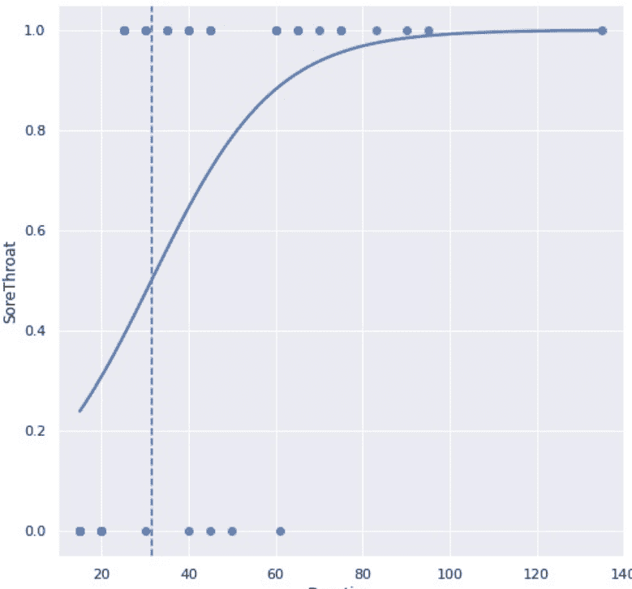

垂直虚线标记了出现咽喉疼痛可能性较低（π̂ < .5）与可能性较高（π̂ > .5）之间的转变；它发生在 Duration 略多于半小时时：

```
transition = -throat_fit.params[0] / throat_fit.params[1]
transition

31.450620812871517
```

作为练习，你应该使用此 logistic 模型构建一个二元分类器，然后分析 ROC 曲线以探索其他可能分类阈值的有效性。你还应通过比较不包含该异常值与包含该异常值的模型来探索该图右上角异常值（手术持续 135 分钟）的影响——请参阅本章末尾的练习。

为了完成此初始建模阶段，让我们通过检查前面讨论的三个 R² 类比来比较空模型和 logistic 模型：

```
R2_M = 1 - (throat_fit.deviance / throat_fit.null_deviance )
R2_M

0.2712976002620783
```

```
throat["Null_residual"] = throat["SoreThroat"] - pi_null
throat["Residual"] = throat["SoreThroat"] - throat_fit.fittedvalues
throat["Difference"] = throat_fit.fittedvalues - pi_null
R2_S = np.sum(throat["Difference"]**2) / np.sum(throat["Null_residual"]**2)
R2_S

0.31224924747701394
```

```
throat["Fit_prob"] = throat_fit.fittedvalues
sns.displot( data=throat, x="Fit_prob", col="SoreThroat", binwidth=0.1)
```

Figure 4.11. Comparing predicted probabilities for both groups

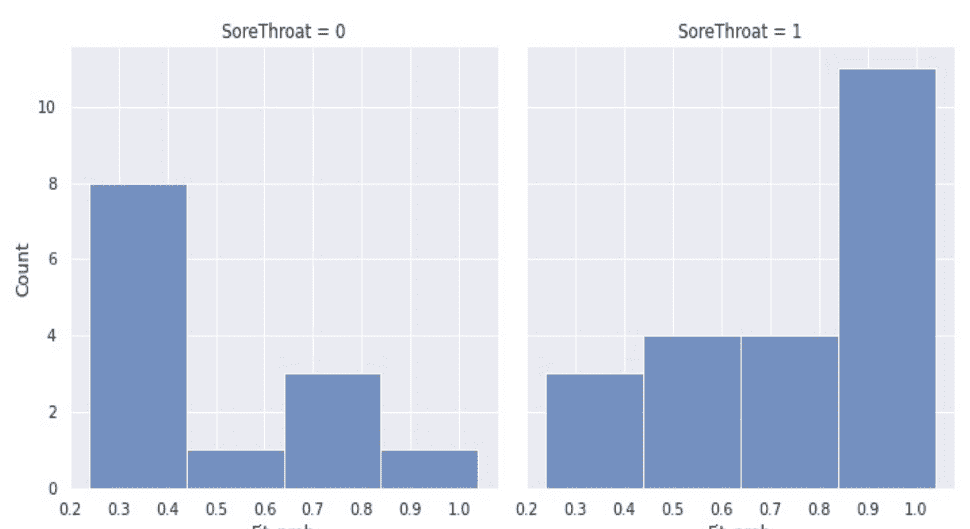

```
fit_avgs = throat.groupby("SoreThroat").agg(Fit_average=('Fit_prob', 'mean'))
fit_avgs
```

Fit_average
SoreThroat
0    0.433820
1    0.743652

```
R2_D = fit_avgs["Fit_average"][1] - fit_avgs["Fit_average"][0]
R2_D
```

0.3098313956744167

这三个度量值相当，并且都大于 0.2，因此到目前为止一切看起来都很好——包含 Duration 的模型比排除它的空模型具有更大的预测能力。更进一步，我们如何精确地量化和衡量模型的拟合度？这些是将在下一章仔细探讨的话题。

## 4.4.2 Extinction risks for cartilaginous fish

在上一章的 Example 5.2 中，我们利用鱼类长度与鱼类重量的对数之间的线性关系来推断 FishBase 中软骨鱼类缺失的重量，从而创建了 sharks 数据集。让我们加载数据并重新熟悉它：

```
sharks = pd.read_csv("sharks.csv")
sharks
```

| Species | Length | Weight | Category |
|---|---|---|---|
| Acroteriobatus annulatus | 140.0 | 20463.398751 |  |
| Acroteriobatus blochii | 100.0 | 8302.228700 | Le |
| Acroteriobatus leucospilus | 120.0 | 13535.898740 |  |
| Acroteriobatus salalah | 78.0 | 4264.716085 | Near |
| Acroteriobatus variegatus | 75.0 | 3839.035532 | Critically |
| ... | ... | ... | ... |
| Urotrygon simulatrix | 26.7 | 240.778211 |  |
| Urotrygon venezuelae | 25.5 | 212.849595 |  |
| Zameus squamulosus | 84.0 | 5202.119234 | Le |
| Zapteryx brevirostris | 53.4 | 758.000000 |  |
| Zapteryx xyster | 78.0 | 4264.716085 |  |

809 rows × 4 columns

请记住，Length 是物种的特征长度，单位为厘米，weight 是物种的特征重量，单位为克。现在我们知道了简单的 logistic 回归，我们将构建一个模型，将软骨鱼类的灭绝风险与其重量联系起来。为此，我们首先将因子 Category 转换为二元响应变量 Threatened，该因子有 5 个水平，直接来自 IUCN 红色名录，具体如下：

```
threatened = ["Critically Endangered","Endangered","Vulnerable"]

sharks["Threatened"] = sharks["Category"].isin( threatened ).astype(int)
sharks = sharks.drop(columns = "Category")
sharks
```

| Species | Length | Weight | Threatened |
|---|---|---|---|
| Acroteriobatus annulatus | 140.0 | 20463.398751 | 1 |
| Acroteriobatus blochii | 100.0 | 8302.228700 | 0 |
| Acroteriobatus leucospilus | 120.0 | 13535.898740 | 1 |
| Acroteriobatus salalah | 78.0 | 4264.716085 | 0 |
| Acroteriobatus variegatus | 75.0 | 3839.035532 | 1 |
| ... | ... | ... | ... |
| Urotrygon simulatrix | 26.7 | 240.778211 | 1 |
| Urotrygon venezuelae | 25.5 | 212.849595 | 1 |
| Zameus squamulosus | 84.0 | 5202.119234 | 0 |
| Zapteryx brevirostris | 53.4 | 758.000000 | 1 |


808                Zapteryx xyster    78.0    4264.716085          1

809 rows × 4 columns

响应值为 1 和 0 分别表示灭绝风险高和低；这与 Ripple 等人 [14] 在其对所有脊椎动物灭绝风险的广泛分析中使用的二元分组相同，而不仅仅是软骨鱼类。在准备好二元响应变量后，拟合逻辑模型就很简单：

```
sharks["LogWeight"] = np.log(sharks["Weight"])
sharks_model = smf.glm("Threatened ~ LogWeight", data=sharks, family=sm.families.Binomial())
sharks_fit = sharks_model.fit()
sharks_fit.params
```

Intercept    -3.173571
LogWeight     0.293120
dtype: float64

我们现在有了表达拟合模型的常用选项。用概率和逻辑函数 σ(·) 表示，模型为

受威胁的概率 = σ(−3.173571 + 0.293120 * log(Weight))，

这很容易用 regplot 可视化：

```
sns.regplot(data=sharks, x="LogWeight", y="Threatened", logistic=True)
```

图 4.12. 使用拟合逻辑模型可视化鲨鱼数据

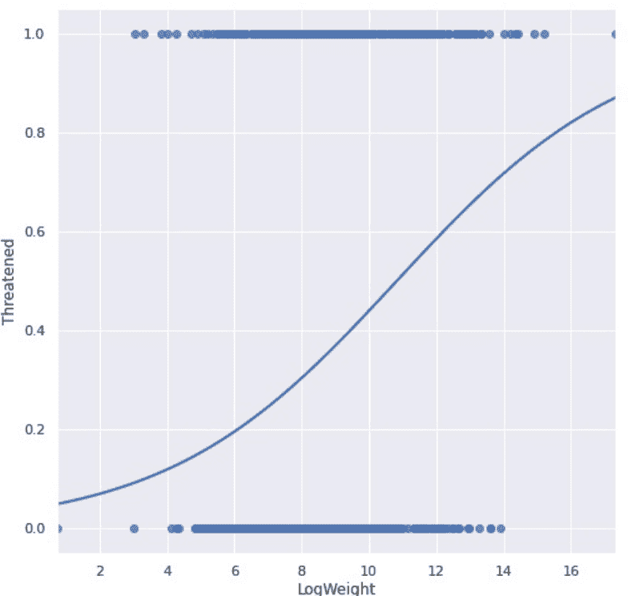

蓝色逻辑曲线显示了拟合的濒危概率如何随物种体重的对数变化。逻辑模型的对数几率形式为

受威胁的几率的对数 = -3.173571 + 0.29312 * log(Weight)，

我们可以通过取指数并消除对数使其更易于理解：

受威胁的几率 = e^{-3.17357} * e^{0.29312 * log(Weight)} = 0.0419 * Weight^{0.29312}。

这种最后的形式或许最清楚地表明，较大的

软骨鱼类更有可能受到威胁，灭绝风险更高。根据似然比检验，该模型明显优于空模型：

```
1 - chi2.cdf(sharks_fit.null_deviance - sharks_fit.deviance, df=1)
```

```
8.770761894538737e-15
```

这个极其小的 p 值反映了将 LogWeight 纳入模型所获得的预测能力提升。但这个模型到底有多好呢？一种简单的方法，仅使用我们迄今为止讨论过的内容，就是将拟合的逻辑模型转换为二元分类器。如果我们使用等概率（概率 50%）作为分类阈值，会得到以下结果：

```
sharks["Class"] = (sharks_fit.fittedvalues > 0.50).astype(int)
sharks
```

```
pd.crosstab(sharks["Threatened"], sharks["Class"])
```

Class 0 1
Threatened
0 492 37
1 211 69

```
np.mean( sharks["Threatened"] == sharks["Class"] )
```

```
0.6934487021013597
```

成功率略低于 70%，该分类器确实比随机猜测要好，但很可能使用更多信息（例如额外的预测变量）可以构建出更有效的模型。特别令人担忧的是较高的假阴性率：该分类器将 211 条受威胁的鱼归入非受威胁类别，如果不加检查，这种错误可能会产生灾难性的政策影响。当然，问题可能出在用于构建该分类器的阈值上——让我们检查 ROC 曲线来研究这个问题：

```
fpr, tpr, thresholds = metrics.roc_curve(sharks["Threatened"], sharks_fit.fittedvalues)
chronic_auc = metrics.auc(fpr, tpr)
chronic_auc
```

```
0.6589994598973805
```

```
plt.figure()
plt.plot(fpr, tpr, label='ROC curve    AUC: %0.2f' % chronic_auc)
plt.plot([0,1], [0,1], 'r--', label='Random classification')
### plt.xlim([0, 1])
### plt.ylim([0, 1.05])
plt.xlabel('False Positive Rate (1-Specificity)')
plt.ylabel('True Positive Rate (Sensitivity)')
plt.title('ROC curve for shark extinction risk classifier')
plt.legend(loc="lower right")
```

图 4.13. 基于简单逻辑模型的灭绝风险分类器

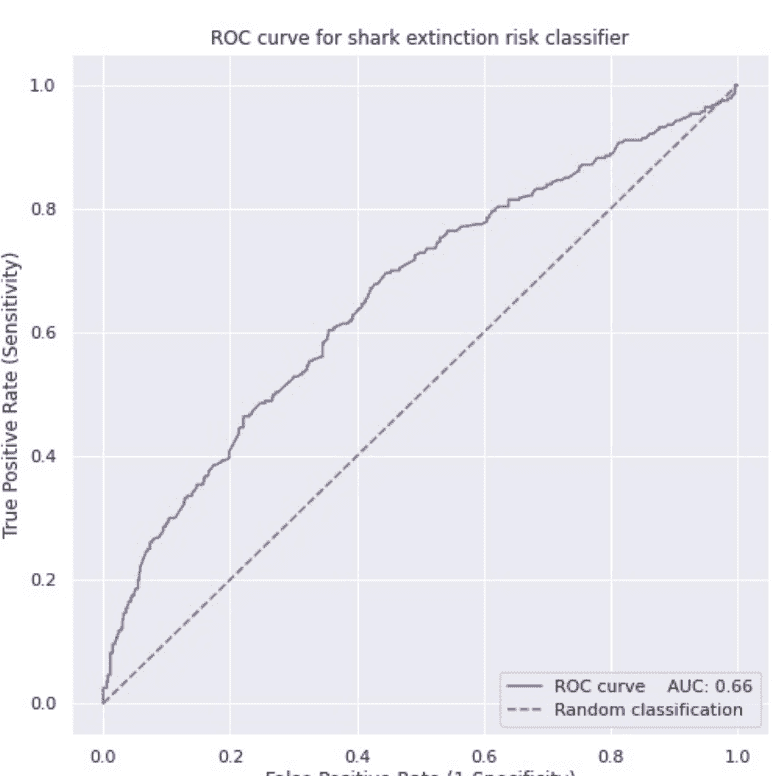

同样，这比随机猜测要好，但对于这样一个重要问题来说，有一个更好的分类器会更好。稍后章节会详细介绍！

## 4.5 练习

+   1. 对于具有未分组响应的 NAMCS 逻辑模型：
+      1. 计算似然比并进行似然比检验。
+      2. 计算并比较 $R_M^2$、$R_S^2$ 和 $R_D^2$。
+      3. 查看与判别系数相关的直方图。
+   2. 对于裂葇花芽发育的简单逻辑模型：
+      构建二元分类器，计算其错误率和成功率，绘制相关的 ROC 曲线，并确定其 AUC。
+   3. 使用紫花数据构建并评估一个逻辑模型，该模型将 *闭花* 芽形成的概率与光周期长度联系起来。
+   4. 对于 Collett 的咽喉数据：
+      1. 构建并分析二元分类器。
+      2. 构建一个排除手术持续 135 分钟的模型，并将其与包含该异常值的模型进行比较。
+   5. 一些有趣练习的来源：
+      1. NHANES
+      2. UCI-ML 仓库中的心力衰竭示例
+      3. 地质灾害风险示例（例如佛罗里达的陷坑，墨西哥的山体滑坡）

## 4.6 总结

+   - 简单逻辑回归使用逻辑曲线将成功概率（结果=1）与预测变量的值联系起来。
+   - 逻辑模型可以用概率、几率或几率的对数来表示；这三种公式都很有用。
+   - 要查看逻辑模型是否适用于小数据集，请绘制原始二元响应并寻找成功（1）和失败（0）之间的自然分离。
+   - 使用似然比统计量 $G^2$ 比较空模型和逻辑模型；对于简单逻辑回归，$G^2$ 具有 1 自由度的 $\chi^2$ 分布。
+   - 使用决定系数 $R_M^2$、$R_S^2$ 和 $R_D^2$ 的逻辑类比来比较空模型和逻辑模型的预测能力。

[12] Sternberger et al., "Environmental impact on the temporal production of chasmogamous and cleistogamous flowers in the mixed breeding system of *Viola pubescens*", PLOS One 15 (3): e0229726

[13] McCullagh and Nelder, *Generalized Linear Models*; Agresti, *Categorical Data Analysis*

[14] Ripple et al., "Extinction risk is most acute for the world’s largest and smallest invertebrates", PNAS October 3, 2017 114 (40) 10678-10683
