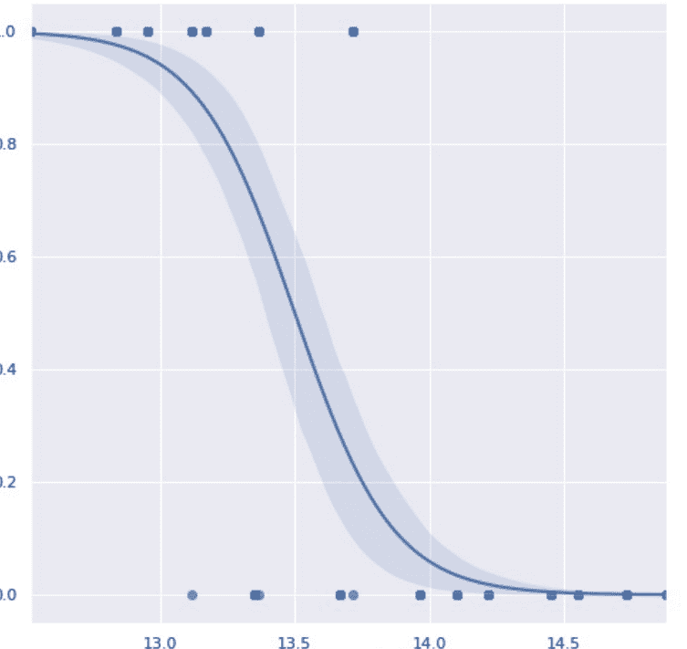
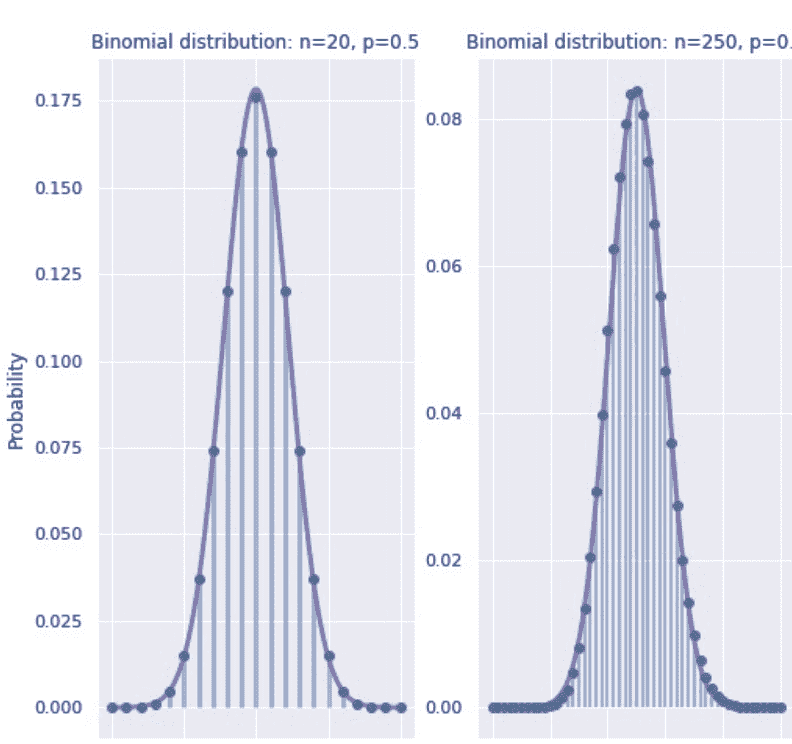
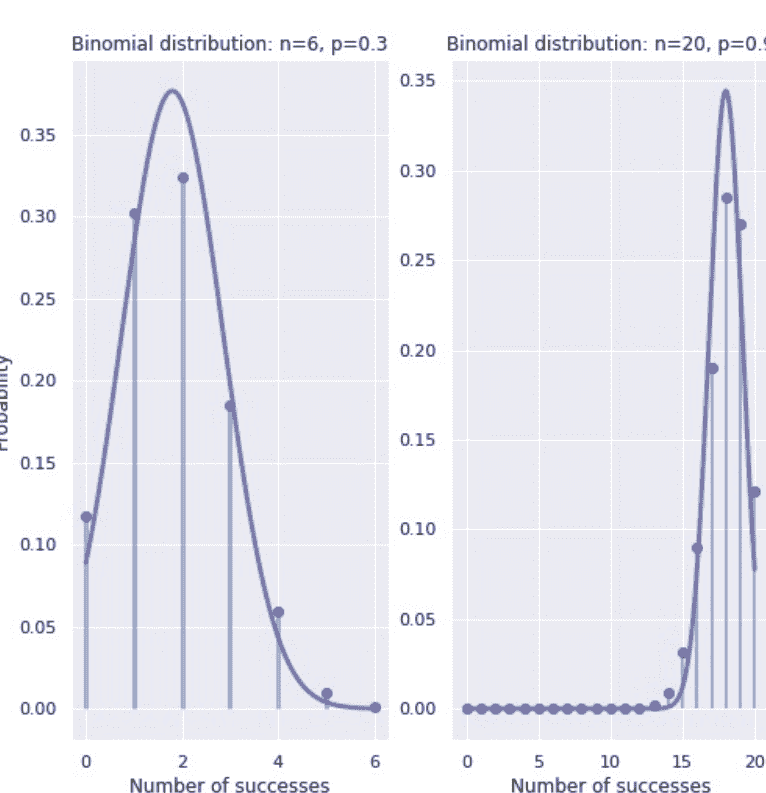
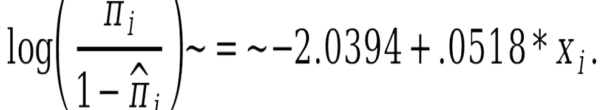
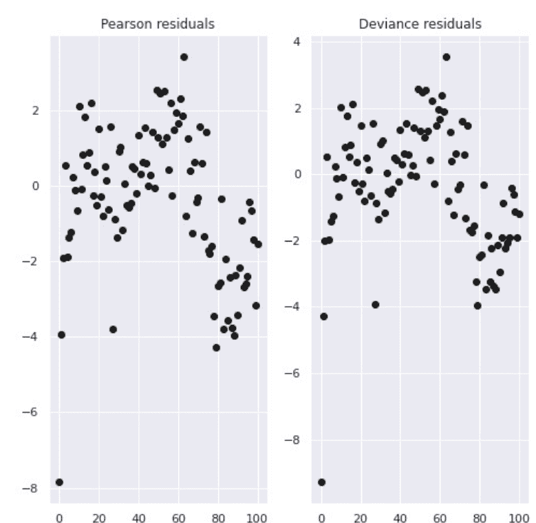

# 5 简单逻辑回归模型

## 本章涵盖

+   - 理解二元和二项逻辑回归背后的理论
+   - 计算和解释参数和预测的区间估计
+   - 使用偏差和残差评估简单逻辑回归模型的拟合度

在处理二元响应变量时，我们事先就知道——假设采用标准的数值编码——响应的可能取值只有 0 和 1，但在进行观察之前无法知道会出现哪种结果。虽然这种固有的随机性已包含在上一章中我们考虑的模型中，但理解所有这些不确定性的实际影响需要扎实的理论基础。这就是本章要建立的内容！在解释伯努利随机变量的来龙去脉之后，我们将解释如何对模型参数和预测进行推断，并更深入地了解偏差在评估模型拟合度中的作用。这些任务与我们在第 3 章中对简单线性回归模型所做的工作类似，但逻辑函数的非线性提高了技术复杂性，让你有更多新东西需要思考。

正如我们在上一章开头用 NAMCS 数据所看到的，将响应分组到多个类别中可以快速揭示变量之间的重要关系。当有足够的数据以合理的方式进行分组时，探究和评估模型时有比处理二元响应时更好的工具。具体来说，有助于将数据视为二项实验的集合，因此我们需要理解二项分布、二项随机变量和二项逻辑回归模型。一旦我们开发了这种概率机制，我们将正确地解释偏差并学习分析残差


for logistic models.

由于本章建立在上一章的基础上，你可能不需要创建任何新的笔记本。启动你用来分析紫罗兰数据、NAMCS 数据和 Collett 喉部数据的笔记本，泡一杯咖啡，开始阅读吧！

## 5.1 Bernoulli models for binary data

由于在观察到特定结果之前我们不知道二元响应变量会发生什么，我们能期望的最好结果就是知道每种可能性的精确概率。数学上，这定义了一个 *Bernoulli 随机变量*，一个随机变量 $Y$ 满足

$P(Y = 1) = \Pi$ and $P(Y = 0) = 1 - \Pi$

对于某个已知概率 $\Pi$，其中 $P(\cdot)$ 表示括号中事件的概率。例如，如果 $Y$ 对应于抛一枚公平硬币的结果，其中 $Y = 1$（成功）表示正面朝上，$Y = 0$（失败）表示反面朝上，则 $\Pi = \frac{1}{2}$。在掷一枚公平的六面骰子时，我们可能会定义 $Y = 1$ 表示掷出 1，$Y = 0$ 表示其他情况，使得 $\Pi = \frac{1}{6}$。在这两种情况下，我们都依赖于 *fair* 的定义来确定 *theoretical probabilities*；我们根本不需要收集任何数据。相比之下，在大多数实际情况下，理论概率不可用，因此我们必须收集数据并使用 *empirical probabilities.*

由于感兴趣的事件很少像抛硬币或掷骰子那样简单，单一的静态概率通常是对将要发生的事情的糟糕模型。这正是我们在上一章中看到的空模型的情况，我们通过引入预测变量显著改进了它们。尽管我们构建的 logistic 模型比空模型好得多，但它们远非完美——没有任何模型是完美的。因此，知道如何评估此类模型、衡量其拟合程度并量化其不确定性至关重要。本节追求这些目标，首先从底层理论模型开始，然后解释如何从经验估计中推断其参数。

## 5.1.1 The theoretical simple logistic model

与其假设成功概率必须恒定，不如让我们（ somewhat）更现实一些，允许该概率取决于一个定量预测变量的值，该值已知精确。具体来说，我们假设

$\Pi_X = \sigma(\alpha + \beta X),$

其中 X 是预测变量的值，$\Pi_X = P(Y = 1|X)$ 是在此给定值 X 下 Y = 1 的概率，$\sigma(\cdot)$ 是 logistic 函数。因此，该理论模型有两个参数 α 和 β，它们的取值定义了这个特定的 Bernoulli 变量——事实上，我们现在有一个 Bernoulli 变量族，对预测变量的每个取值一个。只要概率 $\Pi_X$ 既不为 0 也不为 1，我们就可以将该理论模型重新表述为 $Y = 1$ 的几率：

$\log\left(\frac{\Pi_X}{1 - \Pi_X}\right) = \alpha + \beta x.$

我们会交替使用这些形式，但我们必须记住 log-odds 未定义的两种例外情况（当 $\Pi_X = 0$ 时和当 $\Pi_X = 1$ 时）。

无论我们使用哪种表述，模型的随机性都体现在概率 $\Pi_X$ 中——即使系数的精确值 $\alpha$ 和 $\beta$ 已知，这是不可能的，该模型也不会是确定性的。这与理论线性回归模型大不相同，在该模型中，随机误差 $\mathcal{E}$ 必然是一个显式项；$\mathcal{E}$ 的两个不同描述符，其平均值和方差，都必须与定量响应的那些相关。对于我们的 Bernoulli 随机变量 $Y$ 来说，另一方面，成功概率 $\Pi_X$ 决定了其平均值——即其期望值，$E(Y|X)$——及其方差：

$E(Y|X) = \Pi_X \quad \text{and} \quad \text{Var}(Y|X) = \Pi_X(1 - \Pi_X).$

要验证这些结果，我们只需记住概率是一个比例。例如，要计算平均值 $E(Y|X)$，我们将该值 X 下 $Y$ 的所有可能值相加并除以它们的个数；由于 $\Pi_X$ 是 1 的比例，$1 - \Pi_X$ 是 0 的比例，平均值为 $E(Y|X) = 1*\Pi_X + 0*(1-\Pi_X) = \Pi_X.$

这个计算表明概率 $\Pi_X$ 是对该预测变量值的平均响应；从这个角度来看，logistic 回归和线性回归是相同的，因为两个模型都将平均响应与预测变量的线性函数相关联。要计算方差，对 $Y$ 与其平均值 $\Pi_X$ 的平方偏差取平均值——我们将此计算留作本章末尾的练习。在你计算时，注意除非 $\beta = 0$，否则方差会随着预测变量的不同取值而变化，因此我们不假设方差恒定，就像线性回归那样。

到目前为止我们所做的工作涉及理论 logistic 模型的第一个假设：对于预测变量 $X$ 的每个给定值，响应 $Y$ 是一个 Bernoulli 随机变量，其成功概率 $\Pi_X$ 依赖于 $X$ 如上所述。该模型只有一个其他假设：响应变量的不同观测值是 *independent*。这是模型的一个基本部分，因为它证明了定义和处理似然函数 $L(\alpha, \beta)$ 的合理性；回顾上一章中的紫罗兰示例，$L(\alpha, \beta)$ 是根据模型对观测响应的集体概率。通常，如果有 $n$ 个观测响应 $Y_1, \dots, Y_n$ 对应于各自的预测变量值 $X_1, ..., X_n$，那么不同观测的独立性意味着似然函数为

$L(α, β) ∝ ∏_{i=1}^{n} π_i^{y_i} (1 - π_i)^{(1 - y_i)}$,

其中 $π_i = P(Y = 1 | X_i)$。为了将这个乘积和所有这些指数整理成更易处理的 forms，我们取 $L(α, β)$ 的自然对数得到对数似然函数，

$\log L(α, β) ∝ \sum_{i=1}^{n} [y_i \log π_i + (1 - y_i) \log (1 - π_i)]$.

这些似然公式与我们在紫罗兰示例中处理过的公式有一个关键但微妙的区别：这些公式依赖于模型参数 $α$ 和 $β$，而我们在分析紫罗兰数据时并未提及。由于模型参数永远不可能被知道，理论模型的对数似然也无法被知道。将简单的 logistic 模型拟合到观测值 $\{(x_1, y_1), ..., (x_n, y_n)\}$ 的过程会产生 $\log L(α, β)$ 的最佳可能近似——通过构造，拟合模型

$\log(\hat{\Pi}_i / (1 - \hat{\Pi}_i)) = a + b x$

具有系数 a 和 b，它们最大化相应的对数似然 log L(a, b)。这些系数是模型参数 α 和 β 的最佳可用估计，就像拟合概率 $\{\hat{\Pi}_1, ..., \hat{\Pi}_n\}$ 是我们对理论概率 $\{\Pi_1, ..., \Pi_n\}$ 的最佳估计一样。正如我们将在下一节中解释的那样，拟合过程还提供了我们计算参数和理论概率的区间估计所需的标准误差。

## 5.1.2 Inferences for logistic models

每组 $\{(x1, y1), ..., (xn, yn)\}$ 观测值都会产生理论模型参数 α 和 β 的最大似然估计 a 和 b。在现实生活中，我们通常只有一个观测样本，我们需要使用这个样本中的信息来估计模型参数并预测未来响应。为此，我们必须知道计算出的系数如何从样本到样本变化——换句话说，我们需要理解统计量 $a$ 和 $b$ 的随机变量的抽样分布。在线性回归的情况下，假设误差 $\mathcal{E}$ 呈正态分布使得可以计算回归系数的抽样分布的显式公式；而计算和由此产生的公式都不是微不足道的，一旦你习惯了处理随机变量的工作，它们就不是太糟糕。对于 logistic 回归，情况大不相同，我们甚至不会尝试推导或陈述所有相关公式。相反，我们将依赖于一个事实，其证明可在其他地方找到 [15]：当使用大样本时，logistic 回归系数的最大似然估计近似无偏且呈正态分布。只要该大样本假设成立，我们就可以应用基于正态分布的标准方法来计算区间估计和检验假设。这在实践中意味着我们需要系数的标准误差，它们是我们数据基于的抽样分布标准差的最佳估计。

### Confidence intervals for the parameters

如预期，smf.glm 提供了我们所需的内容。作为示例，让我们看一下我们在上一章中构建的 logistic 模型 chasm_fit 的摘要：

```
print( chasm_fit.summary() )
```

```
Generalized Linear Model Regression Results
================================================================================
Dep. Variable:                     Bud   No. Observations:  
Model:                            GLM   Df Residuals:      
Model Family:                Binomial   Df Model:          
Link Function:                  logit   Scale:             
Method:                          IRLS   Log-Likelihood:    
Date:                Tue, 03 Aug 2021   Deviance:          
Time:                        13:26:08   Pearson chi2:      
No. Iterations:                    7   
Covariance Type:            nonrobust  
================================================================================
                       coef    std err          z      P>|z|      [0.
--------------------------------------------------------------------------------
Intercept          74.5837     12.132      6.148      0.000      50.
Photoperiod        -5.5250      0.900     -6.136      0.000      -7.
================================================================================
```


光周期系数的估计值为 $b = -5.5250$，其标准误差为 $SE(b) = 0.900$。按照我们在第 3 章中介绍的计算置信区间的方法，我们有 95% 的把握认为模型参数 $\beta$ 满足

$-5.5250 - (1.96*0.900) \le \beta \le -5.5250 + (1.96*0.900) \Rightarrow -7.29 \le \beta \le -3.76.$

同理，我们有 95% 的把握认为 $\alpha$ 满足

$74.5837 - (1.96*12.132) \le \alpha \le 74.5837 + (1.96*12.132) \Rightarrow 50.80 \le \alpha \le 98.36,$

因为 $a = 74.5837$ 且 $SE(a) = 12.132$。这里的乘数 1.96 是标准正态分布的 97.5% 分位点，意味着 97.5% 的 $Z$-分数小于 1.96；等价地，95% 的 $Z$-分数介于 -1.96 和 1.96 之间。我们之前用 scipy.stats 函数 norm.ppf 计算过该分位点：

```
import scipy.stats as st
st.norm.ppf(.975 )
```

1.959963984540054

正如我们在第 3 章中所见，我们也可以直接使用拟合模型的 conf_int 方法来获取这些置信区间：

```
chasm_fit.conf_int()
```

0       1
Intercept   50.805021  98.362373

Photoperiod  -7.289651  -3.760326

#### 参数的假设检验

在选择了诸如逻辑回归之类的建模范式后，假设检验是评估响应变量对预测变量依赖性的标准工具——也是一个理所当然且颇具争议的工具。假设检验的问题在于对基于 p 值规则的盲目遵守；只要你仔细思考检验的作用以及如何解释结果，它们就能提供非常有用的诊断信息。只要记住要用手头的全部信息做出决策，而不仅仅是一个 p 值！话虽如此，让我们进入感兴趣的具体检验：利用我们手头的数据，我们想知道模型参数 β = 0 是否合理，这意味着响应 Y 不依赖于预测变量。因此，两个竞争假设为

H₀ : β = 0  and  Hₐ : β ≠ 0.

为了确定哪个假设得到数据的更好支持，我们计算相关的检验统计量，从中获得 p 值，然后得出结论。在这种情况下，检验统计量有两个流行的选择：前面讨论过的似然比统计量

G² = -2*log( null likelihood / likelihood of logistic model ) = null deviance - residual deviance,

以及 Wald 统计量

z = b / SE(b).

从似然比获得 p 值时，我们依赖于它是一个自由度为 1 的 χ² 统计量。 （请回顾上一章，紫罗兰示例中 G² = 137.19，p 值实际上为 0。）一般来说，p 值越小，反对原假设的证据越强：请记住，p 值是在原假设为真的前提下，观察到检验统计量的绝对值至少与我们从数据中计算出的值一样大的概率。更直白地说，把 p 值看作在原假设为真时得到你所得到的结果的几率——只是不要在书本或论文中这样写。如果反对原假设的证据足够强，我们就拒绝它，并且可以确信响应确实依赖于预测变量；另一方面，如果反对原假设的证据足够弱，我们就无法拒绝它，也就不能确信响应依赖于预测变量。

以这种方式使用似然比就是似然比检验，这是评估简单逻辑模型中 β 是否可能为 0 的首选方法。基于刚刚定义的 Wald 统计量的 Wald 检验也很常用，并且经常由统计软件报告，如上文 chasm_fit 的摘要所示。因此，了解 Wald 统计量也很重要——同样重要的是要理解为什么似然比检验通常更好。Wald 检验依赖于这样一个事实：当样本量较大时，相关的抽样分布大致呈正态且无偏。我们在为 $\alpha$ 和 $\beta$ 构造置信区间时已经利用了这一点，这也解释了为什么我们称 Wald 统计量为 $Z$。例如，对于紫罗兰数据中光周期的系数，

$Z = \frac{b}{SE(b)} = \frac{-5.5250}{0.9004} = -6.136,$

正如 chasm_fit 摘要的 z 列中报告的那样。截距的 Wald 统计量也在其中，我们可以很容易地核对其值：

$Z = \frac{a}{SE(a)} = \frac{74.5837}{12.1322} = 6.148.$

chasm_fit 摘要中给出的极小 $p$-值反映了这两个 Wald 统计量的绝对值都很大。可以用 norm.cdf 很容易地检验其中任一 $p$-值：

```
st.norm.cdf( -6.136 )
```

4.231257833108574e-10

这在上文的摘要表中（合理地！）被四舍五入为 0。Wald 检验的问题之一是上述大样本假设的模糊渐近性——关于抽样分布的结果在样本量趋近于 $\infty$ 时成立，这对定理来说很棒，但在实践中却具有挑战性。另一个问题是 Wald 统计量可能出现异常行为，这种现象被称为 Hauck-Donner 效应，我们将在第 9 章中探讨。

幸运的是，对于我们和紫罗兰数据而言，似然比检验和 Wald 检验在此例中是一致的：我们有强有力的证据表明 $\beta$ 为负且 $\alpha$ 为正。用显著性检验的枯燥语言来说，我们拒绝原假设 $H_0: \beta = 0$ 和 $H_0: \alpha = 0$，并得出结论：芽形成的概率确实取决于光周期长度。

请注意，有些其他来源将 Wald 统计量定义为我们刚刚计算的检验统计量的平方——你可能会看到紫罗兰模型的 Wald 统计量被报告为

$\left(\frac{b}{SE(b)}\right)^2 = 37.6505 \quad \text{and} \quad \left(\frac{a}{SE(a)}\right)^2 = 37.7979.$

由于 $Z$-分数的平方按定义是一个 $\chi^2$ 统计量，我们必须使用 $\chi^2$ 分布来解释这些版本的 Wald 统计量。

具体来说，我们可以使用自由度为 1 的 $\chi^2$ 分布来计算相关的 $p$-值：

```
1 - st.chi2.cdf( (74.5837/12.132)**2, df=1 )
```

7.862256401480749e-10

```
1 - st.chi2.cdf( (-5.5250/0.900)**2, df=1 )
```

8.310065968686331e-10

与相应的 $Z$-分数一样，这些 $p$-值实际上为 0：我们有证据表明 Bud 依赖于 Photoperiod。

#### 预测理论概率

一旦我们确信拥有一个合适的模型，该模型拟合数据并捕捉到变量之间真实的关系，我们通常希望利用该模型进行预测。对于逻辑模型而言，这意味着获得对应于给定预测变量值 $X$ 的理论概率 $\Pi_X$ 的良好估计；基于用于构建模型的数据，我们对 $\Pi_X$ 的最佳点估计就是 $\hat{\Pi}_X = \sigma(a + b X)$，拟合模型的 predict 方法可以轻松提供。例如，以下是光周期为 13、13.5 和 14 小时时紫罗兰芽形成的概率估计：

```
X = pd.DataFrame({"Bias":[1,1,1],
"Photoperiod":[13,13.5,14]})
predictions = pd.DataFrame({"Photoperiod":[13,13.5,14],
"Probability":chasm_fit.predict( X )})
predictions
```

Photoperiod  Probability
0  13.0        0.940411
1  13.5        0.499087
2  14.0        0.059181

我们将预测变量值组织到 DataFrame X 中（通常称为设计矩阵），其中包含一列名为 Bias 的全 1 列（机器学习社区中的惯例），并将预测结果组织到自己的 DataFrame 中。正如其 Probability 列所示，当光周期持续 13 小时时，芽形成的可能性非常大；当光周期持续 14 小时时，芽形成的可能性非常小；当光周期为 13.5 小时时，芽形成的几率为 50-50。Having


之前处理过这些数据，这一切都不令人惊讶，但我们知道这些预测可能并不完全准确；它们只是永远无法精确得知的理论值的估计。我们在第3章中用基于简单线性回归模型的预测遇到了同样的问题，而下一步在这里也是一样的：我们需要用区间估计来补充这些点估计。这样做比在第3章中更复杂，原因有两个。首先，预测概率与线性组合 $a + b x$ 之间的联系是非线性的。其次，有三个不确定性来源需要管理：

- 我们对 $\alpha$ 的估计 $a$ 存在一定的误差，
- 我们对 $\beta$ 的估计 $b$ 存在一定的误差，以及
- 这些估计中的误差可能相互作用。

处理完这些误差后，我们将看到如何计算 $\alpha + \beta x$ 的区间估计，然后我们将使用 logistic 函数将其转换为 $\Pi_X$ 的区间估计。为了准备这些计算，我们需要记录这三个光周期长度的 $a + b x$ 值，使用 numpy dot 函数直接从模型系数计算它们。这个点积将设计矩阵的 Bias 列中的每个 1 与截距相乘，将每个预测变量值与 Photoperiod 系数相乘，然后对每个预测变量值将结果相加：

```
links = pd.DataFrame({"Photoperiod":[13,13.5,14],
"Link":np.dot( chasm_fit.params, X.T)})
links
```

| Photoperiod | Link |
|---|---|
| 0 | 13.0 | 2.758843 |
| 1 | 13.5 | -0.003651 |
| 2 | 14.0 | -2.766145 |

可能更快的方法是直接将 logit 函数（例如来自 scipy.special 模块）应用于预测概率以获得这些值，但这是一个开始明确使用向量、矩阵和线性代数的良好时机；从现在开始我们将越来越多地使用此类方法。无论如何，logistic 函数将这些 Link 值转换为 Probability 列中的相应预测。这种命名约定暴露了我作为 R useR 的根源——这是一种术语上的轻微滥用，因为 logistic 函数的逆函数（logit 函数）才是 logistic 回归中的实际链接函数。稍后再谈！

如果我们想要的只是模型参数的置信区间，我们可以使用标准误差 SE(a) 和 SE(b) 来处理我们对 α 和 β 的估计中的不确定性；这就是我们之前用拟合模型的 conf_int 方法所做的。然而，要解决这些误差的相互作用，我们必须使用一些新东西：我们必须估计随机变量的协方差，其一次性实现为计算系数 a 和 b。

#### 方差和协方差

到目前为止，我们已经相当多地处理了样本方差——一组观测值 {a1, …, an} 的方差是其与样本平均值 ā 的平均平方偏差的度量。

对于随机变量 A，我们必须使用结果的概率而不是实际观测值，使得其方差的技术定义看起来有点不同。思想是相同的：A 的方差是 A 与其平均值 E(A) 之间平均平方偏差。精确地，

当处理两个随机变量 $A$ 和 $B$ 时，我们通常想知道它们如何相互作用；我们关心的不仅仅是它们各自的平均值和方差。$A$ 和 $B$ 的 *协方差*，表示为 $\mathrm{Cov}(A, B)$，正如其名称所说所做的——它衡量 $A$ 和 $B$ 如何一起变化：

因此协方差衡量了 $A$ 和 $B$ 相对于各自平均值的平均同时关系；请注意 $\mathrm{Cov}(A, A) = \mathrm{Var}(A)$ 且 $\mathrm{Cov}(B, B) = \mathrm{Var}(B)$。 （另请注意，我们在第 2 章中定义相关系数时做了类似的事情，即使当时我们没有使用协方差这个词。）*方差-协方差矩阵* $C$ 高效地存储了所有这些信息，我们可以使用它来简化某些计算。例如，对于任意数 $X$，我们可以使用 $C$ 及其条目来计算线性组合 $A + x B$ 的方差：

随机变量 $A$ 和 $B$ 的观测值可用于估计它们的方差和协方差。特别是，如果 $A$ 和 $B$ 是 logistic 回归参数 $\alpha$ 和 $\beta$ 的估计量，则 $(\mathrm{SE}(a))^2$ 和 $(\mathrm{SE}(b))^2$ 分别估计

Var(A) 和 Var(B)。

要获取 logistic 模型 chasm_fit 的方差-协方差矩阵，使用其 cov_params 方法：

```
chasm_fit.cov_params()
```

|  | Intercept | Photoperiod |
|---|---|---|
| Intercept | 147.190287 | -10.920255 |
| Photoperiod | -10.920255 | 0.810638 |

该矩阵告诉我们三件事：

- Var(a) = 147.190287，因此 SE(a) = √147.190287 = 12.1322
- Var(b) = 0.810638，因此 SE(b) = √0.810638 = 0.9004
- Cov(a, b) = -10.920255

现在我们准备好了！要计算预测 Link 值的标准误差，我们将使用侧边栏中的最后一个公式，将 C 替换为该协方差矩阵。以下是计算和结果：

```
links["SE"] = np.sqrt( np.diag( np.dot( np.dot(X, chasm_fit.cov_params()), X.T)))
```

links

| Photoperiod | Link | SE |
|---|---|---|
| 0 | 13.0 | 2.758843 | 0.511404 |
| 1 | 13.5 | -0.003651 | 0.286769 |
| 2 | 14.0 | -2.766145 | 0.555210 |

有了这些 SE，我们可以用通常的方式计算 95% 置信区间：

```
links["Lower"] = links["Link"] - 1.96*links["SE"]
links["Upper"] = links["Link"] + 1.96*links["SE"]
links
```

| Photoperiod | Link | SE | Lower | Upper |
|---|---|---|---|---|
| 0 | 13.0 | 2.758843 | 0.511404 | 1.756492 | 3.761195 |
| 1 | 13.5 | -0.003651 | 0.286769 | -0.565718 | 0.558416 |
| 2 | 14.0 | -2.766145 | 0.555210 | -3.854357 | -1.677933 |

坚持一下……还有最后一步。要将这些区间转换为概率估计，我们需要用 logistic 函数对其进行转换。应用此函数的一种简单方法是将其从 scipy.special 模块导入——你只需要知道它被称为 expit。以下是结果：

```
predictions["Lower"] = expit( links["Lower"] )
predictions["Upper"] = expit( links["Upper"] )
predictions
```

| Photoperiod | Probability | Lower | Upper |
|---|---|---|---|
| 0 | 13.0 | 0.940411 | 0.852770 | 0.977273 |
| 1 | 13.5 | 0.499087 | 0.362225 | 0.636086 |
| 2 | 14.0 | 0.059181 | 0.020748 | 0.157369 |

终于！我们有 95% 的把握认为概率 Π X 在这些区间的下限和上限之间。logistic 函数（或从观点上看是 logit）的非线性使得使用 link 值进行这种看似迂回的方法成为必要。经过如此艰苦的工作，看到如何可视化这些置信区间是令人满意的还是令人恼火——我们只需使用 sns.regplot 及其默认的 ci 设置，这里为了强调而明确显示：

```
sns.regplot(data=chasm, x="Photoperiod", y="Bud", logistic=True,
```



拟合的 logistic 曲线周围的浅蓝色带显示了区间估计；你可以凭眼睛看出我们刚刚计算的三个置信区间。

[15] McCullagh and Nelder

## 5.2 分组响应的二项式模型

当我们介绍 NAMCS 数据时，我们看到绘制单个响应是无用的。另一方面，按年龄或按十年分组响应然后绘制各组的条件率被证明非常有效和信息丰富。当对观测响应进行分组是一个合理的选择时，这样做可以提供比构建粗糙的二元决策规则更全面的评估。在开发一些相关的工具和术语之后，我们将彻底探索所有这些内容。

## 5.2.1 二项式随机变量和分布

许多涉及二元数据的难题自然地结构化为 *试验* 的集合：某人一次又一次地尝试某事，每次尝试成功的理论概率相同。两个标准例子是抛公平硬币和反复掷公平的 6 面骰子；如前所述，抛公平硬币得到正面的概率为 $\frac{1}{2}$，掷公平 6 面骰子得到 1 的概率为 $\frac{1}{6}$。我们已经看到 Bernoulli 随机变量模拟单次试验，只包含一次尝试，因此我们的下一个任务是模拟有多次试验时会发生什么。首先，我们必须指定每次试验成功的概率 $\Pi$ 和试验次数 $n$。我们还要求尝试是 *独立的*：一次试验的结果不会影响任何其他试验的结果。这种设置称为 *二项式实验*，相关的 *二项式随机变量* $Y$ 跟踪实验中总体成功次数。用紧凑的记号，我们将所有这些总结为写 $Y \sim B(n, \Pi)$：$Y$ 是一个具有 $n$ 次试验和每次试验成功概率为 $\Pi$ 的二项式随机变量。

开始分析 $Y$ 时，很容易确定没有成功或没有失败的概率。在任何一种情况下，所有 $n$ 次试验的结果都相同；


由于试验是独立的，总体概率是个体结果概率的乘积：

P(Y = 0) ≈ (1 − Π)^n   and   P(Y = n) ≈ Π^n.

类似地，在前 k 次尝试中取得成功而在剩余的 n − k 次尝试中失败的概率为 Π^k * (1 − Π)^(n − k)。事实上，这也是 k 次成功和 n − k 次失败的任意特定顺序的概率；剩下的就是要确定这些成功和失败可以重新排列的方式数。把这组成功和失败看作 n 张纸条，其中 k 张写有 1，n − k 张写有 0。忽略 0 和 1，有 n * (n − 1) * (n − 2) * ... * 2 * 1 = n! 种排列这些纸条的方式，因为有 n 种选择第一张纸条的方式，n − 1 种选择第二张纸条的方式，依此类推。对于纸条的任何特定排列，重新排列 1 或 0 实际上不会改变任何东西，所以我们必须考虑大量相同的排列。由于对于纸条的特定排列，1 的排列数为 k!，0 的排列数为 (n − k)!，成功和失败的不同排列总数为

$$\frac{n!}{k!(n-k)!}\,.$$

这个量是*二项式系数* $\binom{n}{k}$；按惯例，

$0! = 1$, 所以 $\binom{n}{0} = \binom{n}{n} = 1$. 把这一切放在一起，我们发现

$P(Y = k) = \binom{n}{k} \pi^{k} (1 - \pi)^{n - k}, \quad \text{for } 0 \le k \le n.$

这个*概率分布*定义了二项随机变量 $Y \sim B(n, p)$，并且不出所料，被称为

*二项分布*，参数为 n 和 p。当只有一次试验时，$n = 1$，我们得到一个成功概率为 $p$ 的伯努利随机变量。

每当你遇到一个新的概率分布时，你都想更好地了解它——具体来说，你想知道它的平均值（即期望值）和方差。暴力法是一种计算二项随机变量平均值的方法，但这不必要地困难且丑陋。相反，我们将利用一个巧妙的技巧：二项随机变量 $Y \sim B(n, p)$ 是 $n$ 个独立

伯努利随机变量之和，每个都对应于实验中的一次试验。因此，$Y$ 的平均值只是伯努利变量平均值之和，所以 $E(Y)=n\pi$。使用同样的技巧，$Y$ 的方差为 $Var(Y)=n\pi(1-\pi)$，其标准差为 $\sqrt{n\pi(1-\pi)}$。当概率 $p$ 接近 0.5 或试验次数 $n$ 较大时，二项分布大致呈正态，因此 $B(n,p)\approx N\left(n\pi,\sqrt{n\pi(1-\pi)}\right)$。当我们绘制 $B(20,.5)$ 和 $B(250,.1)$ 时，例如，将近似的正态分布叠加在每个之上（以洋红色显示）就可以很容易地看出这一点：

```
fig, (ax1, ax2) = plt.subplots(1, 2)

x = np.linspace(0,20,num=1000)
ax1.plot(x, st.norm.pdf(x,loc=10,scale=np.sqrt(5)), color='m', lw
x = np.linspace(0,20,num=21)
ax1.plot( x, st.binom.pmf(x,n=20,p=0.5), 'bo')
ax1.vlines(x, 0, st.binom.pmf(x, n=20, p=0.5), color='b', lw=3, a
ax1.set_xlabel("Number of successes")# ax1.ylabel("Probability")
ax1.set_ylabel("Probability")
ax1.set_title("Binomial distribution: n=20, p=0.5")

x = np.linspace(0,50,num=1000)
ax2.plot(x, st.norm.pdf(x,loc=25,scale=np.sqrt(22.5)), color='m',
```

```
x = np.linspace(0,50,num=51)
ax2.plot( x, st.binom.pmf(x,n=250,p=0.1), 'bo')
ax2.vlines(x, 0, st.binom.pmf(x, n=250, p=0.1), color='b', lw=2,
ax2.set_xlabel("Number of successes")
ax2.set_title("Binomial distribution: n=250, p=0.1")
```

图 5.1. 当 n 较大或 p,p50% 时，B(n,p) 接近正态



另一方面，当试验次数较少或成功概率接近 0 或 1 时，二项分布就不能很好地用正态分布近似。例如，这里是

分布 $B(6, .3)$ 和 $B(20, .9)$：

```
fig, (ax1, ax2) = plt.subplots(1, 2)

x = np.linspace(0,6,num=1000)
ax1.plot(x, st.norm.pdf(x,loc=1.8,scale=np.sqrt(1.122)), color='m'
x = np.linspace(0,6,num=7)
ax1.plot( x, st.binom.pmf(x,n=6,p=0.3), 'bo')
ax1.vlines(x, 0, st.binom.pmf(x, n=6, p=0.3), color='b', lw=3, al
ax1.set_xlabel("Number of successes")# ax1.ylabel("Probability")
ax1.set_ylabel("Probability")
ax1.set_title("Binomial distribution: n=6, p=0.3")

x = np.linspace(0,20,num=1000)
ax2.plot(x, st.norm.pdf(x,loc=18,scale=np.sqrt(1.342)), color='m'
x = np.linspace(0,20,num=21)
ax2.plot( x, st.binom.pmf(x,n=20,p=0.9), 'bo')
ax2.vlines(x, 0, st.binom.pmf(x, n=20, p=0.9), color='b', lw=2, a
ax2.set_xlabel("Number of successes")
ax2.set_title("Binomial distribution: n=20, p=0.9")
```

图 5.2. 当 n 较小时或 p 远离 50% 时，B(n,p) 不大致呈正态



尽管正态分布对这些拟合得并不好，但它们也不算*糟糕*。无论如何，二项分布与正态分布之间的关系在许多应用中是基础性的，正如我们在第 5.3 节中将看到的那样。

## 5.2.2 二项逻辑回归与偏差的再讨论

在许多实验和观察性研究中，受试者可以根据预测变量的值进行分组。这些预测值集合中的每一个都称为*协变量类*或*协变量模式*，并且每个 resulting 组都可以被视为一次二项实验。对于

2009 年 NAMCS 数据集，例如，我们可以将特定年龄的所有患者视为一个协变量类，从而产生 101 个这样的组：

```
cohorts = (chronic.groupby("Age", as_index=False)
    .agg(Number = ("Condition","size"),
          Successes = ("Condition","sum"),
          Percentage = ("Condition","mean")))
cohorts.insert(3,"Failures", cohorts["Number"] - cohorts["Success"]
cohorts
```

Age  Number  Successes  Failures  Percentage
0    0       796        21        775        0.026382
1    1       505        32        473        0.063366
2    2       320        29        291        0.090625
3    3       258        37        221        0.143411
4    4       299        30        269        0.100334
...  ...     ...        ...       ...        ...
96   96      13         12        1          0.923077
97   97      11         10        1          0.909091
98   98      6          5         1          0.833333
99   99      2          1         1          0.500000
100  100     6          5         1          0.833333

101 rows x 5 columns

遵循二项实验的术语，至少患有一种慢性病条件的患者是 Successes，而没有慢性病条件的患者是 Failures。Percentage 显然是特定年龄患者患有慢性病条件的百分比；我们在上一章开头看到，基于此数据的逻辑模型很好地拟合了这些年龄组百分比。当我们之前构建该模型时，我们直接使用了二元响应 Condition，因为我们当时使用的是伯努利随机变量。现在，我们将改变方法，直接使用协变量类进行工作：对于每个年龄，Successes 的数量是二项随机变量的一个观测值。为了使这一点精确，我们将使用以下记号：

-   X_i 表示定义第 i 个协变量类的 Age，i 从 1 到 101，
-   Y_i 表示第 i 个协变量类中观察到的 Successes 数量，以及
-   $n_i$ 表示第 $i^{th}$ 协变量类中的患者数量。

理论上——在被观察之前，换句话说——第 $i^{th}$ 协变量类中的成功次数是二项随机变量 $Y_i \sim B\left(n_i, \Pi_i\right)$，其中成功概率 $\Pi_i$ 依赖于预测变量 $X_i$：

$\log\left(\frac{\Pi_i}{1 - \Pi_i}\right) = \alpha + \beta x_i,$

参数 $\alpha$ 和 $\beta$ 必须通过将此模型拟合到可用数据来估计。观测值 $y_i$ 是 $Y$ 的一个实现，而计算出的 Percentage 是 $\Pi_i$ 的经验估计。正如我们之前看到的，拟合的逻辑模型将具有形式

$\log\left(\frac{\hat{\Pi}_i}{1 - \hat{\Pi}_i}\right) = a + b x_i,$

其中回归系数 $a$ 和 $b$ 是


模型参数 $\alpha$ 和 $\beta$ 分别——是通过最大化对数似然函数确定的。将数据按协变量类别分组使得对数似然的定义与之前有所不同。利用定义 $Y_i$ 的二项分布，似然函数现在为

$L(a, b) = \prod_i P(Y_i = y_i) = \prod_i \binom{n_i}{y_i} \hat{\pi}_i^{y_i} (1 - \hat{\pi}_i)^{n_i - y_i},$

而对数似然函数为

$\log L(a, b) = \sum_i \log\left(\binom{n_i}{y_i} \hat{\pi}_i^{y_i} (1 - \hat{\pi}_i)^{n_i - y_i}\right) = \sum_i \left\{\log\binom{n_i}{y_i} + y_i \log \hat{\pi}_i + (n_i - y_i)\log(1 - \hat{\pi}_i)\right\}.$

注意，当使用个体响应时，这会简化为之前对数似然的定义，因为在这种情况下每个 $n_i = 1$。

在设置好一切之后，我们现在可以对数据拟合模型并分析输出。为了处理这些协变量类别，我们不会像之前那样使用公式来拟合模型。相反，我们将使用 statsmodels GLM 函数；我们将观测值打包成一个矩阵——第一列为成功数，第二列为失败数——并将该矩阵用作响应变量。为了构建零二项式模型，$\beta = 0$，对应于理论模型 $\beta = 0$，1 的 Bias 列是我们唯一需要的预测变量：

```
cohorts_null_model = sm.GLM( cohorts[["Successes","Failures"]],
    cohorts["Bias"], 
    family=sm.families.Binomial())
cohorts_null_fit = cohorts_null_model.fit()
print(cohorts_null_fit.summary())
```

### 广义线性模型回归结果

Dep. Variable:       ['Successes', 'Failures']   No. Observations:
Model:                            GLM               Df Residuals:
Model Family:                Binomial             Df Model:
Link Function:                 logit               Scale:
Method:                          IRLS               Log-Likelihood:
Date:                Sun, 24 Oct 2021             Deviance:
Time:                        12:51:42             Pearson chi2:
No. Iterations:                    4
Covariance Type:        nonrobust

|          | coef   | std err | z      | P>|z| | [0.0 |
|----------|--------|---------|--------|-------|------|
| Bias     | 0.3096 | 0.011   | 27.118 | 0.000 | 0.2  |

这实际上与我们在上一章中找到的零模型相同——为了确认这一点，我们只需将此结果转换为当时找到的样本比例即可：

log(Odds of condition) ≈ 0.3096 ⇒ Odds of condition ≈ 1.363 ⇒ Probability of condition ≈ 0.577.

经过所有这些工作来建立一个替代的理论框架，看到这个二项式零模型与之前相同可能会让人失望，但不应该如此。毕竟，我们使用的是相同的数据并提出了相同的条件患病几率与年龄之间的函数关系；不同之处在于我们如何打包数据以及如何分析结果。现在看到纳入 Age 的最佳拟合二项式 logistic 模型也是相同的，应该不会让人感到意外：

```
cohorts_model = sm.GLM( cohorts[["Successes","Failures"]],
    cohorts[["Bias","Age"]],
    family=sm.families.Binomial())
cohorts_fit = cohorts_model.fit()
print(cohorts_fit.summary())
```

### 广义线性模型回归结果

Dep. Variable: ['Successes', 'Failures'] No. Observations:
Model: GLM Df Residuals:
Model Family: Binomial Df Model:
Link Function: logit Scale:
Method: IRLS Log-Likelihood:
Date: Sun, 24 Oct 2021 Deviance:
Time: 12:51:42 Pearson chi2:
No. Iterations: 5
Covariance Type: nonrobust

|  | coef | std err | z | P>|z| | [0.0 |
|---|---|---|---|---|---|
| Bias | -2.0394 | 0.032 | -64.348 | 0.000 | -2.1 |
| Age | 0.0518 | 0.001 | 80.787 | 0.000 | 0.0 |

因此，正如预期的那样，



尽管这两个模型的回归系数与我们使用个体响应时相同，但其他输出是不同的。特别是零偏差和残差偏差现在要小得多——为了更清楚地看到这一点，这里是我们在上一章中从相同数据构建的二元 logistic 回归模型的输出：

```
print( chronic_fit.summary() )
```

### Logit 回归结果

Dep. Variable: Condition No. Observations:
Model: Logit Df Residuals:
Method: MLE Df Model:
Date: Sun, 24 Oct 2021 Pseudo R-squ.:
Time: 12:51:39 Log-Likelihood:
converged: True LL-Null:

Covariance Type: nonrobust LLR p-value:
================================================================================
coef std err z P>|z| [0.0
--------------------------------------------------------------------------------
Intercept -2.0394 0.032 -64.348 0.000 -2.1
Age 0.0518 0.001 80.787 0.000 0.0
=================================================================================

要解释为什么在处理二项式数据时偏差会小得多，我们必须讨论偏差的实际定义；我们在第 4 章中介绍的简化版本是一个特例，正如我们稍后将展示的那样。无论我们使用个体还是分组响应，偏差始终将 logistic 模型与一个完美拟合观测的假设模型进行比较——这个理想模型，从未有人真正构建过，被称为饱和模型。为了预测与经验百分比完全相同的概率，饱和模型必然具有与观测值一样多的参数，这在实践中不可行，但在理论上很有用。在此示例中，饱和模型有 101 个参数，每个协变量类别一个，其第 i 个预测值为

```
p̂_i = y_i / n_i ,
```

第 i 个组的观测百分比。由于饱和模型完美拟合数据，其对数似然，记为 log L_S，保证大于拟合 logistic 模型对数似然 log L(a, b)，其精确值为

log L_S = Σ_i ( log( n_i \choose y_i ) + y_i log \hat p_i + (n_i - y_i) log(1 - \hat p_i) ).

偏差衡量 log L(a, b) 与这一理论理想的接近程度；具体来说，我们将对数似然乘以 -2 并计算其差值，得出以下一般定义：

Deviance = -2 log L(a, b) - (-2 log L_S) = 2 Σ_i { y_i log( \hat p_i / \hat Π_i ) + (n_i - y_i) log( (1 - \hat p_i) / (1 - \hat Π_i) ) }.

现在仔细思考当使用个体响应时会发生什么：每个 i 的 n_i = 1，并且每个 \hat p_i 要么为 0 要么为 1（因为 \hat p_i = y_i）；由此可知 log L_S = 0，偏差简化为我们在上一章开始时使用的初步定义。

有了这个一般定义，我们现在可以自行检查偏差。当然，重点不是记住这些公式或不必要地进行繁琐的计算；目标是彻底理解回归输出。无论如何，让我们确认上面报告的内容。首先，我们检查零偏差：

```
null_odds = np.exp( cohorts_null_fit.params["Bias"] )
pi_null = null_odds / (1 + null_odds)
pi_null
```

```
cohorts["Null deviance"] = (2*
    (cohorts["Successes"]*np.log( cohorts["Percentage"]/pi_null) +
    cohorts["Failures"]*np.log((1 - cohorts["Percentage"])/(1 - pi_null))))
cohorts
```

| Bias | Age | Number | Successes | Failures | Percentage | Null deviance |
| 0 | 1 | 0 | 796 | 21 | 775 | 0.026382 | 1161.79 |
| 1 | 1 | 1 | 505 | 32 | 473 | 0.063366 | 610.16 |
| 2 | 1 | 2 | 320 | 29 | 291 | 0.090625 | 337.81 |
| 3 | 1 | 3 | 258 | 37 | 221 | 0.143411 | 208.65 |
| 4 | 1 | 4 | 299 | 30 | 269 | 0.100334 | 300.78 |
| ... | ... | ... | ... | ... | ... | ... | ... |
| 96 | 1 | 96 | 13 | 12 | 1 | 0.923077 | 7.87 |
| 97 | 1 | 97 | 11 | 10 | 1 | 0.909091 | 6.02 |
| 98 | 1 | 98 | 6 | 5 | 1 | 0.833333 | 1.81 |
| 99 | 1 | 99 | 2 | 1 | 1 | 0.500000 | 0.04 |
| 100 | 1 | 100 | 6 | 5 | 1 | 0.833333 | 1.81 |

101 rows x 7 columns

```
np.sum( cohorts["Null deviance"])
```

9369.377128605302

完美！现在是残差偏差：

```
cohorts["Probability"] = cohorts_fit.predict()
cohorts["Deviance"] = (2*(
    cohorts["Successes"]*np.log(
        cohorts["Percentage"]/cohorts["Probability"] ) +
    cohorts["Failures"]*np.log(
        (1 - cohorts["Percentage"])/(1 - cohorts["Probability"])
)))
cohorts[["Age","Percentage","Null deviance","Probability","Deviance"]]
```

| Age | Percentage | Null deviance | Probability | Deviance |
| 0 | 0 | 0.026382 | 1161.794446 | 0.115130 | 86.263867 |
| 1 | 1 | 0.063366 | 610.161711 | 0.120514 | 18.413977 |
| 2 | 2 | 0.090625 | 337.812295 | 0.126115 | 4.001841 |
| 3 | 3 | 0.143411 | 208.652149 | 0.131937 | 0.289567 |
| 4 | 4 | 0.100334 | 300.788097 | 0.137986 | 3.881705 |
| ... | ... | ... | ... | ... | ... |
| 96 | 96 | 0.923077 | 7.875780 | 0.949544 | 0.164944 |
| 97 | 97 | 0.909091 | 6.023549 | 0.951969 | 0.354287 |
| 98 | 98 | 0.833333 | 1.815906 | 0.954284 | 1.231814 |
| 99 | 99 | 0.500000 | 0.047729 | 0.956492 | 3.585992 |
| 100 | 100 | 0.833333 | 1.815906 | 0.958598 | 1.384948 |


101 rows x 5 columns

```
np.sum( cohorts["Deviance"] )
```

375.7650234849703

也非常完美！现在我们知道了计算这些偏差值在内部发生了什么，让我们用它们来比较零模型和逻辑二项式模型。对于像这样的嵌套模型，偏差值的差异就是似然比统计量 $G^2$，它服从自由度为 1 的 $\chi^2$ 分布；自由度为 1 是因为逻辑模型比零模型多 1 个参数。似然比检验将所有这些结合起来：

```
G2_cohorts = cohorts_null_fit.deviance - cohorts_fit.deviance
G2_cohorts
```

8993.61210512033

```
1 - st.chi2.cdf( G2_cohorts, df=1 )
```

0.0

你可以很容易地检查到，这些与未分组响应的似然比统计量和似然比检验完全相同，就像模型系数一样。这些共同点展示了一个基本事实：如果我们只关心响应变量对预测变量的依赖关系，那么响应是否分组或逐个处理并不重要。以 NAMCS 数据为例，无论我们如何打包数据，从似然比检验中得到的 $p$-值都是天文数字般的小。因此，我们可以确信模型参数 $\beta$ 确实为正，这意味着患慢性病的几率确实会随着年龄的增长而增加，而且包含 Age 的逻辑模型比忽略它的零模型具有更强的预测能力。那么为什么还要大费周章讨论二项式模型和分组响应呢？事实证明，基于个体响应的逻辑模型难以评估，而使用分组响应则提供了其他情况下不可用的模型检验选项。我们将在下一部分详细讨论这些内容。

## 5.2.3 残差分析与模型检验

到目前为止，我们一直专注于使用特定的函数形式——具有一个参数的零模型和具有两个参数的简单逻辑模型——拟合可用数据，这些数据要么以个体二元响应的形式呈现，要么按协变量类别分组。一旦模型的函数形式和数据的结构被指定，我们通过最小化偏差来拟合模型。因此，偏差的最终值告诉我们*某些*关于拟合模型质量的信息，通常拟合良好的模型比拟合不良的模型具有更小的偏差；似然比检验对嵌套模型的比较体现了这一一般原则。在使用该检验在竞争模型之间做出选择之后，下一步是评估所选模型的整体拟合度，然后详细研究拟合情况。前者有点误导性地被称为检验模型的*拟合优度*，后者则涉及对残差的仔细分析。

偏差是常见的拟合优度度量，但将其用于此目的存在一些挑战，需要更好地理解。首先，当处理基于个体二元响应的逻辑模型时，偏差完全无法告诉我们模型预测与观测之间的一致性。事实上，正如你在练习 7.2.2 中会推导出的那样，这种情况下的残差偏差等于

$$-2\sum_{i}\left(\hat{\pi}_{i}\log\hat{\pi}_{i}+\left(1-\hat{\pi}_{i}\right)\log\left(1-\hat{\pi}_{i}\right)\right),$$

该表达式*仅*依赖于预测概率，而省略了对观测响应 $Y_i$ 的任何引用。因此，它根本无法衡量逻辑模型对数据的拟合程度！当处理分组响应时，偏差当然更有信息量，但我们必须牢记其定义——偏差比较拟合模型和饱和模型的对数似然，因此它真正衡量的是拟合模型相对于饱和模型的表现。这就是为什么称偏差为拟合优度统计量是不恰当的；更准确地说，偏差告诉我们是否可以通过添加参数显著改进模型。为了将其形式化为假设检验，我们需要知道相关分布，以便确定给定模型的偏差是小还是大。以下是该结果，我们将在第 9 章通过模拟进行研究：当协变量类别的数量 $n$ *固定*且所有协变量类别都*很大*时，偏差大致是一个 $\chi^2_p$ 统计量，自由度为 $\left(n - p\right)$，其中 $p$ 是模型中预测变量的数量。这会让你思考以下几个问题：

- 这种分布近似有多好？
- 协变量类别需要有多大近似才有效？
- 当预测变量是连续时，协变量类别是如何确定的？

前两个问题没有简单的答案，但通过大量示例的练习可以获得处理它们所需的经验。第三个问题则不同。例如，对于 NAMCS 数据，我们一直使用的协变量类别——患者年龄——非常自然，但我们完全可以同样合理地将受试者组织成 5 年间隔、十年间隔（我们之前做过），或青少年、年轻成年人、中年成年人和老年患者等组。由于这些选项会产生不同数量的协变量类别，随后的偏差将是自由度非常不同的 $\chi^2$ 统计量，并且 $p$-值也可能大不相同。这意味着解释偏差依赖于理论、常识、经验和背景的结合。为了具体说明，考虑我们上一节从 NAMCS 数据构建的二项式逻辑模型的偏差及其 $p$-值：

```
cohorts_fit.deviance
```

```
375.7650234849703
```

```
cohorts_fit.df_resid
```

```
99
```

```
1 - st.chi2.cdf( cohorts_fit.deviance, cohorts_fit.df_resid )
```

```
0.0
```

这个 $p$-值几乎为零，建议我们拒绝模型拟合数据良好的原假设。这真的意味着我们的模型很糟糕吗？完全不是！这意味着模型可以通过添加参数得到显著改善，这完全合理：我们将一个具有 2 个参数的简单二项式逻辑模型与一个具有 101 个参数的饱和模型进行比较，如果我们的微小模型与更大的模型竞争，我们会感到震惊。此外，我们从之前的工作中知道，这个简单的二项式模型很好地概括了年龄与慢性病之间的关系，因此我们不应孤立地解释偏差及其 $p$-值。你应该通过以不同方式分组响应、构建各种二项式逻辑模型并观察偏差和 $p$-值的变化来进一步探索这一点（参见练习 7.1.2）。在你尝试这个和其他示例时，仔细思考这样一种常规智慧：你应该将模型的偏差与 $(n - p)$ 进行比较，后者是相关 $\chi^2$ 分布的平均值；有一个经验法则是偏差小于 $(n - p)$ 的模型拟合良好，而偏差更大的模型拟合不良，但背景和常识也很重要！

逻辑模型拟合优度的另一个常见整体度量是 Pearson 的 $X^2$ 统计量，它直接比较预测值和观测值。为了定义它，回忆我们将第 $i$ 个协变量类别视为一次二项式试验，其试验次数为 $n_i$，每次试验成功的预测概率为 $\hat{\Pi}_i$；成功次数的期望值为 $n_i \hat{\Pi}_i$，成功次数的观测值为 $y_i$，成功次数的方差近似为 $n_i \hat{\Pi}_i \left(1 - \hat{\Pi}_i\right)$。将原始残差 $\left(y_i - n_i \hat{\Pi}_i\right)$ 除以估计的标准差，得到第 $i$ 个 Pearson 残差，

$$X_i = \frac{y_i - n_i \hat{\Pi}_i}{\sqrt{n_i \hat{\Pi}_i \left(1 - \hat{\Pi}_i\right)}},$$

该统计量量化了模型在第 $i$ 个协变量类别中与观测值的一致程度。乍一看，$X_i$ 看起来像是用于检验比例原假设的 $Z$ 分数，但它并非如此：我们使用的是经验估计，而不是理论比例 $\Pi_i$ 和


the variance $n_i \Pi_i (1 - \Pi_i)$ of the underlying binomial random variable. On the other hand, the Pearson residual will *almost* be a $Z$-score if the model fits well, so its square is approximately a $\chi^2$ statistic. The sum of the squares of all of the Pearson residuals will therefore roughly be a $\chi^2$ statistic and is the overall fit metric we want:

$X^2 = \sum_{i=1}^{n} X_i^2 = \sum_{i=1}^{n} \frac{(y_i - n_i \hat{\Pi}_i)^2}{n_i \hat{\Pi}_i (1 - \hat{\Pi}_i)}$.

Under the same conditions outlined for the deviance—a fixed number of large covariate classes—Pearson’s $X^2$ statistic follows the same distribution, a $\chi^2$ distribution with $(n - p)$ degrees of freedom. If those conditions hold, at least approximately, then we can gauge whether a given value of $X^2$ is large or small from the corresponding $p$-value, but the null hypothesis being tested now is different: the Pearson statistic tests whether the model’s predicted proportions fit the observed binomial proportions. For the binomial model built from the NAMCS data, the Pearson residuals are stored in the model’s resid_pearson attribute and the sum of their squares is stored in pearson_chi2. Once we have the model’s Pearson statistic, we can use sm.chi2 to get the corresponding $p$-value:

`cohorts_fit.pearson_chi2`

```
383.2638432548809

1 - st.chi2.cdf(cohorts_fit.pearson_chi2,  cohorts_fit.df_resid)

0.0
```

The deviance and the Pearson $X^2$ statistic are often pretty close in magnitude, as they are here, so the $p$-values are often similar in size, too.

As before, this astronomically small $p$-value should not be too surprising or alarming—as with the deviance, it’s an artifact of both the large number of covariate classes and the deficiencies of the model.

For some binomial logistic models, the deviance and Pearson’s $X^2$ statistic will both be relatively small, so you can rest assured that the models fit the observations well. Other times, as with the NAMCS data, these overall goodness-of-fit statistics are large, despite having models that look pretty good. This situation requires careful reflection and thought; if you’re confident that the models merit further analysis, then the next step is to analyze the residuals to pinpoint where the predictions and the observations are most divergent. As so often happens with logistic models, there are several options to consider—in addition to the Pearson residuals, there are also deviance residuals, which we’ll discuss, and standardized and Anscombe residuals, which we won’t mention further. By analogy with the Pearson

residuals and the Pearson $X^2$ statistic, the $i^{th}$ deviance residual $d_i$ is defined by

```
$d_i^2 = 2\left\{ y_i \log\left(\frac{\hat{p}_i}{\hat{\Pi}_i}\right) + (n_i - y_i)\log\left(\frac{1-\hat{p}_i}{1-\hat{\Pi}_i}\right)\right\}, $
```

with the convention that the sign of $d_i$ (positive or negative) is the same as that of the raw residual $\left(\hat{p}_i - \hat{\Pi}_i\right)$. It follows that the deviance equals $\sum_i d_i^2$, just as $X^2$ is the sum of the squared Pearson residuals.

The deviance residuals are stored in the fitted model’s resid_deviance attribute, so it’s easy to compare them with the Pearson residuals:

```
cohort_residuals = pd.DataFrame( {"Age" : cohorts["Age"],
    "Pearson" : cohorts_fit.resid_pearson,
    "Deviance" : cohorts_fit.resid_deviance})
cohort_residuals
```

| Age | Pearson | Deviance |
| 0 | 0 | -7.844772 | -9.287834 |
| 1 | 1 | -3.944698 | -4.291151 |
| 2 | 2 | -1.912377 | -2.000460 |
| 3 | 3 | 0.544562 | 0.538115 |
| 4 | 4 | -1.887735 | -1.970204 |
| ... | ... | ... | ... |
| 96 | 96 | -0.435976 | -0.406134 |
| 97 | 97 | -0.665066 | -0.595220 |
| 98 | 98 | -1.418436 | -1.109871 |
| 99 | 99 | -3.164625 | -1.893672 |
| 100 | 100 | -1.540190 | -1.176838 |

101 rows x 3 columns

Inspecting these 10 rows shows that the deviance and Pearson residuals are similar, with the smallest deviance residual right there in the first row. Even better than eyeballing this tabular output, let’s plot both sets of residuals to see how they compare and what they tell us:

```
fig, (ax1, ax2) = plt.subplots(1, 2)

ax1.plot( cohort_residuals["Age"], cohort_residuals["Pearson"],'o')
ax1.set_title("Pearson residuals")
ax1.set_xlabel("Age")
```

```
ax2.plot( cohort_residuals["Age"], cohort_residuals["Deviance"],'o')
ax2.set_title("Deviance residuals")
ax2.set_xlabel("Age")
```

### Figure 5.3. Residuals for the binomial cohort model



For this dataset, the residuals are comparable in size and clearly identify the model’s weaknesses. From the nonlinear pattern common to both plots, we can see that, aside from babies and 27-year-olds, the binomial logistic model fits the younger and middle-aged patients pretty well, but it has trouble with the patients over 75. This is why the overall deviance and Pearson X²

statistics indicate a poor fit, and this is exactly what we saw at the beginning of Chapter 4. We have now come full circle, from our initial visual analysis of the NAMCS data to this detailed assessment via residuals. The various stages of the analysis reinforce each other to inform the conclusion: this model summarizes the overall relationship between age and chronic conditions pretty well, but it doesn’t perform as well for older patients as we would like. As you’ll see in Exercise 7.1.2, grouping the patients differently is one way to address this and to improve the model’s fit.

## 5.3 Examples

## 5.3.1 Intubation and throat pain

In the examples at the end of Chapter 4, we introduced and began analyzing Collett’s data on post-operative throat pain. In particular, we examined a simple logistic model relating the probability of throat pain to the duration of the surgery:

log(Odds of sore throat) = -2.213582 + 0.070383 * Duration.

Based on the likelihood ratio test and all three logistic analogues of the coefficient of determination, this model looks decent and is certainly better than the null model that excludes Duration as a predictor. Now that we know about more about deviances and residuals, let’s check the fitted model’s summary:

```
print( throat_fit.summary())
```

```
Generalized Linear Model Regression Results
================================================================================
Dep. Variable:              SoreThroat      No. Observations:
Model:                      GLM             Df Residuals:
Model Family:               Binomial        Df Model:
Link Function:              logit           Scale:
Method:                     IRLS            Log-Likelihood:
Date:                       Sun, 24 Oct 2021 Deviance:
Time:                       20:38:19        Pearson chi2:
No. Iterations:             6
```

Covariance Type: nonrobust
================================================================================
coef std err z P>|z| [0.025
--------------------------------------------------------------------------------
Intercept -2.2136 0.999 -2.216 0.027 -4.1
Duration 0.0704 0.027 2.639 0.008 0.0
================================================================================

The residual deviance of 33.651 might look good at first glance, since it’s almost the same as the number of degrees of freedom, but remember that the deviance of a binary logistic model says *nothing* about model fit; the conventional rule of thumb of comparing the deviance to $(n - p) = 33$ does not apply here! In fact, none of the residual analysis covered in Section 5.3 applies, since all of that depends on grouping the responses and building a binomial logistic model with large covariate classes. Given the size and nature of this dataset, that’s not really an option. If we group the cases by the values of Duration, for instance, the covariate classes are small:

```
throat.groupby("Duration").agg(Number=("Duration","size"),
    Percentage=("SoreThroat","mean"))
```

Number Percentage
Duration
15 5 0.000000
20 3 0.000000
25 3 1.000000
30 3 0.666667
35 2 1.000000
40 3 0.666667
45 3 0.666667
50 1 0.000000
60 2 1.000000
61 1 0.000000
65 2 1.000000
70 1 1.000000
75 2 1.000000
83 1 1.000000
90 1 1.000000
95 1 1.000000
135 1 1.000000


那么我们应该怎么做呢？多年来，常见的建议是进行 Hosmer-Lemeshow 检验，其本质是将数据按某种方式分组，然后比较观察值和期望值的计数。然而，Hosmer-Lemeshow 检验的临时性做法是有问题的——这是在对定量变量进行分类时常见的难题！——人们随着时间的推移已经了解到，不同的分组可能导致截然不同的结论。因此，我们中的许多人现在认为 Hosmer-Lemeshow 检验已经过时了。Hosmer-Lemeshow 检验的现代替代方法在技术上也有各种复杂性，很像奇异残差的计算，因此我们只讨论其中一种，似乎正在成为首选方案的技术。

我们将要做的是分析残差，存储在 throat_fit.resid_response 中。具体来说，为了衡量模型的整体拟合优度，我们将计算未加权的平方和

S~ = ~∑ᵢ (y − π̂ᵢ)².

如果您在想，是的，S 确实与用于分析线性回归模型的残差平方和完全相同，但我们现在将以不同的方式使用它。下面是该拟合模型此统计量的值：

```
np.sum( throat_fit.resid_response**2 )
```

```
5.659420755790276
```

这已经足够直接了，但获取 p 值的地方就变得棘手了。对于大样本——一个难以精确表述的条件——这个样本统计量 S 恰好近似服从正态分布，因此我们可以对其进行标准化以得到 Z 分数。与其尝试解释所有相关细节，我们在附录中提供了相关计算，并参考 Hosmer 等人的基础论文 [16] 获取更多信息。结论是 $Z_p$-分数约为 0.19，这是一个很小的 Z 分数，对应的 p 值约为 85%。未能拒绝原假设意味着，根据这个拟合优度指标——并且假设大样本条件至少大致满足——该模型拟合数据良好。

请注意，我们只分析了 SoreThroat 对 Duration 的依赖性；我们仍然想知道响应变量如何依赖于其他可用的预测变量！例如，了解喉咙痛的几率是否也取决于用于在手术期间保持患者气道开放的设备类型，这并不令人惊讶。一种调查这种可能性的方法是将数据分为两组，一组为喉罩气道，另一组为气管导管，然后为每组分别构建逻辑模型。这当然是可行的——试着练习一下！——但由此产生的组将比 throat 数据集还要小，因此评估模型的拟合度会更加困难。最好构建一个包含 Duration 和 Device 作为预测变量的模型。为此，我们需要讨论处理分类预测变量和多元逻辑回归，这两个主题将在后续章节中介绍。

> [16] Hosmer et al. (1997), "A comparison of goodness-of-fit tests for the logistic regression model," Statistics in Medicine 16:965—980

## 5.4 练习

+   1. 计算方差
+      A. 成功概率为 $\Pi$ 的伯努利随机变量。
+      B. 进行 $n$ 次试验且每次试验成功概率为 $\Pi$ 的二项随机变量。

+   2. 为了说明在处理未分组响应时，偏差和 Pearson 的 $X^2$-统计量不能衡量拟合优度，请逐步引导读者完成以下二元响应模型（ $n_i = 1$ 对所有 $i$ ）所需的计算：
+   A. 偏差*只*取决于拟合值。
+   B. 零模型的 Pearson $X^2$-统计量等于总样本量。
+   3. 使用二项逻辑模型的对数似然的定义，直接证明零模型中的常数是总体成功几率的自然对数。

## 5.5 总结

- 伯努利随机变量用于建模二元响应。它们是二项随机变量的特例，二项随机变量用于计数二项试验中的成功次数并建模分组协变量类别。
- 使用拟合模型系数的标准误差来计算模型参数的置信区间。
- 使用方差-协方差矩阵计算链接尺度上预测响应的区间估计，然后使用逻辑函数将其转换为预测概率的区间估计。
- 为了获得更好的拟合优度检验和模型评估，在可能的情况下对响应进行分组并分析拟合二项逻辑模型的残差。对于固定组和大协变量类别，偏差和 Pearson 的 $X^2$ 统计量服从 $\chi^2$ 分布。

