# 正则化简介

### 本章内容

- * 深度学习中正则化的定义与重要性
- * 欠拟合与过拟合
- * 偏差与方差的权衡
- * 典型的模型训练过程
- * 不同类型的正则化

我们都希望考试取得好成绩。从小到大，我们大概都被教导要努力学习，不仅要在常规模拟考中取得高分，也要在期末考试中取得高分。在建模的世界里，模拟考类似于提供给我们的训练数据，其中问题和答案均可获得。我们希望基于训练数据训练一个模型，并使用该训练好的模型对测试数据（即期末考试）进行预测。

我们的目标是训练一个在模拟考和期末考试中都表现优异的优秀心智模型。我们知道，两次考试之间的常见解题模式在很大程度上是相同的，因此在模拟考期间理解并学习这些模式至关重要，以便能够在期末考试中取得好成绩。根据我们的备考策略，训练好的心智模型可能在两次考试中的任意一次表现好或坏，最终会出现四种可能的结果之一：两次考试都好、两次考试都坏、模拟考好但期末考试不幸不好、以及模拟考不好但期末考试惊喜地好。图 1.1 说明了这四种不同的考试结果。

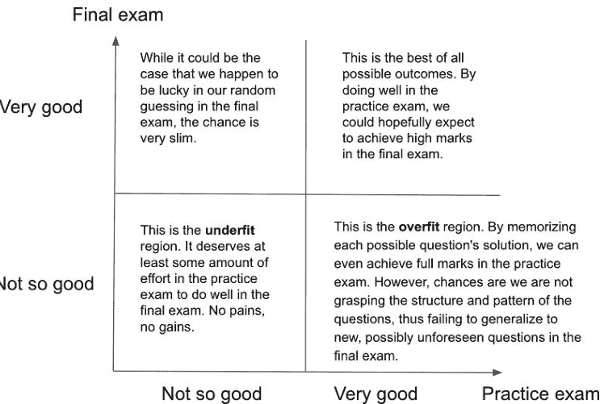

图 1.1 模拟考和期末考试有四种不同的结果，其中模拟考包含问题-答案对，而期末考试仅包含问题。这也对应于模型开发中的四种可能场景，即可用的训练数据包含输入-输出对，而测试数据仅包含输入数据。训练好的模型在训练数据和测试数据上都会被评估，尽管后者受到更多关注。

在图 1.1 中，左下象限代表最糟糕的情况——两次考试都考不好。虽然令人遗憾，但这种情况有些可以理解——备考期间准备不足很可能导致期末考试表现不佳。我们需要充分利用有答案可参考的模拟考，训练解题能力，形成一个良好的心智模型，并将其应用于期末考试。如果模型本身就不够好，我们基本上就无法指望在期末考试中取得好成绩。

请注意，即使基于模拟考没有充分准备，仍有可能纯属运气地在期末考试中取得高分。然而，正如左上象限所示，这种情况不太可能发生。我们可能在随机猜测中碰巧走运，但这不能保证平均期末考试表现稳定。

右上象限是最好的情况——心智模型基于模拟考训练得当，并适当地应用于期末考试。我们通过不断微调心智模型来掌握要点，该模型能够泛化到期末考试中未来的、未见过的问题。在这个区域，一切都很美好。

有些学生可能过于在意自己在训练考试中的表现。来自父母、老师或同伴的巨大压力可能迫使他们过度学习训练材料。正如右下象限所示，这种对训练表现的过度强调导致他们最终背下了所有训练问题的答案，凭借完美的问题-答案记忆，在模拟考中拿到满分。

然而，我们都知道，期末考试大多会与训练考试在某些方面有所不同。仅仅记住答案而不学习模式，他们就遭受了 _过拟合_，这是一种现象：训练好的心智模型过于契合模拟考（有时甚至完美契合），但无法泛化到期末考试中的新问题。相反，欠拟合意味着我们没有足够努力，导致模型过于简单，在模拟考或期末考试中表现都不好。然而，过拟合问题在生活的许多方面频繁发生；渴望在眼前事情上表现异常出色，使我们无法看到大局。诀窍是：不要死记硬背答案，要从答案中学习。

在上面的例子中，右下象限的过拟合区域意味着模型已被训练为在训练集上表现良好，但不能很好地泛化到测试集。这种过拟合问题可以通过适当的 _正则化_ 来缓解。正则化提供了一套旨在对模型开发过程进行轻微修改的技术。通过适当的正则化，训练好的心智模型可以更好地学习输入数据（问题）与输出标签（答案）之间的潜在模式。这样一个经过适当正则化的心智模型将更好地泛化到期末考试，并对新问题输出更准确的答案。

正则化包含一套用于降低机器学习模型（尤其是深度学习模型）泛化误差的策略。适当的正则化可以帮助控制神经网络的复杂性，缩小泛化差距，并解决过拟合问题。在训练数据有限或优化程序受限的情况下，适当的正则化可以帮助将训练好的模型泛化到未来未见过的测试数据集（通常从与训练集相同的隐藏分布中采样）。它既能减少过拟合，同时又能尽可能降低训练误差。它通常通过调整数据、模型架构、代价函数或优化流程来增强整体学习算法并控制过拟合的程度。

在本书中，我们的首要目标是将自己从右下象限（过拟合区域）带入右上象限（目标区域）。我们假设已经做出了大量努力来在训练考试中取得好成绩，考虑到我们现有的学习资源，这相对容易实现。实践中更常见的挑战是过拟合。我们如何检测它？什么时候需要担心它？有哪些技术可用于解决这个问题？此外，为什么有些技术比其他技术效果更好？本书旨在解决的一些问题就是这些。

## 1.1 为什么需要正则化？

模型复杂度可以由所使用的模型参数数量以及调节输入特征与模型参数之间交互作用（从而共同产生输出标签）的模型架构来表示。由于参数量庞大且架构精巧，深度神经网络通常是复杂模型，因此容易出现参数过多和过拟合。过于复杂的模型可能会非常好地学习和理解训练数据的潜在模式，但与此同时

unconsciously become sensitive to the noises in the training data, resulting in overfitting and not generalizing to the test data.

不自觉地对训练数据中的噪声变得敏感，导致过拟合且无法泛化到测试数据。

While some data points can have no noise due to perfect data measurement and collection, the majority of the data points will often be corrupted by noises one way or the other. The random noises in the data point would cause the actual value to deviate from the real value by a (hopefully) small margin. Since these noises, if learned by the model, would obscure the underlying pattern and do not necessarily appear in the test data, the model’s performance will likely suffer as a result of overfitting the noise-afflicted data. Similarly, in our exam example, not all the answers provided are correct in the practice exam. Noises may corrupt the target labels in practice. Thus the model will surely go wrong if it tries to tune its parameters to match its predictions to the target. If we try to memorize the sample answers to the practice questions without learning the problem-solving skills, the final exam performance will most likely drop if the answers are wrong. It helps to treat these answers with a grain of salt and cultivate critical thinking and reasoning skills.

尽管有些数据点可能由于完美的数据测量和采集而没有噪声，但大多数数据点往往会以这样或那样的方式被噪声损坏。数据点中的随机噪声会导致实际值与真实值之间出现（希望是）微小的偏差。由于这些噪声如果被模型学习，就会掩盖潜在模式，并且不一定出现在测试数据中，因此模型的性能可能会因过拟合受噪声影响的数据而下降。同样，在我们的考试示例中，练习考试中提供的并非所有答案都是正确的。噪声可能会损坏练习中的目标标签。因此，如果模型试图调整其参数以使其预测与目标匹配，它肯定会出错。如果我们试图背诵练习题的示例答案而不学习解题技巧，那么如果答案是错的，最终考试的表现很可能会下降。持怀疑态度对待这些答案并培养批判性思维和推理能力是有帮助的。

Note that embedding noises in the data could sometimes be good if done adequately as a data augmentation approach. A small amount of noise, whether in the input features, the model weights, or the target label, could pressurize the model to tune its estimation process so that the resulting weights are robust to different variations. These intentionally injected noises are random perturbations that cause the model to exhibit an improved performance by learning to appreciate different variations of the same data point, thus becoming more robust and less sensitive to the noises in test data. After all, if the training data covers all variations of the test data, then it becomes effortless to achieve a perfect generalization performance, even with a simple model like k-nearest neighbors. The reason is simple – if the questions in the final exam are all taken from the practice exam, then it is straightforward to get full marks in the final exam without studying very hard. As we will learn in the later part of the book, noise injection and data augmentation are helpful techniques to create noisy data points that help improve the model’s robustness. The trained model after noise perturbation will be less sensitive to the effects of random variability in the test data.

请注意，如果作为一种数据增强方法妥善地在数据中注入噪声，有时是有益的。少量的噪声，无论是在输入特征、模型权重还是目标标签中，都可能迫使模型调整其估计过程，使得得到的权重对不同的变化具有鲁棒性。这些故意注入的噪声是随机扰动，它们通过让模型学习欣赏同一数据点的不同变化来提高性能，从而变得更加鲁棒且对测试数据中的噪声不那么敏感。毕竟，如果训练数据涵盖了测试数据的所有变化，那么即使使用 k-近邻等简单模型，也能轻松实现完美的泛化性能。原因很简单——如果最终考试的题目全部来自练习考试，那么不用非常努力地学习就可以轻松拿到满分。如我们在本书后面部分将学到的，噪声注入和数据增强是创建有助于提高模型鲁棒性的噪声数据点的有用技术。噪声扰动后的训练模型将对测试数据中随机变异的影响不那么敏感。

Let us graphically visualize the true pattern (the actual function to be approximated), the noise, and the model. In figure 1.2, the dots represent the actual observations as input-output pairs, and the curve denotes the true function we want the model to learn. Unfortunately, the actual observations often deviate from the true function, possibly due to random noise in the observation model (the underlying model that governs how actual data points are revealed and is often assumed to contain an additive noise) or purely collection error, leading to vertical perturbations. Our task is to train a model that approximates the curve as much as possible.

让我们以图形方式可视化真实模式（要近似的实际函数）、噪声和模型。在图 1.2 中，点表示作为输入-输出对的实际观察，曲线表示我们希望模型学习的真实函数。不幸的是，实际观察往往偏离真实函数，可能是由于观察模型（管理实际数据点如何揭示的底层模型，通常被假设包含加性噪声）中的随机噪声，或者纯粹的采集错误，导致垂直扰动。我们的任务是训练一个尽可能逼近该曲线的模型。

Such approximation could easily go wrong in two ways. On the one hand, using a more complex and flexible model such as a neural network is more likely to result in a better approximation than, say, a simple linear regression model. However, overfitting the observed data without proper control of model complexity will likely lead to an overly sensitive model. Model training needs to minimize the impact of unwanted noises, which tend to cause ups and downs to the fitted curve. On the other hand, a simple model may not be flexible enough to learn the true pattern and thus result in the underfitting scenario. It is easy to fall into either underfitting or overfitting during the model training process. In other words, our model may not be flexible enough and fail to capture the curvature using a simple straight line, or it may be too complex and end up with a wiggly-looking curve that is overstretched and unnecessarily sensitive.

这种近似很容易以两种方式出错。一方面，使用像神经网络这样更复杂、更灵活的模型，比简单的线性回归模型更有可能得到更好的近似。然而，在没有适当控制模型复杂度的情况下过拟合观察数据，可能会导致一个过于敏感的模型。模型训练需要尽量减少不需要的噪声的影响，这些噪声往往会导致拟合曲线出现起伏。另一方面，简单模型可能不够灵活，无法学习真实模式，从而导致欠拟合场景。在模型训练过程中，很容易陷入欠拟合或过拟合。换句话说，我们的模型可能不够灵活，无法使用简单的直线捕捉曲率，或者可能太复杂，最终得到一个看起来扭曲的曲线，该曲线被过度拉伸且不必要地敏感。

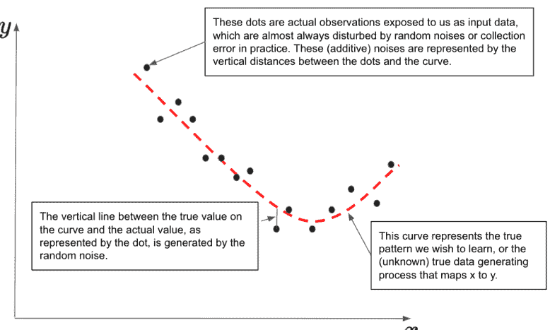

Figure 1.2 The true relationship we want to learn, as represented by the curve, and the training data available for model development, as represented by the dots. The (vertical) deviations between the curve and the dots are due to random observational noises (assumed to be additive in this case) or collection error, which almost always appear in practice. Our goal is to use these dots to build a model to approximate the true pattern as much as possible, namely the real relationship between input x and output y. At the same time, the learned model needs to be robust enough to avoid distractions from the noises.

图 1.2 我们希望学习的真实关系，由曲线表示，以及可用于模型开发的训练数据，由点表示。曲线与点之间的（垂直）偏差是由于随机观测噪声（在此假设为加性噪声）或采集错误造成的，这些在实践中几乎总是存在。我们的目标是使用这些点来构建一个模型，尽可能逼近真实模式，即输入 x 与输出 y 之间的真实关系。同时，学习到的模型需要足够鲁棒，以避免受到噪声的干扰。

There are two scenarios for underfitting. We could underfit the model by limiting ourselves to a simple linear regression model, which struggles to capture a nonlinear relationship due to insufficient model complexity. As shown in figure 1.3, the model, as represented by the straight line, is not flexible enough to approximate the true nonlinear function in a curved line.

欠拟合有两种场景。我们可以将自己局限于简单的线性回归模型来欠拟合模型，由于模型复杂度不足，它难以捕捉非线性关系。如图 1.3 所示，由直线表示的模型不够灵活，无法近似弯曲线条的真实非线性函数。

An example of underfitting due to insufficient model complexity. We could at most build a straight line with two parameter (slope and intercept) using a linear regression model

由于模型复杂度不足导致欠拟合的示例。使用线性回归模型，我们最多只能构建一条具有两个参数（斜率和截距）的直线

Model trained using linear regression

使用线性回归训练的模型

True function to be approximated/learned

要近似/学习的真实函数

Figure 1.3 An example of fitting a nonlinear function using a linear function, which underfits the training data. The model needs to be flexible enough to be able to learn the pattern of the true function, which is often highly complex in reality.

图 1.3 使用线性函数拟合非线性函数的示例，这导致了对训练数据的欠拟合。模型需要足够灵活才能学习真实函数的模式，而在现实中，真实函数通常非常复杂。

Alternatively, the training data could be minimal and thus insufficient to support a decent training process. In such a case with great uncertainty in the input data, a conservative function such as a simple linear model is more likely to generalize to the test set. On the other hand, a complex model tends to overfit the limited training data and fails to learn a generalizable mapping function. It is thus better to play safely in the face of extreme uncertainties. This case is illustrated in figure 1.4.

或者，训练数据可能非常少，因此不足以支持一个良好的训练过程。在输入数据存在很大不确定性的这种情况下，像简单的线性模型这样的保守函数更有可能泛化到测试集。另一方面，复杂模型往往会过拟合有限的训练数据，无法学习到可泛化的映射函数。因此，在面临极端不确定性时，最好稳妥行事。这种情况在图 1.4 中有所说明。

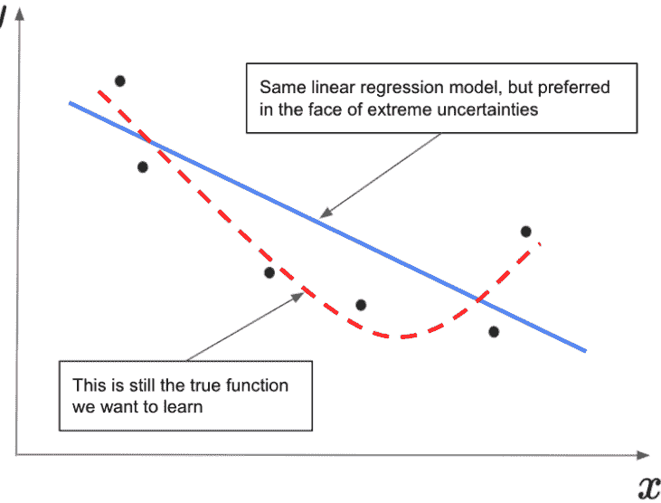

Figure 1.4 Another underfitting example, where the same linear regression model is now a preferred choice due to extremely limited training data. When only exposed to very limited training data, it is totally fine to use linear regression, which tends to generalize better than a complex model such as neural networks. Deep neural networks tend to be highly complex and are thus prone to overfit. However, the problem in this case is more on the training data and less on the model choice; we are limited by what we can do in the first place. Any model built on top of six observation points alone will likely be sensitive and not robust to the noises in the data.

图 1.4 另一个欠拟合示例，由于训练数据极其有限，同样的线性回归模型现在成为首选。当仅接触到非常有限的训练数据时，使用线性回归完全没问题，它往往比神经网络等复杂模型泛化得更好。深度神经网络往往非常复杂，因此容易过拟合。然而，在这种情况下，问题更多在于训练数据，而较少在于模型选择；我们在一开始就受限于能做的事情。仅基于六个观测点构建的任何模型，很可能对数据中的噪声敏感且不够鲁棒。

In either case, our model, as represented by the straight line, is too simple to capture the true pattern, as represented by the curved line.

无论哪种情况，由直线表示的我们的模型太简单，无法捕捉由弯曲线条表示的真实模式。

On the other extreme, when the model is excessively complex, we would expect a wiggly-looking shape of the fitted model that tries to cross every training point, reducing the training error to zero. This scenario is illustrated in figure 1.5. The generalization gap is relatively big in this case, as shown by the significant vertical differences between the trained model in the wiggly solid line and the target truth in the dashed line.

另一种极端情况是，当模型过于复杂时，我们会期望拟合模型呈现扭曲的形状，试图穿过每个训练点，将训练误差降至零。这种情况在图 1.5 中有所说明。在这种情况下，泛化差距相对较大，如扭曲实线的训练模型与虚线的目标真实值之间显著的垂直差异所示。

This is an overly complex model that clearly overfits the training data

这是一个明显过拟合训练数据的过度复杂模型

This is still the true function the model is trying to approximate

这仍然是模型试图近似的真实函数

Figure 1.5 An example of overfitting due to an excessively complex model. The model perfectly fits all dots, giving zero error rate in training set. However, the wiggly curve comes at a price of generalizability - the model's predictions for new input data will be far off from the truth. In other words, it fails to generalize to future unseen data in the test set. The excessive complexity leads to a large generalization gap.

图 1.5 由于模型过度复杂而导致过拟合的示例。模型完美拟合所有点，在训练集上获得零错误率。然而，扭曲曲线的代价是泛化能力下降——模型对新输入数据的预测将远离真实值。换句话说，它无法泛化到测试集中未来未见的数据。过度复杂性导致较大的泛化差距。

Regularization helps build simpler and more robust models that are generalizable to the test set. Just as Occam's razor principle recommends: the simplest models tend to perform better. For example, deep neural networks are very good at obtaining a very low training error due to their sufficient representational capacity. The model with a low variance is selected among multiple over-parameterized and interpolating candidates, i.e., the simplest model with equally good performance. Since the actual level of complexity is unknown to us in advance, it is often impossible to jump to the right amount of model complexity during the training stage. One of the remedies is to regularize the process before or during model training. Regularization aims to penalize the unnecessary complexity of the model for reducing the generalization gap and obtaining a good performance in the test set. It helps us pick the right amount of model complexity needed to approximate the actual underlying pattern and remain robust to noise.

正则化有助于构建更简单、更鲁棒、可泛化到测试集的模型。正如奥卡姆剃刀原则所建议的：最简单的模型往往表现更好。例如，深度神经网络由于其充分的表示能力，非常擅长获得非常低的训练误差。在多个过参数化和插值候选模型中，会选择方差较低的模型，即性能同样良好的最简单模型。由于我们预先不知道实际的复杂度水平，因此在训练阶段通常不可能直接跳到正确的模型复杂度。补救措施之一是在模型训练前或训练过程中对过程进行正则化。正则化旨在惩罚模型不必要的复杂性，以减小泛化差距并在测试集上获得良好的性能。它帮助我们选择近似实际潜在模式并保持对噪声鲁棒性所需的适当模型复杂度。

## 1.2 维度灾难

为什么现代机器学习模型容易过度参数化并容易过拟合？答案与大数据的兴起有关。近年来，大数据的四个 V 有显著增加：volume，数据规模；velocity，高频流式数据；variety，不同形式的数据；veracity，数据的不确定性。这四个 V 主要由现代数据收集接触点的进步推动：直播监控摄像头、海量网页搜索和对话、各种持续的业务交易。它们共同为存储和建模方法带来了前所未有且令人兴奋的挑战。

一个直接的挑战是高维性。数据中大量的特征也给建模带来了维度灾难的挑战，使得设计能够有效学习高维中底层模式的算法变得困难。线性回归等传统统计方法在处理少量特征时效果最好。在存在高维性的情况下，例如易于包含数万个特征的图像数据，需要更复杂的算法来识别、提取和转换关键特征并做出良好预测。图 1.6 展示了图像数据的示例。

图 1.6 在新加坡 CBD 区域拍摄的示例图像。像这样的典型彩色图像形状为 (400, 225, 3)，其中 400 表示宽度，225 表示高度，3 表示颜色通道数，即红、绿、蓝。这导致单幅图像中总共有 400*225*3=270,000 个像素值，即特征。

文本数据也面临类似挑战。例如，一个文档由大量单词组成，每个单词根据上下文可能表达不同的含义。为了有效从文本数据中学习并识别一致模式，模型需要能够推导词的重要性及其交互效应。此过程很容易产生数万个特征。

特定的正则化方法可以有效解决高维性挑战。例如，稀疏学习旨在学习少量重要特征的子集并丢弃其他特征。这种方法本质上假设只有少量特征子集具有预测能力，其余特征通过将系数设为零来移除。标准稀疏学习技术包括 Lasso 及其变体，它们通过在最小化训练误差的同时，对系数的大小添加惩罚来工作。例如，如果我们想构建一个模型来分类前一张图片是乡村还是城市区域，代表高楼大厦的特征比其他特征更可能具有预测性。使用稀疏约束可以通过将不相关特征的系数设为零来抑制这些特征，从而更专注于预测性特征。

这种正则化可以从多种方式进行解释。例如，从几何角度，添加此类惩罚为得到的估计系数引入特定的几何约束，导致一些系数趋近于或等于零。从贝叶斯角度，引入先验信念以对系数估计过程强制执行特定的分布假设，其中系数为零的高概率被预先编码。从鲁棒优化角度，某些正则化器（如 Lasso）对数据中的随机噪声提供保护，使得到的系数更加稳健且对噪声不那么敏感。我们将在本书后面部分介绍这些不同的视角。

## 1.3 理解欠拟合和过拟合

欠拟合是指由于训练模型过于简单或训练数据过于不足，导致在训练集和测试集上表现不佳。过拟合是指训练模型在训练集（总体的一个特定子集）上表现良好，但对来自同一总体的其他测试集推广效果不佳。换句话说，预测测试集产生的泛化误差，或训练集性能与测试集性能之间的泛化差距，非常大。然而，为什么我们如此关注模型泛化能力，即其在未来未见测试集上的预测性能？为了回答这个问题，让我们回到之前的考试示例。这次，我们将用努力程度来代表模型复杂度；我们学习越努力，心智模型就越复杂。

观察训练考试和最终考试中模型性能的演变很有帮助。如图 1.7 所示，随着我们投入更多时间学习和打磨心智模型，我们的解题能力提高，在训练（练习）和测试（最终）考试中都能获得更好的分数。我们也可能注意到，从 60 分提升到 70 分比从 80 分提升到 90 分甚至 100 分要容易得多；为了在考试分数上获得相同单位的提升，所需的努力呈指数级增加。

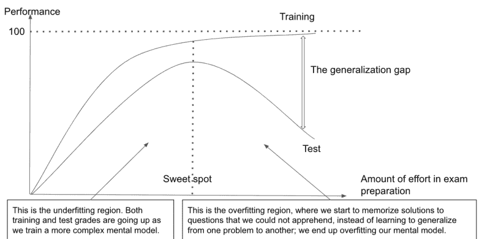

图 1.7 随着考试准备投入更多努力，训练和测试性能的演变。我们从欠拟合区域开始，在该区域，随着心智解题模型变得强大，训练和测试性能都在提升。模型在经过甜点区后开始过拟合，这由测试性能下降所反映。在过拟合区域，必须关注测试性能，因为随着模型变得更加复杂，训练性能将（仅）继续提高。

但是，如果我们继续投入更多时间学习，并力求在练习考试中拿满分，我们可能会冒过拟合心智模型的风险。到了某个阶段，我们可能会开始背诵每道训练题的答案，尤其是在无法立即得出解答时。鉴于学习时间有限，完美背记答案可以直接让我们在练习考试中拿满分。不幸的是，过度努力并不能保证等同的回报。由于缺乏泛化能力，我们的测试性能将开始下降，泛化差距将扩大。此外，市面上有那么多练习题，谁知道提供的答案是否无噪声且 100% 正确呢？重点是，如果我们只关注获得正确答案而非学习模式，就要当心测试性能下降。

请记住，我们的目标是通过练习考试训练出一个足够好的心智模型，并希望使用训练好的心智模型在最终考试中获得高分。一个在测试集上泛化良好的模型意味着其复杂度足够好，所学习的核心解题模式可以很好地应用到最终考试中的新问题。我们希望尽可能减少训练性能和测试性能之间的泛化差距。然而，更高的模型复杂度并不一定意味着更小的泛化差距。

通常存在一个甜点区，代表最终考试的最佳表现，并且通常与练习考试中足够好的训练性能相关联。甜点区之后泛化能力开始下降，导致我们进入过拟合区域。因此，我们希望达到的正是甜点区。在建模术语中，甜点区代表最优模型复杂度，即权重配置，预计这将导致最低测试误差并最好地推广到未见测试集。最优模型避免了欠拟合和过拟合：它足够复杂，能够学习训练数据中的底层模式，又足够简单，能避免因数据噪声而拟合虚假模式。

## 1.4 理解偏差-方差权衡

欠拟合和过拟合，如图 1.7 中的甜点区所分隔，与回归、分类和强化学习任务中出现的偏差-方差权衡概念密切相关。在回归设置中，偏差是指模型预测值与目标值平均而言的接近程度。平均一词与期望密切相关。在此，我们使用偏差来描述预测值与目标值之间预期的平均距离。我们希望模型尽可能具有低偏差，从而平均而言接近实际目标值。高偏差模型意味着它未能捕捉数据中的底层模式，只能生成有偏差、偏离目标的预测。如果训练模型过于简单，它很可能会导致对训练数据欠拟合。在我们的考试案例中，如果解题心智模型未被打磨得足够准确，练习考试和最终考试的分数都可能较低。

另一方面，我们也可能遭受高方差，这是过拟合的一种症状。方差衡量模型预测的变异性；它显示模型预测范围有多宽或多窄。我们希望模型方差尽可能低，从而产生更稳定、更可靠的结果。高方差模型通常源于过度关注拟合训练数据，甚至到了将其预测精确匹配到目标标签的程度。当发生过拟合时，模型在训练数据上表现很好，但在测试数据上存在显著误差。在我们的考试示例中，过拟合可能来自于完美记忆数据以正确回答每道练习题。在练习考试中可能存在错误答案且缺乏可推广和可迁移的解题技能的情况下，训练好的心智模型很可能会针对测试问题的微小变化生成不准确、不稳定且截然不同的答案。模型预测的显著波动，即高方差，是过拟合的明显迹象。

偏差和方差是我们在训练模型时希望尽量减少的两种误差来源。然而，同时减少两者并不容易。一方面，降低偏差通常会使模型更加复杂，这增加了过拟合的机会，从而导致高方差。另一方面，降低方差通常伴随着较低的模型复杂度，并且在最终得到简单模型时可能导致高偏差。在不牺牲另一方的情况下改进一方是困难的，更不用说同时改进两者了。这就是所谓的偏差-方差权衡。

为了进一步帮助理解，让我们看看图 1.8，它包含基于这两种误差来源的四种不同场景。

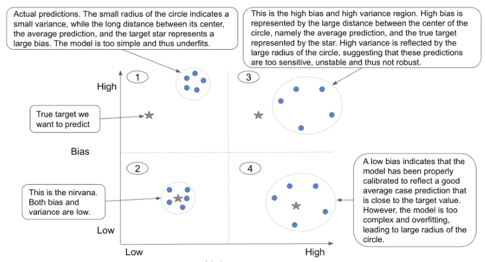

图 1.8 四种可能的偏差-方差场景。第一区域具有高偏差和低方差，因为训练模型过于简单，可能欠拟合。第二区域是理想状态，偏差和方差都很低。第三区域偏差和方差都高，表明模型值得进一步训练以学习潜在模式。第四区域表示过拟合模型，具有低偏差但高方差。

如图 1.8 所示，第一和第四区域分别对应欠拟合和过拟合。训练模型时，我们通常从第三区域开始，该区域两类错误都很高。随着模型逐渐改进并变得更加复杂，由于更好的模式识别，我们会进入第一区域——模型通过学习潜在模式，预测变得更加稳定。现在，如果我们运气好，可以毫不费力地达到第二区域，该区域两类错误都很低。然而，在实际模型训练中，更常见的是看到训练过度且过于复杂的模型，可能会陷入第四区域。

适当的正则化可以通过多种方式帮助我们到达目标区域，即低偏差和低方差区域。如图 1.9 所示，示例训练路径可能遵循 3 -> 1 -> 2、3 -> 1 -> 4 -> 2 或其他路径，具体取决于所使用的正则化策略。

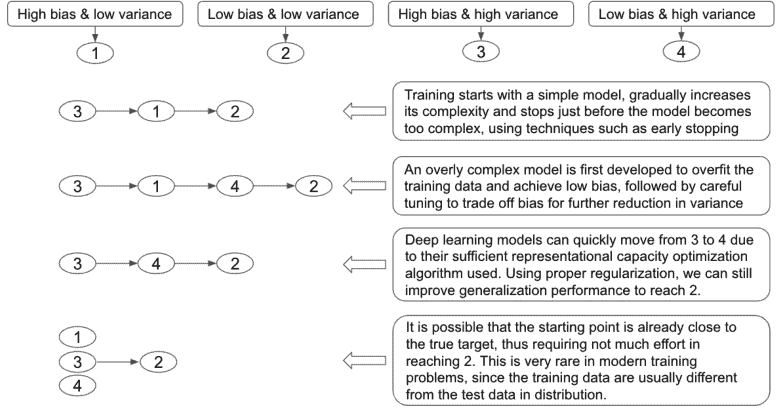

图 1.9 使用适当正则化的示例模型训练路径。构建具有低偏差和低方差的可泛化模型（如区域 2 所示）有多种方式。取决于训练集与测试集之间的相似性，以及所使用的模型类和训练策略，模型训练路径可能以多种方式进行。通过适当的正则化，最终训练的模型有望达到区域 2。

为了在偏差和方差之间取得良好的平衡，模型不应过于简单或复杂，前提是拥有足够数量的数据，涵盖模型学习所需的足够变异性。换句话说，模型不应欠拟合或过拟合。在实践中，我们希望最小化总误差，包括偏差和方差。我们将在第 2 章正式化总误差的公式。使用适当的正则化，我们可以在偏差项略微增加的代价下降低模型方差，从而整体降低总误差。方差降低的模型更有可能产生稳定和健壮的结果。此外，只要偏差略有增加，我们仍能确保平均预测处于真实目标的近邻范围内。

值得注意的是，偏差与方差之间的权衡并不总是成立。给予足够的训练迭代次数，参数化充足的模型（如深度神经网络）甚至可以在偏差为零的情况下学习降低方差。这种现象被称为“双下降”现象，如图 1.10 所示。

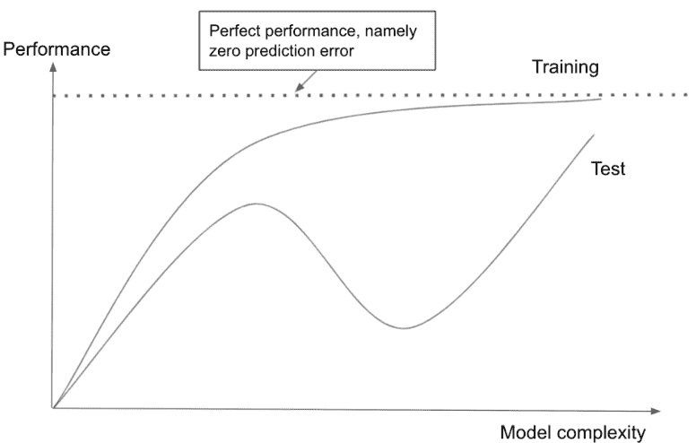

图 1.10 使用深度神经网络等复杂模型的双下降现象。随着模型不断变得更加复杂，我们将开始观察到测试数据性能的提升，此时即使偏差为零，方差也会继续下降。

在此模式下，偏差-方差分解不一定意味着两者之间的权衡。只要我们给予深度神经网络足够的训练时间，最终就会看到测试性能再次提升并摆脱过拟合的困境。为什么深度学习模型即使高度复杂且在训练数据上过拟合，最终仍能得到可泛化模型？简短的答案是，深度神经网络（尤其是使用随机梯度下降训练时）会隐式正则化模型估计过程，因此更有可能泛化到测试集。我们将在第 3 章介绍“双下降”现象，并在后续章节介绍随机梯度算法的隐式正则化效应。

## 1.5 关于模型训练路径的更多内容

让我们稍微深入探讨一下模型训练路径。典型的机器学习流水线从最小化给定损失函数（通常是训练集误差）的目标出发，希望训练好的模型在未来的测试集上也能表现良好。类似于考试案例，这里会出现四种可能的情况。首先，训练集误差和测试集误差都很高。这意味着模型未能从训练数据集中提取模式，需要通过训练更久、调整其他超参数或更换另一类模型来进一步改进。这就是欠拟合的情况。

训练也可能导致高训练集误差，但出乎意料地出现低测试集误差。这种情况可能发生吗？很少发生，因为训练不足的模型不太可能在测试集上表现良好。测试集通常被假设遵循与训练集相同的数据生成分布。然而，两者通常都会受到随机噪声的干扰，这些噪声掩盖了将输入映射到输出的实际模式。

也有可能出现低训练集误差和高测试集误差的情况。这就是过拟合场景，即我们不必要地使模型过于复杂，以在训练数据中实现近乎完美的预测。尽管在训练数据中高度具有预测性，但该模型未能很好地泛化到测试集中未观测的数据。我们想要做的事情（也是本书的重点）是应用适当的正则化技术，使模型在测试集上也能表现良好。图 1.11 说明了这四种情况。

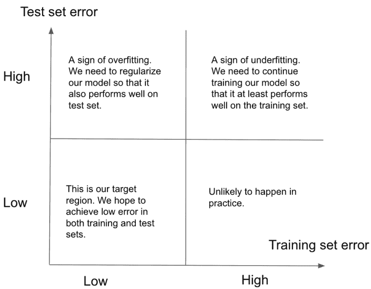

图 1.11 训练结束时的四种不同情况。我们希望构建的模型不仅能实现低训练误差，而且（更重要的是）能实现低测试误差。

现在让我们从另一个角度来看待问题。我们本质上有兴趣从许多可能的模型中识别出一个在训练集上表现优异且能很好地泛化到测试集的模型。每个模型都对应一组特定的参数及其数学运算配置，这些运算调节信息的流动和交互（例如加法或乘法）。所有这些模型共同构成一个模型类，我们的目标是从可能存在的多个优良模型中找到一个，通过使用训练集进行精心训练，使其能很好地泛化到测试集。图 1.12 说明了这一点，其中模型类（假设足够大，例如使用神经网络）包含所有可能的模型配置，其中一些是好的，另一些则是不好的。

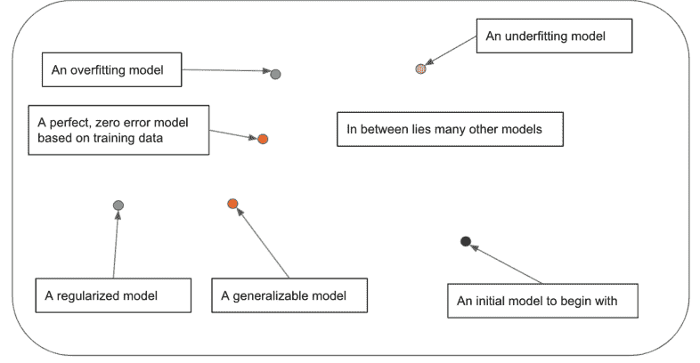

图 1.12 一个（足够大的）模型类的总空间。每个点代表一个特定的模型，此示例中的相对位置是任意的。我们的目标是开发一个经过适当正则化的模型，使训练误差和测试误差都较低。

如图 1.12 所示，模型训练过程本质上意味着我们在根据特定标准寻找最佳模型的过程中，从一个模型跳转到另一个模型。存在无数条路径，具体取决于我们使用的模型类、算法和训练计划。图 1.13 展示了训练 CART（分类和回归树）模型的一个示例路径。在树生长的初始阶段，由于模型复杂性不足，模型会欠拟合，正如从黑点到黄点的路径所代表的那样。然后，树生长成一个看似复杂的树，包含多个分支和叶子，将我们带到蓝点。通过仔细的剪枝，我们通过移除不必要的复杂分支来对模型复杂性进行正则化。

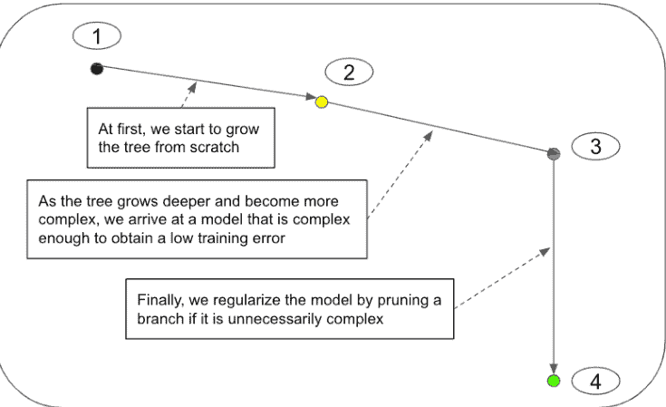

起初，我们从零开始生长树

随着树变得更深、更复杂，我们得到一个足够复杂、能够获得低训练误差的模型

最后，如果某个分支不必要地复杂，我们通过修剪它来对模型进行正则化

**图 1.13** 训练随机森林模型的示例路径。具体的训练路径可能因所使用的模型类别和训练策略而异。

在实践中，多个模型能够很好地泛化到测试集，形成一组可泛化的模型，如图 1.14 中虚线圆所示。因此，我们的目标是构建一个位于虚线圆内的可泛化模型。对过拟合模型进行正则化的目的是控制其复杂度，从而增加到达虚线圆内任意位置的可能性。典型的训练过程如下：通过最小化训练误差，或者更具体地说，经验风险（模型泛化能力的一个指标，例如模型的平均训练损失），希望得到的最佳训练模型平均能很好地泛化到测试集。这假设可用的训练集和测试集在分布上是相似的，但在实际中可能并非如此。我们将在第 2 章更详细地阐述经验风险的概念。然而，目前只需知道，训练期间的模型评估标准可能不仅仅是经验风险。经过正则化的经验风险版本有助于泛化到测试集，尤其是当训练集与测试集分布不相似时。

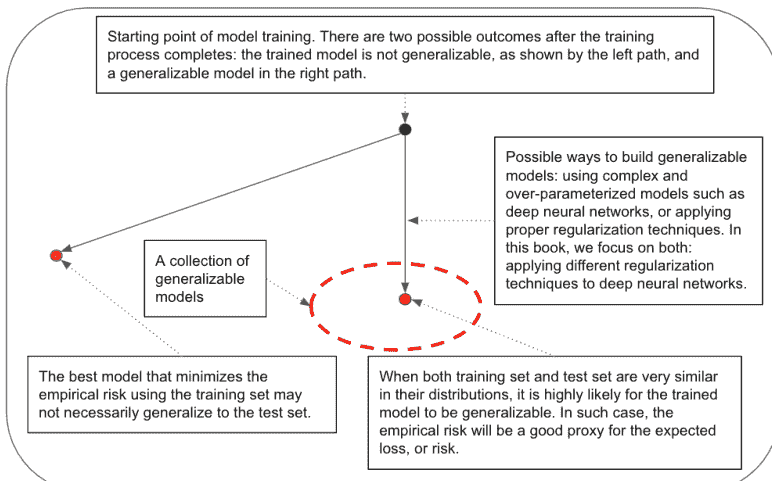

**图 1.14** 模型训练在测试集泛化方面的两种可能结果。

为了进一步阐述这一点，应当注意的是，能够完美预测训练数据的模型不一定能泛化到测试数据。原因很简单：当模型接触到不同的输入输出对变体并从中学习后，很容易将所学知识迁移并应用到观察到的变体范围内的新输入上。如果手头的训练集和测试集遵循相似的分布，那么我们最佳训练的模型很可能能泛化到测试集。然而，由于训练集中可能存在潜在的随机噪声或数据不足，这种分布相似性可能并不总是可用。

为了缩小泛化差距，我们可以尝试使用深度神经网络，在最小化设置中利用“双重下降”现象。当使用随机梯度下降训练深度神经网络时，优化过程有效地将高维性从诅咒变成了祝福。在训练深度神经网络时，随机梯度下降算法扮演隐式正则化的角色，倾向于为训练集和测试集生成预测模型。或者，我们可以应用更显式的正则化技术来对过于复杂的模型进行正则化。

由于不同的模型在搜索空间中往往表现出不同的搜索路径，经验表明，有些模型比其他模型更频繁地到达虚线圆。例如，经过充分训练的深度神经网络通常非常复杂，可以实现非常低甚至零的训练误差。然而，它们在实践中在测试集上仍然表现良好，这与我们之前的讨论有些反直觉——过于复杂的模型更容易过拟合，因此不太可能泛化到测试集。如前所述，结果发现这是“双重下降”现象，仅特有于深度神经网络等过参数化模型。

使用深度神经网络时，随着训练的进行，模型在超过某个*插值阈值*后变得更加复杂，我们观察到，尽管偏差为零，方差却在减小。此外，由于要近似的真实函数通常非常复杂且非凸，多个局部极小值会产生同样好的模型，所有这些模型都可以获得零训练误差或最小的正则化损失值。换句话说，我们最终可能会使用相同的训练数据得到多个同样好的最佳模型。这些多个最佳训练模型随后可以扩展到一个圆，形成三组模型集合，如图 1.15 所示。

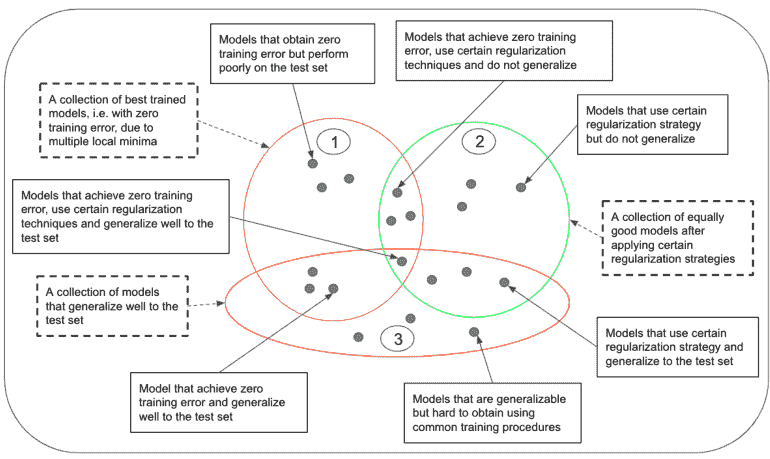

**图 1.15** 三组不同的候选模型集合。应当注意的是，要么在训练集上达到零误差，要么应用正则化，或者两者结合，都不能最终保证构建出可泛化的模型。实际情况是，使用像深度神经网络这样的过参数化模型，以及应用适当的正则化技术，往往最终会得到一个在测试集上泛化良好的模型。

图 1.15 的文氏图表示多种同样好的模型类型。我们有三个圆圈，每个圆圈代表基于特定客观标准的性能相似的一组模型。圆圈 1 包括实现零训练误差的模型。圆圈 2 表示在优化特定损失函数的同时进行正则化的模型集合。圆圈 3 包含在测试集上误差较低的可泛化模型集合。任何两个圆圈都可能重叠。当训练成本为零或在训练过程中应用特定正则化技术时，不能保证存在可泛化的模型。然而，使用像深度神经网络这样的过参数化模型，并伴随适当的正则化技术，可以大大提高构建可泛化模型的机会。

## 1.6 理解模型训练过程

典型的模型训练过程从一些训练数据开始。在监督学习任务中，训练数据由输入输出对组成。每个输入条目可能包含多个特征，从不同角度描述一个观察。相应的输出包含真实目标，充当指导训练过程的正确答案。模型训练旨在生成一个映射函数，即模型，它能将给定输入正确映射到相应的输出。

训练好的模型由两部分组成：*参数*和*架构*。参数是模型的组成部分，架构指定这些组件如何与输入数据交互以生成最终的预测输出。然后将此预测值与基准真值的目标输出进行比较，共同产生误差指标。这里，误差表示预测值与实际值之间接近或远离程度的当前代价。遵循特定的优化程序，训练过程调整模型参数，有时也调整架构，以减少训练成本。调整权重后，会再次计算新的误差，形成反馈循环。完整的模型训练过程如图 1.16 所示。

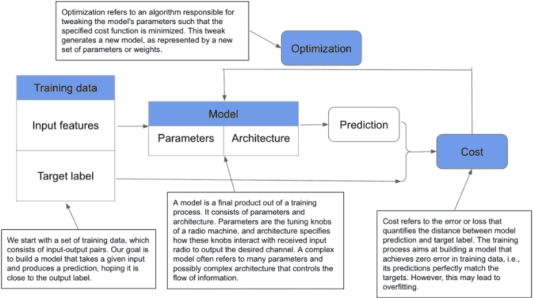

**图 1.16** 典型模型训练过程示例。工作流程从可用的训练数据开始，逐步调优模型。调优过程要求将模型预测与目标输出匹配，其中差距由特定的成本函数衡量，并作为下一轮调优的反馈。每次调优都会产生一个新模型，我们希望找到最小化成本的模型。

图 1.16 中突出了四个组件：训练数据、模型、成本和优化。任何或多个这些组件都可以用作正则化的切入点。例如，数据增广，一种广泛用于训练目标检测算法的技术，是一种在数据上操作的正则化技术。通过向输入图像数据添加随机噪声，例如剪切和旋转，会以各种形式生成一组新的且多样的图像，然后将其添加到原始训练集中并暴露给模型，以进行更强健的训练。训练数据的多样性有助于泛化。我们将在后续章节中分享更多关于它如何以及为何对（通常）图像分类任务有效的细节。

## 1.7 正则化的多种面貌

已经提出了许多不同的技术来扮演正则化的角色，侧重于数据、模型、成本、优化或某些组合。尽管这些技术特定于问题，但特定技术往往比其他技术效果更好并能立即带来改进。然而，挑战在于，现有的不同技术文献非常混乱，主要彼此分离地进行研究。本书旨在弥补这一差距。通过在统一框架内共同介绍流行技术，我们希望通过大量关于理论和实践的实用直观解释和示例，使学习之旅既顺利又全面。

基于图 1.16 中先前的模型训练工作流程，训练神经网络始于将数据输入模型架构、与模型参数交互、输出预测、计算误差，并将误差反馈回传播到模型权重以进行迭代更新。这一过程自然成为本书的关注领域，涵盖了数据、模型架构、成本函数和优化程序方面的正则化技术。图 1.17 展示了从模型训练角度对正则化技术的整体分类。

| 数据 | 模型 | 成本 | 优化 |
|---|---|---|---|
| 数据增广 噪声注入 自助法 等等 | 池化 脱校 权重共享 等等 | 岭回归 LASSO 熵 等等 | SGD 权重初始化 早停 等等 |

**图 1.17** 基于数据、模型、成本和优化对正则化技术进行分类。

此外，正则化还可分为隐式正则化和显式正则化。隐式正则化是指一种特定的操作，它间接地发挥正则化作用。例如，随机梯度下降（SGD）是一种用于训练深度学习模型的典型优化器。通过在每次迭代中基于一个或一小批数据点来优化模型，模型会接触到更多样的数据变化，并通过考虑这些变化来学习变得更加鲁棒。通过去相关附近的更新，SGD可以间接地对模型进行正则化，使其能够泛化到测试集。另一方面，显式正则化专门针对模型训练期间调整特定组件，例如控制模型复杂度。图 1.18 列出了一些标准的隐式和显式正则化技术。一种特殊的技术是 Dropout，它既充当隐式正则化器，也充当显式正则化器。我们将在后续章节中深入探讨此技术。

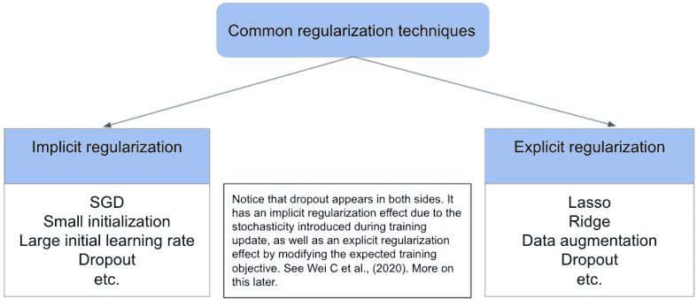

图 1.18 将正则化技术分类为隐式或显式。

最后，如图 1.19 所示，正则化还可根据其效果分为强正则化和弱正则化。例如，Lasso 等显式正则化器通过将系数设为零来直接移除不重要的特征。这可被视为具有强正则化效果。另一方面，数据增强等技术旨在提供同一数据集的不同版本，希望模型能从相似之处中学习并对中间的变化保持鲁棒性，从而产生更温和、间接，因此也是弱正则化效果。

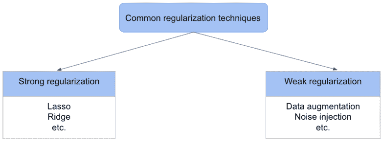

图 1.19 将正则化技术分类为强或弱。

## 1.8 总结

- 正则化包含一组技术，用于将训练好的模型泛化到未见的测试集
- 正则化可应用于模型训练流水线的四个组件：数据、模型、代价和优化；它可以是显式或隐式、强或弱
- 欠拟合是指容量不足的模型，存在高偏差且无法捕捉底层模式；过拟合是指容量过大的模型，存在高方差且可能偶然学习到虚假关系
- 模型训练需要在偏差和方差之间取得平衡，达到合适的模型复杂度
