# 2

# 广义化：经典视角

## 本章内容

- 训练线性回归模型的逐步实现
- 典型模型训练工作流中的关键数学概念，重点介绍数据、模型、代价和优化
- 统计建模和机器学习中关于广义化的经典视角
- 对关键广义化概念的深入探讨，包括经验风险最小化、偏差-方差权衡以及欠拟合与过拟合

本章探讨了监督学习中最基础模型之一的典型训练过程：线性回归，它构建一个将输入特征映射到输出目标的线性模型。通过回顾训练简单线性回归模型的过程，我们将更好地理解不同的训练组件，包括数据、模型、代价和优化。我们将介绍每个部分的数学直觉，这对于理解各种建模操作至关重要。我们还将把这些概念放在适当的背景下来说明其用途，因为我们认为有效的学习始于对背景的理解。我们还将配以恰当的实现细节来辅助数学内容，以便更好地把握整体并同时欣赏理论与实践。在介绍完基础模块后，我们将介绍广义化的经典视角，涵盖经验风险最小化和偏差-方差分解等关键概念。机器学习模型所需的基础知识将帮助我们过渡到下一章中介绍的广义化现代视角。

构建机器学习模型的主要目标是模拟并自动化特定的手动流程。示例包括预测房价或预测未来气温。*监督学习*是机器学习任务的一种类型，专注于基于手动标注预先创建的输入数据与目标输出之间的映射关系。这种映射是通过学习一个数学函数来实现的，该函数指定底层模式，根据一组控制映射函数的参数将输入映射到输出。特定的数学函数代表了我们的 _归纳偏差_，即以假设形式对函数属性的事先信念。在从示例中学习的过程中，模型参数被优化，使学习函数的形状更具代表性，更接近真实函数。然后，监督学习模型可以接受新的输入数据并预测相应的输出。与显式编程映射规则不同，模型会自动学习映射逻辑，因此比传统的基于规则的软件工程实践更具智能性。只要提供适当的输入和输出，我们就可以将整个映射和规则识别任务外包给监督学习算法，这非常有用，尤其是在存在复杂流程时。

需要注意的是，模型本质上代表了对底层数据生成过程的简化假设。这种假设通常伴随着 _归纳偏差_，例如数据生成函数的平滑性：一个值应该平滑地过渡到另一个值，而不会出现突然的跳跃。预设的归纳偏差在恰当使用时，可能会产生令人惊讶的广义化效果。对真实函数的假设也可能源于我们对底层数据生成过程的事先信念，例如我们希望通过迁移学习框架从类似任务中借用的规律或其他属性。

为了更好地考察通过监督学习进行模型开发的细节，我们将回顾第 1 章中介绍的构成模型训练工作流的四个组件，即数据、模型、代价和优化。这次，我们将引入一些数学符号来更精确地解释这些概念。如果您不熟悉线性代数或多元微积分，请不要担心；这些内容将配合直觉和示例进行充分的标注和解释。即使您熟悉这些概念，这也是一个重温它们的好机会。

## 2.1 数据

所有机器学习模型都始于给定的训练数据。在监督学习中，训练数据由输入-输出对组成。假设总共有 _n_ 对，我们关注第 _i_ 对数据，表示为 (**x**<sub>_i_</sub>, _y<sub>i</sub>_)。括号意味着训练集中的每个条目都必须是一对，包含输入 **x**_<sub>i</sub>_ 和输出 _y<sub>i</sub>_。输入向量 **x**_<sub>i</sub>_ 是一个一维数组，使用粗体以突出其包含一个或多个特征。模型使用 **x**_<sub>i</sub>_ 中的输入特征作为预测器，为第 _i_ 个观测值生成一个标量预测 $\hat{y}_i$（单维，因此未加粗）。

### 常见术语

表达 X_i 有多种名称，包括特征或预测器（常用于机器学习）、协变量或自变量（常用于统计学）、属性（常用于数据库语言），或仅仅是数据表的列。相应地，y_i 可以称为目标、标签、结果或因变量或响应变量。在本书中，我们将这些术语混用。此外，单个条目中 X_i 的所有特征统称为一次观测，所有观测共同构成设计矩阵。模型有时也称为（映射）函数、假设或分类器（更常用于分类任务）。

值得注意的是，在机器学习社区中，向量默认表示为列向量。对于包含总共 p 个特征的观测 x_i，图 2.1 展示了表示同一向量的不同方式。

粗体用于表示向量，由一系列标量值组成

每个元素是标量值，按其在向量中的相对位置索引（下标为行索引和上标为列索引）

同一向量转置为行表示

图 2.1 向量默认使用粗体并表示为列。它可以转置为行向量，以便与其他变量进行某些数学运算。

至此，我们有第 i 个输入-输出对 (X_i, y_i)，其中 X_i 是特征向量，y_i 是标量结果。由于总共有 n 对，整个数据集可以表示为 (X, y)，其中 X 通常称为设计矩阵，是一个具有 n 行和 p 列的二维数组，y 是一个具有 n 个元素的列向量。图 2.2 说明了其分解。


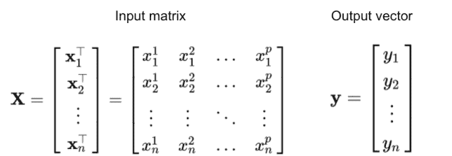

图 2.2 输入矩阵和输出向量的分解。输入矩阵也称为设计矩阵，是一个包含一个或多个输入特征的二维数组。输出向量是一个一维数组。

下面的代码清单演示了如何使用随机生成的数字创建作为一维数组的向量和作为二维数组的矩阵。

清单 2.1 创建随机数向量和矩阵

```
import numpy as np #A
np.random.seed(1) #B
x = np.random.randn(5) #C
>>> x
array([ 4.17022005e-01, 7.20324493e-01, 1.14374817e-04, 3.02332573e-01,
       1.46755891e-01])
X = np.random.rand(2,3) #D
>>> X
array([[ 0.09233859, 0.18626021, 0.34556073],
       [0.39676747, 0.53881673, 0.41919451]])
```

#A 广泛用于科学计算的包
#B 固定随机种子以便复现
#C 生成作为一维数组的随机数列表
#D 生成作为二维数组的随机数列表

我们可以看到向量和矩阵在 Numpy 中是如何表示的，Numpy 是最广泛使用的科学计算包之一。例如，我们生成了五个随机数并存储在变量 x 中。打印它会给出由数组指示的数据类型，以及包裹在一对方括号内的五个数字。同样，由两行三列组成的矩阵被创建并存储在变量 X 中，其显示为一个二维数组，其中的数字包含在嵌入的一对方括号内。我们可以继续此过程来创建三维或更高维度的数组。

### 2.1.1 从底层数据分布中采样

请注意，实际训练数据集 (X,y) 常被假定源自一个底层数据生成分布，即 (X,y) ~ P(x,y)。在实际中，P(x,y) 对我们是未知的。如果我们能获取 P(x,y)，问题本身将迎刃而解。此外，(X,y) 只是一组观测值，这些观测值在从 P(x,y) 绘制这些随机样本后，被假设为独立同分布（i.i.d.）。如果我们继续从真实分布 P(x,y) 绘制样本并生成更多数据集，我们可能会得到一个与 (X,y) 不同的训练数据集实例。事实上，这正是数据增强背后的动机，数据增强是一种为训练目的创建额外人工样本（称为自助样本）的技术。通过人工生成更多训练集，模型将接触到更多的数据集实现，并希望学会对数据的变化变得更加稳健。生成的样本可能并不总是有助于模型学习，因为它可能比原始数据集包含更多无关样本，但总体而言，在训练数据集中暴露更多变化有助于改进模型训练。训练集 (X,y) 的实际快照与真实数据生成分布 P(x,y) 之间的关系在图 2.3 中有所说明。

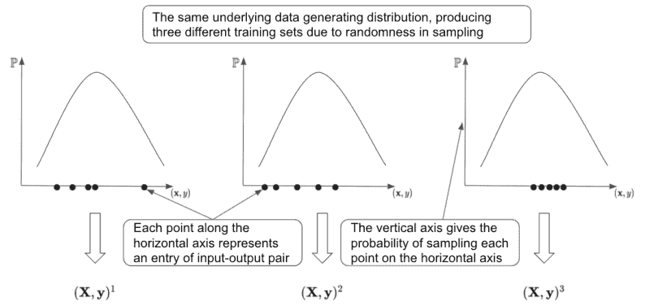

图 2.3 基于相同数据分布生成三个不同训练集的简化过程。每个训练集包含从相同概率分布中随机采样的五组不同的输入输出对。由于采样的随机性以及可能的噪声扰动，生成的训练集很可能各不相同。

基于图 2.3，显而易见，可用的训练集只是许多可能变体中的一个快照。如果我们从底层数据分布 P(x,y) 采样另一个训练集，它也很可能会发生变化。同时还应注意，X 和 y 都可能包含连续或离散变量。在我们后面的示例中，我们关注线性回归模型，该模型假设 y 为连续变量。

让我们在代码中观察采样的变异性。回顾之前我们使用函数 `np.random.rand()` 来创建随机数。该函数基本上是在 [0,1] 范围内均匀地绘制指定数量的随机数。换句话说，它遵循零到一之间的均匀分布，其中每个候选数字被采样的概率相等。然而，我们可以将范围更改为另一个范围。我们也可以假设一个不同的概率分布，例如正态分布，其由均值（中心趋势）和方差（离散程度）特征化，具有不同的分布特征。下面的代码清单演示了这些差异。

清单 2.2 从不同分布观察采样变异性

```
x = np.random.uniform(-1,0,5) #A
>>> x
array([-0.3147805 , -0.79554775, -0.12188256, -0.97261241, -0.32953249])
x = np.random.uniform(-1,0,5) #B
>>> x
array([-0.5826952 , -0.44131017, -0.85961306, -0.80189851, -0.19925543])
x = np.random.normal(1,2,5) #C
>>> x
array([2.45995119, 1.74598758, 2.06762182, 0.8160534 , 4.82764078])
```

#A 从 -1 到 0 的均匀分布中绘制随机样本
#B 再次绘制很可能会得到一组不同的数字
#C 更改为均值为 1、方差为 2 的正态分布

从绘制输出可以看出，所有三个向量都包含一组不同的数字。绘制五个数字的列表可能有无限多种可能性。一方面，我们无法获取真实底层分布的类型。它可能是某个范围的均匀分布、具有特定均值和方差的正态分布，或是任何其他由某些参数控制的复杂分布类型。另一方面，即使我们知道底层数据生成分布的类型和参数，由于采样本身的随机性，每次采样也会得到一组不同的数字。然而，在第二种情况下，我们可以轻松训练出一个好的模型，因为我们可以简单地不断生成不同版本的训练数据并输入模型；即使使用简单的模型，预测问题也可以轻松解决。

### 2.1.2 训练-测试划分

机器学习模型的主要目标是在未来的未见数据集（称为测试集）上产生良好的预测结果。然而，测试集对我们不可用，而数据集 (X,y) 是我们拥有的全部。为了更好地评估模型在测试集上的预测性能，常见的做法是分配 (X,y) 的一小部分，记为 (X,y)test，作为未来未知测试集的代理。这有两层含义。首先，(X,y)test 不会用于训练模型。事实上，在训练期间我们不应向模型暴露 (X,y)test 的任何部分；这样做有可能窥探未来的风险。其次，(X,y)test 作为模型在未来可能不同的测试集上的泛化性能的代理。这意味着，由于可能存在数据漂移，即数据集之间的分布差异，(X,y)test 可能或不可能是一个好的代理，这使得在模型估计之外多出一层不确定性。

移除 (X,y)test 后，(X,y) 的其余部分通常进一步划分为训练集 (X,y)train 和验证集 (X,y)val。(X,y)train 是原始 (X,y) 中唯一用于模型训练和参数估计的部分。模型会经历一个优化过程，尽可能拟合给定的训练集 (X,y)train。由于典型的机器学习模型涉及一些手动预定义的超参数，不同超参数配置的效果由 (X,y)val 进行评估。(X,y)val 是未来未见测试集的另一个代理，类似于 (X,y)test；区别在于 (X,y)val 用于整体模型训练过程中的超参数调整，而 (X,y)test 仅用于评估训练好的模型的泛化能力，不参与模型训练。在某些情况下，(X,y)val 被视为 (X,y)train 的一部分，因此整个数据集被分成两个子集：(X,y)train 用于模型训练，(X,y)test 用于模型评估。

显然，在选择 (X,y)train、(X,y)val 和 (X,y)test 时存在选择偏差的潜在风险；我们可能只是碰巧选择了一个 (X,y)train，并产生一个在 (X,y)val 和 (X,y)test 上都泛化良好的模型。选择 (X,y)train 和 (X,y)val 的风险由交叉验证解决，交叉验证是一种系统地多次重复划分的技术。为了降低这种风险，可以采用嵌套交叉验证。

将原始数据集分割为 (X,y)train、(X,y)val 和 (X,y)test 在模型训练工作流程开始时执行。根据数据集的大小，划分比例对于小数据集可能是 6:2:2，对于大数据集则是 8:1:1。

图 2.4 说明了将同一数据集划分为三个互斥且合并详尽的子集的常见经验法则：训练集、验证集和测试集。由于每个子集服务于不同的目的，因此必须多次重复随机划分以避免选择偏差。当测试集用于模型选择（即识别在测试集上误差最低的最优模型）时，测试集性能被视为未来未见数据真实性能的最佳代理。请注意，严格的评估（如许多建模竞赛）需要一个单一、充分且具有代表性的测试集，以避免将测试集暴露给模型训练，即数据泄露。


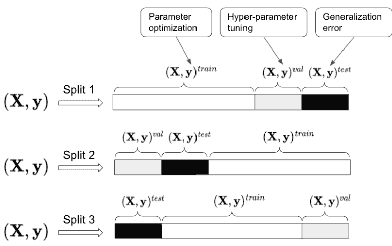

图 2.4 将相同数据集划分为训练集、验证集和测试集的三种不同方式，其中训练集用于根据特定目标优化模型参数，验证集用于帮助选择最佳的一组超参数，测试集用于评估模型泛化效果。根据数据集大小，划分比例对小数据集可能是 6:2:2，对大数据集可能是 8:1:1。

让我们通过一个玩具数据集来可视化训练集和测试集的划分过程。下面的代码清单将随机值集作为输出，相应的索引作为输入。设计矩阵 X 和目标标签 y 均表示为 numpy 数组以实现高效计算。两者都包含一个一维数组，即一系列标量值组成的向量。

```
Listing 2.3 Train-test split

import random

X = np.array(range(10)).reshape(-1,1) #A
y = np.array([1.5, 2.5, 3.7, 3.8, 5.1, 5.8, 6.2, 5.6, 5.2, 5.3]).reshape(-1,1) #A

train_ratio = 0.8 #B
train_idx = random.sample(range(len(X)), int(train_ratio*len(X))) #C
X_train = X[train_idx] #D
y_train = y[train_idx] #D
X_test = X[idx for idx in range(len(X)) if not idx in train_idx] #E
y_test = y[idx for idx in range(len(X)) if not idx in train_idx] #E

#A Reshape to a column representation, -1 means the number of rows is inferred
#B Define the split ratio for the training set
#C Randomly sample a list of integer indexes to go into the training set
#D Allocate training and test set based on selected training indexes
#E Allocate training and test set based on indexes not in training set
```

请注意，X 和 y 在初始化时均显式转换为列向量，这与我们之前从数学上表示这些变量的方式相符。我们将其四舍五入为整数，以避免在根据预定义比例 train_ratio 分配训练样本大小时出现潜在的浮点问题。与直接分配元素不同，我们创建了一个变量来存储用于逐元素选择的索引。基于索引的引用是深度学习中的常见技术，尤其是在引用神经网络中的权重等多维张量时。

下面的代码片段可视化了训练集（蓝色圆圈）和测试集（红色星形）。它们的关系（如下图 2.5 所示）大致遵循二次模式。

```
import matplotlib.pyplot as plt
plt.rcParams.update({'font.size': 22})
plt.scatter(X_train, y_train, c='blue')
plt.scatter(X_test, y_test, c='red', marker="*")
plt.xlabel("x")
plt.ylabel("y")
```

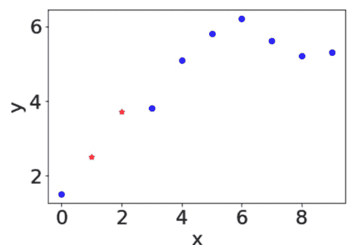

图 2.5 输入特征与输出目标之间的散点图，呈现出大致的二次关系。蓝色圆圈代表训练集，红色星形代表测试集。

我们可能可以通过调整以下值来猜测它是如何构建的，以遵循二次模式并注入少量噪声。或者，实际数据点可以基于特定的潜在真实函数来模拟。然而，在实践中，真实函数的形式几乎总是未知的。

请注意，交叉验证本质上是估计从同一数据生成过程中训练的其他未见数据集上的模型的平均预测误差，从而避免了 p-hacking（即在同一数据集上训练和测试模型开发的误用）。重复的随机外部样本测试有助于防止模型学习错误的正相关关系。

在以下内容中，我们将使用整个数据集进行训练，因此不会执行训练-测试划分。这是为了突出模型开发过程中的训练部分。然而，在实践中，拥有一个独立的专用测试集几乎总是客观评估模型性能所必需的。

## 2.2 模型

此前我们介绍了模型的四个组成部分，包括参数和架构。参数，也称为权重，是模型的可调节旋钮，每个都是一个标量值。我们希望根据某些标准获得最佳参数集。由于在线性回归设置中，一个特征通常对应一个权重，我们将使用 **w** 表示 **X** 中特征的权重集。即，**w**^T = [**w**₁,**w**₂, ... **w**ₚ] 表示我们希望优化的权重集。

如第 1 章所述，模型架构管理 **X** 中输入特征与 **w** 中权重之间的交互作用。模型通常假设过程为：**y** = f(**X**) + ε，其中 f 代表用于近似真实模式的假设函数形式，ε 表示加性随机噪声，通常假设该噪声与 **X** 不相关，并服从均值为零且方差固定的高斯分布。这些交互作用的输出形成了模型预测 ŷ^T = [ŷ₁,ŷ₂,...,ŷₙ]。

### 2.2.1 预测函数

迄今我们讨论的模型架构充当一个函数，以 **X** 和 **w** 作为输入并预测 ŷ 作为输出。换句话说，它是一个预测函数 ŷ = f(**X**;**w**) = f<sub>**w**</sub>(**X**)，其中输出 ŷ 同时依赖于 **X** 和 **w**。这也被称为参数模型，因为函数 f 由一组权重 **w** 参数化，并属于某个参数家族 F<sub>**w**</sub>。请注意，**X** 被视为不可更改的输入；它由初始训练集给出。然而，**w** 代表一组可变权重。

### 参数模型与非参数模型

参数模型是指形式特定且参数数量少且固定的函数。另一方面，非参数模型是具有许多自由参数的非常灵活的函数。线性回归是一个参数模型，因为它具有明确的模型结构和有限数量的参数。然而，深度神经网络模型取决于模型架构。从技术上讲，标准深度神经网络是一个参数模型，因为它具有固定数量的参数。然而，由于涉及大量参数，大多数深度神经网络可以解释为非参数模型。

在线性回归中，数据交互强调加权和，即 **X** 和 **w** 之间的矩阵-向量乘法，加上偏差项 w₀，假设对 **X** 没有额外变换。即，f(**X**;**w**) = w₀ + **Xw**。

### 矩阵乘法

矩阵由其形状（即行数和列数）来表征。如果矩阵包含 n 行和 p 列，则其形状为 (n,p)。给定两个矩阵 A（形状为 (n,p)）和 B（形状为 (q,k)），为了使它们的乘法可行，必要条件是“内维”相等，即 p = q。结果矩阵 AB 将采用“外维”的形状，即 (n,k)。进行矩阵乘法时，建议检查维度的变化。

### 2.2.2 偏置技巧

在线性回归中，通常引入偏差项 w₀，用于对预测输出进行全局平移，使得 ŷ = w₀ + Xw。额外项 w₀ 是一个可学习的参数，是应用于所有输出的全局调整。在线性回归设置中，它也被称为截距项。

在实际实现中，通过编写 ŷ = Xnew Wnew 可以获得简化的线性代数形式，其中 Xnew 是通过将 X 开头的一列 1 追加到 X 而创建的新设计矩阵，而 Wnew 只是添加到权重向量 w 开头的一个额外参数。这被称为偏置技巧，允许我们使用矩阵-向量乘法的代数形式来表达相同的操作。此外，它还省去了为 w₀ 创建单独参数的麻烦，因为 Xnew 中的额外列 1 向量将简单地被视为一个单独的特征。因此，添加的列 1 向量可以使后续数学分析更加方便，除了通过将所有参数表示在一个向量中来实现更直接的实现之外。图 2.6 说明了这一过程。


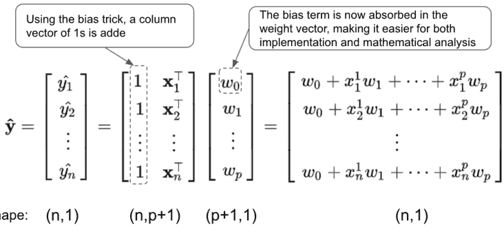

Figure 2.6 基于设计矩阵与权重向量之间线性运算的预测函数，使用偏置技巧实现。额外的全一列向量使我们免于单独维护偏置项参数，在数学分析和实际实现中都很方便。

### 2.2.3 实现预测函数

让我们在代码中实现预测函数，同时为方便起见加入偏置技巧。首先，通过在设计矩阵开头添加一个全一列向量来创建一个新的设计矩阵。在原始设计矩阵 X 的开头添加全一列向量可以使用 numpy 中的 hstack 函数实现。然后，我们按照标准正态分布初始化一组随机权重，偏置项会根据 X 的形状自动包含在内。请注意，权重向量的初始化只在训练过程开始时执行一次。随后，优化过程（稍后介绍）将基于初始值开始寻找最优权重。最后，当输入数据和权重准备就绪后，我们可以通过矩阵-向量乘法结合这两个组件（设计矩阵和权重）来为每个输入数据点生成预测。

```
Listing 2.4 Implementing the prediction function

X_new = np.hstack([np.ones_like(X), X]) #A
w = np.random.normal(0, 1, (X_new.shape[1], 1)) #B
f = X_new@w #C

#A Add the column vector of ones at the beginning
#B Initialize a random set of weights including the bias term
#C Generate element-wise prediction via matrix vector multiplication
```

鉴于权重向量 W 中的两个参数，所得到的模型是一条由截距 w0 和斜率 w1 参数化的直线。因此，任何预测都将落在这条直线上。下面的代码片段通过生成一组等间距输入并根据初始随机生成的权重计算预测输出来可视化这条直线。

下面的代码片段展示了如何在 Python 中可视化预测。

```
X_vals = np.linspace(X.min(), X.max(), 100)[:, np.newaxis] #A
X_vals_new = np.hstack((np.ones_like(X_vals), X_vals))
y_vals = X_vals_new@w #B

fig, ax = plt.subplots() #C
ax.scatter(X, y, c='black') #C
ax.set_xlabel('x', fontsize=25) #C
ax.set_ylabel('y', fontsize=25) #C
ax.plot(X_vals, y_vals, linewidth=2) #C
plt.show()#C
```

#A 在 x 轴上创建占位符列表并显式指定列维度
#B 生成预测列表
#C 绘制模型

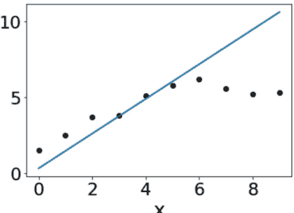

Figure 2.7 由直线表示的初始模型。拟合基于执行优化前的权重集，因此偏离目标。

如图 2.7 所示，初始拟合偏离目标，需要进行优化。优化通过朝着最小化预定义成本函数的方向调整两个参数来执行。我们现在介绍成本组件，随后详细讨论优化过程。

## 2.3 成本函数

每个模型都有一个关联的成本函数，用于衡量对训练数据的拟合优度。给定输入 x_i 的预测 f(x_i;w) 和第 i 个数据对应的目标 y_i，回归设置中的标量差异或残差 r_i 可以通过计算它们的差值得到，即 r_i = y_i - f(x_i;w)。这些残差在图上体现时，指的是预测与实际训练数据点之间在图上的垂直距离。有多种方法来聚合这些单个残差，其中最流行的是平方误差和（SSE）。SSE 定义为 Q(w) = L(yf_w(X)) = Σ_{i=1}^n 1/2 r_i^2 = Σ_{i=1}^n (y_i - f(x_i; w))^2，它不仅强制正负残差的符号一致性，而且由于平方运算，对较大残差施加更大的惩罚。它还使得在求解解析解或使用梯度下降等迭代程序时，后续优化更加容易（稍后详述）。

我们也可以通过将 SSE 除以（训练）观测数量来使用均方误差（MSE）作为成本函数，这在标准线性回归中更常用。SSE 和 MSE 由于具有相同的最小成本位置，因此给出相同的系数估计，尽管 MSE 可以大致了解平均预测与目标之间的差异。

此外，Q(w) 只是可变权重 w 的函数，而不是不可变设计矩阵 X 的函数。它是我们希望最小化的非负标量值。在后续关于经验风险最小化的章节中，我们将假设 X 也会变化。

### 2.3.1 使用线性代数表示成本函数

在线性回归的背景下，成本函数可以进一步写成 Q(w) = Σ_{i=1}^n (y_i - φ(x_i)w)^2，其中 φ(x) 是一种更通用的形式，用于指示对输入特征的额外变换。当不涉及变换时，我们仅有 φ(x) = x。此外，我们可以使用更简洁的线性代数形式表示相同的运算：Q(w) = (y - Φw)^T(y - Φw) = y^Ty - 2y^TΦw + w^TΦ^TΦw，其中 Φ 是 Φ = Φ(X) 的简写。这个等式基于 y^TΦw + w^TΦ^Ty 的事实，因为在这种情况下（一个标量）对称矩阵的转置等于其自身。以这种方式表示成本函数将有助于我们在计算其梯度时进行后续分析。

请注意，成本函数衡量基于当前权重向量的预测与目标值的接近或偏离程度。因此，成本函数的输出是一个需要使用特定优化程序来最小化的标量距离度量。请随意根据其定义展开 Q(w) 并验证其形状。图 2.8 总结了将 SSE 作为成本函数的不同表达方式。

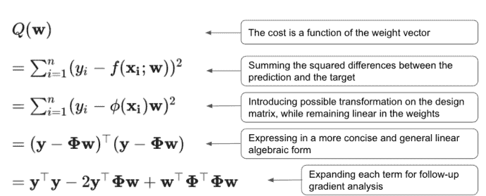

Figure 2.8 线性回归中相同 SSE 成本函数的不同表达方式。

注意：有多种方式来表达两个向量 a 和 b 的内积或加权和，它们全部等价：a · b = <a,b> = aᵀb = Σ_{i=1}^p a_i b_i，其中两个向量都包含 p 个元素。在向量 a 与自身相乘的情况下，这给出了与 SSE 中的平方和等价的形式：aᵀa = Σ_{i=1}^p a_i²。

我们现在有了一个成本函数，它也被称为目标函数或损失函数。成本函数充当权重向量 w 和标量成本 Q(w) 之间的一对一映射函数，是当前模型（具体来说，权重）表现如何的指标。我们可以先生成点向残差，然后对其自身进行点积来计算成本。下面的代码清单计算了标量成本值，基于随机初始化的权重，该值为 58。

```
Listing 2.5 Implementing the cost function
resid = y - f #A
Q = np.dot(resid.T, resid) #B
>>> Q
array([[58.46752305]])
```

#A 计算残差
#B 获取残差的点积作为总成本

接下来，我们介绍用于指导 w 修改以最小化 Q(w) 的优化过程。优化过程中涉及的特定程序也称为算法，旨在最小化标量成本 Q(w)。

## 2.4 优化算法

优化涉及基于特定程序调整模型参数，这是一种将预定义成本函数降至最小值的算法。换句话说，当成本函数被最小化时，就得到了最优权重向量 w*：w* = argmin_w Q(w)。在图上可视化成本函数时，其最小值表明该特定点处成本函数的导数为零。该最小点也称为驻点。

在多特征情况下，处于驻点意味着相对于当前权重向量的梯度向量在所有权重上都为零。请注意，梯度向量包含相对于每个权重的偏导数。基于先前的 Q(w) = y^T y - 2y^T Φw + w^T Φ^T Φw 定义及其仅对 w 的依赖性，其对 w 的导数可写为 ∇wQ = -2Φ^T y + 2Φ^T Φw。因此，优化的目标是达到一个所有 ∇wQ 元素均为零的驻点。该点随后代表一个可能给出最小成本的模型。图 2.9 总结了推导梯度向量 ∇wQ 的过程，该向量表示为列向量。


\nabla_{\mathbf{w}} Q = \frac{\partial Q(\mathbf{w})}{\partial \mathbf{w}} = \frac{\partial (\mathbf{y}^\top \mathbf{y} - 2 \mathbf{y}^\top \mathbf{\Phi w} + \mathbf{w}^\top \mathbf{\Phi}^\top \mathbf{\Phi w})}{\partial \mathbf{w}}
= -2 \mathbf{\Phi}^\top \mathbf{y} + 2 \mathbf{\Phi}^\top \mathbf{\Phi w}
= \begin{bmatrix} \frac{\partial Q(\mathbf{w})}{\partial w_1} \\ \frac{\partial Q(\mathbf{w})}{\partial w_2} \\ \vdots \\ \frac{\partial Q(\mathbf{w})}{\partial w_p} \end{bmatrix} = \begin{bmatrix} -2 \sum_{i=1}^n \phi_i^1 y_i + 2 \sum_{i=1}^n \phi_i^1 \sum_{j=1}^p \phi_i^j w_j \\ -2 \sum_{i=1}^n \phi_i^2 y_i + 2 \sum_{i=1}^n \phi_i^2 \sum_{j=1}^p \phi_i^j w_j \\ \vdots \\ -2 \sum_{i=1}^n \phi_i^p y_i + 2 \sum_{i=1}^n \phi_i^p \sum_{j=1}^p \phi_i^j w_j \end{bmatrix}

对权重向量 **w** 求导

梯度向量中每个得到的偏导数只是各自权重的一个函数

通过将梯度向量的每个元素设为零，我们可以求解驻点处的权重集合

**图 2.9 求解代价函数的梯度向量，其中每个条目都已展开以完全清晰。通过将每个偏导数设为零，我们可以求解驻点处的最优权重。注意，在求解方程组时，梯度向量中的每个条目只是当前权重的一个函数，与其他权重无关。**

由于每个方程在各自权重上是线性的，上述推导使得在驻点处求解最优权重变得容易。这种推导也是线性回归中推导闭式解的基础。

### 二次型的导数

代价函数 Q(W) 中的 W^TΦ^TΦW 项是 W 的一个二次形式。对 W 关于此项求导得到 2Φ^TΦW。为了了解其工作原理，我们可以将 Φ^TΦW 视为 W 的另一个函数 f(W)，并通过求总导数并应用链式法则：

```
(W^TΦ^TΦ)^T = (W^Tf(W))
= (f(W))^T + W^T(f(W))'
= W^TΦ^TΦ + W^TΦ^TΦ
= 2W^TΦ^TΦ
```

我们利用 W^Tf(W) 的对称性得到第二步中的第一项 ((f(W))^T。当矩阵对称时，它等于其转置。最后，行向量 W^TΦ^TΦ 可以转置为其对应的列向量 Φ^TΦW = (W^TΦ^TΦ)^T。

### 2.4.1 多个极小值

然而，这样的驻点可能不是唯一的。根据代价函数的形状，可能存在多个梯度为零的驻点。在这些目标候选点中，可能出现三种情况：

- 1. 这个驻点是我们寻找的唯一解。它是一个全局最优解，其代价在所有解中最小。当代价函数关于权重是凸的时，朝该点优化很容易实现。

- 2. 它是区域谷中的一个局部最优解。尽管其他谷可能有更低的代价，但最小区域代价仅相对于其邻域来推导。面对多个谷或局部最小值，如果不与所有局部最小值进行比较，就难以确定全局最小值。

- 3. 该点可能位于一个平坦区域，该区域内的所有点都显示零梯度。这称为鞍点。我们可能会很快在这个区域陷入困境，因为所有邻点都显示相同的代价。在没有代价函数完整图景的情况下，这种情况下确定全局最小值也具有挑战性。图 2.10 总结了这三种情况。

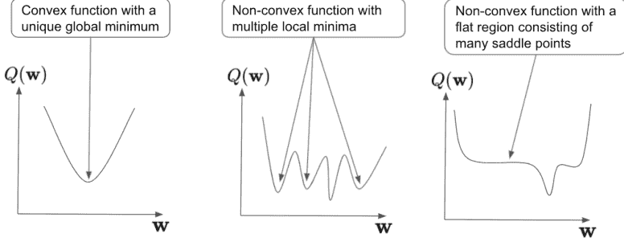

图 2.10 定位全局最小值时的三种不同情况。左图显示一个凸函数，其中唯一的局部最小值是全局最小值。中图包含多个局部最小值，右图有一个包含许多鞍点的平坦区域。所有这些点对权重向量 w 的梯度均为零。在没有代价函数完整图景的情况下，难以确定局部最小值是否为全局最小值。

在线性回归的情况下，代价函数 Q(w) 在 w 上是二次的，使其成为凸函数，因此容易定位全局最小值。例如，线性回归中的最优权重向量 w* 可以直接作为输入 X 和输出 y 的函数来计算。这种函数也称为闭式解。因此，只需将输入-输出对代入闭式解，就可以一步定位全局最小值，但由于矩阵奇异性等原因，这并不总是可用的。

模型培训本质上意味着按照特定算法迭代更新权重向量。当闭式解可用时，不需要这种迭代，因为我们可以一次性直接计算最优参数。在这种情况下，优化仅涉及一步计算。然而，在大多数情况下，由于代价函数具有高度复杂且可能非凸的结构，我们无法获得闭式解。

应当注意的是，驻点处的零导数可能暗示最小值、最大值或鞍点。在线性回归的情况下，包含代价函数二阶导数的海森矩阵可计算为 ∇²_w Q = 2ΦᵀΦ，这是一个正标量值。这表明代价函数的驻点恰好是一个全局最小值。由于海森矩阵给出的代价函数曲率是正定且恒定的值，驻点处得到的最优解是整个函数曲面上唯一的全局最小值。

在以下部分中，我们将首先讲解线性回归的闭式解的推导和实现，然后讨论基于最广泛使用的算法——梯度下降的替代方法。

### 2.4.2 线性回归的闭式解

为了找到代价函数的驻点，我们可以在将梯度向量中的偏导数设为零时求解权重向量：

```
-2Φᵀy + 2ΦᵀΦw = 0
```

其中 0 包含与方程组中每个条目对应的零向量。重新排列方程给出以下正规方程：

```
ΦᵀΦw = Φᵀy
```

这导出了最优权重向量 w* = (ΦᵀΦ)⁻¹Φᵀy 的闭式解，假设 ΦᵀΦ 是可逆的。虽然以这种方式表示 w* 使得数学上更容易跟踪，但计算矩阵逆项 (ΦᵀΦ)⁻¹ 计算量大，因为它本身还需要一个额外的算法。此外，这种计算还引入了潜在的数值稳定性问题。因此，在实践中，通常更倾向于基于 ΦᵀΦw = Φᵀy 的形式求解关于 w 的线性方程组。

回到我们对一元线性回归的示例，驻点处的最优权重向量 w* 可以通过 numpy 中的 linalg.solve 函数求解。在下面的代码清单中，我们将正规方程的左侧和右侧组件提供给优化过程，然后计算新的总代价。

```
Listing 2.6 Solving for the optimal weight vector via closed-form solution

w_star = np.linalg.solve(X_new.T@X_new, X_new.T@y) #A
f_star = X_new@w_star #B
resid = y - f_star #C
Q = np.dot(resid.T, resid) #D
>> Q
array([[6.33963636]])
```

#A 求解最优权重向量
#B 生成模型预测
#C 计算残差
#D 使用最优权重计算代价

存储在 w_star 中的闭式解随后可用于进行一组新的预测并计算新的代价，其值低至 6.3，相比基于随机权重向量的初始代价有了很大改进。

我们可以通过以下代码片段将新拟合的直线与实际数据点一起绘制。如图 2.11 所示，拟合现在总体上更接近训练点。

```
y_vals = X_vals_new@w_star
fig, ax = plt.subplots()
ax.scatter(X, y, c='black')
ax.set_xlabel('x', fontsize=25)
ax.set_ylabel('y', fontsize=25)
ax.plot(X_vals, y_vals, linewidth=2)
plt.show()
```


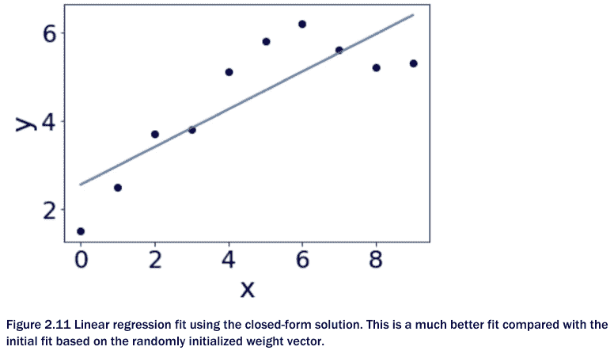

关于封闭式解中涉及的一次性计算，需要注意几点。首先，使用封闭式解可能需要昂贵的计算。例如，$\Phi^T\Phi$ 可能是一个非常大的稠密矩阵，使得无法一次性存储并可靠地计算解（尤其是矩阵逆）。其次，封闭式解本身可能并不总是可用，尤其是对于大多数非线性回归问题。在此类情况下，常见的方法是使用梯度下降等迭代方法，其计算效率要高得多。

### 2.4.3 梯度下降算法

梯度下降是一种针对可微代价函数工作的算法，它会迭代更新权重向量，朝着函数的驻点或局部最小值方向移动。虽然使用梯度下降有时可能会陷入局部最小值或鞍点，而不是全局最小值，但它仍然是深度学习领域最广泛使用的算法。如前所述，梯度是代价函数对权重向量中各权重当前值的偏导数的集合。这些偏导数衡量了当前权重对代价函数变化的敏感度。当梯度向量中的某个特定项很大时，该权重项的微小变化会导致代价发生很大变化。

在将代价作为权重的函数进行绘图时，梯度向量指示了在其邻域内朝着局部最小值的最陡下降方向。在权重向量只有一个元素的情况下，梯度对应于当前权重处代价函数的斜率。这意味着梯度向量关于下一次迭代提供了两类信息：改变权重的方向和变化的幅度。为了利用这两类信息，梯度下降算法采用以下方案迭代更新权重：

```
w ← w - η∇Q(w)
```

其中，← 符号表示将右侧的值赋给左侧。使用此公式，通过将**w**的当前值代入 **w** - η∇Q(**w**) 来计算新的权重向量**w**。η 是一个小的正数，通常称为学习率或步长。它是一个超参数，用于控制每次更新的幅度。由于目标是最小化代价函数，移动方向由等式中的负号进行修正。使用此更新方案，下一次迭代总是会朝着局部最优方向移动。这种直觉在图 2.12 中得到体现，该图展示了线性回归中关于单个参数的代价函数，每个图都有不同的起点。

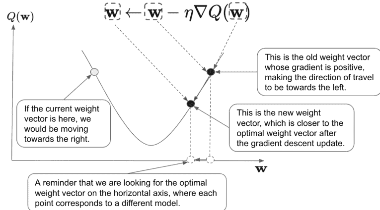

### 图 2.12 单变量线性回归中梯度下降更新算法的可视化。

由于更新等式的设计，在每次更新中给定合适的步长，新的权重向量将始终朝着最优权重向量移动。换句话说，该过程正在迭代寻找一个更接近最佳模型的更好模型。

在单变量线性回归的情况下，梯度下降更新将涉及两个参数来形成直线模型：截距或偏置项 w₀ 和斜率项 w₁。沿用我们之前的模型训练流程，我们将首先基于一组随机初始化的权重，为第 i 个观测生成预测 ŷᵢ = w₀ + w₁xᵢ，然后将其与真实目标值 yᵢ 进行比较，以产生误差项 eᵢ = yᵢ - ŷᵢ。代价函数可以通过求和平方误差来计算：\(Q(w_0, w_1) = \sum_{i=1}^n (y_i - w_0 - w_1 x_i)^2\)。然后，我们计算代价函数关于每个参数 \(w_0\) 和 \(w_1\) 的梯度，并使用这些梯度进行迭代更新。图 2.13 总结了单变量线性回归的推导过程。

### 图 2.13 使用梯度下降算法在线性回归中更新模型参数的方程组推导。

| 步骤 | 详细信息 |
|------|---------|
| 当前权重 | \(\mathbf{w}^\top = [w_0, w_1]\) |
| 随机初始化的模型权重 | |
| 计算每个观测的模型预测 | \(\hat{y}_i = w_0 + w_1 x_i, i = 1, \dots n\) |
| 计算当前代价 | \(Q(w_0, w_1) = \sum_{i=1}^n (y_i - w_0 - w_1 x_i)^2\) |
| 推导代价函数关于每个权重的偏导数 | \(\frac{\partial Q(w_0, w_1)}{\partial w_0} = \sum_{i=1}^n (-2)(y_i - w_0 - w_1 x_i)\)<br>\(\frac{\partial Q(w_0, w_1)}{\partial w_1} = \sum_{i=1}^n (-2x_i)(y_i - w_0 - w_1 x_i)\) |
| 执行梯度下降更新 | \(w_0 \leftarrow w_0 - \eta \frac{\partial Q(w_0, w_1)}{\partial w_0}\)<br>\(w_1 \leftarrow w_1 - \eta \frac{\partial Q(w_0, w_1)}{\partial w_1}\) |

从高层次来看，每组权重对应一个特定的代价，梯度下降算法通过迭代调整权重来寻找最小代价。在线性回归中，这种关系可以绘制为一个 3D 山峰，其中 x 轴和 y 轴分别表示权重 \(w_0\) 和 \(w_1\)，z 轴显示代价作为山峰的高度。梯度下降算法本质上是改变权重，将代价下降到山峰的山谷中。我们可以使用等高线图来可视化山丘，其中圆表示圆上所有点的代价相等。因此，我们的目标是沿着最陡下降方向调整当前权重，朝着中心点移动，即该区域内代价最低的驻点。

以下代码清单首先为 \(w_0\) 和 \(w_1\) 都创建一组候选值，然后计算每个独特参数组合的代价，以及初始起点处的偏导数。

### 清单 2.7 计算梯度

```
w0_vals = np.linspace(w_star[0]-3, w_star[0]+3, 100) #A
w1_vals = np.linspace(w_star[1]-1, w_star[1]+1, 100) #B
w0_grid, w1_grid = np.meshgrid(w0_vals, w1_vals) #C
Q_grid = np.zeros((100, 100)) #D
for i in range(Q_grid.shape[0]): #D
    for j in range(Q_grid.shape[1]): #D
        Q_grid[i, j] = ((y - w0_grid[i, j] - w1_grid[i, j]*X)**2).sum() #D
w0_grad = -2*(y - w[1]*X - w[0]).sum() #E
w1_grad = -2*(X*(y - w[1]*X - w[0])).sum() #F
```

- #A 在 w0 附近创建一组线性分离的值
- #B 创建一组线性分离的值
- #C 创建一个值网格以评估代价函数
- #D 计算 w0 和 w1 各组合处的代价函数
- #E 截距梯度
- #F 斜率梯度

我们根据以下代码将代价函数关于参数可视化为等高线图，其中每条虚线表示沿该线代价相等。星号表示初始起点，箭头指示下一次更新的方向，即朝着局部最小值的最陡下降方向。图示如图 2.14 所示。

```
f, ax = plt.subplots()
cp = ax.contour(w0_grid, w1_grid, Q_grid, colors='black', linestyles='dashed',
        levels=[0, 0.5, 1, 2, 4, 8, 16, 32, 64, 128, 256, 512])
ax.plot(w[0], w[1], 'g*', markersize=20)
ax.arrow(w[0][0], w[1][0], -w0_grad*0.001, -w1_grad*0.001, head_width=0.1)
plt.clabel(cp, inline=True,
        fontsize=10)
plt.xlabel('w0')
plt.ylabel('w1')
plt.show()
```

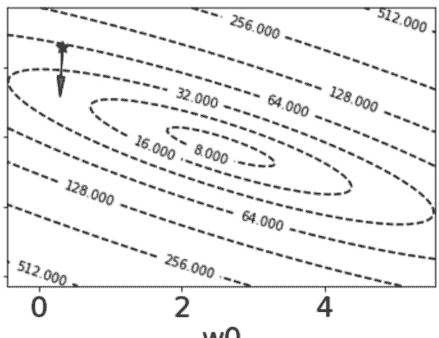

### 图 2.14 两个参数的代价等高线图。

同一条虚线上的点显示相等的代价。目标是从星号点出发，到达代价最低的中间点。箭头显示下一次迭代的移动方向。

优化过程可以通过对参数迭代应用梯度下降更新，逐渐将代价降低到局部最小值。以下代码清单执行固定次数迭代的更新，并在每 100 次迭代处绘制参数的临时位置。

### 清单 2.8 执行梯度下降更新

```
max_iters = 1000 #A
learning_rate = 0.001 #B
f, ax = plt.subplots() #C
cp = ax.contour(w0_grid, w1_grid, Q_grid, colors='black', linestyles='dashed',
        levels=[0, 0.5, 1, 2, 4, 8, 16, 32, 64, 128, 256, 512]) #C
ax.plot(w[0], w[1], 'g*', markersize=10) #C
plt.clabel(cp, inline=True,
        fontsize=10) #C
for i in range(max_iters): #C
    w0_grad = -2*(y - w[1][0] - w[0]).sum() #C #D
    w1_grad = -2*((X - w[1][1]*X - w[0])).sum() #C
    w[0] = w[0] - learning_rate*w0_grad #C #E
    w[1] = w[1] - learning_rate*w1_grad #C #E
    if i % 100 == 0: #C #F
        ax.plot(w[0], w[1], 'g*', markersize=10) #C #F
plt.xlabel('w0') #C
plt.ylabel('w1') #C
plt.show() #C
```

- #A 梯度下降更新的最大迭代次数
- #B 每次更新的学习率或步长
- #C 将代价函数绘制为等高线图
- #D 计算梯度
- #E 更新参数
- #F 每 100 次迭代绘制当前参数


图 2.15 显示了优化调度的输出。

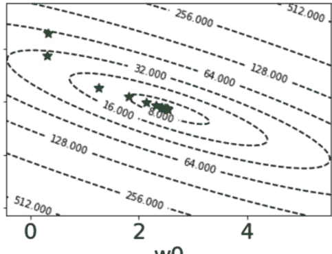

图 2.15 使用梯度下降算法迭代更新权重。随着优化的进行，代表参数位置的星号逐渐接近存在局部最小值的中间点。

请注意，通常会引入一个非常小的数字作为额外的容差参数，以确定优化过程是否应停止。例如，当每次更新仅导致参数值发生轻微变化时，如果参数值的绝对变化或相对变化小于预设的容差阈值，优化循环可以被终止，即使在达到最大迭代次数之前也是如此。

### 2.4.4 不同类型的梯度下降

在每次迭代中，梯度下降算法都需要使用完整的数据集 **_X_** 和 **_y_** 来计算梯度。当数据集大小 _n_ 较小时，运行梯度下降没问题。但是，_n_ 在某些情况下可能非常大。例如，金融交易数据轻松就能达到数百万或数十亿条记录。即使存储梯度是可能的，对完整数据集执行每次迭代更新也会极其缓慢。因此，更倾向于采用更高效的梯度生成方法。

在求导步骤中会使用完整数据集。在计算梯度向量 \(\nabla_{w1}Q = \sum_{i=1}^{n}(-2x_i)(v_i - w_0 - w_1x_i)\) 时，会使用从 _i_ = 2 到 _i_ = _n_ 的所有数据点。求和层级是对梯度下降进行进一步改进的地方。与其一次性传递整个数据集来更新参数，不如将完整数据集划分为不同的切片或批次，并使用分批版本的参数更新？这样一来，由于每次更新使用的数据集规模更小，执行速度和存储方面的问题就能得到缓解。

请回顾，单变量线性回归模型相对于单个特征的梯度是对 $n$ 个项的求和。等价地，这个梯度可以分解为一系列单独且按顺序进行的更新。这些单独且按顺序进行的更新的联合结果最终会导致相同的最终更新。图 2.16 展示了分解过程。

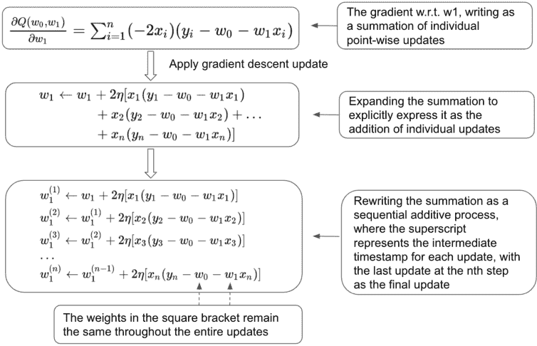

**图 2.16** 将梯度下降更新的计算重写为一系列单独的逐点更新。请注意，方括号中的权重在所有单独更新中保持不变。

需要注意的是，使用梯度下降算法时，每个单独更新的括号中的残差保持不变。这意味着所有中间参数更新都基于相同的原始参数值。

该梯度下降算法称为批量梯度下降算法，其中批量是指使用整个数据集。在批量梯度下降中，所有残差在更新参数之前都会被计算和聚合，从而使参数更新更加稳定。基于这些中间更新，或者等价地说，基于每次参数更新使用的数据量，梯度下降算法有两种常见的变体。

第一种变体是 *随机梯度下降*（SGD）算法，它一次基于一个数据点计算梯度，而不是对所有数据点求和。因此，将单个训练示例放入内存很容易，一次处理一个实例在计算上也很快。由于选择当前数据点的随机性以及计算逐点梯度，因此得到的梯度是基于完整数据集的原始梯度的随机估计。这些频繁的参数更新会导致权重的轨迹充满噪声但更加稳健，从而实现更快的收敛，尤其是在处理大型数据集时。此外，充满噪声的更新更有可能跳出潜在的局部最小值。

另一种变体称为小批量梯度下降，它在每次参数更新中使用的示例数量上介于批量版本和随机版本之间。通过将数据集拆分为小批次，小批量梯度下降算法既继承了批量梯度下降的效率和稳定性，也继承了随机梯度下降的稳健性和快速收敛性。这是训练深度神经网络时最流行的算法之一。

### 2.4.5 随机梯度下降算法

与梯度下降算法不同，SGD 在每次更新后使用最新的参数值来更改残差。这种操作使得在线学习等场景下的顺序更新变得容易，在线学习不需要访问整个数据集，新数据点作为数据流按顺序到达。

请回顾图 2.16 中分解的中间步骤，在一次梯度下降更新的所有步骤中，w0 和 w1 保持不变。然而在 SGD 中，它们在每个步骤中都会改变。在参数更新中随机选择每个示例后，随机更新序列如下：

```
$w_i \leftarrow w_1 + 2\eta[x_i(y_i - w_0 - w_1x_i)], i = 1..., n$
```

其中 $i$ 是从总共 $n$ 个示例中随机选择的索引。以下代码清单演示了使用一轮 SGD 进行参数更新的变化：

```
Listing 2.9 Performing one round of SGD update
index = np.random.randint(X.shape[0]-1) #A
w0_grad = -2*(y[index] - w[1]*X[index] - w[0]) #B
w1_grad = -2*(X[index]*(y[index] - w[1]*X[index] - w[0])) #B
w[0] = w[0] - learning_rate*w0_grad #C
w[1] = w[1] - learning_rate*w1_grad #C
```

#A 选择一个随机示例
#B 计算梯度
#C 更新参数

在 SGD 下，遍历整个数据集一次需要 n 轮更新。一次完整遍历也称为一个 epoch，模型训练通常需要多个 epoch 才能达到收敛。在全批量梯度下降的代码中，epoch 对应于 max_iters 变量。为了完整起见，我们展示了使用 SGD 的训练过程，其中大部分代码与全批量梯度下降类似。

清单 2.10 使用 SGD 进行优化

```
w = w_original #A
max_iters = 6000 #B
learning_rate = 0.001 #C
f, ax = plt.subplots() #D
cp = ax.contour(w0_grid, w1_grid, Q_grid, colors='black', linestyles='dashed',
                levels=[0, 0.5, 1, 2, 4, 8, 16, 32, 64, 128, 256, 512])
ax.plot(w[0], w[1], 'g*', markersize=5)
plt.clabel(cp, inline=True,
           fontsize=10)
for i in range(max_iters):
    index = np.random.randint(X.shape[0]-1)
    w0_grad = -2*(y[index]- w[1]*X[index] - w[0])
           w1_grad = -2*(X[index]*(y[index] - w[1]*X[index] - w[0]))
           w[0] = w[0] - learning_rate*w0_grad
           w[1] = w[1] - learning_rate*w1_grad
           if i % 100 == 0: #E
               ax.plot(w[0], w[1], 'g*', markersize=5)
plt.xlabel('w0')
plt.ylabel('w1')
plt.show()
```

#A 将权重重置为原始值
#B 梯度下降更新的最大迭代次数
#C 每次更新的学习率或步长
#D 将代价函数绘制为等高线图
#E 每 100 次迭代绘制当前参数

图 2.17 显示了使用 SGD 的权重轨迹，与使用全批量梯度下降的路径相比，看起来更加波动。然而，使用诸如动量和 Adam 等优化器变体来平滑剧烈的起伏并因此加速更新，不一定有助于其泛化性能。事实证明，这种波动性是使用 SGD 训练的模型具有良好泛化性能的重要原因之一。我们将在后续章节中更详细地讨论这一点。

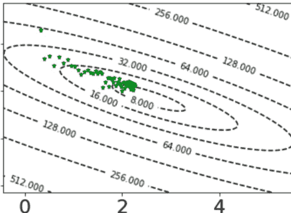

图 2.17 使用 SGD 的参数轨迹。由于在 SGD 更新的一个步骤中选择示例具有随机性，其轨迹明显比使用全批量梯度下降的路径更充满噪声。

### 2.4.6 学习率的影响

梯度下降算法族中使用的学习率是一个关键的超参数。该超参数通常在训练开始前通过手动或某些启发式方法确定，并在模型训练期间保持固定。在使用一批训练数据进行每一轮参数更新时，学习率保持固定，只更改参数。然而，不同参数更新轮次之间的学习率可能不同，并可设计为遵循预先分配的计划进行变化。

学习率 \(\eta\) 决定参数更新的步长。如果 \(\eta\) 太小，每次更新只会将参数轻微地朝最优值推动，导致收敛缓慢。然而，当 \(\eta\) 太大时，优化过程可能会发散，导致参数更新远离最优值。图 2.18 演示了这两种情形。


- 导致收敛缓慢的小型学习率

- 导致发散的大型学习率

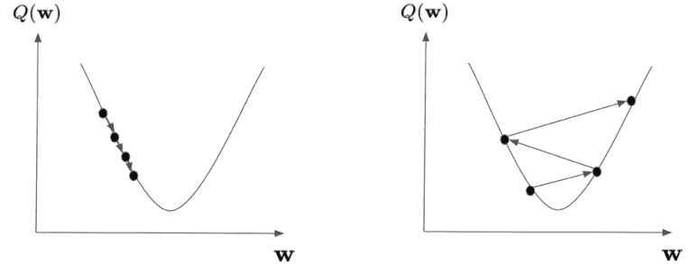

图 2.18 不同学习率下的两种可能情形。小型学习率会导致收敛缓慢，而大型学习率可能导致发散。

一种直观检查学习率是否设置得当的方法是绘制模型成本作为迭代次数的函数。我们可以将迭代次数设为横轴，成本设为纵轴，绘制每次梯度下降迭代后的成本。通过检查成本是否稳步下降，此图为我们提供了评估学习率超参数合适性的工具。当成本下降非常缓慢时，表明模型或多或少已收敛到一个稳定点。此监控工具还可帮助我们检测成本是否持续上升，这是发散的明显迹象。

图 2.19 汇总了不同学习率下成本作为迭代次数函数的曲线。

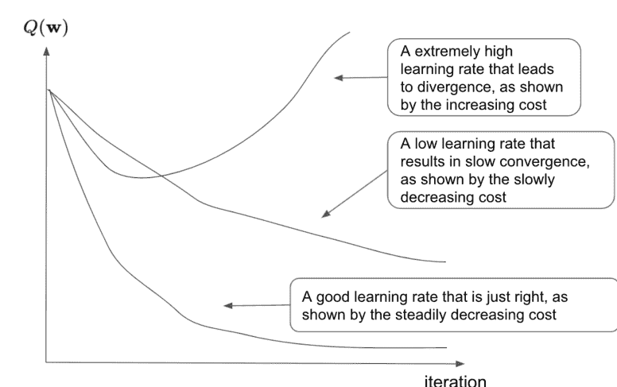

**图 2.19** 使用不同学习率绘制成本作为迭代次数的函数。高学习率可能导致发散，低学习率可能导致收敛缓慢，而合适的学习率会持续降低成本直到收敛。

在大多数梯度下降实现中，通常预设一个阈值来判断模型是否收敛，例如成本或权重的变化。此外，由于成本函数非凸且存在多个局部最小值，不同学习率在模型收敛时可能得到不同的成本。为此，我们通常采用多启动优化程序，包含多次优化运行，每次使用随机选择的起始点。

设置合理的学习率既是艺术也是科学。它通常是深度神经网络中调优的首要超参数之一。学习率的更动态调度可以折中处理：在初始训练阶段设置相对较大的学习率以加快收敛，并在训练接近收敛时逐渐降低。此外，较大的初始学习率还具有隐式正则化效果。我们将在后续章节进一步探讨此话题。

## 2.5 提升预测性能

预测性能本质上由模型复杂度决定，例如使用的权重数量。例如，欠拟合模型往往权重过少，而过拟合模型权重过多。因此，提升训练集预测性能的一种方法是增加模型中使用的可调权重数量。不过，这需要使用验证集进行适当校准，并使用测试集进行评估。

### 2.5.1 通过特征工程进行增强表示

由于权重向量 **w** 仅包含两个对应截距和斜率的元素，拟合直线将难以匹配数据中可能存在的非线性模式。然而，在某些情况下，线性模型仍然更受青睐，因为它具有直接可解释性：预测的变化直接且线性地反映输入特征的变化。可解释模型可以告诉我们驱动我们看到的预测结果的因素。强大但黑箱的模型（如神经网络）不提供这种直接可解释性。使用神经网络时，模型在其权重上不再是线性的，因为对权重引入了非线性转换（本章第 4 节将更多介绍）。从模型预测性能角度来看，神经网络中的非线性转换往往能获得原始特征空间的更好且更解耦的表示，而如果我们仅限于线性模型类，则不容易实现这一点。

然而，如果我们想保留线性模型的可解释性，同时又提升其预测能力，该怎么办呢？一种典型方法是采用特征工程，即基于原始特征生成额外的特征集。例如高阶多项式等额外特征可以给拟合曲线引入一定程度的曲率。在这种情况下，模型将具有更灵活的表达能力，能够学习可能的非线性模式。我们引入的不同阶数的多项式人工特征越多，模型就越灵活。

多项式是一种 **基函数**，可将原始特征转换到另一个特征空间。在示例中，我们在 **X** 中只有一个原始特征。添加额外的多项式项将扩大特征空间，从而使模型预测基于多个特征。随着生成更多多项式特征，模型的预测能力有可能得到提升。

### 2.5.2 二次基函数

由于图 2.5 中输入数据与目标值之间的原始关系看起来是二次关系，我们将使用二次基函数来扩充特征空间。二次基函数将原始的一维输入空间转换为一个新空间，该空间包含从零次到二次的三个多项式基函数。请注意，零次对应使用偏置技巧添加的全一向量，并在线性模型中起截距作用。

通过引入多项式变换，预测函数现在变为 \(\hat{\mathbf{y}} = \mathbf{\Phi}(\mathbf{X})\mathbf{w}\)，其中新的设计矩阵变为 \(\mathbf{\Phi}(\mathbf{X}) = [\mathbf{1} \mathbf{x} \mathbf{x}^2]\)，\(\hat{\mathbf{y}}\) 包含针对任何给定输入特征 \(x_i = 1, ..., n\) 的函数向量 \(w_0 + w_1 x_i + w_2 x_i^2\)。这导致设计矩阵从形状 \((n,1)\) 扩展到形状 \((n,3)\)，如图 2.20 所示。

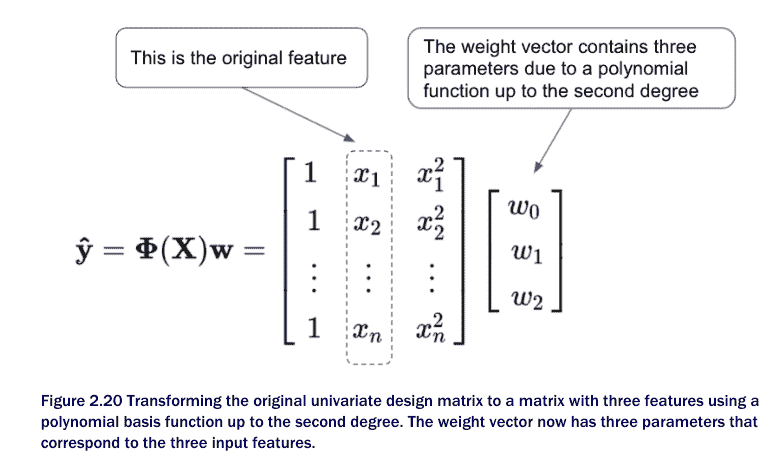

在下面的代码清单中，我们首先通过添加最高 2 次的多项式特征来创建增强设计矩阵，然后使用解析解导出最优权重向量。

**清单 2.11 使用多项式特征扩充特征空间**

```
X_poly = np.hstack([np.ones((X.shape[0], 1)), X, X**2])
w_star = np.linalg.solve(X_poly.T@X_poly, X_poly.T@y) #A
f_star = X_poly@w_star #B
resid = y - f_star #C
Q = np.dot(resid.T, resid) #D
>>> Q
array([[0.93895455]])

#A Solve for the optimal weight vector
#B Generate model prediction
#C Calculate the residuals
#D Cost with the optimal weight
```

目前的总成本为 0.94，相比于基于原始设计矩阵的先前解（6.3）有显著改进。通过向原始特征空间引入非线性变换，使用多项式基函数的这一特征工程技术可显著提升预测性能。

我们可以使用下面的代码片段可视化新模型。

```
X_vals = np.linspace(X.min(), X.max(), 100)[:, np.newaxis] #A
X_vals_poly = np.hstack([np.ones((X_vals.shape[0], 1)), X_vals, X_vals**2]) #B
y_vals = X_vals_poly@w_star #C
fig, ax = plt.subplots() #D
ax.scatter(X, y, c='black') #D
ax.set_xlabel('x', fontsize=25) #D
ax.set_ylabel('y', fontsize=25) #D
ax.plot(X_vals, y_vals, linewidth=2) #D
plt.show() #D

#A Create a list of equally spaced inputs on the x axis
#B Generate additional polynomial features
#C Generate the list of predictions
#D The same plotting codes
```

图 2.21 包含上述代码生成的图表输出。它表明，由于引入了最高 2 次的多项式增强特征，新模型已成功捕捉数据中的非线性趋势。

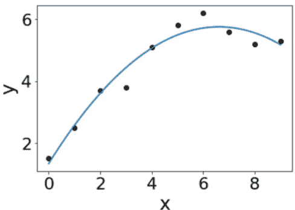

图 2.21 使用最高二次多项式的非线性曲线拟合。与原始直线模型相比，拟合效果好得多。

### 权重中的线性

值得注意的是，基函数引入的非线性变换仅适用于输入设计矩阵 X，而不适用于权重向量 W。由于 W 保持线性，得到的模型仍属于线性模型类。另一种情形是输出变量 ŷ 使用链接函数进行转换，从而得到所谓的广义线性模型 (GLM)。在这两种情况下，W 中的参数保持不变且为线性，使得拟合模型是线性的。

尽管增加的灵活性会降低成本，但这种灵活性可能导致过参数化且容易过拟合的模型。基于第 1 章的讨论，从经典统计学习角度来看，在训练集上过拟合的模型不太可能在测试集上泛化良好。为了形式化这一讨论，我们将更仔细地审视经验风险最小化。这是统计学习理论中的一个基本概念，有助于我们更好地连接成本最小化与模型泛化。


## 2.6 经验风险最小化

迄今为止，我们假设可用数据集 (**X**,**y**) 是从 𝕡(**x**,**y**) 生成的一组独立同分布（i.i.d.）样本，𝕡(**x**,**y**) 是我们未知的底层联合概率分布。模型开发的目标是利用数据集 (**X**,**y**) 迭代训练模型 *f*₩，并最终从候选模型总体 *F*₩ 中识别出最优模型 *f*⁕₩。当使用训练子集 (**X**,**y*)ᵗᵉˢᵗ 训练的模型在测试子集 (**X**,**y*)ᵗᵉˢᵗ 上产生最小成本 *Q*(**w**) 时，即确定了最优性，其中 (**X**,**y*)ᵗᵉˢᵗ 用作未来不可见数据的代理。

测试集误差对模型泛化误差的反映更具指示性。当模型复杂度增加时，模型会产生低甚至为零的训练误差。尽管使用特征工程等技术可以增强模型对训练集的拟合灵活性，但实际影响仍需通过测试集进行评估。迄今为止我们一直在研究的玩具示例仅关注训练集误差。训练好的模型仍需依赖单独的测试集进行更客观的性能评估。

测试集上的模型成本 *Q*(**w**) 告诉我们预测与真实结果相差多少。然而，测试集 (**X**,**y*)ᵗᵉˢᵗ 只是从 𝕡(**x**,**y**) 中可能抽取的众多实现之一。我们真正想要的是构建一个模型，使其在 (**X**,**y*)ᵗᵉˢᵗ 的所有不同变体中产生最小的预期成本。

期望一词意味着，在评估模型 *f*₩ 的成本 *Q*(**w**) 时，我们需要考虑 𝕡(**x**,**y**) 的所有可能实现。目前，我们将 *Q*(**w**) 写作 L(*y*,*f*₩(**x**))，以突出成本现在也是随机输入数据对 (**x**,**y**) 的函数，该数据对可能因从 𝕡(**x**,**y**) 进行随机采样而变化。预期成本也称为 *风险*，它衡量模型 *f*₩ 在所有可能未来 (**X**,**y**) 上的真实泛化误差。在数学上，模型 *f*₩ 的风险表示为：

```
$R(f_\mathbf{w}) = \mathbb{E}[Q(\boldsymbol{w})] = \mathbb{E}[\mathrm{L}(y, f_\mathbf{w}(\boldsymbol{x}))] = \int \mathrm{L}(y, f_\mathbf{w}(\boldsymbol{x})) \mathrm{d}\mathrm{P}(\boldsymbol{x}, y)$
```

这里，期望被展开为基于联合概率分布 𝕡(**x**,**y**) 所有可能数据实现上的积分。在线性回归中，风险的形式为所有可能 (**X**,**y**) 变体上的预期平方误差 R(*f*₩) = 𝔼[**y** − *f*₩(**X**)]²。

最小化预期风险将产生一个在未来测试集上平均泛化效果最好的最优模型。然而，由于联合数据分布 𝕡(**x**,**y**) 未知，真实风险而是通过经验风险项来近似，即基于预分配测试集 (**X**,**y*)ᵗᵉˢᵗ 的均方误差：

```
$R_{\text{empirical}}(f_\mathbf{w}) = \frac{1}{n} \sum_{i=1}^{n} L\left(y_i, f_\mathbf{w}(\mathbf{x}_i)\right) = \frac{1}{n} \sum_{i=1}^{n} \left(y_i - f_\mathbf{w}(\mathbf{x}_i)\right)^2$
```

其中 *n* 是测试集中样本的数量。经验风险最小化指出，最优模型 *f*⁕₩ 是使经验风险最小的模型：

$f_w^* = \text{argmin}_{f_w \in F_w} R_{empirical}(f_w)$

需要注意的是，\(R_{empirical}(f_w)\) 定义中的求和仅涵盖原始数据集的一个小测试子集。根据大数定律，当测试集中有足够多的样本时，经验风险 \(R_{empirical}(f_w)\) 将是真实风险 \(R(f_w)\) 的良好近似。

### 2.6.1 模型补充

迄今为止，我们一直使用 \(f_w\) 表示基于一组权重 **w** 正在开发的模型 \(f\)。目前，我们将使用 \(f\) 表示模型以进行更一般性的讨论。模型的选择可以是线性或非线性、参数或非参数。在线性回归中，模型 \(f\) 是由 **w** 参数化的线性模型。

模型训练意味着构建一个表示输入变量 **x** 与输出变量 y 之间真实映射关系的模型。将真实映射函数表示为 \(g\)，它是非随机的、一致的，并包含 **x** 与 y 之间的真实关系；这正是我们希望模型估计的关系。假设数据生成过程中的加性随机噪声为 \(\epsilon\)，我们可以将底层过程表示为 \(y = g(\mathbf{x}) + \epsilon\)，其中 \(\epsilon\) 是假设服从均值为零、固定方差 \(\sigma^2\) 的正态分布的加性随机噪声。

请注意，随机变量 \(\epsilon\) 表示由于测量误差或现实世界中其他误差来源产生的错误，在回归设置中假设其与随机变量 **x** 独立。因此，线性回归的目标是构建一个线性模型 \(f\)，在存在加性、独立且随机的噪声的情况下，尽可能接近地近似真实函数 \(g\)。考虑到可用数据集 **(x,y)** 对来自 \(\mathbb{P}(\mathbf{x},\mathbf{y})\) 的所有不同数据变体的代表性有限，我们希望构建一个模型 \(f\)，其预期输出与 \(g\) 匹配。在数学上，我们将选择一个模型 \(f\)，使得 \(\mathbb{E}[f(\mathbf{X})] = \mathbb{E}[y|\mathbf{x} = \mathbf{X}] = \mathbb{E}[g(\mathbf{X}) + \epsilon|\mathbf{x} = \mathbf{X}] = \mathbb{E}[g(\mathbf{X})] + \mathbb{E}(\epsilon) = g(\mathbf{X})\)。

### 2.6.2 偏差与方差分解

如第1章所述，在训练模型 \(f\) 时，需要权衡两种误差来源：偏差和方差。偏差是指模型能力不足以完美拟合 \(g\) 所导致的误差；这是欠拟合场景。例如，使用线性模型 \(f\) 拟合非线性二次模式 \(g\)。方差是指由于拟合被数据中的随机噪声 \(\epsilon\) 损坏的虚假关系而导致的误差；这是过拟合场景。例如，使用线性模型 \(f\) 拟合线性模式 \(g\)，但 \(f \neq g\)。

在讨论真实统计风险之后，我们现在来看分解新未见输入 \(\mathbf{X}_{new}\) 的预期风险的方法。为简化记号，我们将记 \(f(\mathbf{X}_{new}) = f\) 和 \(g(\mathbf{X}_{new}) = g\)。经过一些数学推导，预期平方误差现在可以分解为三个部分：模型的平方偏差和方差（被认为可通过训练过程降低），加上噪声的方差（被认为不可降低）。请注意，完全可以跳过推导，直接看到分解过程的结果。主要结论是，风险可以分解为这三个不同的部分。图 2.22 说明了推导过程。

```
R(f) = E[(y - f(X_new))^2 | x = X_new]
= E[(y - f)^2]
= E[(y - g + g - f)^2]
= E[(y - g)^2] + E[(g - f)^2] + 2E[(y - g)(g - f)]
= E[(g + \epsilon - g)^2] + E[(g - f)^2] + 2E[(gy - fy - g^2 + fg)]
= E[\epsilon^2] + E[(g - f)^2] + {2(g^2 - gE[f] - g^2 + gE[f])}
= \sigma^2 + E[(g - E[f] + E[f] - f)^2]
= \sigma^2 + E[(g - E[f])^2] + E[(f - E[f])^2]
= [\sigma^2] + [Bias^2[f] + Var[f]]
```

- 框 1: 我们在这里使用了一个技巧，即加上并减去一个额外项
- 框 2: 代入 y 的定义，得到噪声的方差
- 框 3: 这是由于测量误差或其他潜在和未知误差来源产生的不可减少部分
- 框 4: 引入期望后，所有项都抵消了；这是使用该技巧的结果
- 框 5: 再次使用相同的技巧
- 框 6: 省略详细信息，因为这涉及与上述相同的推导过程
- 框 7: 这是模型偏差和方差的定义；可由训练过程处理的可减少部分

图 2.22 将风险分解为不可减少部分（即误差项的方差）和可减少部分（即模型的平方偏差和方差）。请注意，在展开平方时，加上并减去一个额外项的技巧在推导中被使用了两次。

上述推导使用了以下事实：由于 g 是确定性且非随机的，因此 E[g] = g，同时 E[y] = f 且 E[\epsilon] = 0，其中 y 是 x_new 的观测目标。此外，E[f y] = E[f] E[y] = E[f] E[g + \epsilon] = E[f] (E[g] + E[\epsilon]) = g E[f]。

最小化风险本质上归结为减少三种误差来源中的一种或多种。由于随机噪声是我们无法控制的，它是一种不可减少的误差来源。然而，偏差和方差是由训练过程控制的可减少元素。简单模型通常具有高偏差和低方差，而复杂模型通常与低偏差和高方差相关联。这对应于偏差与方差权衡的经典统计观点：我们只能以另一种误差为代价来努力减少其中一种。这种权衡本质上限制了模型通过同时最小化两种误差来源来泛化到未来测试集的能力。这三种误差来源共同构成了未来不可见数据集上预期误差的下界。

然而，正如我们将在后面的章节中学到的，超参数化模型（如平滑样条和神经网络）即使在偏差为零时也可以继续降低方差，这似乎与统计观点相矛盾。


### 2.6.3 使用自助法理解偏差与方差

模型偏差是指期望模型预测（_f_）与底层真实目标 _g_ 之间的差距：_Bias_[_f_] = _g_ − E[_f_]。这里的期望再次考虑从相同的联合数据生成分布 P(**x**,**y**) 采样的数据集 (**X**,**y**) 的所有不同实现。有偏模型被认为对训练数据存在欠拟合，因为输入特征与输出标签之间的关系未被正确捕获。另一方面，偏差较小的模型能更好地捕获规律并很好地表示底层复杂性。

在图 2.22 中，平方偏差项可被视为模型中简化假设导致的误差，例如使用能力不足的线性模型 _f_ 来近似本质非线性模式 _g_。此类假设会导致对数据中真实模式表示不足。提升模型复杂度（如使用特征增强）可能会改善模型的拟合能力，从而因更好的近似而降低其偏差。不过，这样做可能会导致数据过拟合的风险。

另一方面，方差衡量 _f_ 围绕其均值的预期波动：_Var_[_f_] = E[(_f_ − E[_f_])<sup>2</sup>]。这种波动也指模型对数据可能变化的敏感程度。由于拟合了随机噪声，高方差模型会过于复杂，对数据中的微小波动过于敏感。请注意，高方差模型 _f_ 的复杂度水平是相对于当前数据集而言的，而不是底层函数 _g_ 的真实复杂度；后者在现实中通常要复杂得多。

由于偏差和方差都高度依赖于当前可用的数据集 (**X**,**y**)，量化模型对其他版本 (**X**,**y**) 的偏差和方差的一种方法是使用 _自助法_ 过程。自助法是一种通过从原始数据集 (**X**,**y**) 有放回地随机采样来生成人工数据集的技术。这些人工数据集现在作为来自 P(**x**,**y**) 的额外实现，可用于多次执行相同的模型拟合过程。得到的多个拟合结果可用于估计原始模型 _f_ 的偏差和方差。有关使用自助法估计偏差和方差的可视化说明，请参见图 2.23。

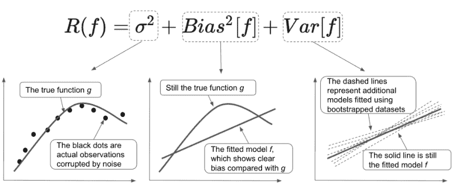

图 2.23 引入自助法后可视化模型风险的三个组成部分。最左侧的图显示了被随机噪声干扰的底层函数和实际观测值。中间图显示了拟合模型与真实函数之间的偏差。最右侧图显示了基于自助采样的虚线多个拟合结果以及实线的原始拟合模型。扩散程度显示了模型对训练数据的敏感程度。

自助法是一种强大的人工数据集工程技术。它属于更通用的集成学习思想，其中多次执行拟合并将其聚合以生成最终预测。额外的拟合可能来自新数据集或新模型架构，令人惊讶的是，这对应于通过数据或模型产生的正则化效果。我们将在后续章节中介绍关于自助法和集成学习的更多细节。

### 2.6.4 高模型复杂度下泛化能力下降

关于泛化的经典观点本质上指出，两个可减的误差源（即偏差和方差）无法同时降低。当偏差高而方差低时，模型相对简单且倾向于对训练数据欠拟合，这通常发生在训练的初始阶段。在这种情况下，通向经验风险最小化的一个常见方向是训练更复杂的模型。增加模型复杂度通常会导致偏差大幅下降和方差项略微增加，从而降低总体联合成本。这种偏差的增加意味着我们的模型在期望上会有偏差且偏离目标。然而，在构建可泛化模型时，经验风险最小化的总体收益仍超过了可能存在的有偏估计带来的不利影响。

关于泛化的经典观点还表明，高方差模型不太可能泛化到未来的测试集。当模型变得任意复杂时，它倾向于对训练数据过拟合，甚至有可能完美插值训练数据，导致训练误差为零。然而，此类模型往往具有高方差，因为它也拟合了训练数据中的噪声。因此，在使用模型对新数据点进行评分时，这些数据点的微小变化会导致非常不同的输出，使得预测变得敏感且不稳定。相比之下，一个好的模型在偏差和方差之间达到了恰当的权衡，避免了潜在的欠拟合或过拟合。平衡偏差和方差的模型也反映为第一章图 1.7 中的“最佳点”。

为了观察模型复杂化时方差的增加，我们将采用额外的特征工程，将多项式基函数的数量提高到更高的次数。与其多次运行相同的代码（每次使用不同的多项式次数），不如将多项式变换封装为一个更通用的函数。设计可复用的函数使得在变换中指定要执行的多项式次数变得灵活。下面的函数首先根据预定义的多项式次数创建一个作为占位符的矩阵，然后使用多项式函数填充该矩阵，从而实现这一点。

### 代码清单 2.12 基于多项式项生成新的设计矩阵

```
def polynomial(x, num_basis=2):
    Phi = np.zeros((x.shape[0], num_basis)) #A
    for i in range(num_basis): #B
        Phi[:, i:i+1] = x**i
    return Phi
#A Create the matrix of zeros as placeholder
#B Fill in each column based on the sequence of polynomials
```

我们可以使用此实用函数通过传入原始设计矩阵并指定基函数数量来创建新的设计矩阵。图 2.24 显示了使用三种不同数量的基函数及其各自代价拟合的模型。随着基函数数量的增加，模型变得越来越不稳定。有关完整的训练代码，请参阅 https://github.com/jackliu333/regularization_in_deep_learning 中的随附笔记本。

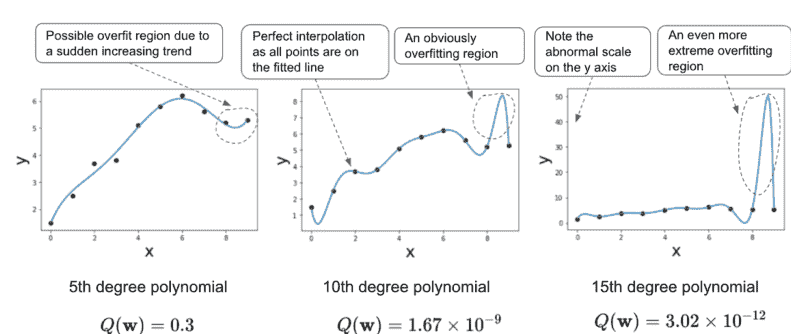

图 2.24 使用不同数量的多项式基函数拟合三个模型。左侧图与使用最高为 2 次多项式的模型相比，显示了更好的拟合效果。当多项式次数增长到 10 甚至 15 时，模型完美拟合所有数据点。然而，这需要以高方差为代价，尤其是在中间图和右侧图的右侧区域。

上图表明，当由于模型复杂度过高而存在高方差时，拟合模型对测试集的泛化能力较差。因此，偏差-方差权衡是经典泛化理论的核心：拟合模型需要找到“最佳点”并适当平衡欠拟合和过拟合。一个好的模型应足够富有表现力以表示数据中的底层模式，并足够简单以避免因随机噪声而拟合潜在的虚假模式。

## 2.7 总结

- 模型训练始于数据，通常分为三个子集：训练集、验证集和测试集，尽管验证集可能作为训练集的一部分被吸收用于模型训练
- 测试集用于评估模型的泛化性能并计算经验风险，作为真实风险的代理
- 特征工程（如添加多项式基）可通过将线性拟合转换为非线性拟合来增加模型复杂度
- 偏差技巧是一种常用的便捷技术，常用于简化机器学习模型的实现
- 均方误差是回归任务中广泛使用的代价函数，在线性回归中也称为经验风险
- 如果存在闭式解，优化可以一次性完成；否则，梯度下降族方法是最广泛使用的方法
- 梯度下降方法有三种类型：批量梯度下降、小批量梯度下降和随机梯度下降；区别在于每次梯度下降更新中使用的样本数量
- 设置合适的学习率对于确保模型收敛至关重要
- 风险可分解为三个误差源：来自随机噪声的不可减方差，以及模型的可减平方偏差和方差
- 关于泛化的经典观点指出偏差和方差之间存在权衡：与简单模型相比，复杂模型具有更低的偏差但更高的方差，并且由于高方差而不太可能在测试集上泛化良好


