# Generalization: A Modern View

## This chapter covers

- The modern view on generalization in machine learning and deep learning
- The "double descent" phenomenon of over-parameterized models and its connection with the classical bias-variance tradeoff
- The implementation of a smoothing spline model as an extension of the polynomial regression model with smoothness penalty
- The extension of the "double descent" phenomenon to both model iterations and sample size

One of the biggest takeaways in chapter 2 is the bias-variance tradeoff. According to the classical view on generalization, a model with excessive complexity will incur high variance and overfit the data, thus not generalizing to the future test data. A properly trained model should balance underfitting and overfitting: It should be complex enough to learn the underlying relationship and simple enough to not fall into a potential spurious pattern due to random noise in the data. This best model, based on the classical statistics, is identified at the "sweet spot" in the inverted U-shaped risk curve for the test set, as shown in figure 1.7 in chapter 1.

Interestingly, machine learning practitioners found that over-parameterized models such as deep neural networks tend to perform well in the test set, even when they fit the training set perfectly, i.e., the training error is zero. Under such circumstance, the model essentially interpolates and passes through all training data points when perfect fitting occurs, leading to zero training error. Nevertheless, these overly complex models can generalize well to the unseen test set. Such a phenomenon is an apparent contradiction to the classical view on generalization. How could an overly complex model manage to generalize even when it overfits the training data?

Many attempts have been made to understand why the empirically witnessed behavior in training modern machine learning models is at odds with the classical view on generalization. To better understand the phenomenon and possible drivers, we will first introduce the modern view on generalization and its connection to the classical view via the "double descent" curve. The "double descent" curve essentially describes a twofold descent risk curve. As the model becomes complex, we would initially observe a decreasing risk, which attains a minimum risk at the "sweet spot" and increases until the number of features equals the number of observations. However, as the model complexity increases, the test risk surprisingly decreases again for the second and final time.

This twofold descent performance curve, however, reconciles the classical view and the modern view on generalization. In the following, we will first provide the modern view on generalization and discuss the "double descent" phenomenon and the reasons behind its occurrence. We will then accompany these discussions with a concrete example on training an over-capacitated polynomial regression model with a smoothness penalty, a continuation of the example from the previous chapter.

## 3.1 A modern view on generalization

The primary goal of model training is to seek a model \( f_w \) out of the total space of model class \( F_w \) that minimizes the empirical risk \( \frac{1}{n} \sum_{i=1}^n L(y_i, f_w(\mathbf{x}_i)) \) on the test subset of the available dataset \( (\mathbf{X}, \mathbf{y}) \). By minimizing the empirical test risk as a proxy of the true unobservable risk, we hope to minimize the true risk \( \mathbb{E}(L(y, f_w(\mathbf{X}))) \). Under the framework of empirical risk minimization, classical statistics suggests controlling the model complexity by balancing underfitting and overfitting via the bias-variance tradeoff philosophy: a model \( f_w \) that has a larger empirical risk at the test subset will generalize poorly to the new data when it has either limited or excessive representational capacity.

The classical view on generalization is characterized by a U-shaped curve that signifies the bias-variance tradeoff. The curve usually represents the model’s test set performance as the empirical test risk as a function of model complexity. The training set’s performance curve is also plotted to verify the increased predictive power of the model. As shown in figure 3.1, the resulting figure is essentially an inverted version of figure 1.7, where the "sweet spot" indicates the model that reaches an optimal tradeoff between the bias and the variance.

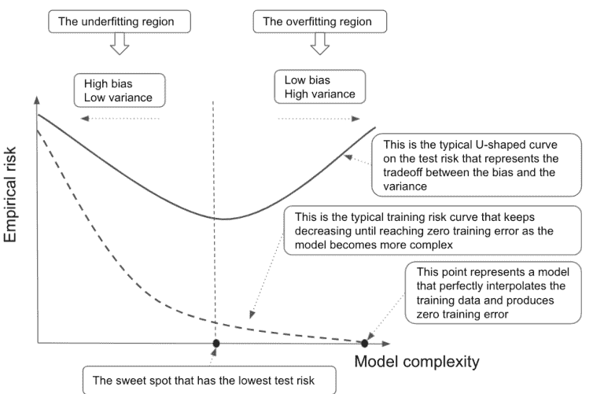

Figure 3.1 The typical U-shaped training and test risk curves that indicate the classical view on the bias-variance tradeoff. As the model becomes complex, both training and test risks will go down. However, when the model becomes overly complex and overfits the training data, the test risk will start to increase, despite continuously decreasing training risk.

Based on the classical view on generalization, the best model is the one that has the lowest empirical test risk, i.e., the model at the “sweet spot”. The region on the left of the “sweet spot” underfits the training data and fails to capture the true relationship due to an excessively simplifying assumption. This is the case when the (squared) bias term dominates the test risk. The region on the right of the “sweet spot” overfits the training data and generates unstable predictions due to an overly complex model capacity. This is the case when the variance term dominates the test risk.

Note that the model complexity can be controlled by regularization via data, model architecture, cost, optimization algorithm, or any combination of the four components. When the model complexity is properly controlled to strike a balance between underfitting and overfitting, it is expected to generalize well to future unseen data sampled from the total population. The classical U-shaped risk curve is thus widely used to guide model selection. In contrast, a model that gives zero training error at the interpolation threshold is said to interpolate the training data and would generalize poorly to the new data. Thus the conventional wisdom from classical statistics argues that larger models suffer in predictive performance once they overfit.

### 3.1.1 Beyond perfect interpolation

Complex models such as neural networks and nonlinear class of models tend to have very low, or even zero training cost. The zero training cost occurs when the model becomes sufficiently complex to interpolate the training data, as shown by the rightmost dot in figure 3.1. Perfect prediction in the training data happens when the number of weights p used by the model is precisely equal to the number of observations n in the training data. In the case of linear regression, when p = n, we solve a system of linear equations where the number of free variables, whose optimal values we are solving for, is equal to the number of linear equations in the system.

A simple example is a two-dimensional training set with two observation points on a coordinate system. When only one parameter is available, the model is reflected as a straight horizontal line in the coordinate system. This univariate model is too simple to fit these two points unless they happen to live along the fitted line. The resulting system of equations is said to be overdetermined and under-parameterized since we have more linear equations than the unknown variables in the system.

When we have two parameters to fit the model, the problem becomes solvable with a exact solution: two linear equations and two unknowns, a straightforward exercise in high school. We can fit a line anywhere in the coordinate system by adjusting its intercept and slope. The problem thus becomes fitting a line that passes through the two points. We can train a model that passes through the two points and produces zero training error, thus interpolating between these two points.

When there are more than two unknown variables, say we have three weights in the model, the problem becomes underdetermined and over-parameterized. The solution, when solvable, will be infinite. Having more than two parameters corresponds to fitting two points with a curved line. Any curve that passes through the two points produces zero training error, yet the curve can be arbitrarily wiggly and complex depending on the number of parameters used. Figure 3.2 summarizes these three scenarios.


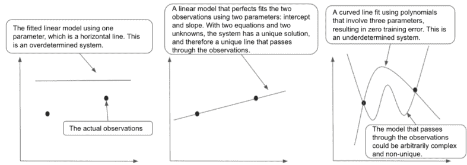

图 3.2 使用不同模型复杂度拟合两个二维观测值。左图包含一个 0 次多项式模型，仅含一个参数，因此是一条水平线。中图的参数数量与观测值数量相等，使得解唯一且精确。右图包含参数超过两个的模型，由于系统为欠定系统，解是非唯一的。

显然，当 p = n 时，即特征数等于观测值数量时，存在完美插值。当 p > n 时，完美插值仍然继续，此时方程组变为欠定且过参数化，导致存在无数解，对应于任意形状的模型。所有这些模型都通过观测数据点，因此训练误差为零。

因此，如果我们将图表向右延伸，即不断增加模型复杂度，训练风险将在完美插值点之后继续保持为零。测试风险呢？根据泛化的经典观点，当模型变得更复杂时，测试风险将继续飙升。然而，在实践中观察到的是图 3.3 所示的测试风险上的“双下降”现象，其中测试风险在某个点开始下降，甚至低于在“最佳点”处获得的最佳风险。

- 左侧是过定且欠参数化区域，反映了强调偏差-方差权衡的经典观点
- 右侧是欠定且过参数化区域，反映了大模型往往表现更好的现代观点
- 经典统计预期随着模型变得更复杂，测试风险会增加，而在实践中却惊人地下降
- 随着模型容量增大，测试风险继续下降，获得的测试风险甚至低于最佳点处的测试风险
- 插值阈值
- 第一个训练风险为零的完全插值模型。
- 插值阈值之后，所有模型继续保持零训练风险。

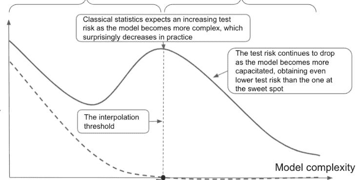

图 3.3 统一了泛化经典观点和现代观点的“双下降”曲线。当模型复杂度低于插值阈值时，经典偏差-方差权衡占主导地位，体现在随着模型表征能力增大，测试风险上升。然而，经过插值阈值后，测试风险开始下降。在两种情况下，随着模型复杂度增加，训练风险继续下降，并在超过插值阈值后保持为零。

这种“双下降”现象经常出现在机器学习模型中，例如前一章中的多项式回归和深度学习模型，如卷积神经网络。在欠参数化区域，随着模型复杂度增加，测试风险在第一次下降后随后增加，遵循强调偏差-方差权衡的 U 型曲线。当模型变得足够复杂以插值训练数据时，增加模型复杂度将进入过参数化区域并导致第二次下降。

然而，为何几乎普遍存在这种现象仍然是一个未被探索且令人兴奋的研究领域。在现代模式下，当模型过参数化时，事情变得违反直觉。例如，当深度神经网络中不存在特定的显式正则化技术时，通常会出现“双下降”现象。然而，使用适当的正则化技术可以避免它。此外，在现代插值模式下，更大规模的训练集可能会损害测试性能，这惊人地与我们更多数据能帮助模型学习的传统观点相矛盾。通过“双下降”现象理解模型性能勾勒出了经典统计观点的边界。它为机器学习和深度学习模型开发、评估和选择的统计与计算方面的进一步研究奠定了基础。

还需要注意的是，风险曲线上的每个点都代表使用特定算法（如随机梯度下降）训练的完全训练模型。假设我们在特定模型复杂度处进行垂直切割，那么训练风险表示使用该特定模型复杂度获得的最佳训练模型的训练性能。测试风险表示使用最佳训练模型在测试集上的相应风险。每个复杂度级别对应多个潜在模型，风险曲线仅显示每个复杂度级别最佳训练模型的性能。

### 3.1.2 “双下降”现象背后

尽管模型复杂度过高且对训练数据几乎完美拟合，但在超过插值阈值后增加模型复杂度会在测试集上产生低误差。这种经验观察在实践中指导了深度神经网络的训练：偏好使用足够大的神经网络，以便轻松插值训练数据集，从而在测试数据集上获得良好的泛化性能。即使训练数据受到高噪声水平的损坏，对大型复杂网络架构的偏好依然成立。

“双下降”风险曲线是一个框架，它调和了过参数化场景，并涵盖了偏差-方差权衡上的经典 U 型风险曲线。它反映的是被插值阈值分隔的现代插值模式，而非经典模式，即给出零训练误差的模型。当表征能力低于插值阈值时，风险曲线仍遵循平衡欠拟合和过拟合的经典模式。然而，当模型在超过插值阈值后增加容量时，测试风险将进入现代插值区域，并随着模型变得越来越复杂而降低。

请注意，表征能力或复杂度由模型中的参数数量表示。更复杂的模型意味着模型架构中使用了更多参数。当我们通过在模型架构中引入更多参数来增加表征能力时，我们会观察到测试风险下降，甚至低于经典模式下“最佳点”处达到的最佳风险。然而，为什么会这样呢？为什么更大的模型突然表现更好，即使它们过拟合了？

最广泛接受的解释之一在于第一章中提到的奥卡姆剃刀：当多个模型对数据拟合得同样好时，应优先选择最简单、最平滑的模型。衡量模型平滑性的一种方法是参数的范数。权重范数较小的模型被认为更规则、更平滑。模型中假设的这种规则性和平滑性代表了重要的归纳偏置，复杂模型试图匹配这种偏置。因此，当多个模型给出零训练误差（这可能指示同样好的局部（也即全局）极小值时，将选择权重范数最小的模型。这种归纳偏置是在从许多精确拟合训练数据的潜在候选函数中选择模型时引入的。

除了功能范数之外，还可以使用其他技术来控制模型的平滑性。例如，随机梯度下降是一种隐式正则化器，它在许多完美插值模型中偏好平滑且低方差的模型。如袋装法（自助聚合，将在后面章节中介绍）之类的平均技术也对拟合曲线的平滑性产生一定的正则化效果。

当多个模型给出零训练误差时，随机梯度下降偏好低方差模型，这由较小的权重范数表示。虽然在大函数类的过参数化区域中，会选择范数较小的模型，但由此产生的“简单”模型在模型预测中也具有较低方差。这种低方差模型源于使用随机梯度下降算法训练深度神经网络时的隐式正则化效应。有一个正在进行的研究方向专注于理解这一特定算法本身。我们将在后面关于使用优化进行正则化的章节中进一步讨论此问题。

### 范数

范数可被视为衡量权重向量 W 的大小的实数。最常用的范数之一是 lp 范数，定义为 lp = (Σ_{j=1}^{D} |w_j|^p)^{1/p}，适用于权重向量 W^T = [w1, w2, ..., wD]。例如，当 p = 1 时，l1 = |w1| + |w2| + ··· + |wD|，这是 Lasso 回归中使用的一种惩罚形式。当 p = 2 时，l2 = √(w1^2 + w2^2 + ··· + wD^2)，这是 Ridge 回归中使用的一种惩罚形式。不同范数对模型具有不同的正则化影响，这将在后面关于通过模型代价进行正则化的章节中介绍。

为了更好地理解这一现象，让我们重新查看图 1.15，并放大一组实现零训练误差并在测试集上泛化良好的模型，即区域 1 与区域 3 的重叠部分。如图 3.4 所示，这个重叠区域代表现代插值模式中一组可泛化的模型。


- 一系列插值模型，即训练误差为零，这是由于存在多个局部最小值
- 应用某些正则化策略后的一系列同等优秀的模型
- 获得零训练误差但在测试集上表现不佳的模型

在多个插值模型中，范数最小的模型往往泛化性能较好。换句话说，对权重的范数进行惩罚会产生显式正则化效果

- 一系列在测试集上泛化性能较好的模型
- 实现零训练误差并且在测试集上也泛化良好的模型
- 训练过参数化的深度神经网络时，由于隐式正则化效果，使用 SGD 倾向于落入此区域

图 3.4 不同模型集合的示例，表示为区域 1 到区域 3。使用高度表达性的模型（如深度神经网络）往往最终得到处于现代插值体系的模型，即区域 1 和区域 3 的重叠部分。

请注意，正则化模型不一定需要达到零训练误差才能在测试数据上泛化良好。当模型过拟合时，经典统计学建议使用适当的正则化技术来缩小模型容量，并逼近经典 U 形测试风险曲线中的“甜点位置”。或者，在现代深度学习时代，流行的做法是通过增加更多参数来提升模型容量，这将跳出过拟合区域并产生更低的测试风险。如下节所介绍，这本质上对应于从临界体系移动到欠参数化体系或过参数化体系，两者都具有低测试风险，尽管后者似乎更容易实现且更简单，只需在神经网络中添加更多参数即可。

### 3.1.3 扩展“双下降”现象

“双下降”风险曲线在机器学习和深度学习模型训练中被广泛观察到，作为模型复杂度的函数。迄今为止，模型复杂度一直关注模型的大小，即所使用的参数数量。后来发现，该现象也作为深度神经网络训练迭代次数的函数存在。这意味着，当模型架构固定时，使用 SGD 训练网络在参数随迭代收敛时也会呈现“双下降”测试风险。

统一“双下降”现象依赖关系的一种尝试是有效模型复杂度（EMC）的概念，其定义为训练过程平均能够实现接近零训练误差的最大样本数量。在训练深度神经网络的背景下，训练过程指定了模型的大小/复杂度以及给定训练集的 epoch 数量或完整遍历次数。

针对特定训练过程，经验上观察到了两种“双下降”曲线：

- 按复杂度划分的“双下降”，即随着模型使用更多参数并变得更加复杂，观察到双重递减的测试风险曲线；
- 按 epoch 划分的“双下降”，即对于固定复杂度的模型，随着训练迭代进行，最初观察到过拟合，随后通过足够的训练 epoch 得以纠正。

此外，两条曲线均通过将 EMC 与训练集大小进行比较，表征为三种不同的体系：

- 当 EMC 远小于训练样本大小时，我们处于欠参数化体系，模型对训练数据欠拟合。在特征数量较少的情况下，每个特征都捕获了一些关于底层模式的信息。无论是增大模型规模还是增加训练 epoch，改进训练过程都会降低训练风险和测试风险。然而，由于存在许多局部最小值，此体系中的优化较为困难。
- 当 EMC 远大于训练样本大小时，我们处于过参数化体系，模型对训练数据进行插值。无论是增大模型规模还是增加训练 epoch，改进训练过程都会降低测试风险。当参数多于样本时，优化相对容易，因为存在多个插值解，且这些解处获得的某些局部最小值同样是同样优秀的全局最小值。这类似于未定量的情况，即未知变量数量多于方程数量。
- 当 EMC 与训练集中的样本数量相当时，我们处于临界参数化体系。更改训练过程可能会增加或降低测试风险。每个特征的拟合变得不那么可靠，与前两种体系相比，这不太常见。

以上是研究界最近提出的非正式广义“双下降”假设。在此假设下，图 3.3 中之前的“双下降”风险曲线现在可以通过一种新的分区方法进行可视化，该方法包含三种不同的体系：欠参数化体系、临界体系和过参数化体系。如图 3.5 所示，欠参数化体系表示具有低 EMC 和相对较大数据集的模型；需要进一步挖掘（例如增加模型复杂度）来降低测试风险。模型 EMC 与测试风险之间相同的单调关系在过参数化体系中依然保持。然而，临界体系并不保证在增强模型训练过程时降低测试风险。

欠参数化体系，其中 EMC 远小于训练样本大小 n。改进训练过程将降低测试风险。

临界体系，其中 EMC 与训练样本大小 n 相当。改进训练过程可能会降低或增加测试风险。

过参数化体系，其中 EMC 远大于训练样本大小 n。改进训练过程将降低测试风险。

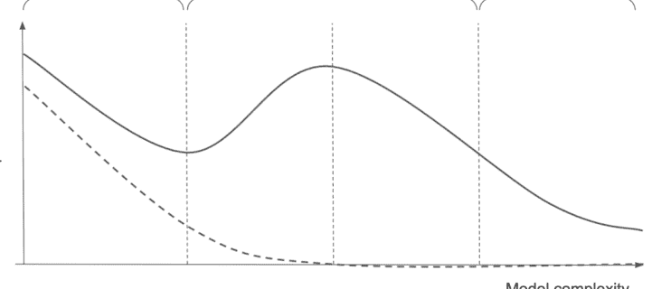

图 3.5 基于广义“双下降”假设的新分区方法。左侧和右侧区域都代表测试风险随训练过程改进而降低的区域，例如增大模型规模或训练更多 epoch。然而，在中间区域，如果训练过程发生变化，测试风险可能会增加或降低。

训练过参数化的线性模型（如前一章中多项式次数过高的多项式回归）时，对参数大小进行显式惩罚可以引入对更平滑函数的归纳偏置，从而提高泛化能力。训练过参数化的深度神经网络时，随机梯度下降算法通过偏好低方差模型发挥隐式正则化效果，从而提高泛化能力。下一节将重点介绍带有平滑约束的插值多项式回归模型的训练，并展示模型变得过于复杂时“双下降”现象的经验证据。

### “双下降”现象的简史

“双下降”现象在历史上长期被忽视，直到近年来才开始显现，这很大程度上是由于过去训练经典模型的典型工作流程所致。线性模型和参数模型通常假设具有固定且有限的容量水平，因为只使用了少数特征。特征数量通常远少于数据集中的观测数量。非参数模型族等强大模型使用平滑和正则化技术来控制模型复杂度。特别是，正则化缩小了模型的有效容量并避免插值，从而掩盖了“双下降”现象的发生。

该领域的几篇重要论文推动了对“双下降”现象的理解。例如，Belkin 等人在 2018 年的发人深省论文《协调现代机器学习实践与偏差-方差权衡》中正式讨论了现代插值体系。他们为广泛高复杂度模型中“双下降”现象的存在和普遍性提供了证据。在随后的一年，Nakkiran 等人在其发表的论文《深度双下降：更大的模型和更多数据可能适得其反》中，在深度神经网络中研究了这一现象，为模型大小和训练迭代次数的函数上双重递减风险曲线提供了额外证据。此外，作者还发现了样本非单调性现象：更多训练数据可能会损害测试性能。这将在后续章节中介绍。

## 3.2 多项式回归中的双下降

在前一章中，我们使用多项式回归研究了拟合一元预测变量 X 与结果变量 y 之间非线性关系的问题，其中 y 由 X 的某个多项式次数建模。换句话说，我们假设模型采用 y = fw(X) + ε 的形式，其中 fw(X) = Φ(X)w = Σp i=0 wiXi = w0 + w1X +···+wpXp 是 p 次多项式函数，ε 是均值为零且方差恒定的独立随机变量。例如，当使用最高 2 次多项式时，预测函数采用 fw(X) = w0 + w1X + w2X2 的形式。

训练模型需要识别最能拟合训练数据集的预测器的正确函数形式。然而，仅增加多项式次数会产生高方差的曲折拟合。如果我们能使用高次多项式生成准确的拟合，同时通过调整拟合曲线的平滑度来控制模型的曲折程度，那将非常理想。换句话说，一个在训练数据上拟合良好的模型也应该简单且平滑。

答案是平滑样条，它在拟合多项式回归模型时添加显式平滑度约束。在下一节中，我们将首先介绍平滑样条的建模细节，然后介绍其实现以关联“双下降”现象。

### 3.2.1 平滑样条

“样条”一词最初是指用于制作平滑曲线的工具。在经典统计学中，样条已被广泛用于通过首先识别连接两个平滑曲线的节点，并拟合两个相邻节点之间的曲线来生成灵活的形状。当


拟合曲线时，通常会对特定阶的导数施加额外约束，以确保曲线的平滑性和连续性。一种常见的选择是使用拟合函数的二阶导数，并在最小化模型预测与目标结果之间的*残差平方和*（RSS）时，对积分的二阶导数平方施加惩罚。将二阶导数上的惩罚表示为 $J(\mathbf{w}) = \int f''_w(x)^2 dx$。$J(\mathbf{w})$ 将用于控制模型的曲率。在这种情况下，得到的模型（称为平滑样条）具有以下代价函数：

$Q(\mathbf{w}) = \sum^n_{i=1} \left(y_i - f_w(\mathbf{x}_i)\right)^2 + \lambda \int f''_w(x)^2 dx$

其中，$\lambda$ 是一个权重因子，用于控制对训练数据拟合优度与生成函数形式粗糙程度之间的权衡。这是一个超参数，通常基于交叉验证程序进行选择。较大的 $\lambda$ 会生成平滑曲线，而较小的 $\lambda$ 会导致粗糙曲线。当 $\lambda$ 趋近于零时，代价函数将由 RSS 驱动，导致产生零训练误差但形状波动的插值样条。当 $\lambda$ 趋近于无穷大时，基于模型二阶导数的粗糙度惩罚变得至关重要，这将模型形式限制为线性。图 3.6 总结了惩罚代价函数中的两种对立力量。

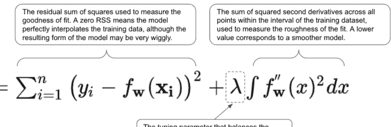

图 3.6 平滑样条模型的惩罚代价函数。除原始残差平方和外，还添加了额外的粗糙度惩罚，以鼓励模型采用平滑形式，该形式由超参数控制。

需要注意的是，第一导数表示拟合曲线的斜率，第二导数表示斜率的变化率。第二导数是曲线粗糙程度的度量，并在代价函数中作为惩罚项。曲线越粗糙，代价函数中的惩罚就越高。此外，这种粗糙度惩罚还省去了在拟合模型时决定使用多少个节点的麻烦。

### 3.2.2 重写平滑样条代价函数

回顾一下，线性回归的解析解可以通过将 $Q(\mathbf{w})$ 的梯度设为零并求解正规方程组来推导：$\Phi^T \Phi \mathbf{w} = \Phi^T \mathbf{y}$。在引入新惩罚项 $J(\mathbf{w})$ 后，为了推导解析解，我们将采用类似的方法，使用一阶梯度。

使用矩阵表示法，预测函数可以写成 \(f_w = \Phi w\)，其中 \(\Phi\) 表示用于推导新设计矩阵的多项式基函数列表，**w** 包含待优化的权重列表。我们现在可以重写代价函数如下：

\(Q(w) = ||y - \Phi w||^2 + \lambda w^T \Omega w\)

在新设计矩阵 $\Phi$ 中，$(\Phi)_{jk} = \phi_k(\mathbf{x}_j) = \mathbf{x}^k_j$ 表示将第 $k$ 个多项式函数 $\phi_k$ 应用到第 $j$ 个向量 $\mathbf{x}_j$ 上。双竖线表示 $\mathbf{y} - \Phi w$ 的平方范数，即各个残差平方之和。$\Omega$ 表示去除权重后的积分二阶导数，其中 $(\Omega)_{jk} = \int \Phi''(x) \Phi''(x) dx$。

正如我们在后面章节中将学到的，这种写法与岭回归的代价函数相似，惩罚项中额外加入了 $\Omega$ 项。对于熟悉岭回归的人来说，正规方程为 $(\Phi^T \Phi + \lambda \mathbf{I})w = \Phi^T y$，其中 **I** 表示单位矩阵，即主对角线上为 1、其余为 0 的方阵。我们的代价函数 _Q_(_w_) 的解析解更为通用：$(\Phi^T \Phi + \lambda \Omega)w = \Phi^T y$，当 $\Omega = \mathbf{I}$ 时，可简化为岭回归的解。图 3.7 从惩罚项、代价函数和正规方程三个方面总结并比较了三组模型。

| | 线性回归 | 岭回归 | 平滑样条 |
|---|---|---|---|
| **惩罚** | 无 | \(||w||_2^2\) | \(\int f''_w(x)^2 dx\) |
| **代价函数** | \(||y - \Phi w||^2\) | \(||y - \Phi w||^2 + \lambda ||w||_2^2\) | \(||y - \Phi w||^2 + \lambda w^T \Omega w\) |
| **正规方程** | \(\Phi^T \Phi w = \Phi^T y\) | \((\Phi^T \Phi + \lambda \mathbf{I})w = \Phi^T y\) | \((\Phi^T \Phi + \lambda \Omega)w = \Phi^T y\) |

图 3.7 在不同惩罚方案下总结惩罚项、代价函数和正规方程。

### 3.2.3 推导解析解

为了构建与线性回归情况类似的正规方程，我们将使用新符号 \(\Phi_+\) 表示增量的新设计矩阵，该矩阵由 \(\Phi\) 和来自惩罚项的额外行组成：$\Phi_* = \binom{*}{\lambda \mathbf{B}}$，其中 $\mathbf{B}^T\mathbf{B} = \Omega$。由于 $\Omega$ 是一个 \( p \times p \) 对称（方阵）矩阵，此步骤本质上将额外的 \( p \) 行连接到 $\Phi$ 上。需要注意的是，由于 \(\lambda\) 是正常数，因此按 \(\sqrt{\lambda}\) 缩放 $\Omega$ 是可以的。

同样，输出向量 \(\mathbf{y}\) 在末尾也扩展了 \( p \) 个零，形成新的输出变量 \(\mathbf{y}_* = \binom{\mathbf{y}}{\mathbf{0}}\)。基于原始正规方程 \(\Phi\mathbf{w} = \mathbf{y}\)，我们可以构建一组新的正规方程：\(\Phi_*\mathbf{w} = \mathbf{y}_* = \binom{\mathbf{y}}{\mathbf{0}}\)。然后我们可以两边同时乘以 \(\Phi_*^T\) 并继续推导过程：

```
\(\Phi_*^T\Phi_*\mathbf{w} = \Phi_*^T \binom{\mathbf{y}}{\mathbf{0}}\)

\((\Phi^T \sqrt{\lambda} \mathbf{B}^T) \begin{pmatrix} \Phi \\ \sqrt{\lambda} \mathbf{B} \end{pmatrix} \mathbf{w} = (\Phi^T \sqrt{\lambda} \mathbf{B}^T) \binom{\mathbf{y}}{\mathbf{0}}\)

\((\Phi^T \Phi + \lambda \mathbf{B}^T \mathbf{B}) \mathbf{w} = (\Phi^T \sqrt{\lambda} \mathbf{B}^T) \binom{\mathbf{y}}{\mathbf{0}}\)

\((\Phi^T \Phi + \lambda \Omega) \mathbf{w} = \Phi^T \mathbf{y}\)
```

这为我们提供了一组新的正规方程，其中额外项 \(\lambda \Omega\) 是由于对模型平滑性施加惩罚而添加的。我们也可以从代价函数的角度来处理推导过程。通过重新格式化输入和输出变量，我们现在可以将代价函数表示如下：

```
\(Q(\mathbf{w}) = ||\mathbf{y} - \Phi\mathbf{w}||^2 + \lambda \mathbf{w}^T \Omega \mathbf{w} = ||\mathbf{y}_* - \Phi_* \mathbf{w}||^2\)
```

这种形式与原始线性回归设置相似。将 \(Q(\mathbf{w})\) 的梯度设为零，得到以下正规方程：

```
\((\Phi_*^T \Phi_*) \mathbf{w} = \Phi_*^T \mathbf{y}_*\)
```

这可以使用前一章中相同的程序来求解。需要注意的是，新输出变量 \(\mathbf{y}_*\) 相比于 \(\mathbf{y}\) 包含一组额外的零，因此上述方程的右侧仍然等于 \(\Phi^T \mathbf{y}\)。在左侧，额外项 \(\lambda \Omega\) 被添加到原始的 \(\Phi^T \Phi\) 中，从而得到新的正规方程如下：

```
\((\Phi^T \Phi + \lambda \Omega) \mathbf{w} = \Phi^T \mathbf{y}\)
```

引入 \(\Phi_*\) 和 \(\mathbf{y}_*\) 在推导过程中具有多重好处。除了在求解最小二乘问题的典型框架下在概念上更为节省之外，它还有助于扩展到对惩罚项影响的新的几何视角。与 \(\Phi\) 相比，增量设计矩阵 \(\Phi_*\) 具有扩大的列空间，该空间从 \(\mathbb{R}^n\) 扩展到 \(\mathbb{R}^{n+p}\)。需要注意的是，惩罚矩阵 \(\Omega\) 将经历某种转换（例如特征值分解），以确保其列向量相互正交。因此，\(\Phi_*\) 中拉长的列向量将不再遭受共线性问题，如果


共线性存在于原始设计矩阵 $\Phi$ 中。此外，权重因子 $\lambda$（从技术上讲应为 $\sqrt{\lambda}$）越大，这些扩展列向量就越正交，从而使得正规方程的解也更加稳定。

请注意，我们也可以基于一阶条件，通过将梯度设为零，采用相同的方法推导出正规方程：

```
\frac{\partial Q(\mathbf{w})}{\partial \mathbf{w}} = \frac{\partial(\mathbf{y}-\Phi\mathbf{w})^T(\mathbf{y}-\Phi\mathbf{w}) + \lambda \mathbf{w}^T \Omega \mathbf{w}}{\partial \mathbf{w}} = -2 \Phi^T \mathbf{y} + 2 \Phi^T \Phi \mathbf{w} + 2 \lambda \Omega \mathbf{w} = 0
```

整理各项后，这会给出相同的正规方程 $(\Phi^T\Phi + \lambda \Omega)\mathbf{w}=\Phi^T \mathbf{y}$。不过，与前一种方法相比，这种方法无法提供相同的洞察。

另外，请注意矩阵乘法通常以对第一个矩阵转置开始。这取决于我们如何安排和解释矩阵的行和列，以便乘法结果与预期形状相匹配。

### 3.2.4 实现平滑样条模型

为了使用平滑样条模型观察“双下降”现象，我们将创建以下函数来表示真实的底层模式：

$$
y = ||x - 0.4| - 0.2| + \frac{x}{2} - 0.1
$$

这是使用平滑样条模型进行近似的真实分段线性函数。下面的代码清单实现了待近似的底层函数。

### 清单 3.1 定义真实的底层函数

```
def get_true_y(x):
    return np.abs(np.abs(x - 0.4) - 0.2) + x/2 - 0.1
```

然后，我们可以采样若干个等距输入点并获取相应的输出以进行绘图。这通过以下代码片段完成。

```
import math
import matplotlib.pyplot as plt
import numpy as np
from numpy import random
random.seed(1)
X_vals = np.linspace(0, 1, 100).reshape(-1,1)
y_vals = get_true_y(X_vals)
plt.plot(y_vals, color = 'r')
plt.title('Underlying true function')
plt.xlabel('X')
plt.ylabel('y')
plt.show()
```

- #A 导入必要的包
- #B 设置种子以确保可重复性
- #C 创建一组等距的 X 值
- #D 计算相应的真实 y 值
- #E 绘制真实函数

生成的输出如图 3.8 所示，它展示了一个由四个线性片段组成的分段线性函数。我们将构建一个具有不同数量多项式项的平滑样条模型，以近似底层的真实函数。

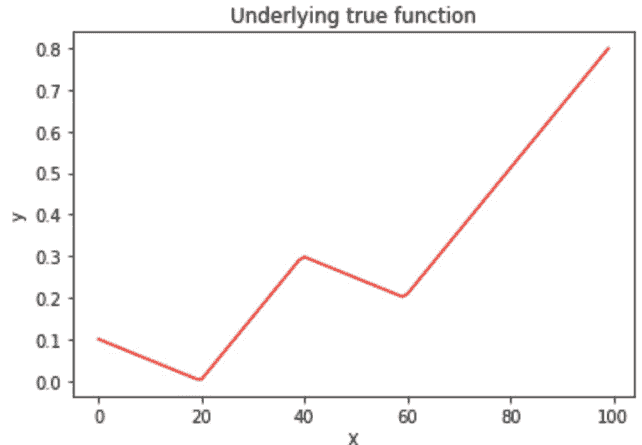

图 3.8 平滑样条模型待近似的真实底层分段线性函数。

我们首先从转换函数入手，该函数将原始单变量输入 X 映射至新的设计矩阵 $\Phi$，最高不超过预设的多项式次数。这与第 2 章中定义的函数相同。

### 清单 3.2 定义多项式转换函数

```
def polynomial(x, num_basis=2):
    Phi = np.zeros((x.shape[0], num_basis))
    for i in range(num_basis):
        Phi[:, i:i+1] = x**i
    return Phi
```

- #A 基于指定数量的多项式基生成新设计矩阵的函数
- #B 创建零矩阵作为占位符
- #C 基于多项式序列填充每一列

至于惩罚项 $J(\mathbf{w}) = \iint (m''(x))^2 dx$，在转换为 $J(\mathbf{w}) = \mathbf{w}^T \Omega \mathbf{w}$ 时，可以通过离散的二维块进行近似。具体地，$J(\mathbf{w})$ 使用以下公式近似：

$J(\mathbf{w}) = \sum_{q=2}^p \sum_{r=2}^q \beta_{q,r} w_q w_r$

其中 $\beta_{q,r}$ 表示 $\mathbf{\Omega}$ 的元素，计算如下：

$\beta_{q,r} = \frac{(q-1)q(r-1)r}{q+r-3}$

### 清单 3.3 求解平滑样条模型的解析解

```
def estimate_coef(X, y, num_basis):
    Phi = polynomial(X, num_basis=num_basis)
    q = np.arange(2, num_basis).reshape(1, -1)
    r = q.reshape(-1, 1)
    omega = np.zeros((num_basis, num_basis))
    omega[2:, 2:] = (q - 1) * q * (r - 1) * r / (q+r-3)
    values, vectors = np.linalg.eig(omega)
    beta = vectors @ np.diag(values.clip(min = 0) ** 0.5)
    y_star = np.concatenate((y, np.zeros(omega.shape[0]).reshape(-1,1)), axis=0)
    Phi_star = np.concatenate((Phi, math.sqrt(rho) * beta.T), axis=0)
    w_star = np.linalg.lstsq(Phi_star, y_star, rcond=None)[0]
    return w_star
```

- #A 估计模型系数的函数
- #B 通过添加多项式扩展原始设计矩阵
- #C 使用 omega 矩阵近似惩罚项
- #D 在裁剪非负值后，将 omega 矩阵的平方根生成到 beta 矩阵中
- #E 分别创建拉长的设计矩阵和结果变量
- #F 使用 numpy 的最小二乘程序求解最优权重向量

接下来，我们创建一个函数来计算经验风险，即给定数据集和系数集的均方误差。

### 清单 3.4 计算均方误差

```
def calculate_mse(X, y, coef, num_basis):
    Phi = polynomial(X, num_basis=num_basis)
    f_star = Phi@coef
    resid = y - f_star
    Q = np.dot(resid.T, resid).mean()
    return Q
```

- #A 通过添加多项式扩展原始设计矩阵
- #B 生成模型预测值
- #C 计算残差
- #D 使用最优权重计算代价

请注意，即使模型足够复杂可以完美插值训练数据，计算过程中精确的 MSE 损失也不会体现为零。相反，它会是一个非常小的数，例如 $10^{-8}$，可以将其视为零。

最后，我们创建一个函数，允许对上述步骤进行多次运行，并根据预设的模拟次数报告中位数结果。具体地，我们首先创建两个占位符（`mse_train` 和 `mse_test`）来存储多次运行的结果。对于每次运行，我们将生成一个不同的训练数据集，如果需要，还可以选择用一定水平的噪声损坏目标。泛化性能通过 X_test 中一组等距点以及 y_test 中对应的真实目标值进行评估。接下来，我们通过依次评估最高达不同多项式次数的模型来改变模型复杂度，最高次数为 `num_basis_max`。每次评估包括估计模型系数并计算相应的代价。函数末尾，我们返回多次运行中训练集和测试集的中位数代价。

### 清单 3.5 计算多次运行的中位数代价

```
def compute_performance(num_train_samples, num_runs, num_basis_max, train_noise_std=0):
    mse_train = np.zeros((num_runs, num_basis_max))
    mse_test = np.zeros((num_runs, num_basis_max))
    for k in range(num_runs):
        X_train = random.randn(num_train_samples).reshape(-1, 1)
        y_train = get_true_y(X_train).reshape(-1,1)
        if train_noise_std > 0:
            y_train = y_train + np.random.normal(0, 0.01, y_train.shape[0]).reshape(-1,1)
        X_test = np.linspace(0, 1, 100, dtype=X_train.dtype).reshape(-1,1)
        y_test = get_true_y(X_test).reshape(-1,1)
        for num_basis in range(1, num_basis_max + 1):
            fitted_coef = estimate_coef(X_train, y_train, num_basis)
            mse_train[k, num_basis-1] = calculate_mse(X_train, y_train, fitted_coef, num_basis)
            mse_test[k, num_basis-1] = calculate_mse(X_test, y_test, fitted_coef, num_basis)
    return np.median(mse_train, axis = 0), np.median(mse_test, axis=0)
```

- #A 执行多次模拟并报告中位数结果的函数
- #B 用于存储多次运行 mse 的占位符矩阵
- #C 执行多次运行并报告中位数
- #D 为每次运行生成不同的训练集
- #E 如果启用，则用随机噪声损坏目标
- #F 生成用于得出泛化性能的测试集数据点列表
- #G 通过遍历每个多项式次数来改变模型复杂度
- #H 估计模型系数
- #I 存储多次运行的结果

在定义上述实用函数后，我们现在可以指定全局超参数并运行模拟。在以下代码清单中，我们将调参数 $\lambda$ 设置为一个非常小的数，该数值可进一步通过交叉验证进行评估。我们总共运行十次，每次包含十个训练样本和最高 30 次多项式。


### 清单 3.6 不同模型复杂度下的训练和测试性能计算

```python
lamb = 1e-12 #A
num_runs = 10 #A
num_train_samples = 10 #A
num_basis_max = 30 #A
fig = plt.figure() #B
ax = fig.add_subplot(1, 1, 1) #B
ax.set_yscale('log') #B
ax.set_xlabel('Polynomial degree', labelpad = 10) #B
ax.set_ylabel('MSE', labelpad = 10) #B
ax.axvline(x = num_train_samples,
           color = 'gray', linewidth = 0.5, linestyle = '--') #B
ax.text(num_train_samples - 0.2, 1e-16, 'Interpolation threshold',
        fontsize = 10, color = 'gray',
        rotation = 90, rotation_mode='anchor') #B
mse_train, mse_test = compute_performance(num_train_samples=num_train_samples,
                                          num_runs=num_runs, num_basis_max=num_basis_max,
                                          train_noise_std=0) #B
ax.plot(np.arange(1, num_basis_max + 1), mse_train, color = 'blue', label = 'Train',
        linestyle = '--') #B
ax.plot(np.arange(1, num_basis_max + 1), mse_test, color = 'red', label = 'Test') #B
ax.legend(frameon = False) #B
plt.show() #B
```

- #A 设置全局超参数
- #B 绘制 MSE 与度数的曲线

运行上述代码的结果如图 3.9 所示。该图显示，随着所使用的多项式次数增加，模型变得复杂，测试风险曲线中出现清晰的“双下降”现象。请注意，插值阈值出现在训练样本数等于多项式次数的点上。它是第一次下降和第二次下降之间的分隔线。

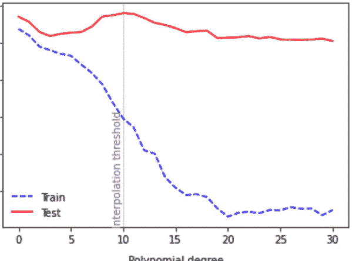

图 3.9 不同多项式次数下的中位数 MSE。随着模型变得更加复杂，训练曲线呈现单调递减趋势。测试风险呈现“双下降”特征，插值阈值是两次下降之间的分隔线。

为了观察模型在提高多项式次数时拟合的优劣与粗糙度，以下代码提供了一个示例，可视化真实函数与拟合模型作为多项式次数的函数。

### 清单 3.7 可视化不同多项式项数的模型

```python
X_train = random.rand(num_train_samples).reshape(-1,1) #A
y_train = get_true_y(X_train).reshape(-1,1) #A
X_test = np.linspace(0, 1, 100, dtype = X_train.dtype).reshape(-1,1) #B
y_test = get_true_y(X_test, reshape=(-1,1)) #B
for num_basis in range(1, num_basis_max + 1): #C
    fig = plt.figure()
    ax = fig.add_subplot(1, 1, 1)
    ax.set_title(f'Degree {num_basis-1}')
    ax.plot(X_test, y_test, color = 'black', label = 'True function', linestyle = '--')
    ax.scatter(X_train, y_train, color = 'blue', label = 'Train samples')
    fitted_coef = estimate_coef(X_train, y_train, num_basis) #D
    Phi = polynomial(X_test, num_basis=num_basis) #E
    f_star = Phi @ fitted_coef
    ax.plot(X_test, f_star, color = 'red', label = 'Fitted polynomial')
    ax.legend(frameon = False)
    plt.show()
```

- #A 生成训练集
- #B 沿真实函数生成一系列数据点
- #C 通过改变多项式次数绘制拟合模型和真实函数
- #D 估计模型系数
- #E 通过添加多项式扩展原始设计矩阵
- #F 生成模型预测

运行上述代码将为每个多项式拟合次数生成一系列图表。此处展示了几个代表性图表。完整图表列表，请参阅附带的笔记本 https://github.com/jackliu333/regularization_in_deep_learning。

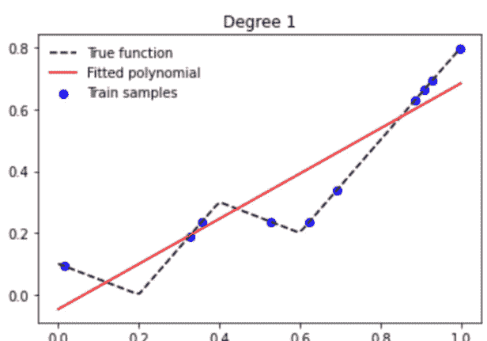

图 3.10 使用最高 1 次多项式进行模型拟合，得到一条带有两个参数的直线。

当使用最高 2 次多项式时（即使用三个特征），模型足够灵活，可以如图 3.11 所示呈现非线性结构。然而，非线性程度不足以近似真实底层函数的多个线性片段。我们需要加入更多多项式，进一步增加模型的曲率。

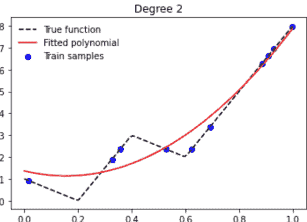

图 3.11 使用最高 2 次多项式进行模型拟合。使用三个参数，模型现在更有灵活性呈现为曲线，尽管曲率需要增强。

拟合模型足够复杂，可以使用最高 6 次多项式来近似分段线性并插值所有训练点。特别是，如图 3.12 所示，从第二个训练点向右直到图像末尾，我们看到近乎完美的拟合。然而，在第一个点和第二个点之间，模型显示出高方差，表现为深向下的山谷。模型在此区域过于敏感，给出两个彼此靠近的点时会产生截然不同的输出。从经典泛化角度来看，这是典型的过拟合现象。人们可能会开始降低模型复杂度以控制偏差-方差权衡。然而，让我们看看当我们继续扩大多项式特征空间时会发生什么。

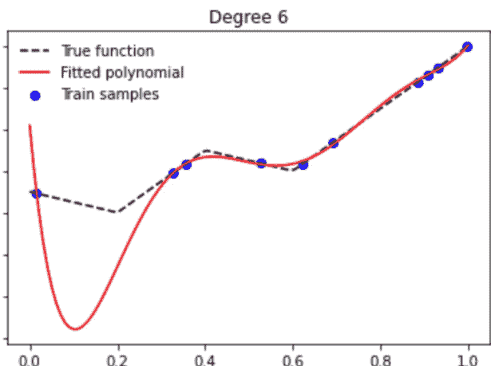

图 3.12 当使用最高 6 次多项式时，模型几乎在训练点上进行插值。拟合在左区域也显示出高方差的症状。这是经典泛化意义下的过拟合案例。

如图 3.13 所示，当使用最高 16 次多项式时，模型在所有训练点上表现出完美的插值。尽管特征数量远大于训练点数量，但与使用最高 6 次多项式相比，生成的模型并不过度敏感。随着多项式项数增加，添加粗糙度惩罚使模型进入过参数化体系。

### 16 次

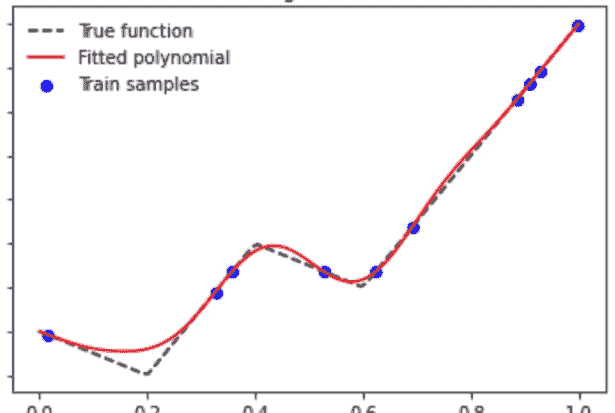

图 3.13 当使用最高 16 次多项式时，模型作为一条平滑曲线进行完美插值，这是粗糙度惩罚的结果。这是现代泛化意义上的过参数化体系。

仅出于实验目的，让我们看看如果使用最高 29 次多项式会发生什么。如图 3.14 所示，即使多项式项数几乎是之前的两倍，生成的拟合也没有太大变化。相对稳定的拟合表明，在过参数化体系下，生成的模型在有效模型容量方面相似。在这种体系下，添加更多多项式项并没有太大区别。

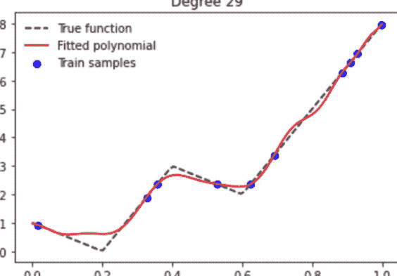

图 3.14 当使用最高 29 次多项式时，生成的模型差别不大。

### 3.2.5 样本非单调性

在经典和现代泛化理论中，一个普遍观点是更多数据似乎更好。然而，更大的训练集不一定对应更低的测试风险。在某些情况下，更多数据可能更糟。这种现象被称为样本非单调性，即改变训练数据的大小可能会提高或降低测试性能。

为了观察这种现象，让我们在改变训练样本数量的同时重复上述实验。以下代码在不同多项式次数下绘制多条 MSE 曲线，每条曲线对应不同的训练样本大小。

### 清单 3.8 检查不同样本大小和模型复杂度下的模型性能

```python
fig = plt.figure()
ax = fig.add_subplot(1, 1, 1)
ax.set_yscale('log')
ax.set_xlabel('Polynomial degree', labelpad = 10)
ax.set_ylabel('MSE', labelpad = 10)
num_train_samples_min = num_train_samples - 4 #A
num_train_samples_max = num_train_samples #A
for tmp_num_train_samples in range(num_train_samples_min, num_train_samples_max + 1, 2): #B
    mse_train, mse_test = compute_performance(num_train_samples=tmp_num_train_samples,
    num_runs=num_runs, num_basis_max=num_basis_max,
    train_noise_std=0)
    e = float(tmp_num_train_samples - num_train_samples_min) / float(num_train_samples_max
    - num_train_samples_min) #C
    e = 0.2 + 0.6 * e #C
    ax.plot(np.arange(1, num_basis_max + 1), mse_train, color = (e, e, 1.0),
    label = f'Train N={tmp_num_train_samples}', linestyle = '-.-')
    ax.plot(np.arange(1, num_train_samples_max + 1), mse_test, color = (1.0, e, e),
    label = f'Test N={tmp_num_train_samples}')
ax.legend(frameon = False)
ax.axvline(x = 9,
color = 'gray', linewidth = 0.5, linestyle = '-.-')
plt.show()
```

- #A 设置训练样本的最小值和最大值
- #B 使用不同数量的训练样本重复实验
- #C 为每个训练样本数量设置颜色强度

如图 3.15 所示，生成的图表显示，当多项式次数最高为 9 次时，随着训练样本大小增加，测试 MSE 会上升。因此，更多训练数据并不能保证更好的泛化性能。这是研究界最近发现的一个令人兴奋的现象，表明泛化性能与所使用的特定数据（包括其大小和领域）密切相关。我们期待更多关于为何会出现这种情况的研究。


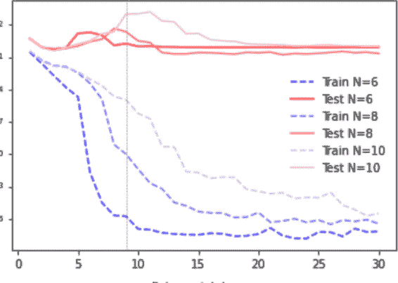

图 3.15 观察样本非单调性现象。当多项式次数达到 9 次时，增加训练集会导致测试 MSE 升高。

## 3.3 总结

- “双下降”曲线，一种在训练机器学习和深度学习模型时广泛观察到的现象，涵盖了偏差-方差权衡中的经典 U 型曲线
- 双下降曲线既可以作为模型复杂度的函数，也可以作为训练迭代次数的函数而存在
- 过拟合问题可以通过增加参数数量（进入过参数化区域，并利用随机梯度下降隐式正则化模型）或采用适当的显式正则化技术降低模型容量来解决
- 有效模型复杂度是一个最近提出的概念，用于表示训练过程在平均情况下能使训练误差接近零的最大样本数量
- 由于样本非单调性，更多的训练数据未必能提升模型性能
- 二阶导数可以作为拟合多项式模型粗糙度的度量，并通过权重因子与 MSE 结合，形成总代价
