# 训练深度神经网络的基础

## 本章内容

- 使用 ReLU 激活函数的感知机网络的函数逼近能力
- PyTorch 使用的自动微分机制介绍
- 使用 MNIST 数据集从图像预测数字的卷积神经网络逐步实现
- 尝试不同神经网络复杂度水平以观察其对训练集和测试集性能的影响
- 继续讨论随机梯度下降算法的泛化特性

迄今为止，我们一直在通过添加更多特征和控制模型复杂度来处理模型对真实底层函数的逼近能力。例如，在上一章中，我们了解到当存在更多高次多项式项时，多项式函数的逼近能力会增强。这种模型拟合过程本质上属于函数逼近，即使用一组更简单的函数来近似一个复杂函数。因此，我们的目标是构建一个足够具备表达力的机器学习模型，以近似真实的底层函数。

一般来说，添加更多参数可能导致过参数化，这是一种在经典模式中通常会避免，但在现代插值模式中却被某种程度鼓励的情况。就神经网络而言，研究哪些底层函数可以被建模和近似是很有趣的。在这方面，由 Hornik 等人（1989）在论文“Multilayer Feedforward Networks are Universal Approximators”中最初提出的通用逼近定理指出，神经网络具备足够的表达能力来近似任何感兴趣的函数。基于该定理，当提供合适的权重和架构时，神经网络足够强大和灵活，可以以任意精度表示任意形状的任意映射。这是如何实现的？

要理解其逼近行为，我们将从神经网络的基本计算单元——感知机的概念入手。

## 4.1 多层感知机

典型的神经网络由表示输入数据的输入层和生成输出的输出层组成。它还可以包含中间任意数量的层（称为隐藏层）。每层至少包含一个神经元，可解释为提取的隐藏特征。说到神经网络的层数，它是指隐藏层加上输出层。例如，感知机是一个单层神经网络，意味着它只有输入层和输出层，中间没有任何隐藏层。

作为神经网络的基本构成单元，感知机是一个单个神经元，它完成两步数学运算：加权求和和非线性变换。对于 p 维的单次观测 x \in R^p，感知机首先计算 x 与其对应的权重向量 w \in R^p 之间的加权和 \sum_{i=1}^{p} W X_i，该和应当也是 p 维的。加权和通常伴随另一个称为截距或偏置的项，它作为额外参数，对加权和进行整体水平移动，以更好地拟合数据。

添加截距/偏置项 b 之后，和会通过激活函数，该函数对加权和引入非线性变换。请注意，偏置项是通过在输入数据中插入一列 1 来添加的，这与线性回归中的偏置技巧相同。这种非线性变换，连同层数和层宽，共同决定了神经网络的灵活性、表达能力和逼近能力。图 4.1 总结了感知机的过程流程。

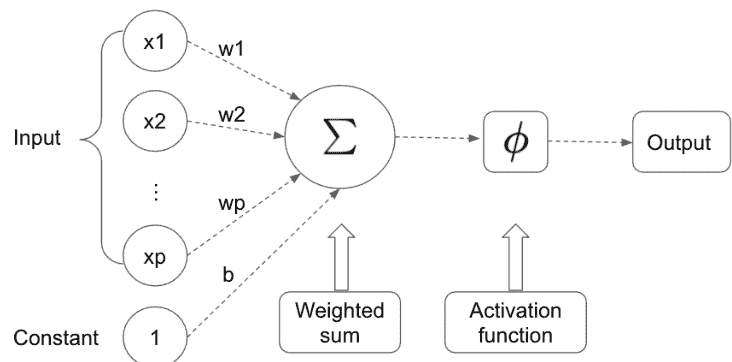

图 4.1 感知机的过程流程图，它由加权求和运算后跟激活函数组成。一列 1 会自动添加，以对应权重向量中的偏置项。

最流行的激活函数选择是修正线性单元（ReLU），它充当一个开/关开关，如果输入信号的值高于特定阈值，则原样传递输入信号；如果低于阈值，则通过输出零将其静音。换句话说，如果输入为正，ReLU 操作是恒等函数；否则，输出设为零。如果没有这种非线性激活，多层神经网络将简单地成为相互堆叠的一系列线性函数，从而形成一个线性模型。

让我们看一个例子。假设我们有一个简单的两层神经网络，隐藏层和输出层各有一个节点，输入为二维。没有激活函数的中间层输出将为 z = w11x1 + w12x2 + b1，其中 w11 表示第一个也是唯一的隐藏层中的第一个权重。同样，最终输出为 y = wz + b2。代入 z 的定义得到 y = w2(w11x1 + w12x2 + b1) + b2 = w2w11x1 + w2w12x2 + w2b1 + b2，当我们将 w2w11 和 w2w12 视为特征权重、将 w2b1 + b2 视为偏置时，这又是线性模型的体现。同样的推理适用于扩展到更深更宽的线性网络。

单个感知机中的两个操作可以解释为一个函数，该函数通过权重的矩阵-向量乘法及其后续的非线性变换，将输入向量 X 从一个空间投影到另一个空间。具体来说，感知机是一个函数 f(X) = ϕ(wX + b)，其中 b 是用作全局平移的偏置项，它向上或向下调整先前的加权和，以表示更复杂的情况。这里我们将 ϕ(z) = max(z,0) 表示为 ReLU 激活函数，它返回原始输入和零之间的最大值，其中 z = wX + b 表示在应用激活函数之前的线性运算输出。换句话说，负值设为零，正值保持不变。

以下代码片段展示了如何定义 ReLU 激活函数并将其应用到输入列表的每个元素上。-1 因负值的置零效应而被设为零，而另外两个保持不变。

```
def relu(x):
    return np.maximum(x, 0)
>>> relu([1,-1,2])
array([1, 0, 2])
```

图 4.2 可视化了 ReLU 函数的形状，并总结了迄今讨论的感知机操作的特性。除了神经网络模型在层数和层宽方面的架构灵活性之外，另一主要的额外灵活性在于非线性操作。事实上，使用 ReLU 作为激活函数可以自动提取许多令人兴奋且有意义的隐藏特征。例如，在使用称为卷积神经网络的特殊架构训练图像分类器时，初始隐藏层中的低级特征往往类似于线条或边缘等基本结构组件，而后续隐藏层中的高级特征开始学习正方形、圆形甚至汽车轮子等复杂形状等结构模式。如果我们仅限于特征的线性变换，这是不可能实现的；而如果要手动设计这样的信息特征，则被认为是一项极其困难的任务。另外，请记住参考附带的笔记本以获取完整的绘图细节。

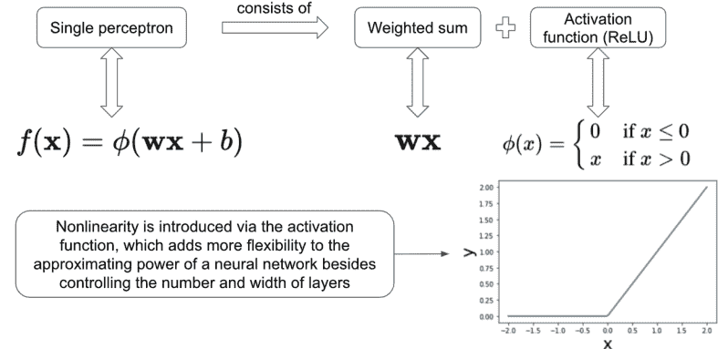

图 4.2 将单个感知机分解为加权求和和激活函数（通常为 ReLU）。如果信号为正，ReLU 操作会放行该信号；如果为负，则将其静音。除了设计层数和层宽的灵活性之外，这种非线性还为神经网络引入了强大的逼近能力。


ReLU（及其变体）之所以一直是最受欢迎的激活函数，是因为其梯度计算速度快。当输入小于或等于零时，梯度（常数的梯度）变为零，从而省去了反向传播和参数更新的需要。当输入为正时，梯度（原始输入变量的梯度）仅为一，并原样反向传播。

由于典型的神经网络模型由多个层组成，我们可以以递归方式表示第 \(l^{th}\) 层的感知器操作，如下所示：

```
\(f_l(\mathbf{x}) = \phi(\mathbf{W}_l f_{l-1}(\mathbf{x}) + \mathbf{b}_l)\)
```

其中，**x** 是包含总共 \(L\) 层的多层神经网络的原始输入向量。请注意，由于每一层通常包含多个节点，第 \(l-1\) 层与第 \(l\) 层之间的权重 \(\mathbf{W}_l\) 现在变为形状为 \(|l-1| \times |l|\) 的矩阵，其中 \(|l|\) 表示第 \(l\) 层的节点数。同样，\(\mathbf{b}_l\) 包含大小为 \(|l|\) 的偏置向量。应用激活函数 \(\phi\) 后，输出向量 \(f_l(\mathbf{x})\) 的维度将与输入向量 \(\mathbf{W}_l f_{l-1}(\mathbf{x}) + \mathbf{b}_l\) 相同。也就是说，激活函数不会改变输入维度，因为它作用于输入向量的每个元素。至于第一层，感知器操作的输出直接返回输入本身，即 \(f_0(\mathbf{x}) = \mathbf{x}\)。

通过代入前一感知器 \(f_{l-1}\) 的定义等，我们可以将多层神经网络的最终输出重新表示为一系列感知器操作，即基于原始输入 **x** 的重复矩阵乘法和非线性变换：

```
\(f_L(\mathbf{x}) = \phi(\mathbf{b}_L + \mathbf{W}_L \phi(\mathbf{b}_{L-1} + \mathbf{W}_{L-1} \phi(\cdots \phi(\mathbf{b}_1 + \mathbf{W}_1 \mathbf{x}) \cdots)))\)
```

在实践中，输入向量 **x** 还可以转换为 PyTorch 中的张量表示，这类似于多维数组。

### 4.1.1 双层神经网络

让我们来看看使用 ReLU 激活函数的简单双层神经网络的近似能力，即具有一个隐藏层和一个输出层的神经网络。为简化问题，我们假设一个一维标量输入 \(x\)、一个具有五个节点的隐藏层和一个一维输出。整个神经网络可以表示为 \(f(x)=\mathbf{w}_2^T \phi(\mathbf{w}_1 x + \mathbf{b}_1)\)，其中 \(\mathbf{w}_1 = \{w^1_1, w^2_1, w^3_1, w^4_1, w^5_1\}\)、\(\mathbf{b}_1 = \{b^1_1, b^2_1, b^3_1, b^4_1, b^5_1\}\) 和 \(\mathbf{w}_2 = \{b^1_1, b^2_1, b^3_1, b^1_4, b^1_5\}\) 都是 5 x 1 权重向量。为简化，我们忽略了隐藏层与输出层之间的标量偏置项 \(b_2\)，并将加权和作为最终层的直接输出而不使用激活函数。第一个偏置向量 \(\mathbf{b}_1\) 包含与隐藏层中五个神经元对应的五个元素。请参见图 4.3，了解网络架构示意图。

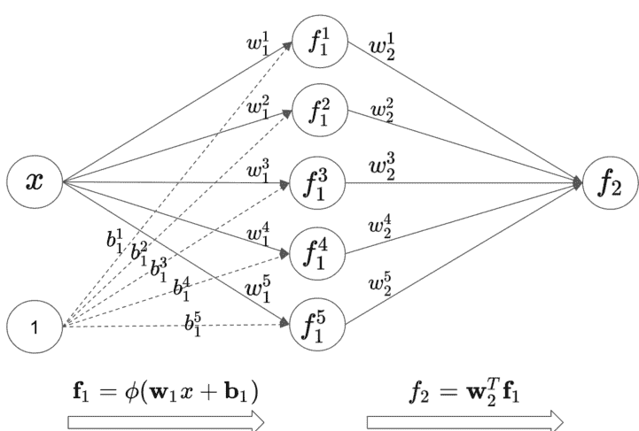

图 4.3 双层网络架构示意图。第一个隐藏层完成加权求和和非线性变换操作，生成一个 5x1 的中间特征向量。第二个隐藏层，即输出层，执行不带偏置项的加权求和，生成最终标量输出。

下面的代码清单首先初始化了一个输入数据数组 xs，以及变量 W1、b1 和 W2 中的一组随机权重。然后，我们将输入传递经过隐藏层（通过加权求和和激活函数），其结果存储在 first_layer_activations 中，并传递经过输出层（仅通过加权求和），其结果存储在 final_output 中。为更好地理解隐藏层中各个神经元的作用，我们还可视化了五个隐藏神经元的输出。

```
Listing 4.1 Visualizing the activation of individual neurons in the hidden layer

xs = np.linspace(-2, 2, 100) #A
W1 = np.random.uniform(low=-1, high=1, size=(5,1)) #B
b1 = np.random.uniform(low=-1, high=1, size=(5,1)) #B
W2 = np.random.uniform(low=-1, high=1, size=(5,1)) #B
first_layer_activations = relu(W1*xs + b1) #C
final_output = np.dot(W2.T, first_layer_activations) #C
plt.figure(figsize=(8,6)) #D
plt.plot(np.tile(xs[:, None], 5), first_layer_activations.T);
plt.xlabel('$x$');
plt.ylabel('Hidden layer activation output');
plt.yticks([]);
```

```
#A Create an array of inputs
#B Randomly initialize the weights
#C Compute hidden layer activation and final output
#D Plot the activation output of the five hidden neurons
```

运行上面的代码清单生成图 4.4，表明隐藏层中五个神经元的 ReLU 激活形状相似。然而，它们在三个方面有所不同：转折点（阈值）、线性段的斜率以及激活的方向（正斜率或负斜率）。与前一章中手工构造的多项式特征相比，这些激活是在隐空间中自动提取的派生学习特征。随着优化的进行，这些特征将共同形成对原始输入数据的更好表示，各自在不同粒度级别上呈现不同视角。它们也可以解释为一组派生基函数。

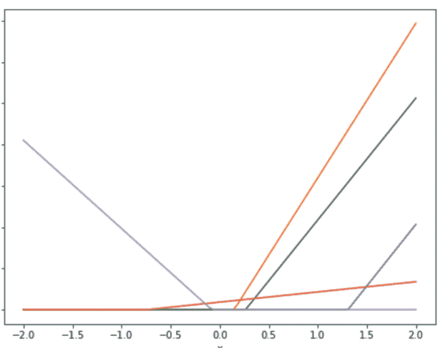

图 4.4 可视化隐藏层中五个神经元的激活输出。每个激活都是形状相似的 ReLU 函数，在转折点的位置、斜率的大小和方向上有所不同。

最后一层的模型输出随后通过这些基函数的线性组合计算得出。为进一步探究一系列函数变换的结果，我们依赖下面的代码清单来可视化拟合模型的输出，以及隐藏层中不同 ReLU 激活之间的交点。我们还绘制了两个线性段的断点，作为模型灵活性的指标，断点是通过将 ReLU 操作的输出设为零并求解输入值来确定的。

```
Listing 4.2 Visualizing the final output of the two-layer neural network
plt.figure(figsize=(8,6))
plt.plot(xs, final_output[0,:], 'k:')
breakpoints = (-b1/W1).T #A
f_breakpoints = np.dot(W2,relu(W1*breakpoints + b1)) #B
plt.plot(breakpoints, f_breakpoints, '.', markersize=18);
plt.xlabel('$x$');
plt.ylabel('$f(x)$');
```

#A Breakpoint is the input location where ReLU output is zero
#B Calculate model output at the breakpoints

图 4.5 包含上述代码的输出。最终输出只是隐藏层输出 \(\phi(w_1 x + b_1)\) 的加权线性组合，权重为 \(w_2\)。与图 4.4 相比，我们看到这些转折点（存储在 `breakpoints` 变量中）正是隐藏层中多个 ReLU 激活之间的交叉点。在这些断点之间是线性段，函数在该区域内表现为线性。因此，最终拟合模型是分段线性的，其转折点由激活函数定义。

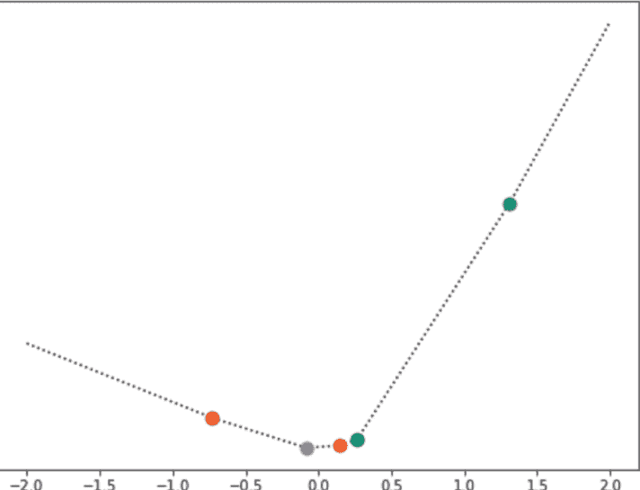

图 4.5 可视化最终层的输出。拟合模型是分段线性的，其转折点表现为两个 ReLU 激活之间的交点。

根据隐藏层中使用的激活函数数量，得到的输出在断点数量或由这些断点分隔的线性段数量方面具有相应的复杂度。换言之，最终输出中的模型复杂度与浅层神经网络隐藏层中的神经元数量呈线性相关。因此，节点数量（即层的宽度）直接决定了神经网络模型的复杂度和表达能力。这意味着，为了拥有足够的转折点（即断点）来近似一个复杂函数，神经网络模型在隐藏层中需要足够宽（即拥有足够的隐藏节点）。然而，这样做在计算上效率低下。增加节点的计算成本可能会超过所带来的建模灵活性提升的好处。

与其让浅层神经网络变宽，不如通过堆叠更多层来使其更深，这是提高神经网络表达能力的主流方法。这正是它被称为深度神经网络的原因。一般来说，具有超过两个隐藏层的神经网络可以称为深度神经网络，尽管对于大型模型，深度可以增长得更多。构建具有多个层的深度神经网络，比加宽浅层神经网络更能有效地提高其近似能力。


### 4.1.2 浅层与深度神经网络

处理浅层网络时，即具有一个隐藏层后跟一个输出层的神经网络，模型灵活性的调节旋钮仅限于隐藏层中的节点/神经元数量。为了创建在最终输出中具有特定数量断点或线性段的模型，我们需要在隐藏层中添加相同数量的节点。这些隐藏神经元充当基函数，通过线性组合生成最终输出。换句话说，模型复杂度与隐藏层中的节点数量呈线性增长。

然而，深度神经网络每层所需的节点数量要少得多，即可达到相同的复杂度水平。具体来说，模型复杂度（即最终输出中的断点数量或线性段数量）与深度神经网络中的隐藏层数量呈指数级增长。我们将通过一个带有 ReLU 激活函数的手工设计深度神经网络示例来说明这一点，并观察其复杂度如何随网络加深而变化。

假设我们希望在每个隐藏层中拟合以下函数。所得网络也被称为“锯齿”网络模型。每一层都是前一层的绝对值乘以二并向下平移二，从而得到最终类似锯齿的拟合。当前层与前一层之间的关系可以表示为：

$f_l(x)=2|f_{l-1}(x)|-2$

通常，我们有 $f_0(x)=x$。对输入取绝对值时有两种情况：如果输入为正，输出保持与输入相同；如果输入为负，输出是输入的相反数。因此，我们可以将绝对值函数分解为两部分，每部分通过 ReLU 激活函数实现，如下所示：

$f_l(x)=2|f_{l-1}(x)|-2=2\text{ReLU}(f_{l-1}(x))+2\text{ReLU}(-f_{l-1}(x))-2`

注意，在本示例中权重是固定的，不会发生实际学习。我们有兴趣评估“锯齿”网络的近似能力。

双神经元隐藏层可以通过以下代码片段定义。

```
def layer(x):
    return 2*relu(x) + 2*relu(-x) - 2
```

接下来，我们定义一个函数，根据指定的层数顺序堆叠各层来构建神经网络。

```
def multilayer(x, hidden_layers=1):
    f = x #A
    for _ in range(hidden_layers): #B
        f = layer(f)
    return f
```

- #A 第一层仅返回输入本身
- #B 将当前层的输出顺序传递给下一层作为输入

在每个隐藏层中放置两个神经元时，我们可以通过调整 `hidden_layers` 参数并观察模型最终输出的变化来改变模型复杂度。在下面的代码清单中，我们通过将隐藏层数量从零变到五并绘制最终输出来改变神经网络的规模。

```
Listing 4.3 Sequentially changing the number of hidden layers
numlayers = 6
fig, axs = plt.subplots(numlayers, 1, figsize=(8,25))
for i, ax in enumerate(axs):
    ax.plot(xs, multilayer(xs, hidden_layers=i))
    ax.set_ylim([-3, 3])
    ax.legend(['$f_{{{}}}(x)$'.format(i)])
```

查看下面几个示例输出，我们可以观察到，随着隐藏层数量的增加，最终输出的断点和线性段数量呈指数级增长，每个隐藏层包含两个神经元。当没有隐藏层时，输出仅为输入本身，如图 4.6 所示。

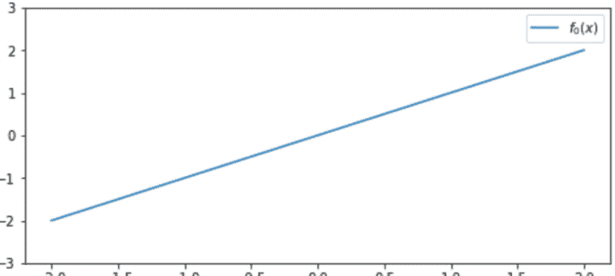

**图 4.6 没有隐藏层的神经网络输出。模型输出仅为输入本身。**

如图 4.7 所示，具有一个隐藏层时，模型可以有两个线性段，每个线性段来自一个 ReLU 激活函数，并且具有相同的断点以完成绝对函数。

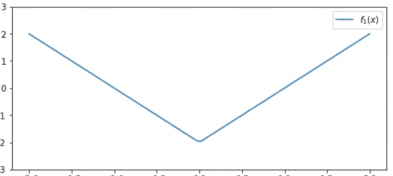

图 4.7 一个隐藏层内包含两个神经元的模型输出。拟合线中的断点是两个 ReLU 激活函数输出的线性组合结果，这两个函数的阈值恰好重叠，以适应绝对函数的效果。

如图 4.8 所示，具备三个隐藏层时，所得拟合现在由 $2^3 = 8$ 个线性段组成。

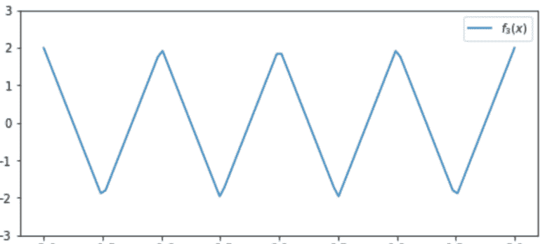

图 4.8 三个隐藏层、每个隐藏层包含两个神经元的模型输出。随着隐藏层数量增加，断点和线性段数量呈指数级增长，我们开始观察到近似能力有所提升。

如图 4.9 所示，当有五个隐藏层时，断点数量进一步增长到总共 $2^5 = 32$ 个。然而，隐藏层中仅使用了总共 $2 \times 5 = 10$ 个节点，这对应于使用浅层神经网络时最多十个断点。指数级增长的线性段也表明，具有多个隐藏层的深度神经网络可以表示比浅层网络大得多的函数类。因此，深度神经网络相较于浅层网络，在表达能力上获得了指数级增长。

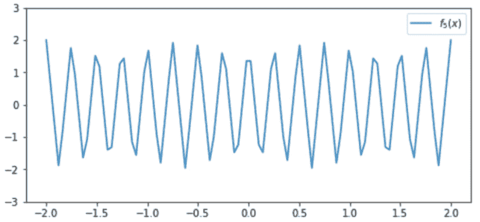

图 4.9 五个隐藏层的模型输出。当堆叠更多隐藏层时，断点和线性段数量的指数级增长更为明显。与具有 $5 \times 2 = 10$ 个节点（五层，每层两个神经元）的浅层神经网络相比，深层版本在使用相同数量的节点时，最终拟合模型中最多可有 $2^5 = 32$ 个断点。

浅层网络另一种经验上观察到的缺点是倾向于直接记忆输入数据，而不是学习底层模式以泛化到未来的未见数据集。例如，一个极宽的网络最终可能会记住训练数据并产生零训练误差。另一方面，具有多个层的深度神经网络可以在不同抽象级别上学习特征，最终有助于泛化的中间隐藏特征。例如，在图像识别任务中，早期隐藏层中的低级组合特征（如边缘和角）会被自动提取和学习。它们共同在最终隐藏层中创建更抽象、更高级的特征（如形状和对象），以促进更有效的模式识别。

总而言之，神经网络中隐藏层数量与断点和线性段数量（模型复杂度的指标）呈指数级增长。神经网络的深度对复杂度的提升远大于宽度，深度神经网络足以表示/近似任意形状的函数。

接下来，我们将探讨自动微分，这是现代深度学习框架中嵌入的基本机制，可提供自动梯度计算，从而实现大型神经网络的快速高效开发。

## 4.2 自动微分

深度神经网络强大的近似能力使其成为一种强大且富有表达力的模型类型。然而，我们仍需采用优化技术来为给定的网络架构搜索最优权重。在前几章中，我们介绍了梯度下降方法族。优化神经网络模型的过程是迭代计算当前模型代价相对于模型权重的梯度，然后应用梯度来更新权重。

这种基于梯度的优化也是神经网络取得巨大成功的原因之一。特别是，使用随机梯度下降算法训练的神经网络往往能获得较低的经验风险，并很好地泛化到未来的未见测试集。该算法的一个显著特征在于梯度的随机性，梯度基于单个样本或一个小批量样本计算，因此与基于大批量样本的平均梯度相比具有噪声。当使用全批量梯度下降过程（对所有样本进行梯度计算）降低噪声时，测试性能开始下降。部分原因是，小批量 SGD 使优化器能够跳出锐利局部最优，向更平坦的局部最优移动，后者在测试集上泛化效果更好。因此，神经网络的泛化能力与所使用的特定算法及其配置，以及模型复杂度和样本量相关。

我们将在以后从优化角度详细介绍正则化。目前，让我们仔细了解基于梯度的优化的细节，尤其是在每次迭代中需要更新多个权重时。

### 4.2.1 基于梯度的优化

让我们重新审视整个模型训练过程，并回顾每个环节中的数学运算。如图 4.10 所示，模型训练过程首先将原始数据集划分为训练集和测试集。训练集用于开发最优模型，测试集用于衡量训练后模型的泛化性能。训练过程中使用两个基本函数：预测函数和代价函数。预测函数将（固定的）输入特征和（变化的）模型权重作为输入，生成一组预测。

相比之下，代价函数通过计算预测值与目标标签之间的总距离（或平均距离），将这些预测的质量汇总为一个标量值。然后将代价传递给诸如梯度下降之类的优化过程，以更新模型权重并最小化代价。一旦训练过程完成，基于训练集的最优权重集将用于根据测试集特征得到另一组最终预测。这些测试集预测与相应的标签进行比较，以生成测试集的最终代价（如均方误差）。测试集性能是第 2 章中介绍的经验风险，它作为一个


作为真实风险的代理，并衡量模型在给定新测试集上的平均表现。此过程持续多个 epoch，直到获得一个最小化经验风险的模型。

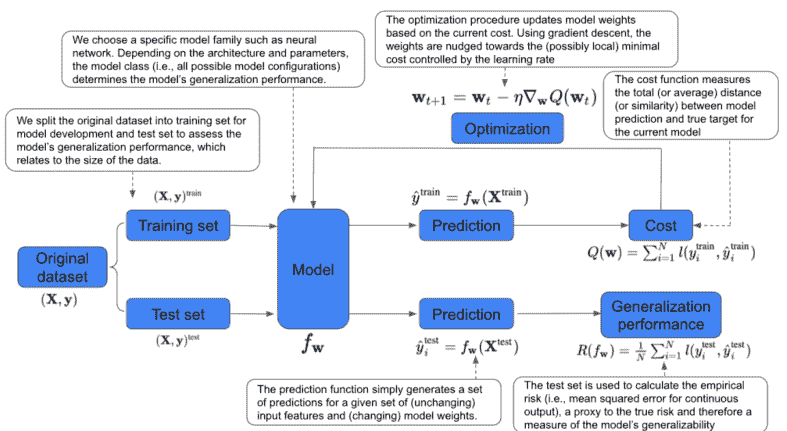

图 4.10 模型训练过程回顾。我们首先将大部分数据集分配用于训练，其余用于测试。选择特定的模型族后，我们可以生成预测并衡量代价，这是一个标量值，指示当前模型的表现如何。然后优化过程调整模型权重，使模型代价降至最小。当基于训练集确定了一组最优权重后，模型随后用于为测试集生成预测并计算相应的代价，对于连续输出，代价的形式为均方误差。测试集代价是用于逼近真实风险的经验风险，并指示模型对未见的未来数据集的泛化能力。在重复该过程多轮（epochs）直至训练过程收敛后，我们最终会选择一个最小化经验风险的模型。

需要注意的是，优化是在根据当前代价相对于当前权重集的梯度来更新权重时发生的。因此，梯度下降算法要求我们能够计算梯度向量 $\nabla_w Q(w_t)$，该向量包含时间戳 t 时代价相对于 w 中每个权重的偏导数；在神经网络的情况中，即每一层的权重。

现在，回顾多层感知机的函数形式：

$$f_L(x) = \phi(b_L + W_L \phi(b_{L-1} + W_{L-1} \phi(\cdots \phi(b_1 + W_1 x)\cdots)))$$

最终预测 $f_L(x)$ 可以被视为第一个隐藏层初始输入权重 $W_1$ 和 $b_1$ 的多层复合函数。在计算代价时，我们需要将其级联到所有权重以进行梯度计算，包括层中较早的权重，例如 $\mathbf{W}_1$ 和 $\mathbf{b}_1$。为了简化讨论，我们将使用 $\mathbf{w}$ 表示网络中所有初始权重（即 $\mathbf{W}_1$ 和 $\mathbf{b}_1$），并了解如何计算 *雅各比矩阵*（即每个权重的代价一阶偏导数）。换句话说，基于多层感知机的嵌套预测函数现在变为：

$$f_l(f_{l-1}(\cdots f_1(\mathbf{w})))$$

其中，对于总共 $L$ 层中的每个 $l^{th}$ 层，函数 $f_l$ 是一个可微的多元函数，将 $p_{l-1}$ 维的输入向量映射到 $p_l$ 维的输出向量。中间函数的可微性对于基于梯度的优化至关重要。当这些函数不可微时，我们无法计算梯度，更不用说进行梯度下降更新了。

### 4.2.2 带偏导数的链式法则

当一个函数是复合函数时，例如多层感知机的预测函数，我们通常可以将其表示为 *f(g(x))*，其中 *f* 是另一个函数 *g* 的函数（依此类推）。要计算复合函数的导数，我们将依赖 *链式法则*，它本质上将导数操作逐层传递给每个中间函数，直到原始输入。具体来说，链式法则表明复合函数可以按如下方式求导：

$$\frac{d}{dx}[f(g(x))] = f'(g(x))g'(x)$$

上述公式对应于求导的直接后向执行。为了计算（两层）复合函数相对于原始输入的导数，我们首先计算外层函数 *f* 相对于整个内层函数 *g(x)* 的整体导数，得到 *f'(g(x))*。然后继续在内层函数 *g* 上进行计算，得到 *g'(x)*。最后，将这些中间导数相乘。求导步骤逆向通过所有组合函数。

更一般地说，为了计算神经网络中每个权重的复合多层感知机函数的偏导数，我们将依赖链式法则以逆向方式将导数计算传递通过所有隐藏层。该过程也对应于神经网络训练中的预测前向传播以及导数计算中的反向传播。在前向传播中，我们使用预测函数通过重复的矩阵乘法和非线性变换筛选关键信号，得到一组预测，然后通过代价函数将其汇总为单一指标。在反向传播中，代价被反向传播到最后一个隐藏层，以计算该隐藏层中每个权重的偏导数。此过程继续用于倒数第二个隐藏层，并重复直到第一个隐藏层。

为了增进对这两种传播的理解，我们可以观察一个具有两个隐藏层的简单神经网络，每个隐藏层有两个节点，两个输入节点和一个输出节点。图 4.11 展示了前向传播的流程。为了记法的一致性，我们使用 x 表示输入特征（即由输入数据提供的特征），w 表示层间权重，f 作为操作前一层的输入和权重以产生输出（即隐空间中的学习特征）的中间函数，供下一层使用。我们使用下标表示层级索引，使用上标表示给定层内的索引。例如，$x^j$ 表示输入层中作为原始特征的第 $j$ 个节点，$w^j_i$ 表示第 $i$ 层中使用相对位置（从上到下）的第 $j$ 个标量权重，$f^j_i$ 表示第 $i$ 层中的第 $j$ 个节点。

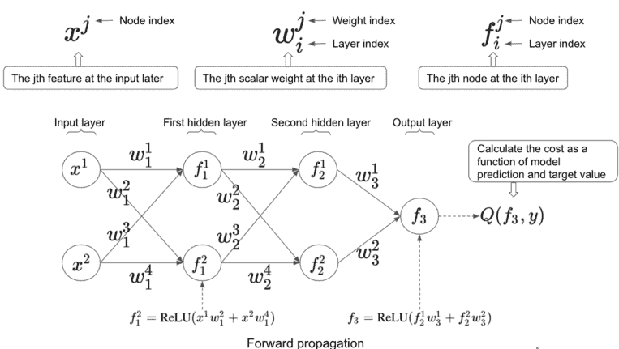

图 4.11 具有两个隐藏层的简单神经网络中前向传播的示意图，每个隐藏层有两个节点。为简化起见，偏置项被忽略。箭头沿线的节点和权重在每次前向传递中均被显式标注以提高清晰度。如 $f^2_2$ 和 $f_3$ 的两个示例所示，除了输入层，每个节点都是前一层输入节点与相应权重之间矩阵乘法的结果，随后经过一个激活函数（在此例中为 ReLU）。节点的输出随后成为下一层的输入（即学习的隐藏特征），直到到达最终输出层。

前向传播本质上是使用激活函数进行矩阵乘法（或等价的加权求和）与非线性变换的重复操作。例如，第一个隐藏层中的第二个节点计算 $f^2_1 = \text{ReLU}(x^1 w^1_1 + x^2 w^1_4)$，其输出随后成为下一层相同操作的输入特征。隐藏层中的这些输入特征由神经网络自动提取和学习，并在不同抽象层次上倾向于更解耦且更有意义。当前向传播到达最终层时，我们得到 $f_3 = \text{ReLU}(f^2_1 w^1_3 + f^2_2 w^3_2)$ 作为模型的最终预测。随后基于最终模型预测 $f_3$ 和相应的真实目标 $y$ 计算代价，从而完成前向传递。

随后触发反向传播，将反馈（即偏导数）发送到神经网络中的每个权重。然而，此过程涉及多个嵌入函数，因此依赖链式法则进行梯度计算。如图 4.12 所示，计算过程本质上从最终输出开始，按顺序向后展开，直到到达第一个隐藏层中的初始权重。为了更好地说明，偏导数被显式标注，以便与前一图中的权重直接对应。如果我们想要计算代价 Q 相对于第一个隐藏层中权重 $w_1^1$ 的偏导数，我们需要通过点划线向后遍历，从代价开始，穿过所有相互连接的偏导数，一直到 $w_1^1$ 处的起点。这种级联过程本质上遵循链式法则。

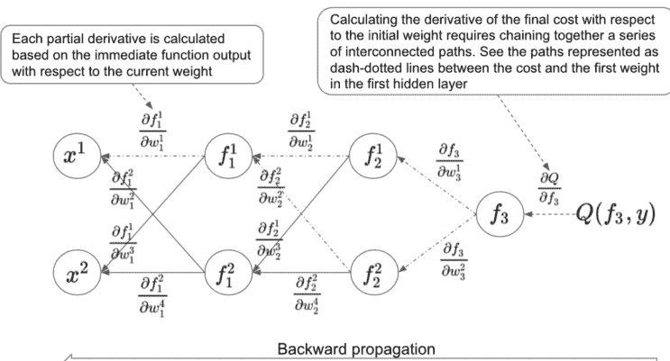

图 4.12 反向传播过程的说明。该过程从端点（即代价）开始，按顺序向后进行。每个偏导数使用输出函数相对于输入变量（即进入权重）进行计算。神经网络中每个权重的偏导数均被显式标注。基于链式法则，我们需要考虑最终输出与初始输入之间所有相互连接的路径，以计算其相对于特定权重的偏导数。从右到左的行进路径的这种逐步扩展在图中通过点划线展示。

让我们将多层神经网络的预测函数表示为 $\mathbf{f}_L(\mathbf{f}_{L-1}(\cdots \mathbf{f}_1(\mathbf{w})))$ 的形式，其中粗体函数 $\mathbf{f}_L$ 表明层 $L$ 可能包含多个函数（即多个节点），而 $\mathbf{w}$ 表示初始隐藏层中的权重。


为了计算函数 \(f_L\) 关于权重 \(\mathbf{w}\) 的导数 \(\frac{\partial f_L}{\partial \mathbf{w}}\)，我们首先会计算 \(f_L\) 关于前一层预测函数 \(f_{L-1}\) 的中间导数 \(\frac{\partial f_L}{\partial f_{L-1}}\)，将整个 \(f_{L-1}(\cdots f_1(\mathbf{w}))\) 块视为一个单一实体。等价地，我们可以将 \(\frac{\partial f_L}{\partial f_{L-1}}\) 解释为 \(\frac{\partial f_L(x)}{\partial x}\)，其中 \(x=f_{L-1}(\cdots f_1(\mathbf{w}))\)。

我们将以类似方式继续，计算 \(f_{L-1}\) 关于其前一层函数 \(f_{L-2}\) 的中间导数 \(\frac{\partial f_{L-2}}{\partial f_{L-1}}\)，以此类推。推导中间导数的过程会持续进行，直到到达第一个（即最内层）函数 \(f_1\)，在那里我们将乘上最后的导数 \(\frac{\partial f_1}{\partial \mathbf{w}}\)。最后，这些中间导数相乘。换句话说，\(\frac{\partial f_L}{\partial \mathbf{w}}\) 可以按以下方式计算：

\(\frac{\partial f_L}{\partial \mathbf{w}} = \frac{\partial f_L}{\partial f_{L-1}} \frac{\partial f_{L-1}}{\partial f_{L-2}} \frac{\partial f_{L-2}}{\partial f_{L-3}} \cdots \frac{\partial f_2}{\partial f_1} \frac{\partial f_1}{\partial \mathbf{w}}\)。

图 4.13 说明了计算最终层预测函数 \(f_L\) 关于初始隐藏层权重 \(\mathbf{w}\) 的导数的过程。我们首先会遵循前向传播过程，为权重生成一系列嵌入预测。然后启动反向传播，为每对相邻层生成一系列中间导数。最后，通过相乘这些中间导数，得出最外层函数 \(f_L\) 关于权重 \(\mathbf{w}\) 的梯度。这些计算是通过大多数流行深度学习框架（如 PyTorch）中的自动微分功能执行的。

首先，我们从初始隐藏层的权重开始，通过一系列感知机操作执行前向传播。

每个隐藏层都是一个由一个或多个节点组成的感知机函数向量。

多层神经网络中一系列嵌入预测函数的最后一步，以 $\mathbf{f}_L(\mathbf{f}_{L-1}(\dots \mathbf{f}_1(\mathbf{w})))$ 结束。

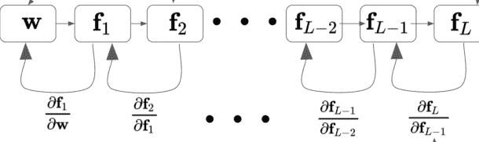

最后，我们将这些中间导数相乘以得到最终梯度，得到 $\frac{\partial \mathbf{f}_L}{\partial \mathbf{w}} = \frac{\partial \mathbf{f}_L}{\partial \mathbf{f}_{L-1}} \frac{\partial \mathbf{f}_{L-1}}{\partial \mathbf{f}_{L-2}} \cdots \frac{\partial \mathbf{f}_2}{\partial \mathbf{f}_1} \frac{\partial \mathbf{f}_1}{\partial \mathbf{w}}$

然后，我们执行反向传播来计算中间导数。

图 4.13 计算多层神经网络关于初始隐藏层权重的梯度。该过程从前向传播开始，生成一系列预测直到到达最后一层。然后计算两个相邻层之间的中间导数。最终梯度通过相乘这些中间导数得出。

### 4.2.3 不同的乘法模式

到目前为止，我们一直在探讨如何计算多层神经网络关于第一个隐藏层权重的梯度。同样，推广到其他层的权重也很简单。关于第一层权重的最终代价梯度可以通过相乘这些中间层的中间导数来推导。然而，每一对层都会产生一个偏导数矩阵，其元素对应两个层中每对唯一节点，如果规划不当，相乘多个矩阵可能需要很长时间才能计算完成。

让我们关注前两个矩阵的乘法：$\frac{\partial \mathbf{f}_1}{\partial \mathbf{w}}$ 和 $\frac{\partial \mathbf{f}_2}{\partial \mathbf{f}_1}$。假设 $\mathbf{w}$ 是一个 $p_0$ 维向量，$\mathbf{f}_1$ 是一个 $p_1$ 维向量。对 $\mathbf{f}_1$ 中每个函数相对于 $\mathbf{w}$ 中每个权重求偏导，得到一个维度为 $p_1 \times p_0$ 的矩阵 $\frac{\partial \mathbf{f}_1}{\partial \mathbf{w}}$。同样，$\frac{\partial \mathbf{f}_2}{\partial \mathbf{f}_1}$ 将是一个 $p_2 \times p_1$ 矩阵。基于我们之前对矩阵乘法的介绍，当两个矩阵相乘时，内部维度应相互匹配，外部维度将形成输出的结果形状。在此例中，$\frac{\partial \mathbf{f}_2}{\partial \mathbf{f}_1} \frac{\partial \mathbf{f}_1}{\partial \mathbf{w}}$ 将是一个 $p_2 \times p_0$ 矩阵。此外，从计算角度来看，相乘 $\frac{\partial \mathbf{f}_1}{\partial \mathbf{w}}$ 和 $\frac{\partial \mathbf{f}_2}{\partial \mathbf{f}_1}$ 总共需要 $p_2 p_1 p_0$ 次操作。操作次数表明乘法需要多长时间。

当汇总到整个神经网络中所有导数的乘法时，根据乘法在复合函数中如何分布，我们最终会得到不同的计算复杂度。例如，如果我们遵循前向传播的风格，即以 *前向模式* 进行乘法，则由括号分隔的乘法序列将如下所示：

```
\frac{\partial f_L}{\partial \mathbf{w}} = \frac{\partial f_L}{\partial f_{L-1}} \left( \frac{\partial f_{L-1}}{\partial f_{L-2}} \left( \frac{\partial f_{L-2}}{\partial f_{L-3}} \dots \left( \frac{\partial f_3}{\partial f_2} \left( \frac{\partial f_2}{\partial f_1} \frac{\partial f_1}{\partial \mathbf{w}} \right) \right) \dots \right) \right).
```

如图 4.14 所示，第二层乘法，即 $\frac{\partial f_2}{\partial f_1} \frac{\partial f_1}{\partial \mathbf{w}}$，将继续并生成一个形状为 $p_3 \times p_0$ 的矩阵，总共产生 $p_3 p_2 p_0$ 次操作。与外层矩阵相乘的过程将持续进行，直到到达最后一层。涉及的操作总数（即前向模式乘法计算成本的指标）将因此变为：

```
p_2 p_1 p_0 + p_3 p_2 p_0 + \dots + p_L p_{L-1} p_0 = p_0 \sum_{l=2}^L p_l p_{l-1}.
```

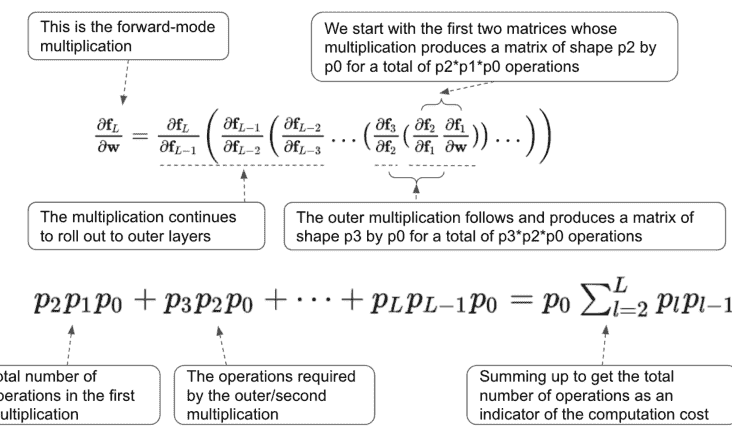

**图 4.14** 说明前向模式乘法过程及其计算成本。乘法从神经网络开头的最内层级别开始，逐渐扩展到末尾的外层级别。计算成本可以计算为一系列乘法中涉及的操作总数。

我们也可以以 *反向模式* 查看乘法链，从神经网络的末端到开头相乘偏导数矩阵。反向模式将具有以下乘法序列：

$$\frac{\partial f_L}{\partial \mathbf{w}} = \left( \left( \cdots \left( \left( \frac{\partial f_L}{\partial f_{L-1}} \frac{\partial f_{L-1}}{\partial f_{L-2}} \right) \frac{\partial f_{L-2}}{\partial f_{L-3}} \right) \cdots \frac{\partial f_3}{\partial f_2} \right) \frac{\partial f_2}{\partial f_1} \right) \frac{\partial f_1}{\partial \mathbf{w}}.$$

遵循类似的推理，反向模式乘法所需的操作总数将为：

$$p_L p_{L-1} p_{L-2} + p_L p_{L-2} p_{L-3} + \dots + p_L p_1 p_0 = p_L \sum_{l=1}^{L-1} p_l p_{l-1}.$$

图 4.15 说明了反向模式乘法。

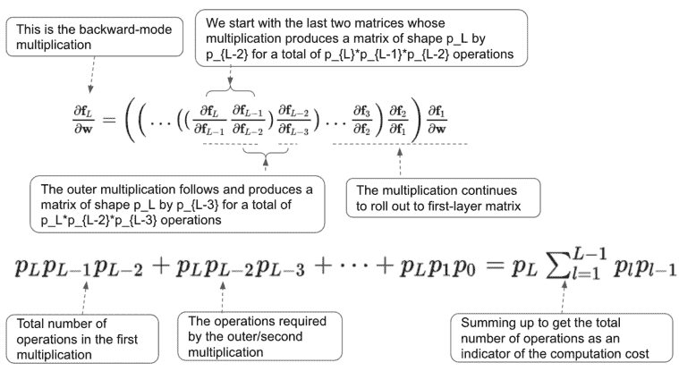

图 4.15 说明反向模式乘法过程及其计算成本。乘法从神经网络末端的最内层级别开始，逐渐扩展到开头的外层级别。

请记住，我们的目标是计算包含模型代价相对于每个权重的偏导数的梯度向量。由于现代神经网络规模庞大且涉及多轮优化，我们希望能够高效地计算梯度。因此，我们需要分析和比较前向模式和反向模式乘法的计算成本，并选择更快的选项。

显然，这两种模式的计算成本因复合函数中各层的大小而异。此外，之前推导的计算成本公式表明，前向模式依赖于常数乘数 $p_0$，而反向模式依赖于 $p_L$。在典型的模型训练过程中，通常根据当前模型的预测选择标量代价作为性能指标。单值代价表明 $p_L = 1$。另一方面，$p_0$ 直接取决于输入数据的维度，在图像数据的情况下，每个条目可增长到数十万个特征。


因此，在执行自动微分时，反向模式乘法在大多数情况下通常具有更高的计算效率。

自动微分中的反向模式乘法也称为 _反向传播_。具体来说，矩阵乘法系列从最后一层开始，接着乘以前面各层的偏导数矩阵，直到到达初始权重。尽管其计算速度比正向模式更快，但反向模式需要更多内存来存储每个隐藏层中的中间偏导数矩阵。然而，运行正向模式会按照预测函数的前向传播顺序计算当前层的这些梯度，并且在移动到下一层时会丢弃这些梯度。

在下一节中，我们将探讨使用 MNIST 数据集训练简单 CNN 模型时的实现细节。

## 4.3 使用 MNIST 训练简单 CNN

现在让我们通过一些实际示例来了解代码中的实际训练过程。我们将使用 MNIST 数据集训练一个图像分类器。MNIST 数据库（修正后的美国国家标准与技术研究院数据库）是一个广泛用于机器学习和深度学习模型实验、原型设计和基准测试的手写数字数据库。它包含 60,000 张训练图像和 10,000 张测试图像，这些图像均已归一化并居中裁剪。可以通过 `torch.datasets` 类访问，无需单独下载。

**torch, torchvision 和 torchtext**

`torch` 包包含实现各种架构神经网络所需的所有核心类和方法。`torchvision` 是一个支持包，提供计算机视觉任务中标准的常用数据集、模型架构和图像转换流水线。`torchtext` 正如其名称所示，是一个提供自然语言处理任务实用函数的包。

本示例将介绍使用 MNIST 训练简单 CNN 模型的逐步实现过程。我们将首先使用 PyTorch `torchvision` 包中的 `datasets` 和 `dataloader` 子类进行数据加载和预处理。使用这些实用函数可以显著加速模型开发过程，因为它对输入数据提供一致的处理和预处理。接下来，我们将定义模型架构、代价函数和优化函数。最后，我们将使用训练集训练模型，并使用测试集测试其预测性能。

### 4.3.1 下载和加载 MNIST

我们将首先使用 `torchvision` 中的 `datasets` 子包下载 MNIST 数据集，这是一个强大且方便的开箱即用实用工具，用于访问常用图像数据集。它存储图像样本及其对应的标签。在以下代码片段中，我们首先导入 `datasets` 类并实例化它，以将训练数据和测试数据下载到 `Data` 文件夹中。此外，下载的图像将被转换为张量对象，在 PyTorch 中，张量是一个多维 NumPy 数组。该转换还可以包括将图像像素从原始范围 [0, 255] 缩放到标准范围 [0.0, 1.0]。

### 清单 4.4 下载 MNIST 数据集

```
import torch
import matplotlib.pyplot as plt
from torchvision import datasets
from torchvision.transforms import ToTensor
train_data = datasets.MNIST(
    root = 'data',
    train = True,
    transform = ToTensor(),
    download = True,
)
test_data = datasets.MNIST(
    root = 'data',
    train = False,
    transform = ToTensor()
)
```

我们可以打印这些对象以访问其对象概要信息，包括观测值的数量。

```
>>> print(train_data)
Dataset MNIST
    Number of datapoints: 60000
    Root location: data
    Split: Train
    StandardTransform
Transform: ToTensor()
>>> print(test_data)
Dataset MNIST
    Number of datapoints: 10000
    Root location: data
    Split: Test
    StandardTransform
Transform: ToTensor()
```

将数据下载到 `train_data` 变量后，输入和输出分别存储在 `data` 和 `targets` 属性中。我们可以按如下方式检查它们的形状。

```
>>> print(train_data.data.size())
>>> print(train_data.targets.size())
torch.Size([60000, 28, 28])
torch.Size([60000])
```

输出显示我们有 60,000 张图像，每张图像的形状为 28 x 28，分别对应图像的 *宽度* 和 *高度*。需要注意的是，彩色图像会有第三个维度，称为 *深度* 或 *通道*，通常其值为 3。由于我们处理的是灰度图像，因此省略了额外的维度 1。

我们可以可视化训练集中的几张图像。下面的代码随机选择 25 张图像，并在 5x5 的网格画布上绘制它们。

```
figure = plt.figure(figsize=(10, 8))
cols, rows = 5, 5
for i in range(1, cols * rows + 1): #A
    sample_idx = torch.randint(len(train_data), size=(1,)).item() #B #C
    img, label = train_data[sample_idx] #D
    figure.add_subplot(rows, cols, i)
    plt.title(label)
    plt.axis("off")
plt.imshow(img.squeeze(), cmap="gray") #E
plt.show()
```

#A Loop over 25 places to plot the images
#B Generate a random index to select an image
#C The item function converts the Tensor object into a scalar value
#D Extract the image data and target label
#E Squeeze the image to convert the image shape from [1,28,28] to [28,28]

图 4.16 显示了 25 个数字的输出。需要注意的是，每张图像的形状为 28 x 28，因此总共有 784 个像素，即每张图像的特征数。

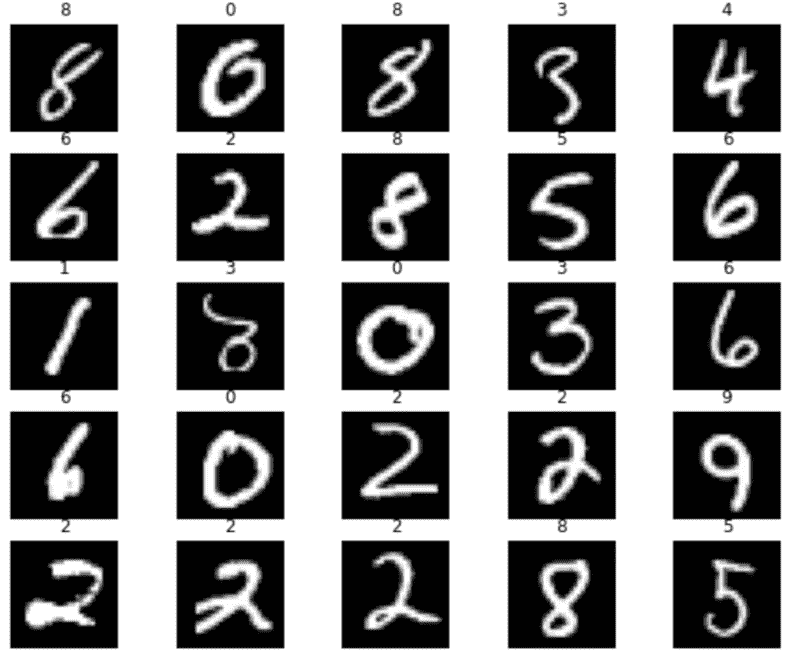

图 4.16 可视化 25 个随机 MNIST 数字。每个数字都是由 28*28=784 个像素组成的灰度图像。

下载数据集后，下一步是加载它们以用于模型训练。torch.utils.data 模块中的 dataloader 类提供了一种方便的方式来批量加载和遍历数据，并在需要时执行特定转换。将数据集对象作为参数传递给 dataloader，可实现数据集的自动批处理、采样、打乱和多进程加载。以下代码在打乱所有图像后，以批大小 100 迭代加载训练集和测试集，并将其存储在 loaders 对象中。

### 清单 4.5 批量加载随机打乱的数据

```
from torch.utils.data import DataLoader
loaders = {
    'train' : torch.utils.data.DataLoader(
        train_data, #A
        batch_size=100, #B
        shuffle=True), #C
    'test' : torch.utils.data.DataLoader(
        test_data,
        batch_size=100,
        shuffle=True)}
#A data source to be loaded
#B the number of training samples used in one iteration
#C samples are shuffled and loaded in batches
```

我们可以通过第一次迭代 loaders 来观察加载数据的形状，如以下代码所示。

```
>>> for X, y in loaders['train']:
>>>   print("Shape of X [batch_size, channel, height, width]: ", X.shape)
>>>   print("Shape of y: ", y.shape)
>>>   break
Shape of X [batch_size, channel, height, width]: torch.Size([100, 1, 28, 28])
Shape of y: torch.Size([100])
```

### 4.3.2 定义预测函数

到目前为止，我们一直将模型定义为一个预测函数，该函数接收输入数据，通过一系列矩阵-向量乘法和非线性变换与模型参数进行交互，并输出模型预测结果。预测函数一举两得：定义模型参数并指定模型架构（即权重与输入之间的交互机制）。如果问题规模较小且模型相对简单，在一个函数中实现这两个目标是可行的。然而，随着数据、模型、代价或整个模型训练过程的优化程序复杂性增加，建议将模型参数与模型架构分离，并根据具体目的将相应代码模块化。换句话说，模型参数和指定数据与参数之间交互的模型架构将拥有各自专用的函数。

常见的做法是使用一个类将所有这些不同的实用函数封装在一起。具体来说，我们可以在一个函数中安排模型参数，这通常表现为类的默认 __init__ 函数。__init__ 函数包含在首次实例化类时初始化的属性，这意味着抽象类被转换为具体且可感知的对象。这些属性包括类的基本构建块，即神经网络的层以及由层隐含的相应参数。实例化类似于购买一套乐高玩具，所有部件均根据其设计规格提供。这些部件也可以有不同的尺寸和结构，其中一个大组件可以由多个小组件组成。

此外，定义模型架构并调节数据流的函数放入 forward 函数中，它充当组装部件的说明书。这是一个在底层自动执行的特殊函数

当类的对象被调用时。因此，它充当默认的信息路线图，将 __init__ 函数定义的各种组件串联起来，与输入数据结合，指定它们如何通过网络并返回模型预测。

让我们通过创建一个名为 CNN 的模型类来看一个具体的例子，这表明这是一个卷积神经网络。卷积是一种特定类型的神经网络层，能够有效处理图像数据。它采用小方形滤波器（也称为内核）的形式，通过反复扫描输入表面来对输入数据的局部区域进行操作。在 MNIST 的灰度图像数据中，每个图像条目将表现为一个二维矩阵，其中每个单元格存储 0 到 255 之间的像素值。

如图 4.17 所示，我们创建一个 3x3 的内核来容纳总共九个权重。然后，相同的内核将依次在输入图像数据周围移动，并与不同的补丁进行交互，从而实现不同局部输入区域之间的特征共享。具体的卷积机制（这应该不会让你惊讶）仍然是加权求和操作。换句话说，内核与输入数据局部区域的每次交互都会产生一个标量值，而整体输出数据的大小会相对于输入数据缩小。图中提供的示例基于两个实线高亮显示的输入矩阵之间的卷积操作，输出特征值为 3。该输出也称为特征图，因为卷积操作本质上将输入数据从其原始特征空间投影到另一个更精细、希望更有意义的特征空间中。

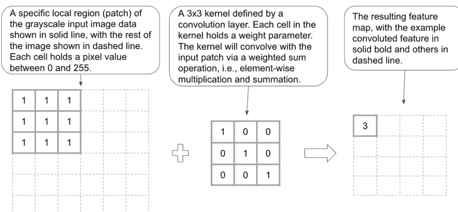

图 4.17 卷积工作流。这里我们定义了一个包含总共 9 个权重的 3x3 内核。该内核将与输入图像中相同大小的不同补丁进行卷积。每个卷积操作包括逐元素矩阵乘法，然后对所有项求和，以在输出特征图中产生最终的标量值。

常见的做法是在卷积层后跟随一个 ReLU 层和一个池化层。池化操作与卷积类似，涉及内核与输入的不同补丁进行交互。但是，内核中没有权重。池化操作使用内核聚焦于特定的输入补丁，选择一个代表值，例如平均值（*平均池化*）或最大值（*最大池化*），并将其存储在输出特征图中。此类操作减少输入数据维度，仅保留（希望是）有意义的特征。

我们现在要创建的 CNN 类使用了上述介绍的所有三种类型的层。如下面的代码清单所示，它继承自预定义的基类 `torch.nn.Module`，该类管理神经网络模块的其他后端后勤工作，无需从头开始创建它们。`CNN` 类将有两个基本函数：`__init__` 和 `forward`。将此类实例化为一个对象时，例如 `model = CNN()`，发生的情况是使用 CNN 的 `__init__` 方法创建 `model` 对象。当使用模型对新数据进行预测时，例如 `model(new_data)`，我们会在幕后将 `new_data` 输入传递给 `forward` 函数。这两个函数都是隐式调用的。

### 清单 4.6 定义卷积神经网络模型类

```
import torch.nn as nn
class CNN(nn.Module):
    def __init__(self): #A
        super(CNN, self).__init__()
        self.conv1 = nn.Sequential( #B
            nn.Conv2d(
                in_channels=1,
                out_channels=16,
                kernel_size=5,
                stride=1,
                padding=2,
            ),
            nn.ReLU(),
            nn.MaxPool2d(kernel_size=2),
        )
        self.conv2 = nn.Sequential( #C
            nn.Conv2d(16, 32, 5, 1, 2),
            nn.ReLU(),
            nn.MaxPool2d(2),
        )
        self.out = nn.Linear(32 * 7 * 7, 10) #D
    def forward(self, x): #E
        x = self.conv1(x)
        x = self.conv2(x)
        x = x.view(x.size(0), -1) #F
        output = self.out(x)
        return output
```

- #A 指定在实例化时自动创建的组件
- #B 第一个卷积块
- #C 第二个卷积块
- #D 输出 10 个类的最终全连接层
- #E 指定信息流
- #F 将输出展平为形状 (batch_size, 32 * 7 * 7)

从高层次来看，我们在 `__init__` 函数的初始化过程中定义了两个卷积块 `conv1` 和 `conv2`。每个块依次应用三个层：由 nn.Conv2d() 进行卷积，由 nn.ReLU() 进行 ReLU 激活，以及由 nn.MaxPool2d() 进行最大池化。请注意，在 nn.Conv2d() 中，in_channels 指图像数据的颜色通道数。由于我们处理的是灰度图像，因此将其设置为 1。out_channels 参数指要创建的内核数量；这将决定输出特征图的深度。换句话说，将其设置为 16 意味着我们将创建 16 个不同的内核与输入数据进行卷积，每个内核从不同角度进行学习，并共同在输出中形成一个 16 层特征图。kernel_size 参数决定方形内核的大小。较大的内核会促进更多的特征共享，但包含更多需要调整的权重，而较小的内核需要更多的卷积操作，但可以更好地关注输入中的局部特征。最后，stride 参数用于控制移动内核以与下一个补丁进行卷积时的步长，padding 参数用于通过在输入周边添加或填充零来调整输出的形状。

将多个简单的层组合在一个块中，并以不同配置多次重复此类块，是定义相对复杂神经网络的常见方法。卷积神经网络中的这种结构也有助于学习图像数据的组合性。经过充分训练的神经网络可以在早期层中提取边缘等低级特征，并在深层中提取对象等高级模式。

此外，我们还通过 nn.Linear() 在初始化函数中将一个全连接层定义为网络的最后一层。请注意，我们需要在第一个参数中传入输入的正确节点数，在第二个参数中传入输出的正确节点数。输入大小基于前面层的网络配置确定，输出设置为 10，因为我们有十个数字类别需要分类。

最后，forward 函数将这些组件按顺序串联起来。在将卷积层与全连接层连接时需要注意。有必要将每个图像条目的多维立方体特征图展平为一维向量。在这种情况下，我们使用 view() 函数将数据重塑为单列，如 -1 参数所示，同时保持批量大小（使用 x.size(0) 作为第一个维度检索）不变。

此外，使用 GPU 时训练过程将显著加速。在 Colab（一个无需麻烦的在线 Jupyter 笔记本）中运行附带的笔记本时，只需将运行时类型中的硬件加速器选项更改为 GPU，即可免费启用 GPU 资源（当然，最高有一定限制）。

在下面的代码片段中，我们通过 model = CNN().to(device) 将类实例化为一个对象来创建模型，其中我们使用 device 变量来确定如果可用则使用 GPU。打印模型对象将给出由 __init__ 函数定义的不同组件的规范，如下所示。

```
>>> device = "cuda" if torch.cuda.is_available() else "cpu"
>>> print(f"Using {device} device")
>>> model = CNN().to(device)
>>> print(model)
Using cuda device
CNN(
(conv1): Sequential(
    (0): Conv2d(1, 16, kernel_size=(5, 5), stride=(1, 1), padding=(2, 2))
    (1): ReLU()
    (2): MaxPool2d(kernel_size=2, stride=2, padding=0, dilation=1, ceil_mode=False)
)
(conv2): Sequential(
    (0): Conv2d(16, 32, kernel_size=(5, 5), stride=(1, 1), padding=(2, 2))
    (1): ReLU()
    (2): MaxPool2d(kernel_size=2, stride=2, padding=0, dilation=1, ceil_mode=False)
)
(out): Linear(in_features=1568, out_features=10, bias=True)
)
```

当神经网络架构开始规模扩大并变得复杂时，打印架构通常有助于更好地澄清其组成。在下面的代码片段中，我们使用 `torchsummary` 包来简化可视化任务，方法是传入输入条目的大小。输出从上到下显示模型架构，每个层依次添加一个整数后缀。还提供了每个层的输出形状和参数数量。模型中总共使用了（可训练）28,938 个参数。请注意，我们没有任何不可训练的参数；这与迁移学习中模型微调的程度有关。

```
>>> from torchsummary import summary
>>> summary(model, input_size=(1, 28, 28))
```

| 层 (类型) | 输出形状 | 参数数量 |
|--------------|--------------|---------|
| Conv2d-1 | [-1, 16, 28, 28] | 416 |
| ReLU-2 | [-1, 16, 28, 28] | 0 |
| MaxPool2d-3 | [-1, 16, 14, 14] | 0 |
| Conv2d-4 | [-1, 32, 14, 14] | 12,832 |
| ReLU-5 | [-1, 32, 14, 14] | 0 |
| MaxPool2d-6 | [-1, 32, 7, 7] | 0 |
| Linear-7 | [-1, 10] | 15,690 |

总参数: 28,938
可训练参数: 28,938
不可训练参数: 0
输入大小 (MB): 0.00
前向/后向传递大小 (MB): 0.32
参数大小 (MB): 0.11
估计总大小 (MB): 0.44

请注意，每个输入图像的最终输出 \(\hat{\mathbf{y}} = [\hat{y}_1, \hat{y}_2, ..., \hat{y}_{10}]\) 是一个包含十个数值的数组，分别对应每个类别的预测输出。值最大的类别成为该图像条目的最终预测。由于这是一个分类任务，这些数字将进一步转换为概率数组。此类转换是


使用 _softmax_ 函数完成，该函数应用特定的数学公式将数字转换为概率，同时确保所有类别的概率之和为一。使用概率的好处是我们不必处理特定的且无界的数字；概率始终介于零和一之间，使其更易于解释。

具体来说，对于第 `_kth_` 类的原始输出 {ŷk, k = 1, ..., 10} 将通过 S(ŷk) = e^ŷk / Σ (i=1 到 10) e^ŷi 进行转换。该转换本质上对每个原始输出应用指数函数，并通过将所有结果指数求和来对其进行归一化，以将输出压缩在零和一之间，所有输出现在都有界且之和为一。例如，给定数组 [1,2,3]，使用 softmax 函数转换后的输出将是 [0.09, 0.24, 0.67]。请注意，该转换是单调的，意味着这些输出之间的相对排名保持不变，因此我们仍然可以通过定位最大值来识别最终预测。图 4.18 说明了 softmax 转换过程。

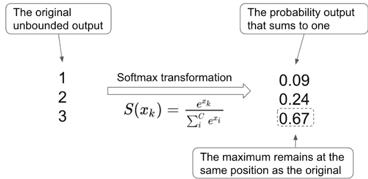

图 4.18 使用 softmax 函数将原始输出转换为概率。转换后的输出现在有界且之和为一，从而便于解释。输出的相对排名也保持不变，因此在此示例中最终预测仍然是第三类。

可以按如下方式实现 softmax 函数。

```
Listing 4.7 Using softmax function to transform to probability output
import numpy as np
def softmax(x):
    return np.exp(x) / np.sum(np.exp(x), axis=0)
```

然后可以按如下方式复制图 4.18 中的示例。

```
>>> test = [1,2,3]
>>> transformed_test = softmax(test)
>>> print('softmax output:', transformed_test)
softmax output: [0.09003057 0.24472847 0.66524096]
```

请注意，我们此时没有将 softmax 转换添加到预测输出中，这是有原因的。下一节将介绍的 PyTorch 提供的特定损失函数会为我们执行 softmax 转换。只要我们以原始数值格式提供输出，损失函数就会在底层计算过程中处理该转换。

### 4.3.3 定义损失函数

当目标输出为数值时，我们在前几章中使用的损失指标是 MSE（均方误差）。由于我们在预测数字，这是一个分类任务。用于分类问题的最流行的损失指标之一是交叉熵损失（CEL）。对于第 $i^{th}$ 个观测值 \(\mathbf{x_i}\)，预测函数将产生一个概率输出（即，值在 0 和 1 之间），表示为 \(p_{i,k} = f(\mathbf{x_i};\mathbf{w})\)，以指示属于第 \(k^{th}\) 类的可能性。对于包含总共 \(C\) 个类的分类任务，\(\mathbf{x_i}\) 的 CEL 定义为 \(Q_i(\mathbf{w}) = -\sum^C_{k=1} y_{i,k}log(p_{i,k})\)，其中如果第 \(i^{th}\) 个观测值的目标标签属于第 \(k^{th}\) 类，则 \(y_{i,k} = 1\)，否则 \(y_{i,k} = 0\)。

求和意味着类别评估（即，项 \(y_{i,k}log(p_{i,k})\)）针对所有类别执行并相加，以产生第 \(i^{th}\) 个观测值的总成本。对于每个观测值，总共有 \(C\) 个预测，分别对应属于每个类的概率。因此，成本通过将预测概率数组相加为单个数字来聚合。此外，结果被取反以产生正数，因为如果 \(x\) 是 0 和 1 之间的概率，则 \(log(x)\) 为负数。

请注意，CEL 计算中的目标标签是 one-hot 编码。单个标签被转换为二进制数组，其中类别标签为 1，其余为 0。例如，对于数字 8 的图像，不再将原始类作为目标输出，而是使用结果 one-hot 编码的目标 [0, 0, 0, 0, 0, 0, 0, 0, 1, 0, 0]，其中第八位被激活（即，hot），其余被禁用。目标数组的长度也与概率输出数组相同。

直观地，我们希望正确类的预测概率接近 1，错误类的预测概率接近 0。也就是说，随着预测概率与实际类别标签的偏离，损失应增加。交叉熵损失旨在遵循这一直觉。具体来说，我们可以查看第 \(i^{th}\) 个观测值的以下四种情景：

- 当目标标签属于第 \(k^{th}\) 类（即，\(y_{i,k} = 1\)）且第 \(k^{th}\) 类的预测概率很强（即，\(p_{i,k} \approx 1\)）时，成本应较低；
- 当目标标签属于第 \(k^{th}\) 类（即，\(y_{i,k} = 1\)）且第 \(k^{th}\) 类的预测概率很弱（即，\(p_{i,k} \approx 0\)）时，成本应较高；
- 当目标标签不属于第 \(k^{th}\) 类（即，\(y_{i,k} = 0\)）且第 \(k^{th}\) 类的预测概率很强（即，\(p_{i,k} \approx 1\)）时，成本应较高；
- 当目标标签不属于第 \(k^{th}\) 类（即，\(y_{i,k} = 0\)）且第 \(k^{th}\) 类的预测概率很弱（即，\(p_{i,k} \approx 0\)）时，成本应较低。

要计算总成本，我们只需将单个成本相加，从而得到 \(Q(\mathbf{w}) = -\sum_{i=1}^N \sum_{k=1}^C y_{i,k} \log(p_{i,k})\)。图 4.19 总结了上述关于交叉熵损失的讨论。

\(Q(\mathbf{w}) = - \sum_{i=1}^N \sum_{k=1}^C y_{i,k} \log(p_{i,k})\)

| | | |
|---|---|---|
| 低 | 1 | ≈1 |
| 高 | 1 | ≈0 |
| 高 | 0 | ≈1 |
| 低 | 0 | ≈0 |

图 4.19 交叉熵损失及其背后的直觉。要计算 CEL，我们首先计算每个观测值中二进制标签向量与所有类预测概率向量之间的加权和。将所有观测值的结果相加，然后加上负号以将成本转换为正数。CEL 的设计旨在匹配成本的直觉：当预测与目标紧密匹配时，成本较低，否则较高。

请注意，由于目标值等于零，最后两种情景完全不参与损失计算；任何数乘以零都为零。此外，请注意，对于这两个类别，特定观测值的预测概率需要加起来等于一，因此只需关注一个类别（通常是第 1 类）的预测概率即可。

如下定义的计算 CEL 的函数接受两个输入：one-hot 编码的目标数组和预测概率数组，两者的长度均与类别数相同。

### Listing 4.8 定义交叉熵损失函数

```
def cross_entropy(actual, predicted):
    EPS = 1e-15
    predicted = np.clip(predicted, EPS, 1 - EPS)
    loss = -np.sum(actual * np.log(predicted))
    return loss
```

### A 将概率限制在 0 和 1 之间

让我们看一个例子。假设我们正在处理一个三类分类问题，真实标签是第一类，即目标标签 one-hot 编码为 [1, 0, 0]。我们有一个好的预测 [0.8, 0.1, 0.1] 和一个不好的预测 [0.1, 0.6, 0.3]。让我们看看它们的 CEL 结果有何不同。

```
>>> y = np.array([1, 0, 0])
>>> pred_good = np.array([0.8, 0.1, 0.1])
>>> pred_bad = np.array([0.1, 0.6, 0.3])
>>> loss_good = cross_entropy(y, pred_good)
>>> loss_bad = cross_entropy(y, pred_bad)
>>> print('The good prediction loss: {:.4f}'.format(loss_good))
>>> print('The bad prediction loss: {:.4f}'.format(loss_bad))
The good prediction loss: 0.2231
The bad prediction loss: 2.3026
```

结果符合我们的预期，即预测越差，CEL 越高。然而，在 PyTorch 中，使用 torch.nn.CrossEntropyLoss 函数时，会自动对目标标签进行 one-hot 编码，并对预测数组进行 softmax 转换。以下代码显示我们可以传入原始类别标签和预测数组来计算 CEL。

```
>>> cost_func = nn.CrossEntropyLoss() #A
>>> y = torch.tensor([0]) #B
>>> pred_good = torch.tensor([[2, 0.8, 0.5]])
>>> pred_bad = torch.tensor([[1, 6, 0.2]])
>>> loss_good = cost_func(pred_good, y)
>>> loss_bad = cost_func(pred_bad, y)
>>> print('The good prediction loss: {:.4f}'.format(loss_good.item()))
>>> print('The bad prediction loss: {:.4f}'.format(loss_bad.item()))
```

#A 使用 nn 模块中的默认 CEL 函数
#B 第一个类从索引 0 开始

```
The good prediction loss: 0.4216
The bad prediction loss: 5.0097
```

在评估整个模型训练过程时，理解 CEL 的结构至关重要，因为它代表了模型的拟合优度。虽然对训练数据的高拟合优度可能导致模型过拟合，但可以添加一个针对模型复杂度的额外成本项。该额外成本项作为参数大小的显式正则化器。我们在前一章中基于拟合函数的二阶导数见过正则化器的一个示例。我们将在后续章节中通过成本函数介绍更多关于正则化的内容。


### 4.3.4 定义优化过程

要更新模型参数，我们可以使用 PyTorch 提供的优化器，包括 SGD 及其变体。使用默认优化器可以轻松地将优化扩展到甚至数百万个参数。像 SGD 这样的典型优化器包括两个输入参数：要更新的模型参数和要使用的学习率。实例化优化器后，我们可以调用其 step() 方法来更新权重，方法是在使用 backward() 方法反向传播成本并计算梯度之后。

请记住，优化过程是一个迭代过程。预测函数在每次迭代中根据当前权重生成输出。然后，成本函数使用预测值和目标标签来计算成本。优化步骤为每个权重推导成本梯度，并使用梯度下降类型的算法更新所有权重。此过程重复进行，直到收敛，即权重或成本在训练迭代进行过程中基本保持不变且变化不大。

以下代码片段通过使用 SGD 实例化优化器来定义优化过程，该优化器将用于支持模型权重的迭代更新。

```
from torch import optim
optimizer = optim.SGD(model.parameters(), lr = 0.01)
```

### 4.3.5 通过迭代训练更新权重

我们现在可以将上述组件整合为一个完整的训练循环。基于预定义的模型和数据加载器，以下代码清单定义了训练函数，该函数通过完整遍历训练数据集一次来执行 SGD 优化。我们还跟踪权重在不同训练批次中更新时的成本变化，然后根据指定的 epoch 数重复此过程。

### 清单 4.9 定义训练函数

```
def train(model, loaders, verbose=True):
    model.train()#A
    total_img = len(loaders['train'].dataset) #B
    for batch, (X, y) in enumerate(loaders['train']): #C
        X, y = X.to(device), y.to(device) #D
        pred = model(X) #E
        cost = cost_func(pred, y) #F
        optimizer.zero_grad() #G
        cost.backward() #H
        optimizer.step() #I
        if(batch) % 100 == 0: #J
            loss, current_img_idx = cost.item(), batch * len(X)
            print(f"cost: {cost:>7f} [{current_img_idx:>5d}/{total_img:>5d}]")
```

- #A 通过指定训练模式来控制某些层的行为
- #B 提取图像总数以跟踪训练进度
- #C 提取并遍历每批训练数据
- #D 传递到 GPU 以进行更快处理
- #E 调用前向方法（内部）以生成预测
- #F 计算当前成本
- #G 清除现有梯度，否则梯度会累积
- #H 执行反向传播并计算梯度
- #I 使用 SGD 更新权重
- #J 每 100 个批次打印一次成本；每个批次包含 100 对图像-标签

让我们尝试运行一个 epoch 的训练过程，并观察预测成本的下降。以下代码显示，随着训练的进行，成本稳步下降，表明模型的预测能力在提高。

```
>>> train(model, loaders)
cost: 2.305853 [ 0/60000]
cost: 2.079413 [10000/60000]
cost: 0.855676 [20000/60000]
cost: 0.454673 [30000/60000]
cost: 0.475409 [40000/60000]
cost: 0.320870 [50000/60000]
```

我们还将定义一个函数来检查模型在测试集上的性能。以下代码清单生成模型预测，并通过与目标标签比较来计算测试准确率。由于不需要学习，在生成预测时，模型被设置为评估模式并置于 `torch.no_grad()` 上下文中。

### 清单 4.10 定义测试函数

```
def test(model, loaders, verbose=True):
    model.eval() #A
    total_img = len(loaders['test'].dataset) #B
    correct = 0
    with torch.no_grad(): #C
        for X, y in loaders['test']:
            X, y = X.to(device), y.to(device)
            pred = model(X)
            correct += (pred.argmax(1) == y).type(torch.float).sum().item()
    correct /= total_img #D
    if verbose:
        print(f"Test accuracy: {correct:>0.3f}")
```

- #A 通过指定评估模式来控制某些层的行为
- #B 提取测试集中的图像总数
- #C 禁用梯度计算
- #D 为每个批次添加正确预测的数量

我们可以使用此函数来检查先前训练的模型的性能。

```
>>> test(model, loaders)
Test accuracy: 0.911
```

使用一个 epoch 训练的模型达到 91.1% 的准确率，这非常高。通过训练更多的 epoch，我们可以做得更好，如下所示。

```
>>> num_epochs = 10
>>> for t in range(num_epochs):
>>>     print(f"Epoch {t+1}\n-----------------------------------")
>>>     train(model, loaders, verbose=False)
>>>     test(model, loaders)
>>> print("Done!")
Epoch 1
-----------------------------------
Test accuracy: 0.911
Epoch 2
-----------------------------------
Test accuracy: 0.943
Epoch 3
-----------------------------------
Test accuracy: 0.959
Epoch 4
-----------------------------------
Test accuracy: 0.967
Epoch 5
-----------------------------------
Test accuracy: 0.973
Epoch 6
-----------------------------------
Test accuracy: 0.974
Epoch 7
-----------------------------------
Test accuracy: 0.975
Epoch 8
-----------------------------------
Test accuracy: 0.977
Epoch 9
-----------------------------------
Test accuracy: 0.981
Epoch 10
-----------------------------------
Test accuracy: 0.980
Done!
```

通过训练十个 epoch，准确率现在提高到了 98%！

## 4.4 关于泛化的更多内容

此前，我们提到，由于 SGD 具有良好的泛化性能，因此广泛用于深度神经网络模型。在该过程中，我们并未显式地使用任何正则化。因此，SGD 算法似乎具有隐式正则化效果，除了神经网络的广泛模型类和特定的输入数据类型（即，结构化图像数据）之外。来自 SGD 的隐式正则化将承诺即使在训练误差达到零时，测试误差也会进一步降低，从而在测试损失曲线上导致“双下降”。Smith 等人（2021）在其论文《随机梯度下降中隐式正则化的起源》中最近研究了隐式正则化的效果，我们将在后续章节中讨论。

现在让我们更仔细地研究这一特性。以下代码清单定义了一个只有一个全连接隐藏层的简单神经网络。设置简单的架构使得在我们更改模型复杂度时（即，调整隐藏层中的节点数量）容易关注性能影响。在 `__init__` 函数中的模型初始化代码中，我们使用 `nn.Linear()` 定义两个全连接层，一个作为隐藏层，另一个作为输出层。请注意，我们为隐藏层指定输入大小为 1*28*28，为输出层指定默认输出大小为 10；这些基于 MNIST 数据的特性。我们还将隐藏层大小 `num_nodes` 作为初始化函数中的显式输入参数，以便以后创建不同大小的模型。`forward()` 函数与我们之前的示例中执行类似的工作。唯一需要注意的是，我们在开头直接展平输入数据以适应全连接层，因为此处未使用卷积层。

### 清单 4.11 定义单层神经网络模型类

```
import torch.nn as nn
import torch.nn.functional as F
class SimpleNN(nn.Module):
    def __init__(self, num_nodes, num_classes=10): #A
        super(SimpleNN, self).__init__()
        self.fc = nn.Linear(1 * 28 * 28, num_nodes) #B
        self.out = nn.Linear(num_nodes, num_classes) #C

    def forward(self, x): #D
        x = x.view(x.shape[0], -1) #F
        x = F.relu(self.fc(x))
        output = self.out(x)
        return output
```

- #A 模型初始化代码
- #B 单个全连接层
- #C 输出 10 个类的最终全连接层
- #D 模型架构代码
- #F 除了批量大小之外展平所有维度

接下来，我们需要一个函数来告诉我们模型在训练集和测试集上的表现如何。这些将在我们改变隐藏层大小时指示模型的泛化性能。以下代码清单定义了一个名为 `check_accuracy` 的函数，该函数根据 `type` 参数计算整个训练集或测试集的预测准确率。该代码在很大程度上遵循与之前示例中 `test()` 函数相同的结构，不同之处在于我们将输入图像加载器泛化为基于用户指定参数；这使我们免于为训练集和测试集编写两个相似的函数。


### 清单 4.12 计算整个训练集或测试集的预测准确率

```
def check_accuracy(model, loaders, verbose=True, type="train"):
    model.eval() #A
    total_img = len(loaders[type].dataset) #B
    correct = 0
    with torch.no_grad(): #C
        for X, y in loaders[type]:
            X, y = X.to(device), y.to(device)
            pred = model(X)
            correct += (pred.argmax(1) == y).type(torch.float).sum().item() #D
    correct /= total_img
    if verbose:
        print(f"{type} accuracy: {correct:>0.3f}")
    return correct
```

- #A 设置为评估模式
- #B 提取图像总数
- #C 禁用梯度计算，因为不需要反向传播
- #D 累加每个批次的正确预测

我们现在准备测试模型复杂度对训练集和测试集预测准确率的影响。在下面的代码清单中，我们从隐藏层的两个节点开始，逐渐将其翻倍直到 4096。之所以使用如此广泛的范围，是为了查看模型在超过插值阈值后继续增加复杂度时的表现。我们还在 `num_epochs` 中设置了总共 500 个时代的训练预算，以确保训练过程达到收敛，即模型参数不再发生太大变化。在耗尽训练预算后，我们将训练集的最终预测准确率记录在 `final_train_acc` 中，将测试集的记录在 `final_test_acc` 中。由于运行完整代码需要相当长的时间，我们通过 `pickle` 包将这两个变量存储在文本文件中，以便在运行中断时无需从头开始。

### 清单 4.13 完整的模型训练与测试

```
Listing 4.13 The full model training and testing
import pickle
from torch import optim
device = "cuda" if torch.cuda.is_available() else "cpu"
num_epochs = 500
final_train_acc = []
final_test_acc = []
num_nodes = [2, 4, 8, 16, 32, 64, 128, 256, 512, 1024, 2048, 4096]
for n_node in num_nodes:
    print(f"------NODE: {n_node}------")
    model = SimpleNN(num_nodes=n_node)
    cost_func = nn.CrossEntropyLoss()
    optimizer = optim.SGD(model.parameters(), lr = 0.01)
    for t in range(num_epochs): #A
        if t % 10 == 0:
            print(f"Epoch {t}")
        train(model, loaders, verbose=False)
        final_train_acc.append(check_accuracy(model, loaders, type='train')) #B
        final_test_acc.append(check_accuracy(model, loaders, type='test')) #B
        with open(f"final_train_acc_{n_node}.txt", "wb") as fp:
            pickle.dump(final_train_acc, fp)
        with open(f"final_test_acc_{n_node}.txt", "wb") as fp:
            pickle.dump(final_test_acc, fp)
```

- #A 开始训练
- #B 保存最终准确率

为了将我们的关注点从准确率转移到损失，并观察插值阈值出现的位置，我们将用 1 减去准确率来得出误分类率，并将其四舍五入到三位小数。这是在加载不同隐藏层大小的保存训练和测试准确率后，通过列表推导式实现的（请参见下面的代码清单）。我们希望观察在 x 轴上模型复杂度增加时，y 轴上训练和测试误分类率的变化。除了绘制两条误分类曲线外，我们还通过 `index` 方法检测 `train` 变量中零值首次出现的位置来绘制插值阈值。

### 清单 4.14 绘制训练集和测试集的误分类率

```
Listing 4.14 Plotting the misclassification rate for training and test set

import matplotlib.pyplot as plt
import numpy as np
with open("final_train_acc_4096.txt", "rb") as fp:
    train = pickle.load(fp)
with open("final_test_acc_4096.txt", "rb") as fp:
    test = pickle.load(fp)
train = [np.around(1-i,3) for i in train] #A
test = [np.around(1-i,3) for i in test] #A
x_axis = range(len(num_nodes))
plt.plot(x_axis, train, label = "train")
plt.plot(x_axis, test, label = "test", ls = '--.')
plt.xticks(x_axis, num_nodes)
plt.axvline(x=x_axis[train.index(0)], ls = '--') #B
plt.text(x_axis[train.index(0)] - 0.2, 0.1, 'Interpolation threshold',
   fontsize = 10, color = 'gray',
   rotation = 90, rotation_mode='anchor')
plt.xlabel("# hidden nodes")
plt.ylabel("Misclassification rate")
plt.legend()
plt.show()
```

- #A 将准确率转换为误分类率并进行四舍五入
- #B 检测零误分类首次出现的位置并添加一条垂直线

运行上述代码将生成图 4.20。请回顾，每个点代表训练过程完成第 500 个时代后的最终训练或测试误分类率。因此，误分类率曲线可以被视为模型收敛时性能的反映。训练曲线和测试曲线都表现出均匀的下降趋势，当隐藏层拥有 256 个节点时，模型达到 100% 的训练准确率并完美插值训练数据。有趣的是，测试误分类率甚至在超过插值阈值后仍在下降，这基于经典泛化理论是反直觉的，也是现代泛化理论的一个绝佳示例。

此外，“双下降”曲线并未出现，这可能是因为不同模型复杂度之间的差距不断扩大，导致第二次下降被掩盖。另一种可能性是，SGD 优化算法的隐式正则化效应足够强，可以缓解“双下降”现象。适当的正则化可以避免“双下降”现象，并加速学习朝向泛化模型。

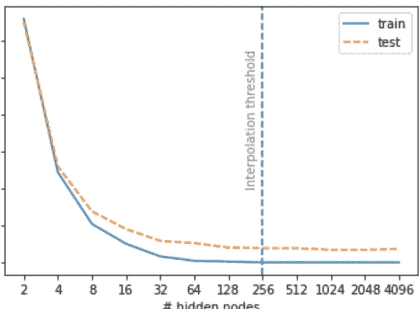

图 4.20 训练集和测试集的误分类率曲线，作为隐藏层节点数量的函数。即使模型继续变得更加复杂，两条曲线都呈现下降趋势，这符合现代泛化理论。特别是，当模型使用 256 个隐藏节点开始完美插值训练数据时，随着隐藏层尺寸增大，测试集的误分类率仍在下降。

## 4.4.1 多个全局最小值

迄今为止，我们观察到，使用 SGD 训练所返回的解（即收敛时的模型权重）在测试集上表现出良好的泛化性能，并且存在多个性能同样良好的解。换句话说，损失曲面上存在多个同样良好的全局最小值，使用 SGD 倾向于收敛到这些解。然而，当不使用 SGD 时，对于相同的模型配置，模型可能会收敛到一个糟糕的解。

让我们详细分析这一特定属性。图 4.21 根据训练损失曲线展示了两种不同类型的全局最小值：陡峭的山谷和平坦的盆地。陡峭的山谷是指作为全局最小值的最佳解较为狭窄且敏感。当训练神经网络以达到该区域时，训练过程需要足够精细才能到达山谷底部。相比之下，右侧平坦盆地区域中存在的多个全局最小值对该区域内权重的位置敏感度要低得多，因为在该区域误差变化缓慢。

这是一个陡峭的山谷，误差变化迅速，且包含最佳解的区域很窄

这是一个平坦的盆地，误差变化缓慢，且包含最佳解的区域很广

多个全局最小值，我们可能根据具体的训练过程到达其中任何一个

图 4.21 展示了两种全局最小值。左侧显示一个陡峭的山谷，误差曲线在到达山谷底部时剧烈变化。右侧显示沿着平坦盆地的一组同样良好的全局最小值，其中误差变化缓慢。

这两种截然不同的误差特征在许多深度学习问题中都很常见。总体建议是训练那些能够到达包含众多同样良好的全局最小值或吸引盆地的平坦区域的模型。这类模型往往更具正则化特性，并且在未见过的测试集上泛化效果更好（参见图 4.22）。尽管训练集上的误差相似（由多个全局最小值导致的零误分类率所体现），但相应的测试误差可能会根据特定的解区域而有所不同。具体来说，广阔而平坦的区域的测试误差低于在陡峭区域获得的测试误差。最近提出的一种特定方法是随机权重平均法，它对若干个“陡峭”解权重进行平均，以得出盆地区域内的最终“平坦”解。该技术属于集成学习，其中使用多个模型版本来生成最终预测。我们将在后续关于通过数据进行正则化的章节中介绍一种名为 bootstrap 的特定集成技术。


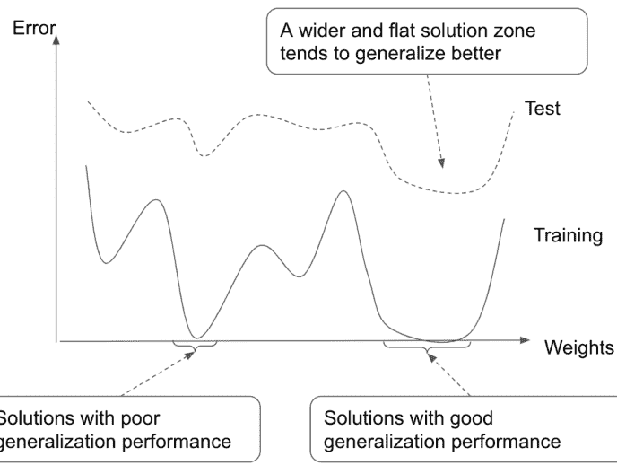

图 4.22 训练和测试误差曲线中的良好与不良解区域。权重可以插值训练数据并产生零误分类率的解有多个。然而，位于宽而平坦区域内的解往往能更好地泛化到测试集，体现为较低的误分类率。

### 4.4.2 最佳与最差全局最小值

就迄今为止关于解空间（收敛时的模型权重）所了解的情况而言，在给定固定模型复杂度且跨不同模型复杂度水平的条件下，当模型被训练为对训练数据进行插值时，会存在多个全局最小值。在这众多同样优秀的解中，有些倾向于在测试集上泛化良好，例如，在使用 SGD 时通过隐式正则化。有些则因过拟合而倾向于泛化效果较差。假设我们要刻画给定模型复杂度水平下全局最小值的解空间，那么可以得到一个上界（即最差全局最小值）和一个下界（即最佳全局最小值）。上界将是经典泛化理论研究的对象，该理论强调由于过拟合导致的高测试误差。另一方面，下界反映了现代泛化理论，该理论强调由于隐式或显式正则化导致的低测试误差。

让我们更仔细地审视这一观点。图 4.23 说明了测试误差作为模型复杂度函数的上界和下界，并附带训练误差作为参考。在经典和现代泛化视角下，随着模型变得复杂，训练误差都会下降。然而，测试误差的表现有所不同。在经典泛化理论下得到的测试误差，由于过拟合，构成了给定模型复杂度水平下所有可能测试误差的上界。测试误差的增加表明，在模型拟合过程中对（有效）模型复杂度进行正则化以控制过度敏感性的重要性。下界是在不同模型复杂度水平上经验观察到的最佳全局最小值。我们可以使用隐式正则化（即 SGD）、显式正则化（即对权重范数进行惩罚），或两者结合来获得下界。我们还注意到，可能测试误差的上界和下界之间的差距会随着模型变得复杂而增大。

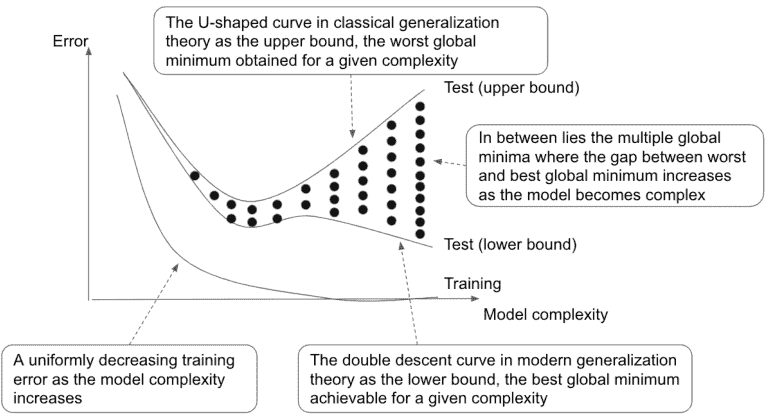

图 4.23 不同模型复杂度水平下的最差和最佳全局最小值。上界是在未使用任何正则化机制的情况下，根据经典泛化理论获得的最差全局最小值。下界是根据现代泛化理论可获得的最佳全局最小值。上界和下界之间的差距会随着模型变得复杂而增大。

当模型复杂度较低且规模较小，当模型被训练以最小化训练误差时，我们会在测试误差中得到唯一或非常相似的全局最小值。然而，随着模型变得灵活和复杂，最佳和最差全局最小值之间的差距会增大。因此，对深度神经网络等大型复杂模型应用适当的正则化至关重要，以获得尽可能好的全局最小值，并对未来未见的测试集进行良好泛化。

## 4.5 总结

- 作为简单神经网络的感知机，是基于嵌入式和重复使用矩阵乘法及激活函数的强大函数近似器
- 深度网络比宽网络更高效，因为函数近似中的灵活性呈指数级增长
- 反向传播在计算上比前向传播更高效，是 PyTorch 提供的主流自动微分机制
- 可以通过指定 `__init__()` 函数和 `forward()` 函数来定义自定义神经网络类
- 对于给定模型复杂度水平以及跨不同模型复杂度水平，存在多个全局最小值
- 最佳全局最小值是根据现代泛化理论通过适当正则化（显式、隐式或两者结合）获得的，而最差全局最小值是根据经典泛化理论由于过拟合且未使用正则化而获得的
- 最佳和最差全局最小值之间的差距会随着模型变得越来越复杂和灵活而增大
