# 5 通过数据进行正则化

本章涵盖

- 数据中的常见挑战及数据增强的必要性
- 有助于正则化模型训练的不同数据增强技术
- 在图像分类中应用数据增强以提升训练性能
- 连接离线泛化与在线优化的深度自助框架

除了训练过程外，数据直接决定了训练后模型的泛化性能。提供足够且具有代表性的数据集对于训练良好且可泛化的模型起着至关重要的作用。不幸的是，有限的训练数据往往是我们唯一可利用的，获取新的训练数据会带来额外成本，在某些情况下甚至是不可能的。

由于数据有限而产生的一个直接挑战是，可用的训练数据可能来自与测试数据不同的底层数据生成分布。这种分布差异构成了数据中的 *非平稳性*。在比较训练集和测试集时，非平稳数据在数据的不同部分具有不同的统计特征，例如设计矩阵或目标的均值和方差。两者之间的映射关系也可能发生转移。因此，在一个分布的数据上训练分类器并在另一个分布的数据上测试，并不能保证在测试集上获得良好的泛化性能。

分布差异可能以一种或多种以下形式存在：

- *域偏移*（比较训练集和测试集时，输入与输出之间不同的映射关系）
- *协变偏移*（仅输入特征分布的变化）
- *目标偏移*（仅输出目标分布的变化）

此外，即使训练数据与测试数据来自相同的底层分布，训练数据的规模也可能不足以支持对良好分类器进行适当训练，从而使得捕捉数据中嵌入的微弱信号变得具有挑战性。

这些挑战可能会损害基于现有数据训练的模型质量。我们需要转换和调整训练数据，使其分布更好地近似测试集。

在本章中，我们将首先介绍常见的基于数据的方法，这些方法有助于增强我们的训练数据集，随后介绍如何应用这些技术来提高泛化性能的实际示例。我们将这些技术称为通过数据进行正则化，因为它们代表基于数据的转换，以一种能提高最终训练模型泛化能力的方式对其进行正则化。

## 5.1 基于数据的方法

基于数据的方法是指应用于数据的一系列变换，包括输入设计矩阵、输出目标、使用深度神经网络时的隐藏层激活值以及这些组件的组合。这种变换可以是行方向或列方向的。由于模型在变换后需要拟合广泛的数据，模型过拟合且对其预测过度自信的可能性较小。让我们从设计矩阵开始，了解我们如何转换数据。

假设我们有一个输入数据集 **X** ∈ R<sup>n×p</sup>，即一个具有 **n** 行和 **p** 列的矩阵。我们可以通过添加更多信息性和预测性特征来执行水平处理，这实际上会转换并增加原始 **p** 维特征空间。这可以通过手动特征工程来实现，例如添加基函数作为额外特征（如在第 2 章中所见），或通过深度神经网络中的隐藏层使用自动特征提取。后者可能涉及特定隐藏层中比原始输入层更大或更小的特征空间。当将原始特征空间映射/提取到隐藏层中的新表示时，学习到的特征往往更加解耦，因此更有利于当前学习任务。

我们还可以通过向 **X** 添加更多人工示例来引入垂直处理，形成更大且可能无限的增强训练数据集 **X**<sup>∗</sup>。为了扩大样本空间，我们可以根据手头的具体问题类型，有策略地对原始数据集进行采样。例如，对 **X** 中的少数群体进行带替换的 **过采样** 通常可以有效解决类别不平衡问题，并带来更好的模型。通过使用重复采样增强少数样本的存在，这种技术提供了一个更适合训练的扩展数据集，尽管数据分布与真实分布有意不同。请注意，**欠采样** 也可以减少多数群体的存在并增强少数群体的信号，从而发挥正则化作用。

或者，也可以使用 **自助采样** 从原始数据集中反复有放回地抽取样本，创建多个数据集副本，每个副本包含不同数量的重复样本。然后可以使用这些数据集创建多个独立模型，其预测将被聚合以生成最终预测。这种形式的 **集成学习** 称为 **自助聚合**（或 **装袋法**），有助于减少过拟合并提高模型稳定性。


另一类方法是使用数据增强技术，通过向原始输入数据、隐藏层中的激活值，甚至目标输出引入随机噪声来生成人工样本。所有这些变换都可能发生在训练或测试阶段，测试时的目标除外，因为它们对我们不可见。在变换目标时，一种常见的方法称为标签平滑，用于分类任务，其中目标标签与均匀分布的随机噪声混合，以鼓励正则化。请注意，这两种方法可以结合使用，使结果数据集在两个方向上都具有更大的规模。

图 5.1 说明了输入矩阵的不同基于数据的变换方法。当沿水平方向通过手动特征工程或自动特征提取来变换特征空间时，我们期望构建一个更有意义的特征空间，以正则化并简化训练任务。垂直变换也是如此，通过重复采样或数据增强来调整数据分布，以实现更好、更规范化的训练。在训练深度神经网络时使用数据增强时，这两种方法会结合使用，如本章后面所示。

原始输入数据集

水平增强数据集

输入或隐藏层的特征变换
通过手动特征工程或自动特征提取实现

有放回采样，例如过采样或自助法
通过引入随机噪声进行数据增强

垂直增强数据集

双向增强

图 5.1 输入矩阵的不同基于数据的方法，包括水平变换（如特征工程或提取）、垂直处理（如自助法或数据增强）以及两种方法的结合。

### 5.1.1 数据增强

数据增强本质上通过向现有数据（输入、输出或两者）引入噪声并生成额外的人工数据点来增加模型所接触的训练数据的多样性，从而呈现出与原始数据不同但相似的新数据。它们可以帮助缓解训练数据中分布不一致和代表性不足的挑战。通过增加和增强训练数据的多样性，模型被迫在广泛的数据点上表现良好，从而降低了在原始数据集上出现高方差的可能性，并更有可能泛化到测试集。

数据增强最流行的应用包括计算机视觉中的图像分类和目标识别。例如，在基于图像数据训练模型对数字进行分类时，我们可以通过对输入图像进行轻微更改（如裁剪、缩放/放大缩小、旋转、翻转或调整亮度）来在同一类别下收集更多训练数据。引入的多样性帮助模型从不同角度学习一致的结构，而不是过度拟合和记忆原始训练数据。数据增强已成为大多数计算机视觉任务中事实上的数据预处理步骤，无需手动收集更多训练数据。

但是，在对图像数据应用变换时应谨慎。例如，旋转图像时容易将数字“6”与“9”混淆，翻转图像时容易将字母“b”与“d”混淆。感兴趣的对象也可能意外被裁剪出图像。由于我们期望通过变换现有图像创建的这些新图像仍属于同一类别，因此引入的随机噪声不应改变原始图像数据的含义。

图 5.2 说明了同一类别标签下图像数据的增强过程，我们将图像投影到二维坐标系中的点以方便可视化。请注意，投影概念是深度神经网络的核心，每一层在某种意义上都是对前一层的一种投影，而通过学习，投影特征应更具意义和信息性。事实上，我们甚至可以通过在隐藏特征之间进行插值来在某个隐藏层生成额外数据。隐藏层内的这种插值可以生成更高质量的数据，因为隐藏特征在网络深处会更加线性化且不相关。Wang et al. 最近在 2019 年 NeurIPS 论文《面向深度网络的隐式语义数据增强》中提出了这种特定技术。我们将在关于通过目标函数进行正则化的后续章节中了解更多这种技术，因为作者巧妙地将增强任务转换为修改后的成本函数，从而实现隐式数据增强。

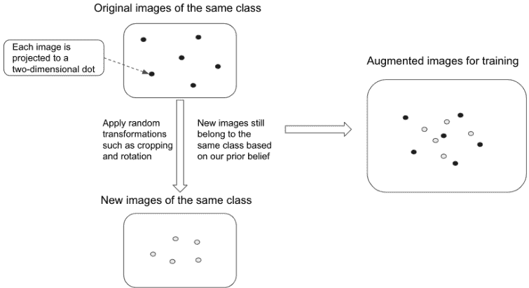

图 5.2 图像分类任务中的数据增强过程。

需要注意的是，这些数据增强技术仅在*某些*情况下被实证证明有帮助，特别是计算机视觉任务。鉴于我们对样本非单调性的观察，更多训练数据有时可能会损害测试性能。

我们的最终目标是提高训练模型的泛化能力。创建更多（人工）训练数据如何作为一种正则化技术并帮助实现这一目标？通过向原始训练数据引入随机噪声和扰动，模型不断接触到新的、略有修改的数据。当数据集足够多样时，模型更有可能学习到鲁棒特征。这些额外的数据点反映了我们的先验信念或归纳偏差，因为我们知道对图像进行轻微变换不会改变其类别标签。换句话说，我们使用数据增强来增加训练数据集的规模并正则化模型训练过程，使训练后的模型具有低方差，并更有可能很好地泛化到测试集。

数据增强通过添加更合理、更真实的训练数据版本来提高训练模型的泛化性能，从而改善测试集性能。它被认为是一种*隐式正则化*技术，与惩罚权重范数等*显式正则化*技术形成对比。

请注意，数据增强不适用于测试集；它仅是一种预处理技术，用于在每次训练迭代开始前增强训练数据集。但是，尽管倾向于提高模型的测试集性能，我们*可能*会观察到训练集性能下降。

现在让我们来看看标签平滑，这是一种调整目标标签以实现正则化的巧妙技术。

### 5.1.2 标签平滑

标签平滑是一种正则化技术，假设为分类任务，通过在单热编码输出标签中引入均匀分布的噪声来缓解过拟合。我们可能希望扰动目标标签的原因是训练数据集中的标签可能被错误标记。通过创建“软”目标并减少对原始“硬”目标输出的依赖，我们可以让模型摆脱潜在的错误标签问题，并防止其对其预测过度自信。

数学上，令 C 为目标输出中的类总数，\(y_{one\_hot}\) 为单热编码输出，\(\alpha\) 为控制超参数，决定均匀噪声的强度。标签平滑后的变换输出 \(y_{label\_smoothing}\) 表示为：

\(y_{label\_smoothing} = (1 - \alpha)y_{one\_hot} + \alpha/C\)

当 \(\alpha = 0\) 时，我们得到原始单热编码，正确类标签的概率为 1；我们在计算训练成本时利用这一知识。当 \(\alpha = 1\) 时，平滑编码向量包含均匀分布，所有类的概率相等，鼓励跨所有类进行探索。因此，这是一种由超参数 \(\alpha\) 控制的利用与探索之间的平衡版本。

例如，假设我们有一个三类分类问题，其中一个样本的标签是第一类，即 \(y_{one\_hot} = [1,0,0]\)。设置 \(\alpha = 0.3\) 后，平滑编码向量现在变为 \((1 - 0.3)*[1, 0, 0] + \frac{0.3}{3} = [0.7, 0, 0] + 0.1 = [0.8, 0.1, 0.1]\)，在倒数第二步中我们使用了广播机制。我们可以看到，第二类和第三类现在也被分配了一个小概率，在模型中形成了软目标。

在下一节中，我们将通过一个具体示例，介绍如何在训练深度神经网络模型时使用数据增强。

## 5.2 使用数据增强训练深度神经网络

让我们先根据第 1 章中的城市景观图片可视化增强后的图像。我们将使用此图像作为示例，演示如何应用各种数据增强技术来生成新图像。

首先，我们需要从网上下载图像。在下面的代码清单中，我们使用 `requests` 库通过 GitHub 链接的 `get()` 方法发起 HTTP 请求，将返回的结果存储在 `response` 中，并访问其内容以检索图像数据并将其转换为 NumPy 数组。由于这是一个 PNG 格式的彩色图像，包含四个通道，分别对应红色、绿色、蓝色和透明度，我们通过选择最多第三个通道索引来忽略第四个通道。


### 清单 5.1 从网络链接下载图像数据

```
import torch #A
import torch.nn.functional as F
import torchvision
from torchvision import datasets, transforms
from torch import nn
import matplotlib.pyplot as plt
import numpy as np
from PIL import Image
import requests
from io import BytesIO
torch.manual_seed(8) #B
url='https://raw.githubusercontent.com/jackliu333/regularization_in_deep_learning/main/ImageNet.png' #C
response = requests.get(url) #C
img = Image.open(BytesIO(response.content)) #D
img = np.array(img) #E
img = img[..., :3] #F
```

- #A 导入支持库
- #B 设置随机种子以确保可重复性
- #C 通过 get 方法发起 HTTP 请求
- #C 通过 get 方法发起 HTTP 请求
- #D 访问响应内容以检索图像
- #E 转换为 NumPy 数组
- #F 忽略第四个通道，因为不需要它

然后我们可以按如下方式绘制图像，其输出如图 5.3 所示。

```
>>> plt.imshow(img, interpolation='nearest')
>>> plt.show()
```

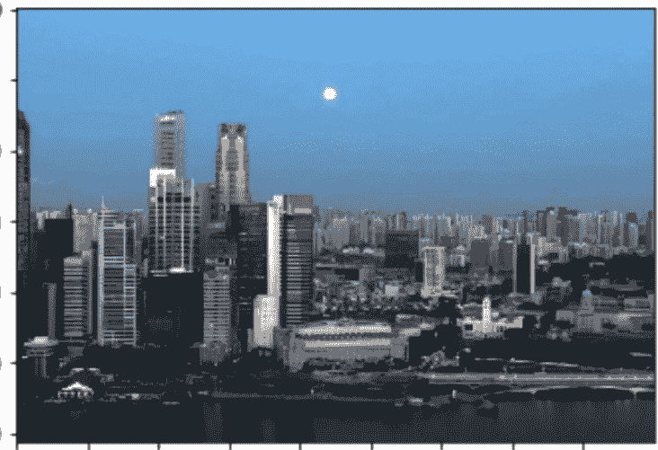

图 5.3 从网络链接检索的同一图像的可视化。

在 PyTorch 中，常见的数据增强是通过 torchvision 库的 transforms 模块实现的。为了演示随机扰动的效果，我们将包含三种增强，包括通过 RandomHorizontalFlip() 函数进行水平翻转、通过 RandomRotation() 函数进行旋转，以及通过 ColorJitter() 函数进行颜色抖动。每个函数都有自己的参数来控制随机噪声的级别，并使用 Compose() 函数将它们链接在一起到 img_augment 变量中。此外，增强后的图像被转换为张量对象以便与 PyTorch 框架配合使用。完整规范请参见下面的代码清单。

### 清单 5.2 指定数据增强方案

```
img_augment = transforms.Compose([transforms.RandomHorizontalFlip(), #A
              transforms.RandomRotation(10), #B
              transforms.ColorJitter(brightness=0.2, contrast=0.2, saturation=0.2), #C
             ])
transforms.ToTensor() #D
```

- #A 相对于水平轴翻转图像
- #B 将图像旋转最多 10 度
- #C 随机更改图像亮度、对比度和饱和度，最高可达一定程度
- #D 转换为张量对象以便与 torch 配合使用

现在让我们将指定的数据增强方案应用到城市景观图像上，并可视化一些随机生成的图像。在下面的代码清单中，我们首先定义一个函数 `gen_img()` 将图像张量（作为副本引用，以避免更改原始对象）转换为 PIL 图像格式，以便我们可以应用数据增强。然后通过将通道维度从第一个移动到最后一个来重塑增强后的图像，以便可以正确地绘制它。然后我们应用该函数生成 10 个图像，绘制成两行。

### 清单 5.3 可视化增强后的图像

```python
import copy
def gen_img(img):
    img2 = transforms.ToPILImage()(copy.copy(img)) #A
    img2 = img_augment(img2) #B
    img2 = np.transpose(img2, (1, 2, 0)) #C
    return img2

fig = plt.figure(figsize=(10, 4))

for idx in np.arange(10): #D
    ax = fig.add_subplot(2, 5, idx+1, xticks=[], yticks=[])
    plt.imshow(gen_img(img))
    ax.set_title(idx)
```

运行上述代码后，图 5.4 显示了增强后的图像。生成的图像现在在旋转、翻转、亮度、对比度和饱和度的级别上有所不同，所有这些都是预先指定的，并作为随机扰动引入原始图像。这些人工图像随后可以作为额外的训练数据，用于构建更稳健的模型。

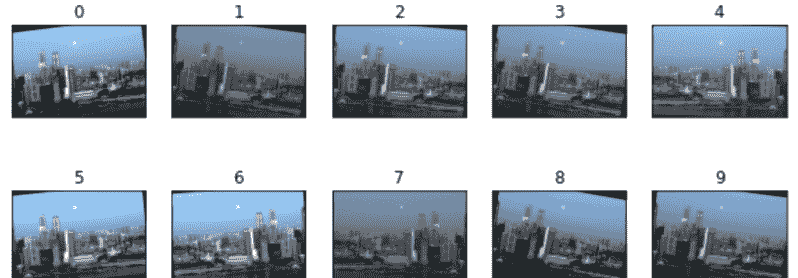

**图 5.4 具有不同级别旋转、翻转和亮度等的增强图像。**

接下来，我们将通过比较使用和不使用数据增强训练的模型来查看性能提升。我们将使用 CIFAR10 数据集，这是一个开源数据集，包含 10 个类别中的 60000 张 32x32 彩色图像，每个类别包含 6000 张图像。

### 5.2.1 不使用数据增强进行训练

CIFAR10 数据集是许多研究论文中常用的基准数据集，也将是本章使用的数据集。本节将查看如果不将任何数据增强应用于训练过程时的基准性能。在 CIFAR10 数据集中，图像分为十个类别：飞机、汽车、鸟、猫、鹿、狗、青蛙、马、船和卡车。让我们通过可视化每个类别的随机样本来了解这些图像。

在下面的代码清单中，我们首先下载 CIFAR10 数据集并应用一系列变换：将像素值从原始范围 [0,1] 归一化到 [-1,1]，并将图像对象转换为张量格式。请注意，Normalize() 函数中的均值和标准差参数被设置为所有三个颜色通道的统一值 0.5。然而，更合适的方法是从所有图像数据中推导这些按通道的统计量。由于差异很小，我们只关心将像素值限制在小而相似的范围内，因此出于实现便利性，我们在所有通道中都使用 0.5。其余代码遵循与上一章相同的结构，每批加载 100 张图像。

### 清单 5.4 加载 CIFAR10 数据集

```
transform = transforms.Compose([transforms.ToTensor(),
                                      transforms.Normalize(mean=(0.5, 0.5, 0.5), std=(0.5,
                                                           0.5, 0.5))]) #A
training_dataset = datasets.CIFAR10(root='./data', train=True, download=True,
                                      transform=transform) #B
validation_dataset = datasets.CIFAR10(root='./data', train=False, download=True,
                                       transform=transform) #B
training_loader = torch.utils.data.DataLoader(training_dataset, batch_size=100,
                                              shuffle=True) #C
validation_loader = torch.utils.data.DataLoader(validation_dataset,
                                                batch_size = 100, shuffle=False) #C
```

- #A 加载数据集时用于训练集和测试集的变换步骤
- #B 下载 CIFAR10 数据集
- #C 定义一次读取 100 张图像的数据加载器

运行上述代码将在 data 文件夹下下载 CIFAR10 数据集，并将其分别加载到 training_loader 和 validation_loader 数据加载器中，用于训练和验证。

接下来，我们将定义一个函数，将图像转换为 NumPy 格式以使用 matplotlib 进行可视化。我们还将图像转换回原始范围 [0,1]，并将其重塑为通道在后（channel-last）格式。然后将此函数应用于 training_loader 第一批中的前十张图像，如下面的代码清单所示。

### 清单 5.5 可视化 CIFAR10 中的十张图像

```
def convert_tensor_to_np(tensor_img):
    image = tensor_img.clone().numpy() #B
    image = image.transpose(1, 2, 0) #C
    image = image * np.array((0.5, 0.5, 0.5)) + np.array((0.5, 0.5, 0.5)) #D
    image = image.clip(0, 1)
    return image

dataiter = iter(training_loader)
images, labels = dataiter.next()
classes = ['plane', 'car', 'bird', 'cat', 'deer', 'dog', 'frog', 'horse', 'ship', 'truck'] #F
fig = plt.figure(figsize=(10, 4)) #G
for idx in np.arange(10):
    ax = fig.add_subplot(2, 5, idx+1, xticks=[], yticks=[])
    plt.imshow(convert_tensor_to_np(images[idx]))
    ax.set_title(classes[labels[idx].item()])
```

- #A 将图像格式化以供绘图
- #B 转换为 NumPy
- #C 将颜色通道移至最后
- #D 将图像反归一化回 [0,1]
- #E 从第一批中获取一些随机训练图像
- #F 定义类标签以用于可视化
- #G 在 2x5 网格中绘制图像

运行上述代码将输出排列成两行的十张图像，如图 5.5 所示。

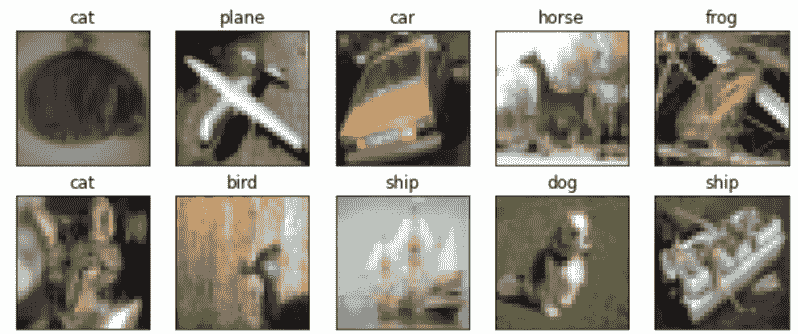

图 5.5 可视化 CIFAR10 中的十张随机图像。

### LENET

LeNet 架构是一种广泛使用的基准神经网络架构，规模较小且易于掌握。我们将构建一个 LeNet 变体，它由三个 CONV->RELU->MAXPOOLING 操作块组成，后面跟随两个全连接层。一个 DROPOUT 层是

添加到第一个全连接层以提高训练性能。请参见图 5.6 了解示例。另外，请注意，`RELU` 和 `DROPOUT` 层不是物理层，因为它们不包含任何权重。

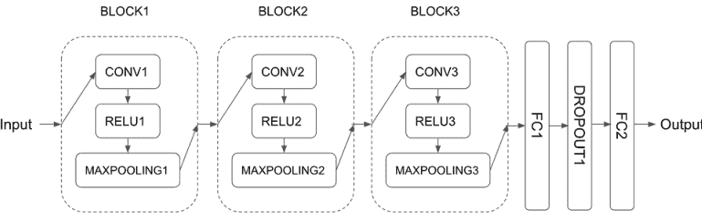

### 图 5.6 LeNet 变体模型的示意架构。

以下代码清单展示了将网络作为类实现的方法。我们将每个 `CONV` 层的特征图深度加倍，这是 `CONV` 层参数设置的常见做法。这种操作可以提高网络从不同角度学习特征的表达能力。随着特征图变深，2x2 `MAXPOOLING` 层进一步将每个特征图的宽度和高度减半，以降低其空间维度。最终输出是最后一个全连接层的十个输出节点，对应十类物体。

### 清单 5.6 实现 LeNet 架构

```
class LeNet(nn.Module):
    def __init__(self):
        super().__init__()
        self.conv1 = nn.Conv2d(in_channels=3, out_channels=16, kernel_size=3,
                                stride=1, padding=1) #A
        self.conv2 = nn.Conv2d(16, 32, 3, 1, 1, padding=1)
        self.conv3 = nn.Conv2d(32, 64, 3, 1, 1, padding=1)
        self.fc1 = nn.Linear(4*4*64, 500) #B
        self.dropout1 = nn.Dropout(0.5)
        self.fc2 = nn.Linear(500, 10) #C

    def forward(self, x):
        x = F.relu(self.conv1(x)) #D
        x = F.max_pool2d(x, 2, 2) #E
        x = F.relu(self.conv2(x))
        x = F.max_pool2d(x, 2, 2)
        x = F.relu(self.conv3(x))
        x = F.max_pool2d(x, 2, 2)
        x = x.view(-1, 4*4*64) #F
        x = F.relu(self.fc1(x))
        x = self.dropout1(x)
        x = self.fc2(x)

        return x
```

#A 为每个卷积层加倍特征图深度
#B 输入图像为 32*32，经过 3 个 MaxPooling 层后减少到 4*4 个 64 通道特征图
#C 映射到 10 个类别的 10 个输出节点
#D 对每个卷积层输出应用 ReLU
#E 使用 2x2 核的最大池化层将尺寸减半
#F 将图像展平作为全连接层的一维输入

然后我们可以实例化一个模型并按如下方式观察其架构，如果可用，还可以将其发送到 GPU 实例。

```
>>> device = torch.device("cuda:0" if torch.cuda.is_available() else "cpu")
>>> model = LeNet().to(device)
LeNet(
(conv1): Conv2d(3, 16, kernel_size=(3, 3), stride=(1, 1), padding=(1, 1))
(conv2): Conv2d(16, 32, kernel_size=(3, 3), stride=(1, 1), padding=(1, 1))
(conv3): Conv2d(32, 64, kernel_size=(3, 3), stride=(1, 1), padding=(1, 1))
(fc1): Linear(in_features=1024, out_features=500, bias=True)
(dropout1): Dropout(p=0.5, inplace=False)
(fc2): Linear(in_features=500, out_features=10, bias=True)
)
```

该架构对应一个规模适中的神经网络，总共有约 50 万个权重：

```
>>> print("Number of parameters:", sum(p.numel() for p in model.parameters() if p.requires_grad))
Number of parameters: 541094
```

接下来，我们遵循上一章中类似的优化流程，例如使用 SGD 优化算法并设置恒定 0.01 学习率。在每个 epoch 中，我们以小批量模式使用训练集的数据加载器迭代训练模型。之后，我们在无梯度环境下在整个验证集上评估模型性能，因为不需要反向传播。请参见下面的代码清单，了解不使用数据增量的完整训练流程。

### 清单 5.7 不使用数据增强训练 LeNet

```
criterion = nn.CrossEntropyLoss()
optimizer = torch.optim.SGD(model.parameters(), lr = 0.01)
epochs = 100
training_loss_history = []
training_accuracy_history = []
val_loss_history = []
val_accuracy_history = []

for e in range(epochs):
    training_loss = 0.0
    training_accuracy = 0.0
    val_loss = 0.0
    val_accuracy = 0.0
    for inputs, labels in training_loader: #A
        inputs = inputs.to(device) #B
        labels = labels.to(device) #B
        outputs = model(inputs) #C
        loss = criterion(outputs, labels) #D
        optimizer.zero_grad() #E
        loss.backward() #F
        optimizer.step() #G
        _, preds = torch.max(outputs, 1) #H
        training_loss += loss.item()
        training_accuracy += torch.sum(preds == labels.data) #I
    with torch.no_grad(): #J
        for val_inputs, val_labels in validation_loader:
            val_inputs = val_inputs.to(device)
            val_labels = val_labels.to(device)
            val_outputs = model(val_inputs)
            val_loss_model = criterion(val_outputs, val_labels)
            _, val_preds = torch.max(val_outputs, 1)
            val_loss += val_loss_model.item()
            val_accuracy += torch.sum(val_preds == val_labels.data)
```

#A 遍历训练集的每个批次
#B 发送到 GPU 以加快训练速度
#C 获取 logit 输出
#D 计算交叉熵损失
#E 清除现有梯度
#F 反向传播损失
#G 更新权重
#H 获取最大 logit 的索引作为类别预测
#I 统计批次中的正确预测数量
#J 在不进行梯度评估的情况下检查验证性能

在每个 epoch 结束时，我们将损失和准确率的性能指标追加到主列表中，以便进行可视化，如下所示。

```
epoch_loss = training_loss/len(training_loader) #K
val_epoch_loss = val_loss/len(validation_loader)
epoch_acc = training_accuracy.float()/ len(training_loader) #L
val_epoch_acc = val_accuracy.float()/ len(validation_loader)
training_loss_history.append(epoch_loss) #M
training_accuracy_history.append(epoch_acc.item())
val_loss_history.append(val_epoch_loss)
val_accuracy_history.append(val_epoch_acc.item())
print('Epoch :', (e+1))
print('Training loss: {:.4f}, acc {:.4f} '.format(epoch_loss, epoch_acc.item()))
print('Validation loss: {:.4f}, validation acc {:.4f} '.format(val_epoch_loss,
val_epoch_acc.item()))
```

#K 每个 epoch 的平均损失
#L 每个 epoch 的准确率
#M 追加到主列表以便可视化

请注意，使用单个 GPU 实例运行代码大约需要 20 分钟。使用 CPU 时将花费更长时间。训练完成后，我们可以使用以下代码片段来可视化每个 epoch 的模型损失和准确率。

```
plt.rcParams["figure.figsize"] = (15,6)
fig = plt.figure()
plt.subplot(121)
plt.plot(training_loss_history, label='training loss')
plt.plot(val_loss_history, label='validation loss')
plt.subplot(122)
plt.plot(training_accuracy_history, label='training accuracy')
plt.plot(val_accuracy_history, label='validation accuracy')
plt.legend()
```

运行上述代码将生成如下所示的图 5.7。结果表明，模型在第 50 个 epoch 左右开始过拟合，此时验证损失增加。验证准确率在第 50 个 epoch 后也趋于平稳并略有下降，最终在验证集上达到约 70% 的分类准确率，在训练集上超过 90%。

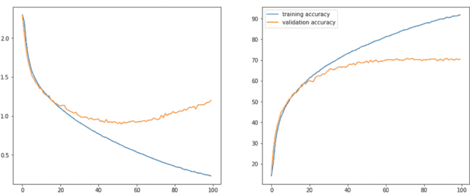

### 图 5.7 不使用数据增强训练时每个 epoch 的模型损失和准确率。

考虑到训练数据有限，模型性能尚可。但是，在训练进行到一半时发生了过拟合，之后模型损失开始恶化。让我们看看使用数据增量是否可以改善模型性能。

### 5.2.2 使用数据增强进行训练

使用数据增量是处理图像数据时的一种自然技术，因为它可以在不更改目标标签的情况下对输入图像引入少量变换。这些几何变换允许模型遍历更多同类别的训练图像，这在原始数据集较小时尤其有帮助。在计算机视觉任务中训练卷积神经网络时，这些常见变换也很容易实现。

要使用数据增量训练模型，我们只需为训练集构建一个新的数据加载器，该加载器涉及不同形式的变换以生成新图像。请参见下面的代码清单，了解所使用的一系列变换，包括翻转、旋转、缩放、剪切和颜色变化。我们省略了完整代码，因为它们大体与之前相同。有关完整训练过程，请参阅附带的笔记本 https://github.com/jackliu333/regularization_in_deep_learning/blob/main/Chapter_5.0.ipynb#b。

```
Listing 5.8 Training with data augmentation

transform_aug = transforms.Compose([
    transforms.RandomHorizontalFlip(), #A
    transforms.RandomRotation(10), #B
    transforms.RandomAffine(0, shear=10,
                            scale=(0.8,1.2)), #C
    transforms.ColorJitter(brightness=0.2,
                           contrast=0.2,
                           saturation=0.2), #D
    transforms.ToTensor(),
    transforms.Normalize((0.5, 0.5, 0.5),
                         (0.5, 0.5, 0.5))
])

training_dataset_aug = datasets.CIFAR10(root='./data_aug', train=True,
                                        download=True, transform=transform_aug)
training_loader_aug = torch.utils.data.DataLoader(training_dataset_aug,
                                                  batch_size=100, shuffle=True)
```

- #A 相对于水平轴翻转图像
- #B 将图像旋转到指定角度
- #C 缩放和剪切
- #D 更改颜色

图 5.8 显示了使用数据增量训练 100 个 epoch 的模型的结果性能图。结果表明，过拟合现象已明显缓解，这从验证集的损失持续下降和准确率上升可以看出。最终验证准确率在第 100 个 epoch 结束时达到 74.4%，比不使用数据增量的情况高出 4% 以上。这些图还


show that we should continue to train the model for more epochs due to the continuously improving accuracy in both training and validation sets.

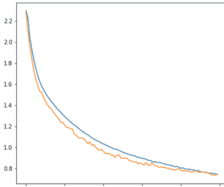

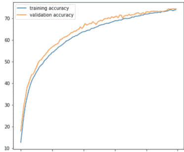

Figure 5.8 Model loss and accuracy per epoch trained with data augmentation.

Augmenting the image classification task with additional artificial images could thus improve both the training and validation/test set performance given the same number of epochs. In practice, data augmentation is *almost always* used when the training set contains a limited number of images. After all, the bootstrapped images can serve as additional training data to improve the model's generalization performance. What if we push the data augmentation to the limit, where we have access to all possible variations of images in a fictional ideal world? This is an interesting question that we will approach in the following section.

## 5.3 The deep bootstrap framework

The previous example shows that having additional augmented training data could help the model better generalize, as indicated by a lower empirical loss. We managed to regularize the trained model by providing more data with slight variations, which better describes and approximates the true data generating distribution if appropriately done, i.e., 6 is not inverted to the extent that it is considered a 9. After all, the training task is easier if the training dataset is more comprehensive, covering more variations that lead to a more robust model.

What if we have access to the entire universe of the training dataset? This would be an extreme case where the training paradigm shifts from a limited training dataset to an unlimited one. In other words, we would like to observe the model's generalization performance given a theoretically complete training dataset. When provided with an unlimited supply of new data, the training procedure becomes an online learning problem where convergence rate (i.e., how long the training procedure requires for the model to converge) is widely studied in the optimization community. This is an exciting angle to study the generalization performance of deep learning models by comparing the offline generalization performance with limited training data from the real world with the convergence rate of online optimization when training with unlimited new data in the ideal world.

In this section, we will delve into this potential connection, which was initially proposed by a recent ICLR conference paper by Nakkiran et al., 2021: “The Deep Bootstrap Framework: Good online Learners Are Good Offline Generalizers.” Besides covering the main framework and associated concepts in this paper, we will also experiment with different model architectures to reproduce similar results as represented in the paper.

### 5.3.1 Insufficiency of classical generalization framework

The classical generalization framework studies how to minimize the test set error by breaking it into two parts: the training set error and the difference between the two, where the latter measures the generalization gap of the model. Mathematically, the breakdown for a model _f_ is expressed as:

TestError(_f_) = TrainError(_f_) + [TestError(_f_) − TrainError(_f_)]

These two components are then studied separately. As the effective model complexity increases and the training set error continues to reduce, the generalization gap between the test and training errors will follow a double descent phenomenon for a modern deep neural network model fully trained with mini-batch SGD. The implicit regularization effect of SGD algorithm will be covered in a later chapter on regularization via optimization.

However, the classical framework to understanding the generalization performance of deep neural networks suffers from a significant weakness. When a fully trained neural network starts to interpolate the training data and produces a near-zero training set error, i.e., TrainError ≈ 0, the breakdown will equate to the test set error itself, i.e., TestError = 0 + TestError, which brings us to the starting point and offers no further insight on the test set performance.

A new perspective on the decomposition of test set error proposed by the paper is to introduce the corresponding performance of the model from an ideal world that provides a constant stream of new data to support optimization via online learning. In the sections below, we will first cover the concept of online optimization and then introduce the alternate decomposition approach.

### 5.3.2 Online optimization

*Online optimization* is an optimization scheme that iteratively updates the model parameters given a new training data set. One example is the mini-batch SGD algorithm that operates on a new batch of training data to perform weight updates without accessing future data in an online setting. It is a widely studied area in optimization and is often compared with the performance of the offline optimal optimization strategy that has complete knowledge of the future data.

There are many scenarios where future data flows in from the external environment like a stream. For example, an airline company may need to constantly adjust its pricing strategy given the latest profile of its customers, competitors, and other external factors. Due to potential data shifts, a model trained with historical data may no longer apply today. Such a scenario requires an online learning strategy that constantly iterates and evolves based on both historical data and current new data. In this regard, online optimization is a popular field of study when knowledge on future data is unavailable. It only assumes the future data are revealed incrementally, which contrasts to *stochastic optimization* that assigns probabilistic distributions to characterize the uncertainty of future data and *robust optimization* that uses set membership to capture the uncertainty.

Online optimization is well studied for convex functions and is an active research area for non-convex functions. It analyses how quickly the optimization strategy reaches a *relatively* small loss over the whole population of data. In most cases, such relativity is quantified with reference to another offline optimization strategy that has access to the whole population of data. The difference in the final solutions (upon convergence) between the online optimizer with incrementally revealed data and the offline optimizer using the complete data is called *regret*. The goal of online optimization is thus to obtain a small regret as fast as possible. Figure 5.9 summarizes the nature of online optimization.

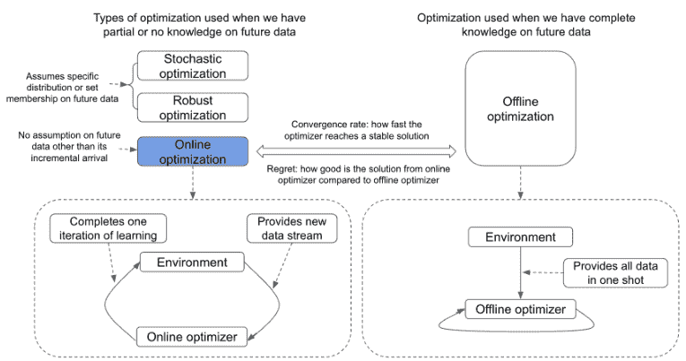

Figure 5.9 Comparing online optimization with other types of optimization procedures. The online optimization only assumes the future data is revealed incrementally and focuses on how fast the optimizer reaches a solution and how good the solution is compared with an offline optimizer.

### 5.3.3 Connecting online optimization with offline generalization

Online optimization essentially switches the training data from a real-world scenario with limited data feed to an ideal world with an unlimited data flow. After plugging in the test error from online optimization in an ideal world, we can then formulate an alternate decomposition of the real-world test error as follows:

TestError(f_real world) = TestError(f_ideal world) + [TestError(f_real world) – TestError(f_ideal world)]

Here, both $f_{\text{real world}}$ and $f_{\text{ideal world}}$ share the same model architecture and training procedure. The only difference is that the $f_{\text{real world}}$ is trained to minimize the empirical loss of the available test set in the real world, and $f_{\text{ideal world}}$ is trained to minimize the population loss of the test set in the hypothetical ideal world where training data is unlimited.

In this alternate decomposition scheme, the first component TestError($f_{\text{ideal world}}$) measures the performance of the online optimizer in terms of how quickly it can achieve a low population loss on the test set in the ideal world. Since the whole population of data is exposed to the learner, a good online optimizer will learn fast and quickly converge to reach a low population loss on the test set. The second component TestError($f_{\text{real world}}$) — TestError($f_{\text{ideal world}}$) measures the *bootstrap error*, the difference between the empirical loss from the real world and the population loss from the ideal world due to finite-sample approximation. Such approximation happens when we reuse existing samples to train the neural network repeatedly across different epochs.

Through this alternate decomposition, analysis on the test set performance could be decoupled into the convergence speed of the online optimizer of the ideal world and the bootstrap error between the real world and the ideal world. Figure 5.10 illustrates the alternate decomposition scheme and its comparison with the traditional scheme.

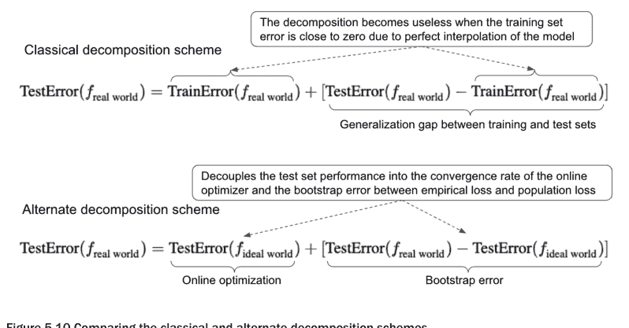

Under the alternate decomposition framework, the test set performance of the model will be primarily driven by the convergence rate of the corresponding online optimizer when the bootstrap error is small. For example, convolutional neural networks (CNN) are often better at generalizing to future data than fully connected networks (FCN) of similar approximation capacity. When the bootstrap error is negligible, we could analyze generalization differently: CNN optimizes faster than FCN in the online ideal world and thus generalizes better in the offline real world.


在接下来的章节中，我们首先将展示如何通过持续的新数据流构建理想世界，随后进行一项关于 CNN 在理想世界中更快收敛速度的实证研究。

### 5.3.4 在 CIFAR-5m 中构建理想世界

我们如何构建拥有无限数据流的理想世界？回顾一下，之前的示例使用了 CIFAR10 数据集中的 10,000 张训练图像，并训练了 100 个时代，总共使用了 500 万张图像进行训练，同时分配了 10,000 张图像用于测试集。如果我们要在保持相同训练-测试比例的同时模拟一个理想世界，则总共需要 500 万张不同的图像用于训练和 100 万张不同的图像用于测试。这 500 万张图像将作为模型在理想世界中一个时代内学习的新样本。

为此，论文中的作者构建了一个名为 CIFAR-5m 的合成 CIFAR10 类数据集，总共包含 600 万张图像。该数据集通过使用生成模型从 CIFAR10 数据集中采样生成，并发布在 `gs://gresearch/cifar5m/part{i}.npz`，其中 `i` 在 `(0,..,5)` 范围内，每个文件占用约 3GB 磁盘空间；我们现在正身处大数据时代。这些文件通过 `gsutil` 命令下载到当前活跃 Google Colab 实例的当前目录中，如下所示。

```
>>> for i in range(0,6):
>>>     !gsutil cp -r gs://gresearch/cifar5m/part{i}.npz .
Copying gs://gresearch/cifar5m/part0.npz...
- [1 files][ 2.9 GiB/ 2.9 GiB]                                             42.3 MiB/s
Operation completed over 1 objects/2.9 GiB.
Copying gs://gresearch/cifar5m/part1.npz...
- [1 files][ 2.9 GiB/ 2.9 GiB]                                             47.9 MiB/s
Operation completed over 1 objects/2.9 GiB.
Copying gs://gresearch/cifar5m/part2.npz...
/ [1 files][ 2.9 GiB/ 2.9 GiB]                                             45.5 MiB/s
Operation completed over 1 objects/2.9 GiB.
Copying gs://gresearch/cifar5m/part3.npz...
\ [1 files][ 2.9 GiB/ 2.9 GiB]                                             50.0 MiB/s
Operation completed over 1 objects/2.9 GiB.
Copying gs://gresearch/cifar5m/part4.npz...
/ [1 files][ 2.9 GiB/ 2.9 GiB]                                             41.6 MiB/s
Operation completed over 1 objects/2.9 GiB.
Copying gs://gresearch/cifar5m/part5.npz...
- [1 files][ 2.9 GiB/ 2.9 GiB]                                             43.2 MiB/s
Operation completed over 1 objects/2.9 GiB.
```

接下来，我们需要构建一个数据加载器，从当前目录加载数据，并根据需要执行转换。实现此目的的方法是构建一个自定义 `Dataset` 类，该类在实例化时可以接受输入张量和转换作为参数。在下面的代码清单中，我们定义了一个名为 `CustomTensorDataset` 的类，它继承自 `torch.utils.data.Dataset` 类，并包含三个内置函数：`__init__` 函数在实例化时存储输入数据和转换，`__getitem__` 用于通过索引检索样本，`__len__` 函数返回数据集的大小。

### 清单 5.9 构建支持转换操作的自定义张量数据集

```
class CustomTensorDataset(torch.utils.data.Dataset):
    def __init__(self, tensors, transform=None):
        self.tensors = tensors
        self.transform = transform

    def __getitem__(self, index):
        x = self.tensors[0][index]
        if self.transform:
            x = self.transform(x)
        y = self.tensors[1][index]
        return x, y

    def __len__(self):
        return self.tensors[0].size(0)
```

由于文件以 `.npz` 结尾并以 `numpy` 格式存储，我们可以加载它们并转换为 `tensor` 格式，从而构建数据加载器。每个输入图像张量在传递给 `CustomTensorDataset` 之前，都会通过 `permute` 函数从通道后置格式更改为通道前置格式。我们还将保持与之前示例相同的配置，例如批次大小、学习率和基本转换，前提是输入图像首先转换为 PIL 图像格式。下面的代码片段展示了如何基于第一个下载的 CIFAR-5m 文件构建数据加载器的示例。

```
transform = transforms.Compose([transforms.ToPILImage(),
                                transforms.ToTensor(),
                                transforms.Normalize(mean=(0.5, 0.5, 0.5),
                                                     std=(0.5, 0.5, 0.5))]) #A

train_X = np.load("part0.npz")["X"]
train_Y = np.load("part0.npz")["Y"]
train_X = torch.Tensor(train_X) #B
train_Y = torch.Tensor(train_Y) #B
training_dataset = CustomTensorDataset(tensors=(train_X.permute(0, 3, 1, 2), train_Y),
                                       transform=transform)
training_loader = torch.utils.data.DataLoader(training_dataset, batch_size=100)
del train_X, train_Y, training_dataset #C
```

#A 对输入图像张量应用的转换  
#B 张量转换为 torch 张量  
#C 通过删除不必要的对象来节省一些 RAM 空间  

请注意，我们需要删除不必要的对象以节省一些 RAM 空间，因为这些操作及后续操作非常占用内存。如果不执行此步骤，在使用 32GB 内存的 Colab Pro 账户运行笔记本时，代码会因内存不足而触发错误并重启会话。

此外，用于测量自举误差的性能指标是 _软分类错误_，定义为 1 减去正确目标标签上的 softmax 概率。另一方面，硬分类错误衡量错误分类的百分比，因此软分类错误能更好地量化与真实目标的绝对距离。

接下来，我们将使用相同的 `LeNet` 架构，基于 CIFAR-5m 数据集训练一个模型。

### 5.3.5 理想世界中的模型训练

由于训练集包含五个文件，我们将遍历每个文件，并且每张训练图像仅使用一次。这要求在耗尽特定文件时刷新训练数据加载器。我们还需要在训练阶段每处理 50,000 张图像后跟踪损失、分类错误和软分类错误等性能指标；这相当于现实世界中离线训练设置下的一个完整时代。训练完成后，每个指标的主列表中将存储总共 100 个性能检查点，并用于与离线设置进行比较。

这 100 个检查点对应 100 个不同的模型，每个模型都将在整个测试集上进行评分。由于存储所有这些中间数据集和模型不可行，我们可以将其下载到磁盘，并在测试阶段按顺序重新加载。下面的代码清单提供了使用 CIFAR-5m 的完整训练过程。

```
Listing 5.10 Training with CIFAR-5m
training_loss_history_5m = []
training_error_history_5m = []
training_softerror_history_5m = []
test_loss_history_5m = []
test_error_history_5m = []
test_softerror_history_5m = []
if not os.path.exists('models'): #A
    os.makedirs('models')

for i in range(5):
    print(f"======= Dataset {i+1} =======")
    train_X = np.load(f"part{i}.npz")["X"] #B
    train_Y = np.load(f"part{i}.npz")["Y"] #B
    train_X = torch.Tensor(train_X) #C
    train_Y = torch.Tensor(train_Y) #C
    training_dataset = CustomTensorDataset(tensors=(
        train_X.permute(0, 3, 1, 2), train_Y), transform=transform)
    training_loader = torch.utils.data.DataLoader(training_dataset, batch_size=100)
    del train_X, train_Y, training_dataset #D

training_loss = 0.0
training_accuracy = 0.0
training_error = 0.0
training_softerror = 0.0
test_loss = 0.0
test_accuracy = 0.0
test_error = 0.0
test_softerror = 0.0
for idx, (inputs, labels) in enumerate(training_loader):
    inputs = inputs.to(device)
    labels = labels.to(torch.int64).to(device)
    outputs = model(inputs).to(device)
    loss = criterion(outputs, labels)
    optimizer.zero_grad()
    loss.backward()
    optimizer.step()
    _, preds = torch.max(outputs, 1)
    correct_class_prob = torch.exp(outputs[torch.arange(len(outputs)),
        labels.data]) / \\
```


training_loss += loss.item()
torch.sum(torch.exp(outputs), 1) #E
training_accuracy += torch.sum(preds == labels.data)
training_softerror += torch.sum(correct_class_prob)

#A 用于存储所有 100 个检查点模型的文件夹
#B 刷新数据加载器
#C 转换为 torch 张量
#D 通过删除不必要的对象来节省一些 RAM 空间
#E 检索 softmax 概率

我们还将根据 `idx2` 变量，在每训练 50000 张图片时计算、存储并打印多项性能指标，如以下代码片段所示。

```
idx2 = idx + 1 #F
    if idx2 % 500 == 0:
        training_loss = training_loss/500
        training_error = 1 - training_accuracy
        training_softerror = 1 - training_softerror/50000 #H
        training_epoch_acc = training_accuracy.float()/50000 #I
        training_loss_history_5m.append(training_loss) #J
        training_error_history_5m.append(training_error.item())
        training_softerror_history_5m.append(training_softerror.item())
        model_name = f"models/model_{idx2/500+i*20}.pkl" #K
        with open(model_name, 'wb') as file:
            pickle.dump(model, file)
        print(f"model {idx2/500+i*20} saved")
        print('Samples passed through in current dataset:', (idx2/500)*50000)
        print("Training loss: {:.4f}, accuracy: {:.4f}, error: {:.4f}, \
        softerror {:.4f}".format(training_loss, training_epoch_acc.item(),
        training_error.item(), training_softerror.item()))
        training_loss = 0.0 #L
        training_accuracy = 0.0
        training_error = 0.0
        training_softerror = 0.0
        test_loss = 0.0
        test_accuracy = 0.0
        test_error = 0.0
        test_softerror = 0.0
```

#F 将索引递增以从 1 开始
#G 计算训练中错误预测的比例
#H 基于正确类平均预测概率计算 softerror
#I 计算每 50000 张训练图片的准确率
#J 追加到主列表用于可视化
#K 保存模型
#L 重置 epoch 内指标

请注意，我们使用位置索引来选择正确类别标签的输出，并将其转换为相应的 softmax 概率。具体而言，我们使用 `outputs[torch.arange(len(outputs)), labels.data]` 来定位并提取当前批次所有行/样本中对应正确标签的元素。随后将结果指数化并缩放，使其成为概率。

当所有 100 个模型检查点以 `pickle` 文件形式保存在 `models` 文件夹中后，我们可以将它们下载到本地驱动器，以防 Colab 会话因使用限制或网络故障而过期。像这样下载大量文件需要提前将它们压缩，如下方代码片段所示。

```
!zip -r /content/models.zip /content/models
from google.colab import files
files.download("/content/models.zip")
```

我们还将所有训练性能指标编译为名为 `stats_cifar10_5m_training` 的字典，并将其保存到本地磁盘以供稍后绘图，如以下代码所示。

```
stats_cifar10_5m_training = {"training_loss_history_5m":training_loss_history_5m,
       "training_error_history_5m":training_error_history_5m,
       "training_softerror_history_5m":training_softerror_history_5m}
stats_name = "stats_cifar10_5m_training.pkl"
with open(stats_name, 'wb') as file:
    pickle.dump(stats_cifar10_5m_training, file)
files.download("/content/stats_cifar10_5m_training.pkl")
```

接下来，我们将在包含约 100 万张图像样本的 CIFAR-5m 测试集上评估这 100 个模型中的每一个，并生成相应的性能指标。

### 5.3.6 模型测试

模型测试涉及与训练类似的流程：我们需要构建一个自定义数据加载器，它提供测试数据的批次，以及预定义的转换。在此示例中，我们使用最后一个文件（`part5.npz`）作为测试集，并采用相同的批次大小和转换配置。

随后，我们遍历所有 100 个模型，并将每个模型循环遍历整个测试集，以计算并存储相应的性能指标。以下代码清单包含测试过程。有关完整详细信息，请参阅位于 https://github.com/jackliu333/regularization_in_deep_learning/blob/main/Chapter_5_1.ipynb 的伴随笔记本。

### 代码清单 5.11 测试模型性能

```
test_loss_history_5m = []
test_error_history_5m = []
test_softerror_history_5m = []
test_loss = 0.0
test_accuracy = 0.0
test_error = 0.0
test_softerror = 0.0
for i in range(1,101):
    filename = f'models/model_{i}.pkl' #A
    model = pickle.load(open(filename, 'rb'))
    with torch.no_grad(): #B
        for idx, (inputs, labels) in enumerate(test_loader):
            inputs = inputs.to(device)
            labels = labels.to(torch.int64).to(device)
            outputs = model(inputs).to(device)
            loss = criterion(outputs, labels)
            _, preds = torch.max(outputs, 1)
            correct_class_prob = torch.exp(outputs[torch.arange(len(outputs)),
            labels.data]) / \
            torch.sum(torch.exp(outputs), 1) #C
            test_loss += loss.item()
            test_accuracy += torch.sum(preds == labels.data)
            test_softerror += torch.sum(correct_class_prob)
test_loss = test_loss/len(test_loader)
test_error = 1 - test_accuracy/(len(test_loader)*100) #D
test_softerror = 1 - test_softerror/(len(test_loader)*100)
test_accuracy = test_accuracy.float()/((len(test_loader))*100)
test_loss_history_5m.append(test_loss.item())
test_error_history_5m.append(test_error.item())
test_softerror_history_5m.append(test_softerror.item())
print(f"====== model {i} ======")
print("Test loss: {:.4f}, accuracy: {:.4f}, error {:.4f}, softerror {:.4f}".format(
      test_loss, test_accuracy.item(), test_error.item(), test_softerror.item()))
test_loss = 0.0 #E
test_accuracy = 0.0 #E
test_error = 0.0 #E
test_softerror = 0.0 #E
```

#A 加载当前模型检查点
#B 在整个测试集上评分
#C 获取当前批次的 softmax 概率
#D 计算测试集中错误预测的比例
#E 重置模型级指标

同样，如以下代码片段所示，我们将测试集上的所有性能指标存储在名为 `stats_cifar10_5m_test.pkl` 的字典中，并将其下载到本地驱动器。主要原因是，此操作在单个 GPU 实例上运行需要 _小时_。通过在测试集评分代码后立即执行下载操作，我们可以确保结果立即保存到本地磁盘，保持浏览器打开，并偶尔回来检查状态，而无需过于担心会话超时。使用 Google Colab 只是让编码环境更加便捷的一种方式；如果我们有本地 GPU 实例来运行代码，事情会变得容易得多。

```
stats_cifar10_5m_test = {"test_loss_history_5m":test_loss_history_5m,
 "test_error_history_5m":test_error_history_5m,
 "test_softerror_history_5m":test_softerror_history_5m}
stats_name = "stats_cifar10_5m_test.pkl"
with open(stats_name, 'wb') as file:
    pickle.dump(stats_cifar10_5m_test, file)
files.download("/content/stats_cifar10_5m_test.pkl")
```

### 5.3.7 现实世界与理想世界之间的 Bootstrap 误差

我们现在可以可视化现实世界与理想世界之间相同数量的 SGD 迭代过程中的训练和测试集性能。请注意，我们在整个训练和测试过程中只取 100 个快照；中间的间隔会由绘图函数自动平滑插值。然而，在原始论文中，每个 SGD 迭代都映射到一个模型检查点，并针对测试集进行评分，这需要大得多的计算能力。因此，我们的实验作为更精细版本的近似。

### 代码清单 5.12 绘制 CIFAR10 与 CIFAR-5m 之间的训练和测试损失曲线

```
Listing 5.12 Plot training and test loss curves between CIFAR10 and CIFAR-5m
stats_cifar10 = pickle.load(open("stats_cifar10.pkl", 'rb'))
stats_cifar10_5m_training = pickle.load(open("stats_cifar10_5m_training.pkl", 'rb'))
stats_cifar10_5m_test = pickle.load(open("stats_cifar10_5m_test.pkl", 'rb'))
plt.rcParams["figure.figsize"] = (15,6)
fig=plt.figure()
plt.subplot(121)
plt.plot(stats_cifar10['training_loss_history'], label='training loss - CIFAR10')
plt.plot(stats_cifar10_5m_training['training_loss_history_5m'], label='training loss - CIFAR-5m')
plt.legend()
plt.subplot(122)
plt.plot(stats_cifar10['test_loss_history'], label='test loss - CIFAR10')
plt.plot(stats_cifar10_5m_test['test_loss_history_5m'], label='test loss - CIFAR-5m')
plt.legend()
```

输出如图 5.11 所示，其形状与使用数据增强进行训练时的情况相似。具体而言，当使用 CIFAR10 时，我们在大约第 50 个 epoch 之后看到测试损失增加，这表明出现了过拟合的迹象。然而，使用 CIFAR-5m 训练的模型会继续改进，因为它们观察到了源源不断的新样本。


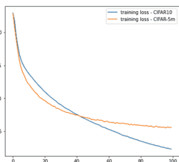

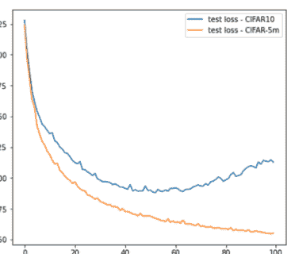

图 5.11 比较训练损失和测试损失曲线。使用 CIFAR-10 训练的模型在第 50 个 epoch 后出现过拟合，而使用 CIFAR-5m 中新样本训练的模型继续改进。

让我们来看看（硬）分类误差。如图 5.12 所示，向模型暴露新数据确实可以支持持续学习，这从使用 CIFAR-5m 训练时测试误差的下降中可以看出。由于 CIFAR-10 数据有限，模型最终开始对训练集进行插值，并在测试集准确率方面趋于平稳。

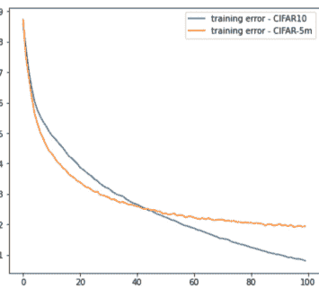

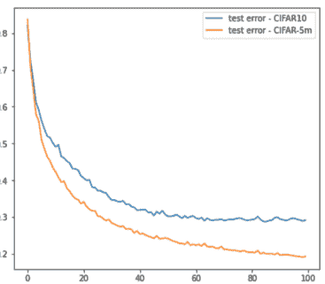

图 5.12 比较硬分类误差曲线。

现在我们来看看软分类误差，这是我们对引导误差诊断的主要关注点。如图 5.13 所示，测试集的软误差起初很小，然后略微增加，直到达到一个相对稳定的值，这从两条曲线之间的差距（约 0.05）可以看出。尽管这个差距不如原论文中那么可以忽略不计，但它仍然是一个较小且稳定的差距。确实，作者提到了这种方法的局限性，即并非所有模型架构都能产生较小的引导误差。仍有多种因素决定两个世界之间的差距，这仍然是一个令人兴奋的研究领域。

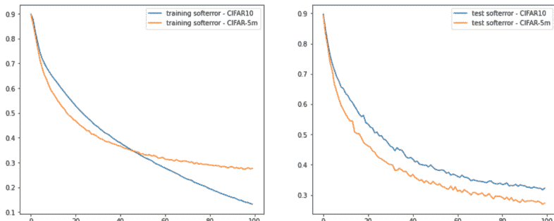

图 5.13 比较软分类误差曲线。

我们已经表明，我们的 LeNet 模型的引导误差相对较小，并在整个训练过程中保持稳定。在替代分解框架下，我们假设，现实世界中测试集误差较低的模型，即离线泛化性能良好的模型，将对应于理想世界中快速收敛的模型，该模型能迅速达到较低的测试集误差。同样，在经验损失中泛化性能差的模型，将对应于在总体损失中收敛缓慢的在线学习者。让我们看一个这样的示例。

### 5.3.8 卷积神经网络中的隐式偏差

在比较卷积神经网络及其等效全连接网络的网络表达能力时，即一个能够表示卷积网络所能表示的所有函数的全连接网络，经验证据表明卷积网络倾向于获得较低的经验损失，从而泛化得更好。一个常见的解释是，当网络开始对训练集进行插值时，SGD 通过落入平坦的局部极小值区域而非陡峭的山谷，在卷积网络中诱导了一种隐式偏差。这样一个平坦区域碰巧是一个可泛化区域。这是一种使用优化进行（隐式）正则化的重要视角，我们将在后续章节中进一步分析。

我们还可以使用替代分解框架获得另一种视角。与其评估使用 SGD 对卷积网络和全连接网络所获得的经验极小值的（隐式）质量，不如通过研究 SGD（显式）优化总体损失的速度来表征泛化性能。

在以下代码清单中，我们构建了一个名为 `LeNet_FC` 的全连接网络类，它包含五个全连接层，总共包含 95,748,510 个参数。

另一方面，原始 LeNet 有 541,094 个参数。这两个网络之间参数数量的相对比率约为 1/200，这与原论文中使用的比率相似。通过创建一个大得多的全连接网络，我们希望 LeNet_FC 在表达能力和近似能力方面涵盖 LeNet。然后，我们可以在保持所有其他训练配置相同的同时，比较它们在理想世界中减少总体损失的优化速度。

清单 5.13 构建 LeNet 的全连接版本

```
class LeNet_FC(nn.Module):
    def __init__(self):
        super().__init__()
        self.fc1 = nn.Linear(32*32*3, 10000) #A
        self.fc2 = nn.Linear(10000, 5000)
        self.fc3 = nn.Linear(5000, 2500)
        self.fc4 = nn.Linear(2500, 1000)
        self.fc5 = nn.Linear(1000, 10) #B
        self.dropout1 = nn.Dropout(0.5)

    def forward(self, x):
        x = x.reshape(-1, 32*32*3) #C
        x = F.relu(self.fc1(x))
        x = F.relu(self.fc2(x))
        x = F.relu(self.fc3(x))
        x = F.relu(self.fc4(x))
        x = self.dropout1(x)
        x = self.fc5(x)
        return x
```

A 输入是 32×32 通道在后的彩色图像
B 10 个输出节点，映射到 10 个类别
C 在开始时将图像展平为全连接层的一维输入

在接收到通道在后的彩色图像后，LeNet_FC 首先会将其重塑为数组，并应用一系列全连接层，其大小大约每次减半，直到最后一层。然后，我们可以使用 CIFAR-5m 遵循相同的训练和测试流程，并获得一系列作为 pickle 对象保存到磁盘的性能指标。同样，当我们在 Google Colab Pro 上使用单个 GPU 实例执行随附笔记本中的完整代码时，预计需要几个小时的运行时间。

图 5.14 显示了使用 CIFAR-5m 的两种架构的训练损失和测试损失曲线。LeNet_FC 优化训练损失更快，但在测试损失上收敛较慢，尽管它比 LeNet 具有更高的表达能力。

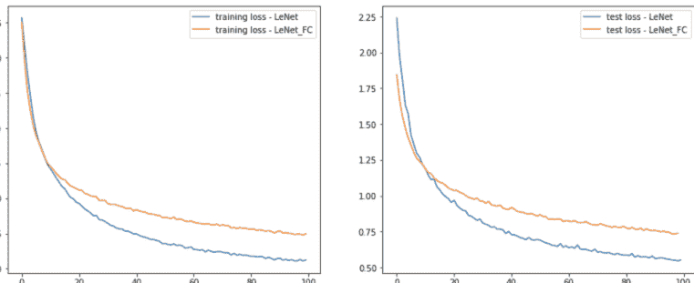

图 5.14 比较在 CIFAR-5m 上训练的 LeNet 和 LeNet_FC 的训练集和测试集损失曲线。

我们可以通过绘制硬分类和软分类误差来进一步证实这一观察，如图 5.15 和 5.16 所示。这两个图都表明，LeNet 的卷积特性比 LeNet_FC 更快地优化总体损失。

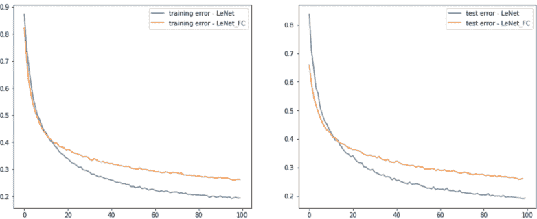

图 5.15 比较使用 CIFAR-5m 训练的 LeNet 和 LeNet_FC 的训练集和测试集硬分类曲线。

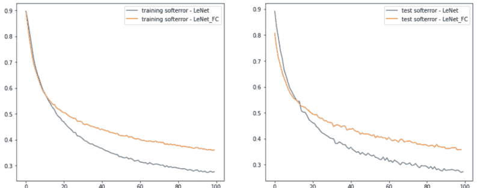

图 5.16 比较使用 CIFAR-5m 训练的 LeNet 和 LeNet_FC 的训练集和测试集软分类曲线。

## 5.4 总结

- 通过数据进行正则化是指一系列有助于构建正则化模型的基于数据的方法
- 对数据的变换可以应用于输入矩阵、输出、深度神经网络中的隐藏层激活值以及这些组件的组合
- 为正则化目的转换输入矩阵时，水平处理包括手动特征工程和自动特征提取，垂直处理包括重复采样（引导法和过采样）和数据增强
- 标签平滑是一种技术，它将“硬”的独热编码目标平滑为由受均匀分布噪声扰动的“软”目标，该噪声由权衡超参数控制
- 数据增强旨在通过对原始数据应用轻微变换来生成人工样本；它是现代计算机视觉任务中事实上的数据预处理步骤
- 数据增强有助于正则化模型训练过程，并在使用 CIFAR-10 的图像分类中构建更具泛化能力的模型
- 深度引导框架通过将现实世界中的离线泛化性能与理想世界中的在线优化速度相联系，为泛化提供了另一种视角
