# 通过模型进行正则化

## 本章内容

- 归纳偏差及其在卷积神经网络中的应用
- 将 dropout 应用为正则化技术以改善模型性能
- 使用多任务学习进行隐式正则化

当使用深度神经网络等过参数化模型时，无论是显式还是隐式正则化，都对实现良好的泛化性能至关重要。如前一章所述，数据增强在图像分类等视觉识别任务中有望带来性能提升。然而，使用可用的训练数据集生成有价值的人工数据集，仍然取决于在数据多样性方面对总体数据的良好覆盖。当训练集极其有限时，我们可增强的内容不多。

例如，考虑图 6.1 中最小训练集的情况，这也是我们在第 1 章中遇到的同一张图。真实的底层函数是一条曲线，对我们不可用。在这种情况下，我们会避免模型中不必要的复杂性，因为它很容易过拟合包含六个数据点的训练数据集。当训练数据进一步减少时，同样的推理也适用。在极端不确定性下，最好保持保守并避免不必要的复杂性。


> 面对极端不确定性时仍偏好的同一线性回归模型

> 这仍是我们想要学习的真实函数

图 6.1 在仅有六个数据点可用时呈现相同场景。简单线性回归模型优于过于复杂的模型，如深度神经网络。

上面的例子很好地体现了引入_归纳偏置_，这是模型在训练过程中所做的一组隐式或显式假设。通过将模型限制为简单线性模型，我们剥离了更高阶多项式等不必要的复杂性，最终构建了一个不那么复杂的模型。例如，如果我们要学习形式为 $f(x) = w_0 + w_1x + w_2x^2 + w_3x^3$ 的模型，在训练集极其有限时偏好线性直线拟合的归纳偏置将允许我们直接设置 $w_2 = w_3 = 0$。换句话说，我们在设计之初就指定了一个线性模型。

除了对模型函数形式的假设外，线性模型还假设误差服从正态分布。也就是说，线性回归拟合产生的误差服从均值为零、方差恒定的正态分布。这种假设使线性回归模型达到最优，即它可证明是无偏的且方差最小。

归纳偏置在_贝叶斯推断_中也起着重要作用，后者是统计学的一个特定领域，根据先验分布和数据的观测似然来研究感兴趣参数的后验分布。如果要估计参数 $w$，贝叶斯统计为 $w$ 赋予一个分布，作为对其可能值的概率性信念，这与试图为 w 估计单一最佳值的原生神经网络不同。在观察任何数据之前，我们会为 w 假设一个特定的先验分布（及其控制参数），这可能是一个简单的标准正态分布 w~N(0,1)，或者基于我们对研究系统的先验知识或领域专业知识的其他形式。

为 w 假设特定先验分布后，我们将根据观测到的数据（特别是我们可用数据的似然）更新该先验分布，形成后验分布。例如，使用贝叶斯法则，观察一些数据后，w 的更新后验分布可能为 N(0.2,0.9)。因此，先验分布作为一种有帮助的归纳偏置，用于热启动估计过程，该过程会以由观测数据校准的后验分布形式进行迭代更新。因此，拥有一个良好的先验分布可以极大地加速找到最佳后验分布的过程。图 6.2 说明了这个例子。

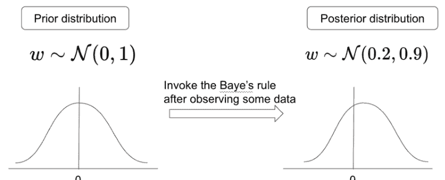

图 6.2 使用贝叶斯法则更新参数的先验分布，并在观察一些数据后获得后验分布。在观察任何数据之前，先验分布作为一种重要的归纳偏置，可以极大地加速获得最佳后验分布的过程。

本章将重点介绍典型卷积神经网络中使用的不同类型的归纳偏置。我们将先介绍模型架构中引入的归纳偏置所带来的平移不变性和权重共享等属性，接着详细讨论一种常用的正则化技术——丢弃法（dropout），它促进稀疏表示。我们还将在本章第二部分将讨论扩展到多任务学习，展示详细示例和实现细节，说明如何从模型设计角度实现正则化。

## 6.1 卷积神经网络中的归纳偏置

归纳偏置是一种基于领域专业知识的假设，用于推广模型在测试集上的预测性能。多个领域特定的应用在模型开发过程中需要专家输入。例如，法官将公平与正义融入司法模型（用于预测法院量刑）中，医生在使用模型自动化诊断决策时会强调 X 光图像中的特定区域或模式。

这也被称为_人机回路_模型开发，领域专家密切参与不同的建模阶段，例如建模前的偏好设置或建模后的调整。Liu 等人在其题为“Limousine Service Management: Capacity Planning with Predictive Analytics and Optimization”的论文中的一项最新工作表明，让领域专家参与数据驱动建模可以显著提高最终生产模型的有效性，并带来更高的满意度和运营效率。

请回顾统计学中的老格言：所有模型都是错的，但有些是有用的。由于模型本质上是我们假设用于近似底层数据生成函数的假设，因此归纳偏置存在于所有模型中，以显式或隐式的形式表达。例如，线性模型假设权重的线性性，而非线性模型根据所用模型应用非线性变换。因此，归纳偏置使我们能够从现实世界或基于过去经验为模型注入充分的外部知识，特别是在训练数据不足以支持适当训练过程时。

让我们重新审视全连接神经网络的结构，特别是我们在任何神经网络设计中所放置的归纳偏置。

### 6.1.1 重新审视全连接网络

考虑我们在第 4 章中讨论过的同一个两层全连接网络。如图 6.3 所示，该网络具有一个包含五个节点的隐藏层，每个节点对先前输入特征进行加权求和，然后通过指定激活函数进行非线性变换。这通过放大隐藏层中第一个节点的操作来阐明，生成 \( f^1_1 = \phi(b^1_1 + w^1_1 x) \)。

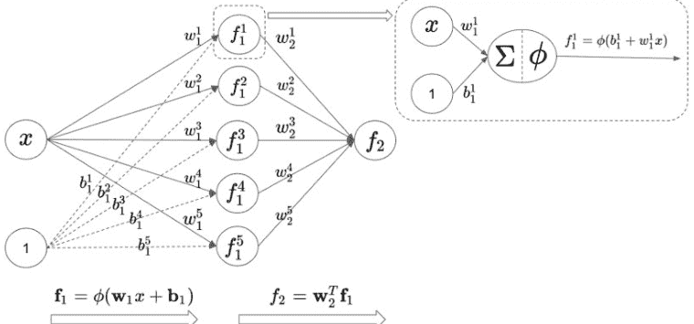

图 6.3 一个包含一个输入节点、五个隐藏节点和一个输出节点的两层全连接神经网络。隐藏层中的每个节点执行加权求和，随后进行非线性变换，这通过放大隐藏层中第一个节点来表示。

事实证明，全连接网络（FCN）在层间数据流动方面具有很少的归纳偏置。当输入特征进入全连接网络时，我们几乎不假设它们应如何与权重交互，除了遍历所有元素的乘法操作外。这导致了其灵活且富有表现力的设计和近似能力，这也得到了第 4 章中介绍的通用逼近定理的支持；通过将隐藏层中的节点数扩展到任意程度，全连接神经网络可以逼近任意形状的函数。

但是，在典型神经网络的结构和优化方面，设计模型架构时我们仍然放置了一些归纳偏置。从架构上讲，假设同一层内的节点永不相互交互。隐藏层中的特征图包含独立特征，这些特征仅参与前向和后向传播，但绝不与同一隐藏层中的邻居交谈。此外，典型神经网络采用有向无环图的形式，如图 6.3 所示，输入从左到右处理，直到到达最终层进行成本计算。这些架构偏好构成了我们在日常开发中使用的许多类型神经网络中的隐式归纳偏置。

从优化角度来看，梯度下降已成为训练神经网络时事实上的优化方法，表现出对易于基于梯度的方法训练的模型的归纳偏置。特别是，随机（小批量）梯度下降算法是一种流行的选择，因为它具有简单快速的训练时间以及隐式正则化效应，诱导出在不同批次中对最优解位置表现出鲁棒性的模型（关于此将在后续正则化章节中进一步讨论，通过


优化）。此外，在训练网络前初始化权重时，大多数情况下我们会选择流行的权重初始化器，例如“He initialization”。这些经验最佳实践构成了我们在模型训练过程中所放置的归纳偏置。

### 6.1.2 卷积神经网络中的平移不变性

卷积是一种独特的操作，旨在有效地从图像数据的几何结构中学习，假设为2D或3D卷积操作。卷积层使用的参数比全连接层少得多，并享有跨不同输入特征的权重共享优势。也就是说，多个特征共享相同的权重，从而显著减少神经网络所使用的有效权重数量。具体而言，卷积是一种数学操作，其中将一个函数传递到一系列值上，这个过程称为对函数进行卷积。它也适用于一维输入，例如序列数据，其中可以使用1D卷积来捕捉数据内部的依赖关系。让我们重新审视卷积操作，并讨论它如何在图像识别任务中超越全连接层。

事实证明，我们可以使用特定类型的归纳偏置（即卷积神经网络中的卷积和池化操作）来调整香草全连接神经网络的设计考量，这在处理图像数据及其他领域时被证明非常有效。调整设计考量会限制神经网络表现出特定的期望属性，例如平移不变性，即无论图像中特定对象位于何处或被移动到何处，网络都能识别它。换句话说，网络对输入图像中对象的位置平移具有不变性，并可以获得相同的分类结果。这是卷积神经网络的关键优势之一，基于这样一个强先验假设：对象的位置对最终分类结果无关紧要。

图6.4说明了在MNIST数据集上具有高准确率的训练有素的CNN的平移不变性属性。当暴露于数字8位于不同位置的图像时，像CNN这样的平移不变模型会生成相同的类别标签8。这意味着，对于FCN来说，要正确分类包含数字8的图像，FCN模型在初始训练过程中必须遇到过相似位置的相似数字8，尽管经过足够长时间训练的FCN *可能* 会发现位置不变性属性。另一方面，CNN在设计上对数字的位置不敏感。这主要归功于局部滤波器（也称为内核），它们能够捕捉并利用数字8上的基本信号，无论其位于何处。然而，像FCN这样的平移变体模型不一定会产生相同的分类结果。这意味着，以一致的方式打乱图像数据中的像素，由于其无结构感知特性，最终会得到相同的基于FCN的模型。由于未能捕捉图像上数字8的空间关系，FCN将难以识别同一对象，直到经过足够长时间的训练以发展有意义的表示，并自行 *学习* 该属性。

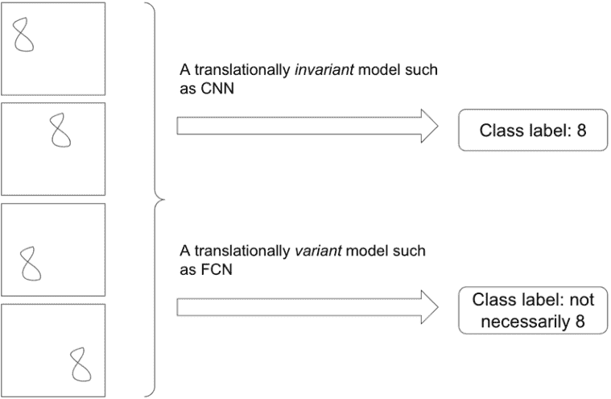

图6.4 典型的卷积神经网络对输入图像中不同位置上的对象（数字8）的平移具有不变性。它可以将数字8识别为相同的标签，而在训练基于FCN的模型时，这不容易实现。前馈架构不理解其输入中的结构或顺序。因此，当向前馈网络展示一组图像及其关联标签并进行训练时，如果我们以一致的方式打乱图像中的像素值后再进行训练，我们也会得到相同的结果。结构感知仅在基于CNN的模型中构建。

因此，在不改变分类结果的情况下移动对象是卷积神经网络中表现出的一种基本归纳偏置。无论对象位于何处，一组滤波器都会在整个图像上移动（从左到右，从上到下）以执行卷积操作。当遇到特定的类似边缘的区域或其他感兴趣的形状时，滤波器中的特定节点会被激活，产生较大的值，在池化操作后“击败”其邻居。因此，特定激活发生的位置（如果有）并不重要，因为它最终会被池化到下一层。只要特定节点被触发，经过充分训练的CNN就能捕捉此类激活，并意识到噪声是由于随机平移引起的。因此，平移不变性是CNN中嵌入的自然属性。

除了平移不变性，我们还可以通过将同一对象旋转一定角度来促进CNN中旋转不变性的学习。只要旋转对象的新图像仍然属于同一类别，我们就可以生成更多人工且有用的图像，供模型学习并掌握所需的旋转不变性属性。事实上，第5章中涵盖的所有不同的数据增强技术，都是为了在识别对象时赋予模型某种不变性和鲁棒性。这些归纳偏置是重要的加速器，可帮助模型理解对象的不同空间连接以及当前对象识别任务特有的其他视觉属性。其他不变性属性，例如尺度不变性和光照不变性，也可以通过数据增强提供相应的增强训练数据，在结果模型中以类似方式发展。

请注意，旋转和尺度不变性属性也可以使用CNN中的最大池化操作来学习。例如，当输入图像包含不同程度的旋转或尺度时，隐藏层中不同的滤波器会被激活，从而输出较大的值。最大池化层将从所有滤波器中选择最大激活值，从而对输入图像中的可能旋转或尺度显示出不变性。遵循相同的推理，最大池化连同即将讨论的卷积操作，也对CNN的平移不变性有所贡献。

为了实现这些期望的属性，我们需要以一种方式限制FCN中的连接，以便使网络能够学习局部结构并掌握不变性属性。具体而言，我们希望在神经网络中嵌入针对不同类型层的关系性归纳偏置。一方面，我们利用输入数据中几何对象的局部性，使得结果CNN模型对空间平移具有不变性。另一方面，在循环神经网络（RNN）中利用对象的顺序性（例如，自然语言处理中的标记、时间序列中的观测值），使得结果模型对时间平移具有不变性。

在深入探讨如何限制FCN以显示期望属性之前，让我们更详细地了解卷积操作。事实上，正如您将在下一节中看到的那样，由于卷积操作，CNN是一种特殊类型的受限FCN。

### 6.1.3 理解卷积算子

卷积算子是实现平移不变性属性的主要驱动力之一。回顾第4章中的卷积工作流程图，这里也在图6.5中展示以方便参考。关键要点是，我们定义一个内核/滤波器与不同的输入补丁依次进行卷积，并在特征图中生成结果特征。每一次卷积都由内核与输入补丁之间的逐元素乘法组成，随后进行求和操作。


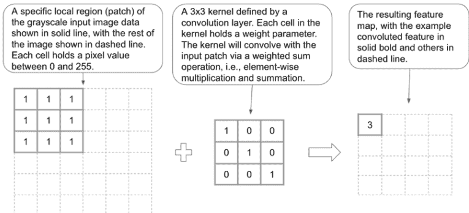

图 6.5 卷积操作示意图。

我们也可以用类似下面的方式来表达 3x3 卷积核的整体卷积运算，这描述了互相关运算的机制，互相关运算是另一种与卷积运算高度相似的操作，有助于说明数学运算。唯一的区别是，CNN 会在水平和垂直方向上翻转滤波器，导致 $IN_{i+x,j+y}$ 变为 $IN_{i-x,j-y}$。

$Out_{i,j} = b + \sum_{x=0}^2 \sum_{y=0}^2 IN_{i+x,j+y} W_{x,y}$

在这个表达式中，$IN` 表示输入矩阵，$W` 表示权重的卷积核矩阵，$Out` 表示结果特征图，该特征图再次作为后续层的输入矩阵。有两组从零开始的索引：$(i,j)$ 作为在输入补丁上移动的全局索引，$(x,y)$ 作为在输入补丁元素上移动的局部索引。$(i,j)$ 唯一地定位特征图 $Out` 中的每个特征，如图 6.5 中的卷积示例所示，$Out_{0,0} = 3$。由于 $IN` 是 6x6，$W` 是 3x3，如果卷积核依次与每个输入补丁进行卷积，即使用步长为 1，则结果输出 $Out` 是 4x4，使得 $i` 和 $j` 都在 0 到 3 的范围内。我们将稍后讨论维度的变化。

对于每次卷积操作，$x` 和 $y` 都在 0 到 2 之间变化，总共产生 9 种组合，即输入补丁和卷积核矩阵之间进行 9 次逐元素乘法。因此，索引对 $(x,y)$ 唯一地标识输入条目 $IN_{i+x,j+y}$（在全局输入补丁索引 $(i,j)` 之上）和权重条目 $W_{x,y}$，执行逐元素乘法 $IN_{i+x,j+y}W_{x,y}` 和求和 $\sum_{x=0}^2 \sum_{y=0}^2 IN_{i+x,j+y}W_{x,y}$。我们还注意到，偏置项 $b` 作为输出特征的全局调整被加入。

有几个超参数我们可以针对卷积算子进行设置，以决定卷积核如何与输入补丁进行卷积。具体来说，我们可以改变步长以控制滤波器在图像上移动的幅度。例如，前一个示例使用步长为 1，因为卷积核每次移动一个像素（从左到右，从上到下）。通过将步长参数设置为 2，卷积核将跳过下一个像素并“跳”到再下一个像素。更大的步长会导致更小的特征图，因为卷积核与输入补丁之间的逐元素乘法数量减少。

此外，由于图像边缘的像素仅与卷积核卷积一次，我们可以调整填充参数来解决这个问题，并确保所有像素与卷积核的交互次数相同。例如，我们可以在输入图像边缘周围添加一层值全为零的额外像素。这称为零填充，或同尺寸填充，它在输入图像外部添加一圈零填充，如果我们希望在结果输出特征图中保留输入图像的形状/维度，以便捕获输入图像边缘沿线的信息，则这特别有用。填充在边缘周围引入零，以扩大输入矩阵的虚拟大小。

请注意，填充的另一个优势是图像的维度从一层到下一层都被保留，我们不必过分担心张量的维度。

图 6.6 说明了这两个调整参数，其中我们设置填充为 1，步长为 2。这些参数在定义卷积层时预先设置。它们本质上影响结果输出数组的形状，并属于神经网络中不断增长的超参数列表。虽然获得最佳超参数配置是一个需要试错的繁琐过程，但我们通常会选择在许多领域似乎效果良好的设置。例如，在早期隐藏层中学习低级局部结构时，使用 3x3 卷积核、零填充和步长为 1。

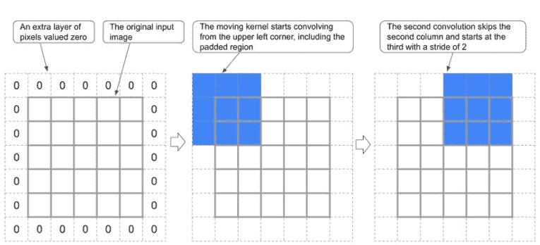

图 6.6 在卷积算子中调整填充和步长参数。

如何确定卷积层的输出维度？为了实现这一点，我们需要知道输入数组和卷积核的大小，以及其填充和步长的参数设置。计算输出形状 $D_{out}$ 的一个有用公式如下所示：

$D_{out} = \lfloor(D_{in} - k + 2p)/s\rfloor + 1$

其中，$D_{in}$ 表示输入图像的宽度或高度（假设为方阵），$k` 是卷积核的宽度或高度，$p` 是输入图像水平或垂直边界上的填充，$s` 是卷积核的步长。结果随后使用地板运算符 $\lfloor \rfloor$ 向下舍入到最接近的整数，然后加一。欢迎将此公式代入上述示例中进行验证，看看是否正确。

让我们将此公式应用于前一个示例，以更好地理解输入和输出之间的维度转换。如图 6.6 中的示例所示，我们有输入大小 $D_{in} = 5$，卷积核大小 $k = 3$，填充大小 $p = 1$，步长 $s = 2$。应用公式可得 $D_{out} = 3$，输出为一个 3x3 特征图。请参见图 6.7，了解输入和输出之间维度变化的示意图。

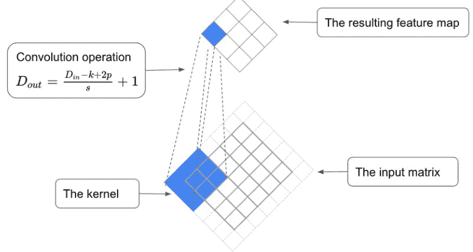

图 6.7 卷积操作示意图。使用 3x3 卷积核、填充为 1、步长为 2，5x5 输入矩阵被转换为 3x3 特征图。因此，公式使我们能够根据卷积操作在输入矩阵上的参数化方式来获取输出的维度。

结果表明，卷积操作对应于一种采用权重共享的特殊 FCN，我们将在下一节中展示这一点。

### 6.1.4 卷积操作中的权重共享

考虑一个 2x2 卷积核矩阵，用于与 4x4 输入矩阵进行卷积，不使用填充（也称为 *有效填充*）且步长为 2。使用这种参数化，卷积核将与四个输入补丁进行卷积，这些补丁互斥且共同覆盖完整的输入矩阵。请参见图 6.8 了解示意图。

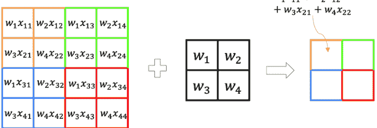

图 6.8 在不使用填充且步长为 2 的情况下，将 2x2 卷积核与 4x4 输入矩阵进行卷积。为了清晰起见，四个输入补丁采用颜色编码，并标记为相应权重和输入之间的乘积。输出是一个 2x2 特征图，其中我们展示了左上角单元格中卷积核与输入补丁之间逐元素乘法求和的结果。

在这个图中，我们明确标记了输入矩阵及其将与之相乘的相应权重。所有输入补丁都与 *相同* 的卷积核矩阵进行卷积，其权重在相应的输入条目之间共享。例如，$w_1$ 在所有四个输入补丁的左上角条目之间共享。与 FCN 中将每个输入条目与各自唯一的权重配对不同，卷积操作在多个输入条目之间共享权重。

让我们在 FCN 的背景下可视化权重共享机制。在图 6.9 中，我们绘制了与图 6.9 中相同的卷积操作，尽管使用类似于 FCN 的扁平化前馈方式。请注意，这个图中的转换包含大量需要拆解的信息。首先，我们对输入矩阵中的四个输入补丁进行颜色编码，这对应于输出特征图中的四个特征（相同颜色）。接下来，我们以典型 FCN 的方式将所有这些组件（输入层、卷积核和输出层）按前馈方式展平。对于输入矩阵，每个条目按顺序映射到输入层中的相应节点，从左到右，从上到下。例如，左上角条目映射到第一个输入节点，如图中的点划线所示。相同的位置映射也适用于输出层。最后，卷积核表现为表示网络权重的连接线。每个权重假设不同类型的线条以区分开来，避免已拥挤的颜色空间。


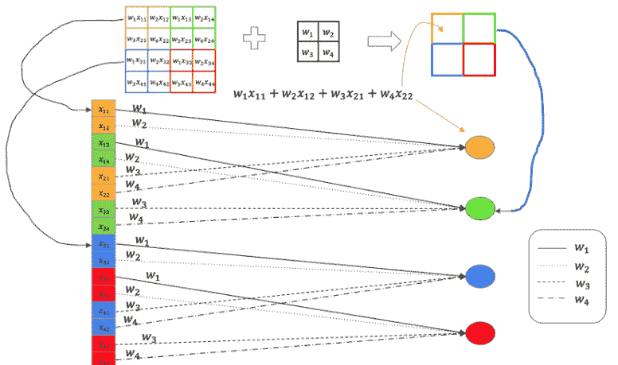

图 6.9 使用前馈式风格表示卷积操作。方阵中的输入条目按顺序映射到输入层的节点中，从左到右，从上到下。我们给出了两个示例，其中 w1 在图中被映射到。同样，输出特征图也被展平为由四个节点组成的直线层。我们使用颜色编码来区分四个输入补丁和产生的输出特征，以及每个节点和权重的相应符号。权重使用不同类型的线条绘制以便区分，其中每个单一权重在四个输入节点中重复/共享四次，连接数量显著少于典型 FCN 中的数量。

尤其是观察权重如何连接输入和输出节点很有趣。一方面，与需要 16x4=64 个权重的典型 FCN 相比，现在使用的权重数量要少得多。更少的权重既减轻了计算负担，也减轻了训练负担。另一方面，权重共享明确地强制应用于特定的输入节点。考虑图中由实线表示的 w1。所有四种不同颜色的节点共享相同的权重，并最终进入不同的输出节点。这种安排有助于学习几何结构（边缘、形状等），而这些结构在典型 FCN 中使用独立的权重很难捕捉。因此，在网络架构设计中引入归纳偏置对决定模型的学习能力起着重要作用。

请注意，最大池化或平均池化等池化操作也是模型设计中引入归纳偏置的示例，尽管该操作中不涉及可学习的权重。

在了解了 CNN 的核心操作后，让我们转换方向，关注模型架构中的另一种归纳偏置：脱校法。

## 6.2 通过脱校法对深度神经网络进行正则化

请回顾，我们在前一章中简要提及了*集成学习*，它是一种基于多个自助采样数据集开发的多个模型进行聚合，以构建更泛化模型的方法。事实证明，我们也可以保持数据集不变，多次调整模型架构，每次都得到一个不同的模型，然后集体聚合以产生最终输出。这就是*脱校法*的理念，即按照特定的计划，仅在*训练*阶段随机（暂时）禁用/移除某一层中的某些节点以及所有关联的入站和出站连接权重。这通常发生在隐藏层中，尽管也可以将其应用于输入层。

通过集成不同的模型配置，脱校法导致训练多个模型，这有助于减少过拟合并提高泛化性能。它可以被视为将随机噪声注入模型架构作为一种正则化形式。此外，在网络中以概率方式随机脱校节点也能加快训练期间的计算速度。

脱校法操作的一个类比如下。在课堂上，老师提出一些问题，但总是同两个孩子在回答。老师让他们安静一段时间，让其他学生参与进来。这样，其他学生就能学得更好。也许他们会给出错误的答案，但老师（损失函数）可以纠正他们（使用反向传播进行权重更新）。通过暂时让几个异常活跃的学生（具有高激活输出的节点）保持安静，整个班级（层）对该主题的学习效果更好。

让我们详细了解脱校法操作。

### 6.2.1 引入脱校法

脱校法最初由 Srivastava 等人（2014 年）在其里程碑式论文“脱校法：防止神经网络过拟合的一种简单方法”中提出。脱校法的核心思想是近似集成学习，仿佛我们要训练许多不同的模型并平均它们的预测，因为当数据集变大且模型变复杂时，显式构建多个模型在计算上非常昂贵。这种近似是通过随机禁用网络中的某些节点（乘以零）来实现，使其看起来像是当前训练迭代的一个不同模型。这样做将防止模型对某个特定节点（由其大权重表示）产生过度依赖，因为它可能只是随机地被脱校出网络。当一个看似重要的节点被脱校时，其他相邻节点将承担当前训练任务的额外共享责任，并学习变得更加健壮，不易发生*共适应*，即相邻节点表现出相似的行为，并因高相关性而损害泛化性能。

考虑图 6.10 中包含两个隐藏层的简单网络的训练过程。在第一次训练迭代中，第一个隐藏层的第二个节点及其关联的入站和出站权重被禁用。在第二次训练迭代中，第二个隐藏层的第一个节点也会发生同样的操作。请注意，这两个节点只是暂时从网络中省略，并在训练结束后恢复。在测试阶段，所有节点都像原始网络中一样存在，并用于带有缩放输出的推理。

在实践中，随机禁用效果是在定义网络架构时基于预设概率发生的。此外，我们会得到与原始版本相同的网络架构，并且在测试阶段不会应用脱校法。

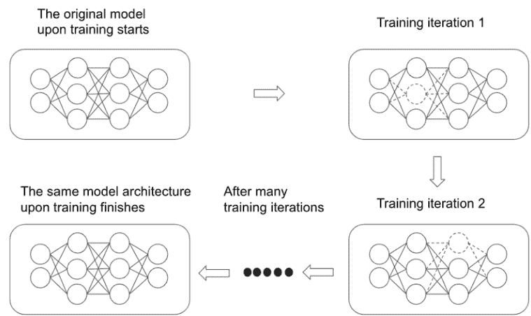

图 6.10 说明了在训练具有两个隐藏层的简单全连接神经网络时的脱校法操作。隐藏节点的概率性移除发生在训练迭代期间。例如，第一个隐藏层的第二个节点在迭代 1 被移除，第二个隐藏层的第一个节点在迭代 2 被移除。请注意，让一个节点静默也意味着将所有连接权重静默（设置为零），由虚线表示。由于脱校法仅在训练迭代期间发生，我们最终会得到与原始版本相同的网络架构。

随机脱校节点也可以被视为从原始网络中采样一个精简网络，通过切断特定节点的所有入站和出站连接来实现。由于大多数节点出现在多个采样网络或子模型中，脱校过程允许这些精简网络在不同迭代之间共享权重，在多个子模型之间传输和通信权重。这种权重共享方案与多任务学习不谋而合，我们将在本章后面部分简要介绍。

请注意，脱校法可以在测试阶段启用，此时每个预测由略有不同的采样模型生成，从而得到一组预测。这些多个预测可以形成一个分布，然后使用统计量（如分布的均值和方差）来量化预测的不确定性，这近似于考虑模型不确定性的贝叶斯推断。

除了通过减少过拟合来提供更好的泛化性能外，脱校法还带来了在隐藏层中鼓励稀疏表示的副作用，而不是依赖添加到模型损失函数中的显式权重正则化。

此外，脱校法有助于保持网络中的权重较小，因为权重更新被分散了。较小的权重是可取的，因为模型对输入特征的小变化不那么敏感。我们将在后面的章节中详细介绍通过目标函数进行正则化，其中 l1 和 l2 范数等惩罚项在正则化模型权重方面起着显著作用，使权重保持较小甚至为零。

### 6.2.2 诱导稀疏表示

CNN 在从图像数据中学习几何结构方面非常擅长。也就是说，良好的特征表示会被自动提取和学习，以捕捉不同层次上的结构模式。在许多同样良好的特征表示中，稀疏表示通常更受青睐，因为它具有提高鲁棒性（即选取的特征更少）和加快计算（模型推理中涉及的权重更少）等优势。因此，特征表示中的稀疏性是我们置于模型中的另一种归纳偏置，即只有原始特征的一个子集（在输入层或隐藏层中）是重要的。因此，在输入层面上，稀疏性也可以被视为一种隐式特征选择机制。

有许多诱导稀疏学习的技术，其中 Lasso 正则化是最突出的示例。Lasso 是添加到模型目标损失函数中的一个惩罚项，以便在最终模型中仅选取原始特征的一个子集。这种特征选择是通过将不重要特征的权重设置为零来实现的。

还有两种更常用的 Lasso 变体：组 Lasso 和弹性网。组 Lasso 假设某些权重的组成员资格，选择或丢弃整个权重组。弹性网将 Lasso 和组 Lasso 线性结合起来，在单个权重层面和聚合组层面都执行稀疏学习。

我们将在关于通过目标函数进行正则化的后面章节中更深入地探讨这种特定技术。目前，让我们将稀疏学习置于简单 FCN 的背景下。图 6.11 说明了不同稀疏诱导技术在特征表示中的效果。如果不使用任何稀疏诱导正则化器，如左上图所示的 FCN 将学习所有权重，并在最终模型中保留所有生成的隐藏特征/节点，这在实际应用中可能存储要求高且推理耗时。通常可以学习一个稀疏模型，在保持更小尺寸的同时提供相同的预测性能。稀疏性可以采用 Lasso 的权重级选择形式，如右上图所示，或采用组 Lasso 的节点组级选择，如左下图所示，或两者的结合，即所谓的弹性网正则化，如右下图所示。


### 带有所有已学习和保留的权重和特征的原始模型
### 使用个体权重级稀疏性（即 Lasso 正则化）移除某些权重
### 使用组级别稀疏性（即组 Lasso 正则化）移除隐藏节点/特征（以及所有连接权重）
### 使用弹性网正则化诱导权重级和节点级的稀疏性

图 6.11 简单 FCN 中诱导稀疏性的学习。左上图是原始 FCN，其中所有权重都已学习和保留。右上图是使用 Lasso 通过将其值设置为零来禁用某些连接权重（由虚线表示）的示例。左下图使用组 Lasso 通过将所有输入和输出权重设置为零来移除一个节点（由虚线圆和线条表示）。右下图应用弹性网正则化来结合 Lasso 和组 Lasso，实现权重级和节点级的稀疏性。

通过 Dropout 促进稀疏性的副作用与在节点级选择中使用组 Lasso 相似，尽管 Dropout 不涉及对节点的显式正则化项。

在下一节中，我们将探讨从零实现 Dropout 操作，并使用 MNIST 数据集在 FCN 和 CNN 中应用它。

### 6.2.3 Dropout 实战

Dropout 操作包括根据预设概率丢弃一些节点，并放大其余节点的权重。在这里，我们指定丢弃节点的概率（这也是一个超参数），而不是保留节点的概率。这既适用于下文将要介绍的示例，也适用于 PyTorch 中提供的 Dropout 层。

实现 Dropout 时，第一部分涉及生成一个布尔数值的指示列表，用于与待评估层中的节点相乘，无论是输入层还是隐藏层。当一个节点乘以零，或者等价于 Python 中的 `FALSE` 值时，该节点的结果特征值将变为零，并流入后续操作，这相当于丢弃或掩码该节点。它还确保在反向传播过程中，不会有误差梯度流回被丢弃的神经元。布尔列表的长度与节点数量相同，它是通过将一组随机数与预设的 Dropout 概率进行比较生成的，这些随机数服从 0 到 1 之间的均匀分布。

第二部分是放大节点的特征值，这等同于放大它们的输出权重。原因是丢弃一些节点后，其余节点需要在值上进行放大，以补偿被丢弃的节点。具体来说，假设 Dropout 比率为 p，那么每个剩余节点将乘以 1/(1 - p)。

以下代码清单实现了一个 Dropout 类，可以应用于输入层或任何隐藏层。实例化该类时，它接受默认 Dropout 比率为 0.5，通常在 0.5 到 1 的范围内变化。当 `__init__()` 函数自动触发时，缩放因子也会被计算并存储为属性。接下来，`forward()` 函数指定如何执行 Dropout 操作，并在应用此类时自动触发。具体来说，我们首先创建一个名为 `selected_ind` 的指示列表，以确定要掩码/屏蔽哪些节点。布尔数值列表是通过将 0 到 1 范围内的一组均匀生成的数字与预设的 `dropout_rate` 进行比较来创建的。指示列表随后被转换为浮点数据类型，并包装在一个变量中，其梯度传播被禁用，因为不涉及学习。最后，我们根据指示列表掩码节点，并放大其余的幸存节点。

### 清单 6.1 定义自定义 Dropout 类

```
class Dropout(nn.Module):
    def __init__(self, dropout_rate=0.5):
        super(Dropout, self).__init__()
        self.dropout_rate = dropout_rate
        if self.dropout_rate < 1: #A
            self.scaling_fct = 1.0 / (1.0-dropout_rate) #A
        else: #A
            self.scaling_fct = 0.0 #A

    def forward(self, input):
        if not self.training: #B
            return input

        selected_ind = torch.Tensor(input.shape).uniform_(0,1) > self.dropout_rate #C
        if input.is_cuda: #D
            selected_ind = Variable(selected_ind.type(torch.cuda.FloatTensor),
                requires_grad=False) #D
        else: #D
            selected_ind = Variable(selected_ind.type(torch.FloatTensor),
                requires_grad=False) #D

        return torch.mul(selected_ind, input) * self.scaling_fct #E
```

- #A 为剩余节点定义缩放因子，以补偿被丢弃的节点
- #B 仅在训练模式下应用 Dropout
- #C 相同大小的指示张量，用于标记所选节点
- #D 如果可用则使用 GPU
- #E 丢弃一些节点并放大其余节点

接下来，我们将 FCN 模型定义为名为 `MLP()` 的类。如以下代码清单所示，我们使用 PyTorch 的 sequential 容器，通过其 `add_module()` 函数将多个层串联在一起。`dropout_rates` 参数是一个包含两个条目的列表，分别对应输入层和所有隐藏层的 Dropout 概率。在指定输入层与第一个隐藏层之间的连接后，所有剩余层都在 `for` 循环中配置，这使得扩展到具有不同完全连接隐藏层配置的架构变得方便。由于我们使用 MNIST 数据集，我们的网络从 1x28x28 像素的输入维度和 10 个类别的输出维度开始。

### 清单 6.2 定义 FCN 模型

```
class MLP(nn.Module):
    def __init__(self, hidden_layers=[800, 800], dropout_rates=[0, 0]):
        super(MLP, self).__init__()
        self.model = nn.Sequential()
        self.model.add_module("input", nn.Linear(28*28, hidden_layers[0]))
        self.model.add_module("dropout_input", Dropout(dropout_rate=dropout_rates[0]))
        self.model.add_module("tanh", nn.Tanh())
        # add hidden layers
        for i, d in enumerate(hidden_layers[:-1]):
            self.model.add_module("dropout_hidden_"+str(i+1),
            Dropout(dropout_rate=dropout_rates[1]))
            self.model.add_module("hidden_"+str(i+1), nn.Linear(hidden_layers[i],
            hidden_layers[i+1]))
            self.model.add_module("tanh_hidden_"+str(i+1), nn.Tanh())
        self.model.add_module("final", nn.Linear(hidden_layers[-1], 10))

    def forward(self, x):
        # flatten to one-dimensional array
        x = x.view(x.size()[0], 28*28)
        x = self.model(x)
        return x
```

请注意，我们在非线性激活函数生效之前使用了 Dropout，这在计算效率上提供了 slight 提升。然而，在实践中，Dropout 层通常放置在激活层之后。

我们可以实例化一个示例模型，并按以下代码片段检查其架构。

```
>>> model = MLP()
>>> print(model)
MLP(
  (model): Sequential(
    (input): Linear(in_features=784, out_features=800, bias=True)
    (dropout_input): Dropout()
    (tanh): Tanh()
    (dropout_hidden1): Dropout()
    (hidden_1): Linear(in_features=800, out_features=800, bias=True)
    (tanh_hidden_1): Tanh()
    (final): Linear(in_features=800, out_features=10, bias=True)
  )
)
```

接下来，我们将构建一个 `MLPClassifier` 类，以更好地管理训练流水线中的各个组件，包括数据加载、模型训练和结果保存。如以下代码清单所示，我们首先创建在实例化时稍后使用的几个实用变量。这些包括用于在 GPU 环境中启动 MLP 模型的隐藏层和 Dropout 配置（`hidden_layers` 和 `dropout_rates`）、训练批量大小（`batch_size`）、最大训练轮数（`max_epoch`）、损失函数（`criterion`）和优化例程（`optimizer`），以及用于保存模型性能指标（`loss` 和 `test_accuracy`）的变量。

### 清单 6.3 定义模型训练的包装器

```
class MLPClassifier:
    def __init__(self, hidden_layers=[800, 800], dropout_rates=[0, 0], batch_size=128, \
        max_epoch=10, lr=0.1):
        self.hidden_layers = hidden_layers
        self.dropout_rates = dropout_rates
        self.batch_size = batch_size
        self.max_epoch = max_epoch
        self.model = MLP(hidden_layers=hidden_layers, dropout_rates=dropout_rates)
        self.model.cuda()
        self.criterion = nn.CrossEntropyLoss().cuda()
        self.optimizer = optim.SGD(self.model.parameters(), lr=lr)
        self.loss = []
        self.test_accuracy = []
```

然后，我们将向类添加一个 `fit()` 函数来处理训练过程。如以下代码片段所示，我们首先使用 `dataloader` 类加载训练集和测试集，其中训练集分批次提供，测试集一次性全部提供，用于每隔 `test_score_freq` 个轮次进行一次评分。在每个训练迭代中，我们遵循同样的熟悉流水线：准备批量训练数据（`X_train` 和 `y_train`）、清除当前梯度以避免梯度累积、使用当前模型进行预测（存储在 `y_pred` 中）、计算当前损失（`loss`）、将损失反向传播以计算偏导数梯度，最后执行一步梯度下降更新以获得新模型。我们使用 `running_loss` 监控不同轮次中每个批次的平均损失。默认情况下，每隔五个轮次对测试集进行一次评分，模型会对测试集中的所有 10,000 张图像进行预测以计算预测准确率。


```
def fit(self, trainset, testset, verbose=True, test_score_freq=5):
    trainloader = torch.utils.data.DataLoader(trainset, batch_size=self.batch_size,
    shuffle=True) #A
    testloader = torch.utils.data.DataLoader(testset, batch_size=len(testset),
    shuffle=False) #A
    X_test, y_test = iter(testloader).next() #A
    X_test = X_test.cuda() #A
    for epoch in range(self.max_epoch): #B
        running_loss = 0
        for i, training_batch in enumerate(trainloader, 0):
            X_train, y_train = training_batch
            X_train, y_train = Variable(X_train).cuda(), Variable(y_train).cuda()
            self.optimizer.zero_grad() #C
            y_pred = self.model(X_train) #D
            loss = self.criterion(y_pred, y_train) #E
            loss.backward() #F
            self.optimizer.step() #G
            running_loss += loss.item() #H
    self.loss.append(running_loss / len(trainloader)) #I
    if verbose:
        print('{Epoch {} loss: {}}'.format(epoch+1, self.loss[-1]))
    if (epoch+1) % test_score_freq == 0:
        y_test_pred = self.predict(X_test).cpu() #J
        self.y_test_pred = y_test_pred
        self.y_test = y_test
        self.test_accuracy.append(np.mean((y_test == y_test_pred).numpy())) #K
        if verbose:
            print('Test accuracy: {}'.format(self.test_accuracy[-1]))
    return self
```

- #A 准备训练集和测试集
- #B 启动训练过程，最好在 GPU 上运行
- #C 清除梯度
- #D 进行预测
- #E 计算当前批次的损失
- #F 执行反向传播以自动计算梯度
- #G 更新权重
- #H 将同一时期内不同批次的损失相加
- #I 存储所有时期每批次的平均损失
- #J 获取测试集的预测结果
- #K 存储测试集准确率

在对整个测试集进行预测时，我们使用了类中的 predict() 方法。这是一个自定义的预测函数，它将概率模型输出转换为类别分配，如下面的代码片段所示。

```
def predict(self, x):
    model = self.model.eval()
    outputs = model(Variable(x))
    _, pred = torch.max(outputs.data, 1)
    model = self.model.train()
    return pred
```

最后，我们可以在 MNIST 数据集上测试分类器。在下面的代码清单中，我们测试了三种不同的模型：不带任何 dropout 的原始 FCN、隐藏层中带有 50% dropout 的 FCN，以及隐藏层中带有 50% dropout 且输入层中带有 20% dropout 的 FCN。FCN 包含两个隐藏层，每个隐藏层由 300 个隐藏节点组成。我们对所有三种模型总共训练 500 个时期，并每 5 个时期记录一次测试集准确率。所有模型都包含在 `model_list` 中。此外，由于在单个 GPU 上运行此代码清单大约需要 5 小时，我们将模型和性能指标离线保存，以便稍后绘图。

### 清单 6.4 在 MNIST 数据集上训练三个 FCN

```
transform = transforms.Compose([transforms.ToTensor(),
 transforms.Normalize([0.5], [0.5])]) #A
trainset = datasets.MNIST(root='data/', train=True, download=True, transform=transform) #A
testset = datasets.MNIST(root='data/', train=False, transform=transform) #A
hidden_layers = [300, 300] #B
model_list = [MLPClassifier(hidden_layers, dropout_rates=[0, 0], max_epoch=500),
 MLPClassifier(hidden_layers, dropout_rates=[0, 0.5], max_epoch=500),
 MLPClassifier(hidden_layers, dropout_rates=[0.2, 0.5], max_epoch=500)] #B
[tmp_model.fit(trainset, testset, verbose=True) for tmp_model in model_list] #C
for ind, tmp_model in enumerate(model_list): #D
    torch.save(tmp_model, 'mnist_mlp_'+str(ind)+'.pth')
    tmp_model.test_accuracy = list(map(str, tmp_model.test_accuracy))
from google.colab import files
open("mlp_test_accuracy.txt", "w").write('\\n'.join(['.'.join(tmp_model.test_accuracy) for tmp_model in model_list])) #E
files.download('mlp_test_accuracy.txt')
```

- # A 加载并转换 MNIST
- # B 定义三个 FCN 模型
- # C 开始训练
- # D 保存 torch 模型
- # E 保存测试准确率

训练完成后，我们可以加载测试集准确率的保存文件，并以步长为 5 的训练迭代次数为函数将其绘制出来。绘图详情请参见下面的代码片段。

```
import matplotlib.pyplot as plt
mlp_test_accuracy = [accuracy_array.split(',') for accuracy_array in
 open("mlp_test_accuracy.txt", "r").read().split('\\n')]
mlp_test_accuracy = np.array(mlp_test_accuracy, dtype='f')
labels = ['MLP no dropout',
          'MLP 50% dropout in hidden layers',
          'MLP 50% dropout in hidden layers + 20% in input layer']
plt.figure(figsize=(8, 7))
for i, r in enumerate(mlp_test_accuracy):
    plt.plot(np.array(range(1, len(r)+1))*5, r, '.-', label=labels[i], alpha=0.6);
plt.legend(loc=4);
plt.xlabel('Epochs');
plt.ylabel('Accuracy in test set');
plt.show()
```

运行上述代码将生成图 6.12。在这种情况下，在第二个和第三个模型中添加 dropout 明显提高了测试集性能。在实践中，常观察到 dropout 对模型泛化性能有显著贡献，这甚至比显式正则化权重范数更加明显。此外，对输入层应用 dropout（程度较小）进一步提升了测试集性能。

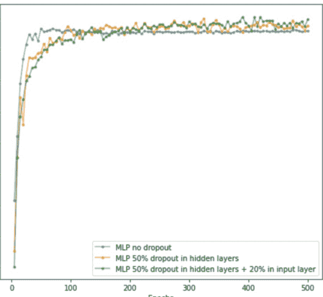

图 6.12 比较三种不同模型的测试集准确率。将 dropout 作为模型架构的正则化添加有助于提高测试集的泛化性能，正如后两个模型具有更高的测试集准确率所示。在输入层之后进一步应用 dropout 层也有助于提高测试性能，正如第三个模型略高的曲线所示。

在下一节中，我们将使用 LeNet 对 CNN 应用 dropout，LeNet 是我们在第 5 章中遇到的典型模型架构。在使用 CNN 时，每个输入图像都是一个三维张量对象，并将使用卷积操作进行处理。我们将使用 nn.Dropout2d() 函数，它等效于我们之前定义的 Dropout 层，只是它专门用于二维 dropout 操作（沿图像的宽度和高度），并提供更好的处理效率。

### 6.2.4 在 CNN 中应用 dropout

对 LeNet 应用 dropout 遵循与之前相似的流程。首先，我们定义模型架构。如下面的代码清单所示，该模型由两个 CONV + DROPOUT + MAX POOLING 操作块组成，随后是两个 FC + RELU 操作级别，然后到达最终输出层。我们对所有 dropout 层使用默认的 50% dropout 概率。

### 清单 6.5 定义 LeNet

```
class LeNet(nn.Module):
    def __init__(self, dropout_rate=0.5):
        super(LeNet, self).__init__()
        self.model = nn.Sequential()
        self.model.add_module('conv1', nn.Conv2d(1, 20, kernel_size=5, padding=2))
        self.model.add_module('dropout1', nn.Dropout2d(p=dropout_rate))
        self.model.add_module('maxpool1', nn.MaxPool2d(2, stride=2))
        self.model.add_module('conv2', nn.Conv2d(20, 50, kernel_size=5, padding=2))
        self.model.add_module('dropout2', nn.Dropout2d(p=dropout_rate))
        self.model.add_module('maxpool2', nn.MaxPool2d(2, stride=2))
        self.model.add_module('flatten', Flatten())
        self.model.add_module('dense3', nn.Linear(50*7*7, 500))
        self.model.add_module('relu3', nn.ReLU())
        self.model.add_module('dropout3', nn.Dropout(p=dropout_rate))
        self.model.add_module('final', nn.Linear(500, 10))

    def forward(self, x):
        return self.model(x)
```

请注意，卷积操作产生的二维特征图需要转换或展平为一维数组，以便与另一个线性层连接。这是通过下面代码片段中定义的另一个 Flatten 类实现的。

```
class Flatten(nn.Module):
    def __init__(self):
        super(Flatten, self).__init__()

    def forward(self, x):
        x = x.view(x.size(0), -1)
        return x
```

我们还可以打印模型架构，以了解所涉及的不同类型的层。

```
>>> model = LeNet()
>>> print(model)
LeNet(
  (model): Sequential(
    (conv1): Conv2d(1, 20, kernel_size=(5, 5), stride=(1, 1), padding=(2, 2))
    (dropout1): Dropout2d(p=0.5, inplace=False)
    (maxpool1): MaxPool2d(kernel_size=2, stride=2, padding=0, dilation=1, ceil_mode=False)
    (conv2): Conv2d(20, 50, kernel_size=(5, 5), stride=(1, 1), padding=(2, 2))
    (dropout2): Dropout2d(p=0.5, inplace=False)
    (maxpool2): MaxPool2d(kernel_size=2, stride=2, padding=0, dilation=1, ceil_mode=False)
    (flatten): Flatten()
    (dense3): Linear(in_features=2450, out_features=500, bias=True)
    (relu3): ReLU()
    (dropout3): Dropout(p=0.5, inplace=False)
    (final): Linear(in_features=500, out_features=10, bias=True)
  )
)
```


模型训练和测试的其余代码大体遵循与之前相同的结构。有关完整代码集，请参阅随附的笔记本，网址为 https://github.com/jackliu333/regularization_in_deep_learning/blob/main/Chapter_6_1.ipynb。

训练完成后，我们可以在图 6.13 中一起绘制所有性能指标。总体而言，两个基于 CNN 的 LeNet 模型在测试集性能上相对于其他基于 FCN 的模型具有显著优势。这主要归功于卷积操作中更优越的归纳偏置。观察两个 LeNet 模型，我们发现添加 Dropout 操作可以进一步提高测试集准确率。未使用 Dropout 的 LeNet 模型曲线表明，从大约第 100 次迭代开始，测试集准确率略有下降，这很可能是由于过拟合造成的。当使用 Dropout 时，过拟合现象消失，模型显示出持续改进的测试集性能。

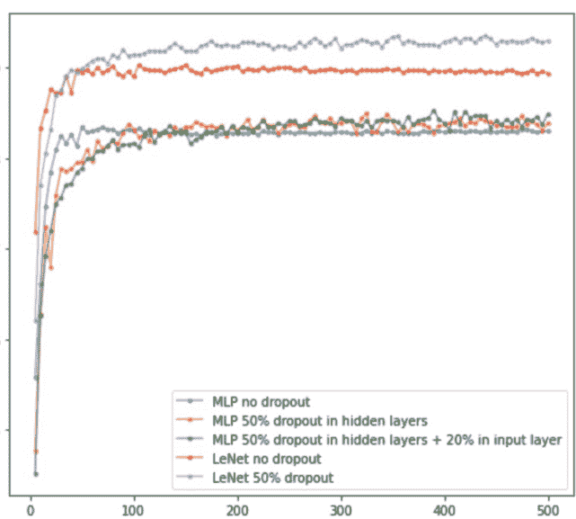

图 6.13 比较所有五个模型的测试集准确率。基于 CNN 的模型在图像相关任务上通常表现更好，这从两个 LeNet 模型的更高准确率中可以看出。应用 Dropout 可以进一步提高泛化性能并减少过拟合，这似乎发生在第四个模型上，正如略有下降的准确率曲线所显示的那样。

## 6.3 多任务学习中的隐式正则化

在接下来的章节中，我们将探讨另一种诱导泛化的模型架构：多任务学习。

迄今为止，我们一直专注于优化单一特定指标，例如均方误差。这涉及为手头的特定任务训练单个模型或模型集成，通常需要经过多轮微调和估计。然而，当我们面对多于一个任务时，这种方法会忽略其他相关任务中可能有用的信息。在这种情况下，我们可以考虑使用多任务学习（MTL）在这些相似任务之间构建共享表示，以提高原始任务的泛化性能。换句话说，相关任务中嵌入的特定领域特征可以帮助通过 MTL 训练的模型更好地泛化。

MTL 是指一种学习范式，其中多个任务并行学习，而不是使用单任务方法将其视为独立任务。当同时学习多个任务时，一个任务中获得的知识和经验可以（希望地）共享并转移到其他相似任务，这是人类学习过程的基础之一。确实，作为人类，我们在学习新任务时通常会应用通过相关任务获得的知识。作为机器学习的一个专门领域，MTL 在学习效率和预测准确性方面提供了好处。通过利用辅助任务信号中嵌入的信息，MTL 可以挖掘多个学习问题之间的相似性和关系，从而有助于测试集泛化。改进的泛化性能是在优化模型在所有学习任务上的表现时隐式诱导的正则化效应的结果。

MTL 也可以被视为一种叠加归纳偏置的形式，导致模型偏好某些假设（所有可能模型整个空间中的一组模型）而非其他假设。这种归纳偏置由辅助任务的联合训练提供，因为使用 MTL 训练的模型倾向于能够解释多个任务的假设，从而带来更好的泛化。通过偏向模型偏好其他任务也偏好的表示，它还将帮助模型很好地泛化到训练数据之外的新任务，只要这些任务在性质上相似且源自相同的数据生成过程。

此外，MTL 可以被视为一种隐式数据增强形式，这有效增加了训练过程中使用的样本量。这种解释来自这样一个事实：所有学习任务通常都受到不同级别噪声的干扰。在单个任务上训练模型时，典型单任务训练过程的最终目标是学习一个足够好的表示，忽略依赖于数据的噪声并捕捉基础模式，这有助于它在测试集上很好地泛化。由于不同任务暴露于不同的噪声，联合学习两个任务将使模型能够获得更通用的表示并克服特定于任务的噪声。通过降低对单个学习任务过拟合的风险，同时学习多个任务允许模型平均化噪声模式，从而更好地对两个任务进行泛化。

另一个额外的好处称为“窃听”，其中模型增强了对某些特征的偏好，这些特征在一个任务中难以学习但在另一个任务中容易识别。在学习一个任务时，特征空间中潜在的复杂依赖结构可能会阻碍模型发现某些重要特征，这些特征在学习另一个相关任务时可能会凸显出来。通过共同学习这两个任务，模型在某种程度上从另一个任务“窃听”并将此外部知识应用于当前学习任务，从而提升其学习性能。有关在深度学习中使用 MTL 的更详细综述，请参阅 Sebastian Ruder 撰写的综述论文“An Overview of Multi-Task Learning in Deep Neural Networks”。

图 6.14 对 MTL 的好处进行了总结。

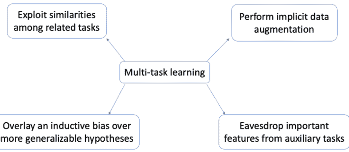

图 6.14 总结了多任务学习的多种解释和好处。

应当注意的是，大多数 MTL 深度学习模型假设任务来自相同的数据生成过程。尽管这一假设有利于多个相关任务之间的共享特性，但在实践中可能并不总是成立。当学习任务之间不相关或仅松散相关时，构建稳健的 MTL 模型成为一项挑战。这一挑战的一部分可以通过允许 MTL 模型学习共享什么来解决，例如后面将介绍的跨缝合网络。除了共享层级之外，允许模型自动学习具有不同粒度层级的层次结构也有助于提高模型的泛化性能。即使我们的目标是只学习一个任务，利用其他任务的知识（有时甚至是对抗性任务）也通常有助于提供更好的预测性能。

### 6.3.1 深度神经网络中的两种 MTL 方法

使用深度神经网络进行 MTL 时有两种主要方法：硬参数共享，它强制所有任务共享一组共同的权重；以及软参数共享，它鼓励不同任务学习相似的表示，通常通过对相应权重施加某些约束来实现。让我们详细了解一下。

作为神经网络中最流行的共享方案，硬参数共享通过强制所有任务在隐藏层中完全共享一组权重，同时在最终输出中保留少数特定于任务的层，来鼓励不同任务学习共同的表示。然后使用这一共同权重组与下游特定于任务的层相结合，这些层分别针对每个任务独立学习。通过强加一个支持所有任务的表示，硬参数共享诱导隐式正则化效应并减少过拟合的可能性。换句话说，通过要求模型联合学习多个任务，我们的模型被迫找到一个捕捉所有联合学习任务的表示，这减少了对原始单任务过拟合的可能性。特别是，当这些任务被认为共享一定程度的共性时，例如从同一个人脸中预测性别和年龄，我们可以通过为所有任务强制执行共同的骨干架构来在模型中强加这种归纳偏置。

图 6.15 说明了硬参数共享方案。我们从一个涵盖三个任务中所有共享层的顺序块开始。这些共享层旨在学习所有任务之间的共性，即在所有任务中都具有预测性的特征集。到达最后一个共享层后，网络扩展为三个分支，分别专门用于每个任务。这些特定于任务的层负责学习被认为特定于特定学习任务的任务内特征。与为每个学习任务拥有三个独立网络相比，硬参数共享架构由于可学习参数更少而计算效率更高，除此之外，还有过拟合更少和泛化性能更好的额外好处。


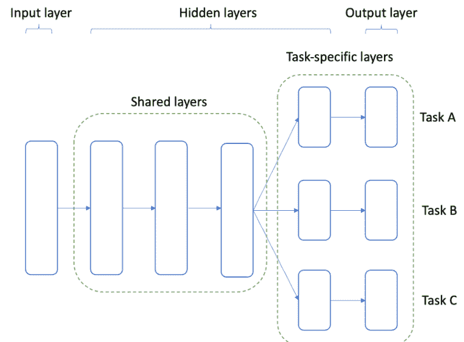

图 6.15 三任务的硬参数共享方案示意图。该架构以所有任务共用的公共层集合开始，用于共同的表示学习，然后分支为三组独立的层序列，用于任务特定的学习。当所有学习任务彼此相关时，这种架构能够提供更好的泛化性能（参数更少，因此过拟合风险更低）以及更高的学习效率（同样，与三个独立网络相比，可学习参数更少）。请注意，各个任务特定的损失可以通过遵循某种先验偏好的加权方案，或采用自适应方法，直接组合在一起。

另一方面，软参数共享方案添加了一个软约束，以鼓励所有学习任务中相关权重之间的表示相似，而不是强制它们采用完全相同的值。该约束通常采用模型权重之间基于距离的惩罚度量形式，例如 Lasso 惩罚中的 l1 范数和脊惩罚中的 l2 范数。对模型权重之间距离进行正则化会鼓励这些权重在数值上相似。因此，该方案为每个学习任务的架构设计提供了更多灵活性，因为它仅松散地耦合了共享的特征表示。请参见图 6.16 了解示例，其中软约束（由双箭头指示）应用于鼓励对应特征之间的相似表示。

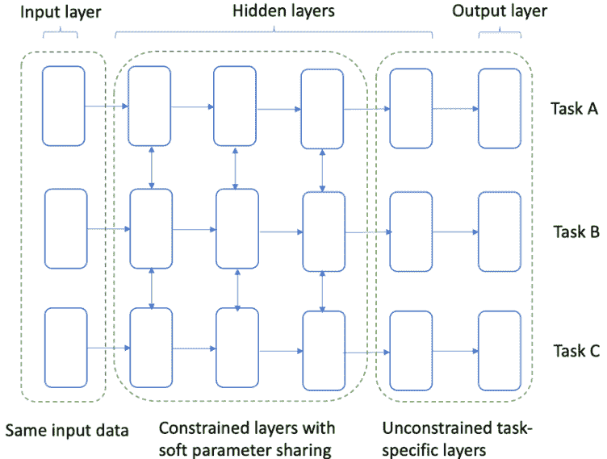

图 6.16 三任务的软参数共享方案示意图。该架构由针对每个任务的三个专用网络序列组成。与单任务学习的情况相同，相同的输入数据会被输入到网络三次。然而，网络对某些隐藏层的参数应用软约束（即序列间由双箭头指示的 lasso 或脊惩罚），以便在联合学习所有三个任务时鼓励相似的表示。

硬参数共享方案实现直观，因为我们只需将模型架构修改为由主干和几个分支组成的树形结构。然而，软参数共享需要修改损失函数以叠加软约束。让我们看看如何实现这一点。

### 6.3.2 修改损失函数以实现软参数共享

假设我们有三个学习任务：A、B 和 C。用 $W_i^{(j)}$ 表示任务 $j$ 的第 $i$ 层权重，其中 $j \in \{A,B,C\}$。对应权重之间相似性施加软约束的一种方法是，在代价函数中添加一个额外项：所有共享层上平方 Frobenius 范数（也称为欧氏范数）之和。第 $i$ 层的平衡因子 \(\lambda_i\) 可以在所有共享层上设置为相同值，而 $||\cdot||_F^2$ 表示平方 Frobenius 范数。

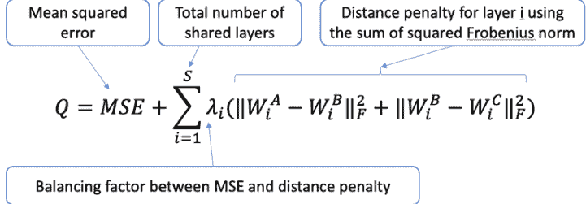

图 6.17 修改代价函数以实现软参数共享，其中我们将所有共享层上的逐层平方 Frobenius 范数之和加到均方误差中，以获得最终代价。请注意，平衡因子可以在所有共享层上设置为相同值。

请注意，通过对应位置权重的一致性进行正则化来增强代价函数的这种方法，也被视为通过目标函数进行正则化，这是一个将在下一章讨论的主题。确实，许多正则化技术属于多个类别，随着更多激动人心的方法被提出，界限只会变得更加模糊。在众多促进模型泛化性能的正则化技术中，我们打算涵盖最流行且在方法论上最有趣的技术。

一个有趣的方法称为交叉缝合网络（cross-stitch networks），最初由 Misra 等人在其 2016 年论文《面向多任务学习的交叉缝合网络》中提出，其中所谓的交叉缝合单元用于允许模型自动学习和确定任务特定网络如何利用其他辅助任务的知识。如图 6.18 所示，交叉缝合单元是前一层输出的线性组合，前一层可以是池化层或全连接层。通过学习所有共享层上的线性组合程度，交叉缝合网络能够自动识别层特定的共享方案，并确定所有任务之间的表示共享。

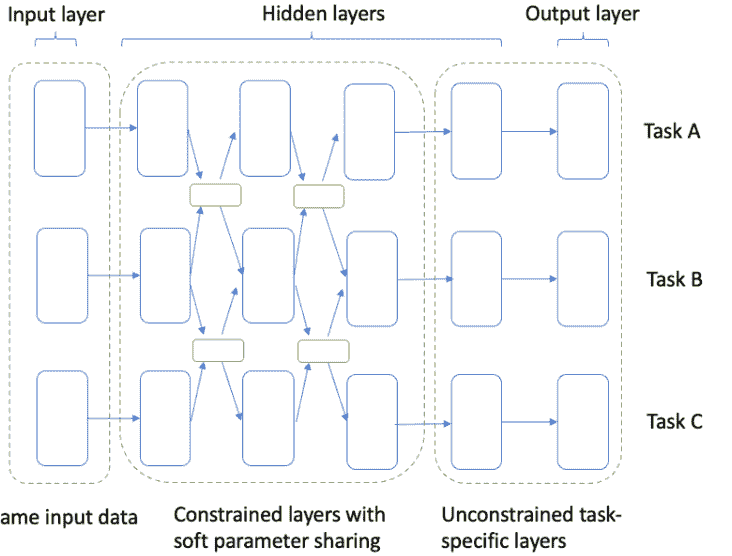

图 6.18 交叉缝合网络示意图，其中橙色框代表交叉缝合单元，它们线性地转换前一层的输出。通过将线性转换的程度视为可学习参数，网络能够自动确定所有共享层之间表示共享的最佳方案。

在下一节中，我们将探讨使用 PyTorch 实现基于硬参数共享架构的 MTL 模型。

### 6.3.3 MTL 实战

为了进行多任务学习，我们将使用标准汽车数据集（Standard cars dataset），该数据集包含 196 类汽车的 16,185 张图像以及相应的元数据，如制造商、型号和年份。这些多类别标签使我们能够应用 MTL 模型进行联合估计。

在深入细节之前，理解 MTL 与典型的二元分类以及多类分类之间的区别非常重要。二元分类是最简单的情况，即在单个任务中预测两种可能结果中的一种，例如预测是否为红色汽车。多类分类涉及单个目标变量，仍然是单个任务，但假设有两个以上的可能值，例如汽车的品牌。多任务学习可能是两者的结合，其目标是同时预测汽车的颜色（红色或非红色）和品牌（BMW、Audi、Mercedes 等）。我们还可以将 MTL 重新命名为多标签多类分类，因为它涉及预测不止一个标签，每个标签包含两个或更多可能值。请参见图 6.19 了解示例。

| 任务 | 类型 | 可能结果 | 示例预测 |
| --- | --- | --- | --- |
| 红色或非红色 | 二元分类 | [是或否] | 是 |
| 品牌 | 多类分类 | [BMW、Audi、Mercedes 等] | BMW |
| 两者 | 多任务学习（多标签多类分类） | [是或否] & [BMW、Audi、Mercedes 等] | 红色 BMW |

图 6.19 不同类型学习任务的比较。

现在，让我们创建两个函数来下载汽车数据集及其元数据，如以下代码清单所示。

```
Listing 6.6 Downloading cars dataset and its metadata
def getting_data(url, path):
    data = urllib2.urlopen(url)
    tar_package = tarfile.open(fileobj=data, mode='r:gz')
    tar_package.extractall(path)
    tar_package.close()
    print("Data extracted and saved.")

def getting_metadata(url, filename):
    labels = urllib2.urlopen(url)
    file = open(filename, 'wb')
    file.write(labels.read())
    file.close()
    print("Metadata downloaded and saved.")
```

然后，我们可以传入相应汽车数据集和元数据的 URL 以完成下载，如以下代码片段所示。

```
>>> getting_data("http://ai.stanford.edu/~jkrause/car196/car_ims.tgz", "./")
>>> getting_metadata("http://ai.stanford.edu/~jkrause/car196/cars_annos.mat",
                     "car_metadata.mat")
```

运行上述代码将把汽车数据集和元数据下载到当前目录。

接下来，我们将创建三个目标标签：品牌、类型和队列标记，其中最后一个是通过将输入年份作为阈值（例如 2009）进行比较生成的。让我们


看一个具体示例。假设我们有一个关于汽车元数据的条目，名为“Audi RS 4 Convertible 2008”。然后将根据该字符串派生出三个目标标签，生成“Audi”、“Convertible”和“0”，其中最后一个标签为 0 表示汽车在 2009 年阈值之前生产。然后我们将前两个标签映射为基于整数的索引以方便模型训练，生成最终输出集合为 [0, 0, 0]，其中“Audi”和“Convertible”分别是各自映射字典中的第一个条目。

在以下代码清单中，我们定义一个名为 MetaParsing 的类来处理元数据，并使用字符串匹配从汽车名称中提取所需的标签。请注意，一个输入参数指定为 *args，用于保存两个映射字典。

### 清单 6.7 解析元数据

```
class MetaParsing():
    def __init__(self, path, *args, year=None):
        self.mat = scipy.io.loadmat(path) #A
        self.year = year #B
        self.args = args #C
        self.annotations = np.transpose(self.mat['annotations'])
        self.file_names = [annotation[0][0][0].split('/')[-1] for annotation in
                           self.annotations] #D
        self.label_indices = [annotation[0][5][0][0] for annotation in self.annotations] #E
        self.car_names = [x[0] for x in self.mat['class_names'][0]] #F
        self.translated_car_names = [self.car_names[x-1] for x in self.label_indices] #G

    def brand_types(self, base_dict, x):
        y = list(base_dict.keys())[-1]
        for k,v in base_dict.items(): #H
            if v in x:
                y=k
        return y

    def parsing(self):
        result = []
        for arg in self.args: #I
            temp_list = [self.brand_types(arg, x) for x in self.translated_car_names]
            result.append(temp_list)
        if self.year != None: #J
            years_list = [0 if int(x.split(" ")[-1]) <= self.year else 1 for x in
                          self.translated_car_names]
            result.append(years_list)
        return result, self.file_names, self.translated_car_names
```

- #A 加载 MATLAB 格式的元数据
- #B 用于创建队列标志
- #C 保存两个映射字典
- #D 提取每个样本的文件名
- #E 提取每个样本的标签索引
- #F 将汽车名称提取为字符串
- #G 为每个样本创建汽车名称列表
- #H 执行基于字符串的匹配
- #I 检索车辆品牌和类型的索引
- #J 检索队列标记标志

然后我们可以创建两个自定义映射字典，如以下代码片段所示，实例化此类并按需解析元数据。

```
>>> brand_dict = {0: 'Audi', 1: 'BMW', 2: 'Chevrolet', 3: 'Dodge', 4: 'Ford', 5: 'Other'}
>>> vehicle_types_dict = {0: 'Convertible', 1: 'Coupe', 2: 'SUV', 3: 'Van', 4: 'Other'}
>>> results, file_names, translated_car_names = MetaParsing("./car_metadata.mat",
brand_dict, vehicle_types_dict, year=2009).parsing()
```

让我们对品牌和车辆类型的计数进行一些合理性检查。在以下代码片段中，我们定义一个函数来遍历两个映射字典的不同键，并统计早先解析的 `results` 中的出现次数。

```
def count_classes(base_dict, base_list):
    for i in range(len(list(base_dict.keys()))):
        print("{}: {}".format(base_dict[i], str(base_list.count(i))))
>>> count_classes(brand_dict, results[0]) #A count of brand names
>>> count_classes(vehicle_types_dict, results[1]) #B count of type of vehicle
```

如下结果所示，几乎所有品牌和车辆类型在数据集中均占用超过 1000 张图像。

```
Audi: 1169
BMW: 1055
Chevrolet: 1799
Dodge: 1253
Ford: 1035
Other: 9874
Convertible: 1907
Coupe: 2143
SUV: 2855
Van: 832
Other: 8448
```

接下来，我们将创建一个自定义 `Dataset` 类并将其传递给 PyTorch 的 `DataLoader` 函数，以便按批次一致地提供数据，这遵循与前一章相同的流水线。在以下代码清单中，我们定义一个名为 `CarDataset` 的类，将图像数据、解析后的元数据以及数据转换（如果有）组合在一起。

### 清单 6.8 定义自定义数据集类

```
from torch.utils.data import Dataset, DataLoader
class CarDataset(Dataset):
    def __init__(self, car_path, transform, mapping_dict):
        self.path = car_path
        self.folder = [x for x in listdir(car_path)]
        self.transform = transform
        self.mapping_dict = mapping_dict

    def __len__(self):
        return len(self.folder)

    def __getitem__(self, idx):
        img_loc = os.path.join(self.path, self.folder[idx])
        image = Image.open(img_loc).convert('RGB')
        single_img = self.transform(image)
        label1 = mapping_dict[self.folder[idx]][0] #A
        label2 = mapping_dict[self.folder[idx]][1] #A
        label3 = mapping_dict[self.folder[idx]][2] #A
        sample = {'image':single_img, 'labels': {'label_brand':label1,
        'label_vehicle_type':label2, 'label_cohort':label3}}
        return sample
```

- #A 检索对应的标签

然后可以通过传入图像数据目录、转换操作（调整大小、转换为张量和归一化）以及将每个文件名映射到三个目标标签的总体映射字典 `mapping_dict` 来实例化此类。数据集还被分为训练集（80%）和测试集（20%），在提供给模型时，每个数据集的批次大小均为 16 并传递给 DataLoader 函数。请注意，`CarDataset` 类在向模型提供样本时需要将三个标签与输入图像一起返回。如果剩余样本数少于预设的批次大小，我们还会丢弃最后一个批次。请参见下面的代码片段。

```
mapping_dict = dict(zip(file_names,list(zip(results[0],results[1],results[2])))) #A
data_transforms = transforms.Compose([ #B
    transforms.Resize((224,224)),
    transforms.ToTensor(),
    transforms.Normalize((0.5,0.5,0.5), (0.5,0.5,0.5))
])
cardata = CarDataset("./car_ims", transform=data_transforms, mapping_dict=mapping_dict) #C
train_len = int(cardata.__len__()*0.8) #D
test_len = int(cardata.__len__()*0.2) #D
train_set, val_set = torch.utils.data.random_split(cardata, [train_len, test_len])
train_loader = DataLoader(train_set, batch_size=16, shuffle=True, num_workers=2,
    drop_last=True) #E
test_loader = DataLoader(val_set, batch_size=16, shuffle=False, num_workers=2,
    drop_last=True) #E
```

- #A 创建总体映射字典
- #B 定义预处理转换链
- #C 创建自定义数据集实例
- #D 将数据分为训练集和测试集
- #E 为每个数据集创建数据加载器

让我们从训练数据加载器中获取一个示例以检查其内容。在以下代码片段中，我们获取一个批次的数据存储在 `sample` 中，并打印出其键和与品牌相关的内容。

```
>>> sample = next(iter(train_loader))
>>> print("Keys in the current batch: {}".format(sample.keys()))
>>> print("Size for the images in the current batch: {}".format(sample['image'].shape))
>>> print("Size for the brand target in the current batch: {}".format(sample['labels']['label_brand'].shape))
>>> print("Brand indexes in the current batch: {}".format(sample['labels']['label_brand']))
Keys in the current batch: dict_keys(['image', 'labels'])
Size for the images in the current batch: torch.Size([16, 3, 224, 224])
Size for the brand target in the current batch: torch.Size([16])
Brand indexes in the current batch: tensor([2, 4, 5, 5, 5, 3, 5, 3, 2, 5, 5, 3, 5, 1, 5, 5])
```

现在让我们定义模型架构。这次，我们将利用一个名为 resnet 的预训练模型，这是一种特殊的架构，特别擅长建模序列数据。由于典型的基于 resnet 的架构通常模型体积较大，从头开始手动定义模型结构将是一项相当艰巨的工作。为了避免繁重的工作，我们将求助于 `torchvision.models` 子包，它为包括 resnet 在内的许多流行模型架构提供了预训练权重。在以下代码片段中，我们首先通过设置 `pretrained=True` 下载预训练模型，然后打印出模型架构的最后三层。


```
>>> import torchvision.models as models
>>> resnet = models.resnet34(pretrained=True) #A
>>> list(resnet.children())[:-3] #B
Downloading: "https://download.pytorch.org/models/resnet34-b627a593.pth" to
/root/.cache/torch/hub/checkpoints/resnet34-b627a593.pth

100%
83.3M/83.3M [00:00<00:00, 163MB/s]
[Sequential(
  (0): BasicBlock(
    (conv1): Conv2d(256, 512, kernel_size=(3, 3), stride=(2, 2), padding=(1, 1),
       bias=False)
    (bn1): BatchNorm2d(512, eps=1e-05, momentum=0.1, affine=True,
       track_running_stats=True)
    (relu): ReLU(inplace=True)
    (conv2): Conv2d(512, 512, kernel_size=(3, 3), stride=(1, 1), padding=(1, 1),
       bias=False)
    (bn2): BatchNorm2d(512, eps=1e-05, momentum=0.1, affine=True,
       track_running_stats=True)
    (downsample): Sequential(
      (0): Conv2d(256, 512, kernel_size=(1, 1), stride=(2, 2), bias=False)
      (1): BatchNorm2d(512, eps=1e-05, momentum=0.1, affine=True,
         track_running_stats=True)
    )
  )
  (1): BasicBlock(
    (conv1): Conv2d(512, 512, kernel_size=(3, 3), stride=(1, 1), padding=(1, 1),
       bias=False)
    (bn1): BatchNorm2d(512, eps=1e-05, momentum=0.1, affine=True,
       track_running_stats=True)
    (relu): ReLU(inplace=True)
    (conv2): Conv2d(512, 512, kernel_size=(3, 3), stride=(1, 1), padding=(1, 1),
       bias=False)
    (bn2): BatchNorm2d(512, eps=1e-05, momentum=0.1, affine=True,
       track_running_stats=True)
  )
  (2): BasicBlock(
    (conv1): Conv2d(512, 512, kernel_size=(3, 3), stride=(1, 1), padding=(1, 1),
       bias=False)
    (bn1): BatchNorm2d(512, eps=1e-05, momentum=0.1, affine=True,
       track_running_stats=True)
    (relu): ReLU(inplace=True)
    (conv2): Conv2d(512, 512, kernel_size=(3, 3), stride=(1, 1), padding=(1, 1),
       bias=False)
    (bn2): BatchNorm2d(512, eps=1e-05, momentum=0.1, affine=True,
       track_running_stats=True)
  ),
),
AdaptiveAvgPool2d(output_size=(1, 1)),
Linear(in_features=512, out_features=1000, bias=True)]
```

#A 下载 resnet34 模型架构的预训练权重
#B 访问包括最后分类头在内的所有层

请注意，我们使用了 `children()` 函数来访问 resnet 中的所有层。观察输出，我们可以发现倒数第三层是一个复杂的层：一个由三个基本构建块组成的序列块，每个块包含一系列卷积层、批归一化层和 ReLU 层。最后一层是一个具有 512 个输入特征和 1,000 个输出特征的线性层，对应于 ImageNet 中的 1,000 个类别，ImageNet 是一个常用的大规模数据集，用于训练 resnet 并生成我们正在下载的权重。由于我们的学习任务不同，可以移除最后的全连接层，仅保留之前的层，作为支持三个学习任务硬参数共享的骨干网络。

```
model_wo_fc = nn.Sequential(*[list(resnet.children())[:-1]])
```

让我们尝试将前一批图像传入模型，并观察输出的张量形状。如以下代码片段所示，输出包含 16 张图像，每张图像具有 512 个特征/节点。由于未使用通道维度，输出可以展平以移除/平滑不必要的维度。

```
output_sample = model_wo_fc(sample['image'])
>>> print(output_sample.shape)
>>> print(torch.flatten(output_sample, 1).shape)
torch.Size([16, 512, 1, 1])
torch.Size([16, 512])
```

我们可以插入一个自定义的最终层（也称为分类头）以满足当前的训练需求。以品牌任务为例，以下代码片段为当前批次的 16 张图像生成 6 维输出。输出显示批次中每个样本有 6 个 logits，这正是我们期望的。

```
output_sample_flatten = torch.flatten(output_sample, 1) #A
brand = nn.Sequential( #B
    nn.Dropout(p=0.2),
    nn.Linear(in_features=512, out_features=6)
)
>>> brand(output_sample_flatten).shape
torch.Size([16, 6])
```

#A 展平输出
#B 添加另一个全连接层

现在我们可以总结上述代码，为多标签分类器定义一个自定义类。如以下代码清单所示，我们保留 resnet34 骨干架构作为三个任务之间的共享层（在移除其最后的全连接层之后），接着扩展为三个分支，每个分支由一个 Dropout 层和一个具有相应输出形状的全连接层组成。

### 清单 6.9 定义多类分类器

```
class MultilabelClassifier(nn.Module):
    def __init__(self, n_brand, n_vehicle_type, n_cohort):
        super().__init__()
        self.resnet = models.resnet34(pretrained=True) #A
        self.model_wo_fc = nn.Sequential(*(list(self.resnet.children())[:-1])) #B
        self.brand = nn.Sequential( #C
            nn.Dropout(p=0.2),
            nn.Linear(in_features=512, out_features=n_brand)
        )
        self.vehicle_type = nn.Sequential( #D
            nn.Dropout(p=0.2),
            nn.Linear(in_features=512, out_features=n_vehicle_type)
        )
        self.cohort = nn.Sequential( #E
            nn.Dropout(p=0.2),
            nn.Linear(in_features=512, out_features=n_cohort)
        )

    def forward(self, x): #F
        x = self.model_wo_fc(x)
        x = torch.flatten(x, 1)
        return {
            'brand': self.brand(x),
            'vehicle_type': self.vehicle_type(x),
            'cohort': self.cohort(x)
        }
```

#A 下载骨干架构
#B 移除最后的全连接层
#C 定义品牌分类的分支头
#D 定义车辆类型分类的分支头
#E 定义队列分类的分支头
#F 定义模型的前向流

如以下代码片段所示，我们可以基于每个目标标签的预定类别数实例化模型对象，并在可用时将其移至 GPU 以进行加速训练。

```
device = torch.device('cuda' if torch.cuda.is_available() else 'cpu')
model = MultilabelClassifier(6, 5, 2).to(device)
```

图 6.20 可视化了模型的整体架构。我们使用 resnet34（移除最后的全连接层后）作为三个任务共享的骨干网络。resnet34 的最终输出有 512 个节点，它分支为三个独立的分类头，均由全连接线性层组成。

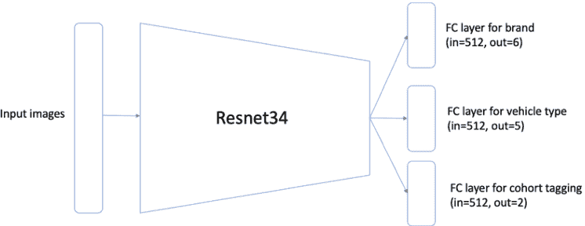

图 6.20 整体模型架构，由基于 resnet34 的骨干网络和用于品牌、车辆类型及队列标记的三个分类头组成。

现在我们可以定义训练流程。在以下代码清单中，我们首先定义 `criterion()` 函数，用于计算预测的总损失作为各任务特定损失的总和。然后在 `training()` 中，我们使用 Adam 优化器，因为它对学习率设置不太敏感，并对每个单独损失应用交叉熵损失。训练在每个 epoch 的每个批次中以嵌套循环方式执行，其中我们应用在之前示例中见过的常规训练流程。最后，我们返回每个 epoch 的最终组合损失。我们在单个 GPU 实例上运行总共 10 个 epoch 的训练流程，大约需要半小时。所以，在等待训练完成时，不妨拿杯咖啡。

### 清单 6.10 训练 MTL 模型

```
def criterion(loss_func, outputs, pictures):
    losses = 0
    for i, key in enumerate(outputs): #A
        losses += loss_func(outputs[key], pictures['labels'][f'label_{key}'].to(device))
    return losses

def training(model, device, lr_rate, num_epochs, train_loader):
    losses = []
    checkpoint_losses = []
    optimizer = torch.optim.Adam(model.parameters(), lr=lr_rate)
    n_total_steps = len(train_loader)
    loss_func = nn.CrossEntropyLoss()
    for epoch in range(num_epochs): #B
        for i, pictures in enumerate(train_loader):
            images = pictures['image'].to(device) #C
            outputs = model(images) #D
            loss = criterion(loss_func, outputs, pictures) #E
            losses.append(loss.item())
            optimizer.zero_grad() #F
            loss.backward() #G
            optimizer.step() #H

        if (i+1) % (n_total_steps) == 0:
            checkpoint_loss = torch.tensor(losses).mean().item()
            checkpoint_losses.append(checkpoint_loss)
            print(f'Epoch [{epoch+1}/{num_epochs}], Step [{i+1}/{n_total_steps}], Loss: {checkpoint_loss:.4f}')
    return checkpoint_losses

checkpoint_losses = training(model, device, 0.0001, 10, train_loader)
```

- #A 汇总所有单独损失
- #B 在嵌套循环中启动模型训练
- #C 获取输入图像
- #D 获得模型预测
- #E 计算当前损失
- #F 清除历史梯度
- #G 应用自动微分
- #H 执行梯度下降更新

现在让我们使用之前分配的测试集来测试模型性能。在以下代码清单中，我们定义一个 `validation()` 函数来计算三个学习任务中的整体准确率和类别准确率。然后通过 `class_acc()` 函数打印这些结果。


### 清单 6.11 检查测试集性能

```
def validation(model, dataloader, *args):
    all_predictions = torch.tensor([]).to(device)
    all_true_labels = torch.tensor([]).to(device)

    with torch.no_grad():
        n_correct = []
        n_class_correct = []
        n_class_samples = []
        n_samples = 0

        for arg in args:
            n_correct.append(len(arg))
            n_class_correct.append([0 for i in range(len(arg))])
            n_class_samples.append([0 for i in range(len(arg))])

        for pictures in dataloader:
            images = pictures['image'].to(device)
            outputs = model(images)
            labels = [pictures['labels'][label].to(device) for label in pictures['labels']]

        #A
        for i, out in enumerate(outputs):
            _, predicted = torch.max(outputs[out], 1) #B
            n_correct[i] += (predicted == labels[i]).sum().item() #C
            if i == 0: #D
                n_samples += labels[i].size(0)

            for k in range(len(predicted)):
                label = labels[i][k]
                pred = predicted[k]
                if label == pred: #E
                    n_class_correct[i][label] += 1
                n_class_samples[i][label] += 1 #F

    return n_correct, n_samples, n_class_correct, n_class_samples

def class_acc(n_correct, n_samples, n_class_correct, n_class_samples, class_list):
    for i in range(len(class_list)):
        print("---")
        acc = 100.0 * n_correct[i] / n_samples
        print(f"Overall class performance: {round(acc,1)} %")
        for k in range(len(class_list[i])):
            acc = 100.0 * n_class_correct[i][k] / n_class_samples[i][k]
            print(f'Accuracy of {class_list[i][k]}: {round(acc,1)} %')
    print("---")
```

#A 在嵌套列表中获取目标输出
#B 获取批次中所有样本的最大 logit 对应的预测类别
#C 记录正确预测的累计数量
#D 获取直到当前批次的累计样本数量
#E 获取每个类中每个类别的正确预测数量
#F 获取每个类中每个类别的预测总数量

我们可以为每个标签准备类名称列表并传递给函数，如以下代码片段所示。

```
classes_brand = list(brand_dict.values())
classes_vehicle_type = list(vehicle_types_dict.values())
classes_epoch = ['2009 and earlier','2010 and later']
class_list = [classes_brand,classes_vehicle_type,classes_epoch]

n_correct, n_samples, n_class_correct, n_class_samples = validation(model, test_loader,
    classes_brand, classes_vehicle_type, classes_epoch)
```

>>> class_acc(n_correct, n_samples, n_class_correct, n_class_samples,class_list)
----------------------------------------
整体类别性能: 90.8 %
Audi 的准确率: 83.6 %
BMW 的准确率: 89.6 %
Chevrolet 的准确率: 78.6 %
Dodge 的准确率: 84.3 %
Ford 的准确率: 75.7 %
Other 的准确率: 96.2 %
----------------------------------------
整体类别性能: 87.8 %
Convertible 的准确率: 85.0 %
Coupe 的准确率: 67.0 %
SUV 的准确率: 91.9 %
Van 的准确率: 85.1 %
Other 的准确率: 92.4 %
----------------------------------------
整体类别性能: 90.6 %
2009 年及以前的准确率: 88.6 %
2010 年及以后的准确率: 91.4 %

结果表明，该模型在品牌和时代标记分类任务上均可实现超过 90% 的整体准确率，且仅需训练十个时代。这些相似任务之间的协同效应帮助 MTL 模型在有限的训练预算内获得良好的性能。

## 6.4 总结

- 归纳偏置是在模型训练过程中引入的一种先验假设，用于提升其预测性能，例如卷积神经网络中的平移不变性
- 卷积算子通过特殊的卷积层强制执行权重共享
- Dropout 随机禁用某些节点以促进稀疏表示
- 多任务学习 (MTL) 是一种同时学习多个任务的训练框架
- MTL 对更具可推广性的假设引入了归纳偏置，并为相关任务执行隐式数据增强
- 深度神经网络中流行的 MTL 框架包括硬参数共享和软参数共享，其中前者是最主流的方法，后者在研究界正获得日益关注
