# 7 通过目标函数进行正则化

## 本章内容

- 基于范数的惩罚及其在模型估计过程中的正则化应用
- 岭回归中的基于 L2 范数的惩罚及其实现
- LASSO 回归中的基于 L1 范数的惩罚及其实现
- 岭回归和 LASSO 回归封闭式解的推导
- 前馈神经网络训练中不同正则化方案效果的实证分析

在训练神经网络时，目标函数是前向传播的终点。目标函数也称为代价函数，它根据网络当前的参数配置来确定预测质量。它通过梯度下降指导下一次迭代中的权重更新。通过汇总所有观测值的预测质量，目标函数提供了一个单一指标来总结下游优化的误差量。如果预测值与目标值（平均而言）接近，该单一指标的值较小，否则较大。

目标函数的方向性同时适用于回归和分类场景。我们知道，均方误差 (MSE) 和交叉熵损失 (CEL) 分别是回归和分类的常用指标。MSE 的下界为零，当算法完美拟合所有训练数据点时，MSE 为零。然而，由于使用了 SoftMax 操作，要得到精确的零 CEL 是不可能的。在两种情况下，最小化这些经验损失函数都能保持优化迭代继续进行。在使用大型神经网络时，我们通常会运行优化直到模型拟合训练集，并在此过程中配合某种形式的正则化，以提高模型在测试集上泛化的可能性。

回顾图 7.1 中所示的整体模型训练工作流。目标函数的主要作用是将模型预测与相应的目标标签进行比较，以分类场景为例（不失一般性）。它提供一个直接的标量值，通常以待最小化的代价形式，来总结当前模型的预测能力。当优化过程的目标是构建一个在训练集上表现良好的准确模型时，优化目标函数意味着通过不断更改权重将预测误差最小化，直到预测误差为零。换言之，目标函数中仅最大化预测准确率 _单独_ 的最终状态是一个完美拟合训练数据集的模型。

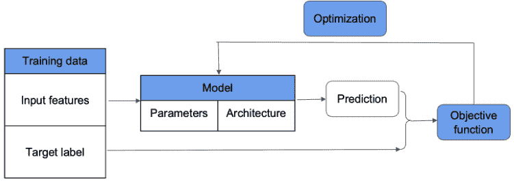

图 7.1 整体模型训练工作流。目标函数是前向传播的最后一站，之后诸如梯度下降之类的优化过程将启动，以优化预设模型架构的参数。

然而，无论模型在训练数据集上是否表现出完美的拟合，复杂模型都容易过拟合。这种复杂性通常会导致对新测试集（即使只有轻微变化）的不稳定预测。事实证明，我们可以在目标函数中包含多个指标。例如，我们可以不再单独优化预测准确率，而是引入一个针对模型复杂度的额外惩罚项，使得得到的模型在预测准确率和模型复杂度之间进行权衡。换言之，一个复杂且可能过拟合的模型将获得较低的预测代价，但同时会因模型复杂度而承受显著的惩罚，导致目标函数的总值较高。另一方面，简单模型在惩罚项上具有较低值，但缺乏预测能力，导致目标函数值较高。


在本章中，我们将揭示目标函数中不同形式的惩罚项。惩罚项充当显式正则化器，诱导所得估计器（即权重配置）的期望属性，例如通过基于$l^1$范数的稀疏性（仅在最终模型中选择一部分特征）和基于$l^2$范数的规范性（偏好小权重而非大权重）。设计带有新颖且特定于领域的惩罚项的复合目标函数是一个令人兴奋的研究领域。我们旨在为读者打下基础，涵盖目前在训练深度神经网络中常用的方法。

## 7.1 引入正则化项

在深度神经网络的背景下，我们在前一章中已经遇到了作为一种正则化形式的稀疏性。例如，在训练期间使用脱校技术时，通过随机禁用神经网络中的特定节点来获得稀疏网络。卷积运算中的权重共享属性也起着与拥有稀疏网络相同的作用。通过将减少参数数量作为一种正则化形式，算法不太可能选择过于复杂的模型，因此也不太容易过拟合。

稀疏神经网络在计算上也更快、可扩展性更强。例如，虽然果蝇或蚂蚁的大脑中大约有250K个神经元，但它们仍能执行运动感应和觅食等复杂任务。在现代深度学习时代，这个规模的神经网络勉强算是中等规模。然而，如自主机器人中越来越复杂的模型所示，要完成类似任务，我们需要一个大得多的网络。神经元级稀疏性，即每个神经元仅连接到下游神经元的一个子集，正在成为稳健神经网络的基本属性。在识别面孔时，只有大脑的特定部分被激活，其余部分保持不活跃。因此，将输入信号引导至神经网络中的正确区域，并避免对正确预测贡献甚微的冗余计算，至关重要。

同样，在人脑的860亿个神经元中，一个典型的神经元平均仅连接到数万个其他神经元。这种稀疏连接也表现在卷积神经网络中，其中当前层的每个神经元仅接收来自前一层小块的输入信息。如上一章所介绍，CNN中的稀疏连接本质上是一个大多数连接权重为零的完全连接网络（FCN）。然而，从一开始就设计架构稀疏且高效的网络，比先从FCN开始再学习非零权重更好，因为我们可以避免将零权重与输入矩阵相乘，并为后续非线性变换对所有零求和。

在高维问题的情况下，稀疏表示甚至更有优势。例如，在图像识别任务中，如果将每个像素视为一个独立特征，那么使用简单线性回归模型时，需要估计的权重数量与像素数量一样多。这些权重很可能相关，尤其是在物理上彼此靠近时。当一个权重值增加时，附近的权重可能会上升（导致过拟合）或下降（补偿增加）。因此，我们需要对权重强制执行某些条件，以诱导对简单且简洁模型的偏好。

在我们将正则化项引入目标函数以控制估计系数的大小和/或稀疏性之前，让我们先回顾一下旨在最小化残差平方和（RSS）的线性回归设置。

### 7.1.1 未正则化的线性回归

首先，让我们将目标函数表示为代价函数Q(w)；即，对于给定的权重集w，存在相应的标量代价值Q(w)。在线性回归的背景下，假设我们得到一个训练集 {(xi, yi)}i=1n，其中xi表示第i个观测值的输入特征列表，yi是相应的标量目标，数据集中总共有n个观测值。给定一组权重w，线性回归模型可以对第i个观测值进行预测f(xi; w)，之后，预测值f(xi; w)将与相应的目标值yi进行比较，以指示预测的质量。然后将所有单独预测的质量汇总为单一评估指标Q(w)。

如第2章所述，代价函数Q(w)可以表示为残差平方和：Q(w) = Σi=1n(yi − f(xi; w))2，其中平方运算统一了正负误差，且较大误差产生的代价大于较小误差。或者，我们也可以将其表示为 Q(w) = Σi=1n(yi − fw(xi))2，其中fw(xi)表示给定权重w时对xi的预测。这是回归问题中最广泛使用的代价指标。

我们也可以使用矩阵表示法重写RSS Q(w)，这是一种更紧凑的方式来表示所有n个观测值的联合代价。这给出了 Q(w) = ||y − Φw||2，其中Φ表示转换原始设计矩阵X后的新设计矩阵。这种表示法更通用，因为如果输入矩阵没有变换，则Φ = X。RSS代价Q(w)基于线性模型 y = Φw + ϵ，其中y是以n × 1向量形式体现的目标变量，Φ是n × d设计矩阵，w是d × 1权重向量，ϵ是n × 1随机误差向量。我们可以等价地将RSS表示为 Q(w) = Σi=1n(yi − φ(xi)T w)2 = (y − Φw)T (y − Φw)。有关线性模型和RSS目标函数的图示，请参见图7.2。

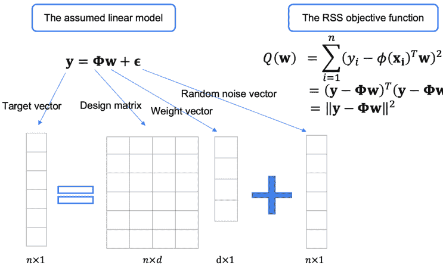

图7.2 使用残差平方和（RSS）说明线性回归模型和目标函数。我们在后续分析中使用矩阵表示法以方便起见。

未正则化线性回归模型的最小化器可以通过将\(Q(\mathbf{w})\)的梯度设置为零来获得，因为\(Q(\mathbf{w})\)是\(\mathbf{w}\)的二次函数。我们可以得到解析梯度向量\(\nabla Q(\mathbf{w}) = -2\mathbf{\Phi}^T(\mathbf{y} - \mathbf{\Phi w})\)。将梯度向量设置为零，得出与第2章相同的正规方程：\(\mathbf{\Phi}^T\mathbf{\Phi w}^* = \mathbf{\Phi}^T\mathbf{y}\)。在等式两边开头乘以\((\mathbf{\Phi}^T\mathbf{\Phi})^{-1}\)，可产生最小二乘估计量\(\mathbf{w}^{LS} = \mathbf{w}^* = (\mathbf{\Phi}^T\mathbf{\Phi})^{-1}\mathbf{\Phi}^T\mathbf{y}\)的闭式解。

### 7.1.2 基于范数的惩罚

基于范数的惩罚是一种常用技术，旨在鼓励模型偏好更小权重的解，从而避免过拟合。

如第3章所述，我们将添加一个惩罚项\(J(\mathbf{w}) = \int f''_w(x)^2 dx\)来控制模型的曲率，从而防止过拟合。这种正则化项通常由超参数\(\lambda\)乘以，以在训练数据的拟合优度和所得模型的粗糙度之间进行权衡。因此，惩罚代价函数变为 \(Q(\mathbf{w}) = \sum_{i=1}^n (y_i - f_w(\mathbf{x}_i))^2 + \lambda \int f''_w(x)^2 dx\)，所得模型称为平滑样条线。

此外，我们在第二章也提到了岭回归，其中惩罚项变为 \(J(\mathbf{w}) = \|\mathbf{w}\|_2^2 = \sum_{i=1}^d w_i^2\)，其中\(d\)是数据集中特征的总数，\(\|\mathbf{w}\|_2 = \sqrt{\sum_{i=1}^d w_i^2}\)。这是\(L^2\)范数的平方，用于衡量估计权重的大小。相应地，使用\(L^1\)范数的惩罚函数是 \(J(\mathbf{w}) = \|\mathbf{w}\|_1 = \sum_{i=1}^p |w_i|\)，它还作为特征选择的额外好处给出稀疏解。\(L^1\)范数和


$L^2$ 范数是更一般的 $L^p$ 范数的示例，其中惩罚函数现在变为 \( J(\mathbf{w}) = \|\mathbf{w}\|_p = \left( \sum_{i=1}^d |w_i|^p \right)^{1/p} \)。所有形式的 \( L^p \) 范数都使用正标量来测量权重向量 \(\mathbf{w}\) 的大小，并且每个范数测量大小的方式略有不同。使用这些正则化术语，权重的高值会导致高成本；因此，优化过程被激励保持这些权重的值较小。

Figure 7.3 illustrates the regularized linear regression model using different forms of penalty. Note that the sum of squared errors between the predictions and the target values can also be interpreted as the squared \( L^2 \) norm of the prediction errors.

```
\( Q(\mathbf{w}) = \sum_{i=1}^n \left( y_i - f(\mathbf{x}_i; \mathbf{w}) \right)^2 \) \<-- The objective/cost function in unregularized linear regression

\( Q(\mathbf{w}) = \sum_{i=1}^n \left( y_i - f(\mathbf{x}_i; \mathbf{w}) \right)^2 + \lambda \int f''_{\mathbf{w}}(x)^2 dx \) \<-- Penalizing the second derivative to control the curvature of the model using smoothing splines

\( Q(\mathbf{w}) = \sum_{i=1}^n \left( y_i - f(\mathbf{x}_i; \mathbf{w}) \right)^2 + \lambda \|\mathbf{w}\|_2^2 \) \<-- \( L^2 \) norm in ridge regression

\( Q(\mathbf{w}) = \sum_{i=1}^n \left( y_i - f(\mathbf{x}_i; \mathbf{w}) \right)^2 + \lambda \|\mathbf{w}\|_1 \) \<-- \( L^1 \) norm in lasso regression
```

Figure 7.3 Different forms of regularization in linear regression.

In the next section, we will review the mechanism of obtaining a regularized model using the \( L^2 \)-norm-based penalty in the context of polynomial regression.

## 7.2 L2 regularization in ridge regression

The ridge regression measures the magnitude of the weight vector using the squared \( L2 \) norm; that is, \( \|\mathbf{w}\|_2 = w_1^2 + w_2^2 + \cdots + w_d^2 = \sum_{i=1}^d w_i^2 \). We can also write this norm using vector notation, giving \( \|\mathbf{w}\|_2 = \mathbf{w}^t \mathbf{w} \). To see this, recall that \(\mathbf{w}\) is a \( d \times 1 \) vector and \(\mathbf{w}^t\) is a \( 1 \times d \) vector. Multiplying the two, \(\mathbf{w}^t \mathbf{w}\) will be a \( 1 \times 1 \) scalar value, which measures the magnitude of the model weights. See figure 7.4 for an illustration.

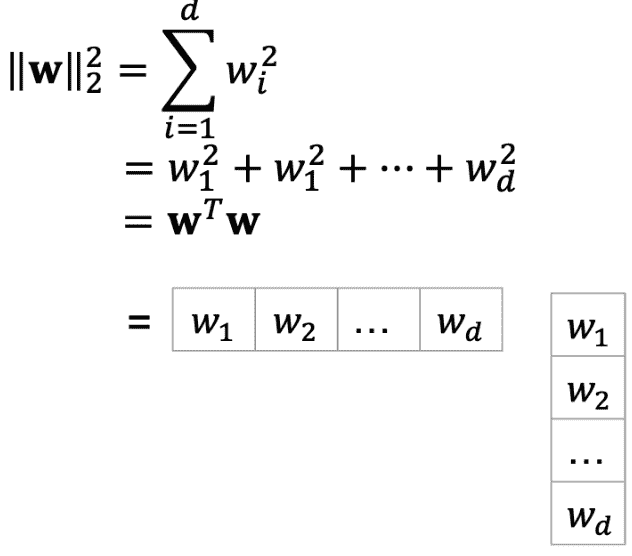

Figure 7.4 Illustrating the squared L2 norm using vector notation.

Adding the squared L2 norm, the objective function now becomes \( Q(\mathbf{w}) = RSS(\mathbf{w}) + \lambda\|\mathbf{w}\|_2^2 \), where \( \lambda \) is a hyperparameter that controls the goodness of fit (the RSS term) and the magnitude of the resulting weights (the ridge penalty term). We often choose the optimal \( \lambda \) using cross-validation, a technique that splits the dataset into several folds and uses different folds for training and test purposes, similar to the train-test split section covered in chapter 2. We can also use matrix notation to express the objective function as \( Q(\mathbf{w}) = (\mathbf{y} - \Phi\mathbf{w})^T(\mathbf{y} - \Phi\mathbf{w}) + \lambda\mathbf{w}^T\mathbf{w} \).

In order to obtain the optimal weight vector \( \mathbf{w}^* \) that minimizes the objective function \( Q(\mathbf{w}) \), we can either analytically solve for \( \mathbf{w}^* \) or resort to an iterative optimization procedure such as gradient descent, both of which require the calculation of the gradient vector \( \nabla Q(\mathbf{w}) = \nabla[RSS(\mathbf{w}) + \lambda\|\mathbf{w}\|_2] = \nabla[(\mathbf{y} - \Phi\mathbf{w})^T(\mathbf{y} - \Phi\mathbf{w}) + \lambda\mathbf{w}^T\mathbf{w}] \). Note that since \( Q(w) \) is quadratic in \( \mathbf{w} \), we can simply set its gradient to zero in order to obtain the minimizer. Since the gradient operation distributes across the sum, we have \( \nabla Q(\mathbf{w}) = \nabla[(\mathbf{y} - \Phi\mathbf{w})^T(\mathbf{y} - \Phi\mathbf{w})] + \lambda\nabla[\mathbf{w}^T\mathbf{w}] \). Further taking the derivative with respect to \( \mathbf{w} \) gives \( \nabla Q(\mathbf{w}) = -2\Phi^T(\mathbf{y} - \Phi\mathbf{w}) + 2\lambda\mathbf{w} \). Let us start with the analytic approach.

### 7.2.1 Using the analytic solution

To facilitate working with matrix notations and combine like terms, let us introduce an identity matrix to the second term, giving \(\nabla Q(w) = 2\Phi^T(y - \Phi w) + 2\lambda Iw\). The identity matrix is a special type of matrix that is square and has a value of one on the main diagonal and a value of zero elsewhere. It has a few useful properties. For example, for an arbitrary matrix A of size \(n \times m\), we have an \(n \times n\) identity matrix \(I_n\) that gives \(IA = A\). When \(m = 1\), we have \(Iw = w\), which is the change in the second term. Setting \(\nabla Q(w^*) = 0\) gives \(2\Phi^T(y - \Phi w^*) + 2\lambda Iw^* = 0\), which further simplifies to \((\Phi^T\Phi + \lambda I)w^* = \Phi^T y\). Now, we can pre-multiply both sides by \((\Phi^T\Phi + \lambda I)^{-1}\) to get the ridge estimator \(w^{ridge} = w^* = (\Phi^T\Phi + \lambda I)^{-1}\Phi^T y\). Figure 7.5 summarizes this derivation process.

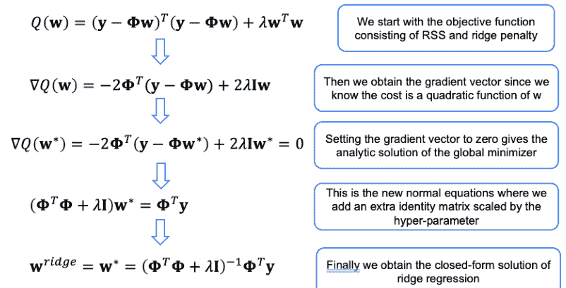

Figure 7.5 Deriving the closed-form solution of the ridge estimator in linear regression.

Now, let us analyze this closed-form solution and verify if it makes sense intuitively. When setting \(\lambda = 0\), we have \(w^{ridge} = (\Phi^T\Phi)^{-1}\Phi^T y = w^{LS}\), which is the same as the un-penalized least squares estimator. In this case, the model tends to overfit and end up with a large magnitude in the resulting weights. When setting \(\lambda = \infty\), we have \(w^{ridge} = 0\) since the solution involves dividing an infinitely big number for each weight. In this case, the model is over simplistic and just a straight line, exhibiting a severe underfitting phenomenon. In practice, \(\lambda\) is a positive number determined via cross-validation or other model selection techniques based on the input dataset at hand.

When contrasting with the closed-form solution of least squares, the net impact is the additional term \(\lambda I\) added to \(\Phi^T\Phi\) before taking its inverse. An underlying assumption when calculating \((\Phi^T\Phi)^{-1}\) is that the number of linearly independent observations \(n\) is bigger than the number of (again, linearly independent) features \(d\) in the design matrix \(\Phi\). Here, linear independence means any row (column) in the matrix \(\Phi^T\Phi\) cannot be a result of linear combination from other rows (columns) in \(\Phi^T\Phi\). That closed-form solution will break down if we have more linearly independent features than linearly independent observations, i.e., \(d > n\), since there will be more than one solution and the system of normal equations is underdetermined. In other words, the matrix \(\Phi^T\Phi\) is not invertible when \(d > n\) in the unregularized linear regression setting.

We have an advantage by adding a regularization term here. However, notice that the linear models' coefficients are often used for inference. Adding a regularization term makes inferential questions hard to ascertain as the algorithm now is trying to simultaneously optimize parameter values and perform variable selection.

By adding the additional term \(\lambda I\), we are essentially adding a scalar value \(\lambda\) to all the diagonal elements of \(\Phi^T\Phi\). This makes the new matrix (\(\Phi^T\Phi + \lambda I\)) invertible now, even when we have more features than observations, i.e., \(d > n\). This is an important property when we have a lot of features in the dataset; by penalizing the magnitude of the weights, we are able to learn from all features in a high-dimensional setting. The extra term \(\lambda I\) makes the matrix (\(\Phi^T\Phi + \lambda I\)) more regular and invertible, thus the linear model using ridge penalty is regularized.

It should be noted that both \(\mathbf{w}^{LS}\) and \(\mathbf{w}^{ridge}\) require \(O(d^3)\) of work when calculating the matrix inverse; that is, the amount of computation is cubic in the number of features we have. Obviously, when \(d\) is large, calculating the closed-form solution using the analytic expression will be computationally prohibitive. Now that we have a way to work with high-dimensional data by using the ridge penalty, how can we obtain the solution more efficiently? The answer is that we would need a more computationally efficient algorithm, which seems to be a good job for the gradient descent algorithm.

### 7.2.2 Using gradient descent algorithm

Instead of using the closed-form solution which is computationally demanding, we can resort to the gradient descent algorithm to leverage its computational efficiency. Since we have a total of \(d\) features and each feature is updated independently, let us focus on the update procedure for the \(j^{th}\) feature.

Recall that the gradient of the cost function in ridge regression is \(\nabla Q(\mathbf{w}) = -2\Phi^T(\mathbf{y} - \Phi\mathbf{w}) + 2\lambda\mathbf{w}\). When taking the gradient with respect to the \(j^{th}\) feature, the partial derivative of \(Q(\mathbf{w})\) with respect to \(w_j\) can be written as \(\partial Q(\mathbf{w}) / \partial w_j = -2\Phi_j^T(\mathbf{y} - \Phi\mathbf{w}) + 2\lambda w_j\), where the only change is the second term. The first term is the same as the term in the gradient descent update using least squares, while the second term adds information on the relative magnitude of the current weight during the gradient descent update. We can also write it as \(\partial Q(\mathbf{w}) / \partial w_j = -2 \sum_{i=1}^n \Phi_{ij}(y_i - \sum_{k=1}^d \Phi_{ik} w_k) + 2\lambda w_j\), where the summation across all observations is shown explicitly.

When plugging in the coordinate-wise gradient descent algorithm, covered in chapter 4, we have \(w_j^{(t+1)} := w_j^{(t)} - \eta[-2 \sum_{i=1}^n \Phi_{ij}(y_i - \sum_{k=1}^d \Phi_{ik} w_k^{(t)}) + 2\lambda w_j^{(t)}]\) for all weights, where \(w_j^t\) is the value of \(w_j\) at the \(t^{th}\) iteration, \(w_j^{(t+1)}\) is its updated value at the next iteration, and \(\eta\) is the learning rate. The := sign means \(w_j^{(t+1)}\) is defined as the expression on the right. Equivalently,


我们可以将更新规则表示为 $w_j^{(t+1)} := (1 - 2\eta\lambda)w_j^{(t)} + 2\eta \sum_{i=1}^n \Phi_{ij}(y_i - \sum_{k=1}^d \Phi_{ik}w_k^{(t)})$。图 7.6 说明了使用梯度下降法的岭回归更新规则。

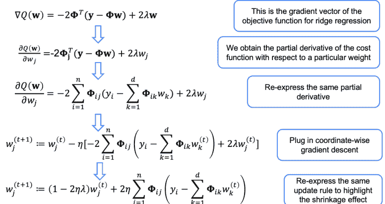

图 7.6 使用梯度下降算法说明了坐标式更新规则。与仅使用 RSS 的最小二乘更新规则相比，岭回归在经过相同更新之前会先将原始权重缩小。

需要注意的是，与未正则化的最小二乘更新规则相比，唯一的变化在于第一项的乘数 $(1 - 2\eta\lambda)$，这实际上会缩小原始 $w_j$ 的规模。要理解这一点，请回顾 $\eta$ 和 $\lambda$ 都是手动选择的正数，通常从小值开始。当 $2\eta\lambda < 1$ 时，该乘数本质上会按一定比例缩小 $w_j^{(t)}$，随后跟随来自未正则化 RSS 的相同更新项。当我们为 $\eta$ 或 $\lambda$ 设置较大值，使得 $2\eta\lambda > 1$ 时，这种解释不一定成立。

让我们可视化岭回归中的缩小效应。图 7.7 展示了从 $w_j^{(t)}$ 到 $w_j^{(t+1)}$ 的一个示例更新路径。在岭回归中使用梯度下降更新时，第一步操作是缩小当前权重，以控制权重幅度方面的模型复杂度。这种操作有助于减少过拟合。之后，更新继续基于模型与数据之间的拟合优度。然而，使用最小二乘的未正则化线性回归模型只关注在每次迭代中将模型拟合到数据，这增加了出现过拟合的机会。

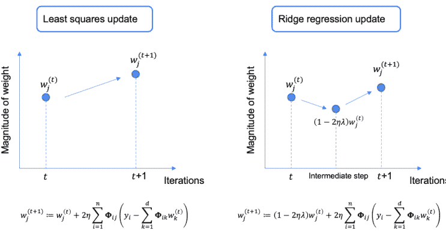

图 7.7 比较了使用坐标式梯度下降算法的最小二乘更新和岭回归更新。

使用坐标式梯度下降的整体优化算法（每次更新都使用所有观测值来计算梯度）可以描述如下。首先，我们会在优化开始时为权重向量初始化一个起始点。这可以通过设置 w = 0 或随机初始化来完成。然后，我们遍历每个权重/坐标，应用岭回归的更新规则。这完成了一轮优化。此过程重复，直到 RSS 梯度的 L1 范数或其百分比变化小于预设参数 r（例如 0.01%）。我们也可以使用其他标准来判断优化过程是否已收敛。图 7.8 描述了完整的优化流程。

Initialize $\mathbf{w}^t$ at the beginning of optimization when $t = 0$
While $\| \nabla RSS(\mathbf{w}^t) \|_1 > \tau$:
For each $j$ in $[1, ..., d]$:
$$ w_j^{(t+1)} \leftarrow (1 - 2\eta\lambda)w_j^{(t)} + 2\eta \sum_{i=1}^n \mathbf{\Phi}_{ij} \left( y_i - \sum_{k=1}^d \mathbf{\Phi}_{ik} w_k^{(t)} \right) $$
$t \leftarrow t + 1$

图 7.8 岭回归的坐标式梯度下降优化算法。

在深入实现之前，让我们再看一个重要细节：处理偏置项。

### 7.2.3 处理偏置项

偏置项（也称为截距项）是指模型中不乘以任何特征的权重，它充当水平偏移。添加偏置项后，对于第 \(i\) 个观测值，模型变为 $y_i = \sum_{j=0}^d w_j \mathbf{\Phi}_{ij} + \epsilon_i = w_0 \mathbf{\Phi}_{i0} + w_1 \mathbf{\Phi}_{i1} + \dots + w_d \mathbf{\Phi}_{id} + \epsilon_i$，其中 \(\mathbf{\Phi}_{i0} = 1\) 是根据第 2 章介绍的偏置技巧手动添加的值为 1 的条目，权重向量 \(\mathbf{w}\) 开头对应有一个新的条目 \(w_0\)。

基于岭回归目标函数的表达式，总代价现在变为 \(Q(\mathbf{w}) = RSS(\mathbf{w}) + \lambda ||\mathbf{w}||_2\)，其中第一个条目 \(w_0\) 也受到惩罚，并被鼓励幅度较小。然而，不建议对偏置项施加惩罚，因为它并不影响模型的过拟合行为。

对偏置项有两种变通方法。我们可以选择不对偏置项施加惩罚，使 \(Q(\mathbf{w}) = RSS(w_0, w_{rest}) + \lambda ||w_{rest}||_2\)，其中平方 \(L2\) 范数包括除第一个条目外的所有权重。要在岭回归的闭式解中实现这一点，即 \(\mathbf{w}^{ridge} = (\mathbf{\Phi}^T \mathbf{\Phi} + \lambda \mathbf{I})^{-1} \mathbf{\Phi}^T \mathbf{y}\)，我们可以将单位矩阵 \(\mathbf{I}\) 的第一个条目设为零，从而得到修改后的单位矩阵 \(\mathbf{I}^{modified}\) 及其对应的解析形式 \(\mathbf{w}^{ridge} = (\mathbf{\Phi}^T \mathbf{\Phi} + \lambda \mathbf{I}^{modified})^{-1} \mathbf{\Phi}^T \mathbf{y}\)。至于梯度下降算法，我们可以简单地为 \(w_0\) 添加一个特例，使其遵循仅基于 RSS 的更新规则，即 \(w_0^{(t+1)} \leftarrow w_0^{(t)} + 2\eta \sum_{i=1}^n \mathbf{\Phi}_{ij} (y_i - \sum_{k=1}^d \mathbf{\Phi}_{ik} w_k^{(t)})\)。请参见图 7.9，了解闭式解和迭代优化计划中相关变化的说明。

解析闭式解

梯度下降

$$ \mathbf{w}^{ridge} = (\mathbf{\Phi}^T\mathbf{\Phi} + \lambda \mathbf{I}^{modified})^{-1} \mathbf{\Phi}^T \mathbf{y} $$

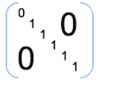

While \(\|\nabla RSS(\mathbf{w}^t)\|_1 > \tau\):
For each \(j\) in \([1, ..., d]\):

Least squares update

If \(j == 0\):

$$ w_0^{(t+1)} \leftarrow w_0^{(t)} + 2\eta \sum_{i=1}^n \Phi_{ij} \left( y_i - \sum_{k=1}^d \Phi_{ik} w_k^{(t)} \right) $$

Else:

Ridge regression update

$$ w_j^{(t+1)} \leftarrow (1 - 2\eta\lambda)w_j^{(t)} + 2\eta \sum_{i=1}^n \Phi_{ij} \left( y_i - \sum_{k=1}^d \Phi_{ik} w_k^{(t)} \right) $$

$$ t \leftarrow t + 1 $$

图 7.9 说明在不对偏置项施加惩罚时，闭式解和梯度下降算法的相关变化。

如果你不想更改任何一种算法，一种方法是通过将目标向量 y 居中来转换数据。将目标变量居中可确保其均值为零，因此是否对幅度施加惩罚区别不大。换句话说，我们可以在岭回归中运行闭式解或常规梯度下降更新，而无需区分偏置项的权重。

因此，岭回归使我们能够在标准线性回归设置中处理许多特征。它给了我们一个控制手段（超参数 \(\lambda\)）来平衡偏差和方差。在下一节中，我们将深入探讨从零开始实现以及使用 PyTorch 的自动微分机制进行实现。

### 7.2.4 L2 正则化实战

在本节中，我们将演示在目标函数中使用基于 L2 范数的惩罚来控制最终估计系数的幅度。首先，让我们通过以下代码清单加载必要的包，其中我们使用 `datasets` 类在线性回归设置中创建一个虚拟数据集，并通过 `SEED` 参数控制后续代码的随机性。

### 清单 7.1 加载必要的包

```
import math, argparse
import numpy as np
from numpy import random
import torch
import torch.nn as nn
from sklearn import datasets
from sklearn.model_selection import train_test_split
import matplotlib.pyplot as plt

SEED = 8 #A
random.seed(SEED)
torch.manual_seed(SEED)
np.random.seed(SEED)
```

#A 设置随机种子以确保可重复性

接下来，我们生成一个包含 100 个观测值和 20 个特征的虚拟数据集，噪声为 80，作为应用于输出的高斯噪声的标准差，使用 `make_regression()` 函数。请注意，该函数有一个名为 `n_informative` 的参数，表示用于生成输出的有价值特征的数量。该参数的默认值为 10。由于我们正在创建一个包含 20 个特征的数据集，这实际上意味着只有其中一半特征是有用的。

然后，我们应用偏置技巧，使用 `np.c_()` 函数在设计矩阵 `X` 中添加一列 1。随后，使用 `sklearn` 中的 `train_test_split()` 函数将数据集分为训练集和测试集。观测值和特征维度分别存储在 `n_samples` 和 `n_features` 中。

### 清单 7.2 生成虚拟数据集

```
X, y = datasets.make_regression(n_samples=100, n_features=20, noise=80, random_state=SEED) #A
X = np.c_[np.ones(X.shape[0]), X] #B
X_train, X_test, y_train, y_test = train_test_split(X, y, test_size=0.2, random_state=SEED) #C
n_samples, n_features = X_train.shape
```

#A 准备虚拟数据
#B 应用偏置技巧
#C 划分训练集和测试集

在实现的第一部分中，我们将专注于之前提到的坐标式梯度下降方法。我们将查看普通最小二乘的结果，然后将其与使用岭回归的同一模型的正则化版本进行比较。

### 使用坐标式梯度下降的线性回归

首先，让我们创建一个名为 `GD_regression` 的类，用于托管模型估计所需的一系列属性和方法。在以下代码清单中，我们在初始化方法中包含了学习率 `lr`、训练轮数 `num_epochs` 以及 `l2` 惩罚的缩放因子 `l2_penalty` 等输入参数。我们还包含两个数组，分别用于存储不同轮次下的训练集和测试集损失。


### 清单 7.3 使用梯度下降创建未正则化线性回归的类

```
class GD_regression:
    def __init__(self, lr=1e-3, num_epochs=1000, l2_penalty=0):
        self.lr = lr
        self.num_epochs = num_epochs
        self.l2_penalty = l2_penalty
        self.train_loss = []
        self.test_loss = []
```

接下来，我们将定义两个实用函数来支持坐标式梯度下降算法。在以下代码片段中，我们定义函数 `calculate_mse()` 来计算均方误差，以及 `feature_derivative_ridge()` 函数以获取每个特征的导数。`calculate_mse()` 是我们在上一章中使用的同一实用函数，我们首先生成存储在 `f_star` 中的预测列表，计算 `resid` 中的残差，最后返回 `Q` 中的总均方误差。`feature_derivative_ridge()` 函数实现了前面讨论的精确解析式导数解，其中我们将第一个偏置项的权重情况单独分离，因为它不受惩罚。请注意，这两个函数都包含在 `GD_regression` 类的方法中。

### 清单 7.4 计算 MSE 和导数的类方法

```
def calculate_mse(self, X, y, weights): #A
    f_star = X@weights #B
    resid = y - f_star #C
    Q = np.dot(resid.T, resid).mean() #D
    return Q

def feature_derivative_ridge(self, errors, feature, weight, l2_penalty,
    feature_is_constant): #E
    if feature_is_constant == True: #F
        derivative = np.dot(feature, errors) * 2
    elif feature_is_constant == False: #G
        derivative = np.dot(feature, errors) * 2 + 2*l2_penalty*weight
    else:
        derivative = 'derivative not exist!!!'
    return derivative
```

- # A 计算均方误差的函数
- # B 生成模型预测
- # C 计算残差
- # D 作为最终代价的 MSE
- # E 计算特征级解析式导数的函数
- # F 计算对应偏置项权重的导数
- # G 计算所有其他权重的导数

最后，我们将定义 `fit()` 方法来执行拟合和估计过程。如以下代码片段所示，我们首先初始化存储在 `weights` 中的零数组，并开始由输入参数 `num_epochs` 指定的总轮数的优化循环。这与基于特征规范 RSS 的停止条件不同，这里出于方便而使用。我们在每个 epoch 中计算所有观测值的预测和误差，然后进入对所有权重的循环以执行坐标式梯度下降更新。接着，我们使用训练集和测试集对当前权重进行评分，并将结果分别存储在 train_loss 和 test_loss 中。

### 清单 7.5 模型拟合的类方法

```python
def fit(self, X_train, y_train, X_test, y_test): #A
    weights = np.zeros(X_train.shape[1]) #B
    epoch = 0 #C
    while epoch < self.num_epochs: #D
        epoch += 1 #E
        predictions = np.dot(X_train, weights) #F
        errors = predictions.reshape(-1,1) - y_train.reshape(-1,1) #G
        for i in range(len(weights)): #H
            if i == 0: #I
                derivative = self.feature_derivative_ridge(errors,
                X_train[:,i].reshape(1,-1), weights[i], self.l2_penalty, True) #J
            else:
                derivative = self.feature_derivative_ridge(errors,
                X_train[:,i].reshape(1,-1), weights[i], self.l2_penalty, False) #K
                weights[i] = weights[i] - self.lr * derivative #L

        self.train_loss.append(self.calculate_mse(X_train, y_train, weights)) #M
        self.test_loss.append(self.calculate_mse(X_test, y_test, weights)) #M
        # store the final weights
        self.weights = weights
    return self
```

- #A 估计模型系数的函数
- #B 将权重初始化为零数组
- #C 迭代计数器
- #D 当未达到最大迭代次数时
- #E 递增迭代计数器
- #F 基于当前权重计算预测值
- #G 将误差计算为预测值 – 输出
- #H 对每个权重执行坐标式梯度下降
- #I 计算第 i 个权重的导数
- #J 当 i=0 时计算常量权重的导数
- #K 计算所有其他权重的导数
- #L 对每个坐标/权重执行梯度下降更新
- #M 使用训练集和测试集进行评分

让我们训练模型 100 个 epoch 并观察训练损失和测试损失的变化。在以下代码清单中，我们使用 num_epochs=100 实例化一个 GD_regression 类并将其存储在 model 对象中，随后调用 fit() 方法使用训练集和测试集训练和评估模型。然后我们绘制两条损失曲线。

### 清单 7.6 模型训练与结果可视化

```python
model = GD_regression(num_epochs=100)
model.fit(X_train, y_train, X_test, y_test)
x_axis = list(range(model.num_epochs))
plt.plot(x_axis, model.train_loss, label = "train")
plt.plot(x_axis, model.test_loss, ':', label = "test")
plt.legend()
plt.show()
```

运行上述命令生成图 7.10，两条曲线在第 20 个 epoch 左右趋于稳定。请注意，训练集占总数据集的 80%，因此在相同的线性模型下，其 MSE 高于测试集。随着底层模型变得非线性且更加复杂，当模型进入临界和超参数化模式时，我们预期训练损失将低于测试损失，这是第 3 章涵盖的主题。

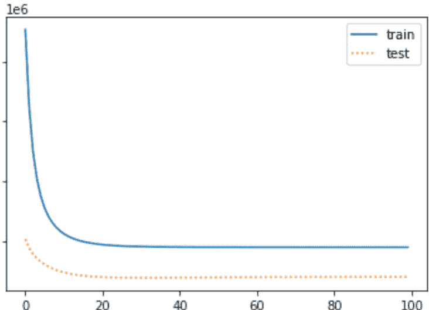

### 图 7.10 不同 epoch 的训练集和测试集 MSE 损失。

让我们向目标函数激活 $L_2$ 范数惩罚，并观察其对模型估计的影响。这次，我们在创建模型类时设置 `l2_penalty=10`，并将四条损失曲线一起绘制，如以下代码清单所示。

### 清单 7.7 带 l2 惩罚的模型训练

```
model_ridge = GD_regression(num_epochs=100, l2_penalty=10)
model_ridge.fit(X_train, y_train, X_test, y_test)
x_axis = list(range(model.num_epochs))
plt.plot(x_axis, model.train_loss, label = "train-without-ridge")
plt.plot(x_axis, model.test_loss, ':', label = "test-without-ridge")
plt.plot(x_axis, model_ridge.train_loss, '--', label = "train-with-ridge")
plt.plot(x_axis, model_ridge.test_loss, '-.', label = "test-with-ridge")
plt.legend()
plt.show()
```

运行上述命令生成图 7.11，其中 $L_2$ 范数惩罚略微增加了训练集和测试集的损失。这来自岭回归所鼓励的收缩权重。

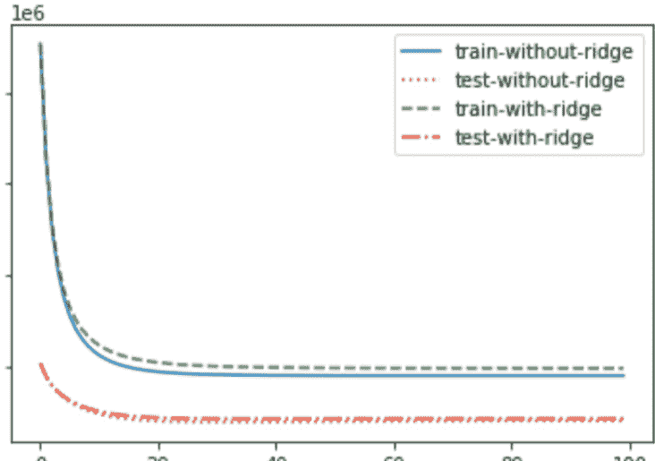

### 图 7.11 未正则化回归与岭回归的训练集和测试集损失比较。

我们可以通过查看结果权重的 $L_2$ 范数来进一步验证收缩效果。如以下代码片段所示，我们使用 `numpy` 中的 `norm` 函数来计算两个模型权重向量的 $L_2$ 范数。结果表明，与未正则化模型相比，岭回归在估计权重中具有较低的 $L_2$ 范数。

```
>>> from numpy import linalg as LA
>>> print(LA.norm(model.weights, 2))
>>> print(LA.norm(model_ridge.weights, 2))
187.12047119912242
164.13282992694337
```

我们将在下一节中使用神经网络实现相同的线性回归模型。当只有一个输入层和一个输出层（也称为单层神经网络）时，神经网络模型本质上等价于线性回归模型。这是基于这样一个事实：输入层和输出层之间的矩阵乘法步骤（第 4 章涵盖的主题，且没有激活步骤）恢复了线性回归操作。

### 使用单层神经网络的线性回归

为了学习线性回归模型，让我们定义一个单层全连接网络（FCN）。输入大小等于特征数量，输出大小为一，因为每个输入观测值只有一个标量输出。在以下代码清单中，我们定义一个名为 FCN_regression 的类来存储必要的属性和方法。初始化时，该类需要几个输入参数：input_size 中的输入特征数量，lr 中的 SGD 学习率，num_epochs 中的 epoch 数量，以及 l2_penalty 中 L2 惩罚的标量超参数大小。我们还将模型架构定义为存储在 model 中的单个线性层，将 nn.MSELoss() 作为存储在 criterion 中的损失函数，并将 SGD 作为存储在 optimizer 中的优化器。

### 清单 7.8 创建单层 FCN 的类

```
class FCN_regression:
    def __init__(self, input_size, lr=1e-3, num_epochs=1000, l2_penalty=0):
        self.lr = lr
        self.num_epochs = num_epochs
        self.l2_penalty = l2_penalty
        self.train_loss = []
        self.test_loss = []
        self.model = nn.Linear(input_size, 1)
        self.criterion = nn.MSELoss()
        self.optimizer = torch.optim.SGD(self.model.parameters(), lr=self.lr)
```

接下来，我们将在类中创建一个 fit() 方法来执行模型估计任务。如以下代码片段所示，我们将训练集和测试集作为训练和评分的输入，由于我们使用 PyTorch，因此需要将其转换为张量格式。沿用相同的零初始化策略，我们执行与第 4 章中训练典型神经网络相同的训练过程。具体来说，我们执行前向传播以获取训练集的模型预测 y_predicted，计算 loss_train 中的损失，如有需要则添加 L2 惩罚，清除相关变量中的历史梯度，通过反向传播自动计算当前梯度，最后执行由 num_epochs 指定的总 epoch 数的随机梯度下降更新。此外，我们还在每一轮训练后在无梯度设置下计算测试集 MSE。

```
def fit(self, X_train, y_train, X_test, y_test):
    weights = np.zeros(X_train.shape[1]) #A
    epoch = 0 #B
    X_train = torch.from_numpy(X_train).float() #C
    X_test = torch.from_numpy(X_test).float() #C
    y_train = torch.from_numpy(y_train).float() #C
    y_test = torch.from_numpy(y_test).float() #C

    for epoch in range(self.num_epochs):
        y_predicted = self.model(X_train) #D
        loss_train = self.criterion(y_predicted, y_train) #E
        self.train_loss.append(loss_train.item())
```


```
l2_norm = sum(p.pow(2.0).sum() for p in self.model.parameters()) #F
loss_train = loss_train + self.l2_penalty * l2_norm #F
self.optimizer.zero_grad() #G
loss_train.backward() #G
self.optimizer.step() #G
with torch.no_grad(): #H
    y_test_pred = self.predict(X_test)
    loss_test = self.criterion(y_test_pred, y_test)
    self.test_loss.append(loss_test.item())

return self
```

```
#A Initialize weights to be an array of zeros
#B Iteration counter
#C convert to tensor
#D forward pass to calculate prediction
#E get current MSE loss
#F add L2 penalty
#G backward pass to perform SGD
#H calculate and store test loss without gradient
```

请注意，我们为测试集额外提供了一个 `predict()` 函数。这是与上一章中使用的相同的函数，该函数首先将模型转换为评估模式，执行评分，然后将模式切换回训练模式。

```
def predict(self, x):
    model = self.model.eval()
    outputs = model(x)
    model = self.model.train()
    return outputs
```

让我们在训练集和测试集上测试该类。在下面的代码清单中，我们实例化了一个学习率为 0.001、训练轮数总计 10,000 的 `FCN_regression` 类。迭代次数远多于之前，因为与之前的全批量梯度下降更新相比，SGD 由于其随机性需要更多的迭代才能收敛。接着我们调用 `fit()` 方法训练模型，并绘制训练集和测试集上的 MSE 结果。

### 代码清单 7.9 FCN 模型的模型训练与结果可视化

```
model = FCN_regression(input_size=X_train.shape[1], lr=1e-3, num_epochs=10000)
model.fit(X_train, y_train, X_test, y_test)
x_axis = list(range(model.num_epochs))
plt.plot(x_axis, model.train_loss, label = "train")
plt.plot(x_axis, model.test_loss, ':', label = "test")
plt.legend()
plt.show()
```

运行上述命令生成图 7.12。随着训练损失逐渐收敛，我们对测试集 MSE 有一个有趣的观察：一条典型的从欠拟合到过拟合的 U 形曲线。然而，测试集 MSE 在第 4000 轮之后趋于稳定。这可能与 SGD 算法本身带来的隐式正则化效应有关（下一章将详细介绍），因为模型训练过程中并未使用任何显式正则化技术。

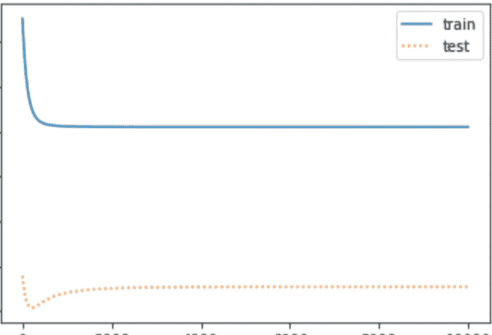

图 7.12 使用单层 FCN 模型的训练集和测试集 MSE。

现在，让我们通过将 L2 惩罚设置为 0.1 来激活它并观察其影响。欢迎调整此超参数，并使用附带的笔记本 https://github.com/jackliu333/regularization_in_deep_learning/blob/main/Chapter_7.ipynb 探索结果。如图 7.13 所示，添加 L2 惩罚对训练损失曲线没有明显变化，但导致不同轮次下测试集 MSE 显著降低。因此，对模型权重的大小进行控制有助于模型在测试集上泛化得更好。

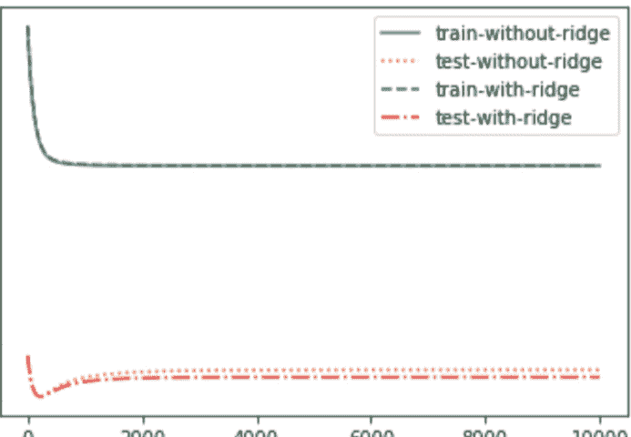

图 7.13 使用单层 FCN 模型对比未正则化和岭回归的训练及测试集损失。

在下一节中，我们将探讨另一种常用的正则化项：$L1$ 惩罚，也称为 LASSO。

## 7.3 通过 LASSO 进行稀疏估计

基于 l1 范数的惩罚也称为 LASSO，即最小绝对收缩与选择算子（Least Absolute Shrinkage and Selection Operator）。对权重绝对值之和进行惩罚时，我们实际上同时进行了变量选择和模型估计。变量选择是 LASSO 的自然副产品：使用权重的绝对值对其大小进行惩罚时，某些权重将被设为零，从而相当于从完整特征空间中丢弃这些不重要的特征。最终模型中保留下来的特征被认为更为重要，得到的模型也更加简洁。因此，对权重的 l1 范数进行正则化有助于促进线性方程组的稀疏解。

在探讨使用 l1 范数的稀疏性驱动因素之前，让我们从几何角度重新审视 l2 范数，并以此为基础建立对基于 LASSO 的稀疏性的直觉。

### 7.3.1 岭回归的几何解释

岭回归通过对权重的 L2 范数进行惩罚，使我们能够求解欠定方程组。也就是说，当方程组中未知变量的数量多于方程数量时，岭惩罚可以产生一个具有最小 L2 范数权重的唯一解。相比之下，若不对权重使用任何惩罚，欠定方程组则有无穷多个解。

让我们来看一个简单的线性方程案例，包含两个输入变量、一个输出变量和一个单一观测值。换句话说，我们希望在 y = x^T w = x1w1 + x2w2 中求解 w = [w1, w2]。由于只有一个可用观测值，满足该方程的 w 解有无穷多个。从图形上看，我们可以代入观测值 (x, y)，在以 w1 和 w2 为坐标轴的坐标系中得到一条直线。这条直线表示线性方程所施加的约束下所有可能的（无穷多个）解，直线上的每一点都代表一个解。请参见图 7.14 的示意图。

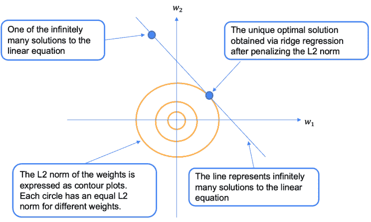

图 7.14 岭回归几何解释的可视化。所有可能的解共同构成这条直线。使用 L2 范数在直线与圆的交点处给出一个唯一解，此时半径最小。任何其他点都将对应更大的半径，因此也有更大的 L2 范数。

在此过程中，我们不断从原点绘制圆并增大半径，直到与直线相交。这个交点即代表优化问题的解。虽然直线是无数个同样优良解的集合，但使用 L2 范数强制在众多圆中选取半径最小的那个唯一解，每个圆对应一个不同的 L2 范数。为了看出 L2 范数与圆半径之间的对应关系，请注意 ||w||_2 = sqrt(w1^2 + w2^2)。因此，圆上的所有点（解）共享相同的 L2 范数。

### 7.3.2 引入 L0 范数

在某些情况下，我们也希望得到一个满足线性方程且尽可能多权重为零的解，即稀疏解。一种直接的方法是对权重的 L0 范数进行惩罚，以得到一些权重为零的稀疏解。

L0 范数定义为向量中非零元素的个数。在我们的语境中，||w||0 = #{i | wi != 0}，其中 i ∈ {1, 2}。对 L0 范数进行惩罚意味着寻找非零元素数量最少的最稀疏解，这是一个 NP-hard 问题，需要评估所有可能的特征子集。图 7.15 说明了在 L0 范数约束下求解线性方程的场景，其中解必须位于任意一条坐标轴上，以便只有一个权重为零。请注意，我们依然在寻找具有最小 L0 范数的解；因此，任何从交点延伸出来的解都被排除。在此情况下，加粗的点表示最优解，它通过将 w2 = 0 给出一个稀疏解。

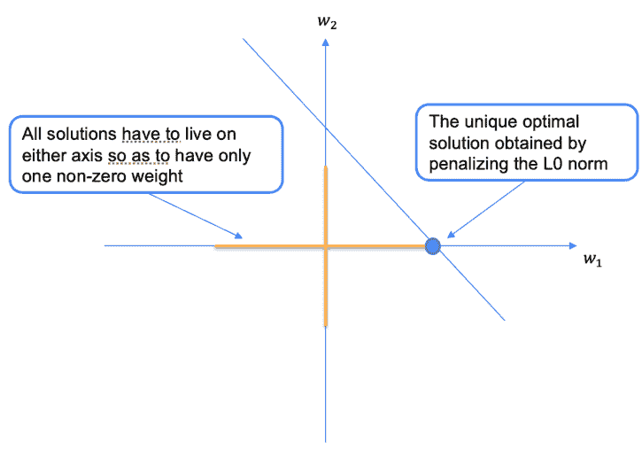

图 7.15 基于 L0 范数惩罚求解线性方程的几何解释。虽然所有解都必须位于直线上，但 L0 惩罚只要求解位于任意一条坐标轴上即可产生稀疏解。在 L0 惩罚约束下求解线性方程是一项 NP-hard 任务，因为此前常用的凸优化技术（将梯度设为零）在此情况下失效。

仅有两个权重的情况很简单。然而，想象一下有几十个权重需要共同学习。在这种情况下，快速弄清楚哪些权重应该为零就成为一项非平凡的任务。换句话说，使用 L0 范数求解此问题的复杂度


呈指数增长，因为这是一个 NP-hard 问题。这与我们之前的方法形成对比，之前的方法是将梯度设为零，并使用凸优化获得全局最优解。请回顾，凸优化寻求凸函数的全局最小值，这一主题在第 2 章中有所涉及。

我们如何在将相同方法扩展到高维数据集的大规模问题时获得稀疏解？L1 范数正是为此而来，它允许我们以凸的方式实现稀疏解，并更高效地扩展到更大规模的问题。通过惩罚 L1 范数，模型会倾向于通过将一些权重设为零来生成稀疏解。

### 7.3.3 引入 L1 范数

基于 L1 范数的线性回归，即 LASSO 回归，可以处理高维问题，并以计算高效的方式隐式生成一组稀疏权重。权重上的 L1 范数定义为 ||w||₁ = Σ|wᵢ| = |w₁| + |w₂|。在我们的贯穿示例中，通过最小化拟合的 RSS 与权重的（缩放的）L1 范数，模型估计过程将得出一个唯一解（在无数解中），该解具有最小的 L1 范数。

让我们以图形方式可视化估计过程。如图 7.16 所示，L1 范数表示为菱形，这意味着同一菱形上的所有权重具有相同的 L1 范数值。为了说明这一点，让我们将 L1 范数设为任意常数 C，即 |w1| + |w2| = C。考虑对权重进行模运算（取绝对值），总共有四种不同的组合：w1 ≥ 0 & w2 ≥ 0、w1 ≥ 0 & w2 < 0、w1 < 0 & w2 ≥ 0 和 w1 < 0 & w2 < 0。这给出了四个不同的线性方程，即 w1 + w2 = C、w1 – w2 = C、–w1 + w2 = C 和 –w1 – w2 = C。这四个方程（直线）共同构成一个菱形。菱形上的所有点共享相同的 L1 范数。菱形上的所有点也被称为水平集。

- 菱形表示具有相等 L1 范数的权重
- 通过惩罚 L1 范数获得的唯一最优解
- 每个菱形表示 |w1| + |w2| = C 的图形，其中 C 是任意常数
- 不同的菱形表示具有不同 L1 范数的不同解

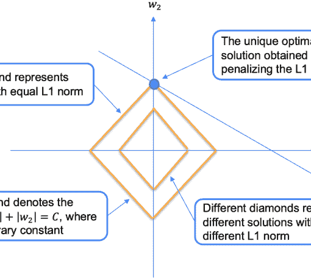

图 7.16 基于 L1 范数惩罚求解线性方程的几何解释。虽然直线上有无数个解，但引入 LASSO 惩罚可以唯一确定一个具有最小 L1 范数的解，如加粗的点所示，该点很可能也是稀疏解（在此例中，w1 = 0）。

在直线上的无数解中，我们关注的是产生最小 L1 范数的那个唯一解：即直线上菱形大小最小的点。这个解由图中的加粗点表示，该点也恰好是一个稀疏解（w1 = 0）。这并非巧合；LASSO 惩罚引入了对稀疏解的额外偏好。因此，L1 范数为欠定系统促进稀疏解，尤其是在自由参数远多于观测值的高维环境中。

### 7.3.4 理解 LASSO

LASSO 回归产生稀疏解和可解释模型，且不易过拟合。Robert Tibshirani 在 1996 年的一篇题为“通过 Lasso 进行回归收缩与选择”的论文中提出了该方法。此后，LASSO 惩罚开始流行，并在许多需要可解释模型的领域得到广泛应用。可解释性是采用可运行模型时的重要考量因素。在试图理解模型的决策过程时，我们通常更倾向于使用因子数量相对较少、复杂度较低的模型，以帮助解释逻辑并追踪信息流。这正是其受欢迎的主要原因之一。

请注意，LASSO 回归适用于欠定问题和过定问题。欠定问题指的是在求解线性方程组时，自由变量（因此也包括权重）的数量多于观测值的情况，而过定系统则正好相反：观测值多于变量。在这两种情况下，我们可能希望获得一个选取的特征最少的稀疏解，同时保持良好的预测精度。

在处理高维问题时，使用最小二乘法进行优化本质上假设所有因素都很重要，因此应保留在最终模型中。使用 LASSO 时，我们通过仅保留原始特征的一个子集来打破这一假设，并假设并非所有变量都相关。最小化权重的 L1 范数通过在权重向量中仅突出少量条目（同时生成良好的拟合）来促进稀疏性。例如，假设我们有一个具有 50 个特征的模型和另一个具有 5 个特征的模型，两者的预测精度相同。我们肯定会更倾向于选择第二个模型，因为它更具可解释性和可传达性。基于简约原则，我们会选择能够较好描述数据的最简单模型。稀疏模型也更稳健，因为它不太可能对数据过拟合。

超参数 lambda 控制在最小化正则化目标函数 Q(w) = RSS(w) + λ||w||₁ 时的稀疏程度。当 λ = 0 时，它恢复最小二乘解，该解对训练数据给出最佳线性拟合，但可能会对测试数据过拟合。当 λ 非常大时，模型过度简约，在训练集和测试集上的表现都很差。选择合适的 λ 通常通过交叉验证进行，其中验证集用作测试集并近似模型的泛化误差。如图 7.17 所示，在绘制一系列 λ 下的训练集和验证集误差（即 MSE）时，每个 λ 通常对应多个验证折叠（称为 K 折交叉验证），选择验证误差最低的 λ 值。请注意，使用交叉验证程序选择的最优 λ 倾向于产生比稀疏解的最优选择更不稀疏的解，因为前者更关注预测精度。此外，请注意 x 轴使用 λ 的倒数，因此左端表示较大的 λ，右端表示较小的 λ（一直到零）。

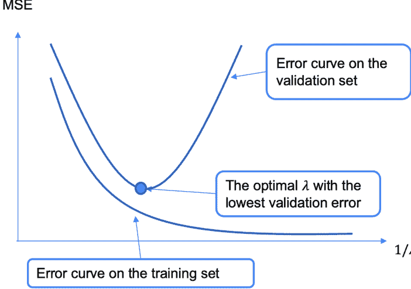

图 7.17 不同超参数 $\lambda` 值下的训练误差和验证误差曲线。随着 $1/\lambda` 从小变大，验证误差曲线将呈现典型的 U 形曲线，在典型的线性回归问题中从欠拟合过渡到过拟合。最优 $\lambda` 是通过最小化验证误差来选择的。

同样，并非所有 $\lambda` 值都会导致稀疏解。当 $\lambda` 相对较小时，得到的权重仍可能全部非零。当 $\lambda` 增加到特定值时，将出现稀疏解，其增加会导致得到的权重进一步稀疏。让我们在略有不同的背景下重新审视相同的轮廓图，以更好地欣赏 LASSO 诱导稀疏性背后的几何解释。这次，我们将假设一个包含许多观测值的一般设置，而不是像之前示例中那样只有一个观测值。我们仍将使用两个权重进行说明。

如图 7.18 所示，目标函数由 RSS 项 $\sum_{i=1}^N (y_i - w_0 \phi_{i0} - w_1 \phi_{i1})^2` 和权重的 $L1` 范数 $(|w_0| + |w_1|)$ 组成，并由超参数 $\lambda` 加权。当 $\lambda = 0` 时，解为最小二乘法，如左图中的实心点所示。当 $\lambda \rightarrow \infty` 时，解为原点，如右图中的实心点所示。左侧轮廓图由表示不同权重水平集的椭圆组成。例如，当将 RSS 项设为特定常数时，我们有 $\sum_{i=1}^N y_i^2 + w_0^2 \sum_{i=1}^N \phi_{i0}^2 + w_1^2 \sum_{i=1}^N \phi_{i1}^2 + cross terms = constant`，这正是图上椭圆的表达式。常数越大，椭圆越大。同样，我们可以将 $L1` 范数的水平集可视化为菱形。因此，从图形上看，LASSO 回归是椭圆和菱形的加权组合。


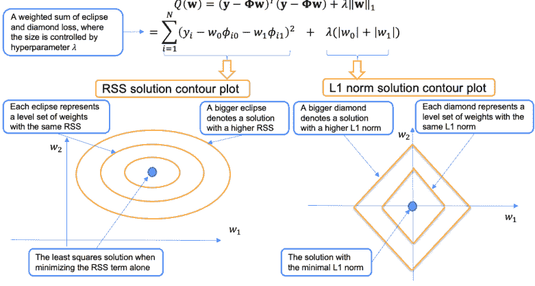

图 7.18 LASSO 回归中 RSS 与 L1 范数的几何解释。

现在，在最小化 LASSO 正则化的目标函数时，我们实质上是在图中寻找一个解点，该点对应于椭圆（RSS 项）与菱形（L1 范数）的交点，超参数 lambda 控制每个形状的大小。交点倾向于出现在菱形的尖角处（有一定概率），如图 7.19 所示。在高维设置中，这种概率甚至更高，解很可能会命中其中一个高维角点。

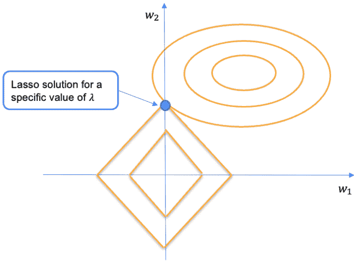

图 7.19 固定 \(\lambda\) 值下的 LASSO 解可视化。

### 7.3.5 软阈值法则

迄今为止，我们一直在探讨如何利用目标函数的梯度信息来获取最优权重，无论是在推导解析解（将一阶导数设为零）还是在迭代梯度下降算法中。然而，LASSO 回归中目标函数 \(Q(\mathbf{w}) = RSS(\mathbf{w}) + \lambda \|\mathbf{w}\|_1\) 的梯度无法直接使用。

具体来说，对于权重向量 \(\mathbf{w}\) 中的每个 \(w_j\)，我们需要计算 \(|w_j|\) 对 \(w_j\) 的导数，即 \(d|w_j|/dw_j\)。当 \(w_j > 0\) 时，有 \(|w_j| = w_j\)，其导数为 1。相应地，如果 \(w_j < 0\)，导数为 -1。然而，在 \(w_j = 0\) 处不存在导数，这一问题点排除了使用解析解和基于梯度的优化算法的可能性。关于 \(|w_j|\) 在不同 \(w_j\) 值处的图像及其导数，请参见图 7.20。

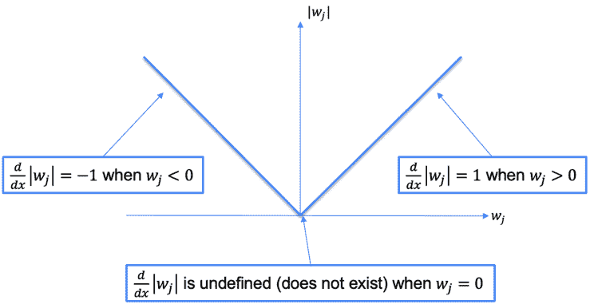

图 7.20 不同 $w_j$ 值处 $|w_j|$ 导数的示意图。

为了求解最优权重向量，我们可以使用另一种称为坐标下降的迭代优化过程，它一次只更新一个坐标/权重，同时保持其他所有权重固定。具体来说，该算法在 $w_j = 0$ 时依赖 $|w_j|$ 的次梯度。尽管坐标下降算法不是我们的重点，但理解其推导过程有助于我们更深入地了解 LASSO 如何获得稀疏解，即使用软阈值法则，这是每个坐标 $w_j$ 的更新规则。让我们来看看该规则是如何推导的。

回顾一下，LASSO 目标函数为 $Q(\mathbf{w}) = RSS(\mathbf{w}) + \lambda||\mathbf{w}||_1 = \sum_{i=1}^N (y_i - \sum_{k=0}^d \Phi_{ik} w_k) + \lambda \sum_{k=0}^d |w_k|$。在使用坐标下降算法时，假设我们专注于更新第 $j$ 个权重 $w_j$，并保持其他所有权重 $\mathbf{w}_{-j}$ 固定，将第一阶偏导数 $\frac{\partial Q(\mathbf{w})}{\partial w_j}$ 设为零，以求得当前坐标 $w_j$ 的解析式更新。图 7.21 展示了第一项 $RSS(\mathbf{w})$ 偏导数的推导过程。与之前的推导过程相比，关键区别在于我们将涉及 $w_j$ 的项与其余部分分开，其余部分被假设保持固定，因此偏导数为零。需要注意的是，$\rho_j$ 可以被视为设计矩阵与不含 $w_j$ 的预测误差之间的相关性。

$$\frac{\partial}{\partial w_j} RSS(\mathbf{w}) = -2\Phi_j^T (\mathbf{y} - \Phi \mathbf{w})$$
$$= -2 \sum_{i=1}^n \Phi_{ij} \left( y_i - \sum_{k=1}^d \Phi_{ik} w_k \right)$$
[将 \( w_j \) 与其他固定项分开]
$$= -2 \sum_{i=1}^n \Phi_{ij} \left( y_i - \sum_{k \neq j} \Phi_{ik} w_k - \Phi_{ij} w_j \right)$$
[将 \( w_j \) 表示为独立项]
$$= -2 \sum_{i=1}^n \Phi_{ij} \left( y_i - \sum_{k \neq j} \Phi_{ik} w_k \right) + 2w_j \sum_{i=1}^n \Phi_{ij}^2$$
[为记号方便重新表示]
$$= -2\rho_j + 2w_j z_j$$

其中 \(\rho_j = \sum_{i=1}^n \Phi_{ij} (y_i - \sum_{k \neq j} \Phi_{ik} w_k)\) 和 \(z_j = \sum_{i=1}^n \Phi_{ij}^2\)

图 7.21 关于单个权重 \( w_j \) 的 RSS 一阶偏导数推导。

接下来，让我们计算 LASSO 惩罚项关于 \( w_j \) 的偏导数。由于当 \( w_j = 0 \) 时 \(|w_j|\) 没有梯度，我们可以求助于次梯度的表示法，它将梯度推广到不可微点，并指所有对原始函数（在此例中为 \(|w_j|\)）构成下界的平面（候选集合）。从图示角度看，如图 7.22 所示，原点处（不可微点）的次梯度是位于函数 \(|w_j|\) 下方的所有虚线的集合。将次梯度记为 \(V\)，当 \(w_j = 0\) 时，有 \(V \in [-1,1]\)。

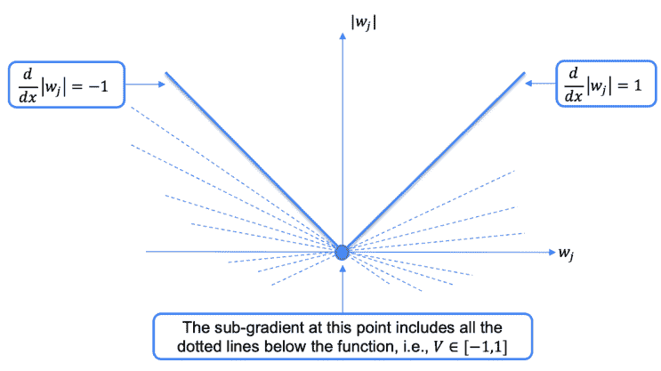

图 7.22 引入原点处的次梯度。

因此，我们可以将 \(\lambda|w_j|\) 关于 \(w_j\) 的偏导数表示为三种不同情况。当 \(w_j < 0\) 时，LASSO 惩罚项的偏导数为 \(\lambda \partial_{w_j}|w_j| = -\lambda\)。当 \(w_j > 0\) 时，有 \(\lambda \partial_{w_j}|w_j| = \lambda\)。当 \(w_j = 0\) 时，有 \(\lambda \partial_{w_j}|w_j| = [-\lambda, \lambda]\)。

综上所述，目标函数关于单个权重 \(w_j\) 的偏导数也可以表示为三种情况。即，当 \(w_j < 0\) 时，\(\lambda \partial_{w_j} Q(\mathbf{w}) = 2z_j w_j - 2\rho_j - \lambda\)；当 \(w_j = 0\) 时，\(\lambda \partial_{w_j} Q(\mathbf{w}) = [-2\rho_j - \lambda, -2\rho_j + \lambda]\)；当 \(w_j > 0\) 时，\(\lambda \partial_{w_j} Q(\mathbf{w}) = 2z_j w_j - 2\rho_j + \lambda\)。图 7.23 总结了次梯度的表达式。

\(\lambda \partial_{w_j} |w_j| = \begin{cases} -\lambda, & w_j < 0 \\ [-\lambda, \lambda], & w_j = 0 \\ \lambda, & w_j > 0 \end{cases}\)

LASSO 惩罚项的次梯度

加上 \(\frac{\partial}{\partial w_j} RSS(\mathbf{w}) = -2\rho_j + 2w_j z_j\)

\(\lambda \partial_{w_j} Q(\mathbf{w}) = \begin{cases} 2w_j z_j - 2\rho_j - \lambda, & w_j < 0 \\ [-2\rho_j - \lambda, -2\rho_j + \lambda], & w_j = 0 \\ 2w_j z_j - 2\rho_j + \lambda, & w_j > 0 \end{cases}\)

目标函数的次梯度

图 7.23 LASSO 惩罚项和目标函数次梯度的表达式。

为了获得最优解，我们接着令 \(\lambda \partial_{w_j} Q(\mathbf{w}) = 0\)，这同样要求我们考虑三种不同情况。当 \(w_j < 0\) 时，有 \(2z_j w_j - 2\rho_j - \lambda = 0\)，由此得 \(w_j = (\rho_j + \lambda/2)/z_j\)，并要求 \(\rho_j < -\lambda/2\)（因为 \(z_j > 0\)）。当 \(w_j = 0\) 时，我们要求区间 \([-2\rho_j - \lambda, -2\rho_j + \lambda]\) 包含零，这意味着 \(-2\rho_j - \lambda \le 0\) 和 \(-2\rho_j + \lambda \ge 0\) 需同时满足。由此得到 \(-\lambda/2 \le \rho_j \le \lambda/2\)。当 \(w_j > 0\) 时，有 \(2z_j w_j - 2\rho_j + \lambda = 0\)，由此得 \(w_j = (\rho_j - \lambda/2)/z_j\)，并要求 \(\rho_j > \lambda/2\)。这也被称为软阈值法则，其中一些权重被设为零，其他权重则被缩小到零方向（缩小量为 \(\lambda/2z_j\)）。

换句话说，当 \(\rho_j \in [-\lambda/2, \lambda/2]\) 时，权重 \(w_j\) 被缩小到零。当 \(\rho_j < -\lambda/2\) 或 \(\rho_j > \lambda/2\) 时，我们添加偏置项 \(\lambda/2\) 以减小 \(w_j\) 最小二乘解的幅度；也就是说，当 \(\lambda = 0\) 时，最小二乘解为 \(w_j = \rho_j / z_j\)。图 7.24 总结了使用次梯度得到的 \(w_j\) 的解析解，以及软阈值法则与最小二乘解的图形比较。

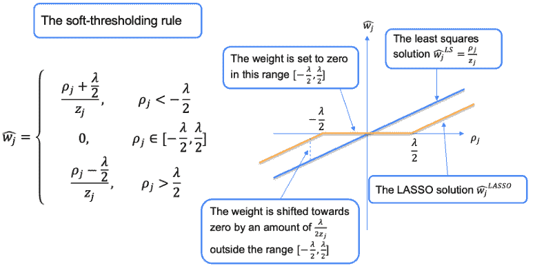

图 7.24 软阈值法则示意图。

在下一节中，我们将探讨 LASSO 惩罚项的实现，并将其与普通回归和岭回归进行比较。

### 7.3.6 LASSO 实战

在本节中，我们将基于 MNIST 数据集训练一个简单的前馈神经网络，并观察添加不同类型正则化项（如岭惩罚、LASSO 惩罚以及弹性网惩罚，即岭回归和 LASSO 的加权组合）时的影响。首先，让我们构建一个包含训练神经网络所需逻辑的类。

在以下代码清单中，我们构建一个名为 `MLP()` 的类，它包含与之前相同的初始化参数。我们在 `nn.Sequential()` 函数中定义了一个 FCN，该函数在将图像数据展平为数组后包含三个线性层。


### 代码清单 7.10 构建用于不同正则化类型训练 FCN 的类

```
class MLP:
    def __init__(self, lr=1e-3, num_epochs=10, l1_weight=0, l2_weight=0):
        self.lr = lr
        self.num_epochs = num_epochs
        self.l1_weight = l1_weight
        self.l2_weight = l2_weight
        self.train_loss = []
        self.test_accuracy = []
        self.model = nn.Sequential(
            nn.Flatten(),
            nn.Linear(28 * 28 * 1, 64),
            nn.ReLU(),
            nn.Linear(64, 32),
            nn.ReLU(),
            nn.Linear(32, 10)
        )
        self.model.cuda()
        self.criterion = nn.CrossEntropyLoss().cuda()
        self.optimizer = torch.optim.SGD(self.model.parameters(), lr=self.lr)
```

接下来，我们构建一个 fit() 方法来执行模型训练。以下代码片段显示，该方法需要两个输入参数：训练集和测试集的数据加载器。对于每个 epoch，我们首先提取训练数据集的当前批次，并执行常规前向传播以获得预测值和相应的损失。如果 LASSO 或岭回归惩罚的权重被激活，我们会将额外的惩罚项添加到当前损失中。为了计算这些惩罚项，我们首先使用 self.model.parameters() 获取模型的所有参数，然后将其存储在列表中以供后续计算。这些惩罚项使用函数 compute_l1_loss() 和 compute_l2_loss() 进行计算，这两个函数将在稍后介绍。在对损失进行反向传播并更新权重后，我们还会在每个 epoch 结束时在测试集上对模型进行评分。每次迭代的训练损失和每个 epoch 的测试集准确率分别存储在属性 train_loss 和 test_accuracy 中。

### 代码清单 7.11 模型拟合的类方法

```
def fit(self, trainloader, testloader):
    for epoch in range(self.num_epochs): #A
        print(f'Starting epoch {epoch+1}')
        for i, data in enumerate(trainloader, 0):
            X_train, y_train = data #B
            X_train, y_train = Variable(X_train).cuda(), Variable(y_train).cuda() #C
            self.optimizer.zero_grad() #D
            y_predicted = self.model(X_train) #E
            loss_train = self.criterion(y_predicted, y_train) #F

            if self.l1_weight != 0: #G
                l1_parameters = []
                for parameter in self.model.parameters():
                    l1_parameters.append(parameter.view(-1))
                l1 = self.l1_weight * self.compute_l1_loss(torch.cat(l1_parameters))
                loss_train += l1

            if self.l2_weight != 0: #H
                l2_parameters = []
                for parameter in self.model.parameters():
                    l2_parameters.append(parameter.view(-1))
                l2 = self.l2_weight * self.compute_l2_loss(torch.cat(l2_parameters))
                loss_train += l2

            loss_train.backward() #I
            self.optimizer.step() #J
            self.train_loss.append(loss_train.item()) #K

            with torch.no_grad(): #L
                X_test, y_test = iter(testloader).next()
                X_test = X_test.cuda()
                y_test_pred = self.predict(X_test.cpu()) #M
                self.test_accuracy.append(np.mean((y_test == y_test_pred).numpy())) #N
                print('Test accuracy: {}'.format(self.test_accuracy[-1]))

        return self
```

- #A 遍历训练数据的 DataLoader
- #B 获取输入
- #C 如果可用，发送到 GPU
- #D 将梯度归零
- #E 执行前向传播
- #F 计算损失
- #G 添加 L1 损失分量
- #H 添加 L2 损失分量
- #I 执行后向传播
- #J 执行优化
- #K 添加训练损失
- #L 获取测试集性能
- #M 获取测试集预测
- #N 存储测试集准确率

类中还有几个其他函数。首先，`predict()` 函数用于在评估模式下对测试集数据进行评分，具体是通过设置 `self.model.eval()` 来实现；每个观测值的最终预测是通过 `torch.max(outputs.data, 1)` 命令，在所有数字类别中选择 logit 最大的那个。有关 `predict()` 函数的代码片段如下，它与我们在前一章中介绍的函数相同。

### 代码清单 7.12 模型预测的类方法

```
def predict(self, x):
    model = self.model.eval()
    outputs = model(Variable(x))
    _, pred = torch.max(outputs.data, 1)
    model = self.model.train()
    return pred
```

接下来，让我们看看 `compute_l1_loss()` 和 `compute_l2_loss()`。如以下代码片段所示，这两个函数都执行逐元素操作（LASSO 取绝对值，岭回归对权重取平方），然后对所有权重求和，以产生一个标量的数值。

```
def compute_l1_loss(self, w):
    return torch.abs(w).sum()

def compute_l2_loss(self, w):
    return torch.square(w).sum()
```

我们现在可以准备训练和测试数据集了。在以下代码清单中，我们首先下载 MNIST 数据集，然后分别将其加载到 `trainloader` 和 `testloader` 中。`trainloader` 的批量大小为 128，而 `testloader` 的批量大小为测试集的总大小；我们希望一次性对所有测试集观测值进行评分。

### 代码清单 7.13 准备训练集和测试集

```
transform = transforms.Compose([transforms.ToTensor(), transforms.Normalize([0.5], [0.5])])
trainset = MNIST(root='data/', train=True, download=True, transform=transform)
testset = MNIST(root='data/', train=False, transform=transform)
trainloader = torch.utils.data.DataLoader(trainset, batch_size=128, shuffle=True)
testloader = torch.utils.data.DataLoader(testset, batch_size=len(testset), shuffle=False)
```

现在我们已准备好初始化模型并使用数据集进行训练。在以下代码清单中，我们指定设备为 GPU（如果可用），并准备训练总共四个不同的模型：未正则化模型、LASSO 正则化模型、岭回归正则化模型以及采用组合正则化方案的模型。我们通过在列表推导式中调用 `fit()` 方法来训练每个模型。

### 代码清单 7.14 训练四个 MLP 模型

```
device = torch.device('cuda' if torch.cuda.is_available() else 'cpu') #A
model_list = [MLP(num_epochs=50, l1_weight=0, l2_weight=0),
    MLP(num_epochs=50, l1_weight=0.001, l2_weight=0),
    MLP(num_epochs=50, l1_weight=0, l2_weight=0.001),
    MLP(num_epochs=50, l1_weight=0.001, l2_weight=0.001)] #B
[tmp_model.fit(trainloader, testloader) for tmp_model in model_list] #C
```

```
# A set optimization device
# B model configuration and initialization
# C start training
```

在 Google Colab 的单个 GPU 实例上，对四个模型各训练 50 个 epoch，整个过程大约需要 1 小时。为了防止会话超时，保存输出也可能有所帮助。有关完整的训练代码，请查看附带的笔记本：https://github.com/jackliu333/regularization_in_deep_learning/blob/main/Chapter_7_2.ipynb

请注意，采用组合正则化方案的模型称为弹性网（elastic net），它是指在目标函数中将系数的 L1 范数和 L2 范数的加权和作为联合惩罚项。如果我们的目标仅是约束模型权重，可以只正则化 L2 范数；如果我们希望同时进行特征选择和模型估计，可以只正则化 L1 范数；如果两者都想实现，则应用弹性网惩罚。

训练完成后，我们可以比较四个模型的预测性能。在以下代码清单中，我们绘制了四个模型在不同迭代次数下的训练损失曲线。

### 代码清单 7.15 绘制训练损失曲线

```
mlp_train_loss = np.array([tmp_model.train_loss for tmp_model in model_list])
labels = ['MLP no regularization',
          'MLP with L1 regularization',
          'MLP with L2 regularization',
          'MLP with both L1 and L2']
styles = ['-', '-.', '--', ':']
plt.figure(figsize=(8, 7))
for i, r in enumerate(mlp_train_loss):
    plt.plot(np.array(range(1, len(r)+1)), r, styles[i], label=labels[i], alpha=0.6);
plt.legend(loc=4);
plt.xlabel('Iterations');
plt.ylabel('Loss in training set');
plt.show()
```

运行上述代码会生成图 7.25。该图表明，所有损失曲线都相对颠簸，这是使用 SGD 作为优化器时的典型特征。如果切换到 Adam 优化器，损失曲线会更平滑。此外，未正则化模型在各次迭代中的训练损失最低，与其他模型的较高损失曲线相比，这可能是过拟合的迹象。在超参数 λ 取相同值的情况下，L1 范数模型相比 L2 范数模型具有相对更强的正则化效果。


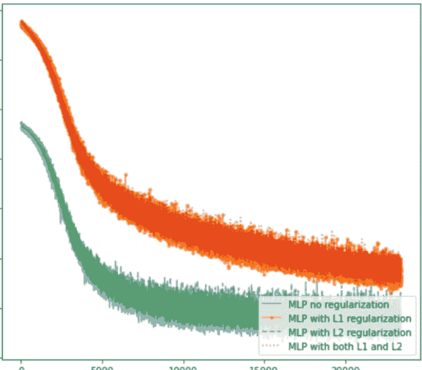

图 7.25 四个模型在不同训练迭代中的训练损失曲线可视化。

让我们绘制四个模型在不同训练轮次上的测试集准确率。如图 7.26 所示，四个模型在测试集上都表现出相近的预测准确率。未正则化模型和岭正则化模型的准确率最高。在实践中，手动调整超参数 lambda 是一个需要多次尝试的迭代过程，以在预测准确率和稀疏性之间取得平衡。网格搜索、随机搜索或贝叶斯优化等自动化过程是超参数搜索中的常见替代方案。

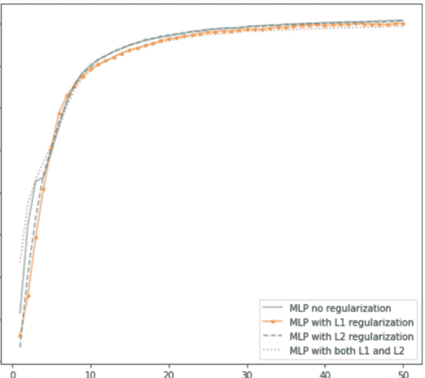

图 7.26 四个模型在不同训练轮次上的测试集准确率曲线可视化。

在结束本章之前，需要注意的是，正则化项可以应用于网络中特定的参数组/层，而不仅仅是所有参数。此外，实现正则化项的方法有多种。例如，在使用 SGD 定义优化器时，有一个名为 weight_decay 的参数，我们可以用它来指定 L2 惩罚项的权重。

将正则化作为额外的损失项添加到目标函数中是一个活跃的研究领域。希望你在阅读本章后能有一个良好的起点，并在未来的探索之旅中继续研究更多令人兴奋且特定于领域的正则化项。

## 7.4 总结

- 通过目标函数进行的正则化是指向原始未正则化损失项添加的任何正则化/惩罚项，其中正则化旨在惩罚模型权重的大小
- 常见的基于范数的正则化项包括 LASSO 惩罚（L1 范数）、岭惩罚（L2 范数）或弹性网（LASSO 与岭的加权组合）
- 在寻求最优权重时，可以推导闭式解并直接计算解；当闭式解不可用时，我们通常采用迭代方法（如（随机）梯度下降）或替代优化程序（如坐标下降）
- 偏置项通常不受惩罚，仅与特征相关的权重会根据基于范数的大小受到惩罚
- 基于 LASSO 的惩罚倾向于根据软阈值规则将部分权重设为零、其余权重趋近于零，从而生成稀疏解
- LASSO 和岭惩罚在正则化效果方面都具有良好的几何诠释
- 实现基于范数的惩罚不止一种方式，既可以从头开始实现，也可以使用现成工具
- 调整正则化项的超参数需要多次尝试和错误
